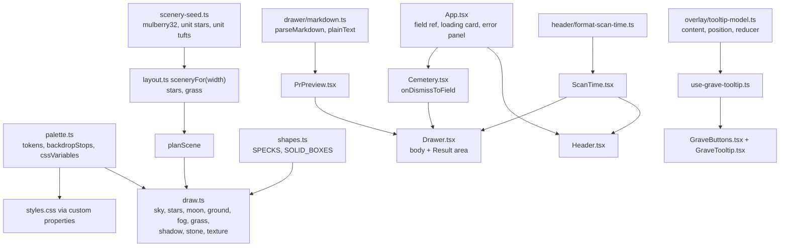

# Design Document: cemetery-polish

## Overview

cemetery-polish makes `@sexton/web` read as a finished product. The pure parts stay pure and are new: the seeded scenery generator, the scan time formatter, the Markdown parser and the tooltip model. The painter, the components and the CSS only execute what those parts return.

Implements requirements 1 to 22 of this spec. It fixes the 19 items of `audit.md`. It keeps R-UI-1, R-UI-2, R-UI-3 and R-UI-6 of docs/requirements.md as constraints, serves R-UI-4 with the tooltip and the PR preview, and records the R-UI-5 sign-off as owed by the user again (requirement 20).

It amends these cemetery-theme values and nothing else: the Scenery paint order (stars and grass join it), the Backdrop stop count (seven becomes ten), and the cemetery-ui rule that the header is inert while the drawer is open.

Out of scope, each going to the next spec: the history scrubber, the pull request burial animation, the incident replay.

### Decisions already made

1. **No new runtime dependency.** `packages/web/package.json` is not touched. React and React DOM stay the only runtime dependencies. `test/imports.test.ts` keeps pinning that.
2. **No Markdown library.** The Parser is a small hand-written module that supports exactly what `pr-body.ts` emits. A general library would parse constructs that Sexton never writes and would add a runtime dependency.
3. **No web font, no image file, no audio file, no external request.** The Wordmark is text in the existing serif stack plus an inline SVG. The CSP stays as it is: `style-src 'self'`, no `url()` in `styles.css`.
4. **The Night palette stays.** There is no light theme and no theme switch. The `Theme` alias stays (audit 16).
5. **The scene stays a 2D canvas.** The tooltip, the header and the drawer stay DOM.
6. **Scenery is seeded.** Positions come from a fixed seed through a pure generator. `Math.random` appears nowhere in `src`. Two renders of one scan are identical.
7. **ESLint bans stay.** `dangerouslySetInnerHTML`, `innerHTML`, `outerHTML` and `insertAdjacentHTML` stay banned. The PR preview builds React elements only.

### Contrast against the Backdrop stops

Ten Backdrop stops. Seven come from cemetery-theme. Three are new. Stones and Ghosts are drawn over grass and over the Shadow, so those colours count as backdrop.

| Stop | Colour | Note |
|------|--------|------|
| skyTop | #070b17 | darkest sky stop |
| skyMid | #11183a | |
| skyHorizon | #262550 | |
| groundTop | #1f2b24 | |
| bg | #0b0f0d | lowest ground, page background |
| fogSky | #41436b | fog over skyHorizon, lightest stop |
| fogGround | #3b4748 | fog over groundTop |
| grassDark | #24362b | new |
| grassLight | #2f4a3a | new |
| shadow | #111817 | new: pit at alpha byte 80 over groundTop |

New tokens: `star` #f4f1de, `starFar` #aeb8dc, `grassDark` #24362b, `grassLight` #2f4a3a, `field` #0e1322, `accentBg` #3f64d8, `accentText` #ffffff, `wordmark` #efe6c4.

Ratios by the WCAG 2.1 formula (relative luminance, `(L1 + 0.05) / (L2 + 0.05)`), computed on 21 Nov 2026. Required minimum: 3 for the State colours, ghost, ring, focus and border (non-text), 4.5 for text, muted and wordmark.

| Token | Colour | skyTop | skyMid | skyHorizon | groundTop | bg | fogSky | fogGround | grassDark | grassLight | shadow | Min |
|-------|--------|--------|--------|------------|-----------|----|--------|-----------|-----------|------------|--------|-----|
| Alive | #43a857 | 6.53 | 5.74 | 4.77 | 4.88 | 6.41 | 3.11 | 3.20 | 4.26 | 3.23 | 5.98 | 3 |
| Restless | #f2d060 | 13.06 | 11.49 | 9.55 | 9.77 | 12.83 | 6.24 | 6.40 | 8.53 | 6.46 | 11.97 | 3 |
| Haunted | #ee6a4f | 6.37 | 5.60 | 4.66 | 4.76 | 6.26 | 3.04 | 3.12 | 4.16 | 3.15 | 5.84 | 3 |
| Dead | #9aa0ad | 7.49 | 6.59 | 5.47 | 5.60 | 7.36 | 3.57 | 3.67 | 4.89 | 3.70 | 6.86 | 3 |
| Possessed | #c58cf5 | 7.90 | 6.95 | 5.77 | 5.91 | 7.76 | 3.77 | 3.87 | 5.16 | 3.91 | 7.24 | 3 |
| ghost | #c7d0e6 | 12.71 | 11.18 | 9.29 | 9.51 | 12.49 | 6.07 | 6.23 | 8.30 | 6.29 | 11.65 | 3 |
| ring and focus | #7aa2ff | 7.89 | 6.94 | 5.77 | 5.90 | 7.75 | 3.77 | 3.87 | 5.15 | 3.90 | 7.23 | 3 |
| border | #8d93a3 | 6.39 | 5.62 | 4.67 | 4.78 | 6.28 | 3.05 | 3.13 | 4.17 | 3.16 | 5.86 | 3 |
| text | #ecebe6 | 16.45 | 14.47 | 12.03 | 12.31 | 16.16 | 7.85 | 8.07 | 10.74 | 8.14 | 15.08 | 4.5 |
| muted | #b4b8c2 | 9.89 | 8.70 | 7.23 | 7.40 | 9.72 | 4.72 | 4.85 | 6.46 | 4.89 | 9.06 | 4.5 |
| wordmark | #efe6c4 | 15.70 | 13.81 | 11.47 | 11.74 | 15.42 | 7.49 | 7.70 | 10.25 | 7.77 | 14.39 | 4.5 |

The lowest value in every row is against fogSky, the lightest stop, as in cemetery-theme. The two grass stops and the shadow never lower it. Grass is kept at or below the luminance of fogSky on purpose: a lighter grass (for example #35553f) would drop Alive to 2.7 against it.

Other pairs:

| Pair | Ratio | Minimum |
|------|-------|---------|
| text on surface (#141a2b) | 14.51 | 4.5 |
| muted on surface | 8.72 | 4.5 |
| wordmark on surface | 13.85 | 4.5 |
| text on field (#0e1322) | 15.50 | 4.5 |
| muted on field | 9.32 | 4.5 |
| wordmark on field | 14.79 | 4.5 |
| focus on field | 7.44 | 3 |
| border on field | 6.02 | 3 |
| border on surface | 5.64 | 3 |
| accentText on accentBg | 5.22 | 4.5 |
| accentBg on skyTop | 3.76 | 3 |
| accentBg on skyMid | 3.31 | 3 |
| star on skyTop, skyMid, skyHorizon | 17.29, 15.21, 12.64 | 3 |
| starFar on skyTop, skyMid, skyHorizon | 10.00, 8.79, 7.31 | 3 |
| ink on Alive, Restless, Haunted, Dead, Possessed | 6.41, 12.83, 6.26, 7.35, 7.76 | 4.5 |

The test computes every ratio from the table, so these numbers are a record, not a source. `shadow` is darker than `groundTop` (luminance order asserted in the test), so it can only raise the ratio of every lighter colour.

## Architecture



Module list. New files first. Paths are under `packages/web`.

| File | Kind | Content |
|------|------|---------|
| `src/scene/scenery-seed.ts` | new, pure | `SCENERY_SEED`, `mulberry32`, `unitStars`, `unitTufts` |
| `src/header/format-scan-time.ts` | new, pure | `scanTimeView` |
| `src/drawer/markdown.ts` | new, pure | `parseMarkdown`, `plainText`, the Block and Inline types |
| `src/overlay/tooltip-model.ts` | new, pure | `tooltipContent`, `tooltipRect`, `tipReducer`, `visibleIndex` |
| `src/header/ScanTime.tsx` | new | the `time` or `span` element for a Scan time view |
| `src/header/Wordmark.tsx` | new | inline SVG mark and the name |
| `src/drawer/PrPreview.tsx` | new | maps the Block tree to React elements |
| `src/overlay/use-grave-tooltip.ts` | new | reducer, grace timer and Escape listener |
| `src/overlay/GraveTooltip.tsx` | new | the `role="tooltip"` element |
| `src/LoadingCard.tsx` | new | the loading card and spinner |
| `src/scene/palette.ts` | changed | eight tokens, ten stops, two alpha bytes |
| `src/scene/layout.ts` | changed | `Scenery` gains `stars` and `grass` |
| `src/scene/shapes.ts` | changed | `SPECKS`, `SOLID_BOXES` |
| `src/scene/draw.ts` | changed | stars, grass, shadow, texture |
| `src/drawer/format-value.ts` | changed | adds `displayValue` |
| `src/drawer/Drawer.tsx` | changed | preview, Result area, readable values, backdrop press |
| `src/overlay/GraveButtons.tsx` | changed | tooltip wiring |
| `src/Cemetery.tsx` | changed | `repoFieldRef`, `onDismissToField`, no `onDrawerOpenChange`, main class |
| `src/App.tsx` | changed | no inert header, field ref, loading card, error panel |
| `src/header/Header.tsx`, `src/header/Legend.tsx` | changed | bar layout |
| `src/styles.css` | changed | the whole look, every colour a variable |

No change: `src/triage`, `src/selection`, `src/load`, `src/drawer/drawer-model.ts`, `src/header/header-model.ts`, `src/hooks`, `vite.config.ts`, `index.html`, `package.json`.

## Components and Interfaces

### scene/scenery-seed.ts (requirements 1, 2)

```ts
export const SCENERY_SEED = 0x5e7701c3;

/** Pure. The same seed always gives the same sequence of numbers in [0, 1). */
export function mulberry32(seed: number): () => number;

export interface UnitStar { readonly u: number; readonly v: number }
export interface UnitTuft { readonly u: number; readonly v: number; readonly h: number; readonly tone: "dark" | "light" }

/** The first `count` stars of one fixed stream (seed XOR 0x1). Star i uses randoms 2i and 2i+1. */
export function unitStars(count: number): readonly UnitStar[];
/** The first `count` tufts of one fixed stream (seed XOR 0x2). Tuft i uses randoms 4i to 4i+3: u, v, height, tone. */
export function unitTufts(count: number): readonly UnitTuft[];
```

`mulberry32` is the usual 32-bit generator: `a = (a + 0x6d2b79f5) >>> 0`, then the three mixing steps with `Math.imul`, and a division by 2^32. Because item i always consumes the same randoms, the first n items of `unitStars(m)` equal `unitStars(n)` for n at most m. A wider canvas adds stars and keeps the others at the same unit position.

Tuft height is `4 + floor(r * 7)` (4 to 10). Tone is `dark` when the fourth random is below 0.5, else `light`.

### scene/layout.ts (requirements 1, 2)

```ts
export const STAR_AREA = 800;          // CSS px squared of sky per star
export const GRASS_STEP = 14;          // one tuft per 14 CSS px of width, per Tile
export const GRASS_TILE_HEIGHT = 224;  // equals CELL_HEIGHT
export interface Star { readonly x: number; readonly y: number; readonly size: 1 | 2; readonly layer: "far" | "near" }
export interface Tuft { readonly x: number; readonly y: number; readonly h: number; readonly tone: "dark" | "light" }
export interface Scenery { /* existing fields */ readonly stars: readonly Star[]; readonly grass: readonly Tuft[] }
```

`sceneryFor(width)` stays pure and depends on `width` only:

- `count = floor(width * SKY_HEIGHT / STAR_AREA)`. Star i: `x = floor(u * (width - 1))` (0 to width - 2), `y = 4 + floor(v * 69)` (4 to 72), `layer = i % 3 === 0 ? "near" : "far"`, `size = near ? 2 : 1`.
- `count = floor(width / GRASS_STEP)`. Tuft i: `x = floor(u * (width - 1))`, `y = floor(v * (224 - h + 1))` (Tile-relative, so the tuft ends inside the Tile), `h` and `tone` from the unit tuft.
- The result for the last width is kept in a one-entry cache, so the 10 plans per second of the ghost drift do not rebuild about 220 objects. The cache returns the same object, which is deeply equal to a fresh one.

Why Tile-relative: the grass list must depend on the width only, because cemetery-theme Property 5 pins "Scenery depends on the width only" and the grave count sets the canvas height. The painter repeats the one list in every Tile.

At 1280 pixels: 128 stars (43 near), 91 tufts per Tile. For 300 graves at width 1280 the canvas is 11,312 pixels high, so 51 Tiles and 4,641 tuft rectangles. At width 224 and 300 graves: 301 Tiles and 4,816 rectangles.

### scene/palette.ts (requirement 16)

`PaletteTheme` gains `star`, `starFar`, `grassDark`, `grassLight`, `field`, `accentBg`, `accentText` and `wordmark`, with the hex values above. New exports: `SHADOW_ALPHA_BYTE = "80"` and `STONE_ALPHA_BYTE = "40"`. `cssVariables` adds `--star`, `--star-far`, `--grass-dark`, `--grass-light`, `--field`, `--accent-bg`, `--accent-text` and `--wordmark`. `backdropStops` returns ten values: the seven existing ones, then `grassDark`, `grassLight` and `mix(groundTop, pit, 128)`.

### scene/shapes.ts and scene/draw.ts (requirements 1 to 3)

Constants of each shape, in the 64 by 64 shape box. A speck is a 1 by 1 shape unit square, which is 2 by 2 CSS pixels at scale 2. A solid box is an axis-aligned rectangle that lies inside the shape.

| Shape | Solid boxes (x, y, w, h) | Specks (x, y) |
|-------|--------------------------|----------------|
| upright | (12, 26, 40, 34) | (18,34) (40,32) (28,42) (44,48) (20,52) (34,54) |
| cross | stem (26, 6, 12, 54), arm (10, 26, 44, 12) | (30,12) (33,20) (28,44) (34,52) (14,30) (46,32) |
| cracked | (12, 26, 40, 34) | (16,32) (44,30) (18,48) (42,44) (46,54) (36,36) |
| open | lid (10, 40, 14, 14) | (12,42) (18,44) (14,48) (20,50) |

The crack of the cracked shape runs from (30,24) to (26,38) to (34,46) to (30,60). No cracked speck lies on it: the nearest, (36,36), is 9 units from the crack at that height.

`drawScenery` order: sky gradient, far stars, near stars, moon halo, moon disc, ground gradient, horizon line, fog band, grass. Stars and grass use `fillRect` only, so the set of methods before the first `save` stays inside the set that `test/draw.test.ts` allows.

```ts
// stars
ctx.fillStyle = colours.starFar;  for (const s of far)  ctx.fillRect(s.x, s.y, 1, 1);
ctx.fillStyle = colours.star;     for (const s of near) ctx.fillRect(s.x, s.y, 2, 2);
// grass: one fillStyle change per tone, per Tile
for (let tile = 0; SKY_HEIGHT + tile * 224 < plan.height; tile += 1) {
  const top = SKY_HEIGHT + tile * 224;
  for (const t of dark) if (top + t.y + t.h <= plan.height) ctx.fillRect(t.x, top + t.y, 2, t.h);
  ...same for light
}
```

`drawGrave` per grave, in this order:

1. `save`, `translate(rect.x + 96, rect.y + 210)`, `scale(72, 8)`, `beginPath`, `arc(0, 0, 1, 0, 2 * PI)`, `fillStyle = pit + "80"`, `fill()` with no argument, `restore`. This is the Shadow, a unit circle stretched to an ellipse. Its lowest point is cell y 218, inside the Cell of 224.
2. The existing pit (open grave), the shape fill, then the Stone texture inside the same transform: `strokeStyle = ink + "40"`, `lineWidth = 0.5` (1 CSS pixel at scale 2), `stroke(shapePath)`, `fillStyle = ink + "40"`, then `fillRect(x, y, 1, 1)` for each speck.
3. The existing crack detail, restore, Plinth, Ghost and Inscription, unchanged.

The Shadow and the texture never call `fill(path)`, so `test/draw.test.ts` "draws the same Plinth path object" (fills with one argument: two per grave) keeps passing.

### header/format-scan-time.ts and ScanTime.tsx (requirement 5)

```ts
export interface ScanTimeView { readonly text: string; readonly dateTime: string | null }
export function scanTimeView(value: string): ScanTimeView;
```

`dateTime` is the input when it matches `^\d{4}-\d{2}-\d{2}T\d{2}:\d{2}(:\d{2}(\.\d+)?)?(Z|[+-]\d{2}:\d{2})$` and `Date.parse` is finite. Otherwise `text` is the input and `dateTime` is null. The text is built from `getUTCDate`, a fixed English month table (no `Intl`, so the output never depends on the browser locale), `getUTCFullYear` padded to four digits, and `getUTCHours` and `getUTCMinutes` padded to two digits: `12 Nov 2026, 00:00 UTC`. `ScanTime` returns `<time dateTime={dateTime}>{text}</time>` or `<span>{text}</span>`.

### header/Header.tsx, Wordmark.tsx, Legend.tsx (requirements 4, 5, 6)

```tsx
<header className="site-header">
  <div className="header-top">
    <h1 className="wordmark"><Mark /> <span className="wordmark-name">Sexton</span>{" "}<span className="wordmark-sub">cemetery</span></h1>
    <div className="header-summary">          // always rendered, min-height keeps the bar steady (audit 19)
      {model && (<>
        <p className="header-repo"><span className="repo-text">…</span><span className="demo-label">…</span></p>
        <p className="header-time"><ScanTime iso={model.scanTime} /></p>
        <p className="header-policy">policy: <strong>…</strong>, …, …</p>
        notices
      </>)}
    </div>
  </div>
  {model?.evidenceLinks && <div className="header-evidence" role="group" aria-label="Evidence pack"> two a.evidence-link </div>}
  <Legend theme={theme} />
  <form className="repo-form" …> label + input + Scan, all in one pill </form>
  {message && <p role="alert" className="header-message">…</p>}
</header>
```

The h1 text content is "Sexton cemetery": the mark is `aria-hidden`, and the two spans are joined by one space. `test/smoke.test.tsx` therefore needs no change. The `Mark` is a gravestone arch with a small cross, drawn with `fill: var(--wordmark)` from the CSS class, not an attribute colour.

The two `a.evidence-link` elements keep `href`, `download` and the `aria-label` values. Each holds an `aria-hidden` SVG arrow and the visible words "JSON" and "Markdown", which the accessible names contain (WCAG 2.5.3). The container keeps the class `header-evidence`, so `test/app.test.tsx` selectors still work. The tab order is the DOM order: links, Legend toggle, input, Scan.

The input placeholder is "Paste a public repository URL". It holds no host name, because `test/imports.test.ts` fails any host string such as `github.com` in `src`.

### overlay/tooltip-model.ts, use-grave-tooltip.ts, GraveTooltip.tsx (requirement 7)

```ts
export interface TooltipContent {
  readonly name: string; readonly version: string; readonly state: State; readonly reason: string;
  readonly advisoryCount: number | null; readonly advisoryText: string;
}
export function tooltipContent(pkg: PackageHealth): TooltipContent;
/** Inside the Cell: left = cell.x + 8, top = cell.y + 4, width 176. */
export function tooltipRect(cell: Rect): { left: number; top: number; width: number };

export interface TipState { readonly index: number | null; readonly source: "pointer" | "focus" | null; readonly overTip: boolean; readonly leaving: boolean }
export type TipEvent =
  | { type: "pointer-enter"; index: number } | { type: "pointer-leave"; index: number }
  | { type: "tip-enter" } | { type: "tip-leave" }
  | { type: "focus"; index: number } | { type: "blur"; index: number }
  | { type: "escape" } | { type: "grace-expired" };
export const TIP_START: TipState;
export function tipReducer(state: TipState, event: TipEvent): TipState;
export const GRACE_MS = 150;
```

Reducer rules:

- `pointer-enter(i)` and `focus(i)`: show grave i with the source `pointer` or `focus`; `overTip` false; `leaving` false. The last event wins when pointer and focus disagree.
- `pointer-leave(i)`: when the source is `pointer`, the index is i and `overTip` is false, set `leaving` true. The hook starts a timer of `GRACE_MS`.
- `tip-enter`: when a tooltip is shown, set `overTip` true and `leaving` false. `tip-leave`: set `overTip` false, and when the source is `pointer`, set `leaving` true.
- `grace-expired`: when `leaving` and not `overTip` and the source is `pointer`, hide.
- `blur(i)`: when the source is `focus` and the index is i, hide.
- `escape`: hide. A hidden state changes only on `pointer-enter` or `focus`.

`tooltipContent.advisoryText` is `advisories unavailable` for an unavailable signal, `no advisories` for 0, `1 advisory` for 1 and `N advisories` for more. Name, version and State come from `pkg.name`, `pkg.installedVersion` and `pkg.state`; the reason is `pkg.stateReason`.

`use-grave-tooltip.ts` owns `useReducer(tipReducer)`, a `setTimeout` for the grace period (cleared on `tip-enter`, on a new enter and on unmount) and a `keydown` listener on `document` that is installed only while a tooltip is shown and sends `escape`. The listener does not call `preventDefault` or `stopPropagation`, so the drawer and the selection keys are unaffected. `GraveButtons` takes an optional `suppressTooltip` prop; `Cemetery` passes `true` while the drawer is open, which hides the tooltip.

`GraveTooltip` renders `<div id="grave-tooltip" role="tooltip" className="grave-tooltip" style={{left, top, width}} onPointerEnter onPointerLeave>` inside the `.overlay` after the buttons, with `pointer-events: auto`. Four lines: the name in `strong`, "`version`, `State`", the reason, the advisory text. The button that the tooltip describes gets `aria-describedby="grave-tooltip"` while it is shown. The tooltip lies inside its own Cell, over the stone top and the Ghost, so the pointer moves from the button onto it with no gap, and the Plinth Inscription stays visible.

### drawer/markdown.ts and PrPreview.tsx (requirement 8)

Types:

```ts
export type Inline =
  | { kind: "text"; text: string } | { kind: "code"; text: string }
  | { kind: "bold"; children: readonly Inline[] }
  | { kind: "link"; href: string; text: string };      // href always starts with "https://"
export type Block =
  | { kind: "heading"; level: 1 | 2; children: readonly Inline[] }
  | { kind: "paragraph"; children: readonly Inline[] }
  | { kind: "table"; header: readonly (readonly Inline[])[]; rows: readonly (readonly (readonly Inline[])[])[] }
  | { kind: "list"; ordered: false; items: readonly (readonly Inline[])[] }
  | { kind: "list"; ordered: true; start: number; items: readonly (readonly Inline[])[] }
  | { kind: "quote"; children: readonly Inline[] }
  | { kind: "rule" };
export function parseMarkdown(source: string): readonly Block[];
export function plainText(blocks: readonly Block[]): string;
```

What `pr-body.ts` emits, and how each is read (the list was taken from the source on 21 Nov 2026):

| Emitted text | Source | Read as |
|--------------|--------|---------|
| `# Sexton remediation` | line 1 of the body | heading level 1 |
| `## Signals`, `## Proposed change`, `## Failing policy rules`, `## Files changed`, `## Review before merging`, `## Lockfile` | `render`, `migrationSections` | heading level 2 |
| `**Package:** ...`, `**State:** ...`, `**Kind:** ...` | `render`, `proposedChange` | paragraph with bold and code |
| `> **Warning:** this package is Possessed...` | `POSSESSED_WARNING` | block quote with bold |
| `\| Signal \| Value \| Source \| Fetched at \|` then `\|---\|---\|---\|---\|` then rows | `render`, `signalRow` | table, 4 columns, 10 body rows |
| `- Remove ...`, `- ...path rule: excerpt` | `proposedChange`, `migrationSections` | unordered list |
| `1. Rule 2 ...` | `rulesSection` | ordered list |
| `---` | `render` before the footer line | rule |
| `` `x` `` around every outside value | `escapeField` | inline code |
| `and N more`, `none`, plain sentences | `list`, `NONE_LINE` | paragraph text |

`escapeField` (in `packages/engine/src/remediation/escape-field.ts`) writes every outside value as one inline code span. It replaces control, bidi and line-separator characters with a space, replaces every backtick inside with `'`, writes `|` as `\|`, cuts at 200 code points with `…`, and writes a single space for an empty value. So a code span never contains a backtick, never spans a line, and holds `\|` for each pipe. The Parser reads it as follows:

- **Blocks.** The source is split on `\n`. A line is blank when `trim()` is empty. Block starts: `# ` and `## ` at column 0 (heading); `- ` (list item); a digit run then `. ` (ordered item; the first number becomes `start`); `> ` (quote); a line starting with `|` whose next line is a separator row (table); the exact line `---` (rule). `###` and deeper, `*` lists, setext headings and everything else are paragraph text. A paragraph runs until a blank line or the next block start, and keeps its inner line breaks as `\n`.
- **Table.** A separator row matches `^\|(-+\|)+$`. Cells are found by one left-to-right scan: `\|` stays inside the cell, every other `|` ends it, and the first and last empty parts (before the first and after the last pipe) are dropped. Each cell text then has `\|` replaced by `|` before inline parsing. A row may have more or fewer cells than the header; cells are kept as they are, nothing is dropped. A `|` line with no separator row after it is paragraph text.
- **Inline.** One left-to-right scan. A backtick looks for the next backtick: if found, the text between is a `code` node, read literally (so `**`, `[x](y)` and `|` inside are literal), else the backtick is text. `**` looks for the next `**` with at least one character between: if found, the inside is parsed again for code only, giving `bold`, else `**` is text. `[` looks for `](`, then the next `)`: the text is the part between `[` and `]` with no `[` in it, the address is the part between `(` and `)` with no white space. When the address starts with exactly `https://` and has no white space, the node is `link`. In every other case the node is the link text as `text`, and the address is not shown. If the pattern does not match, `[` is text.
- **Cost.** Each scanner remembers that a closing marker does not exist after a given position, so unmatched markers do not rescan the rest of the line. The cost is linear in the input length.

`plainText` joins blocks with a blank line; a paragraph gives its inline texts (code and link text without markers) joined; a table gives its rows, cells joined by ` | `, one row per line; a list gives one item per line; a rule gives an empty string.

`PrPreview` maps the tree to elements, nothing else. Heading 1 is `h4` and heading 2 is `h5`, because the drawer title is h2, "Remediation preview" is h3 and each signal is h4 (the signal h4 elements are in `.drawer-signals`). A table is `<div className="pr-table-wrap" role="region" aria-label="Table 1" tabIndex={0}><table>…</table></div>`: the label counts the tables in the body in order ("Table 1", "Table 2"), so no two regions share a name. The wrapper scrolls sideways on a narrow screen, and the tab stop satisfies axe `scrollable-region-focusable` in a real browser. `thead` holds the header row. A paragraph is `<p className="pr-p">` with `white-space: pre-line`. A link is `<a href target="_blank" rel="noopener noreferrer" referrerPolicy="no-referrer">`. Text is always a React text child.

### drawer/format-value.ts, Drawer.tsx (requirements 8, 9, 10, 11)

`displayValue(valueText)` returns `{ kind: "inline", text }` when `JSON.parse(valueText)` is a string (the unquoted text), number, boolean or null, `{ kind: "block", text: valueText }` for an object or array, and `{ kind: "inline", text: valueText }` when parsing fails (this covers `UNDISPLAYABLE_TEXT`). `drawer-model.ts` is not changed.

`Drawer` layout:

```
section.drawer (dialog)
  button.drawer-close
  h2#drawer-title
  div.drawer-body (region, tabIndex 0, scrolls)
     State, Reason, Signals (Fetched at: <ScanTime/>, value inline or pre), Missing, Failing rules, Remediation preview
       Kind, Title, <PrPreview source={prBody}/>
  div.drawer-result (only when status is "proposed" and an intent exists)   // outside the scroll area
     RemediateAction: button, p[role=status], link, or the demo-only note
```

The Result area is part of the dialog, after the body, so `focusables` and the Tab trap find it without change: Close, body, body elements, then the button and link. It is always inside the visible part of the drawer, so no `scrollIntoView` call is needed.

The backdrop gets `onMouseDown`. When `event.target === event.currentTarget` and the new prop `onDismissToField?(x, y)` returns true, the handler calls `event.preventDefault()`. Cancelling `mousedown` stops the browser from moving focus to the body after the field has been focused. Touch taps also raise `mousedown` after `touchend`, so the same handler covers them.

### Cemetery.tsx and App.tsx (requirements 10, 12, 13)

`Cemetery` gains `repoFieldRef?: RefObject<HTMLInputElement | null>` and loses `onDrawerOpenChange`. It builds:

```ts
const onDismissToField = useCallback((x: number, y: number): boolean => {
  const field = repoFieldRef?.current;
  if (field == null || field.disabled) return false;
  const r = field.getBoundingClientRect();
  if (r.width === 0 || x < r.left || x > r.right || y < r.top || y > r.bottom) return false;
  returnFocusTo.current = null;      // focus stays in the field
  field.focus();
  setOpenIndex(null);
  return true;
}, [repoFieldRef]);
```

`App` creates the ref, passes it to `Header` (to the input) and to `Cemetery`, and renders `<Header>` with no `inert` wrapper. `Cemetery` keeps `<div inert={open}>` around `<main>` only. The empty state and the scene `main` get the class `scene-main` (no padding). The loading card and the error panel sit in `main.panel-main` (16 px padding).

### styles.css (requirements 4, 6, 11 to 15)

Layout and look only. Every colour is `var(--token)`. New selectors, grouped:

- Header: `.site-header`, `.header-top`, `.wordmark`, `.wordmark-name`, `.wordmark-sub`, `.header-summary` (min-height), `.repo-text` (overflow-wrap anywhere), `.demo-label` and `.notice` (chips), `.header-policy`, `.header-evidence`, `.evidence-link`, `.legend-*` chips, `.repo-form` pill, `.scan-button` (accent), `.header-message`.
- Scene and states: `.scene-main`, `.panel-main`, `.loading-card`, `.loading-spinner` with `@keyframes`, `.load-error`, `.cemetery-empty`, `.grave-tooltip`.
- Drawer: `.drawer`, `.drawer-body`, `.drawer-result`, `.drawer-remediate-button` (accent), `.pr-preview`, `.pr-table-wrap`, `.signal-value`, long-word wrapping.
- Responsive: `@media (max-width: 600px)` stacks the header parts and lets the field shrink. The drawer keeps `width: min(32rem, 100%)`, which is the full width below 512 pixels.
- Motion: `@media (prefers-reduced-motion: reduce) { .loading-spinner { animation: none } }`. The animation is declared only on `.loading-spinner`.
- Focus: every rule that cemetery-theme and `test/a11y.test.tsx` name stays. New focus rules: `.evidence-link:focus-visible`, `.drawer a:focus-visible`, `.pr-table-wrap:focus-visible` (3 px, `--focus`). The grave focus ring becomes `outline: 3px solid var(--focus); outline-offset: -9px;`, which draws it 6 pixels inside the canvas ring (the canvas ring covers 0.5 to 3.5 pixels from the Cell edge, the outline 6 to 9). `outline: none` and `outline: 0` appear nowhere.
- Accent button: `background: var(--accent-bg); color: var(--accent-text); border: 0`. The pair test reads `color` and `background` from one rule, so the 5.22 ratio is checked. The boundary against the header gradient is 3.76 and 3.31 (see the table).

## How each audit item is fixed

| Audit | Fix | Requirements |
|-------|-----|--------------|
| 1 Raw Markdown in `pre` | `markdown.ts` and `PrPreview.tsx` replace `pre.drawer-prbody` | 8 |
| 2 Result below the fold | `drawer-result` area outside the scrolling body | 9 |
| 3 Raw ISO time in header | `scanTimeView` and `ScanTime` | 5 |
| 4 Plain loading text | `LoadingCard` in `role="status"` with a CSS spinner | 6 |
| 5 Plain header | Wordmark, summary bar, downloads, Legend chips, pill field | 4 |
| 6 Header inert | no `inert` on the header, `onMouseDown` hit test on the backdrop | 10 |
| 7 Nothing on hover or focus | `GraveTooltip` and `tooltip-model.ts` | 7 |
| 8 Flat scene | seeded stars, grass, Shadow, Stone texture | 1, 2, 3 |
| 9 Unchecked small screens, keyboard, contrast | 360 px e2e, focus rules, contrast table, new sign-off | 14, 15, 16, 20 |
| 10 Raw `fetchedAt` in the drawer | `ScanTime` in the drawer | 5.5 |
| 11 JSON `pre` for single values | `displayValue` | 11.1 |
| 12 Plain error panel | framed panel, code element | 12.1 |
| 13 Bare empty state | framed empty state on the night sky | 12.2 |
| 14 Clipped long names and URLs | `overflow-wrap: anywhere` on the drawer text | 11.2 |
| 15 Selection and focus rings coincide | focus outline 9 pixels inside the Cell edge | 15.4 |
| 16 Night-only Theme alias | left alone, recorded | none |
| 17 Scene inset by page padding | `scene-main` without padding | 13 |
| 18 Unstyled Open pull request button | accent button in the Result area | 9.6 |
| 19 Header empties while loading | `header-summary` min-height | 6.4 |

## Data Models

The Block tree and the tooltip state are given above. The Scenery record gains two arrays:

```ts
interface Scenery {
  skyHeight: number; horizonY: number; moon: { x; y; r }; fog: { y; h }; groundFade: number;
  stars: readonly Star[];   // floor(width * 80 / 800), all inside x 0..width-2, y 4..72
  grass: readonly Tuft[];   // floor(width / 14), Tile-relative, repeated by the painter
}
```

`ScenePlan`, `GravePlan` and the API contract do not change. `GravePlan` keeps its eight keys, so the layout key test keeps passing.

## Error Handling

- `parseMarkdown` never throws. Any string is valid input. A construct that does not match its pattern is shown as text. A table row with a different cell count is shown as it is.
- A link whose address does not start with `https://` is shown as its text, never as an anchor. A non-string `prBody` cannot reach the Parser: the contract validator already checks the type.
- `scanTimeView` returns the input as text when the value is not an ISO date. `NOT_RECORDED` ("not recorded") passes through as text.
- `displayValue` falls back to inline text when the JSON text does not parse.
- `getContext("2d")` returning null skips the paint, as before. A tuft below the canvas bottom is skipped.
- A tooltip for an index with no package is not shown: the reducer only takes indices from button events, and `tooltipContent` is called with the package at that index only when it exists.
- If the backdrop press lands on a disabled or hidden field (width 0), the press closes the drawer in the ordinary way.
- The load error panel keeps showing the fixed texts of `LOAD_ERROR_TEXT` and the capped contract error list. No upstream text reaches it.

## Correctness Properties

*A property is a characteristic or behavior that should hold true across all valid executions of a system-essentially, a formal statement about what the system should do. Properties serve as the bridge between human-readable specifications and machine-verifiable correctness guarantees.*

Reflection. Prework found these testable as properties: 1.1, 1.2, 1.4, 1.5, 1.6, 1.7, 2.1 to 2.5, 3.1, 3.2, 3.4, 3.5, 3.7, 5.2 to 5.4, 7.1, 7.2, 7.4, 7.5, 7.8, 7.9, 8.4 to 8.9, 8.13, 16.1, 16.5 to 16.10. They collapse as follows. Star and grass bounds, determinism and independence (1.1, 1.2, 1.4, 1.5, 2.1, 2.2) become Properties 2 and 3. The paint order, the star and tuft counts and the sky limit (1.6, 1.7, 2.3 to 2.5) become one painter property, Property 4, together with the shadow and texture order (3.1, 3.2), the per-State equality (3.4), the alpha rule (3.5) and the path-fill count (3.7). The three time criteria become Property 5. The link criteria (8.6, 8.7, 8.12) become Property 6 for the tree and Property 10 for the DOM. 8.5 is covered by Property 9's inline code literal part. 16.1 and 16.5 to 16.10 become the extended Property 1. The existing cemetery-ui and cemetery-theme properties for shape and colour by State, the Ghost rule, triage, layout formulas and once-per-frame repaint run unchanged.

### Property 1: Palette contrast over every backdrop stop

For all tokens of the Night palette and all ten Backdrop stops, the contrast ratio is at least 4.5 to 1 for `text`, `muted` and `wordmark` (also against `surface` and `field`), and at least 3 to 1 for the five State colours, `ghost`, `ring`, `focus` and `border`; `focus` and `border` are at least 3 to 1 against `field`; `accentText` against `accentBg` is at least 4.5 to 1; `accentBg` against `skyTop` and `skyMid` is at least 3 to 1; `star` and `starFar` against `skyTop`, `skyMid` and `skyHorizon` are at least 3 to 1; `ink` against each State colour is at least 4.5 to 1; every token is a six-digit hex string; `backdropStops` has ten entries and the `shadow` stop is no lighter than `groundTop`.

**Validates: Requirements 16.1, 16.4, 16.5, 16.6, 16.7, 16.8, 16.9**

### Property 2: Seeded scenery is deterministic and bounded

For all layout widths of at least 224, `sceneryFor(width)` called twice returns deeply equal results; the star count is `floor(width * 80 / 800)` and the tuft count is `floor(width / 14)`; every star has x in 0 to `width - 2`, y in 4 to 72, size 2 for `i mod 3 = 0` and size 1 otherwise; every tuft has x in 0 to `width - 2`, height in 4 to 10, `y + h` at most 224 and a tone of `dark` or `light`; and for all counts `n` at most `m`, `unitStars(n)` is a prefix of `unitStars(m)` and `unitTufts(n)` is a prefix of `unitTufts(m)`. A static check shows `Math.random` appears nowhere under `src`.

**Validates: Requirements 1.1, 1.2, 1.3, 1.4, 2.1, 2.2**

### Property 3: Scenery depends on the width only

For all two lists of packages, all two Ghost phases, all selections, all Themes and any width, `planScene` returns equal `scenery` (including the stars and the grass), so that stars never move with the phase and stay still under Reduced motion.

**Validates: Requirements 1.5, 2.2**

### Property 4: Painter call discipline for stars, grass, shadow and texture

For all Scene plans, on a recording context: (a) the calls before the first `save` use only `setTransform`, `clearRect`, `createLinearGradient`, `createRadialGradient`, `beginPath`, `arc`, `fill` and `fillRect`, in the order sky, far stars, near stars, moon, ground, horizon, fog, grass; (b) the number of `fillRect` calls for stars equals the star count, and every grass `fillRect` has y at least 80, a width of 2 and a bottom at most the plan height, and their count equals the number of (Tile, tuft) pairs whose bottom is inside the canvas; (c) in each grave, the shadow `arc` and its `fill` with no argument come before the stone fill, and the texture has exactly one `stroke` and one 1 by 1 `fillRect` per speck of the shape, after the stone fill; (d) for any two graves of one State, the Shadow and Stone texture calls are equal relative to the Cell origin; (e) every `fillStyle` and `strokeStyle` string is a token or a token with one of the alpha bytes `34`, `00`, `40`, `80`; no `globalAlpha` is assigned; the Grave fill, Plinth, Ghost and Inscription colours are plain tokens; (f) the count of `fill` calls with a path argument is two per grave plus one per Ghost.

**Validates: Requirements 1.6, 1.7, 2.3, 2.4, 2.5, 3.1, 3.2, 3.4, 3.5, 3.7**

### Property 5: The scan time formatter round-trips

For all instants from 1970-01-01 to 9999-12-31 (as `toISOString` strings, also with an offset form), `scanTimeView(iso).dateTime` parses to the same epoch milliseconds as `iso`; the text matches `^\d{1,2} (Jan|…|Dec) \d{4}, \d{2}:\d{2} UTC$`; and reading the text back as a UTC date and time gives the instant of `iso` truncated to the minute. For all strings that do not match the ISO pattern, the text equals the input and `dateTime` is null.

**Validates: Requirements 5.2, 5.3, 5.4**

### Property 6: Markdown links are https only

For all strings built from fragments that include `[`, `]`, `(`, `)`, `https://`, `http://`, `HTTPS://`, `javascript:`, `//`, `data:`, white space, control characters and arbitrary text, every link node in `parseMarkdown(s)` has an `href` that starts with `https://` and holds no white space. This is a security invariant and runs 1000 times.

**Validates: Requirements 8.6, 8.7**

### Property 7: Text without constructs is preserved

For all lists of paragraphs, each a list of non-blank lines made only of letters, digits, spaces and the characters `.,;:!?'"@/_` where no line starts with a digit followed by a full stop, `plainText(parseMarkdown(s))` equals `s` when `s` is the paragraphs joined by a blank line and the lines by `\n`.

**Validates: Requirements 8.8**

### Property 8: Parsing is total and drops no word characters

For all strings (including lone surrogates, control characters and very long runs of markers), `parseMarkdown` returns without throwing. For all strings over the alphabet of letters, digits, spaces, newlines and the characters `# - > | * \` \\` (no brackets, no full stop), the letters and digits of `plainText(parseMarkdown(s))` equal the letters and digits of `s` as a multiset.

**Validates: Requirements 8.1, 8.9**

### Property 9: Escaped fields render as their literal characters

For all strings `v`, a table row built as `| ` followed by the engine escaping of `v` (control and bidi characters to a space, backtick to `'`, pipe to `\|`, cut at 200 code points with an ellipsis, wrapped in backticks) and ` | x |` parses to one code node whose text equals the escaped content with each `\|` replaced by `|`; and for all strings without a backtick, the string wrapped in backticks parses to one code node with the same text.

**Validates: Requirements 8.4, 8.5**

### Property 10: The rendered preview holds only safe elements

For all strings built as in Property 6 plus the hostile strings of `arbHostile`, the rendered `PrPreview` holds no `script`, `img`, `iframe`, `svg`, `style` or `object` element, every `a` has an `href` that starts with `https://`, `target="_blank"` and `rel="noopener noreferrer"`, and no element has an `href` or `src` attribute except those anchors. This is a security invariant and runs 1000 times.

**Validates: Requirements 8.11, 8.12, 8.13**

### Property 11: Tooltip content matches the package

For all packages, `tooltipContent(pkg)` holds the package name, the installed version, the State and the state reason exactly, and `advisoryCount` equals the length of the advisories value when the signal is available, and null otherwise, with `advisoryText` of the matching form (`no advisories`, `1 advisory`, `N advisories`, `advisories unavailable`). For all rectangles, `tooltipRect(cell)` lies inside the cell and has width 176.

**Validates: Requirements 7.2, 7.8**

### Property 12: The tooltip state machine

For all event sequences: the shown index is null or the index of the latest `pointer-enter` or `focus`; after `escape` the state is hidden and stays hidden under every event except `pointer-enter` and `focus`; `pointer-enter(i)` and `focus(i)` always show i; `blur(i)` hides a tooltip that was shown by `focus(i)`; `pointer-leave(i)` followed by `grace-expired` hides a pointer tooltip unless `tip-enter` came between; `pointer-leave(i)`, `tip-enter`, `grace-expired` keeps it shown; at most one index is shown at any time.

**Validates: Requirements 7.1, 7.4, 7.5, 7.6, 7.9**

## Testing Strategy

Dual approach: examples for specific values, static checks and DOM structure, properties for the universal statements. All tests are network-free. Property tests use fast-check 3.23.1 with `numRuns` 100, and 1000 for Properties 6 and 10, which guard what a link can target. Each property is one test. Each carries the tag `Feature: cemetery-polish, Property N: <title>`. Property 1 keeps its cemetery-theme test and extends it.

| Test file | Content |
|-----------|---------|
| `test/shapes-palette.test.ts` | Property 1 (extended); static: decoration tokens absent from CSS, no `Math.random` |
| `test/scenery-seed.test.ts` (new) | Property 2 |
| `test/draw.test.ts` | Properties 3 and 4; the specks-inside-solid-boxes examples |
| `test/scan-time.test.ts` (new) | Property 5; examples for the header and the drawer |
| `test/markdown.test.ts` (new) | Properties 6 to 9; one example per construct; the real demo bodies; the 60,000-character boundary |
| `test/pr-preview.test.tsx` (new) | Property 10; element mapping examples |
| `test/tooltip.test.tsx` (new) | Properties 11 and 12; DOM examples: show on focus and hover, role and describedby, Escape, hidden while the drawer is open, arrow key moves it |
| `test/drawer.test.tsx`, `test/hosted-plans.test.tsx`, `test/remediate.test.tsx` | updated and new examples: Result area outside the body, readable values, backdrop press on the field |
| `test/header.test.tsx`, `test/app.test.tsx`, `test/a11y.test.tsx` | updated and new examples; axe scenarios for the tooltip and a table |
| `test/styles.test.ts` (new) | static CSS checks: overflow-wrap, reduced motion block, min-height, focus selectors, no `outline: none`, no `url(`, new tokens only |
| `test/readme.test.ts` (new) | the README holds the section, the three links, no semicolon and no dash in it, and the image line |
| `e2e/polish.spec.ts` (new) | 360 px no horizontal scroll (closed, drawer open, Legend open), tooltip on hover and Escape, field press closes the drawer, canvas full-bleed, PR table visible |
| `e2e/remediate.spec.ts` | adds: the link and the status are inside the viewport |
| `e2e/smoke.spec.ts` | screenshot at 1440 by 900, then 1280 by 800 for the 16 ms budget |

Property testing is the right tool for the generator, formatter, parser and reducer: pure functions over wide input spaces. It is not used for the CSS, the layout in a browser, the README or the sign-off. Those use static checks, Playwright and review.

**Performance fallback.** If the median of 30 repaints of 300 graves exceeds 16 ms in `npm run test:e2e`, cache the part of the Scenery that depends only on width and height (sky, stars, ground, grass) in an offscreen canvas and draw it with one `drawImage`. Run the test again. If the median is still above 16 ms, stop and report the number. Do not raise the budget. Cost estimate before that: 4,641 grass rectangles and 16 extra calls for each of 300 graves, about 10,000 cheap calls.

### Deliberate test changes

Every existing test not listed here must pass unmodified. Each change touches only the value this spec changes on purpose. The task that applies each change is in brackets.

`packages/web/test/app.test.tsx`
1. "loads the demo address by default and labels it as the demo" [8.4]. Old: `expect(screen.getByRole("status").textContent).toBe("loading scan")`. New: `toBe("Loading the scan")`.
2. "makes the header inert with the page while the drawer is open, and keeps the drawer outside" [7.3]. Old: the header is inside an `[inert]` element while the drawer is open. New: the header is not inside an `[inert]` element, `main` still is, the dialog is not, and nothing is inert after Escape. The title becomes "keeps the header live and the page inert while the drawer is open".

`packages/web/test/header.test.tsx`
3. "Feature: cemetery-ui, Property 14: Header values follow the response exactly" [8.3]. Old: `expect(text).toContain(model.scanTime)`. New: `expect(text).toContain(scanTimeView(model.scanTime).text)`. The line `expect(model.scanTime).toBe(response.report.generatedAt)` stays.
4. "says so when scan metadata is absent and still shows the time" [8.3]. Old: the content contains `2026-11-12T00:00:00.000Z`. New: it contains `12 Nov 2026, 00:00 UTC`, and a `time` element has `dateTime` `2026-11-12T00:00:00.000Z`.
5. "renders the line after the policy line with download links" [8.3]. Old: the `header > p` classes put `header-evidence` right after `header-policy`, and its text is exactly "evidence pack: JSON, Markdown". New: `.header-evidence` is the `div` that follows the `.header-top` element, its two links have the texts "JSON" and "Markdown" and the `download` attribute.
6. "Feature: cemetery-ui, Property 22: Untrusted strings are rendered only as text" [7.3]. Old: `expect(hostile.drawer).toEqual(plain.drawer)` over every element of the dialog. New: the tag lists are compared with the `.pr-preview` subtree removed. Inside `.pr-preview`, the hostile case may not hold `SCRIPT`, `IMG`, `IFRAME` or `SVG`, and every `A` must pass the Link rule. Reason: the hostile prefix on `prBody` can now change how the body parses (for example a prefix that turns the first line into a paragraph), which is correct.

`packages/web/test/drawer.test.tsx`
7. "has dialog semantics, shows all ten signals in order, the state, rules and remediation as text" [7.3]. Old: `dialog.querySelectorAll("h4")` equals the ten signal names. New: `dialog.querySelectorAll(".drawer-signals h4")` equals them. Old: `.drawer-prbody` is a `PRE` with the text `\n# not markdown`. New: `.pr-preview` is a `DIV`, it holds an `h4` with the text "not markdown", its other text is `` as a text node, and `container.querySelector("img, b, h1")` stays null.

`packages/web/test/hosted-plans.test.tsx`
8. "renders the proposed plan and its PR body in the drawer" [7.3]. Old: `.drawer-prbody` text contains `## Sexton: bump <name>`. New: `.pr-preview h5` has the text `Sexton: bump <name>`.

`packages/web/test/shapes-palette.test.ts`
9. "Feature: cemetery-theme, Property 1: Palette contrast over every backdrop stop" "holds for every token against every Backdrop stop, in both Theme keys" [1.2]. Old: `fc.nat({ max: 6 })` and `expect(stops).toHaveLength(7)`. New: `fc.nat({ max: 9 })` and `toHaveLength(10)`. The token list in the same file ("keeps ... every token a six-digit hex") gains the eight new tokens (an addition).
10. "keeps the Theme keys identical and the CSS free of scheme queries, url() and decoration tokens" [1.2]. Old: `not.toMatch(/--(horizon|moon|fog)\b/)`. New: `not.toMatch(/--(horizon|moon|fog|star|star-far|grass-dark|grass-light)\b/)`.

`packages/web/test/draw.test.ts`
11. "Feature: cemetery-theme, Property 4: Painter call discipline" "keeps order, call counts, colours and no globalAlpha" [3.3]. Old: the allowed colour set holds tokens plus the alpha bytes `34`, `00`, `40`. New: it also holds `80` (`SHADOW_ALPHA_BYTE`, imported). The set of scenery methods before the first `save` is unchanged, because stars and grass use `fillRect` only.
12. "Feature: cemetery-theme, Property 5: Scenery depends on the width only" [2.4]. Old: scenery equal for two package lists (the phase differs in the two plans already). New: unchanged assertions pass because stars and grass depend on the width only. No edit is needed. It is listed so that a failure there is read as a regression in the scenery, not as a test to change.
13. "draws the same Plinth path object for one Grave of each State" [3.3]. No edit is needed. It pins that the Shadow and texture call no `fill(path)`.

`packages/web/test/a11y.test.tsx`
14. "gives every DOM control a focus-visible outline of at least 2px" [9.2]. Old: six selectors. New: the same six, and the selectors `.evidence-link:focus-visible`, `.drawer a:focus-visible` and `.pr-table-wrap:focus-visible` are added (an addition). The six keep their rules.

`packages/web/test/smoke.test.tsx`
15. "renders the heading through the JSX transform and .js resolution". No change: the h1 text content stays "Sexton cemetery".

`packages/web/e2e/smoke.spec.ts`
16. "demo loads under the CSP, then 300 graves redraw within budget" [10.2]. Old: click `left-padder`, wait for the dialog, wait for the first paint, screenshot at the configured 1280 by 800. New: `page.setViewportSize({ width: 1440, height: 900 })` before the first paint wait, no grave click and no dialog, the screenshot at 1440 by 900 with Reduced motion on, then `page.setViewportSize({ width: 1280, height: 800 })` and `emulateMedia({ reducedMotion: "no-preference" })` before the 300-grave step. The CSP, the download checks, the abort of non-local requests, the 300-grave response and `BUDGET_MS = 16` stay.

`packages/web/e2e/remediate.spec.ts`
17. "a hosted scan of the demo repository opens a pull request from the drawer" [10.2]. An addition only: the link is inside the viewport (`toBeInViewport`). No old assertion changes.

No existing test pins: the `Fetched at:` text of the drawer, the `Close` button styling, `drawer-remediate*` class names, the h1 level, the grave button accessible names, the tab order of the header (it is kept), or the draw order of `fillRect` calls.

## README text

The section goes after "How Sexton is different" and before "Roadmap". The screenshot line replaces line 5, "Screenshot placeholder: the cemetery view, `docs/cemetery.png`, arrives with the cemetery UI.". The exact text:

```markdown

```

```markdown
## Sexton and Dependabot

Sexton and Dependabot do different jobs. They run side by side, not as rivals.

[Dependabot](https://docs.github.com/en/code-security/dependabot/ecosystems-supported-by-dependabot/supported-ecosystems-and-repositories) gives you alerts, security updates and version updates. It has alerted on [malware in npm packages since 17 March 2026](https://github.blog/changelog/2026-03-17-dependabot-now-detects-malware-in-npm-dependencies/). Since 28 July 2026 it also [alerts on malicious packages in more ecosystems](https://github.blog/changelog/2026-07-28-dependabot-alerts-on-malicious-packages-across-more-ecosystems), using OpenSSF data.

So Dependabot tells you that a package is known to be bad. Sexton tells you which packages are likely to go bad, and why. It shows the signal, where it came from and when it was read. It then proposes the pull request that fixes the package.

Keep Dependabot on and run Sexton beside it.
```

The section holds no semicolon and no dash chain. The existing "How Sexton is different" Dependabot bullet stays as written.

## Calls made without a user decision

Each item is the question, the call, and the reason.

1. **What does the screenshot show?** Call: the cemetery at 1440 by 900 with the drawer closed, Reduced motion on, and the first grave (`left-padder`) selected so that its ring shows. Reason: the README should show the scene and the new header. The old image had the drawer open and hid half of the scene. Reduced motion keeps the Ghost phase at 0, so the image is repeatable.
2. **How are PR headings mapped, given the drawer h4 per signal?** Call: `#` is h4 and `##` is h5 in the preview, and `test/drawer.test.tsx` scopes its signal h4 query to `.drawer-signals`. Reason: it keeps the heading order valid (h3 section, h4, h5). The alternative, `div role="heading"`, hides the structure from the existing selector for a bad reason.
3. **Why is the placeholder "Paste a public repository URL"?** Call: no host name in the placeholder. Reason: `test/imports.test.ts` fails any `github.com` string in `src`.
4. **Do stars twinkle?** Call: no. Stars are static in every mode. Reason: a twinkle needs either a new timer or phase data in `Scenery`, and cemetery-theme Property 5 pins that Scenery depends on the width only. Requirement 1.5 states that stars do not move with the phase, which is true under Reduced motion and without it.
5. **Why is grass Tile-relative?** Call: the grass list is one Tile of tufts, repeated by the painter every 224 pixels. Reason: the canvas height depends on the grave count, and the Scenery must not. A per-canvas list would fail Property 3.
6. **How does the URL box click work with a backdrop over the whole page?** Call: a `mousedown` hit test against the field rectangle on the backdrop, then `preventDefault` and `focus()`. Alternatives rejected: a backdrop with `pointer-events: none` (it loses the click-outside close), `document.elementsFromPoint` (jsdom has none), a z-index lift of the header (it paints over the drawer). Reason: it is testable in jsdom with a stubbed rectangle and keeps every existing close path.
7. **Result area: a footer or `scrollIntoView`?** Call: a footer inside the dialog, outside the scrolling body. Reason: it is always visible, needs no scripted scrolling, keeps the live region in place, and costs one container.
8. **Tooltip place and timing.** Call: inside the grave's own Cell at offset (8, 4), width 176, grace period 150 ms, latest event wins between pointer and focus. Reason: it covers the stone top and the Ghost of the grave under the pointer, leaves the Inscription visible and gives a continuous hover path.
9. **New accent colour or reuse `focus`?** Call: new tokens `accentBg` and `accentText`. Reason: `focus` (#7aa2ff) with white text gives under 3 to 1. `#3f64d8` gives 5.22 to 1 with white text and 3.31 or more against the header.
10. **Translucent texture in a scene that bans opacity scales?** Call: the Shadow and the texture use one fixed alpha byte each (`80`, `40`) on one token, the same for every grave and State. Reason: the rule is "no continuous visual encoding". A constant translucency encodes nothing. The Grave fill, Plinth, Ghost and Inscription stay opaque, and requirement 3.5 states this.
11. **Do the grass tokens join the Backdrop stops?** Call: yes, along with the shadow composite, making ten. Reason: stones are drawn over grass, so every stone colour must keep 3 to 1 against it. The grass is capped at the luminance of the fog over the sky for that reason.
12. **What does a non-https link show?** Call: its text only, without the address. Reason: the instruction was to show its text as plain text. Showing the address would let a reader copy a `javascript:` address.
13. **The `Theme` alias.** Call: keep it (audit 16). Reason: about 40 tests import it and no viewer sees it.
14. **Time format.** Call: minute precision, no seconds, a fixed English month table, no `Intl`. Reason: the same text in every browser and locale. The full instant stays in the `dateTime` attribute.
15. **Also format `fetchedAt` in the drawer, and show single values inline?** Call: yes, both (audit 10 and 11). Reason: the brief listed them as candidates and the code confirmed both.
16. **Loading text.** Call: "Loading the scan" in place of "loading scan". Reason: sentence case reads as finished. It changes one pinned test (change 1).
17. **h1 text.** Call: the Wordmark keeps the h1 text content "Sexton cemetery". Reason: `test/smoke.test.tsx` and the page title agree, and the change costs nothing.
18. **A new e2e file.** Call: `e2e/polish.spec.ts` holds the new browser checks, and `smoke.spec.ts` keeps its one test. Reason: one test per concern, and the smoke test keeps the 16 ms budget alone.
19. **Where does the README test live?** Call: `packages/web/test/readme.test.ts`, reading `../../README.md`. Reason: the spec may change only `packages/web` and the named docs. A test in `packages/web` is inside the scope.
20. **Breakpoint.** Call: the header stacks at 600 CSS pixels and below. Reason: the drawer is already full width below 512 pixels, and 600 leaves room for the pill field and the downloads on one row above it.
21. **README placement.** Call: the Dependabot section goes after "How Sexton is different". Reason: that section already compares the tools, and the new one adds the facts. The old bullet stays, as the brief allowed only the section and the image to change.
22. **Security review mechanics.** Call: each top-level task ends with an invocation of the security-reviewer agent, which reads `git diff`. Reason: the agent has no write tools and runs only `git diff`, `git status` and `git log`. The task notes record the findings. Findings of kind "defect" are fixed in the same task.

## Notes and open items

- **Not measured yet.** The 360 pixel behaviour, the 16 ms budget and the look are judged from the CSS and the screenshot of 21 Nov 2026. Task 15.4 runs the browser tests.
- **R-UI-5.** The sign-off needs a person outside the project. Task 14 does not ask the user. The sign-off is owed by the user and is recorded as owed, and the task records nothing on its own.
- **The seeded star field** is the same at every width up to the prefix property: a wider canvas shows the same first stars at the same relative place, plus more.
- **Reduced motion** affects only the Ghost drift (unchanged) and the spinner. The scene has no other motion.
