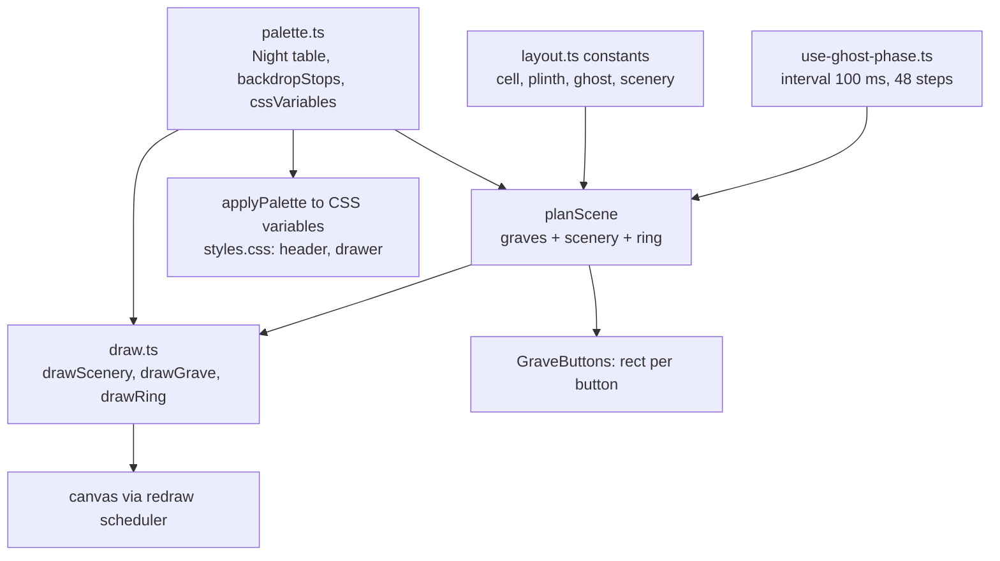
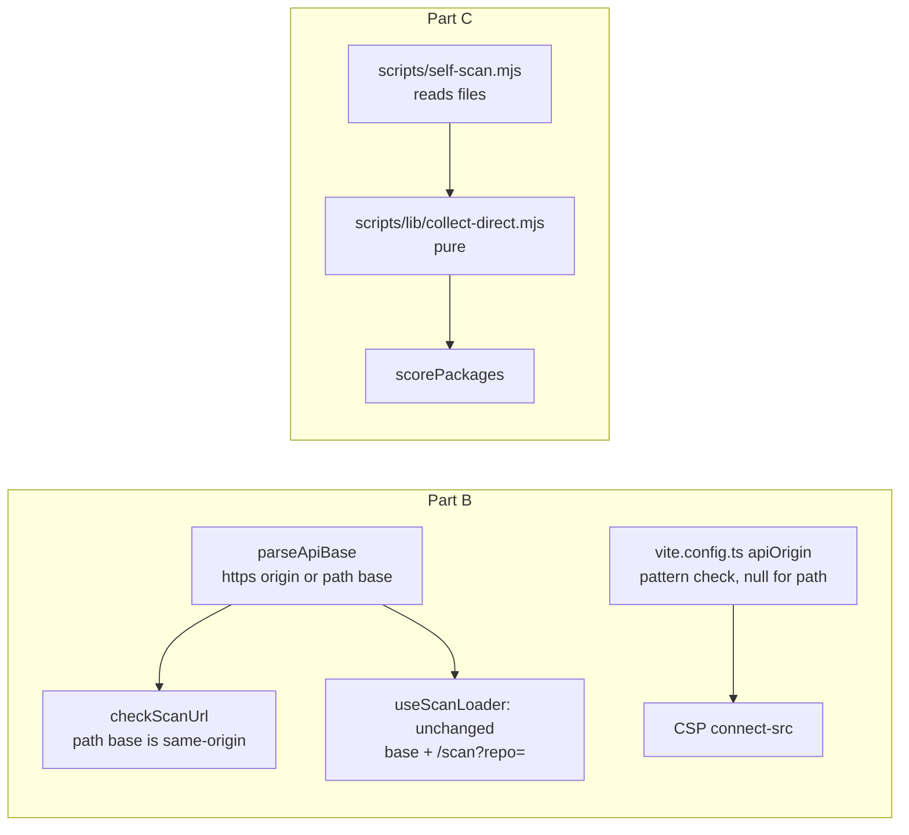

# Design Document: cemetery-theme

## Overview

cemetery-theme restyles `@sexton/web` as a night scene and makes two small fixes. The pure parts stay pure: `planScene` gains a Scenery record and new geometry constants, `ghostOffset` is a new pure function, `parseApiBase`, `checkScanUrl`, `apiOrigin` and `collectDirect` are pure. The painter and the CSS only execute what those parts return.

Implements requirements 1 to 8 of this spec. It amends these cemetery-ui values and nothing else: Cell size (96 by 112 to 192 by 224), minimum layout width (128 to 224), inscription length (14 to 16 code units), the palette (light and dark tables to one Night table), and the Ghost animation (a 0/1 toggle every 1000 ms to a 48-step cycle at 100 ms). It reads R-UI-1, R-UI-2, R-UI-6 and R-UI-7 of docs/requirements.md as constraints that must keep holding, and N-7 and N-8 for the self-scan.

Out of scope: a light theme, a theme switch, new dependencies, web fonts, image or audio assets, per-package decoration, canvas tiling for very tall scenes, any change to triage, validation, loading, selection, policy or the engine.

### Decisions

Each is a choice the brief left open. All are recorded here and in the Notes.

1. **Night-only app.** The scene, header and drawer use one Night palette under both values of `prefers-color-scheme`. `PALETTE.light` and `PALETTE.dark` are the same object, so the `Theme` type, the `theme` props and every existing test that passes `"light"` or `"dark"` compile and run unchanged. `App` stops reading the `prefers-color-scheme` query and always passes `"dark"`. A real light theme is roadmap, not this spec. Reason: a dark sky behind graves cannot be a light theme by changing a palette, the contrast budget (below) would double, and aliasing keeps the diff small.
2. **Palette stays the single colour source.** Every colour, including the sky, moon, fog and horizon, is a token in `palette.ts`. `draw.ts` and `styles.css` hold no colour literal. Transparency is made by appending an alpha byte to a token (`fog + "34"`), which keeps the table to six-digit hex and needs no `globalAlpha`.
3. **Sky band on top, graves on the ground below.** The canvas starts with a 80 px sky band. The first row of Cells starts at y = 96. The ground gradient starts at the horizon. Graves never stand in the sky, so the moon is never behind a grave.
4. **Stone = state shape at scale 2 + a Plinth.** The four state shapes keep their SVG path strings (defined in a 64 by 64 box) and are drawn at scale 2. The cross has a 12 unit stem, which is far too narrow for a name, so the inscription cannot be drawn on the cross itself. Every Grave therefore gets the same Plinth, a 144 by 40 rounded base in the State colour, and the Inscription is drawn on it. The Plinth is part of the stone, is identical for all States, and so carries no information. The Legend keeps drawing the upper form only.
5. **Inscription length grows from 14 to 16 code units.** Plinth text width is 136 px (144 minus 4 px each side). At 14 px monospace one code unit is about 8.4 px, so 16 units take about 134 px and fit. 18 units need about 151 px and would not. The `maxWidth` argument of `fillText` squeezes the glyphs if a fallback monospace font is wider. The rule "60 Packages or fewer, none above" and the ellipsis rule stay. The cut is 15 code units plus the ellipsis, without a lone surrogate.
6. **Minimum layout width becomes 224.** One Cell (192) plus two paddings (32) is 224. With the old minimum of 128 the single column would overflow the canvas and break the "every rectangle lies inside the canvas" invariant.
7. **Ghost drift is a stepped sine, driven by the existing interval hook.** The Ghost phase is an integer 0 to 47. One tick every 100 ms adds 1 modulo 48, so a cycle takes 4800 ms. The offset is `round2(6 * sin(2 * PI * phase / 48))` px: smooth (at most 0.79 px between steps), slow, a fixed amplitude of 6 px, the same for every Ghost, and a pure function of the phase. Under Reduced motion no interval exists, as today. The interval form keeps the "no animation timer" test shape and avoids a `requestAnimationFrame` loop. Cost: 10 full repaints per second while a ghost exists. Accepted, and gated by the 16 ms median test (see "Performance fallback").
8. **Fog and moon are canvas gradients.** Sky and ground gradients are on the canvas, not in CSS. The fog is a horizontal band whose alpha rises to `34` (52 of 255) at its middle and falls to `00` at both edges. It is drawn before the graves, so it lies behind them, and it is counted in the Backdrop stops as two composites.
9. **Version dedupe in the self-scan: scan each distinct name and version pair once.** A name locked at two versions in two workspaces gives two rows. Today no declared name differs between workspaces: `ajv` is declared only by the engine (locked at `packages/engine/node_modules/ajv`, 8.20.0), and the root-hoisted `ajv` 6.15.0 is transitive and not declared by any manifest. The lookup order (workspace `node_modules` first) is what makes the engine's ajv resolve to 8.20.0 and `vite` resolve to `packages/web/node_modules/vite` 8.3.8.
10. **Path base rules are a whitelist.** A Path base must match `^/[A-Za-z0-9._~/-]*$`, must not be `/`, must contain no `//`, no `..` and no `.` segment. This rejects protocol-relative `//host`, backslashes, `?`, `#`, whitespace and `%` (a percent escape such as `%2e%2e` is treated as a dot segment by URL parsers). One trailing slash is stripped. `/` alone is rejected because stripping it leaves an empty base.
11. **CSP fails closed.** The CSP origin must match `^https://[A-Za-z0-9.-]+(:\d+)?$`. An origin that does not match (an IPv6 literal, for instance) is not inserted and `connect-src` stays `'self'`. The page then cannot call that API, which is the safe failure.
12. **The screenshot emulates Reduced motion.** The Ghost phase stays 0 so the screenshot is repeatable.
13. **Headings use a system serif stack, no web font.** The CSP `font-src 'self'` and `style-src 'self'` stay as they are and no font request is made.

### Contrast against the Backdrop stops

Backdrop stops, from `palette.ts`:

| Stop | Colour | Note |
|------|--------|------|
| skyTop | #070b17 | darkest stop |
| skyMid | #11183a | |
| skyHorizon | #262550 | |
| groundTop | #1f2b24 | |
| bg | #0b0f0d | lowest ground, page background |
| fog over skyHorizon | #41436b | lightest stop |
| fog over groundTop | #3b4748 | |

Ratios against the darkest stop (skyTop) and the lightest stop (fog over skyHorizon), computed with the WCAG 2.1 formula:

| Token | Colour | vs darkest | vs lightest | Minimum |
|-------|--------|-----------|-------------|---------|
| Alive | #43a857 | 6.53 | 3.11 | 3 |
| Restless | #f2d060 | 13.06 | 6.24 | 3 |
| Haunted | #ee6a4f | 6.37 | 3.04 | 3 |
| Dead | #9aa0ad | 7.49 | 3.57 | 3 |
| Possessed | #c58cf5 | 7.90 | 3.77 | 3 |
| ghost | #c7d0e6 | 12.71 | 6.07 | 3 |
| ring and focus | #7aa2ff | 7.89 | 3.77 | 3 |
| border | #8d93a3 | 6.39 | 3.05 | 3 |
| text | #ecebe6 | 16.45 | 7.85 | 4.5 |
| muted | #b4b8c2 | 9.89 | 4.72 | 4.5 |

Against `surface` (#141a2b): text 14.51, muted 8.72, focus 6.96, border 5.64. Ink (#0b0e16) on the stones: Alive 6.41, Restless 12.83, Haunted 6.26, Dead 7.35, Possessed 7.76 (minimum 4.5). Alive against Restless: 2.00 (minimum 1.5). The test computes every ratio from the table, so these numbers are a record, not a source. Horizon (#3a4470), moon (#ece8d0) and fog (#aab6d6) are decoration with no meaning and no contrast requirement.

### 300 graves against the 16384 cap

`backingStore` is unchanged: `scale = min(2, dpr, 16384 / cssW, 16384 / cssH)`. The canvas height is `80 + 16 + rows * 224 + 16`.

| Width | Columns | Rows for 300 | CSS height | Scale at dpr 1 | Scale at dpr 2 |
|-------|---------|--------------|------------|----------------|----------------|
| 224 (minimum) | 1 | 300 | 67312 | 0.2434 | 0.2434 |
| 800 | 4 | 75 | 16912 | 0.9688 | 0.9688 |
| 992 | 5 | 60 | 13552 | 1 | 1.2018 |
| 1280 | 6 | 50 | 11312 | 1 | 1.4381 |
| 1760 | 8 | 38 | 8656 | 1 | 1.8755 |

Result: the cap holds at every width. At the minimum width the backing store is 54 by 16384 (16383 if floating-point rounding falls just under) at scale 0.2434, which is legal but blurry (the old value was 0.487). The scale is below 1 for widths under 992 px with 300 graves. Above 8192 CSS pixels of height the scale also falls below 2 at dpr 2. No tiling is added: that is roadmap. Known gap, unchanged by this spec: the cap is per side only, so a browser that limits canvas area (iOS Safari, about 16.7 megapixels) can refuse a 1280 by 11312 canvas at dpr 2 (about 30 megapixels). The keyboard Overlay and the drawer are DOM and are not affected.

## Architecture





Design decisions:

1. **Everything that varies is a pure function of the plan.** `drawScene` reads `plan.scenery`, `plan.graves` and `plan.ring`. It computes no layout and holds only constant offsets inside a Cell (exported from `layout.ts`).
2. **One repaint path.** The drift changes `plan.graves[i].ghost.y`, which changes the plan identity, which calls `scheduler.invalidate()`, as the old toggle did. No new timer or frame loop exists in `Scene.tsx`.
3. **Scenery is plan data.** It depends on the width only, so a test can show it never varies with Packages (Property 5).
4. **Test stubs return gradients.** The painter calls `createLinearGradient` and `createRadialGradient`, whose results need `addColorStop`. The recording contexts in `test/setup.ts` and `test/scene.test.tsx` return a no-op gradient object for both (Deliberate test changes).

## Components and Interfaces

Paths are under `packages/web/src` unless stated.

### scene/palette.ts

```ts
export type Theme = "light" | "dark";

export interface PaletteTheme {
  readonly skyTop: string; readonly skyMid: string; readonly skyHorizon: string;
  readonly groundTop: string; readonly bg: string;
  readonly horizon: string; readonly moon: string; readonly fog: string;
  readonly surface: string; readonly text: string; readonly muted: string;
  readonly border: string; readonly focus: string; readonly ring: string;
  readonly ghost: string; readonly ink: string; readonly pit: string;
  readonly states: Readonly<Record<State, string>>;
}

const NIGHT: PaletteTheme = {
  skyTop: "#070b17", skyMid: "#11183a", skyHorizon: "#262550",
  groundTop: "#1f2b24", bg: "#0b0f0d",
  horizon: "#3a4470", moon: "#ece8d0", fog: "#aab6d6",
  surface: "#141a2b", text: "#ecebe6", muted: "#b4b8c2",
  border: "#8d93a3", focus: "#7aa2ff", ring: "#7aa2ff",
  ghost: "#c7d0e6", ink: "#0b0e16", pit: "#04060a",
  states: { Alive: "#43a857", Restless: "#f2d060", Haunted: "#ee6a4f", Dead: "#9aa0ad", Possessed: "#c58cf5" },
};

/** One table. Both keys point to it: the app is night-only (decision 1). */
export const PALETTE: Record<Theme, PaletteTheme> = { light: NIGHT, dark: NIGHT };

export const FOG_PEAK_ALPHA_BYTE = "34";   // 52 / 255
export const ALPHA_ZERO_BYTE = "00";
export const MOON_HALO_ALPHA_BYTE = "40";

export function colourFor(state: State, theme: Theme): string;
export function cssVariables(theme: Theme): Record<string, string>; // adds --sky-top, --sky-mid, --sky-horizon, --ground-top, --horizon, --moon, --fog, --ink
export function applyPalette(root: HTMLElement, theme: Theme): void;
/** The seven Backdrop stops: the five tokens and the two fog composites at 52/255. */
export function backdropStops(theme: Theme): readonly string[];
```

`--bg` keeps its name and now means the lowest ground colour. State colours other than Alive keep their previous dark values. Alive moves from #3a9a4e to #43a857 to keep 3 to 1 against the lightest stop. `backdropStops` mixes the fog token over `skyHorizon` and over `groundTop` in sRGB at 52/255 and rounds each channel. The CSS-variable names for tokens already in use do not change, so every existing `var(--x)` keeps working.

### scene/layout.ts

```ts
export const CELL_WIDTH = 192, CELL_HEIGHT = 224, PADDING = 16;
export const SKY_HEIGHT = 80;
export const MIN_WIDTH = CELL_WIDTH + 2 * PADDING;           // 224
export const MAX_INSCRIPTIONS_PACKAGES = 60;                  // existing name and value, unchanged
export const INSCRIPTION_UNITS = 16;
export const GHOST_STEPS = 48, GHOST_STEP_MS = 100, GHOST_AMPLITUDE = 6;
export const GHOST_WIDTH = 24, GHOST_HEIGHT = 28;

/** Cell-relative geometry of one Grave. Constants, never per package. */
export const GRAVE_GEOMETRY = {
  shapeX: 32, shapeY: 48, shapeScale: 2,
  plinth: { x: 24, y: 168, w: 144, h: 40, r: 6 },
  ghostX: 84, ghostTop: 12,
  inscription: { x: 96, baseline: 193, maxWidth: 136, font: "14px monospace" },
} as const;

export interface Scenery {
  readonly skyHeight: number;                                  // 80
  readonly horizonY: number;                                   // 80
  readonly moon: { readonly x: number; readonly y: number; readonly r: number }; // (floor(width / 6), 40, 20)
  readonly fog: { readonly y: number; readonly h: number };    // 56, 96
  readonly groundFade: number;                                 // 640
}

export interface ScenePlan {
  readonly width: number; readonly height: number; readonly columns: number; readonly theme: Theme;
  readonly graves: readonly GravePlan[]; readonly ring: Rect | null;
  readonly scenery: Scenery;
}

export interface SceneInput { /* as before, with */ readonly ghostPhase: number; }

/** Pure. Integer phase to a vertical offset in CSS pixels, rounded to two decimals. */
export function ghostOffset(phase: number): number;          // round2(6 * sin(2 * PI * phase / 48))
export function sceneryFor(width: number): Scenery;
```

`GravePlan` keeps exactly its eight keys (`index`, `name`, `state`, `rect`, `shape`, `fill`, `ghost`, `inscription`), so no per-package field is added. `planScene` changes:

- `width = max(224, floor(width))`, 224 for a non-finite width.
- `columns = max(1, floor((width - 32) / 192))`, `rows = ceil(n / columns)`, `height = SKY_HEIGHT + PADDING + rows * 224 + PADDING` (0 for no Packages).
- Cell `i`: `x = 16 + (i % columns) * 192`, `y = SKY_HEIGHT + PADDING + floor(i / columns) * 224`, `w = 192`, `h = 224`.
- `ghost = { x: rect.x + 84, y: rect.y + 12 + ghostOffset(phase) }` when `hasGhost`.
- `inscriptionFor(name, n)`: `null` above 60 Packages, the name when it has 16 units or fewer, else the first 15 code units (minus a trailing high surrogate) plus an ellipsis.
- `scenery = sceneryFor(width)`, also for zero Packages (no canvas is rendered then).
- `ring` is the Cell inset by 2, as before.

Ghost bounds: top is at least `y + 6` and bottom is at most `y + 12 + 6 + 28 = y + 46`, inside the Cell, and above the highest shape pixel (the cross at `y + 60`).

### scene/shapes.ts

`SHAPE_BY_STATE`, `GHOST_PATH` and the cached Path2D helpers are unchanged. The `open` shape (Possessed) is now an open grave: a dark rectangular pit sunk into the ground (`pit` token, `fillRect`, outlined by a 1.5 unit rim stroked in `border`), a mound of earth beside it, and the stone lid tilted off, with lid and mound in the Possessed colour. `ShapeDef` gains `pit` (null for the other three shapes). The pit token cannot reach 3 to 1 against the ground and the lid at once (the lid needs the pit darker than 0.09 luminance, the ground needs it lighter than 0.16), so the pit is darker than the ground and the `border` rim carries the 3 to 1 against the ground. The header reads "1 failing rule" and "N failing rules" through `failingRulesText` in `header/failing-rules-text.ts`. One export is added:

```ts
/** Cell-relative rounded rectangle for the Plinth. Same for every State. */
export const PLINTH_PATH = "M30 168 H162 A6 6 0 0 1 168 174 V202 A6 6 0 0 1 162 208 H30 A6 6 0 0 1 24 202 V174 A6 6 0 0 1 30 168 Z";
export function plinthPath(): Path2D;
```

### scene/draw.ts

`PaintContext2D` gains the members the painter now calls: `createLinearGradient(x0, y0, x1, y1): GradientLike`, `createRadialGradient(x0, y0, r0, x1, y1, r1): GradientLike`, `beginPath()`, `arc(x, y, r, a0, a1): void`, `fill(): void` (no argument, for the moon), `scale(x, y)`, and `fillText(text, x, y, maxWidth?)`. `GradientLike` is `{ addColorStop(offset: number, colour: string): void }`.

```ts
export function drawScene(ctx: PaintContext2D, plan: ScenePlan, scale: number): void {
  ctx.setTransform(scale, 0, 0, scale, 0, 0);
  ctx.clearRect(0, 0, plan.width, plan.height);
  drawScenery(ctx, plan);                 // sky, moon, ground, horizon, fog: fillRect, arc, fill only
  for (const grave of plan.graves) drawGrave(ctx, grave, plan.theme);
  if (plan.ring !== null) { /* strokeRect once, as before */ }
}
```

Scenery, in order (all colours from `PALETTE[plan.theme]`):

1. Sky: `createLinearGradient(0, 0, 0, 80)` with `skyTop` at 0, `skyMid` at 0.6, `skyHorizon` at 1. `fillRect(0, 0, width, 80)`.
2. Moon halo: `createRadialGradient(mx, my, r, mx, my, r * 2.5)` from `moon + "40"` to `moon + "00"`, `fillRect` over the square around the moon. Moon disc: `beginPath()`, `arc(mx, my, r, 0, 2 * PI)`, `fillStyle = moon`, `fill()`.
3. Ground: `createLinearGradient(0, 80, 0, 720)` with `groundTop` at 0 and `bg` at 1, `fillRect(0, 80, width, height - 80)`. The canvas pads the gradient with its last stop below y 720.
4. Horizon line: `fillStyle = horizon`, `fillRect(0, 80, width, 2)`.
5. Fog: `createLinearGradient(0, 56, 0, 152)` with `fog + "00"` at 0, `fog + "34"` at 0.5, `fog + "00"` at 1, `fillRect(0, 56, width, 96)`.

Each Grave, translated to its Cell origin `(rect.x, rect.y)`:

1. State shape: `translate(32 + 64, 48 + 64)`, `rotate(tilt)`, `translate(-64, -64)`, `scale(2, 2)`, `fillStyle = grave.fill`, `fill(shapePath(shape))`. The crack detail of `cracked` is stroked in `ink` at `lineWidth 2`. The tilt is the constant of the shape. The transform is saved and restored around it.
2. Plinth: `fillStyle = grave.fill`, `fill(plinthPath())`. It is drawn after the shape, so it hides the feet of the tilted stone and the two merge into one silhouette.
3. Ghost, when planned: `translate(ghost.x, ghost.y)`, `scale(2, 2)`, `fillStyle = ghost`, `fill(ghostPath())`.
4. Inscription, when planned: `fillStyle = ink`, `font = "14px monospace"`, `textAlign = "center"`, `fillText(text, rect.x + 96, rect.y + 193, 136)`.

The painter never assigns `globalAlpha`, never calls `strokeRect` or `fillText` for Scenery, and uses no literal colour.

### hooks/use-ghost-phase.ts

```ts
export function useGhostPhase(anyGhost: boolean, reducedMotion: boolean): number {
  const [phase, setPhase] = useState(0);
  const running = anyGhost && !reducedMotion;
  useEffect(() => {
    if (!running) return undefined;
    const timer = setInterval(() => { setPhase((p) => (p + 1) % GHOST_STEPS); }, GHOST_STEP_MS);
    return () => { clearInterval(timer); setPhase(0); };
  }, [running]);
  return running ? phase : 0;
}
```

`Cemetery.tsx` is unchanged: it already passes the phase into `planScene`. `Scene.tsx` is unchanged.

### App.tsx, index.html, styles.css

`App` drops `useMediaQuery("(prefers-color-scheme: dark)")` and sets `const theme: Theme = "dark"`. `index.html` gains `<meta name="color-scheme" content="dark" />`. `styles.css` gains `:root { color-scheme: dark; }` and restyles these rules, with every selector the tests read kept:

- `header`: `background: linear-gradient(to bottom, var(--sky-top), var(--sky-mid))`, `border-bottom: 2px solid var(--border)`, `color: var(--text)`.
- `h1, h2, h3, h4`: `font-family: Georgia, "Times New Roman", serif`.
- `.drawer`: `background: var(--surface)`, `border-left: 2px solid var(--border)`, `box-shadow: -8px 0 24px var(--bg)` (a shadow in a token colour, no alpha).
- `.legend-toggle`, `.repo-form button`, `.repo-form input`, `.drawer-close`: unchanged structure, tokens only, `border-radius: 4px`.
- `.scene-container`: `background: var(--bg)` so the page below the canvas matches the lowest ground colour.
- `.grave-button:focus-visible`, `.drawer button:focus-visible`, `.drawer-body:focus-visible`, `.legend-toggle:focus-visible`, `.repo-form button:focus-visible`, `.repo-form input:focus-visible`: unchanged, outline 3 px solid `var(--focus)`.

No rule uses `url()`, `rgba()`, `@media (prefers-color-scheme)` or a colour literal. Text rules keep plain `color: var(--x)` and `background: var(--y)` forms where the existing pair test can read them. The header gradient is covered by the explicit "text and muted against every Backdrop stop" check (Property 1).

### load/api-base.ts (Requirement 6)

```ts
const PATH_BASE = /^\/[A-Za-z0-9._~/-]*$/;

export function parseApiBase(raw: string | undefined): string | null {
  if (raw === undefined || raw === "") return null;
  if (raw.startsWith("/")) return parsePathBase(raw);
  /* existing https branch, unchanged */
}

function parsePathBase(raw: string): string | null {
  if (!PATH_BASE.test(raw)) return null;
  if (raw === "/" || raw.includes("//") || raw.includes("..") || /(^|\/)\.(\/|$)/.test(raw)) return null;
  return raw.endsWith("/") ? raw.slice(0, -1) : raw;
}
```

Examples: `/api` gives `/api`; `/api/` gives `/api`; `/v1/api` gives `/v1/api`. Null: `/`, `//host`, `//`, `/api//x`, `/a\b`, `/a?x`, `/a#x`, `/a/../b`, `/a/./b`, `/a%2e%2e/b`, `/a b`, `/api\n`.

### load/check-scan-url.ts

One added rule: the cross-origin API origin is derived only from a non-path base.

```ts
const crossOrigin = apiBaseUrl !== null && !apiBaseUrl.startsWith("/") ? new URL(apiBaseUrl).origin : null;
...
if (u.origin === page.origin) return { ok: true, url: u.href };
if (u.protocol === "https:" && crossOrigin !== null && u.origin === crossOrigin) return { ok: true, url: u.href };
```

`new URL(apiBaseUrl)` stays inside the existing `try`, and a Path base never reaches it. `use-scan-loader.ts` is not changed: `` `${apiBase}/scan?repo=${encodeURIComponent(t)}` `` with `apiBase = "/api"` is `/api/scan?repo=...`, which resolves against the page origin and is accepted as same-origin. `Header` already enables the field when `apiBase !== null`.

### vite.config.ts (Requirement 6)

```ts
const CSP_ORIGIN = /^https:\/\/[A-Za-z0-9.-]+(:\d+)?$/;

/** Exported for tests. Null for an absent, invalid or path value, and for an origin that fails the pattern. */
export function apiOrigin(raw: string | undefined): string | null {
  if (raw === undefined || raw === "" || raw.startsWith("/") || raw.includes("?") || raw.includes("#")) return null;
  try {
    const url = new URL(raw);
    if (url.protocol !== "https:" || url.username !== "" || url.password !== "") return null;
    return CSP_ORIGIN.test(url.origin) ? url.origin : null;
  } catch {
    return null;
  }
}
```

`cspPlugin` is unchanged: a null origin gives `connect-src 'self'`.

### scripts/lib/collect-direct.mjs (Requirement 7)

```js
/**
 * @param {{ root: Manifest, workspaces: { dir: string, manifest: Manifest }[], lock: { packages?: Record<string, { version?: string }> } }} input
 * @returns {{ name: string, installedVersion: string }[]}
 */
export function collectDirect({ root, workspaces, lock }) {
  const internal = new Set(workspaces.map((w) => w.manifest.name).filter((n) => typeof n === "string"));
  const rows = new Map();                          // key "name@version"
  const declare = (manifest, dir) => {
    const names = [...Object.keys(manifest.dependencies ?? {}), ...Object.keys(manifest.devDependencies ?? {})];
    for (const name of names) {
      if (internal.has(name)) continue;
      const candidates = dir === null ? [`node_modules/${name}`] : [`${dir}/node_modules/${name}`, `node_modules/${name}`];
      const version = candidates.map((k) => lock.packages?.[k]?.version).find((v) => typeof v === "string");
      if (version === undefined) throw new Error(`no locked version for ${name} (declared in ${dir ?? "."})`);
      rows.set(`${name}@${version}`, { name, installedVersion: version });
    }
  };
  declare(root, null);
  for (const w of workspaces) declare(w.manifest, w.dir);
  return [...rows.values()].sort((a, b) => (a.name < b.name ? -1 : a.name > b.name ? 1 : a.installedVersion < b.installedVersion ? -1 : a.installedVersion > b.installedVersion ? 1 : 0));
}
```

`Map` insertion makes the same pair declared twice one row. The sort uses `<` and `>` (code-unit order, no `localeCompare`), and the result does not depend on the order of `workspaces`, because the key set and the sort are order-free (a throw for a missing entry also does not depend on order, except for which declaration is named first).

### scripts/self-scan.mjs

The script keeps its flow. The manifest reading becomes:

```js
const root = new URL("..", import.meta.url);
const rootManifest = JSON.parse(await readFile(new URL("package.json", root), "utf8"));
const workspaces = [];
for (const entry of rootManifest.workspaces ?? []) {
  const m = /^([A-Za-z0-9._-]+(?:\/[A-Za-z0-9._-]+)*)\/\*$/.exec(entry);
  if (m === null) { console.error(`self-scan: unsupported workspaces entry ${JSON.stringify(entry)}`); process.exit(2); }
  for (const d of await readdir(new URL(`${m[1]}/`, root), { withFileTypes: true })) {
    if (!d.isDirectory()) continue;
    const dir = `${m[1]}/${d.name}`;
    try { workspaces.push({ dir, manifest: JSON.parse(await readFile(new URL(`${dir}/package.json`, root), "utf8")) }); }
    catch (e) { if (e?.code !== "ENOENT") throw e; }
  }
}
const packages = collectDirect({ root: rootManifest, workspaces, lock });
```

The rest (scoring, policy parse, evaluation, output, exit codes 0, 1 and 2) is unchanged. `packages/cli` and `packages/action` have no package.json today and are skipped by the ENOENT rule.

### sexton.policy.yml

Only the comment above `allow: []` changes:

```yaml
    # Empty on purpose. The self-scan (npm run scan:self) covers the direct
    # dependencies of the root and of every workspace under packages/. None
    # declares an install, preinstall or postinstall script, or ships a
    # binding.gyp. esbuild is not in the dependency tree: Vite 8 uses Rolldown.
    # The only package in the lockfile with an install script is fsevents
    # 2.3.3, which is optional and transitive, so it is not scanned.
    # Add a package here, with a comment saying what its script does, only
    # when one is reviewed and accepted.
    allow: []
```

### e2e/smoke.spec.ts

- Before the first `goto`: `await page.emulateMedia({ reducedMotion: "reduce" })`.
- After the header and 11 buttons assertions: click `button[data-grave-index]` whose `aria-label` contains `left-padder` (the first Possessed grave in triage order), `await expect(page.getByRole("dialog")).toBeVisible()`.
- Wait for the first paint: `await page.waitForFunction(() => { const c = document.querySelector("canvas"); const d = c?.getContext("2d")?.getImageData(2, 2, 1, 1).data; return d !== undefined && d[3] === 255; })`. The sky fill makes pixel (2, 2) opaque after the first paint, and it is transparent before.
- `page.screenshot({ path: SCREENSHOT })` where `SCREENSHOT` is `docs/cemetery.png` (unchanged path), then `await page.emulateMedia({ reducedMotion: "no-preference" })` before the 300-grave step so the drift timer runs during the timing, which is the worst case.
- For the 300-grave page the existing `waitForFunction` on `__sextonTiming` is kept, and the same pixel wait is added before the timing call.

### Performance fallback

Per paint the new scene fills about 14.6 megapixels at 1280 by 11312 and dpr 1, three gradient rects plus 300 shapes, plinths and ghosts, with no text (300 is above the 60 limit). The budget stays 16 ms median. If the e2e run exceeds it, the orchestrator applies one fallback and runs again: move the sky and ground gradients and the page colour to CSS background layers on `.scene-container` (custom properties from the palette, no literal) and make the painter clear to transparent, keeping the moon, horizon, fog, graves and ghosts on the canvas. If the median is still above 16 ms, the orchestrator stops and reports the number to the user. The budget is not relaxed silently.

## Data Models

No stored data changes. New or changed shapes:

- `PaletteTheme`: the token set above.
- `Scenery`: five fields, computed from the width.
- `ScenePlan`: adds `scenery`. `GravePlan` is unchanged.
- `SceneInput.ghostPhase`: `number` (an integer from 0 to 47), widened from `0 | 1`. Callers that pass `0` or `1` still compile.
- Collector input and output: `{ root, workspaces: { dir, manifest }[], lock }` to `{ name, installedVersion }[]`.

## Error Handling

- A non-finite or small layout width is clamped to 224, as before at 128.
- `getContext("2d")` returning null skips the paint, as before.
- A Path base that fails the whitelist makes `parseApiBase` return null, so the repository field is disabled with the existing text.
- A CSP origin that fails the pattern leaves `connect-src 'self'`.
- A missing lockfile entry stops the self-scan with an error that names the package and the declaring directory. An unsupported `workspaces` entry stops it with exit code 2. A policy parse failure keeps exit code 2.
- A failed network read in the live self-scan degrades one signal, as the engine always does.

## Correctness Properties

*A property is a characteristic or behavior that should hold true across all valid executions of a system-essentially, a formal statement about what the system should do. Properties serve as the bridge between human-readable specifications and machine-verifiable correctness guarantees.*

Reflection: the cemetery-ui properties for shape and colour by State, the Ghost rule and once-per-frame redraw keep their meaning and run unchanged (requirements 1.11 and 3.8). The properties below are new. The cemetery-ui layout and scene-plan properties are replaced by the layout and inscription properties below (their values change), and the cemetery-ui backing-store property runs unchanged with new examples.

### Property 1: Palette contrast over every backdrop stop

For all tokens in the Night palette and all Backdrop stops (the five tokens and the two fog composites), the contrast ratio is at least 4.5 to 1 for `text` and `muted`, at least 3 to 1 for the five State colours, `ghost`, `ring`, `focus` and `border`; for all States, `ink` against the State colour is at least 4.5 to 1; Alive against Restless is at least 1.5 to 1; the five State colours are pairwise distinct; and every token is a six-digit hex string.

**Validates: Requirements 1.3, 1.5, 1.6, 1.7, 1.8, 1.9**

### Property 2: Layout formulas, containment and determinism

For any width (finite or not) and any list of 0 to 300 Packages, `planScene` returns a plan with `width = max(224, floor(width))`, `columns = max(1, floor((width - 32) / 192))` and `height = 80 + 16 + rows * 224 + 16` (0 columns and 0 height for no Package), Cell `i` at `x = 16 + (i mod columns) * 192` and `y = 96 + floor(i / columns) * 224`, every rectangle inside the canvas, no two rectangles overlapping, one Grave per Package in input order, and an equal plan from a second call.

**Validates: Requirements 2.1, 2.2, 2.3**

### Property 3: Inscription truncation

For any package name and any count of Packages, `inscriptionFor` returns null when the count is above 60; otherwise the name when it has 16 code units or fewer; otherwise a string of at most 16 code units that ends with an ellipsis, whose text before the ellipsis is a prefix of the name, and that contains no lone surrogate.

**Validates: Requirements 2.6, 2.7**

### Property 4: Painter call discipline

For any Scene plan, a recording context sees `clearRect` before every other drawing call, every Scenery call before the first Grave call, `fillText` exactly as often as the plan has Inscriptions with a `maxWidth` of 136, `strokeRect` once when the plan has a ring and never otherwise, no assignment to `globalAlpha`, and every string assigned to `fillStyle` equal to a palette token, a Grave fill, or a token with an alpha byte appended.

**Validates: Requirements 2.5, 2.8, 3.4, 3.5, 3.6, 3.7**

### Property 5: Scenery depends on the width only

For any two lists of Packages and any width of at least 224 and any selection and Ghost phase, `plan.scenery` is deeply equal, and the moon disc (centre and radius) lies inside the rectangle from (0, 0) to (width, 80).

**Validates: Requirements 3.1, 3.2, 3.3**

### Property 6: Ghost offset function

For any integer phase and any list of Packages, every Ghost in the plan has the same offset `round2(6 * sin(2 * PI * phase / 48))` with an absolute value of at most 6, a top at `rect.y + 12 + offset`, a left at `rect.x + 84` and a 24 by 28 box inside its Cell; `ghostOffset(0)` is 0; `ghostOffset(p)` equals `ghostOffset(p + 48)`; and changing only the phase leaves every rectangle, shape, fill and Inscription unchanged.

**Validates: Requirements 4.1, 4.3, 4.4, 4.5**

### Property 7: Ghost timer

For any sequence of events drawn from advancing fake time by k steps of 100 ms, switching Reduced motion on or off, and re-rendering, with at least one Ghost: while Reduced motion is off the phase equals the number of elapsed 100 ms steps since the timer started, modulo 48; while it is on the phase is 0 and the fake-timer count is 0; and with no Ghost the fake-timer count is 0.

**Validates: Requirements 4.2, 4.6, 4.7, 4.8**

### Property 8: Overlay buttons follow the plan

For any count of Packages from 1 to 300, each Grave button's `left`, `top`, `width` and `height` equal its Grave rectangle in the plan.

**Validates: Requirements 2.10**

### Property 9: parseApiBase is total and safe

For any string, `parseApiBase` does not throw and returns null, or an `https://` URL without credentials, query or fragment and without a trailing slash, or a string that starts with a single `/` and contains no `//`, `..`, `?`, `#`, backslash, whitespace or `%`, and has no trailing slash; and for any generated valid Path base the result equals the input with one trailing slash stripped.

**Validates: Requirements 6.1, 6.2, 6.3, 6.4**

### Property 10: checkScanUrl with a path base

For any input string, page origin and API base (null, an https origin, or a Path base), `checkScanUrl` does not throw, returns equal results on two calls, and accepts only a URL with no credentials that is same-origin or `https` on the origin of a non-path API base; with a Path base it never accepts a cross-origin URL, and for any value `v` it accepts `{base}/scan?repo=` followed by `encodeURIComponent(v)` with a URL equal to the page origin followed by that string.

**Validates: Requirements 6.5, 6.6**

### Property 11: CSP origin

For any raw string, `apiOrigin` returns null or a string that matches `^https://[A-Za-z0-9.-]+(:\d+)?$`, returns null for every string that `parseApiBase` parses as a Path base, and returns `new URL(raw).origin` for every valid https value whose origin matches the pattern.

**Validates: Requirements 6.8, 6.9, 6.10**

### Property 12: collectDirect

For any generated root manifest, list of workspace manifests and lockfile object that holds an entry for every declared name, `collectDirect` returns rows that are unique by name and version, sorted by name and then version in code-unit order, free of every Workspace-internal name, each with the version found at `<dir>/node_modules/<name>` first and at `node_modules/<name>` second (root-declared names at `node_modules/<name>` only), covering the union of all declared names, and equal for any permutation of the workspace list; and for a declared name with no lockfile version it throws an error that contains the name.

**Validates: Requirements 7.2, 7.3, 7.4, 7.5, 7.6, 7.7**

## Testing Strategy

Dual approach: examples for specific values and static checks, properties for the universal statements. All tests are network-free. Property tests use `numRuns` 100 by default and 1000 for Properties 9, 10 and 11, which guard what a request may target. Each carries the tag `Feature: cemetery-theme, Property N: <title>`. Property 12 uses 100.

| Test file | Content |
|-----------|---------|
| `packages/web/test/shapes-palette.test.ts` | Property 1; CSS static checks (no colour literal, no `prefers-color-scheme`, no `url()`); decoration tokens not used in CSS |
| `packages/web/test/layout.test.ts` | Properties 2 and 3; the 300-graves and 1280-wide examples; backing store examples |
| `packages/web/test/draw.test.ts` (new) | Properties 4 and 5 with a recording context that returns gradient stubs |
| `packages/web/test/ghost-drift.test.ts` (new) | Properties 6 and 7 |
| `packages/web/test/grave-buttons.test.tsx` | Property 8 (added) |
| `packages/web/test/api-base.test.ts` | Property 9; path examples |
| `packages/web/test/check-scan-url.test.ts` | Property 10; path-base examples |
| `packages/web/test/vite-csp.test.ts` (new) | Property 11; the CSP string for a path base and for an https base |
| `packages/web/test/load-scan.test.ts` | Example: `submitRepo` with `apiBase: "/api"` issues `GET /api/scan?repo=...` |
| `packages/web/test/a11y.test.tsx` | Unchanged scenarios (axe, focus rules, keyboard) must stay green |
| `packages/engine/test/policy/collect-direct.test.ts` (new) | Property 12 and the fixture examples (the repo's real shape: engine `ajv` 8.20.0 beside a root `ajv` 6.15.0, web `vite` nested) |
| `packages/web/e2e/smoke.spec.ts` | Screenshot, first-paint wait, 16 ms budget (orchestrator-run) |

`packages/engine/test/policy/self-policy.test.ts` needs no change: it checks the three rules, the parse, and that `scripts/self-scan.mjs` exists and `scan:self` is wired, and all four still hold.

### Deliberate test changes

Every existing test not listed here must pass unmodified. Each listed change touches only the value this spec changes on purpose. No existing test pins a palette hex literal, so none changes for a colour value; the changes follow the palette structure.

`packages/web/test/shapes-palette.test.ts`
1. In "styles.css holds no colour literal and uses only known variables": `expect(PALETTE.light.bg).not.toBe(PALETTE.dark.bg)` becomes `expect(PALETTE.light).toBe(PALETTE.dark)`.
2. In "text and muted text are at least 4.5 to 1 against bg and surface": the background list grows from `[bg, surface]` to `[surface, ...backdropStops(theme)]`.
3. In "state colours, ghost, selection ring, focus and border are at least 3 to 1 against bg": the single background `bg` becomes every entry of `backdropStops(theme)`.

`packages/web/test/layout.test.ts`
4. Property 8 test: the clamp `128` becomes `224`; `(width - 32) / 96` becomes `/ 192`; `32 + rows * 112` becomes `80 + 32 + rows * 224`; `16 + (i % columns) * 96` becomes `* 192`; `16 + floor(i / columns) * 112` becomes `96 + floor(i / columns) * 224`.
5. "puts the first package top-left": `{ x: 16, y: 16, w: 96, h: 112 }` becomes `{ x: 16, y: 96, w: 192, h: 224 }`.
6. "changes columns at width 223 and 224": the widths become 415 and 416 (1 and 2 columns).
7. "lays out 300 graves at width 128 in one column": the width becomes 224 and the height `32 + 300 * 112` becomes 67312.
8. Property 19 test: `[g.rect.w, g.rect.h]` `[96, 112]` becomes `[192, 224]`; the Ghost box `12` and `14` become `GHOST_WIDTH` (24) and `GHOST_HEIGHT` (28); the name length 14 becomes 16 in both the expected-inscription and the `toBeLessThanOrEqual` checks; the Ghost vertical difference `toBe(4)` between phase 0 and 1 becomes `toBe(Math.abs(ghostOffset(1) - ghostOffset(0)))`.
9. "inscriptionFor examples": `"abcdefghijklmnopqrst"` expects `"abcdefghijklmno…"` (was `"abcdefghijklm…"`); the surrogate example `"a".repeat(12) + "😀tail"` becomes `"a".repeat(14) + "😀tail"` and expects `"a".repeat(14) + "…"`.

`packages/web/test/arbitraries.ts`
10. `arbSceneWidth`: `fc.constantFrom(128, 129, 223, 224, 1280)` gains 225, 415 and 416. The comment "13-unit cut" becomes "15-unit cut".

`packages/web/test/setup.ts` and `packages/web/test/scene.test.tsx`
11. `makeContext()` in setup.ts and `recorder()` in scene.test.tsx return `{ addColorStop() {} }` for `createLinearGradient` and `createRadialGradient`, so the painter can build gradients on a recording context.
12. "repaints with the other palette after a theme change": the two palette `fills` assertions (`toContain(PALETTE.light.bg)`, `not.toContain(PALETTE.dark.bg)`, `toContain(PALETTE.dark.bg)`) become: one `clearRect` call is recorded after the first frame, and two after the re-render with `theme="dark"` and the next frame (a Theme change still repaints; the palette is the same).
13. "toggles every second when a ghost exists and motion is allowed" becomes "steps every 100 ms": after `advanceTimersByTime(100)` the phase is 1, and after a further `advanceTimersByTime(4700)` it is 0.
14. "starts and stops without a reload when the media query changes": the last step `advanceTimersByTime(1000)` becomes `advanceTimersByTime(100)`, and the expected phase stays 1.

`packages/web/test/check-scan-url.test.ts`
15. The `arbApi` generator and the `oracle` of the existing property gain Path bases (additive: every existing example and expectation stays).

`packages/web/e2e/smoke.spec.ts`
16. The screenshot step changes as described under e2e (reduced-motion emulation, click on `left-padder`, dialog visible, first-paint wait).

These tests stay unmodified and must pass: the cemetery-ui Properties 2, 3 and 17 (`shapes-palette.test.ts`, `scene.test.tsx`), the "draws a ghost only for graves with advisories" example (one `fillText` per Grave, one `strokeRect`), `a11y.test.tsx`, `drawer.test.tsx`, `header.test.tsx`, `grave-buttons.test.tsx` (apart from the added property), `app.test.tsx`, `load-scan.test.ts` (apart from the added example), the validator, triage and selection tests, and `self-policy.test.ts`.

## Notes and open items

- **Not tiled.** At widths under 992 CSS pixels with 300 graves, the canvas draws at a scale under 1, down to 0.2434 at the 224 minimum. This is within the 16384 cap and is the documented degradation.
- **Area cap.** The per-side cap does not cover browsers that limit canvas area. Unchanged by this spec.
- **Light theme.** Roadmap. The `Theme` alias is the hook for it.
- **R-UI-5.** The first-time-viewer sign-off covers the old scene. The user repeats it on the new `docs/cemetery.png` (task 8.3).
- **Live self-scan.** Needs the network. The orchestrator runs it (task 7.4). If a direct dependency has an install script, the run stops for the user. If any other rule fails, the orchestrator reports the result and stops, and nobody edits the policy without the user.
- **Version dedupe.** Scanning each name and version pair once means two rows for one name. The engine reports failures with the installed version, so the rows stay distinguishable.
