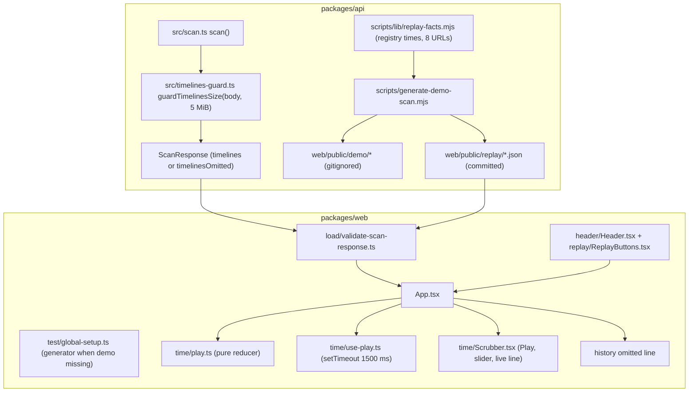

# Design Document: cemetery-time-fixes

## Overview

cemetery-time-fixes clears six problems found after cemetery-time merged and after the first CI run on GitHub.

- **F1** makes every test suite pass on a fresh clone in any workspace order. The api timeline size test stops reading the gitignored demo scan. The web suite creates the demo files itself when they are missing. A static check stops the next test that reaches into another workspace's generated files.
- **F2** gives the two replays the npm registry publish times, so each replay starts Alive, turns Possessed at the bad publish and (axios) returns to Alive.
- **F3** opens a replay at its first Stop and adds a Play control that steps one Stop every 1.5 seconds.
- **F4** adds a size guard to the hosted scan: over 5 MiB the response drops `timelines` and says why.
- **F5** compacts the header so that the canvas starts at or above y 190 at 1440 by 900, and names the replay group "Replay an attack".
- **F6** retakes `docs/cemetery.png` and adds `docs/replay-axios.png` to the README.

Implements requirements 1 to 11 of this spec. It changes no state rule, no policy rule, no evidence field and no demo file. The demo evidence digest stays c8fb6cab465d46ca92cf83dbc10022b6a662c8fad68ec8f64d827ef16f43344d.

### Decisions already made

1. **Paths.** This spec may change `packages/engine`, `packages/api`, `packages/web`, `README.md`, `docs/cemetery.png`, `docs/replay-axios.png`, `.kiro/steering/web.md` and `.kiro/specs/cemetery-time-fixes`. Nothing in `infra`, `packages/cli`, `packages/action` or `.github`. No `package.json` or `package-lock.json` change, except a test script order change in a `package.json` if F1 truly needs it, recorded as a call. F1 does not need it (call 4).
2. **No new runtime dependency.** No web font, image or audio file in the app. No external request at run time.
3. **The demo evidence digest stays** c8fb6cab465d46ca92cf83dbc10022b6a662c8fad68ec8f64d827ef16f43344d, and the three demo files stay byte-identical.
4. **Rules carried from earlier specs.** Never raise the 16 ms budget, never skip a test, never lower `numRuns` or weaken a check. Existing tests change only per "Deliberate test changes". Fix the source, not the test.
5. **Process.** The spec work runs no git command, no build, no test and no network. Read-only node scripts are allowed. No task asks the user. Every call is recorded in "Calls made without a user decision".
6. **Dates.** Every date this spec writes is 24 Nov 2026 (UTC) unless it is an incident or registry fact.

## Confirmation

Each item was checked in the code (and F5 in `docs/cemetery.png`, 1440 by 900, read as an image) on 24 Nov 2026. All six are real.

| Item | Confirmed | Where |
|------|-----------|-------|
| F1 CI fails on a fresh clone | Real | `packages/api/test/timeline-size.test.ts` line 8 builds `DEMO = .../web/public/demo/scan.json` and line 14 reads it with `readFileSync`. `.gitignore` line 33 ignores that file. `packages/web/package.json` line 9 (`"pretest": "npm run demo:generate -w @sexton/api"`) is the only `npm test` path that creates it. Root `package.json` line 17 (`npm run test --workspaces --if-present`) runs the workspaces in the order of the `workspaces` glob: action, api, cli, engine, web, infra. So on a fresh clone api runs before the file exists. `build/ci-first-run.txt` lines 117 to 143 (ubuntu-latest) and 529 to 550 (macos-latest): `Error: ENOENT: no such file or directory, open '.../packages/web/public/demo/scan.json'` at `test/timeline-size.test.ts:14:29`, api "Tests 1 failed, 278 passed (279)", "Test Files 1 failed, 30 passed (31)". npm went on with the other workspaces and they all passed on both systems: action 2 files (line 20 and 431), cli 4 files (170, 582), engine 78 files (290, 703), web 39 files (375, 792), infra 6 files (407, 824). Locally it passed only because a demo scan was left from an earlier build. |
| F2 Replays read Restless before and after the attack | Real | `packages/api/scripts/lib/replay-facts.mjs` line 40 (`1.14.0`, `publishedAt: null`) and line 67 (`5.6.0`, `publishedAt: null`). `packages/api/scripts/generate-demo-scan.mjs` line 157 `replayStateInputs` and line 163 set `lastPublish` only when `publishedAt` is not null, and the function never sets `deprecated` or `advisories`. With none of the three, `packages/engine/src/state.ts` lines 79 to 80 return Restless "all state signals unavailable". The committed fixtures and `packages/web/test/support/replay-fixture.ts` lines 19, 21 and 24 hold exactly that. |
| F3 A replay opens at its last Stop | Real | `packages/web/src/App.tsx` lines 49 to 52: the comment "a new load id falls back to the Scan date (the last Stop)" and `index = picked ... : last`. For axios the last Stop is the clean 1.14.0, so the viewer never sees the attack without dragging. `packages/web/src/time/Scrubber.tsx` lines 22 to 57 has no play control. No live region serves the scrubber: the only `role="status"` elements are `LoadingCard.tsx` line 4 and `drawer/Drawer.tsx` line 47. |
| F4 No runtime guard on the timelines size | Real | `packages/api/src/scan.ts` lines 107 to 110 (`scan()` passes `{ timelines: true }` and returns the body) and lines 207 to 216 and 230 to 238 (the Timelines go into the body with no size check). `packages/api/src/http/responses.ts` line 130 sends `JSON.stringify(body)`. `.kiro/specs/cemetery-time/design.md` line 796 and tasks.md 4.7 and 10.7 record the worst timelines block at about 5.6 MB with the guard left open. |
| F5 Header and scrubber push the graves down | Real | In `docs/cemetery.png` the header ends near y 182 (border), the scrubber band runs to near y 247, the sky (canvas top) starts near y 248 and the first stone (left-padder ring) starts near y 345. Causes: `styles.css` lines 366 to 372 (`.repo-form { flex: 1 1 100% }`) and lines 797 to 801 (`.replay-group { flex: 1 1 100% }`) give the form and the Replay group a row each. `App.tsx` line 73 puts the `Scrubber` under the header, and `styles.css` lines 712 to 757 stack its label row, slider and ticks. `packages/web/src/replay/replay-ids.ts` line 6: `REPLAY_BUTTON_TEXT = { axios: "axios 2026", keyv: "keyv 2026" }`. `ReplayButtons.tsx` line 6: `aria-label="Replay"` with no visible label. |
| F6 Screenshots | Real | `packages/web/e2e/smoke.spec.ts` lines 8 and 72 to 75 write `docs/cemetery.png`. It shows the old header (F5). No test writes a replay image. `README.md` line 5 shows only `docs/cemetery.png` and the Replay section (lines 118 to 122) names the old button texts. |

### Files that tests read and that a script writes

The orchestrator listed every test and e2e file that reads outside its own source. Each entry was read and checked on 24 Nov 2026. "Fresh clone" means `npm ci` only, then the named command.

| File:line | What it reads | Generated or committed | Gitignored | Created by | Safe on a fresh clone in any order | Action |
|-----------|---------------|------------------------|------------|------------|-------------------------------------|--------|
| `packages/api/test/timeline-size.test.ts:8,14` | `packages/web/public/demo/scan.json` | Generated | Yes (`.gitignore:33`) | web `pretest` (`packages/web/package.json:9`) and api `demo:generate` | No. The CI failure. | Build the template package and policy in memory with `buildDemoScan({ fixturesDir })` from the committed engine fixtures (call 3). |
| `packages/web/test/support/demo-scan.ts:6` (used by `a11y`, `app`, `drawer-result`, `markdown`, `marker`, `pr-preview`, `remediate`, `scrubber`, `triage` and `validate-scan-response` tests) | `packages/web/public/demo/scan.json` | Generated | Yes | web `pretest`, same workspace | Yes under `npm test -w @sexton/web` and root `npm test` (pretest runs first). No under a bare `npx vitest run` in `packages/web`. | Add `packages/web/test/global-setup.ts` as Vitest `globalSetup`. It runs the generator when the file is missing (call 4). Keep `pretest`. |
| `packages/web/test/support/replay-fixture.ts:5` (used by `replay` and `validate-scan-response` tests) | `packages/web/public/replay/axios.json`, `keyv.json` | Committed fixture, written by api `demo:generate` | No | api `demo:generate` | Yes. Drift is caught by `packages/api/test/replay-facts.test.ts:48` "are byte-identical on two generator runs and equal the files on disk". | None (call 5). |
| `packages/web/e2e/polish.spec.ts:7`, `packages/web/e2e/remediate.spec.ts:10` | `packages/web/public/demo/scan.json` | Generated | Yes | web `pretest:e2e` (`packages/web/package.json:15`) | Yes via `npm run test:e2e -w @sexton/web` | None. |
| `packages/web/e2e/smoke.spec.ts:55,56,80` | `/demo/evidence.json`, `/demo/evidence.md`, `/demo/scan.json` fetched from the built site | Generated, copied into `dist-e2e` | Yes | web `pretest:e2e` | Yes via `test:e2e` | None. |
| `packages/api/test/generate-demo-scan.test.ts:9,10,15`, `replay-facts.test.ts:7,10`, `timelines.test.ts:4`, `timeline-size.test.ts:6` | the generator script, `../../web/src/load/validate-scan-response.js` and `../../engine/test/fixtures` | Committed source and fixtures | No | not generated | Yes. The four files stay in the `exclude` list of `packages/api/tsconfig.test.json`, as on main. | None. |
| `packages/api/test/generate-demo-scan.test.ts` (whole file) | builds the demo scan and evidence in memory. Its only write is a temp copy of the fixtures under `os.tmpdir()` (lines 110 to 117), removed in `afterAll`. It neither reads nor writes `public/demo`. | n/a | n/a | n/a | Yes | None. |
| `packages/api/test/scan.test.ts:160`, `hosted-plans.test.ts:109` | `packages/web/src/load/validate-scan-response.ts` (path) | Committed source | No | not generated | Yes | None. |
| `packages/api/test/support/fixture-transport.ts:9`, `dynamo/snapshot-store.test.ts:216` | `packages/engine/test/fixtures` | Committed fixtures | No | not generated | Yes | None. |
| `packages/cli/test/support.ts:7`, `packages/cli/test/output.test.ts:11` | `../../engine/test/helpers.js`, `../../engine/test/remediation/arbitraries.js` | Committed test helpers | No | not generated | Yes | None. |
| `packages/action/test/action-yml.test.ts:12,13` | `.github/workflows/sexton.yml`, `ci.yml` | Committed | No | not generated | Yes | None. |
| `packages/engine/test/policy/schema.test.ts:113`, `self-policy.test.ts:14`, `collect-direct.test.ts:6` | `schemas/sexton.policy.schema.json`, `sexton.policy.yml`, `scripts/lib/collect-direct.mjs` | Committed | No | not generated | Yes | None. |
| `packages/web/test/readme.test.ts:7`, `lint-config.test.ts:7`, `correction.test.ts:7` | `README.md`, `eslint.config.js`, `.kiro/specs/cemetery-polish/requirements.md` | Committed | No | not generated | Yes | None. |
| `infra/test/edge-stack.test.ts:223` | nothing on disk. It builds the app with `webAssetPath: null` (`infra/test/helpers.ts:23`) and checks the warning text. Every other infra test uses `infra/test/fixtures/web` (`helpers.ts:11`), never `packages/web/dist`. | n/a | n/a | n/a | Yes, independent of build order | None. |
| `infra/test/nag.test.ts:33,44` | walks `infra/` only, skipping `node_modules` and `cdk.out` | Committed | No | n/a | Yes | None. |
| `infra/test/bundling.test.ts` | builds a fixture entry into a temp dir | Temp output | n/a | the test | Yes | None. |
| any test reading `packages/*/dist`, `dist-types`, `build/` or `cdk.out` | none found. `@sexton/engine` resolves to `packages/engine/dist/index.js` (`packages/engine/package.json` `main`) for api and cli tests, built by their `pretest: tsc -b` through the project reference (`packages/api/tsconfig.json` references `../engine`). | Generated | Yes | api and cli `pretest` | Yes under `npm test`. A bare `npx vitest run` in `packages/api` or `packages/cli` needs `tsc -b` first (call 7). | None. |

`build/fresh-clone` and the outer tree (requirement 1.7): the root `tsconfig.json` has `"files": []` and only project references, so `tsc -b` never reads `build/`. `eslint.config.js` line 6 ignores `build/**`. There is no root Vitest config, and each package config includes only `test/**` under its own package. npm workspaces are `packages/*` and `infra` from the root, so the outer `npm test` does not enter the clone. `infra/test/nag.test.ts` walks `infra/` only. So nothing in the outer tree reads the clone.

## Architecture



The Engine does not change. The replay states still come from `evaluateState`. The web app still holds no state rule.

## Components and Interfaces

### F1, fresh-clone independence

**API.** `packages/api/test/timeline-size.test.ts` drops `DEMO` and `readFileSync`. A `beforeAll` calls `buildDemoScan({ fixturesDir: ENGINE_FIXTURES })` from `../scripts/generate-demo-scan.mjs` (the same call `generate-demo-scan.test.ts` makes) and takes `report.packages[0]`, `report` and `policy` from it. The body, the 300 names, the 64 Segments and both assertions stay. The file stays in the `tsconfig.test.json` exclude list.

**Web.** `packages/web/test/global-setup.ts` (new) exports a default `setup()`. When `packages/web/public/demo/scan.json` does not exist, it runs `execFileSync("npm", ["run", "demo:generate", "-w", "@sexton/api"], { cwd: <repo root>, stdio: "inherit" })`. The command is fixed, there is no shell, and the `predemo:generate` script builds the Engine first. `packages/web/vitest.config.ts` gains `globalSetup: ["test/global-setup.ts"]`. `pretest` stays, so `npm test` keeps regenerating the files on every run. `test/support/demo-scan.ts` keeps its clear error for the case where the generator fails.

**Static check.** `packages/api/test/fresh-clone.test.ts` (new) lists every `.ts`, `.tsx` and `.mjs` file under `packages/*/test`, `packages/web/e2e` and `infra/test` (skipping `fixtures` folders and `node_modules`). For each line that builds or reads a path (`join(`, `resolve(`, `new URL(`, `readFileSync(`, `existsSync(`, `readdirSync(`) it tests these patterns: `public["/, ]+demo`, `["/]dist(-e2e|-types|-types-node)?["/]`, `["/]build["/]`, `["/]cdk\.out["/]`. A match fails the test unless the file is in the allow list: `packages/web/test/support/demo-scan.ts` (web `globalSetup` and `pretest`), `packages/web/test/global-setup.ts` (the creator), `packages/web/e2e/polish.spec.ts` and `packages/web/e2e/remediate.spec.ts` (`pretest:e2e`), and `infra/test/nag.test.ts` (the `cdk.out` skip). The list and the reason of each entry sit in the test. A second example feeds the check a synthetic line like the old `timeline-size.test.ts` line 8 and expects a failure, so the check cannot pass by matching nothing.

**Proof.** The orchestrator runs, from the repository root, `git clone --branch <branch under test> <local repository path> build/fresh-clone`, then in `build/fresh-clone`: `npx npm@11 ci`, `npm test -w @sexton/api`, then `npm test`. It records the exit codes and the per-package file and test counts in "Notes and open items". A clone holds only committed work, so the orchestrator commits the task's work before cloning (call 8). It removes `build/fresh-clone` after recording (it is under the gitignored `build/`).

### F2, registry publish times

`replay-facts.mjs` changes:

- `SOURCE_URLS` gains `registryAxios: "https://registry.npmjs.org/axios"` and `registryKeyv: "https://registry.npmjs.org/keyv"`. The comment says eight URLs.
- axios `sources` gains `{ label: "npm registry: axios", url: SOURCE_URLS.registryAxios }` as its fourth entry. keyv gains `{ label: "npm registry: keyv", url: SOURCE_URLS.registryKeyv }` as its fourth entry.
- axios `versions`: 1.14.0 `publishedAt: "2026-03-27T19:01:40.915Z"`, 1.14.1 `publishedAt: "2026-03-31T00:21:58.168Z"`. Install script and provenance flags as before. No `deprecated` key (null).
- keyv `versions`: 5.6.0 `publishedAt: "2026-01-21T00:39:26.982Z"`, `deprecated: false`, `provenance: false`; 6.0.0-rc.1 `publishedAt: "2026-08-03T19:21:08.158Z"`; 6.0.0 `publishedAt: "2026-08-04T09:35:00.763Z"`. Every other flag as before.
- `stops` and `generatedAt` as in "Replay facts" below.
- `factSources.publishedAt` becomes the registry URL of the replay. keyv gains `factSources.deprecated` (the keyv registry URL). The `installScript` and `provenance` sources stay, except that the provenance of keyv 5.6.0 comes from the registry (call 12).

`generate-demo-scan.mjs` changes:

- `replayStateInputs` sets `inputs.deprecated` when the version has a boolean `deprecated`. Nothing else in it changes.
- `replaySignals` sets the `deprecated` signal from the installed version when that version has a boolean `deprecated`, with `factSources.deprecated` as source, else unavailable as before. The installed versions at the Scan dates (axios 1.14.0, keyv 6.0.0) have none, so both reports keep `deprecated` unavailable.

Then `npm run demo:generate -w @sexton/api` rewrites the two Replay fixtures. The demo files must stay byte-identical (checked by comparing the bytes before and after, and by the digest test).

### F3, opening Stop and Play

**Pure stepping.** `packages/web/src/time/play.ts` (new):

```ts
export const PLAY_STEP_MS = 1500;
export interface PlayState { readonly index: number; readonly playing: boolean }
export type PlayEvent =
  | { readonly type: "load"; readonly count: number; readonly replay: boolean }
  | { readonly type: "play"; readonly count: number }
  | { readonly type: "tick"; readonly count: number }
  | { readonly type: "pause" }
  | { readonly type: "seek"; readonly index: number; readonly count: number };
export function openingStop(count: number, replay: boolean): number; // replay ? 0 : count - 1 (0 when count is 0)
export function playStep(state: PlayState, event: PlayEvent): PlayState;
```

- `load`: `{ index: openingStop(count, replay), playing: false }`.
- `play`: with `count < 2` no change. At `index >= count - 1` gives `{ index: 0, playing: true }`. Else `{ index, playing: true }`.
- `tick`: when not playing, no change. Else `next = index + 1`. At `next >= count - 1` gives `{ index: count - 1, playing: false }`. Else `{ index: next, playing: true }`.
- `pause`: `playing: false`, index kept.
- `seek` (slider and Back to now): `{ index: clamp(index, 0, count - 1), playing: false }`.

**Hook.** `packages/web/src/time/use-play.ts` (new) holds the `PlayState` in `useReducer(playStep)`. It dispatches `load` when `loadId` changes. While `playing` it sets one `setTimeout(PLAY_STEP_MS)` that dispatches `tick`, and the effect cleanup clears it (on each step, on pause, on unmount and on a new load). It returns `{ index, playing, play, pause, seek }`.

**App.** `App.tsx` replaces `picked` with `usePlay(stopInfo.stops.length, state.loadId, response has replay)`. `pick` becomes `seek`. "Back to now" calls `seek(last)` then focuses the slider, as before.

**Scrubber.** `Scrubber.tsx` gains `playing`, `onPlay`, `onPause` and `announce` props. The row becomes: label "History date", the date text, then (when `stops.length > 1`) `<button type="button" className="scrub-play" onClick={playing ? onPause : onPlay}>{playing ? "Pause" : "Play"}</button>`, then the track. A `<p className="scrub-live visually-hidden" aria-live="polite">{announce}</p>` closes the section. `announce` comes from the hook: "Playing from <date>" on play, "<date>" on each step, "End of history at <date>" when the last Stop stops the play, "Paused at <date>" on pause, and "" before the first play. `<date>` is `stopText`. A slider move by the user is announced by the slider's own `aria-valuetext`, so `seek` writes "".

**CSS.** `.scrub-play` follows `.replay-button` (pill, `--border`, `--field`, `--text`). `.scrub-play:focus-visible` has a 3 px outline in `--focus`. `.visually-hidden` clips to 1 by 1 pixel with no colour. No transition or animation on either rule.

### F4, size guard

`packages/api/src/timelines-guard.ts` (new):

```ts
export const TIMELINES_SIZE_LIMIT = 5 * 1024 * 1024; // 5,242,880 bytes
export function responseBytes(body: ScanResponse): number; // Buffer.byteLength(JSON.stringify(body), "utf8")
export function guardTimelinesSize(body: ScanResponse, limit = TIMELINES_SIZE_LIMIT): { readonly body: ScanResponse; readonly omitted: boolean; readonly bytes: number };
```

It returns the input object unchanged when `body.timelines` is absent or `responseBytes(body) <= limit`. Else it returns `{ ...rest, timelinesOmitted: "too-large" }` without `timelines`, `omitted: true`, and the measured `bytes`. Pure, no I/O. A second export, `applySizeGuard(body, log)`, calls it with the constant limit and, when `omitted`, writes `log.warn({ msg: "timelines-omitted", bytes })`. `scan()` in `scan.ts` returns `applySizeGuard(outcome.body, deps.log)` as its body. `scanWithInputs` and the evidence path do not change.

`contract.ts` adds `readonly timelinesOmitted?: "too-large"` to `ScanResponse` with a comment naming this spec.

`validate-scan-response.ts` adds `checkTimelinesOmitted(w, input)`: when the key is present, the value must be exactly `"too-large"` and `timelines` must be absent, else `UNKNOWN_VALUE` at `/timelinesOmitted`. No new error code. The message is the fixed code text, so the value is never echoed.

`App.tsx`: when the scrubber is not shown and `state.response.timelinesOmitted === "too-large"`, it renders `<p className="history-omitted">History is not shown for this scan because it is too large.</p>` at the place of the scrubber. The text is the exported constant `HISTORY_OMITTED_TEXT` in `time/Scrubber.tsx`. `.history-omitted` uses the `.scrub` band padding and colours.

### F5, header layout

Markup changes:

- `ReplayButtons.tsx`: `<div className="replay-group" role="group" aria-labelledby="replay-label"><span id="replay-label" className="replay-label">Replay an attack</span>` then the buttons. `REPLAY_BUTTON_TEXT` becomes `{ axios: "axios, Mar 2026", keyv: "keyv, Aug 2026" }`.
- `Scrubber.tsx` as in F3. The Scrubber stays a sibling after the header in `App.tsx`, so the DOM order, the `.scrub` selectors and the header order test stay.

CSS changes (`styles.css`), all inside existing rules or one new media query `@media (min-width: 960px)`:

| Element | Now | New at 960 px and wider | Target height at 1440 by 900 |
|---------|-----|-------------------------|------------------------------|
| `.site-header` | padding 12px 16px, gap 12px 16px | padding 8px 16px, gap 8px 16px | at most 124 px with border |
| row 1: wordmark, summary, evidence, Legend | one row of about 56 px | unchanged | about 56 px |
| `.repo-form` | `flex: 1 1 100%` (own row) | `flex: 1 1 28rem` | row 2, about 40 px |
| `.replay-group` | `flex: 1 1 100%` (own row) | `flex: 0 1 auto`, `align-items: center`, on row 2 beside the form | on row 2 |
| `.replay-label` | (new) | `color: var(--muted)`, `font-size: 0.875rem` | on row 2 |
| `.scrub` | padding 8px 16px, label row then track then ticks | padding 6px 16px, `display: flex`, `align-items: center`, `gap: 12px`; `.scrub-row` `flex: none`; `.scrub-track` `flex: 1 1 20rem`; notes wrap to their own line (`flex-basis: 100%`) | at most 56 px at the Scan date |
| Canvas top | about 248 | at most 124 + 56 = 180 | at most 190 (requirement 7.1) |

Below 960 px the old rules apply, so the form, the group and the scrubber parts wrap as now. At 360 px every row wraps and nothing is wider than the viewport. The `@media (max-width: 600px)` block stays.

Tab order (DOM order, unchanged except for the two new controls): "Back to now" when shown, JSON, Markdown, Legend, Repository URL, Scan, "axios, Mar 2026", "keyv, Aug 2026", the banner links of a replay, Play, History date, the roving grave.

### F6, screenshots

`smoke.spec.ts` keeps its screenshot step for `docs/cemetery.png`. A new test "the axios replay at its Possessed stop, for the README" sets 1440 by 900 and Reduced motion, blocks foreign origins, opens `/?replay=axios` (it opens at Stop 0, Alive 1.14.0), focuses the slider, presses ArrowRight, waits for the grave name "axios 1.14.1, Possessed" and for two animation frames, and writes `docs/replay-axios.png`. The drawer stays closed. The orchestrator opens both images.

README: the Replay section names the group and buttons, says a replay opens before the attack and can be played with Play, and adds the line ``.

## Replay facts

Only these facts change. Everything else in `replay-facts.mjs` stays as in cemetery-time design.md "Replay facts".

**Sources (eight URLs, all `https://`).** The six of cemetery-time plus:

| Key | URL | Used by |
|-----|-----|---------|
| registryAxios | https://registry.npmjs.org/axios | axios |
| registryKeyv | https://registry.npmjs.org/keyv | keyv |

axios lists trendmicro, csa, npm-trusted, registryAxios (4). keyv lists snyk, osv, gh-issue, registryKeyv (4). The Validator cap of 1 to 6 sources per replay holds.

**Registry facts (given by the user from the registry documents).** axios 1.14.0 2026-03-27T19:01:40.915Z, axios 1.14.1 2026-03-31T00:21:58.168Z (replaces 00:21:00). keyv 5.6.0 2026-01-21T00:39:26.982Z, keyv 6.0.0-rc.1 2026-08-03T19:21:08.158Z, keyv 6.0.0 2026-08-04T09:35:00.763Z (replaces 09:35:00). keyv 5.6.0 has no `deprecated` field and no `dist.attestations`.

**Windows.** Each starts one hour before the Bad publish: axios 2026-03-30T23:21:58.168Z, keyv 2026-08-04T08:35:00.763Z. The axios removal at 2026-03-31T03:29:00.000Z stays (trendmicro, "about 03:29"). The axios Scan date stays 2026-03-31T03:29:00.000Z. The keyv Scan date becomes 2026-08-04T09:35:00.763Z.

**Expected per Stop.** Derived by reading `replayStateInputs` and `state.ts`, then checked with a read-only node call of `evaluateState` from `packages/engine/dist/state.js` on 24 Nov 2026 (call 40). The text column is what `scanTimeView` shows (minutes only).

| Replay | Stop instant (UTC) | Shown as | version | Inputs to `evaluateState` | state | reason |
|--------|--------------------|----------|---------|---------------------------|-------|--------|
| axios | 2026-03-30T23:21:58.168Z | 30 Mar 2026, 23:21 UTC | 1.14.0 | lastPublish 27 Mar 2026 (3 days old, not stale), provenance true so `no-regression`, deprecated and advisories unavailable | Alive | no rule matched |
| axios | 2026-03-31T00:21:58.168Z | 31 Mar 2026, 00:21 UTC | 1.14.1 | lastPublish 31 Mar 2026 00:21:58.168Z, provenance false with 1.14.0 true so `regression`, install script false (no event) | Possessed | provenance regression: 1.14.1 has no provenance, 1.14.0 had it |
| axios | 2026-03-31T03:29:00.000Z | 31 Mar 2026, 03:29 UTC | 1.14.0 | as the first row | Alive | no rule matched |
| keyv | 2026-08-04T08:35:00.763Z | 4 Aug 2026, 08:35 UTC | 5.6.0 | lastPublish 21 Jan 2026 (not stale), deprecated false, provenance false with no earlier true (no input), install script false with no predecessor (no event) | Alive | no rule matched |
| keyv | 2026-08-04T09:35:00.763Z | 4 Aug 2026, 09:35 UTC | 6.0.0 | lastPublish 4 Aug 2026 09:35:00.763Z, install script true with 6.0.0-rc.1 false and Seen time equal to the Stop (within 90 days), provenance true so `no-regression` | Possessed | install script added in 6.0.0 |

The reports at the Scan dates: axios 1.14.0 Alive "no rule matched" with `lastPublish` available (2026-03-27T19:01:40.915Z, source the axios registry URL). keyv 6.0.0 Possessed "install script added in 6.0.0" with `lastPublish` 2026-08-04T09:35:00.763Z (keyv registry URL) and `newInstallScript` `[{ version: "6.0.0", publishTime: "2026-08-04T09:35:00.763Z" }]`. `deprecated` stays unavailable in both reports. The ghost is false at every Stop (advisories unavailable). The Engine gave every row above as read, so no row needed an explanation.

## Data Models

```ts
// api/src/contract.ts
interface ScanResponse { /* existing */ readonly timelinesOmitted?: "too-large" }

// api/scripts/lib/replay-facts.mjs, one version entry
interface ReplayVersionFact { version: string; publishedAt: string | null; installScript: boolean | null; provenance: boolean | null; deprecated?: boolean | null }

// web/src/time/play.ts
interface PlayState { readonly index: number; readonly playing: boolean }
```

The report, the policy result, the evidence body, the digest, the Segment type and the CLI output do not change.

## Error Handling

- A scan response over the Size limit loses only its `timelines`. The report, the policy, the plans, the actions and `pullRequests` stay. The warn line holds the byte count only.
- A body that is over the limit even without `timelines` still loses `timelines` and gets the Omitted reason. The guard never adds data. Such a body cannot come from a 300-package scan today (the report and plans of 300 packages are far under 5 MiB), and the Lambda limit then fails the request as before.
- A `timelinesOmitted` with another value, or together with `timelines`, fails validation with `UNKNOWN_VALUE` at `/timelinesOmitted`, and the usual contract error panel shows.
- The web global setup fails the run with the generator's own error when the generator fails. `demo-scan.ts` keeps its clear message.
- The Play timer is one `setTimeout` at a time. Pause, a slider move, Back to now, a new load and unmount clear it, so no step lands on the wrong response.
- Play with fewer than two Stops does nothing, and the button is not rendered.

## Correctness Properties

*A property is a characteristic or behavior that should hold true across all valid executions of a system-essentially, a formal statement about what the system should do. Properties serve as the bridge between human-readable specifications and machine-verifiable correctness guarantees.*

Reflection. The prework found these criteria testable as properties: 2.6, 2.10, 3.1, 3.2, 3.3, 4.3, 4.4, 4.5, 4.6, 4.10, 5.1, 5.2, 5.3, 5.4, 6.2 and 6.3. They collapse as follows. The four Size guard criteria (5.1 to 5.4) are one property about the same pure function. The validator criteria (6.2, 6.3) are one property over generated values of the field. The opening Stop and the Play stepping criteria (3.1 to 3.3, 4.3 to 4.6, 4.10) are one model-based property over event sequences of the same pure reducer. The replay criteria (2.6, 2.10) are one property over instants of the two windows, and the fixed values of 2.1 to 2.5 are its expected table. The fresh-clone static check (1.6) and the on-disk equality of the replay fixtures (1.5) are examples, not properties: they read a fixed set of files. No criterion here is a security invariant, so every property runs 100 times (call 38).

### Property 1: The size guard bounds the response and keeps every other field

For any scan response body with or without `timelines` and any limit from 1 to 200,000 bytes, `guardTimelinesSize(body, limit)` returns a body that is deeply equal to the input except for the keys `timelines` and `timelinesOmitted`. When the input has `timelines` and `responseBytes(input) <= limit`, the result is the input itself with `timelines` and without `timelinesOmitted`. When the input has `timelines` and `responseBytes(input) > limit`, the result has no `timelines`, has `timelinesOmitted: "too-large"`, and has `responseBytes(result) <= limit` whenever `responseBytes` of the input without `timelines` and with the Omitted reason is at most `limit`. A body without `timelines` is returned unchanged.

**Validates: Requirements 5.1, 5.2, 5.3, 5.4**

### Property 2: The validator accepts the omitted reason only as "too-large" and never with timelines

For any valid scan response and any value `v` drawn from strings (including `"too-large"`, case variants and padded variants), numbers, booleans, null, arrays and objects, setting `timelinesOmitted` to `v` gives a valid result exactly when `v === "too-large"` and the response has no `timelines`. Every rejection holds exactly one error at `/timelinesOmitted` with code `UNKNOWN_VALUE`, and no error message contains `v` when `v` is a string of at least 4 characters. A response without the key keeps its validation result.

**Validates: Requirements 6.2, 6.3**

### Property 3: Play visits the Stops in order and ends at the last

For any Stop count `n` from 0 to 40, any replay flag, and any sequence of events (play, tick, pause, seek to any index) after a `load`, `playStep` keeps `index` within 0 to `max(n - 1, 0)`. After `load` the index is 0 for a replay and `n - 1` otherwise, and `playing` is false. `playing` becomes true only on a `play` event with `n >= 2`. A `pause` or `seek` sets `playing` to false. Starting from any state, a `play` followed by ticks only visits the indices `s, s + 1, ..., n - 1` each once and in order, where `s` is the index before `play` (or 0 when it was `n - 1`), and the state after the tick that reaches `n - 1` has `playing` false. Further ticks change nothing. The reducer is checked against a plain loop model of the same rules.

**Validates: Requirements 3.1, 3.2, 3.3, 4.3, 4.4, 4.5, 4.6, 4.10**

### Property 4: The replays follow the registry facts

For each Replay and any instant `t` from its first Stop to its Scan date, the Replay fixture on disk passes the Validator. The Segment that holds `t` has the version of the latest fact Stop whose `from` is not later than `t`, and its state and reason equal `evaluateState` at `t` on an independent model of the facts of that version and its earlier versions (last publish, deprecated, provenance regression, install script within 90 days). The first `from` equals the Bad publish minus 3,600,000 ms. The Segments, the Stops, the Scan date and the report state equal the table in "Replay facts".

**Validates: Requirements 2.3, 2.4, 2.5, 2.6, 2.10**

## Testing Strategy

Dual approach. Examples cover fixed values, DOM structure, timers and static checks. Properties cover the four universal statements above. All tests are network-free. Property tests use fast-check 3.23.1 with `numRuns` 100. Each property is one test and carries the tag `Feature: cemetery-time-fixes, Property N: <title>`.

PBT does not apply to: the fresh-clone runs (a whole-repository command), the static file check (a fixed file set), the header layout (a browser measurement), the screenshots, the README and the steering text, and the CSS. These use examples, Playwright and review.

| Test file | Content |
|-----------|---------|
| `api/test/timeline-size.test.ts` | Deliberate test change 1 (template in memory). Adds the example: the 300 by 64 case with 200 character reasons goes through `guardTimelinesSize` with the real limit and comes back without `timelines` and with `timelinesOmitted`, and the 80 character case keeps `timelines`. |
| `api/test/timelines-guard.test.ts` (new) | Property 1. Examples: `TIMELINES_SIZE_LIMIT` is 5,242,880; a body exactly at the limit keeps `timelines`, one byte over loses it; a multi-byte reason is counted in UTF-8 bytes, not characters; `applySizeGuard` writes the warn line `timelines-omitted` with `bytes` and no package name for a body over the real limit, and writes nothing under it (fake logger). |
| `api/test/fresh-clone.test.ts` (new) | The static check of requirement 1.6 and its negative example. |
| `api/test/replay-facts.test.ts` | Deliberate test changes 2 to 5. Property 4. |
| `api/test/scan.test.ts` | adds one example: a hosted scan on the fixture transport carries `timelines` and no `timelinesOmitted` (an addition). |
| `web/test/play.test.ts` (new) | Property 3. Hook examples with `vi.useFakeTimers()`: one step after 1,500 ms and none before, stop at the last Stop, pause clears the timer (`vi.getTimerCount()` 0), unmount clears it, a new load clears it, no step without a press. |
| `web/test/scrubber.test.tsx` | Deliberate test change 14. Adds examples: Play is a native button named "Play", Enter and Space start it, its name becomes "Pause", the live line text at start, step, end and pause, no `role="status"` element while playing, no Play with one Stop, Play at the last Stop moves to Stop 0, a slider move and Back to now pause, Reduced motion gives the same steps, axe passes while playing. |
| `web/test/replay.test.tsx` | Deliberate test changes 7 to 11. Adds: a replay opens at Stop 0 with the first row of its table, the group label is visible text. |
| `web/test/validate-scan-response.test.ts` | Property 2. Property 20 of cemetery-time runs unedited on the new support data. |
| `web/test/app.test.tsx` | adds: a response with `timelinesOmitted` shows the omitted line and no slider, a response with neither shows neither. |
| `web/test/a11y.test.tsx` | Deliberate test changes 12 and 13. |
| `web/test/styles.test.ts` | adds: `.scrub-play` and `.visually-hidden` have no transition and no animation, `.visually-hidden` holds no colour literal. |
| `web/test/readme.test.ts` | Deliberate test change 15. |
| `web/e2e/time.spec.ts` | Deliberate test changes 16 to 18. Adds: canvas top at most 190 at 1440 by 900 on the demo at the Scan date (logs the header and scrubber heights), `scrollWidth` 360 at 360 px on the demo and on `?replay=axios`, Play on `?replay=axios` with `page.clock` reaches the Possessed Stop after 1,500 ms and the last Stop after 3,000 ms. |
| `web/e2e/smoke.spec.ts` | Deliberate test change 19 and the replay screenshot test. |

The 16 ms budget of the 300-grave repaint stays. The Play control adds no canvas work: each step is the same repaint as a slider move.

### Deliberate test changes

Every existing test not listed here must pass unmodified. Each change touches only the value this spec changes on purpose. Titles were read from the test files on 24 Nov 2026. The task that applies each change is in brackets. "Old" and "new" are the pinned values.

`packages/api/test/timeline-size.test.ts`
1. "300 packages, 64 Segments each, 200 character reasons, serialise the block under the 6 MB Lambda limit and validate" [Task 1]. Old: the template package, the report and the policy come from `readFileSync` of `web/public/demo/scan.json` (lines 8 and 14). New: they come from `buildDemoScan({ fixturesDir })` in a `beforeAll`, in memory. The two assertions (under 6 MiB, validator ok) stay.

`packages/api/test/replay-facts.test.ts`
2. `EXPECTED`, read by "have the Segments, versions, states and reasons of the Replay facts tables" [Task 2]. Old: axios `["2026-03-30T23:21:00.000Z", "1.14.0", "Restless", "all state signals unavailable"]`, `["2026-03-31T00:21:00.000Z", "1.14.1", "Possessed", ...]`, `["2026-03-31T03:29:00.000Z", "1.14.0", "Restless", "all state signals unavailable"]`, keyv `["2026-08-04T08:35:00.000Z", "5.6.0", "Restless", ...]`, `["2026-08-04T09:35:00.000Z", "6.0.0", "Possessed", ...]`. New: the five rows of "Replay facts" (`23:21:58.168Z` Alive "no rule matched", `00:21:58.168Z` Possessed with the same reason, `03:29:00.000Z` Alive "no rule matched", `08:35:00.763Z` Alive "no rule matched", `09:35:00.763Z` Possessed with the same reason). Versions and the `installed` values stay.
3. "trace every field to the facts file and carry no invented field" [Task 2]. Old: keyv `newInstallScript` `publishTime: "2026-08-04T09:35:00.000Z"`, and source URLs checked against the six. New: `"2026-08-04T09:35:00.763Z"`, checked against the eight. The `deprecated` unavailable check for the installed versions stays.
4. "use only the six source URLs, https only, and no signal that is not on main" [Task 2]. Old: the list `SIX` and `expect(SIX).toHaveLength(6)`. New: the title says "eight", the list is `EIGHT` and the length is 8.
5. "Feature: cemetery-time, Property 13: Segments agree with state as of at every instant" [Task 2]. Old: the model `model()` and the `Fact` type have no `deprecated`. New: `Fact` gains an optional `deprecated` and the model sets `inputs.deprecated` when it is a boolean, as the generator now does. The generated facts, the `numRuns` and the assertions stay.

`packages/web/test/support/replay-fixture.ts` (test data read by `replay.test.tsx` and `validate-scan-response.test.ts`)
6. `EXPECTED_SEGMENTS` and `SIX_URLS` [Task 2]. Old: the instants and states of change 2, and six URLs. New: the five rows of "Replay facts", and `EIGHT_URLS` with eight URLs. Property 20 of cemetery-time in `validate-scan-response.test.ts` and "shows the version, state and reason of each Stop in the grave name, tooltip and drawer" and "places the Stops at the sourced instants, one Step mark at every Stop after the first" in `replay.test.tsx` read the data and need no code edit. `STOP_TEXT` in `replay.test.tsx` needs none either, because `scanTimeView` shows minutes only.

`packages/web/test/replay.test.tsx`
7. "renders the Replay group after the Scan button with the two button texts" [Task 5]. Old: group name "Replay", texts `["axios 2026", "keyv 2026"]`. New: group name "Replay an attack", texts `["axios, Mar 2026", "keyv, Aug 2026"]`.
8. "loads each fixture from the page origin when its button is pressed, then a second one from the header" [Tasks 2, 3 and 5]. Old: after the axios press the label is "axios 1.14.0, Restless", after the keyv press "keyv 6.0.0, Possessed", and the slider text is `STOP_TEXT.keyv[1]` with the comment "at the Scan date of the replay". New: "axios 1.14.0, Alive" (task 2), "keyv 5.6.0, Alive" and `STOP_TEXT.keyv[0]` with the comment "at the first Stop of the replay" (task 3), button names "axios, Mar 2026" and "keyv, Aug 2026" (task 5).
9. "names the provenance regression at axios 1.14.1 and the new install script at keyv 6.0.0 in the tooltip" [Task 3]. Old: the keyv half hovers at load (the last Stop). New: it calls `move(1)` before the hover.
10. "returns to 1.14.0 at the end of the axios replay" [Tasks 2 and 3]. Old: at load `slider().value` is "2" and the label is "axios 1.14.0, Restless". New: it calls `move(2)` first, then expects "2" and "axios 1.14.0, Alive".
11. "Feature: cemetery-time, Property 21: The banner is on every replay screen and links only to https" [Task 2]. Old: `arbReplayBlock` draws URLs from `SIX_URLS`. New: from `EIGHT_URLS` (the import rename of change 6). `numRuns` 1000 and the assertions stay.

`packages/web/test/a11y.test.tsx`
12. "reaches the two evidence links, the Legend control, field, submit and one grave stop by Tab, and wraps out of the page" [Tasks 3 and 5]. Old: nine presses, `seen[5]` "axios 2026", `seen[6]` "keyv 2026", `seen[7]` "History date", the grave active after the ninth. New: ten presses, `seen[5]` "axios, Mar 2026" and `seen[6]` "keyv, Aug 2026" (task 5), `seen[7]` "Play" and `seen[8]` "History date" (task 3), the grave active after the tenth. The roving-stop assertion stays.
13. "gives every DOM control a focus-visible outline of at least 2px" [Task 3]. Addition: the selector `.scrub-play:focus-visible`.

`packages/web/test/scrubber.test.tsx`
14. "is reachable by Tab" [Task 3]. Old: six presses. New: seven presses (the Play control sits before the slider), and the comment names it.

`packages/web/test/readme.test.ts`
15. Addition [Task 8]: a new test "shows docs/replay-axios.png in the Replay section with a non-empty alt text" pins the image line. "pins the Replay section text" and every other test stay unedited: the links and the sentence it pins stay in the README.

`packages/web/e2e/time.spec.ts`
16. "?replay=${id} loads under the CSP with the banner and its links, and no external request" [Task 2]. Old: `toHaveCount(3)` and `SOURCE_HREFS` of three URLs per replay. New: `toHaveCount(4)`, and each list gains its registry URL last.
17. "the axios replay shows Restless 1.14.0, then Possessed 1.14.1, then 1.14.0 again, with no Not-published mound" [Tasks 2 and 3]. Old: title as quoted, the slider value "2" at load, the labels "axios 1.14.0, Restless". New: title "the axios replay shows Alive 1.14.0, then Possessed 1.14.1, then Alive 1.14.0 again, with no Not-published mound", the slider value "0" at load (task 3), the labels "axios 1.14.0, Alive" (task 2). The Home press stays.
18. "the keyv replay shows Restless 5.6.0, then Possessed 6.0.0 at its end, and a second replay opens from the header" [Tasks 2, 3 and 5]. Old: the slider value "1" and "keyv 6.0.0, Possessed" at load, "keyv 5.6.0, Restless" after Home, the button "axios 2026", then "axios 1.14.0, Restless". New: title "the keyv replay shows Alive 5.6.0, then Possessed 6.0.0 at its end, and a second replay opens from the header", "0" and "keyv 5.6.0, Alive" at load (task 3), "keyv 5.6.0, Alive" after Home (task 2), the button "axios, Mar 2026" (task 5), then "axios 1.14.0, Alive".

`packages/web/e2e/smoke.spec.ts`
19. "demo loads under the CSP, then 300 graves redraw within budget" [Task 6]. No assertion changes. The screenshot step writes `docs/cemetery.png` as before, and the image changes because of F5. The replay screenshot is a new test in the same file.

No existing test pins: the header CSS heights, the `.replay-group` and `.repo-form` flex values (`styles.test.ts` line 67 pins only `.repo-form input`), the scrubber row layout, the Replay fixture policy result, the `deprecated` signal of a replay report, `.kiro/steering/web.md` (no test reads it), and the README button texts. `header.test.tsx` "orders the controls evidence JSON, evidence Markdown, Legend, input, Scan in the DOM" renders `Header` without `onReplay` and needs no edit. The demo opens at its Scan date as before, so `scrubber.test.tsx` "resets to the scan date when a new response loads" and the demo e2e tests need no edit.

## Calls made without a user decision

Each item is the question, the call, and the reason.

1. **Which specId?** Call: a fresh UUID v4, `65ef7039-6ea9-4db1-9932-06c2f584f3b9`, checked against every `.kiro/specs/*/.config.kiro`. Reason: the workflow template id `5aff16a3-1b1c-4b47-b0fc-8b220e4c05ac` is already used by another spec.
2. **Which date?** Call: 24 Nov 2026 (UTC) for every date this spec writes. Reason: the brief says today is 24 Nov 2026.
3. **How does the api size test get a package?** Call: `buildDemoScan({ fixturesDir })` in memory from the committed engine fixtures. Reason: it is the same template as before (the first demo package), needs no Generated file and no other workspace's output, and `generate-demo-scan.test.ts` already makes this call. A hand-built package would drift from the contract.
4. **How does the web suite get the demo files on a fresh clone?** Call: a Vitest `globalSetup` that runs the generator only when `public/demo/scan.json` is missing, and `pretest` stays. No `package.json` change. Reason: `npm test` keeps regenerating on every run, a bare `npx vitest run` works on a fresh clone, and reordering workspace tests would hide the next cross-workspace read instead of removing it.
5. **A drift test for the committed Replay fixtures?** Call: none added. Reason: `replay-facts.test.ts` line 48 "are byte-identical on two generator runs and equal the files on disk" already compares the files on disk with the generator output.
6. **Fresh-clone independence as a property?** Call: an example-based static check over the real test files, with one negative example. Reason: the input is a fixed file set, so generated inputs add nothing.
7. **Bare `npx vitest run` in `packages/api` and `packages/cli`?** Call: not changed. Both resolve `@sexton/engine` to `packages/engine/dist/index.js`, which their `pretest: tsc -b` builds through the project reference. Reason: building the Engine is a build step, not a hidden generated test input, and a `globalSetup` that runs `tsc -b` would duplicate `pretest`. Recorded in "Notes and open items".
8. **How is the fresh clone made?** Call: `git clone --branch <branch under test> <local repository path> build/fresh-clone`, run by the orchestrator after it commits the task's work, removed after the counts are recorded. Reason: a clone holds only committed files, which is exactly what CI sees. `build/` is gitignored and ignored by lint. This spec work itself runs no git command.
9. **`npx npm@11 ci` needs the npm registry.** Call: allowed for the orchestrator's proof run only. Reason: installing is not a test. The tests themselves stay offline.
10. **Does "no deprecated field" make keyv 5.6.0 `deprecated: false` available?** Call: yes, with the keyv registry URL as source. It enters the 5.6.0 Segment inputs. Reason: the registry document is the source of the deprecated flag (R-SG-1), and an absent field there means not deprecated. It does not change the state: with an available last publish the 5.6.0 Stop is Alive with or without it. The keyv report is for 6.0.0, which has no stated flag, so the report keeps `deprecated` unavailable.
11. **Does "no dist.attestations" make keyv 5.6.0 provenance false?** Call: yes, `provenance: false` from the registry. Reason: the attestations field of the registry document is what the provenance signal reads. False with no earlier true gives no regression input (the generator looks for an earlier true and finds none), so the state is unchanged. 6.0.0-rc.1 stays null because no fact states it.
12. **Source of keyv provenance.** Call: the per-version `provenance` of 5.6.0 cites the registry. `factSources.provenance` (used for the installed 6.0.0 at the Scan date) stays Snyk. Reason: each fact cites the document that gives it. The report signal is about 6.0.0, whose provenance comes from Snyk.
13. **axios deprecated and attestations.** Call: no new fact. Both versions keep `deprecated` unavailable. 1.14.0 keeps provenance true (cemetery-time call 27, trusted publishing) and 1.14.1 keeps false (trendmicro, csa). Reason: the user stated neither, so nothing is invented.
14. **Source of the publish times.** Call: `factSources.publishedAt` becomes the registry URL of each replay. Reason: the times now come from the registry, and the earlier minute-level times from the reports are replaced.
15. **Source labels and order.** Call: "npm registry: axios" and "npm registry: keyv", appended last. Reason: the banner keeps the reports first, and the labels say what the link is.
16. **Banner, titles, summaries.** Call: unchanged. Reason: the brief keeps them, and the summaries stay true at minute precision ("09:35 UTC", "about 03:29 UTC").
17. **keyv 6.0.0-rc.1 in the window?** Call: it stays a fact and is never a Stop version. Its publish (3 Aug 2026 19:21 UTC) is before the window. Reason: a fresh install of a stable range does not resolve a prerelease (cemetery-time call 38), and it is the predecessor that makes the install script new.
18. **Which responses open at the first Stop?** Call: those with a `replay` block. Every other response opens at its Scan date. Reason: the brief says a non-replay scan still opens at the scan date, and the `replay` block is the only marker of a Replay in the contract.
19. **Play for replays only or for every scan?** Call: every scan whose scrubber has more than one Stop. Reason: the control does the same thing on any timeline, one rule is easier to learn, and the demo with about 20 Stops benefits too. The cost is one Tab stop on the demo, listed in Deliberate test changes 12 and 14.
20. **Name of the Play control.** Call: one native button whose text and accessible name switch between "Play" and "Pause", with no `aria-pressed`. Reason: a toggle should change either its name or its pressed state, not both. A changing name says what the next press does.
21. **Play at the last Stop.** Call: moves to the first Stop and plays from there. The button is never disabled. Reason: the demo opens at its last Stop, so a disabled Play would be useless there. A restart is what a viewer expects of a player.
22. **What pauses?** Call: Pause, a slider move, Back to now, a new load and unmount. Reason: each of these is the viewer taking control or a new context, and a timer that keeps stepping after it would fight the viewer.
23. **Where are the steps announced?** Call: a new `p` with `aria-live="polite"` and the class `visually-hidden` inside the scrubber section, not `role="status"`. Reason: no live region serves the scrubber. The two `role="status"` elements belong to loading and to the drawer. Four test files (`a11y`, `app`, `replay`, `scrubber`) treat "no `role="status"` element" as "loaded", so a persistent status element would also break their `ready()` helper. A polite live region announces the same way.
24. **Announcement texts.** Call: "Playing from <date>", "<date>" per step, "End of history at <date>", "Paused at <date>", with `<date>` the Scan time view text. Reason: short, and the date is the information. A slider move announces through its own `aria-valuetext`, so the live line is cleared then to avoid a double announcement.
25. **Timer.** Call: one `setTimeout(1500)` per step in `use-play.ts`, set in an effect keyed on the state, cleared in its cleanup. Reason: a single pending timer cannot double-step, and the cleanup covers pause, load and unmount in one place.
26. **Reduced motion.** Call: the same steps at the same times. Reason: the steps are discrete moves with no transition (cemetery-time 12.5). The viewer chose to play, so the moves are not unrequested motion.
27. **Size limit.** Call: 5 MiB, 5,242,880 bytes, measured as `Buffer.byteLength(JSON.stringify(body), "utf8")`. Reason: the handler sends `JSON.stringify(body)` with no indentation (`http/responses.ts` line 130), so this is the bytes Lambda returns. The Lambda response limit is 6 MB, and 5 MiB leaves about 1 MiB for headers and for growth of other fields.
28. **Name of the field.** Call: `timelinesOmitted: "too-large"`. Reason: one literal type is easy to validate and leaves room for another reason later without a rename.
29. **Where does the guard run?** Call: in `scan()` on the hosted path only, after `pullRequests` are added, as a pure function in `src/timelines-guard.ts`. Reason: only that path builds `timelines`. The evidence path builds none and the demo scan is 75 KB.
30. **Validator rule for both fields.** Call: `UNKNOWN_VALUE` at `/timelinesOmitted` for any other value and for the pair with `timelines`. No new code. Reason: the pair is contradictory, and a new code would add a text without adding information.
31. **Where does the omitted line sit?** Call: in place of the scrubber, directly under the header, a plain `p` with the scrubber band style. Reason: it answers "where is the history" exactly where the history would be. It is not a status message, so it is not a live region.
32. **Header layout.** Call: CSS in one `min-width: 960px` block plus the Replay group label markup. The Scrubber stays a sibling after the header. Targets: header at most 124 px, scrubber at most 56 px, canvas top at most 190 px at 1440 by 900. Reason: moving the Scrubber into the header would change the DOM order that tests and e2e selectors rely on. Putting the form and the Replay group on one row and the scrubber on one row removes about 60 px.
33. **Play position.** Call: after the History date text and before the slider, in the DOM and on screen. Reason: the visual order and the Tab order then match.
34. **Which screen does the 190 px target measure?** Call: the demo at its Scan date. Reason: a Replay adds the banner and, before its Scan date, the two caption lines, so it is taller by design. The replay screenshot shows that state.
35. **Replay screenshot.** Call: a new test in `smoke.spec.ts` with Reduced motion on, the drawer closed, the Possessed Stop reached by one ArrowRight from the opening Stop. Reason: `smoke.spec.ts` already owns the README screenshot and its paint helper.
36. **README alt text.** Call: "The axios replay at its Possessed stop. The banner says it is reconstructed from public reports." Reason: it says what the picture shows in two short sentences.
37. **Engine changes.** Call: none planned. Reason: every fix sits in the API scripts, the API scan path or the web app. The Engine stays in the allowed paths in case a fix needs it.
38. **`numRuns`.** Call: 100 for all four properties. Reason: none of them is a security invariant. The size guard and the omitted field are about availability and shape. Property 21 of cemetery-time keeps its 1000 runs.
39. **The cemetery-time text "Which Stop is shown first".** Call: left unedited in `.kiro/specs/cemetery-time/design.md` line 428. This spec supersedes it. Reason: that folder is outside the allowed paths.
40. **Process.** Call: during the spec work these read-only node commands ran: `crypto.randomUUID()` for the specId, and `evaluateState` from `packages/engine/dist/state.js` on the new facts (the table in "Replay facts" matches its output). Two earlier attempts printed nothing and were dropped. One of them wrote a scratch script to `/tmp` (outside the repository) and deleted it. No git command, build, test or network call ran.

## Decisions made during implementation

1. **usePlay holds its state with a load key (task 3).** `use-play.ts` keeps `{ key, play, announce }` in `useState`, where the key is the load id, the Stop count and the replay flag. When the key changes it replaces the state during render with the `load` result of `playStep`, in place of a `load` dispatch from an effect. Reason: the loader gives the same load id to the loading state and the ready state, so the Stop count also has to start a new load, and a reset during render means no frame shows the previous response's Stop. The reducer, the events and the timer are as designed.
2. **usePlay takes the Stops, not the count (task 3).** It needs the Stop instants for the announcement texts of call 24. The count is their length.
3. **An event that changes nothing keeps the live line (task 3).** A pause while stopped or a play with one Stop returns the same state, so the last announcement stays.
4. **`.header-top` takes at least half of row 1 at 960 px and wider (task 5).** With only the rules of the F5 table, the form fitted on row 1 beside the evidence links and the Legend, so the summary wrapped to four lines (header 160 px, canvas top 201 px) and the field sat under the drawer, which failed the cemetery-polish e2e "a press on the Repository URL box closes the drawer". `flex: 1 1 50%` on `.header-top` inside the same media block keeps row 1 for the wordmark, summary, evidence and Legend, and starts row 2 at the left with the form and the Replay group.
5. **`.scrub` row gap 0 at 960 px and wider (task 5).** The block uses `gap: 0 12px` in place of `gap: 12px`, so the caption notes that wrap to their own line add no extra 12 px above them.

## Notes and open items

- **Fresh-clone proof after task 1.** Run 24 Nov 2026 on commit 80c7543, cloned to `build/fresh-clone`, `npx npm@11 ci`, no `packages/web/public/demo` folder. `npm test -w @sexton/api` first: exit 0, 32 files, 286 tests, and still no demo folder afterwards. Then root `npm test`: exit 0. action 2 files 12 tests, api 32 files 286 tests, cli 4 files 60 tests, engine 78 files 1059 tests, web 39 files 368 tests, infra 6 files 51 tests (1836 in all). Then task 1.5 in the same clone: `packages/web/public/demo` deleted, `npx vitest run` in `packages/web`: the global setup ran the generator, the three demo files were written, exit 0, 39 files, 368 tests. The clone was then removed.
- **Fresh-clone proof on the final tree.** To be filled by task 9.6, in the same form.
- **Bare Vitest runs.** `npx vitest run` works on a fresh clone in `packages/engine`, `packages/action`, `infra` and, after F1, `packages/web` (its `globalSetup` builds the Engine through `predemo:generate`). In `packages/api` and `packages/cli` it needs `tsc -b` first, which their `pretest` runs (call 7).
- **Demo files.** Task 2.3, 24 Nov 2026: copies saved under `build/k2c-before`, then `npm run demo:generate -w @sexton/api`. `cmp` finds all three byte-identical: `scan.json` 75,283 bytes, `evidence.json` 49,075 bytes, `evidence.md` 19,970 bytes. Printed digest c8fb6cab465d46ca92cf83dbc10022b6a662c8fad68ec8f64d827ef16f43344d. Replay fixtures: `axios.json` 5,605 bytes, `keyv.json` 5,829 bytes.
- **Replay Stops as generated.** Task 2.3, 24 Nov 2026. axios: 2026-03-30T23:21:58.168Z 1.14.0 Alive "no rule matched"; 2026-03-31T00:21:58.168Z 1.14.1 Possessed "provenance regression: 1.14.1 has no provenance, 1.14.0 had it"; 2026-03-31T03:29:00.000Z 1.14.0 Alive "no rule matched". Report 1.14.0 Alive, `lastPublish` 2026-03-27T19:01:40.915Z, 4 sources. keyv: 2026-08-04T08:35:00.763Z 5.6.0 Alive "no rule matched"; 2026-08-04T09:35:00.763Z 6.0.0 Possessed "install script added in 6.0.0". Report 6.0.0 Possessed, `lastPublish` 2026-08-04T09:35:00.763Z, `newInstallScript` [6.0.0 at 2026-08-04T09:35:00.763Z], 4 sources. `deprecated` unavailable in both reports. Every row equals the table of "Replay facts".
- **Header and scrubber heights.** Task 5.4, 24 Nov 2026, Chromium at 1440 by 900 on the demo at the Scan date with Reduced motion: header 122.3 px, scrubber 41.3 px, canvas top 163.6 px (target at most 190, was about 248). The form and the Replay group share row 2, and the label, date, Play and slider share one row. At 360 by 800 `scrollWidth` is 360 on the demo and on `?replay=axios`. Also measured outside the tests: at 1280 the canvas top is the same, and at 960 the header is 192 px because the Scan button wraps under the field.
- **Size guard reach.** With the Engine's short reasons, a real 300-package scan stays far under 5 MiB, so the guard is a backstop. The 300 by 64 case with 200 character reasons is the only test input over the limit.
