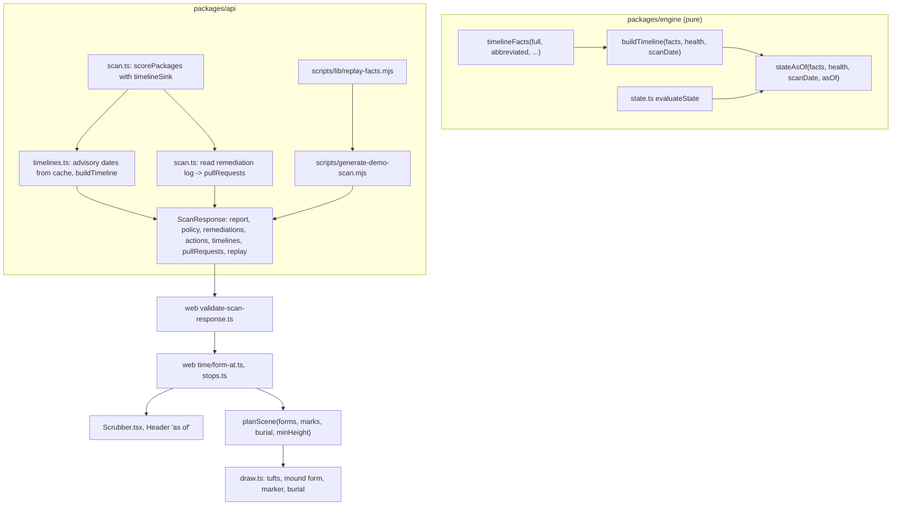

# Design Document: cemetery-time

## Overview

cemetery-time adds time to the Sexton cemetery and clears seven items carried from the cemetery-polish review.

- **Part A** fixes grass, dead space, the header gap, the tooltip flash, one requirement text, the lint ignore list and slow property tests.
- **Part B** adds a history scrubber. The Engine computes, for each package, a short list of Segments: the Form of the grave from a start instant until the next Segment. The scan response carries those lists. The Web app looks up the Form at the chosen instant and repaints. The Web app holds no state rule.
- **Part C** adds a pull request marker and a burial animation.
- **Part D** adds two incident replays, `axios` and `keyv`, as scan responses built offline from public reports and played through the scrubber.

Implements requirements 1 to 24 of this spec. It keeps R-UI-2, R-UI-3, R-UI-6 and R-UI-7 of docs/requirements.md as constraints, amends R-UI-1 and R-UI-4, and changes no state rule, policy rule or evidence pack field.

Out of scope: the publisher-changed and new-dependency signals (a later spec), and any change under `infra`, `packages/cli` and `packages/action`.

### Decisions already made

1. **No new runtime dependency.** No `package.json` or `package-lock.json` changes. `test/imports.test.ts` keeps pinning that for web.
2. **No web font, no image file, no audio file, no external request at run time.** The replay fixtures are JSON on the page origin. The CSP is unchanged.
3. **Grave form still encodes state only.** Two forms are added: the Not-published form (an unmarked mound) and the Pull request marker (a pennant beside the grave, not a form of the stone). Both go in the legend, in `.kiro/steering/web.md`, and in R-UI-1 of docs/requirements.md.
4. **A ghost still means advisories only.** The marker is not a ghost and the Not-published form has none.
5. **The scrubber does not read the snapshot store.** It uses dated facts that the registry and OSV give. A fact without a date is unavailable before the scan date, and the UI says so.
6. **The evidence pack and the policy result describe the scan date only.** The scrubber changes neither.
7. **Every derived file is regenerated from the recorded fixtures.** `npm run demo:generate -w @sexton/api` writes the demo scan, the demo evidence and the two replay fixtures. Nothing is re-recorded from the network.
8. **docs/cemetery.png is retaken after Part A** at 1440 by 900 with the drawer closed, as in cemetery-polish.
9. **The web app imports only types from `@sexton/api`.** Web cannot import Engine code. So the rules of `stateAsOf` run in the Engine, at scan time, and the response carries their result as Segments (see "Why Segments").
10. **Out of scope:** publisher-changed and new-dependency signals.

### Why Segments

The first design idea was to put the raw dated facts in the response and run `stateAsOf` in the browser. That fails two ways. Web may import only types from `@sexton/api`, so it cannot call Engine code. Copying the state rules into web would give two copies of R-ST-2. The chosen design runs `stateAsOf` in the Engine at the instants where a Form can change and writes the result as Segments. The browser does a lookup by time. The Step marks are then exactly the Segment boundaries, so "marks are exactly the dates where some state changes" holds by construction, and the Engine tests prove that the Segments agree with `stateAsOf` at every instant.

## Part A confirmation

Each item was checked in the code and in `docs/cemetery.png` (1440 by 900, read as an image) before its requirement was written. All seven are real.

| Item | Confirmed | Where |
|------|-----------|-------|
| A1 Grass reads as rain | Real | `packages/web/src/scene/layout.ts` lines 53 to 54 (`GRASS_STEP` 14, `GRASS_TILE_HEIGHT` 224) and lines 121 to 128: `floor(w / 14)` tufts, each a vertical blade with `y = floor(v * (224 - h + 1))`, so a blade can start anywhere in the 224 pixel Tile. `packages/web/src/scene/draw.ts` lines 83 to 98 (`drawGrass`): one `fillRect(t.x, top + t.y, 2, t.h)` per tuft per Tile. In the image, thin vertical dashes lie over the whole ground band, between and under the graves, like rain. |
| A2 Dead space | Real | `layout.ts` line 168: `height = SKY_HEIGHT + PADDING + rows * CELL_HEIGHT + PADDING`. `Scene.tsx` line 63 sets the canvas CSS height to `plan.height`. The demo has 12 graves. At 1440 wide there are 7 columns and 2 rows, so `height` is 80 + 16 + 2 * 224 + 16 = 560. The canvas starts under the header at about y 133, so it ends at about y 693. The image shows the ground ending there, with flat `#0b0f0d` below it down to y 900. |
| A3 Header gap | Real | `packages/web/src/header/Header.tsx` lines 43 to 45 put `span.repo-text` and `span.demo-label` in one `p.header-repo`. `styles.css` lines 196 to 212: `.header-repo` has no gap and `.demo-label` is an inline-block chip. In the image the address `https://github.com/sexton-demo/fixture` ends at the x where the chip border starts. |
| A4 Tooltip flash after the drawer closes | Real | `packages/web/src/overlay/use-grave-tooltip.ts` line 12: `const shownIndex = suppressed ? null : state.index;`. While the drawer is open the reducer state keeps its `index`, so when `suppressed` becomes false (`Cemetery.tsx` line 81 passes `suppressTooltip={drawerOpen}`) the old index shows again. The focus return in `Cemetery.tsx` (the `useLayoutEffect` that calls `.focus()` on the grave) raises a second `focus` event. |
| A5 Requirement 7.4 contradicts the build | Real | `.kiro/specs/cemetery-polish/requirements.md` line 154 (criterion 7.4: the tooltip stays shown while the pointer is over it). `packages/web/src/styles.css` lines 104 to 109: `.grave-tooltip` has `pointer-events: none`. The design.md Notes of cemetery-polish record this as open item (a). |
| A6 ESLint ignores miss `build/` | Real | `eslint.config.js` lines 5 to 11: the `ignores` list holds `**/dist/**`, `**/node_modules/**`, `private/**`, `cdk.out/**`, `**/cdk.out/**`, `.kiro/hooks/scripts/**` and the web output paths. It holds no `build/**`. `.gitignore` ignores `build/*`, so git never sees these files but lint does. |
| A7 Property tests time out under load | Real | `build/cp-g-test-run1.txt` lines 31 to 37: api `test/dynamo/cache-store.test.ts` "set resolves, writes nothing, and leaves an earlier entry unchanged" took 24522 ms and hit the 20000 ms timeout. Measured alone on 23 Nov 2026 (this spec): 3384 ms for that test (`build/ct-a7-api-cache-store.txt`), 7319 ms for engine `test/evidence/verify-pack.test.ts` "returns digest-mismatch after one leaf of the body changes" (`build/ct-a7-engine-verify-pack.txt`), and 5196 ms for engine `test/remediation/pr-body.test.ts` "Property 7: PR body signal coverage and no echo" (`build/ct-a7-engine-pr-body.txt`). All three pass alone. The task measures the others. |

Causes found by reading the three tests:

- The api test draws a `fc.uint8Array` of 400 to 600 KB per run, then converts it to hex (about 1.2 MB of text), then the store gzips that text. Generation of half a million array elements per run, 20 runs, is the cost. Fix: generate a 32-bit seed with `fc.integer`, a length with `fc.integer`, and expand to incompressible bytes with the seeded generator `mulberry32` in a helper. The values stay incompressible, the run count stays 20, nothing is skipped.
- The engine `verify-pack` test builds a whole evidence pack (`packOf`, hashing, serialising) for each of 1000 runs. Fix candidates the task measures: build each distinct `arbPack` input once per run and reuse the hash of the unchanged body, and cut `leafPaths` and `canonicalJson` repeats. The 1000 runs stay.
- The engine `pr-body` Property 7 test runs a nested `fc.assert` with the default 100 inner runs inside each of 100 outer runs. Fix candidates: build the context once per outer run and compile the regular expressions once. The inner 100 stay.

## Architecture



Module list. Paths are under the package named in the first column. New files first.

| Package | File | Kind | Content |
|---------|------|------|---------|
| engine | `src/timeline/types.ts` | new | `TimelineFacts`, `TimelineVersion`, `TimelineAdvisory`, `PackageTimeline`, `TimelineSegment`, `Form` |
| engine | `src/timeline/facts.ts` | new, pure | `timelineFacts` |
| engine | `src/timeline/as-of.ts` | new, pure | `stateAsOf` |
| engine | `src/timeline/build.ts` | new, pure | `buildTimeline`, candidate instants |
| engine | `src/clients/osv.ts` | changed | `fetchAdvisoryPublished(ctx, id)`: reads `published` from the cached `osv-vuln` document |
| engine | `src/score.ts` | changed | `ScoringDependencies.timelineSink` (optional), called once per package with the documents scoring already holds |
| engine | `src/index.ts` | changed | exports |
| api | `src/timelines.ts` | new | `buildTimelines(ctx, report, inputs, scanDate)` |
| api | `src/scan.ts` | changed | collects the sink, adds `timelines` and `pullRequests` in `scan()` only |
| api | `src/contract.ts` | changed | `ScanResponse` gains `timelines?`, `pullRequests?`, `replay?` and re-exports the types |
| api | `scripts/lib/replay-facts.mjs` | new | the sourced facts of both incidents and the six source URLs |
| api | `scripts/generate-demo-scan.mjs` | changed | demo timelines, and the two replay files |
| web | `src/time/form-at.ts` | new, pure | `formAt`, `NOT_PUBLISHED` |
| web | `src/time/stops.ts` | new, pure | `stopsFor` |
| web | `src/time/Scrubber.tsx` | new | slider, ticks, caption lines |
| web | `src/time/burial.ts` | new, pure | `burialPhase`, constants |
| web | `src/time/use-burial.ts` | new | animation-frame driver |
| web | `src/replay/replay-ids.ts` | new, pure | `REPLAY_IDS`, `replayAddress`, `parseReplayParam` |
| web | `src/replay/ReplayBanner.tsx`, `ReplayButtons.tsx` | new | banner and header control |
| web | `public/replay/axios.json`, `keyv.json` | new, generated | the two fixtures |
| web | `src/scene/shapes.ts`, `layout.ts`, `draw.ts`, `scenery-seed.ts`, `palette.ts` | changed | tufts, unmarked mound, marker, burial, `marker` token |
| web | `src/Cemetery.tsx`, `App.tsx`, `header/Header.tsx`, `header/Legend.tsx`, `overlay/*`, `drawer/Drawer.tsx`, `load/*`, `styles.css` | changed | wiring |

## Components and Interfaces

### Part A

**A1, tufts (requirement 1).** `scenery-seed.ts` replaces `unitTufts` with `unitClusters(count)`. Cluster `i` uses the 16 randoms `16i` to `16i + 15` of the stream (seed XOR 0x2): one for the centre `cu`, then five for each of three Tufts (offset, base, height, direction, tone). Prefix property: the first `n` clusters of `unitClusters(m)` equal `unitClusters(n)`.

`sceneryFor(width)` stays pure, depends on `width` only, and keeps its one-entry cache. For `clusters = floor(width / 96)` (at least 2 for the minimum width 224) and `span = width - 7`:

```ts
// Tuft i of cluster c
centre = 3 + floor(cu * span)                          // 3 .. width - 4
x      = clamp(centre + floor((off - 0.5) * 48), 3, width - 4)
base   = 8 + floor(v * 9)                              // 8 .. 16, Tile-relative
h      = 4 + floor(r * 5)                              // 4 .. 8
dir    = r2 < 0.5 ? -1 : 1
tone   = r3 < 0.5 ? "dark" : "light"
```

A Tuft has three blades `k = 0, 1, 2` at `bx = x + (k - 1) * 2`. The middle blade has height `h` and leans `dir`. The outer blades have height `h - 2` and lean outward (`-1`, `+1`). A blade is two rectangles: the lower `(bx, base - ceil(bh / 2), 1, ceil(bh / 2))` and the upper `(bx + lean, base - bh, 1, floor(bh / 2))`. So every rectangle lies in x from `x - 3` to `x + 3` and in Tile-relative y from `base - h >= 0` to `base <= 16`. Six rectangles per Tuft, 18 per cluster. Only `fillRect` is used, so the methods before the first `save` stay within the set that `test/draw.test.ts` allows.

`Scenery.grass` becomes `readonly Tuft[]` with `Tuft { x, base, h, dir, tone, rects: readonly (readonly [number, number, number, number])[] }`. The rectangles are built once per width (cached with the Scenery), so painting does not allocate.

The painter draws lines. For `rows = ceil(graves / columns)`, the Row line `t` for `t = 1 .. rows` has top `80 + 224 * t`. The Bottom line is drawn only when `groundHeight - height >= 10`, with top `groundHeight - 26`. For each tone, for each line, `fillRect(rx, top + ry, 1, rh)` for every rectangle of every Tuft of that tone. The order is after the fog band and before every Grave. No Tuft can reach y = 80: the first Row line top is 304.

Counts. At width 1280 with 300 Packages: 13 clusters, 39 Tufts, 234 rectangles per line, 50 Row lines, so 11,700 rectangles, and 11,934 when the Bottom line also draws. The test bound is 12,000. At width 224 with 300 Packages: 2 clusters, 36 rectangles per line, 300 Row lines plus one, 10,836 rectangles. The test bound is 13,000. Before: 4,641. The estimated painter cost rises from about 4,600 to about 12,000 cheap calls per repaint. The cemetery-polish performance fallback applies unchanged if the median passes 16 ms: cache the width-only part (sky, stars, ground, Row line tufts per tile) in an offscreen canvas.

The Scenery depends on the width only, so cemetery-polish Property 3 needs no change. The Row lines come from the plan (`rows`, a function of the grave count), not from the Scenery.

**A2, ground height (requirement 2).** `planScene` takes an optional `minHeight` (default 0). `ScenePlan` gains `rows` and `groundHeight`: `groundHeight = height` for no Packages, else `max(height, floor(minHeight))`. `height` and every Cell position keep their formulas. `Scene.tsx` sizes the canvas from `groundHeight`. The sky gradient, the ground gradient, the fog band and the Bottom line use `groundHeight`. The new hook `use-free-height.ts` returns `max(0, window.innerHeight - top)` where `top` is the container's `getBoundingClientRect().top + window.scrollY`, recomputed on `resize` and when the container width changes. It returns 0 when `innerHeight` is not a finite positive number, which gives the Layout height.

**A3, header gap (requirement 3).** CSS only. `.header-repo` becomes `display: flex; flex-wrap: wrap; align-items: center; gap: 4px 8px;`. The `repo-text` keeps `overflow-wrap: anywhere` and `min-width: 0`. The leading space text node inside `.demo-label` stays (a flex item drops leading white space). A browser test measures the two rectangles at 360, 768, 1280 and 1920.

**A4, tooltip reset (requirement 4).** `tooltip-model.ts` gains the state field `quiet` and the events `reset` and `pointer-move(index, x, y)`. `useGraveTooltip` dispatches `reset` in an effect when `suppressed` becomes true. Rules:

- `reset` hides the tooltip, sets `quiet` true and records nothing else.
- While `quiet`: `pointer-enter` and `focus` do not show. `pointer-move(i, x, y)` shows grave `i` and clears `quiet` when `(x, y)` differs from the last recorded pointer position. The hook records the last pointer position on every pointer event, also while quiet, so a stationary pointer that the browser re-reports after the drawer closes does not count as a move.
- A `focus` that comes from a key press clears `quiet` and shows. `GraveButtons` marks focus as key-driven by `keydown` on a grave button (Tab and arrows already move focus there; the handler records `keyDriven = true` for the next `focus` event). The programmatic `.focus()` that `Cemetery` calls to return focus is not key-driven, so it shows nothing.
- Escape, blur and the grace period are unchanged.

**A5 (requirement 5).** The Correction section text is in the tasks. It quotes criterion 7.4 verbatim and states the built behaviour.

**A6 (requirement 6).** One line added to the `ignores` array: `"build/**"`. A static test reads `eslint.config.js` and checks the entry. The task also lints one temporary file `build/ct-lint-probe.mjs` with a deliberate error, sees no report, and deletes it.

**A7 (requirement 7).** The measured times are in the Part A table above. The task runs `npx vitest run --reporter=json --outputFile=../../build/ct-a7-<pkg>.json` once per package, one package at a time, lists every test with a duration over 5000 ms, applies the fixes named above, measures again, and records the before and after times under "Notes and open items". No `numRuns` goes down, no test is skipped, and no timeout is raised unless the measured times need it (the task records them if it does).

### Part B, Engine

```ts
// engine/src/timeline/types.ts
export interface TimelineVersion {
  readonly version: string;
  readonly publishedAt: string | null;        // ISO. null only in hand-built facts (replay)
  readonly installScript: boolean | null;     // null = unknown
  readonly provenance: boolean | null;
  readonly maintainers: readonly string[] | null;  // at most 10 names
}
export interface TimelineAdvisory { readonly id: string; readonly severity: Severity; readonly summary: string; readonly publishedAt: string }
export interface TimelineFacts {
  readonly installed: string;
  readonly versions: readonly TimelineVersion[];       // Version order, at most 50, installed included
  readonly coveredFrom: string | null;                 // set when older versions were dropped
  readonly advisories: readonly TimelineAdvisory[] | null;  // null = unavailable before the scan date; at most 20
}
export interface Form { readonly state: State | null; readonly reason: string; readonly ghost: boolean }
export interface StateAsOf { readonly form: Form; readonly unavailable: readonly string[] }
export interface TimelineSegment {
  readonly from: string;
  readonly state: State | null;
  readonly reason: string;
  readonly ghost: boolean;
  /** Optional, at most 100 characters. Set only by the replay generator (the Resolved version during the Segment). buildTimeline never sets it. */
  readonly version?: string;
}
export interface PackageTimeline { readonly installed: string; readonly coveredFrom: string | null; readonly segments: readonly TimelineSegment[] }
export const TIMELINE_MAX_VERSIONS = 50, TIMELINE_MAX_ADVISORIES = 20, TIMELINE_MAX_MAINTAINERS = 10, TIMELINE_MAX_SEGMENTS = 64;
```

**`timelineFacts(input)`** (requirement 8.1 to 8.6). Input: the full packument document (or null), the abbreviated document (or null), the installed version, the provenance signal, the advisories signal and a map from advisory id to published time or null. It takes versions from the packument `time` map (not from `versions`, because the recorded fixtures keep one entry in `versions` and the whole history in `time`), drops `created` and `modified`, keeps entries that parse as dates and are not later than the scan clock, sorts by `compareVersionOrder` of `history.ts`, keeps the 49 most recent plus the installed version (50 in all), and sets `coveredFrom` to the publish time of the oldest of the 49 when versions were dropped. A version is in the abbreviated map: `installScript = entry.hasInstallScript === true`. Not in the map or no abbreviated document: `null`. Provenance: only the installed version, `present` of the provenance signal when available. Maintainers: `versions[v].maintainers` or `versions[v]._npmUser` when present, as names, capped at 10. Advisories: `null` when the signal is unavailable, or any advisory has no published time, or more than 20 apply.

**`stateAsOf(facts, health, scanDate, asOf)`** (requirement 9, 10).

```ts
export function stateAsOf(facts: TimelineFacts, health: PackageHealth, scanDate: Date, asOf: Date): StateAsOf {
  if (asOf.getTime() >= scanDate.getTime()) return { form: currentForm(health), unavailable: [] };
  const seen = seenTimes(facts.versions, scanDate);           // Seen time of each version, ms
  const installedAt = seen[indexOf(installed)];
  if (installedAt > asOf.getTime()) return { form: NOT_PUBLISHED_FORM, unavailable: [] };
  const inputs = buildInputs(facts, seen, asOf);              // StateInputs
  const { state, stateReason } = evaluateState(inputs, asOf);
  return { form: { state, reason: stateReason, ghost: ghostAsOf(facts, asOf) }, unavailable: UNAVAILABLE_BEFORE_SCAN };
}
```

`currentForm(health)` is `{ state: health.state, reason: health.stateReason, ghost: hasAdvisoriesGhost(health) }`. `buildInputs` fills `StateInputs`:

- `lastPublish`: the latest Seen time of a dated version not later than `asOf`, as a `Date`; absent (unavailable) when `coveredFrom` is set and `asOf < coveredFrom`.
- `deprecated`: absent (unavailable).
- `advisories`: when `facts.advisories` is not null, the advisories with `publishedAt <= asOf`; else absent.
- `maintainerChange`: from consecutive versions with non-null maintainer lists that differ as sets, the later one with a Seen time in `[asOf - 90 days, asOf]`: `{ status: "history-sufficient", events: [{ kind: "snapshot-pair", before, after, eventTime, recent: true }] }`. No such pair: absent.
- `provenanceRegression`: when the installed version has `provenance === false` and its Seen time is `<= asOf` and an earlier version in Version order has `provenance === true`: `{ status: "regression", installedVersion, earlierVersion, snapshotCaptureTime: <Seen time of installed, ISO> }`. The `snapshotCaptureTime` is the instant the regression became observable. Otherwise absent.
- `newInstallScript`: for each version `j >= 1` with `installScript === true`, predecessor `installScript === false`, and Seen time in `[asOf - 90 days, asOf]`: `{ version, publishTime }`. Empty: absent.

This reuses `evaluateState`, so the Possessed, Dead, Haunted, Restless, Alive order, the state-age rule and the all-unavailable rule are the ones the scan uses. Differences from `history.ts` by design: a predecessor must be known false (the engine treats a missing abbreviated entry as false, which is a property of full abbreviated documents, and the recorded fixtures keep one version only), and the provenance regression is evaluated from per-version flags, not from the latest snapshot.

Seen time: the version's own publish time; for a null `publishedAt`, the publish time of the next dated version in Version order; if there is none, the scan date.

**`buildTimeline(facts, health, scanDate)`** (requirement 8.7 to 8.10).

1. Candidate instants, in milliseconds: for every Seen time `s` of a dated entry: `s`, `s + 90 d + 1 ms`, `addMonthsUtc(s, 24) + 1 ms`, and every UTC midnight from 3 days before to 3 days after `addMonthsUtc(s, 24)`. For every advisory time `a`: `a`. For `coveredFrom`: `coveredFrom`. A staleness candidate is kept only when no later dated version has a Seen time at or before it (if one has, `s` is not the last publish there). The midnights cover the case where `monthsBefore` in `state.ts` clamps 29 February, which makes the stale test non-monotone in a window of about two days.
2. Keep candidates `c` with `first <= c < scanDate`, where `first` is the smallest Seen time or advisory time. Add `first`.
3. Evaluate `stateAsOf` at each candidate in order. Start a new Segment when `(state, ghost)` differs from the previous one. A Segment holds the reason of its first evaluation. `buildTimeline` writes no `version`. The merge compares `(state, ghost, version)` so that the same function can merge hand-built versioned input, and for its own output `version` is always absent.
4. Handle the Scan date: `scanForm = currentForm(health)`. When it differs in `(state, ghost)` from the last Segment, add a Segment at `scanDate`. Otherwise the last Segment takes the scan reason.
5. If more than 64 Segments result, drop the oldest, set `coveredFrom` to the `from` of the oldest kept one.

Cost: at most `50 * 10 + 20 + 2` candidates, each one `stateAsOf` call that is linear in 50. About 25,000 operations per package, 7.5 million for 300 packages. The test measures it.

Why the Segments are right between candidates: the inputs of `evaluateState` change only when a Seen time is passed, when a 90-day window closes, when `monthsBefore(asOf, 24)` passes a publish time, when an advisory time is passed, or at `coveredFrom`. Every such instant is a candidate. The agreement test samples random instants and the instants of every fact and one millisecond before, and compares `formAt(segments, t)` with `stateAsOf(t)`.

### Part B, API

**Where the data comes from (finding).** Hosted scoring already fetches both documents for each package. `packages/engine/src/score.ts` line 142 calls `fetchFullPackumentDocument(ctx, name)` with `Accept: application/json` (the full packument) and `readAbbreviated` at lines 120 to 135 reads the abbreviated packument with `ABBREVIATED_ACCEPT`. `clients/npm.ts` line 58 and line 66 show the two headers. OSV advisories are fetched by `fetchAdvisory` for each id, which the cache keeps under the key source `osv-vuln`. The attestations request is for the installed version only (`clients/attestations.ts`, `attestationsUrl(name, version)`), so a hosted Timeline has the provenance flag of the installed version and null for the others.

A packument larger than `MAX_CACHE_VALUE_BYTES` (350 KB, `api/src/dynamo/cache-item.ts` line 9) is not stored in the cache. Reading it again from the cache would fetch it a second time from the registry. So the design does not read it again. `scorePackages` gets an optional `timelineSink(input)`, called once per package from `scoreOne` with the two documents and the provenance signal it already holds. The API collects those in a map. No extra packument request happens.

OSV `published` is not in `Advisory`. `fetchAdvisoryPublished(ctx, id)` reads the same cached `osv-vuln` document (small, always cacheable) and returns `published` when it is a parseable ISO string, else null. It is a cache hit after scoring. Concurrency 8, as in scoring.

`api/src/timelines.ts`:

```ts
export async function buildTimelines(ctx: ClientContext, report: HealthReport, inputs: ReadonlyMap<string, TimelineInput>, scanDate: Date): Promise<Record<string, PackageTimeline>>;
```

For each package: resolve advisory dates, `timelineFacts`, `buildTimeline`. Any throw omits that package (requirement 8.12). The result has own properties only (`Object.fromEntries`), so a package named `__proto__` is a plain key.

**Where it runs.** `scan.ts` has `scanWithInputs` (shared with the evidence path) and `scan()` (the GET /api/scan path). `scanWithInputs` gets a parameter `options: { timelines: boolean }`, false for the evidence path. `scan()` passes true, then reads the remediation log (Part C) and builds the body. The evidence path adds no cost.

**Size.** Per package at most 64 Segments of about 150 bytes (ISO time, state, a reason up to 200 characters, a flag): about 10 KB worst case, 3 MB for 300 packages in the very worst case, under the 6 MB Lambda response limit. A typical package has under 10 Segments. The task adds a test that builds the largest allowed response and asserts it stays below 4 MB. If the real response were close to the limit, that would be an infra question (response streaming), recorded under "Infra needed (not designed)".

**Contract.**

```ts
export interface PullRequestMark { readonly package: string; readonly kind: RemediationKind; readonly prUrl: string; readonly timestamp: string }
export interface ReplayInfo { readonly id: "axios" | "keyv"; readonly title: string; readonly summary: string; readonly sources: readonly { readonly label: string; readonly url: string }[] }
export interface ScanResponse {
  readonly report: HealthReport; readonly policy: PolicyResult;
  readonly remediations?: readonly RemediationEntry[];
  readonly actions?: { readonly remediate: boolean };
  readonly timelines?: Readonly<Record<string, PackageTimeline>>;
  readonly pullRequests?: readonly PullRequestMark[];
  readonly replay?: ReplayInfo;
}
```

**Validator** (`validate-scan-response.ts`). New code `TOO_MANY_ITEMS` (text "more than the allowed number of items"). The code list is not enumerated by a test (the validator test reads `CONTRACT_ERROR_TEXT[e.code]`), so this adds no test change. Checks: `timelines` is an object, each key is a package name of the report, each value has `installed` (string, at most 100 characters), `coveredFrom` (null or parseable string), and `segments` (array of 1 to 64; each `from` parseable and strictly after the previous, `state` null or one of the five, `reason` string of at most 200 characters, `ghost` boolean, `version` absent or a string of at most 100 characters; a `version` of another type or of 101 characters gives a contract error at its path). `pullRequests`: at most 300 entries, each package in the report, `kind` in the kind list, `prUrl` starting with `https://`, `timestamp` parseable. `replay`: `id` in `axios` or `keyv`, `title` and `summary` strings of at most 120 and 600 characters, `sources` 1 to 6 entries with `label` at most 120 characters and `url` a string (a non-https address is accepted by the validator and rendered as text by the banner, so the validator stays a shape check). Unknown keys are ignored as before.

### Part B, Web

**`time/form-at.ts`.**

```ts
export const NOT_PUBLISHED = { state: null, ghost: false } as const;
export function formAt(timeline: PackageTimeline | undefined, instantMs: number, scanForm: Form): FormView;
```

No timeline: the scan Form. `instantMs` before the first Segment: the Not-published form when `coveredFrom` is null, else the first Segment's Form. Otherwise the last Segment with `from <= instantMs` (binary search). A grave with no timeline entry never changes with the scrubber. `FormView` carries the Segment `version` when there is one (`version?: string`), and the scan Form has none.

**`time/stops.ts`.** `stopsFor(response)` returns `{ stops: number[], startMs, scanMs, hasTimelines }`. Stops are the sorted, deduplicated union of: the Scrubber start (earliest Segment `from` of any Timeline minus 3,600,000 ms, or that `from` itself when the Segment with it carries a `version`: a Replay window already starts with a package in view, so adding an hour would put the start before every fact and show the Not-published form), every Step mark (a Segment `from` whose Form, compared as state, Ghost and `version`, differs from the previous Segment, with the Form before the first Segment being Not-published unless `coveredFrom` is set), and `scanMs` (`Date.parse(report.generatedAt)`). Marks later than `scanMs` are clamped out. 300 packages with 64 Segments is at most 19,200 comparisons.

**`time/Scrubber.tsx`.**

```tsx
<section className="scrubber" aria-label="History">
  <label htmlFor="history-date">History date</label>
  <div className="scrub-track">
    <input id="history-date" type="range" min={0} max={stops.length - 1} step={1} value={index}
           aria-valuetext={scanTimeView(iso(stops[index])).text} onChange=... />
    <svg className="scrub-ticks" aria-hidden="true" focusable="false"> one <path d="M x 0 v 6 M x 0 v 6 ..."/> </svg>
  </div>
  {index < last && <p className="scrub-note">Before the scan date Sexton uses only dated facts. Deprecation, undated advisories and snapshot history are unknown.</p>}
  {index < last && <p className="scrub-note">The drawer shows the scan date.</p>}
</section>
```

Native `input type="range"` gives arrow keys, Home and End, and a slider role to assistive technology. The tick path is one element whatever the mark count. The Stops are equally spaced by index, which keeps every Step mark reachable and visible even when two fall close in time. The visible label shows the current date. The header "as of" line is `<span class="as-of">as of <ScanTime iso=... /></span>` plus `<button>Back to now</button>`. The scrubber is not inert while the drawer is open, as the header; it lies in the header region (see Cemetery). Under Reduced motion nothing animates in any case: the Form changes at once, and the CSS declares no transition on graves (the canvas has none).

**State.** `App` holds `stopIndex`. A `useReducer` keyed by `state.loadId` resets it to the last Stop for each new response. `App` computes `stops` with `useMemo`. `Cemetery` receives `asOfMs` (the Stop value) and the `scanMs`. For each package in the triage order it computes `formAt(timelines[name], asOfMs, scanForm)`. That is 300 lookups of a binary search per move.

**Plan.** `planScene` gains optional `forms?: readonly (FormView | undefined)[]`, `marks?: readonly boolean[]`, `burial?: { index: number; phase: number } | null` and `minHeight?: number`. `GravePlan` gains `pending: boolean`, `marker: boolean` and `burial: number | null` (the phase, or null). For a grave with a form: `state` is the Form state or, for the Not-published form, the scan state (unchanged), `pending` is true for Not-published, `shape` is `"unmarked"` when pending and `SHAPE_BY_STATE[state]` otherwise, `fill` is the `border` token when pending and the State colour otherwise, and the Ghost follows `form.ghost` and is dropped when pending. A plan without `forms` equals the old plan with `pending false`, `marker false`, `burial null`. The triage order is computed once from the scan.

**Shapes.** `ShapeId` gains `"unmarked"`: a low mound without a stone, in the 64 by 64 shape box `M8 60 Q8 44 32 44 Q56 44 56 60 Z` with no detail, no pit, tilt 0, with the SPECKS and SOLID_BOXES entries that the draw tests iterate: solid box `(12, 50, 40, 10)`, specks `(20, 52) (30, 50) (42, 54) (36, 57)`. All inside the solid box. `SHAPE_BY_STATE` is unchanged, so the five States keep four shapes. The unmarked mound sits low in the Cell, with the Plinth and the name below as for every grave.

**Versioned Segments (requirement 12.9).** When `formAt` returns a Form with a `version`, the plan sets the `inscription` of that grave from that version (the `name version` text, in place of the report version), the grave button name and the tooltip use the same version, and the drawer gets two props: `shownVersion` (the Segment version, or undefined) and `asOfLine` (`State on <date>: <State>. <reason>` built with `scanTimeView` for the As-of date, or undefined when the Segment has no version). The drawer title is `<name> <shownVersion ?? report version>` and `asOfLine` is a `p` under the title. The signals, policy and remediation lists of the drawer stay those of the scan (requirement 12.7), and the existing note "The drawer shows the scan date." stays. The version is rendered as text. Forms without a `version` (every hosted scan and the demo) render exactly as before.

**Tooltip and button names.** `tooltipContent(pkg, form?)` writes, for a Form before the scan date, the state, the reason as of that date and "as of <date>". For Not-published: "not yet published on this date" in place of the state. The grave button name becomes `<name> <version>, not yet published on this date` for the Not-published form, `<name> <version>, <State>` plus the advisory suffix plus ` pull request opened` otherwise. The legend adds two chips.

### Part C

**Where the marker comes from (decision, with evidence).** The scan response supports it, and so does the session.

- Response: `ScanDeps.remediationLog` exists (`api/src/scan.ts` line 58) and the scan handler passes it in (`api/src/scan-handler.ts` line 69, built from `REMEDIATION_LOG_TABLE`). Today only the evidence path reads it (`api/src/evidence.ts` lines 28 to 37, `readLog`, using `request.repoUrl.toLowerCase()` at line 60). The scan function already has the table name in its environment (`infra/lib/edge-stack.ts` line 220, `environment: { ...environment, ...remediateEnvironment, ... }` for the `ScanFunction`) and the permission `dynamodb:Query` on the log table (`infra/lib/edge-stack.ts` line 154, `this.scanRole.addToPolicy`). So `scan()` can read the log with no infra change. The reader type is `RemediationLogReader.list(repository)` (`api/src/remediate/log-store.ts`). `scan()` calls `list(repoUrl.toLowerCase())`, keeps the latest entry by `timestamp` for each package that is in the report, and returns at most 300 `PullRequestMark` entries. A failed read omits `pullRequests`, with one warn line (`msg: "remediation-log-unavailable"`, `errorName` only), as `readLog` does.
- Session: right after "Open pull request" answers `opened` or `existing` (`web/src/load/remediate-client.ts`, `requestRemediation`; used by `RemediateAction` in `web/src/drawer/Drawer.tsx` lines 22 to 47), the grave must show the marker before any rescan. So `Cemetery` keeps a set of package names for the loaded scan.

The marker therefore shows for a package that is in `pullRequests` or in the session set. What the marker means: Sexton wrote a log entry for a pull request on this package. The log is append-only and Sexton never asks GitHub whether the pull request is still open, so the marker text is "pull request opened", not "open". A plan in `remediations` is not a pull request and never marks a grave (requirement 14.6).

**Marker drawing.** A pennant at fixed Cell coordinates, the same for every grave: pole `fillRect(160, 124, 2, 44)`, flag `fillRect(162, 124, 14, 4)`, `(162, 128, 10, 4)`, `(162, 132, 6, 4)`, in `marker` (#efe6c4, the wordmark hex). Only `fillRect`, so the path-fill count stays two per grave plus one per Ghost. It lies right of every stone box (the widest stone box ends at cell x 140) and above the Plinth top (168).

**Burial.** `time/burial.ts` is pure:

```ts
export const BURIAL_MS = 1200;
export interface BurialFrame { readonly sink: number; readonly mound: number; readonly marker: boolean }
export function burialFrame(phase: number): BurialFrame;   // phase clamped to [0, 1]
```

`phase < 0.35`: `sink = phase / 0.35`, `mound = 0`. `0.35 <= phase < 0.65`: `sink = 1`, `mound = (phase - 0.35) / 0.3`. `phase >= 0.65`: `sink = 1 - (phase - 0.65) / 0.35`, `mound = 1 - (phase - 0.65) / 0.35`, and `marker = true` from 0.65. The painter, for a grave with `burial !== null`: `save`, `beginPath`, `rect(cell.x, cell.y, 192, 168)`, `clip`, translate the stone group (shadow stays) down by `sink * 130` CSS pixels, draw the stone as usual, `restore`; then draw the mound as an ellipse at `(cell.x + 96, cell.y + 168)` with radii `60 * mound` and `14 * mound` in `grassLight` using `beginPath`, `ellipse`-free `arc` with a scale (the same technique as the Shadow). The Ghost is not drawn during the burial. The Plinth and the name stay. The `burial` value is plain numbers in the plan (requirement 15.7), so the painter is pure.

`use-burial.ts` drives `phase` with `requestAnimationFrame` from the moment the burial starts, updates a state number each frame, and stops at 1. Under Reduced motion it does nothing and the marker is added at once. A burial starts once per package and loaded scan (a ref set). A burial that is queued while the drawer is open starts when the drawer closes (see Calls). The marker shows from phase 0.65 and stays.

The animation never changes `state`, `shape` or `fill` of a GravePlan: those come from the Form.

### Part D

**Replay ids and addresses.** `replay/replay-ids.ts`: `REPLAY_IDS = ["axios", "keyv"] as const`, `replayAddress(id) = "/replay/" + id + ".json"`, `parseReplayParam(search)`: `null` when absent, `{ id }` for a known id, `{ rejected: true }` otherwise. `use-scan-loader.ts` checks `replay` before `scan`. A rejected value sets the error state `scan-url-rejected` without any request. A known id calls `start(replayAddress(id), "replay")`, which passes `checkScanUrl`: `new URL("/replay/axios.json", origin)` has the page origin, no credentials, so `{ ok: true }` (`check-scan-url.ts` lines 9 to 17). `LoadSource` gains `"replay"`. The header Replay group calls `loader.loadFrom(replayAddress(id), "replay")`.

**What a replay screen shows.** `ReplayBanner` renders, when `response.replay` is present, `<aside role="note" class="replay-banner">`: the title in `strong`, the exact text "Reconstructed from public reports. Not a live scan.", the summary as text, and a list of the sources. A source is an `a` with `target="_blank" rel="noopener noreferrer"` when its URL starts with `https://` and contains no white space, else its label as text. The banner shows above the scene in `App`, and again at the top of the drawer (`Drawer` gets `replay`). `headerModel` gets no demo label for a replay, the evidence links are absent (they appear only for `source === "hosted"`), and `onRemediate` is undefined, so the drawer shows the existing demo-only note in place of the button.

**Replay facts.** In section "Replay facts" below.

**Replay Segments follow the Resolved version.** The generator does not call `buildTimeline` for a replay: a Seen-time rule would hide the first version before its (unknown) publish time, and a replay must show the version a fresh install resolves at each moment, not a one-step change. For each Stop of the replay facts (a list of `{ from, version }`) it builds the `StateInputs` of that version from the facts of that version and of the versions before it in Version order (last publish only when the version has a publish time, possession inputs by the same rules as `stateAsOf`: install script by the known-false predecessor rule, provenance regression by the earlier-version rule), calls `evaluateState(inputs, new Date(from))` and writes `{ from, state, reason, ghost: false, version }`. The expected rows are in "Replay facts". Ghost is false because the advisories signal is unavailable. The Timeline has `installed` = the Resolved version at the Scan date, `coveredFrom` null, and the Segments in order. The first Segment `from` is the window start, and `stopsFor` uses it as the Scrubber start (no extra hour, because the first Segment has a `version`). The replay `report` is built with `buildHealth` for the installed version at the Scan date, and its state equals the last Segment (checked by the replay test).

### Docs and steering

`docs/requirements.md`: R-UI-1 gains "a package whose installed version is not yet published on the chosen date shows an unmarked mound (the Not-published form), and a package with a logged pull request shows a pennant beside its grave. Neither changes the grave form of a State." R-UI-4 gains "The drawer shows the scan date." Version line 0.3 to 0.4, 23 Nov 2026. Change-log line: "0.4, 23 Nov 2026. R-UI-1: Not-published form and pull request marker. R-UI-4: drawer shows the scan date. Time features: history scrubber, burial, replay." The version line today reads "Version 0.3, 21 Nov 2026" (line 3) and the last change-log line is 0.3 (line 199).

`.kiro/steering/web.md` gains: tuft grass along Row lines, ground height, the scrubber (native range, aria-valuetext, Stops), the as-of rule (a Segment lookup, no state rule in web), the two forms, the burial (fixed phases, one per package, marker not a ghost), the replay and its banner text. `engine.md` gains the Timeline, `stateAsOf` and the rule that the Engine computes Segments. `product.md` gains the three time features and the two replays. The README gets "Replay" (two links `?replay=axios` and `?replay=keyv`, the sentence that a replay is reconstructed from public reports and not a live scan). The retaken screenshot replaces `docs/cemetery.png`.

## Data findings and consequences

Read from `packages/engine/test/fixtures/packages/*` and `packages/api/scripts/generate-demo-scan.mjs` on 23 Nov 2026. Each finding of the brief was checked.

| Finding | Result |
|---------|--------|
| `packument.json` carries `time` and top-level `maintainers` | Confirmed. `time` holds every version (3,011 keys for react, 15 for left-pad). |
| `versions` entries carry no per-version `maintainers`, no `_npmUser`, no `scripts` | Confirmed. The `versions` map holds one entry per package (the installed one), keys only `deprecated` on four packages. So `timelineFacts` takes versions from `time`, not from `versions`. |
| Install scripts come from `abbreviated.json` `hasInstallScript` | Confirmed. The `versions` map there also holds one entry per package. Only `node-sass@7.0.3` has `hasInstallScript: true`. |
| OSV `vulns/*.json` carry no `published` | Confirmed for the five files (event-stream one, express two, lodash two). `osv-querybatch.json` has `modified` only. |
| `attestations.json` has a body only for semver | Confirmed. |
| The seed package `left-padder` | From `seed-maintainer-change.json` and `seedRoutes` in the generator: two versions in `time`, `maintainers` list, an attestation. It is Possessed at the scan date by the seeded snapshot, which the scrubber does not read. |

Consequences for the demo. For versions other than the installed one, install script, provenance and maintainers are null (unknown). Advisories have no dates, so the advisory list is null. Deprecation is undated. So before the scan date the only facts are publish times. Each package therefore has this timeline: Not-published until the installed version is published, then Alive (or Restless once the last publish is more than 24 months old), then at the scan date its real state. From the recorded `time` maps and the scan date 12 Nov 2026:

| Package | Installed published | Last publish | Alive to Restless on |
|---------|---------------------|--------------|----------------------|
| request 2.88.2 | 11 Feb 2020 | 11 Feb 2020 | 11 Feb 2022 |
| left-pad 1.3.0 | 9 Apr 2018 | 9 Apr 2018 | 9 Apr 2020 |
| node-sass 7.0.3 | 8 Sep 2022 | 20 May 2023 | 20 May 2025 |
| event-stream 3.3.6 | 9 Sep 2018 | 29 Sep 2018 | 29 Sep 2020 |
| colors 1.4.0 | 22 Sep 2019 | 9 Jan 2022 | 9 Jan 2024 |
| lodash, express, moment, react, uuid, semver, left-padder | various | within 24 months of the scan | never |

(Dates from the packument `time` maps. The last publish of react is an experimental build of 11 Nov 2026. semver 7.8.6 was published 2 Nov 2026, so it is Not-published for all but ten days before the scan.) The graves that change Form on the timeline from publish times alone are all twelve (Not-published to a State at the publish of the installed version) and five more turn from Alive to Restless on the dates above. node-sass is not Possessed on the timeline: its install script flag is true, but its predecessor's flag is null (unknown), and a predecessor must be known false. The deprecations (left-pad, request, uuid, node-sass), the advisories (lodash, express, event-stream) and the seeded Possession of left-padder appear only at the scan date. The UI says so in the line under the scrubber. The task replaces the "from `time`" estimates here with the exact Step marks of the generated demo timelines and records them in "Notes and open items".

The demo needs no new fixture and no network. The generator passes a `timelineSink` to `scorePackages` and builds timelines with an advisory date map that holds null for every id.

Hosted scans: no new upstream request type. Packuments, abbreviated packuments and OSV vuln documents are the ones scoring fetches. Details in "Part B, API".

## Replay facts

Only these facts are used. A field with no source is left out, or, where the contract requires it, the call is recorded in "Calls made without a user decision".

**Sources (six URLs, all `https://`).**

| Key | URL |
|-----|-----|
| trendmicro | https://www.trendmicro.com/en_us/research/26/c/axios-npm-package-compromised.html |
| csa | https://www.csa.gov.sg/alerts-and-advisories/advisories/ad-2026-002/ |
| npm-trusted | https://docs.npmjs.com/trusted-publishers |
| snyk | https://snyk.io/blog/inside-keyv-npm-compromise-preinstall-malware-trusted-provenance-ide-hooks/ |
| osv | https://osv.dev/vulnerability/MAL-2026-11524 |
| gh-issue | https://github.com/jaredwray/cacheable/issues/1692 |

**axios.**

- 1.14.0 was published by GitHub Actions as a trusted publisher. npm generates provenance automatically for trusted publishing from GitHub Actions (npm-trusted). So `provenance: true` for 1.14.0.
- 1.14.1 was published on 31 March 2026 at 00:21 UTC from the compromised maintainer account `jasonsaayman`, by hand, with no OIDC binding and no gitHead (trendmicro, csa). So `provenance: false` for 1.14.1, `publishedAt: 2026-03-31T00:21:00.000Z`.
- axios itself has no install script. So `installScript: false` for 1.14.1. For 1.14.0 the source does not say, so it is `null`.
- 1.14.1 added one dependency, `plain-crypto-js` 4.2.1, whose postinstall ran the payload. There is no new-dependency signal on main, so this is left out of the signals. It appears in the summary text only.
- npm removed 1.14.1 at about 03:29 UTC (trendmicro). There is no removal signal on main. A fresh install resolves 1.14.0 again from the removal time (call 35). It sets the replay end instant: `generatedAt` is `2026-03-31T03:29:00.000Z` (the report says "about", so this is stated in the call).
- 1.14.0 has no publish time in the sources, so `publishedAt` is `null`. Its last publish is therefore unavailable (call 36). Its presence in the window does not depend on a Seen time: npm resolved it at the window start, which is a fact of the replay (call 35).
- Resolved version through the window (what a fresh `npm install axios` resolves, as the removal of 1.14.1 in the sources implies): 1.14.0 before 31 Mar 2026 00:21 UTC, 1.14.1 from 00:21 UTC, 1.14.0 again from 03:29 UTC. The window starts one hour before 00:21 UTC, at `2026-03-30T23:21:00.000Z`, and ends at `2026-03-31T03:29:00.000Z`, so the last Stop shows 1.14.0.
- The publisher-changed signal and the new-dependency signal come later. Only the signals on main are used.

Expected result at each Stop (expected, confirmed by task 7). The generator calls `evaluateState(inputs, from)` for the resolved version, with `inputs` built from the facts of that version and its earlier versions. Unavailable inputs are left out, and an input that the facts do not trigger is left out as well.

| Stop `from` (UTC) | `version` | Inputs given to `evaluateState` | Expected state | Expected reason | Ghost |
|-------------------|-----------|---------------------------------|----------------|-----------------|-------|
| 2026-03-30T23:21:00.000Z | 1.14.0 | lastPublish unavailable, deprecated unavailable, advisories unavailable, provenance true (no regression), no install script event | Restless | all state signals unavailable | no |
| 2026-03-31T00:21:00.000Z | 1.14.1 | lastPublish 2026-03-31T00:21:00.000Z, deprecated and advisories unavailable, provenance regression (1.14.1 false, 1.14.0 true), install script false (no event) | Possessed | provenance regression: 1.14.1 has no provenance, 1.14.0 had it | no |
| 2026-03-31T03:29:00.000Z | 1.14.0 | as the first row | Restless | all state signals unavailable | no |

The report at the Scan date (2026-03-31T03:29:00.000Z) equals the last row: installed version 1.14.0, Restless.

**keyv.**

- 5.6.0 and 6.0.0-rc.1 had no install script. `installScript: false`, `publishedAt: null`, in Version order 5.6.0, 6.0.0-rc.1, 6.0.0.
- 6.0.0 was published on 4 August 2026 at 09:35 UTC and added `"preinstall": "node setup.mjs"`. `installScript: true`, `publishedAt: 2026-08-04T09:35:00.000Z`.
- 6.0.0 still carried a valid attestation from GitHub Actions as trusted publisher (the attacker poisoned the real source and pipeline). `provenance: true` for 6.0.0. For 5.6.0 and 6.0.0-rc.1 provenance is not stated, so `null`.
- Provenance did not regress. Sexton marks 6.0.0 Possessed by the new install script (reason "install script added in 6.0.0"). The point: one signal alone is not enough, because provenance stayed valid.
- OSV advisory MAL-2026-11524 exists (osv, gh-issue). The sources give no severity and no published time in the facts used, so the advisories signal is unavailable with the reason "not in public reports", and the OSV page is a listed source only.
- `generatedAt` is `2026-08-04T09:35:00.000Z`: the only instant the sources give. The replay ends at the publish. The sources give no restore time, so there is no restore period and no later Stop (call 37).
- Resolved version through the window: 5.6.0 before 4 Aug 2026 09:35 UTC, 6.0.0 from 09:35 UTC. 5.6.0 is the last clean stable release (snyk). 6.0.0-rc.1 is a prerelease that a fresh install of a stable range does not resolve, so it is a fact for the install script predecessor rule and never a Stop version. The window starts one hour before 09:35 UTC, at `2026-08-04T08:35:00.000Z`, the same way as axios (call 38).
- 5.6.0 has no publish time in the sources, so its last publish is unavailable (call 36).

Expected result at each Stop (expected, confirmed by task 7).

| Stop `from` (UTC) | `version` | Inputs given to `evaluateState` | Expected state | Expected reason | Ghost |
|-------------------|-----------|---------------------------------|----------------|-----------------|-------|
| 2026-08-04T08:35:00.000Z | 5.6.0 | lastPublish unavailable, deprecated unavailable, advisories unavailable, install script false (no event), no provenance fact | Restless | all state signals unavailable | no |
| 2026-08-04T09:35:00.000Z | 6.0.0 | lastPublish 2026-08-04T09:35:00.000Z, deprecated and advisories unavailable, install script event (6.0.0 true, 6.0.0-rc.1 false, the Seen time of 6.0.0 equals the Stop), provenance true (no regression) | Possessed | install script added in 6.0.0 | no |

The report at the Scan date (2026-08-04T09:35:00.000Z) equals the last row: installed version 6.0.0, Possessed.

Why Restless at the first Stop of each replay. `evaluateState` in `packages/engine/src/state.ts` returns Restless with the reason "all state signals unavailable" when no Possessed rule matches and last publish, deprecated and advisories are all unavailable. That is the documented rule of product.md. Alive ("no rule matched") would need an available last publish, and the sources give none for 1.14.0 and 5.6.0.

Which Stop is shown first. A replay loads at its Scan date, so the viewer first sees the last row of its table (axios Restless 1.14.0, keyv Possessed 6.0.0). The viewer drags the History date control back. Axios shows the Possessed window only in the middle Stop.

Both fixtures: one package, `report.scan` absent (the repository is not in the given facts), `policy` evaluated by the Engine over the report with the default policy (a derived value, not a fact), `remediations: []`, `actions: { remediate: false }`, `timelines` with one Timeline for the package whose Segments the generator writes per resolved version (above), each with `version`, and `replay` with `id`, `title`, `summary`, `sources`. The summary texts are in the generator and quote no more than the facts above. The generator derives the signals through `buildHealth`, so the state and the reason come from the Engine and not from the fixture author.

## Data Models

```ts
// the scan response additions (api/src/contract.ts)
interface ScanResponse { /* existing */ timelines?: Record<string, PackageTimeline>; pullRequests?: PullRequestMark[]; replay?: ReplayInfo }

// web: the plan additions
interface GravePlan { /* eight existing keys */ pending: boolean; marker: boolean; burial: number | null }
interface ScenePlan { /* existing */ rows: number; groundHeight: number }
interface Tuft { x: number; base: number; h: number; dir: -1 | 1; tone: "dark" | "light"; rects: readonly (readonly [number, number, number, number])[] }
```

`GravePlan` keeps the eight keys that `layout.test.ts` pins and adds three (Deliberate test change 5). `ScenePlan.height` keeps its formula. `Scenery` keeps `stars` and replaces the shape of `grass`. The report, the policy result, the evidence body, the digest and the CLI output do not change.

## Error Handling

- A package with no Timeline entry keeps its scan Form at every Stop. A response with no `timelines` renders no scrubber.
- A Timeline that fails validation fails the whole response with contract errors, as every other field does. The hosted API builds timelines inside a try block per package, so a bad one never reaches the validator.
- `buildTimeline` never throws on parseable input. Unparseable instants in facts are dropped by `timelineFacts` (versions with an unparseable time are not kept, as in `publishedVersions`).
- A failed log read omits `pullRequests`. A failed advisory date read gives null for that advisory, which makes the whole advisory list null (unavailable before the scan date).
- A replay address that is not `axios` or `keyv` gives the error panel `scan-url-rejected` and no request. A fixture that fails the validator gives the usual contract error panel.
- A non-`https://` replay source renders as text, never as a link.
- `use-free-height` returns 0 when the window height is unreadable, which gives the Layout height.
- The burial driver ignores a package that no longer exists in the plan. Unmount cancels the animation frame.


## Correctness Properties

*A property is a characteristic or behavior that should hold true across all valid executions of a system-essentially, a formal statement about what the system should do. Properties serve as the bridge between human-readable specifications and machine-verifiable correctness guarantees.*

Reflection. The prework found these criteria testable as properties: 1.1, 1.2, 1.3, 1.4, 1.5, 2.1 to 2.4, 4.1, 4.2, 4.4, 8.1 to 8.8, 8.10, 8.13, 9.1 to 9.11, 10.1 to 10.3, 10.5, 11.2, 11.4 to 11.7, 14.1, 14.3, 14.5, 14.7, 15.1, 15.2, 16.1, 16.3 to 16.5, 17.5, 18.4, 18.5, 19.1 to 19.4, 23.1, 23.3 and 23.6. They collapse as follows. Tuft bounds, determinism and width independence (1.1, 1.2, 1.5) are Property 1. The painter criteria for tufts and the ground height drawing (1.3, 1.4, 2.3) are Property 2. The ground height criteria (2.1, 2.2, 2.4) are Property 3. The five caps of `timelineFacts` (8.2 to 8.6) are Property 5. The criteria that say `stateAsOf` follows `evaluateState` (9.2, 9.5 to 9.9) are one model-based Property 6. Determinism (9.10) is Property 9 and age monotonicity (9.11) is Property 10 because the brief names both. The criteria on plans for a Form (10.2, 10.3, 10.5, 23.1, 23.3) are Property 16. The marker criteria (14.5, 14.7, 16.1, 16.3, 16.5) are Property 18. The two banner criteria and the link rule (19.1 to 19.4, 23.6) are Property 21. The existing properties of cemetery-ui, cemetery-theme and cemetery-polish for shape and colour by State, triage, layout, the tooltip machine and the Markdown parser run unchanged, except where the Deliberate test changes name them.

### Property 1: Tuft scenery is deterministic, bounded and depends on the width only

For all layout widths of at least 224, `sceneryFor(width)` called twice returns deeply equal results. The tuft count is `3 * floor(width / 96)`. Every tuft has `base` in 8 to 16, `h` in 4 to 8, `dir` of -1 or 1 and a tone of `dark` or `light`. Every rectangle of every tuft has x in 0 to `width - 1`, y in 0 to 16, width 1 and a bottom (y plus height) of at most 16. For all counts `n` at most `m`, `unitClusters(n)` is a prefix of `unitClusters(m)`. For all package lists, Ghost phases, selections, themes and ground heights at one width, `planScene` returns equal `scenery`.

**Validates: Requirements 1.1, 1.2, 1.5**

### Property 2: Painter call discipline for tufts and the ground

For all Scene plans on a recording context: (a) the calls before the first `save` use only `setTransform`, `clearRect`, `createLinearGradient`, `createRadialGradient`, `beginPath`, `arc`, `fill` and `fillRect`, in the order sky, far stars, near stars, moon, ground, horizon, fog, tufts; (b) every tuft `fillRect` has width 1, a top of at least 304 (the first Row line), a bottom of at most `groundHeight`, and its x inside 0 to `width - 1`; (c) the number of tuft `fillRect` calls equals `rows` (plus one when `groundHeight - height >= 10`) times the rectangles of the tuft list; (d) every tuft call comes after the fog band and before the first `save`; (e) no `fillRect` of a tuft has y below 80; (f) the count of `fill` calls with a path argument is two per grave plus one per Ghost, with the Not-published grave counted as one stone path and the marker as `fillRect` calls only.

**Validates: Requirements 1.3, 1.4, 1.7, 2.3**

### Property 3: Ground height

For all package lists, widths and `minHeight` values (including 0, negative, `NaN` and values above and below the layout height): `plan.height` equals the cemetery-theme formula, every grave `rect` equals the cemetery-theme Cell position, `plan.groundHeight` equals `height` for no packages and `max(height, floor(minHeight))` otherwise with an unreadable `minHeight` counted as 0, and no grave `rect` ends below `plan.height`.

**Validates: Requirements 2.1, 2.2, 2.3, 2.4, 2.5**

### Property 4: The tooltip machine with reset and quiet

For all event sequences over the existing events plus `reset` and `pointer-move`: after `reset` the shown index is null and the machine is quiet; while quiet, `pointer-enter` and `focus` without a key press show nothing; `pointer-move(i, x, y)` with a position different from the last recorded position shows `i` and ends the quiet state; the same position does not; a key-driven `focus(i)` shows `i`; every other property of cemetery-polish Property 12 still holds for the sequences that contain no `reset`.

**Validates: Requirements 4.1, 4.2, 4.4**

### Property 5: Timeline facts respect their caps

For all packuments (full and abbreviated documents of 0 to 300 versions, with and without `maintainers` and `_npmUser`, with unparseable times, with `created` and `modified` keys), advisory lists of 0 to 40 entries with and without published times, and installed versions: `timelineFacts` returns at most 50 versions in Version order, includes the installed version, sets `coveredFrom` if and only if versions were dropped, sets an install script flag only for versions that the abbreviated document holds, sets a provenance flag only on the installed version, caps each maintainer list at 10 names, and sets the advisory list to null if and only if the advisories signal is unavailable or an advisory has no published time or more than 20 apply.

**Validates: Requirements 8.1, 8.2, 8.3, 8.4, 8.5, 8.6**

### Property 6: State as of agrees with evaluateState on the same dated facts

For all Timeline facts and all As-of dates before the Scan date, with an independent model that builds `StateInputs` from the same facts with plain loops (latest seen publish time, advisories dated up to the As-of date, new install script by the predecessor rule, provenance regression by the earlier-version rule, maintainer change by the consecutive-pair rule, deprecation unavailable): `stateAsOf(...).form.state` and `.reason` equal the result of `evaluateState(model, asOf)`, and the `unavailable` list names the deprecated flag and the snapshot facts.

**Validates: Requirements 9.2, 9.5, 9.6, 9.7, 9.8, 9.9**

### Property 7: A later fact is never seen

For all Timeline facts and all As-of dates before the Scan date, and for all edits that add a version, add an advisory, or change any field of an entry whose Seen time is later than the As-of date, `stateAsOf` returns the same result for the edited facts as for the original (the installed version must keep its Seen time at or before the As-of date, or stay later in both).

**Validates: Requirements 9.4**

### Property 8: As of the scan date is the current state

For all Timeline facts, all packages and all As-of dates that are not before the Scan date, `stateAsOf` returns the state, the reason and the Ghost of the package at the scan. For all packages, the last Segment of `buildTimeline` has the state, the reason and the Ghost of the scan.

**Validates: Requirements 8.8, 9.3**

### Property 9: State as of is deterministic

For all Timeline facts, packages and dates, two calls of `stateAsOf` with equal arguments return deeply equal results, and calling it does not change its arguments.

**Validates: Requirements 9.1, 9.10**

### Property 10: State as of is monotonic in age

For all Timeline facts with no advisories, no possession input and no `coveredFrom`, and for all pairs of facts that differ only in the publish time of the latest version before both As-of dates (the later publish is `p2 >= p1`), the state at an As-of date for `p1` is not healthier than the state for `p2` (health rank of `state.ts`).

**Validates: Requirements 9.11**

### Property 11: Not-published exactly before the installed version is seen

For all Timeline facts and all As-of dates before the Scan date, `stateAsOf` returns the Not-published form if and only if the Seen time of the installed version is later than the As-of date, and then reports no Ghost.

**Validates: Requirements 10.1**

### Property 12: Built timelines respect the size cap and the contract

For all Timeline facts (including 0 to 300 versions, many advisories and many possession windows) and all packages: `buildTimeline` returns at most 64 Segments with strictly increasing `from`, no two neighbours with the same state and Ghost, a `coveredFrom` that is null or a parseable instant, reasons of at most 200 characters, and a value that the web validator accepts after `JSON.parse(JSON.stringify(...))` with equal content (round trip).

**Validates: Requirements 8.7, 8.9, 8.13**

### Property 13: Segments agree with state as of at every instant

For all Timeline facts and all packages: for the instant of every fact, one millisecond before it, one millisecond after it, the midnight neighbours of the stale thresholds, and random instants between the first Segment and the Scan date, the Form read from the Segments equals `stateAsOf` at that instant (state, Ghost and Not-published form). For versioned Segments (the two replay timelines), where a Segment is a Resolved version, the check is per version: for each Segment with `version` `v`, for the instants `from`, a random instant inside the Segment and the last millisecond before the next `from` (or the Scan date for the last Segment), the Segment `state` and `reason` equal `evaluateState(inputsFor(v, facts), t)`, where `inputsFor` is an independent model that builds `StateInputs` from the facts of `v` and its earlier versions (last publish unavailable when `v` has no publish time, install script by the known-false predecessor rule, provenance regression by the earlier-version rule). The engine half runs in task 3.9 over unversioned Segments, and the versioned half runs in task 7.2 over both replay fixtures and over generated per-version facts.

**Validates: Requirements 8.10, 8.8**

### Property 14: The validator rejects bad timelines, pull requests and replay blocks

For all valid scan responses with generated `timelines`, `pullRequests` and `replay`, the web validator accepts them, with and without a Segment `version` of 0 to 100 characters. For all single faults (a timeline of 65 Segments, `from` values that do not increase, an unknown key, an unparseable instant, a state outside the five States and null, a reason of 201 characters, a `pullRequests` entry for a package that is not in the report, a `prUrl` that does not start with `https://`, 301 entries, a `replay` id outside the two ids, a Segment `version` of 101 characters, a Segment `version` that is a number or an object), it returns at least one contract error at the path of the fault and never throws.

**Validates: Requirements 8.13, 14.3**

### Property 15: Step marks are exactly the dates where some Form changes

For all sets of Timelines and a Scan date: every Step mark has some package whose Form at the mark differs from its Form one millisecond earlier (soundness); for every instant from the Scrubber start to the Scan date, every package has the same Form at the instant as at the latest Stop not later than the instant (completeness); the Stops are sorted, free of duplicates, start at the earliest Segment `from` minus 3,600,000 ms (or at the earliest `from` itself when the Segment with that `from` carries a `version`) and end at the Scan date; a change of `version` alone between two Segments is a Step mark; and for every Stop index the `aria-valuetext` equals the Scan time view text of that Stop.

**Validates: Requirements 11.2, 11.4, 11.5, 11.6, 11.7**

### Property 16: A plan with Forms keeps the cemetery rules

For all package lists, Forms (any State, the Not-published form, Ghost on or off), marks and burial phases: every grave of a State has the shape and colour of that State only; a Not-published grave has the shape `unmarked`, the `border` colour, no Ghost and no marker; a Ghost is present if and only if the Form says so and the grave is not Not-published; the grave `rect` values and the triage order equal those of a plan with no Forms.

**Validates: Requirements 10.2, 10.3, 10.5, 23.1, 23.3**

### Property 17: Pull request marks from the log

For all lists of log entries (any repository, any package, any kind, any timestamps) and all reports, the reduction in the API returns one mark for each package of the report that has an entry, takes the entry with the latest timestamp for it, never returns a package that is not in the report, and returns at most 300 marks.

**Validates: Requirements 14.1**

### Property 18: The marker adds nothing but the marker

For all package lists, marks (from the response and from the session) and plans: `plan.graves[i].marker` is true if and only if the package of grave `i` is in the response marks or the session marks; a plan with marks equals the plan with no marks in every other key of every grave, in `scenery`, and in the order; the marker draws only `fillRect` calls at the fixed Cell offsets with the `marker` token and is the same for every State; the grave button name ends with " pull request opened" if and only if `marker` is true; a plan with `remediations` but no marks has no marker.

**Validates: Requirements 14.5, 14.6, 14.7, 16.1, 16.3, 16.5**

### Property 19: The burial never changes a state

For all phases from 0 to 1: `burialFrame(phase)` has `sink` and `mound` between 0 and 1, `sink` is 0 at phase 0 and at phase 1, `mound` is 0 at phase 0 and at phase 1, both reach 1 at phase 0.35 and 0.65 as specified, and `marker` is true if and only if the phase is at least 0.65. For all plans with a burial on grave `i`, the `state`, `shape` and `fill` of every grave equal those of the plan with no burial.

**Validates: Requirements 15.1, 15.2, 15.7**

### Property 20: The replay fixtures pass the validator, also under mutation, and follow the sourced versions

For both replay fixtures and for all mutations that delete or null an optional field (`report.scan`, `remediations`, `actions`, `coveredFrom`, a Segment `reason`, a Segment `version`), the web validator either accepts the response or returns a contract error and never throws; the unmutated fixtures are accepted. For the unmutated fixtures: every Segment has a `version` that is one of the sourced versions of its replay (axios: 1.14.0 and 1.14.1, keyv: 5.6.0 and 6.0.0, never 6.0.0-rc.1); the sequence of `from` and `version` equals the sequence of "Replay facts" (axios: 2026-03-30T23:21:00.000Z 1.14.0, 2026-03-31T00:21:00.000Z 1.14.1, 2026-03-31T03:29:00.000Z 1.14.0; keyv: 2026-08-04T08:35:00.000Z 5.6.0, 2026-08-04T09:35:00.000Z 6.0.0); for every instant from the first `from` to the Scan date, `formAt` gives the version and the state of the Segment that holds the instant, with the state and reason of the expected table of "Replay facts"; `stopsFor` returns exactly the `from` values as Stops; and the last Segment equals the state of the report at the Scan date.

**Validates: Requirements 17.5, 17.8, 17.9, 20.1, 20.2, 20.3, 20.4, 20.5, 20.6**

### Property 21: The banner is on every replay screen and links only to https

For all replay responses (the two fixtures and generated `replay` blocks with sources whose URLs are hostile strings: `javascript:`, `http://`, `HTTPS://`, white space, control characters), the rendered scene screen and the rendered open drawer each hold one element with `role="note"` that contains the exact text "Reconstructed from public reports. Not a live scan."; every `a` in it has `target="_blank"`, `rel="noopener noreferrer"` and an `href` that starts with `https://` and holds no white space; a source that fails this renders as its label with no `a`; and there is no `script`, `img`, `iframe`, `svg` or `style` element, and no element with `href` or `src` outside those anchors. This is a security invariant and runs 1000 times.

**Validates: Requirements 19.1, 19.2, 19.3, 19.4, 23.6**

### Property 22: The replay query is a closed set

For all query strings, `parseReplayParam` returns an id if and only if `replay` is exactly `axios` or `keyv`; for every other value (including repeated keys, case variants, path segments, `..` and URL-like strings) it returns the rejected result and the loader makes no request; for each id `checkScanUrl(replayAddress(id), origin, apiBase)` is accepted and its URL has the page origin.

**Validates: Requirements 18.3, 18.4, 18.5**

### Property 23: The marker colour keeps the contrast

For the `marker` token, the contrast ratio is at least 3 to 1 against every Backdrop stop, it is a six-digit lower-case hex string, and it is a different colour from the five State colours and the `ghost` token. (This extends cemetery-theme Property 1 and cemetery-polish Property 1.)

**Validates: Requirements 16.4**

## Testing Strategy

Dual approach: examples for specific values, DOM structure and static checks, properties for the universal statements. All tests are network-free. Property tests use fast-check 3.23.1 with `numRuns` 100, and 1000 for Property 21 (a link guard). Each property is one test and carries the tag `Feature: cemetery-time, Property N: <title>`. Engine properties use generators for `TimelineFacts` that draw dates around fixed anchors (including 29 February of leap years and the 90 day and 24 month thresholds) so that boundaries are hit.

PBT does not apply to: the header gap (a browser measurement), the screenshot, the lint ignore (a static check and one lint run), the infrastructure (unchanged), the slow-test measurement, the README and the steering text (static checks), the Correction section (a static text check), and the end-to-end timing. These use examples, Playwright and review.

| Test file | Content |
|-----------|---------|
| `engine/test/timeline/facts.test.ts` (new) | Property 5; examples on the recorded fixtures (react keeps 49 + installed, left-pad keeps all 15) |
| `engine/test/timeline/as-of.test.ts` (new) | Properties 6, 7, 8, 9, 10, 11; examples for each possession reason and the 29 February clamp |
| `engine/test/timeline/build.test.ts` (new) | Properties 12 (engine side), 13; the 64 Segment cap |
| `engine/test/index.test.ts` | the new exports (addition) |
| `api/test/timelines.test.ts` (new) | `buildTimelines` on the fixture transport: no extra packument request, a throwing builder omits one entry |
| `api/test/pull-requests.test.ts` (new) | Property 17; a failing reader omits `pullRequests` |
| `api/test/generate-demo-scan.test.ts` | adds: the demo carries timelines that the validator accepts, both replay files are produced and pass the validator, evidence digest equals the pre-change digest (examples) |
| `api/test/replay-facts.test.ts` (new) | every fixture field traces to `replay-facts.mjs`; only the six URLs; only signals on main; Property 20 (generation side, the version sequence and the expected table); the versioned half of Property 13 |
| `api/test/timeline-size.test.ts` (new) | the largest allowed response stays under 4 MB |
| `web/test/scenery-seed.test.ts`, `draw.test.ts`, `layout.test.ts` | Properties 1, 2, 3, 16, 19 and the Deliberate changes |
| `web/test/tooltip.test.tsx` | Property 4 and the DOM example for the close of the drawer |
| `web/test/time-stops.test.ts` (new) | Property 15; the 200 ms example |
| `web/test/scrubber.test.tsx` (new) | DOM examples: attributes, keyboard, Back to now, caption lines, reset on new response |
| `web/test/validate-scan-response.test.ts` | Property 14 and the replay mutation property (Property 20) |
| `web/test/burial.test.ts` (new) | Property 19 and the hook examples |
| `web/test/marker.test.tsx` (new) | Property 18; session and response marks |
| `web/test/replay.test.tsx` (new) | Properties 21 and 22; the buttons; the query |
| `web/test/shapes-palette.test.ts` | Property 23 and the Deliberate change |
| `web/test/header.test.tsx`, `a11y.test.tsx`, `readme.test.ts`, `styles.test.ts` | the Deliberate changes and new static checks (header gap CSS, scrubber focus rule, no transition) |
| `web/e2e/time.spec.ts` (new) | header gap at 360, 768, 1280, 1920; ground reaches the bottom at 1440 by 900 (the canvas bottom is at or below the viewport bottom); scrubber by keyboard; the replay by URL; the burial markers; 300 graves repaint after a scrubber move at most 16 ms (median of 30) |
| `web/e2e/smoke.spec.ts` | the 300-grave step keeps its 16 ms budget with tufts |

The performance fallback of cemetery-polish applies to the tufts: if the median of 30 repaints of 300 graves passes 16 ms, cache the width-only layers in an offscreen canvas and draw them with one `drawImage`, then run again. If it is still above 16 ms, stop and report the number. Do not raise the budget.

### Deliberate test changes

Every existing test not listed here must pass unmodified. Each change touches only the value this spec changes on purpose. Titles were read from the test files on 23 Nov 2026. The task that applies each change is in brackets.

`packages/web/test/scenery-seed.test.ts`
1. "is deterministic, counted and bounded for any width of at least 224" [Task 1]. Old: `a.grass` has length `floor(width / 14)`, and each tuft has `x` in 0 to `width - 2`, `h` in 4 to 10, `y` at least 0 and `y + h` at most 224. New: `a.grass` has length `3 * floor(width / 96)`, `base` in 8 to 16, `h` in 4 to 8, `dir` of -1 or 1, and every rectangle inside x 0 to `width - 1`, y 0 to 16, width 1. The star assertions stay.
2. "has unitStars and unitTufts prefixes for any n at most m" [Task 1]. Old: the prefix property of `unitTufts`. New: the same property of `unitClusters`. `unitStars` is unchanged.

`packages/web/test/draw.test.ts`
3. "draws stars and grass in order, then one shadow and one texture per grave" (in "Feature: cemetery-polish, Property 4: Painter call discipline for stars, grass, shadow and texture") [Task 1]. Old: grass `fillRect` calls are found by width 2, their count equals the number of (Tile, tuft) pairs whose bottom is inside `plan.height`, and each has `y >= 80`. New: tuft calls are found by `y >= 304` and width 1 (far stars have `y <= 72`), their count equals `(rows + extra) * rects per line`, each has its bottom at most `plan.groundHeight`. The order, the star, shadow and texture assertions and the two-fill-colour assertion stay.
4. "draws at most 4641 grass rectangles for 300 graves at width 1280" [Task 1]. Old: filter `args[2] === 2 && args[3] !== 2`, bound `51 * 91`. New: filter `args[1] >= 304 && args[2] === 1`, bound 12,000 at width 1280, and a new case at width 224 with bound 13,000.
5. "Feature: cemetery-polish, Property 3: Scenery depends on the width only" "gives equal scenery for any packages, phases, selections and themes at one width": no edit. It gains no assertion on `groundHeight`. It is listed so that a failure is read as a regression.

`packages/web/test/layout.test.ts`
6. "Feature: cemetery-ui, Property 19: Scene plan invariants" "holds for any packages, theme, phase and selection" [Task 5]. Old: `GRAVE_KEYS = ["fill", "ghost", "index", "inscription", "name", "rect", "shape", "state"]`. New: the same plus `"burial"`, `"marker"` and `"pending"`.

`packages/web/test/shapes-palette.test.ts`
7. "shapes and palette examples" "has four distinct shape path strings and the specified state mapping" [Task 5]. Old: `new Set(paths).size` is 4. New: 5 (the `unmarked` mound). The `SHAPE_BY_STATE` equality and the tilt and pit checks stay, and the new shape has tilt 0 and no pit.
8. The token list in "keeps ... every token a six-digit hex" and the contrast examples gain `marker` [Task 6] (an addition, as in cemetery-polish change 9).

`packages/web/test/header.test.tsx`
9. "has the title text 'Sexton cemetery', a placeholder without a host name and one Legend chip per State plus the Ghost" [Tasks 5 and 6]. Old: `chips` has length 6. New: 8 (the two new chips: Not-published in Task 5, Pull request marker in Task 6). The title, placeholder and ghost-chip assertions stay. The title of the test becomes "... one Legend chip per State, the Ghost, the Not-published form and the marker".
10. "orders the controls evidence JSON, evidence Markdown, Legend, input, Scan in the DOM": no edit. The Replay group renders only when the `onReplay` prop is present, and the test renders `Header` without it.

`packages/web/test/a11y.test.tsx`
11. "reaches the two evidence links, the Legend control, field, submit and one grave stop by Tab, and wraps out of the page" [Tasks 5 and 7]. Old: six Tab presses, `seen[0..4]`, then the first grave is the active element. New: nine presses, `seen[5]` is "axios 2026", `seen[6]` is "keyv 2026", `seen[7]` is "History date", and the first grave is the active element after the ninth press. The roving-stop assertion stays.
12. "gives every DOM control a focus-visible outline of at least 2px": the selectors `.scrub input:focus-visible` and `.replay-button:focus-visible` are added (an addition).

`packages/web/test/readme.test.ts`
13. "keeps the other section headings unchanged" [Task 8]. Old: `ORIGINAL_HEADINGS` is the original list. New: the list gains `## Replay`, placed after the Dependabot section and before Roadmap. A new test pins the Replay section text.

`packages/web/e2e/smoke.spec.ts`
14. "demo loads under the CSP, then 300 graves redraw within budget" [Task 5]. No old assertion changes. The screenshot step takes `docs/cemetery.png` as before at 1440 by 900 (the image changes because of Part A). The 300-grave step gains a second timed pass after a scrubber move.

The optional Segment `version` and the changed replay Stops add no Deliberate test change: no existing test reads a Segment key list, a replay fixture or the scrubber start of a replay. The Scrubber start exception (a versioned first Segment) applies only to Timelines that carry a `version`, which no existing test builds.

No existing test pins: the grass colours in the CSS, the `.header-repo` gap, the Legend ids, the exact drawer text, the `Fetched at` text, the evidence digest of the demo (it must stay equal, requirement 13.2), `CONTRACT_ERROR_CODES` (the validator test reads the text by code), the engine `index` export count, the tooltip reducer events (the existing property generates only the old events), and the number of Tab stops in `header.test.tsx`.

## Calls made without a user decision

Each item is the question, the call, and the reason.

1. **Raw facts or Segments in the response?** Call: Segments. Reason: web may import only types from `@sexton/api`, so it cannot run the Engine rules, and a copy of R-ST-2 in web would be a second source of truth. Segments make the Step marks exact by construction.
2. **Does a Ghost change count as a Form change?** Call: yes. The Form is a State or Not-published plus a Ghost flag, and a Step mark is a change of that Form. Reason: the picture changes at that date, and a mark that is missing for a visible change would break "exactly".
3. **Where does the slider start?** Call: one hour before the earliest Segment `from`, except that when the earliest Segment carries a `version` the slider starts at that `from`. Reason: the earliest fact is often the publish of the installed version itself, so without a pre-roll the Not-published form could never be seen. A replay already starts one hour before its first publish instant and its first Segment shows a package, so a second hour would put the slider before every fact and show Not-published.
4. **Is the slider continuous?** Call: no. Its positions are the Stops, equally spaced by index. Reason: a continuous slider over 14 years has useless arrow-key steps and hides marks that fall close together. A Stop equals the Form of every instant until the next Stop.
5. **How does a version with no publish time get a Seen time?** Call: the publish time of the next dated version in Version order, else the Scan date. Reason: this applies to `buildTimeline` and hosted scans. The replay generator does not use it: a replay Segment follows the Resolved version (call 35), so no Seen time decides which version is shown.
6. **Must the predecessor of an install script version be known false?** Call: yes (unknown does not count). `history.ts` treats a version missing from the abbreviated document as false. Reason: the recorded fixtures keep one version in the abbreviated document, so "missing" means "not recorded" there. With the engine's rule node-sass 7.0.3 would be Possessed for 90 days in 2022 on the timeline, which no source supports.
7. **How is provenance regression decided before the scan date?** Call: from per-version flags: the installed version is false and an earlier version is true. `snapshotCaptureTime` is the Seen time of the installed version. Reason: the scrubber must not read the snapshot store. The contract field needs a value, and this is the instant the regression became observable.
8. **Caps.** Call: 50 versions, 20 advisories, 10 maintainer names, 64 Segments, 200 character reasons. Reason: about 10 KB per package worst case, 3 MB for 300 packages worst case, which is under the 6 MB Lambda response limit. Typical packages use far less.
9. **What does a truncated version list mean?** Call: `coveredFrom` marks the oldest kept version, and before it the last publish is unavailable, so the Engine rules give their normal unavailable-signal result. Reason: dropping old versions must not make a package look stale.
10. **Do graves move while scrubbing?** Call: no. Triage order and positions are those of the scan date. Reason: moving graves would break the reading of R-UI-3 and make the slider hard to follow.
11. **What does the drawer show while scrubbing?** Call: the scan date, with a line that says so. Reason: the drawer shows signals and remediation of the scan, which the policy and the evidence pack describe. Mixing dates would mislead a reviewer.
12. **Wording of the marker.** Call: "pull request opened", never "open". Reason: the log is append-only and Sexton never asks GitHub whether a pull request was merged or closed. The brief says "a pull request is open"; the code can only say one was opened.
13. **Marker source.** Call: the scan response (`pullRequests`, read from the remediation log in `scan()` only) plus the current session. Reason: the scan handler already has the table name and `dynamodb:Query` on it (`infra/lib/edge-stack.ts` lines 154 and 220), so no infra change is needed, and the session covers the time before a rescan. The evidence path does not read it twice.
14. **When does the burial play?** Call: when the drawer closes, or at once if it is already closed. Reason: the drawer covers the right side of the page and the burial would play unseen.
15. **Burial timing.** Call: 1,200 ms in three fixed phases of 35, 30 and 35 percent, once per package and loaded scan. Reason: short enough to feel like a result, long enough to read. The phases are fixed numbers, not data, so no continuous encoding.
16. **Marker colour.** Call: a new token `marker`, `#efe6c4` (the wordmark hex). Reason: a pennant needs 3 to 1 against every backdrop and must not read as a State colour or the Ghost. The cream gives at least 7 to 1.
17. **Not-published look.** Call: a new shape `unmarked` (a low mound) in the `border` token. Reason: it must read as "nothing planted yet", it must not look like a State, and `border` already has 3 to 1 against every backdrop.
18. **Tuft design.** Call: clusters of three Tufts of three blades, 18 rectangles per cluster, `fillRect` only. Reason: it reads as grass tufts, stays within the painter methods the existing tests allow, and fits the 16 ms budget (about 11,700 rectangles for 300 graves).
19. **Bottom line.** Call: drawn only when the ground extends at least 10 pixels past the layout height. Reason: otherwise the last Row line is already within 32 pixels of the bottom and a second line would double it.
20. **Ground height.** Call: a `minHeight` input to `planScene` and a hook that reads the window. Reason: the Scenery stays width-only, the layout formulas stay, and tests pass a number.
21. **Header gap.** Call: CSS only (flex with a gap). Reason: no markup change means no test change.
22. **Tooltip after the drawer closes.** Call: quiet until a pointer move to a new position or a key-driven focus. The brief says "until the pointer moves or a grave gets focus". Reason: the focus that `Cemetery` returns to the grave is the cause of one flash and is not the viewer's action, so it does not count. A key press moves focus and shows the tooltip at once.
23. **Date of the Correction section.** Call: 23 Nov 2026. Reason: it is the date of this spec's work, and every date this spec writes uses it.
24. **A7 fixes.** Call: seeded byte expansion for the api test, hoisting for the two engine tests, with the run counts kept. Reason: the cost is generation, not the property.
25. **Replay end instants.** Call: axios ends at 03:29 UTC on 31 March 2026 (the removal time, "about" in the source), keyv ends at its publish instant. Reason: the only instants the sources give. `generatedAt` must be a date.
26. **Signals the sources do not give.** Call: unavailable with the reason "not in public reports", source the first report URL, `fetchedAt` the replay `generatedAt`. Reason: the contract requires source and fetchedAt for every signal. The report date is not in the facts, so the replay end instant is the only honest instant.
27. **axios 1.14.0 provenance.** Call: true, derived from two stated facts (published by GitHub Actions as trusted publisher; npm generates provenance automatically for trusted publishing). Its install script flag is null because the source says only that axios has no install script.
28. **Replay report metadata.** Call: `report.scan` omitted, policy evaluated by the Engine with the default policy, a `summary` text of two sentences built from the facts. Reason: the repository is not in the facts, and the policy result is a derived value that the contract requires.
29. **Replay query rules.** Call: `replay` wins over `scan`; any value outside the two ids is rejected with `scan-url-rejected` and no request. Reason: a closed set cannot be used to reach another address.
30. **Replay buttons render only with `onReplay`.** Call: yes. Reason: existing header tests render `Header` without it and keep passing.
31. **Replay fixtures are committed and generated.** Call: `demo:generate` writes them byte-identically, and `.gitignore` is not changed (it lists the three demo files by name). Reason: they are small, reviewable, and served from the page origin.
32. **New contract error code.** Call: `TOO_MANY_ITEMS`. Reason: `TOO_MANY_PACKAGES` has the wrong text. The test reads texts by code, so nothing breaks.
33. **A non-https replay source URL passes the validator.** Call: yes, and the banner renders it as text. Reason: the validator checks shape, the banner enforces the link rule, as the PR preview does.
34. **Process.** Call: during this spec work one read-only `git check-ignore` was run by mistake while checking whether `public/demo` is ignored. It changed nothing. No other git command was run.
35. **Replay follows the Resolved version.** Call: each replay Segment has the version that a fresh `npm install` resolves at its `from`: axios 1.14.0, then 1.14.1 from 00:21 UTC, then 1.14.0 again from 03:29 UTC; keyv 5.6.0, then 6.0.0 from 09:35 UTC. npm removed 1.14.1 (trendmicro), so a fresh install resolves 1.14.0 again from the removal time. Reason: a one-step replay (only the compromised version) hides the point that the compromise is a window. The removal time is the sources' "about 03:29 UTC", used as stated.
36. **Last publish of 1.14.0 and 5.6.0.** Call: unavailable. Reason: the sources give no publish time for either. Setting it to the window start would invent a publish time, and `evaluateState` would then say Alive ("no rule matched") on a fact that does not exist. With last publish, deprecated and advisories all unavailable and no Possessed rule matched, `state.ts` returns Restless with the reason "all state signals unavailable", which is the product rule. The cost: the first Stop of each replay is Restless, not Alive.
37. **keyv restore.** Call: no restore period and no later Stop. Reason: the sources give no restore time, so the window ends at 09:35 UTC, the publish instant.
38. **Window start.** Call: one hour before the first change instant for both replays: axios `2026-03-30T23:21:00.000Z`, keyv `2026-08-04T08:35:00.000Z`. It is the first Segment `from` and the Scrubber start. Reason: it gives the viewer a before-state, and it uses no instant that the sources do not give.
39. **Optional `version` on Segment.** Call: a string of at most 100 characters, set only by the replay generator, checked by the web validator, shown in the inscription, the grave button name, the tooltip and the drawer title, with an "as of" state line in the drawer. Reason: the grave must show which version was installed at the chosen instant, and a replay changes version. The signals of the drawer stay those of the scan date.
40. **Replay generator does not use `buildTimeline`.** Call: it writes the Segments itself with `evaluateState` per Resolved version. Reason: `buildTimeline` decides presence by Seen time, which would hide a version whose publish time is unknown. `evaluateState` is the same rule set, so no state rule is copied.
41. **CLI before and after sizes.** Call: the "before" run is made by the orchestrator right after the spec commit and before task 1, the "after" run is task 10.6. Reason: both need network and a CLI build, and a later run needs an earlier baseline from the same code state as the spec commit.

## Notes and open items

- **Measured for A7 (23 Nov 2026, each test alone).** api `cache-store` Property 3 "set resolves, writes nothing, and leaves an earlier entry unchanged": 3384 ms. engine `verify-pack` Property 32 "returns digest-mismatch after one leaf of the body changes": 7319 ms. engine `pr-body` "Property 7: PR body signal coverage and no echo": 5196 ms. The task records the other tests above 5000 ms and every before and after time here.
- **CLI output size on `https://github.com/expressjs/express` (requirement 24.6).** The orchestrator built the CLI and ran it once right after the spec commit and before task 1, writing `build/ct-express-before/scan.json`. Task 10.6 runs it again after all changes, writing `build/ct-express-after/scan.json`, and records the numbers in this table. `packages/cli` is not changed by this spec, so the CLI output may not carry timelines. The sizes are recorded as measured, whatever they show.

  | Output | Bytes | Bytes after gzip |
  |--------|-------|------------------|
  | before (`build/ct-express-before/scan.json`) | recorded by task 10.6 | recorded by task 10.6 |
  | after (`build/ct-express-after/scan.json`) | recorded by task 10.6 | recorded by task 10.6 |

- **Replay Stops.** Task 7.1 records the Stops of both fixtures here and checks them against the tables of "Replay facts" (marked expected, confirmed by task 7).
- **Demo Step marks.** The task replaces the estimates of "Data findings and consequences" with the exact Stops of the generated demo timelines.
- **R-UI-5.** The sign-off for the new scene is owed by the user as before. No task asks for it.
- **The advisory list in hosted scans** is non-null only when OSV returns `published` for every advisory of the installed version. The recorded demo has none, so the demo shows no Ghost change before the scan date.
- **Alternative not chosen.** Raw facts in the response and the rules in web (decision 1 above).
- **Reduced motion.** Affects the Ghost drift (unchanged), the spinner (unchanged) and the burial. The scrubber has no animation in any mode.

### Infra needed (not designed)

**No infra change is needed by this design.** Checked against `infra/lib/edge-stack.ts` and `infra/lib/config.ts`:

- The remediation log read for the marker: the scan function has `REMEDIATION_LOG_TABLE` in its environment (line 220) and `dynamodb:Query` on the table (line 154).
- OSV `published` dates: the same `api.osv.dev` vuln documents that scoring fetches. No new endpoint and no new request type.
- Packuments: reused from scoring through the `timelineSink`, so no second download of a packument that the cache cannot hold (above 350 KB).
- Replay fixtures: static files under `packages/web/public/replay/`, served by the default S3 behaviour like `/demo/scan.json`. The only additional behaviours are `/api/remediate` and `/api/*`.

Two watch items. Each is flagged, not designed.

1. **Response size.** The scan response grows by the timelines. The estimate is under 3 MB for 300 packages in the worst case and a few hundred KB typically, under the 6 MB limit of a buffered Lambda function URL response. The task `timeline-size.test.ts` asserts under 4 MB for the largest allowed response. If a real response ever neared 6 MB, response streaming or a separate route would be an infra change. Not designed.
2. **Scan time.** The timeline build adds cache reads for OSV documents and in-memory work. `SCAN_TIMEOUT_SECONDS` is 60 (`infra/lib/config.ts` line 24). If measurement shows the scan near that limit, a longer timeout would be an infra change. Not designed.
