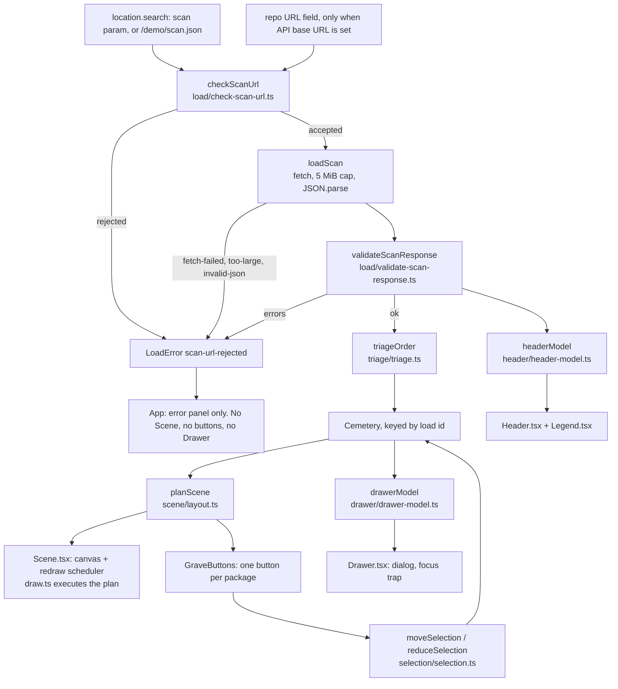
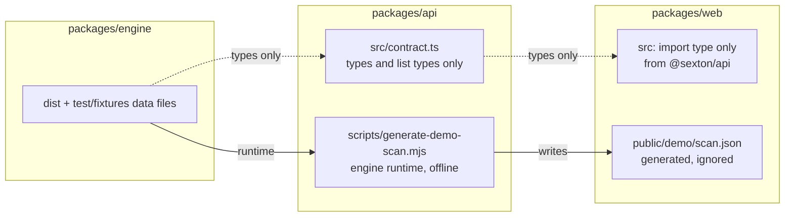

# Design Document: cemetery-ui

## Overview

cemetery-ui adds two packages: `@sexton/api` (this spec adds only the response contract and the demo scan generator, not the handler) and `@sexton/web`, a Vite and React single page. The page loads one ScanResponse, draws every direct dependency as a grave on one canvas, and shows the evidence for the selected grave in a DOM drawer. The pure parts (contract validator, URL check, triage sort, scene planner, selection reducer, header and drawer models, redraw scheduler) hold the logic. The React components and the canvas painter only execute what those pure parts return.

Implements requirements 1 to 10 of this spec, which cover R-UI-1, R-UI-2, R-UI-3, R-UI-4, R-UI-6 and R-UI-7 of docs/requirements.md, R-UI-5 as a manual sign-off (requirement 10.9), and the web side of R-IN-2, R-IN-4 and R-PO-1 (the UI prints what the scan metadata and policy result say). It reads R-ST-2 only for the five states.

Out of scope: the API handler, login, private repositories, a router, server-side rendering, opening pull requests from the UI, editing the policy, transitive scoring or drawing, and any call to a registry, deps.dev, OSV or GitHub.

### Decisions and remaining items

These are recorded in full under "Notes on requirements and open items".

Resolved:

1. **N-7 and axe-core (MPL-2.0).** Resolved. The amended N-7 in docs/requirements.md covers runtime dependencies only, and allows development-only weak-copyleft tools used unmodified and never shipped, each recorded in docs/adr. axe-core 4.14.1 stays a devDependency. The ADR is written by the user, outside the agent's paths.
2. **Modifier keys and `preventDefault` (6.8).** Resolved. With Ctrl, Alt or Meta held, an arrow key leaves the selection unchanged and does not call `preventDefault`. The behaviour is hard-coded in `reduceSelection`.
3. **Triage order.** Resolved. The order is Possessed, then state from least healthy to most healthy (Dead, Haunted, Restless, Alive), then advisory severity, then transitive reach, then name (R-UI-3 as amended).
4. **Demo repository and label.** Resolved. The demo scan carries the repository `sexton-demo/fixture`, and the header shows "demo fixture, recorded data" when the load came from the bundled `/demo/scan.json`, not from the repository name.
5. **`RULE_TYPES` export.** Resolved. Task 1 adds it to `packages/engine/src/index.ts`. Engine tests stay unchanged.

Remaining, as designed:

6. **Generated demo scan.** `scan.json` is generated, not committed. A `prebuild` and a `pretest` script create it.
7. **Playwright browser.** The smoke test needs `npx playwright install chromium` at setup. It is skipped when the browser is absent and is not part of the root `npm test`.

### Names in the source that shape the design

- `packages/api` and `packages/web` hold only `src/.gitkeep`. Neither has a `package.json`. The root `package.json` has `"workspaces": ["packages/*"]`, so a new `package.json` in each makes the workspace pick it up. The root scripts are `"test": "npm run test --workspaces --if-present"` and `"build": "npm run build --workspaces --if-present"`. The root `tsconfig.json` is `{ "files": [], "references": [{ "path": "packages/engine" }] }`.
- `tsconfig.base.json` sets `NodeNext`, `strict`, `noUncheckedIndexedAccess`, `exactOptionalPropertyTypes` and `composite`. The engine tsconfig adds `rootDir: src`, `outDir: dist`, and includes only `src`, so engine tests are transpiled by Vitest and not type-checked by `tsc -b`.
- `packages/engine/src/index.ts` already exports `SEVERITIES`, `SIGNAL_NAMES`, `STATE_ORDER`, and the types `HealthReport`, `PackageHealth`, `PackageSignals`, `Signal`, `SignalName`, `State`, `Severity`, `Advisory`, `PolicyResult`, `RuleResult`, `Failure`, `RepoRef`, `ScanMetadata`, `ProvenanceValue`, `TransitiveReachValue`. It exports the type `RuleType` but **not** the constant `RULE_TYPES`. Requirement 1.4 needs the ordered rule-type list, so the design adds one line to the engine's `index.ts` (see Notes, item 9).
- `RemediationEntry` is the name in requirements.md. The task brief called the same placeholder `RemediationPreview`. The design uses the requirements name.
- Engine fixtures are `packages/engine/test/fixtures/packages.json` (ten refs: react, lodash, express, request, node-sass, left-pad, event-stream, colors, moment, uuid), `packages/engine/test/fixtures/packages/<name>/*.json` and `seed-maintainer-change.json` (package `left-padder`, two snapshots, maintainer `bob` replaced by `mallory`, version 1.2.1 installed, scored with the fixed clock `2026-11-12T00:00:00Z`). `test/helpers.ts` holds `routedTransport` and `fixtureRoutes`. `fixture-scan.test.ts` shows the seeded scan: a routed transport, an `InMemorySnapshotStore` filled from the seed, and `scorePackages(..., { snapshotStore })`.
- Web may not import engine test helpers (structure.md: web depends on api response types only). The generator in `packages/api/scripts` may read fixture data files by relative path, but cannot import `test/helpers.ts`, which is TypeScript outside the engine build output. It carries its own small routed transport (see the generator section and Notes, item 10).
- Vitest 4.1.12 declares `vite ^6 || ^7 || ^8` as a dependency range, so it accepts Vite 8.3.8 and the workspace needs one Vite. `@vitejs/plugin-react` 6.3.0 declares `vite ^8` as a peer.

### Research findings that shape the design

- Vite 8 uses Oxc and Rolldown. The JSX transform reads `compilerOptions.jsx` from tsconfig, so the Vitest config needs no React plugin when `jsx` is `react-jsx`. The first task confirms this with one smoke test before the rest is written.
- A CSP delivered in a `<meta>` tag applies `style-src` to style elements and to `style=""` attributes in markup, not to style changes made through the CSSOM (`element.style.left = ...`). React sets `style` props through the CSSOM, so `style-src 'self'` does not block the overlay positions. A meta CSP cannot carry `frame-ancestors`, `report-uri` or `sandbox`, and the design does not need them.
- The HTML `inert` attribute removes an element's subtree from focus order and from the accessibility tree. React 19 accepts `inert` as a boolean prop.
- A canvas has a hard backing-store limit per browser (some engines refuse above 16384 pixels per side, and Safari caps the area). The requirement fixes 16384 per dimension. 300 graves at the minimum width of 128 CSS pixels is one column, 33632 CSS pixels tall, so the backing store must scale down below the device pixel ratio in that case (decision 8).
- jsdom 31 has no `Path2D`, no canvas context, no `matchMedia` and no `ResizeObserver`. The test setup supplies recording stubs for all four.
- axe-core's `color-contrast` rule needs layout and computed styles that jsdom cannot give. Requirement 10.4 turns it off and requirement 10.3 covers contrast from the palette.

## Architecture





Design decisions:

1. **Pure core, thin React.** Everything that can be wrong is a pure function: `validateScanResponse`, `checkScanUrl`, `triageOrder`, `planScene`, `moveSelection`, `reduceSelection`, `headerModel`, `drawerModel`, `graveLabel`, `trapStep`, `backingStore`, `createRedrawScheduler`. Components read these and render text. This is what makes properties 1 to 23 cheap.
2. **Type-only link to the api and the engine.** Every import from `@sexton/api` or `@sexton/engine` in `packages/web/src` is `import type`, and web's tsconfig sets `verbatimModuleSyntax: true`, so a value import of a type-only module is a compile error. A static test reads the source files and fails on any other import form (1.3). Web keeps literal lists of states, severities, signal names and rule types in `load/lists.ts`, tied to the contract by a compile-time equality check (1.4).
3. **Hand-written validator, never recursing into unknown values.** The validator walks a fixed shape. Opaque signal values are never traversed, so a very deep value cannot overflow the stack inside the validator. All paths come from fixed field names and array indices, and all messages come from a seven-entry table, so no input string can reach an error (1.15).
4. **One canvas, one painter, one plan.** `planScene` returns plain data. `draw.ts` loops over it with `Path2D` objects built once per shape. The overlay reads the same plan for button rectangles, so a button can never drift from its grave.
5. **Redraw only on change, one per frame.** Scene's paint effect depends on the plan object and the palette only. `App` and `Cemetery` memoise the plan on its inputs, so focus, blur, pointer movement, opening the drawer, toggling the legend and typing in the URL field leave the plan identity unchanged and cause no paint. A scheduler coalesces invalidations into one `requestAnimationFrame` callback (9.2 to 9.5).
6. **Palette is the one colour table.** `palette.ts` holds the colours per theme. The painter reads it directly. The CSS reads CSS custom properties that `applyPalette` writes from the same table, and `styles.css` holds no colour literal (a test checks it). The contrast test computes every pair from the table (10.3).
7. **A new load remounts the cemetery.** `Cemetery` is rendered with `key={loadId}`. A new ScanResponse therefore resets the selection and closes the drawer without extra code (6.12).
8. **Backing store scaling.** `backingStore(cssW, cssH, dpr)` returns `scale = min(2, dpr, 16384 / cssW, 16384 / cssH)` and integer backing sizes. A tall scene at width 128 draws at a scale below 1, which is blurry but legal. The draw code multiplies by `scale` and draws in CSS units (4.13).
9. **Loading never falls back.** An explicit `scan` parameter that fails shows its error and never the demo (2.2). A load error renders no scene component at all, so no partial picture can appear (2.11).
10. **Test hook is compiled out.** A build-time constant `__SEXTON_E2E__` is `false` in every build except `vite build --mode e2e`. The hook module is imported only inside `if (__SEXTON_E2E__)`, so the production bundle contains neither the module nor the string `__sextonTiming`. A `postbuild` script greps `dist` for that string (9.6).

## Components and Interfaces

Paths are under `packages/` and are relative to `src/` unless stated. All imports use `.js` suffixes, as the engine does under NodeNext.

### Layout as built

```
packages/api/
  package.json            @sexton/api 0.1.0, deps: @sexton/engine 0.1.0
  tsconfig.json           extends ../../tsconfig.base.json, rootDir src, outDir dist, references ../engine
  src/contract.ts
  scripts/generate-demo-scan.mjs       exports buildDemoScan(); writes the file when run directly
  scripts/lib/fixture-routes.mjs       routed transport + fixtureRoutes (copy of the engine helper logic)
  test/generate-demo-scan.test.ts
  vitest.config.ts
packages/web/
  package.json            @sexton/web 0.1.0
  index.html              lang, title, CSP placeholder, #root
  vite.config.ts          react plugin, define __SEXTON_E2E__, CSP transform (build only)
  vitest.config.ts        environment jsdom, setup file, include test/**/*.test.{ts,tsx}
  playwright.config.ts
  tsconfig.json           solution file: references app and node
  tsconfig.app.json       src only, DOM lib, jsx react-jsx, verbatimModuleSyntax
  tsconfig.node.json      test, e2e and config files, types node, references app
  public/demo/scan.json   generated, not committed
  scripts/check-bundle.mjs
  src/
    main.tsx  App.tsx  Cemetery.tsx  styles.css  vite-env.d.ts
    load/       lists.ts  api-base.ts  check-scan-url.ts  load-scan.ts  load-error.ts  validate-scan-response.ts  use-scan-loader.ts
    triage/     triage.ts
    scene/      layout.ts  shapes.ts  palette.ts  draw.ts  scheduler.ts  Scene.tsx  timing-hook.ts
    overlay/    GraveButtons.tsx  grave-label.ts
    selection/  selection.ts
    drawer/     Drawer.tsx  drawer-model.ts  focus-trap.ts  format-value.ts
    header/     Header.tsx  Legend.tsx  header-model.ts
    hooks/      use-media-query.ts  use-container-width.ts  use-ghost-phase.ts
  test/
    setup.ts  arbitraries.ts  support/demo-scan.ts
    *.test.ts, *.test.tsx  (one file per area, see Testing Strategy)
  e2e/        smoke.spec.ts
```

Additions to the layout in the brief, with reasons: `load/load-error.ts` (the Load error type and its fixed text, shared by the loader and the error panel), `load/api-base.ts` (pure parse of `VITE_SEXTON_API`, requirement 2.17), `load/use-scan-loader.ts` (the hook that owns the abort controller), `scene/scheduler.ts` (a pure scheduler, testable without React), `scene/timing-hook.ts` (e2e only), `overlay/grave-label.ts`, `drawer/drawer-model.ts`, `drawer/focus-trap.ts`, `drawer/format-value.ts`, `header/header-model.ts` (all pure, so the properties do not need a DOM), `hooks/*` (browser state), `Cemetery.tsx` (selection and drawer state, keyed by load). Each file keeps one concept, as structure.md asks.

### api/src/contract.ts (Requirement 1.1, 1.2, 1.4)

```ts
import type {
  HealthReport, PackageHealth, PackageSignals, Signal, SignalName, State, Severity, Advisory,
  ScanMetadata, RepoRef, PolicyResult, RuleResult, Failure,
  SIGNAL_NAMES, STATE_ORDER, SEVERITIES, RULE_TYPES,
} from "@sexton/engine";

export type { HealthReport, PackageHealth, PackageSignals, Signal, SignalName, State, Severity, Advisory,
  ScanMetadata, RepoRef, PolicyResult, RuleResult, Failure };

/** The ordered list types, so web can fail type-checking when its literal lists drift (1.4). */
export type SignalNameList = typeof SIGNAL_NAMES;
export type StateList = typeof STATE_ORDER;
export type SeverityList = typeof SEVERITIES;
export type RuleTypeList = typeof RULE_TYPES;

export const REMEDIATION_KINDS = ["bump", "remove", "migrate"] as const; // runtime constant, no engine import
export type RemediationKind = (typeof REMEDIATION_KINDS)[number];

/** Placeholder. A later remediation spec replaces it. */
export interface RemediationEntry {
  readonly packageName: string;
  readonly kind: RemediationKind;
  readonly title: string;
  readonly prBody: string;
}

export interface ScanResponse {
  readonly report: HealthReport;
  readonly policy: PolicyResult;
  readonly remediations?: readonly RemediationEntry[];
}
```

`typeof SIGNAL_NAMES` on a type-only import is legal TypeScript, so `contract.ts` has no runtime engine import. `REMEDIATION_KINDS` is the only runtime value in the file and the web app does not import it (it keeps its own list). The api package exports it through `"exports": { ".": { "types": "./dist/contract.d.ts", "default": "./dist/contract.js" } }`.

### api/scripts/generate-demo-scan.mjs (Requirements 2.19, 2.20)

```js
export async function buildDemoScan({ fixturesDir, now }) /* : Promise<ScanResponse> */;
// When run as a script: writes packages/web/public/demo/scan.json with JSON.stringify(scan, null, 2) + "\n".
```

Steps, all offline and deterministic:

1. Read `packages.json` (ten refs) and `seed-maintainer-change.json` from `packages/engine/test/fixtures/` by a path resolved from `import.meta.url`. These are data files, not code imports.
2. Build routes with `fixtureRoutes(name, version)` for each of the ten, plus the five routes the engine's `fixture-scan.test.ts` builds for `left-padder` 1.2.1 (packument full and abbreviated, OSV `querybatch`, deps.dev dependencies, attestations). The routed transport answers 404 for an unrouted URL, and the generator wraps it so that any unrouted URL throws, which fails the build (2.19, "fails on any unrouted URL").
3. Fill an `InMemorySnapshotStore` from the seed and call `scorePackages([...tenRefs, seedRef], { transport, clock: () => NOW, retry: { sleep: () => Promise.resolve() }, snapshotStore })` with `NOW = 2026-11-12T00:00:00Z`.
4. `policy = evaluatePolicy(DEFAULT_POLICY, report, "default")`. The default policy forbids Possessed and Dead, and `request`, `node-sass`, `left-pad`, `event-stream`, `colors`, `uuid` are Dead, so `policy.pass` is false.
5. Attach scan metadata (decision recorded in Notes, item 11). The repo is `sexton-demo/fixture`. The scan itself carries no demo flag, so the generator output stays a plain ScanResponse and the header decides from the load source (see `use-scan-loader.ts` and `headerModel`): `{ repo: { owner: "sexton-demo", repo: "fixture", url: "https://github.com/sexton-demo/fixture" }, unlocked: false, unlockedPackages: [], lockfileVersion: 3, capped: false, totalDirect: 11, skipped: { peer: 0, optional: 0, invalidName: 0 }, unresolved: [] }`.
6. Return `{ report, policy }` with no `remediations`, so the demo shows "no remediation proposed yet" until the remediation spec lands.

The output has stable key order (the engine builds objects in fixed order) and no clock read other than `NOW`, so two runs are byte-identical (2.20). `scripts/lib/fixture-routes.mjs` repeats the logic of `test/helpers.ts` (`routedTransport`, `fixtureRoutes`) in plain JavaScript. A task may later move that helper into an engine export. Until then a test in `api/test` runs the generator and compares the ten states with `expected-states.json`, so the copy cannot silently drift from the engine's recorded expectations.

package.json scripts for api:

```json
{
  "build": "tsc -b",
  "pretest": "tsc -b",
  "test": "vitest run",
  "predemo:generate": "tsc -b",
  "demo:generate": "node scripts/generate-demo-scan.mjs"
}
```

### load/lists.ts and the contract tie (Requirement 1.4)

```ts
export const STATES = ["Possessed", "Dead", "Haunted", "Restless", "Alive"] as const;
export const SEVERITIES = ["Critical", "High", "Moderate", "Low", "Unknown"] as const;
export const SIGNAL_NAMES = ["lastPublish","deprecated","hasInstallScript","advisories",
  "maintainers","provenance","transitiveReach","maintainerChange","provenanceRegression","newInstallScript"] as const;
export const RULE_TYPES = ["forbid_state","forbid_install_scripts","max_age_months","require_provenance"] as const;
export const REMEDIATION_KINDS = ["bump", "remove", "migrate"] as const;

type Same<A, B> = (<T>() => T extends A ? 1 : 2) extends <T>() => T extends B ? 1 : 2 ? true : false;
type Assert<T extends true> = T;
export type ListsMatchContract = [
  Assert<Same<typeof STATES, StateList>>,
  Assert<Same<typeof SEVERITIES, SeverityList>>,
  Assert<Same<typeof SIGNAL_NAMES, SignalNameList>>,
  Assert<Same<typeof RULE_TYPES, RuleTypeList>>,
];
```

`Same` compares readonly tuple types, so a different member or a different order fails `tsc -b`. The exported type alias avoids an unused-variable lint error. A test file `lists.test.ts` also checks the runtime lists against literal expectations.

### load/api-base.ts (Requirement 2.17)

```ts
/** Returns the normalised base (no trailing slash) or null when absent, empty or invalid. */
export function parseApiBase(raw: string | undefined): string | null;
```

Accepts only a string that parses as an `https:` URL, has empty `username` and `password`, and contains neither `?` nor `#` anywhere in the raw text (checking the raw text, because `new URL("https://a.example/?").search` is empty and would hide a bare `?`). Strips one trailing `/` from the serialised value. `main.tsx` calls it once with `import.meta.env.VITE_SEXTON_API`.

### load/check-scan-url.ts (Requirements 2.3 to 2.5, pure)

```ts
export type ScanUrlCheck = { readonly ok: true; readonly url: string } | { readonly ok: false };
export function checkScanUrl(input: string, pageOrigin: string, apiBaseUrl: string | null): ScanUrlCheck;
```

1. `input === ""` gives `{ ok: false }`.
2. In a `try`, `page = new URL(pageOrigin)` and `u = new URL(input, page.origin + "/")`. A throw gives `{ ok: false }`. The function never throws.
3. Reject when `u.protocol` is not `http:` or `https:` (this covers `javascript:`, `data:`, `blob:`, `file:`), or when `u.username !== "" || u.password !== ""`.
4. Accept when `u.origin === page.origin` (Same-origin, whichever scheme the page uses).
5. Otherwise accept only when `u.protocol === "https:"`, `apiBaseUrl !== null` and `u.origin === new URL(apiBaseUrl).origin`.
6. Anything else gives `{ ok: false }`. The accepted `url` is `u.href`.

Resolving through `new URL` with a fixed base means a protocol-relative `//host/x` or a backslash form resolves to its real host and is judged by origin, not by the text. The result depends on the three arguments only.

### load/load-error.ts (Requirements 2.9, 2.10)

```ts
export type LoadErrorCode = "scan-url-rejected" | "fetch-failed" | "too-large" | "invalid-json" | "invalid-response";
export interface LoadError {
  readonly code: LoadErrorCode;
  readonly message: string;          // from LOAD_ERROR_TEXT, plus " (HTTP 503)" for a status
  readonly status?: number;          // only for fetch-failed with a response
  readonly contractErrors?: readonly ContractError[]; // invalid-response only, at most 5
}
export const LOAD_ERROR_TEXT: Record<LoadErrorCode, string>;
export function makeLoadError(code: LoadErrorCode, extra?: { status?: number; contractErrors?: readonly ContractError[] }): LoadError;
```

`LOAD_ERROR_TEXT` is a literal table: `scan-url-rejected` "The scan address is not allowed.", `fetch-failed` "The scan could not be fetched.", `too-large` "The scan is larger than 5 MiB.", `invalid-json` "The scan is not valid JSON.", `invalid-response` "The scan does not match the expected format.". `makeLoadError` builds `message` from the table and, for a status, appends the number through `String(Math.trunc(status))` after checking it is an integer from 100 to 599 (otherwise the status is dropped). It keeps at most five Contract errors. No other argument can enter a message.

### load/load-scan.ts (Requirements 2.6 to 2.10, 2.13)

```ts
export const MAX_SCAN_BYTES = 5 * 1024 * 1024;
export type LoadResult =
  | { readonly ok: true; readonly value: ScanResponse }
  | { readonly ok: false; readonly error: LoadError };

export interface LoadScanOptions {
  readonly fetchFn: typeof fetch;
  readonly signal: AbortSignal;
  readonly maxBytes?: number; // defaults to MAX_SCAN_BYTES, tests lower it
}
/** Never rejects. `url` must already have passed checkScanUrl. */
export function loadScan(url: string, options: LoadScanOptions): Promise<LoadResult>;
```

The request: `fetchFn(url, { method: "GET", credentials: "omit", redirect: "error", referrerPolicy: "no-referrer", headers: { Accept: "application/json" }, signal })`. No cookie, no other header.

Reading the body (2.7):

1. A non-2xx status gives `fetch-failed` with the status (2.8). The body is not read.
2. If `Content-Length` parses to an integer above `maxBytes`, return `too-large` and cancel the body. The header is only an early exit, not the limit.
3. If `response.body` exists, read chunks with `getReader()`, add each chunk's `byteLength`, and when the total exceeds `maxBytes`, cancel the reader and return `too-large` without decoding. If `response.body` is null, call `arrayBuffer()` and compare `byteLength`.
4. Decode with `new TextDecoder("utf-8", { fatal: true })`. A decode failure gives `invalid-json`, because the text is not valid JSON text.
5. `JSON.parse` in a `try`. A throw gives `invalid-json` and the parser message is discarded.
6. `validateScanResponse(parsed)`. Errors give `invalid-response` with the first five.

A thrown `fetch` (network error, `redirect: "error"`, abort) gives `fetch-failed` without a status. When `signal.aborted` is true at any await point, the function returns `fetch-failed` as well, and the caller discards results from an aborted signal (see the hook). The function never rejects and never puts an input string into an error.

### load/use-scan-loader.ts (Requirements 2.1, 2.2, 2.12 to 2.16)

```ts
export type LoadState =
  | { readonly status: "loading"; readonly loadId: number }
  | { readonly status: "error"; readonly loadId: number; readonly error: LoadError }
  | { readonly status: "ready"; readonly loadId: number; readonly response: ScanResponse; readonly isDemo: boolean };

export interface ScanLoader {
  readonly state: LoadState;
  /** Starts a load of the address after checkScanUrl. */
  readonly loadFrom: (address: string) => void;
  /** Submit from the repository URL field. Returns a fixed validation message or null when a request started. */
  readonly submitRepo: (value: string) => string | null;
}
export function useScanLoader(deps: { fetchFn: typeof fetch; pageOrigin: string; apiBase: string | null; initialSearch: string }): ScanLoader;
```

On mount: `params = new URLSearchParams(initialSearch)`. If `params.has("scan")` the address is `params.get("scan") ?? ""`, otherwise `"/demo/scan.json"`. Each start increments `loadId`, aborts the previous `AbortController`, creates a new one, sets `loading`, runs `checkScanUrl` then `loadScan`, and applies the result only if its controller is still the current one. This gives "latest request wins" for any completion order (2.13). A rejected address sets `error: scan-url-rejected` and issues no request (2.4).

`isDemo` (8.12) is set by the loader from the load source and never from the response. A load is a demo load if and only if the address that passed `checkScanUrl` resolves to the page origin plus `/demo/scan.json` (`url === new URL("/demo/scan.json", pageOrigin).href`), which is true for the default load and for an explicit `?scan=/demo/scan.json`. A response whose `report.scan.repo` is `sexton-demo/fixture` but that came from any other address has `isDemo` false, so a real repository with that name is not mislabelled.

`submitRepo(value)`: `t = value.trim()`. If `apiBase === null`, return the fixed text for the disabled state and do nothing. If `t === "" || t.length > 200`, return "Enter a repository URL of 1 to 200 characters." and issue no request (2.16). Otherwise the address is `` `${apiBase}/scan?repo=${encodeURIComponent(t)}` ``, started through the same path, so criteria 6 to 13 apply (2.15). `fetchFn` and `pageOrigin` are injected so tests make no network call (2.18).

### triage/triage.ts (Requirement 3, pure)

```ts
export function severityRank(pkg: PackageHealth): 0 | 1 | 2 | 3 | 4 | 5;
export function reachRank(pkg: PackageHealth): number;
export function stateRank(state: State): 0 | 1 | 2 | 3 | 4;
export function compareTriage(a: PackageHealth, b: PackageHealth): number;
export function triageOrder(packages: readonly PackageHealth[]): PackageHealth[];
```

`severityRank`: if `pkg.signals.advisories.available`, the maximum of Critical 5, High 4, Moderate 3, Low 2, Unknown 1 over its advisories, and 0 when the list is empty. Unavailable gives 0 (3.3). `reachRank`: `available ? value.reach : 0` (3.4). `compareTriage(a, b)`:

1. `stateRank(a.state) - stateRank(b.state)`, if non-zero, where `stateRank` is the index in the `STATES` list of `load/lists.ts`: Possessed 0, Dead 1, Haunted 2, Restless 3, Alive 4. This one step places Possessed first and groups the rest from least healthy to most healthy.
2. `severityRank(b) - severityRank(a)`, if non-zero.
3. `reachRank(b) - reachRank(a)`, if non-zero.
4. `a.name < b.name ? -1 : a.name > b.name ? 1 : 0` (UTF-16 code-unit order, no `localeCompare`).

`triageOrder` returns `packages.slice().sort(compareTriage)`. `Array.prototype.sort` is stable since ES2019 (Node 22 and every browser Vite 8 targets), so equal keys keep input order (3.8).

### scene/layout.ts (Requirements 3.13, 4.1, 4.5 to 4.11, 5.1, 5.4, 5.5, 5.10, 6.13, pure)

```ts
export const CELL_WIDTH = 96, CELL_HEIGHT = 112, PADDING = 16, MIN_WIDTH = 128, MAX_INSCRIPTIONS_PACKAGES = 60, INSCRIPTION_UNITS = 14;
export type Theme = "light" | "dark";
export type ShapeId = "upright" | "cross" | "cracked" | "open";
export interface Rect { readonly x: number; readonly y: number; readonly w: number; readonly h: number }
export interface GravePlan {
  readonly index: number;            // position in triage order
  readonly name: string;
  readonly state: State;
  readonly rect: Rect;               // the Cell
  readonly shape: ShapeId;
  readonly fill: string;             // palette colour for (state, theme)
  readonly ghost: { readonly x: number; readonly y: number } | null;
  readonly inscription: string | null;
}
export interface ScenePlan {
  readonly width: number;            // layout width, at least 128
  readonly height: number;           // 0 when there are no packages
  readonly columns: number;          // 0 when there are no packages
  readonly theme: Theme;
  readonly graves: readonly GravePlan[];
  readonly ring: Rect | null;        // around the selected grave
}
export interface SceneInput {
  readonly packages: readonly PackageHealth[];  // already in triage order
  readonly width: number;
  readonly theme: Theme;
  readonly selectedIndex: number | null;
  readonly ghostPhase: 0 | 1;
}
export function planScene(input: SceneInput): ScenePlan;
export function hasGhost(pkg: PackageHealth): boolean;
export function inscriptionFor(name: string, packageCount: number): string | null;
export function backingStore(cssWidth: number, cssHeight: number, dpr: number): { scale: number; width: number; height: number };
```

- `width = Number.isFinite(input.width) ? max(128, floor(input.width)) : 128`.
- `n = packages.length`. If `n === 0`: `columns = 0`, `height = 0`, `graves = []`, `ring = null`. Otherwise `columns = max(1, floor((width - 32) / 96))`, `rows = ceil(n / columns)`, `height = 32 + rows * 112`.
- Grave `i` has `row = floor(i / columns)`, `col = i % columns`, `rect = { x: 16 + col * 96, y: 16 + row * 112, w: 96, h: 112 }`. Cells never overlap, and the right edge of the last column is `16 + columns * 96 <= width - 16`, so every rectangle is inside the canvas (4.10).
- `shape = SHAPE_BY_STATE[state]` and `fill = colourFor(state, theme)` from `shapes.ts` and `palette.ts`. Nothing else reaches them, so P2 holds by construction and by test.
- `hasGhost(pkg) = pkg.signals.advisories.available && pkg.signals.advisories.value.length > 0` (5.1). `ghost = hasGhost ? { x: rect.x + 42, y: rect.y + 4 + 4 * ghostPhase } : null`. The ghost box is 12 by 14, so it ends at `rect.y + 22`, inside the Cell, above the grave body, and the same for every State (5.5, 5.7).
- `inscriptionFor(name, count)`: `null` when `count > 60`. Otherwise `name` when `name.length <= 14`, else `name.slice(0, 13) + "…"`. When the cut at 13 would end on a high surrogate (`0xD800` to `0xDBFF`), the slice drops it, giving 12 units plus the ellipsis, so no lone surrogate reaches the canvas.
- `ring = selectedIndex` valid ? the selected rect inset by 2 : `null`. Out-of-range or non-integer `selectedIndex` gives `null`.
- `ghostPhase` only changes `ghost.y`. Rect, shape, fill and inscription do not read it (5.10).

`backingStore`: `s = min(2, dpr > 0 ? dpr : 1, 16384 / max(cssWidth, 1), 16384 / max(cssHeight, 1))`, `width = max(1, floor(cssWidth * s))`, `height = max(1, floor(cssHeight * s))` (4.13). A zero-height scene is not drawn (the empty state renders no canvas).

### scene/shapes.ts (Requirements 4.2, 4.6)

```ts
export interface ShapeDef { readonly d: string; readonly detail: string | null; readonly tiltDegrees: number }
export const SHAPES: Record<ShapeId, ShapeDef>;
export const SHAPE_BY_STATE: Record<State, ShapeId>;  // Alive, Restless -> upright; Haunted -> cross; Dead -> cracked; Possessed -> open
export const GHOST_PATH: string;
export function shapePath(id: ShapeId): Path2D;        // built once per id and cached
export function ghostPath(): Path2D;
```

Four distinct SVG path strings in a 64 by 64 box (placed at `rect.x + 16`, `rect.y + 26`): `upright` is a round-topped stone, `cross` a Latin cross, `cracked` a stone with a broken top and a `detail` crack line, `open` a rectangular pit with a mound. `tiltDegrees` is -8 for `cracked` and 0 for the others, a constant, never a per-package value. The path strings are constants in the file. The exact art is tuned in the implementation task, and the four strings must stay distinct (test). The Legend renders the same strings in small `<svg>` elements, so the Legend and the Scene use the same definitions (8.10).

### scene/palette.ts (Requirements 4.3, 4.4, 4.12, 5.6, 6.13, 10.3)

```ts
export interface PaletteTheme {
  readonly bg: string; readonly surface: string; readonly text: string; readonly muted: string;
  readonly border: string; readonly focus: string; readonly ring: string; readonly ghost: string;
  readonly states: Readonly<Record<State, string>>;
}
export const PALETTE: Record<Theme, PaletteTheme>;
export function colourFor(state: State, theme: Theme): string;
export function cssVariables(theme: Theme): Record<string, string>;   // "--bg": "#f5f1e8", "--state-alive": ...
export function applyPalette(root: HTMLElement, theme: Theme): void;  // root.style.setProperty for each variable
```

Proposed values, with contrast computed by the WCAG 2.1 formula during design (the test recomputes them):

| Token | Light | vs bg | Dark | vs bg |
|---|---|---|---|---|
| bg | `#f5f1e8` | | `#14161c` | |
| surface | `#ffffff` | | `#1d2029` | |
| text | `#1b1d22` | 14.96 | `#ecebe6` | 15.15 |
| muted | `#4a4f5a` | 7.29 | `#b4b8c2` | 9.11 |
| border | `#6b7280` | 4.29 | `#8a90a0` | 5.66 |
| focus and ring | `#1d4ed8` | 5.95 | `#7aa2ff` | 7.27 |
| ghost | `#5b6475` | 5.29 | `#c7d0e6` | 11.71 |
| Alive | `#12561f` | 7.84 | `#3a9a4e` | 5.09 |
| Restless | `#a8800f` | 3.23 | `#f2d060` | 12.03 |
| Haunted | `#b3361f` | 5.38 | `#ee6a4f` | 5.86 |
| Dead | `#6b6f7a` | 4.46 | `#9aa0ad` | 6.89 |
| Possessed | `#7b2cbf` | 6.30 | `#c58cf5` | 7.27 |

Alive against Restless is 2.42 in light and 2.36 in dark, above the 1.5 floor of requirement 4.4. The five State colours are pairwise distinct in each theme. Text and muted are checked against both bg and surface (all at least 4.5, lowest 7.29). Non-text colours are at least 3 against bg, and the `border`, `focus`, `ring`, `ghost` and State tokens are also at least 3 against `surface`, which the test checks. These values are a starting point. If the test finds a failing pair, the task adjusts the hex value, never the threshold.

`styles.css` holds no colour literal and reads `var(--bg)` and the other variables. `App` calls `applyPalette(document.documentElement, theme)` in a layout effect, so the variables and the canvas change on the same render (4.12).

### scene/draw.ts (Requirement 4.1, 4.12, 5.5)

```ts
export interface PaintContext2D { /* the subset of CanvasRenderingContext2D the painter calls */ }
export function drawScene(ctx: PaintContext2D, plan: ScenePlan, scale: number): void;
```

In order: `setTransform(scale, 0, 0, scale, 0, 0)`, `clearRect`, fill the background (`PALETTE[plan.theme].bg`), then for each grave: translate to the body origin, rotate by the shape tilt, `fill` the cached `Path2D` with `grave.fill`, stroke `detail` in the background colour when present, restore; the ghost (one colour, one 12 by 14 path, translated to `grave.ghost`) when present; the inscription (`fillText`, 11 px monospace, centred at `rect.x + 48`, baseline `rect.y + 106`) when present. The selection ring is drawn last, `strokeRect` with `lineWidth` 3, `PALETTE[theme].ring`. There is no layout logic and no per-package number in the painter. Fill opacity is the default 1 and `globalAlpha` is never set.

### scene/scheduler.ts (Requirements 9.2 to 9.5)

```ts
export interface FrameApi { request(cb: () => void): number; cancel(id: number): void }
export interface RedrawScheduler { invalidate(): void; paintNow(): void; dispose(): void }
export function createRedrawScheduler(frame: FrameApi, paint: () => void): RedrawScheduler;
```

`invalidate` sets a flag and, when no frame is pending, requests one. The frame callback clears the pending state, then calls `paint` once. Any number of `invalidate` calls before the frame produce one paint (9.3). `paintNow` calls `paint` directly (the e2e hook uses it). `dispose` cancels a pending frame. A test uses a manual `FrameApi` and counts `paint` calls.

### scene/Scene.tsx (Requirements 4.1, 4.13, 9.2 to 9.5)

```tsx
export interface SceneProps { readonly plan: ScenePlan }
export const Scene: React.MemoExoticComponent<(props: SceneProps) => JSX.Element>;
```

Scene renders `<canvas aria-hidden="true">`, sets its CSS size from `plan.width` and `plan.height`, and its backing size from `backingStore(plan.width, plan.height, window.devicePixelRatio)`. A `useEffect` keyed on `[plan]` sets the backing size and calls `scheduler.invalidate()`. The scheduler's paint callback gets the 2D context once (cached), applies `drawScene(ctx, plan, scale)` for the latest plan held in a ref, and in e2e builds records `performance.now()` around it. Scene is wrapped in `React.memo`, and nothing else triggers `invalidate`. It does not render when `plan.graves.length === 0`; `Cemetery` shows the empty text instead (4.15).

### scene/timing-hook.ts (Requirement 9.6, e2e builds only)

```ts
export function installTimingHook(repaint: () => void): () => void;  // sets window.__sextonTiming, returns an uninstall function
// window.__sextonTiming.redraw(n): number[]  (n synchronous full paints, each timed with performance.now)
```

Imported by `Scene.tsx` as `if (__SEXTON_E2E__) { void import("./timing-hook.js").then(...) }`. `vite.config.ts` defines `__SEXTON_E2E__` as `mode === "e2e"`. Because the constant is a literal `false` elsewhere, the dynamic import and the module are dropped from the production bundle. `scripts/check-bundle.mjs` runs as `postbuild` and fails when any file in `dist` contains `__sextonTiming`.

### hooks (Requirements 4.12, 5.7 to 5.9, 4.9, 9.5)

```ts
export function useMediaQuery(query: string): boolean;            // matchMedia + change listener
export function useContainerWidth(ref: RefObject<HTMLElement | null>): number;  // ResizeObserver, one setState per animation frame
export function useGhostPhase(active: boolean, reducedMotion: boolean): 0 | 1; // setInterval 1000 ms only when active and not reduced
```

`App` uses `useMediaQuery("(prefers-color-scheme: dark)")` for the Theme and `useMediaQuery("(prefers-reduced-motion: reduce)")` for Reduced motion. `useGhostPhase` starts no timer when `active` is false or `reducedMotion` is true, returns 0 in those cases, and clears the timer when either changes, so a media query change takes effect without a reload (5.8, 5.9). `useContainerWidth` stores the latest observed width in a ref and applies it in one `requestAnimationFrame`, so resize notifications give at most one state change, and at most one repaint, per frame (9.5).

### selection/selection.ts (Requirements 6.4 to 6.9, pure)

```ts
export type ArrowKey = "ArrowLeft" | "ArrowRight" | "ArrowUp" | "ArrowDown";
export function moveSelection(index: number, key: string, columns: number, count: number): number;

export interface KeyEvent {
  readonly key: string; readonly ctrlKey: boolean; readonly altKey: boolean; readonly metaKey: boolean;
}
export interface KeyOutcome { readonly index: number | null; readonly handled: boolean; readonly preventDefault: boolean }
/** Pure reducer used by GraveButtons. `index` null means no selection. */
export function reduceSelection(index: number | null, event: KeyEvent, columns: number, count: number): KeyOutcome;
```

`moveSelection` follows requirement 6.4: the delta is -1, +1, `-columns` or `+columns` for the four keys and 0 otherwise, the result is clamped to `0..count-1`, and a non-integer or out-of-range start index is clamped first. For `count <= 0` it returns 0, and `reduceSelection` never calls it then. `columns` below 1 is treated as 1.

`reduceSelection`:

- `count === 0` gives `{ index: null, handled: false, preventDefault: false }`.
- For a non-arrow key: `{ index: normalised, handled: false, preventDefault: false }`.
- For an arrow key with no Ctrl, Alt or Meta: `{ index: moveSelection(...), handled: true, preventDefault: true }` (6.7).
- For an arrow key with Ctrl, Alt or Meta held: `{ index: normalised (unchanged), handled: false, preventDefault: false }` (6.8). The behaviour is hard-coded, with no constant. The handler then does not call `event.preventDefault()` and does not move focus, so Alt+ArrowLeft, Meta+ArrowLeft and other browser or OS shortcuts keep working on a focused grave.

`normalised` is `null`-safe: for `count > 0`, a null or out-of-range `index` becomes a clamped integer (so the result is always in `0..count-1`).

### overlay/grave-label.ts and overlay/GraveButtons.tsx (Requirements 6.1 to 6.3, 6.7, 6.10, 6.11, 10.1, 10.2)

```ts
export function graveLabel(pkg: PackageHealth): string;
// "{name} {installedVersion}, {state}" + ", 1 advisory" | ", N advisories" when available and non-empty
```

```tsx
export interface GraveButtonsProps {
  readonly plan: ScenePlan;
  readonly selectedIndex: number | null;
  readonly packages: readonly PackageHealth[];     // triage order, same length as plan.graves
  readonly onSelect: (index: number) => void;      // arrow movement
  readonly onOpen: (index: number) => void;        // Enter, Space, click
}
export function GraveButtons(props: GraveButtonsProps): JSX.Element;
```

Renders `<div class="overlay">` holding one `<button type="button" data-grave-index={i} aria-label={graveLabel(pkg)} tabIndex={i === selectedIndex ? 0 : -1}>` per package, positioned by the plan's rectangle through `style` (CSSOM). A button has no visible text, and a focus ring from the CSS (`:focus-visible`, 2 px or more). When `selectedIndex` is null (only when there are no packages) there are no buttons.

`onKeyDown` calls `reduceSelection(selectedIndex, event, plan.columns, packages.length)`. If `preventDefault` is true (an arrow key with no Ctrl, Alt or Meta) it calls `event.preventDefault()`; with a modifier held it calls nothing and returns. If `handled` and `index` changed it calls `onSelect(index)` and focuses `[data-grave-index="${index}"]` through a ref on the overlay root, in the same handler (so focus follows the selection and the Drawer state is untouched, 6.7). Native `button` activation gives Enter, Space and click, and all three call `onOpen(i)`. `onOpen` sets the selection and opens the drawer (6.10). A click on the canvas or the padding reaches no handler (6.11). Focusing a button by Tab does not change the selection, and `onFocus` on a button sets the selection to that button so the roving index and the ring follow a pointer or Tab entry.

### drawer/format-value.ts (Requirement 7.4)

```ts
/** JSON.stringify(value, null, 2) with a fixed fallback when it throws or returns undefined. */
export function formatSignalValue(value: unknown): string;
```

A `try` around `JSON.stringify`. A thrown `RangeError` (a value nested deeper than the stack allows, which a 5 MiB body can hold) or an `undefined` result returns the fixed text "value cannot be displayed". This keeps requirement 7.15 true for deep opaque values.

### drawer/drawer-model.ts (Requirements 7.2 to 7.9, pure)

```ts
export interface SignalRow {
  readonly name: SignalName; readonly source: string; readonly fetchedAt: string;
  readonly available: boolean;
  readonly valueText: string | null;   // formatSignalValue(value) when available
  readonly reason: string | null;      // when unavailable
}
export interface FailingRuleRow {
  readonly index: number; readonly type: string; readonly name: string | null;
  readonly failures: readonly { reason: string; source: string; fetchedAt: string }[];
}
export interface DrawerModel {
  readonly title: string;                 // "{name} {installedVersion}"
  readonly state: State; readonly stateReason: string;
  readonly signals: readonly SignalRow[]; // always ten, in SIGNAL_NAMES order
  readonly missingSignals: readonly string[];   // names, may be empty
  readonly failingRules: readonly FailingRuleRow[];
  readonly remediation: RemediationEntry | null;
}
export function drawerModel(response: ScanResponse, pkg: PackageHealth): DrawerModel;
```

- `signals` iterates the web's `SIGNAL_NAMES` list and reads `pkg.signals[name]` (7.3, 7.5). The validator guarantees all ten exist.
- `failingRules`: each `response.policy.rules` entry whose `failures` holds a failure with `failure.name === pkg.name`, in rule order, with that rule's matching failures. The `source` and `fetchedAt` of a failure come from the failure object when they are strings and are "not recorded" otherwise, because the validator requires only `name` and `reason` (Notes, item 7). The rule `name` is used only when it is a string (7.7, 7.8).
- `remediation`: the entry with `packageName === pkg.name`, else null (7.9).

### drawer/focus-trap.ts (Requirement 7.12, pure)

```ts
/** Index of the next focus target when Tab or Shift+Tab is pressed on element `current` of `count` focusables. */
export function trapStep(count: number, current: number, shift: boolean): number;
```

For `count === 0` returns -1 (the dialog container takes focus). Otherwise Tab moves to `(current + 1) % count` and Shift+Tab to `(current - 1 + count) % count`, and a `current` of -1 (focus outside the list) goes to the first on Tab and the last on Shift+Tab. `Drawer.tsx` collects focusables with a fixed selector (`button, [href], input, select, textarea, [tabindex]:not([tabindex="-1"])`) filtered to non-disabled elements, and handles `keydown` on the dialog element.

### drawer/Drawer.tsx (Requirements 7.1, 7.10 to 7.15)

```tsx
export interface DrawerProps { readonly model: DrawerModel; readonly onClose: () => void }
export function Drawer(props: DrawerProps): JSX.Element;
```

Renders `<div class="backdrop" onClick={...}>` containing `<section role="dialog" aria-modal="true" aria-labelledby="drawer-title">` with `h2#drawer-title` showing `model.title`, a close `button` (first focusable, receives focus on mount), the state and reason, the ten signals (each an `h3` with the name, then `source`, `fetchedAt`, then `<pre>` with `valueText`, or the word "unavailable" and the reason), the missing-signals list (`<ul>` always rendered, one `<li>` "none" when empty, finding 2), the failing rules or "no failing policy rules for this package", and the remediation preview (kind, title and `<pre>` with `prBody`, or "no remediation proposed yet"). There is no control that opens a pull request or creates a branch (7.10). Backdrop `onClick` closes only when `event.target === event.currentTarget`. Escape closes, from a `keydown` handler on the dialog.

The Drawer sits outside the canvas and outside the inert region. `Cemetery` renders the page (`header`, `main`) in a wrapper with `inert={open}` and the Drawer as its sibling (7.11).

### Cemetery.tsx and App.tsx (Requirements 2.11, 2.12, 4.15, 6.2, 6.10, 6.12, 6.14, 7.11, 7.14)

```tsx
export interface CemeteryProps { readonly response: ScanResponse; readonly theme: Theme; readonly reducedMotion: boolean }
export function Cemetery(props: CemeteryProps): JSX.Element;   // keyed by loadId in App
export function App(props: { fetchFn: typeof fetch; apiBase: string | null; initialSearch: string; pageOrigin: string }): JSX.Element;
```

`App` owns the loader state, the theme and the repository URL field, and renders: the `Header`, then one of "loading scan" (a `role="status"` paragraph, no scene), the Load error panel (code, message, status, up to five Contract errors as path, code, message), or `<Cemetery key={loadId}>`. The `Header` shows scan facts only when a response exists, and the error and loading states show the Header shell with the repository field and legend control.

`Cemetery` computes `order = useMemo(() => triageOrder(response.report.packages), [response])`, `width = useContainerWidth(ref)`, `phase = useGhostPhase(anyGhost, reducedMotion)`, `plan = useMemo(() => planScene({ packages: order, width, theme, selectedIndex, ghostPhase: phase }), [...])`, and keeps `selectedIndex` (initially 0, or null for no packages, 6.2) and `openIndex` (null or an index) in state. It renders `<main>` with the container, `Scene`, `GraveButtons`, the empty-state text "no direct dependencies in this scan" (4.15), and the Drawer when `openIndex !== null`. On Drawer close it clears `openIndex` and in a layout effect focuses `[data-grave-index="${i}"]` for the index the Drawer showed (7.14). Selection and response stay unchanged.

### header/header-model.ts (Requirements 8.1 to 8.8, pure)

```ts
export interface HeaderModel {
  readonly repoText: string;                 // report.scan.repo.url, or "no scan metadata in this response"
  readonly demoLabel: string | null;         // "demo fixture, recorded data" when the load source is the bundled demo, else null
  readonly scanTime: string;                 // report.generatedAt
  readonly unlockedNotice: string | null;
  readonly cappedNotice: string | null;
  readonly policyStatus: "pass" | "fail";
  readonly policyLabel: "default policy" | "policy file";
  readonly failingRules: number;
}
export function headerModel(response: ScanResponse, isDemo: boolean): HeaderModel;
```

- `unlockedNotice` is non-null iff `scan.unlocked === true` or `scan.unlockedPackages.length > 0` (8.3). When `unlocked` is true: "unlocked scan: no lockfile exists, so versions were resolved from declared ranges". Otherwise: `unlocked: {n} packages resolved from declared ranges: {first 20 names joined by ", "}` plus `, and {n - 20} more` when `n > 20` (8.4). Both texts contain the word "unlocked".
- `cappedNotice` is non-null iff `scan.capped === true`: `capped: showing {packages.length} of {totalDirect} direct dependencies` (8.5).
- `demoLabel` is `"demo fixture, recorded data"` when `isDemo` is true and `null` otherwise (8.12). `isDemo` comes from the loader's `ready` state, so it reflects where the response was loaded from. `headerModel` never reads `report.scan.repo`, `owner` or `repo` for this decision.
- `policyStatus = policy.pass ? "pass" : "fail"`, `policyLabel` from `policy.source`, `failingRules = policy.rules.filter((r) => !r.pass).length`.

### header/Header.tsx and header/Legend.tsx (Requirements 8, 10.6)

`Header` renders `<header>` with `h1`, the repo text and scan time as text nodes (8.11), the `demoLabel` text in a `<span>` next to the repo text when it is non-null (8.12), the notices, the policy status as the word plus the label and count, the Legend control, and the repository form: `<form>` with a labelled `<input>` and a submit `button`. When `apiBase === null` both are `disabled` and the exact text "hosted scan arrives with release 0.1 infra" is shown next to them (2.14). On submit the form calls `loader.submitRepo(value)` and shows a returned validation message in a `role="alert"` paragraph.

`Legend` is a `<button aria-expanded={open} aria-controls="legend-panel">` and a `<div id="legend-panel" hidden={!open}>`. The `hidden` attribute removes the panel from the tab order and the accessibility tree while it is closed (8.9). When open it lists five States, each with a small `<svg>` of the shape's path string filled with the palette colour for the current theme, the State name as text, a Ghost entry saying "one or more advisories", and the line "Triage order: Possessed first, then state from least healthy to most healthy (Dead, Haunted, Restless, Alive), then highest advisory severity, then transitive reach, then name." (8.10).

### main.tsx, index.html, vite.config.ts and the CSP (Requirements 2.22, 9.6, 10.6)

`index.html` has `<html lang="en">`, `<title>Sexton cemetery</title>`, `<div id="root">`, and a CSP placeholder meta. `vite.config.ts`:

```ts
import { defineConfig } from "vite";
import react from "@vitejs/plugin-react";
export default defineConfig(({ mode }) => ({
  plugins: [react(), cspPlugin(process.env["VITE_SEXTON_API"])],
  define: { __SEXTON_E2E__: JSON.stringify(mode === "e2e") },
  build: { sourcemap: false, target: "es2022" },
}));
```

`cspPlugin` is a small inline plugin with `apply: "build"` and a `transformIndexHtml` hook that inserts `<meta http-equiv="Content-Security-Policy" content="default-src 'none'; script-src 'self'; style-src 'self'; img-src 'self' data:; font-src 'self'; connect-src 'self' <api origin>; object-src 'none'; base-uri 'none'; form-action 'none'">`. The API origin is the origin of the parsed `VITE_SEXTON_API` when `parseApiBase` accepts it (the plugin imports no web source; it repeats a three-line `new URL` check), and `connect-src` is `'self'` alone otherwise. `apply: "build"` leaves the dev server without a CSP, because the React refresh runtime uses inline script in dev. The e2e build gets the same CSP, so the smoke test also proves the page works under it. `vite-env.d.ts` holds `/// <reference types="vite/client" />` and `declare const __SEXTON_E2E__: boolean;`.

### Wiring into the monorepo

Root `tsconfig.json`:

```json
{ "files": [], "references": [{ "path": "packages/engine" }, { "path": "packages/api" }, { "path": "packages/web" }] }
```

`packages/web/tsconfig.json` is a solution file: `{ "files": [], "references": [{ "path": "./tsconfig.app.json" }, { "path": "./tsconfig.node.json" }] }`. `tsconfig.app.json` extends `../../tsconfig.base.json` with `module: ESNext`, `moduleResolution: Bundler` is **not** used. It keeps `NodeNext`, sets `"lib": ["ES2022", "DOM", "DOM.Iterable"]`, `"jsx": "react-jsx"`, `"verbatimModuleSyntax": true`, `"types": ["vite/client"]`, `"emitDeclarationOnly": true`, `"outDir": "dist-types"`, `"include": ["src"]`, and `"references": [{ "path": "../api" }]`. `emitDeclarationOnly` satisfies `composite` without emitting JavaScript, because Vite builds the bundle. `tsconfig.node.json` includes `test`, `e2e`, `vite.config.ts`, `vitest.config.ts`, `playwright.config.ts`, sets `"types": ["node", "vite/client"]`, and references `./tsconfig.app.json`. Node types stay out of `src`, and a lint rule (below) also bans `node:` imports there. `packages/api/tsconfig.json` extends the base with `rootDir: src`, `outDir: dist`, `references: [{ "path": "../engine" }]`, `include: ["src"]`. `npm run typecheck` (`tsc -b`) therefore builds engine, then api, then both web projects.

Under NodeNext, a relative import in `.tsx` is written `./App.js`. Vite resolves a `.js` specifier to a `.ts` or `.tsx` file when the importer is TypeScript. The first task confirms this with one build and, if it fails, switches web's `moduleResolution` to `Bundler` and records an ADR.

`eslint.config.js` additions:

```js
{ ignores: [ ...existing, "packages/web/dist-e2e/**", "packages/web/dist-types/**", "packages/web/test-results/**",
             "packages/web/playwright-report/**", "packages/web/e2e-artifacts/**", "packages/web/public/demo/**" ] },
{ files: ["packages/web/src/**/*.{ts,tsx}"],
  rules: {
    "no-restricted-syntax": ["error",
      { selector: "JSXAttribute[name.name='dangerouslySetInnerHTML']", message: "Render untrusted strings as text only." },
      { selector: "AssignmentExpression[left.property.name=/^(innerHTML|outerHTML)$/]", message: "Render untrusted strings as text only." },
      { selector: "CallExpression[callee.property.name='insertAdjacentHTML']", message: "Render untrusted strings as text only." }],
    "no-restricted-imports": ["error", { patterns: ["node:*"] }],
  } },
```

The existing config already lints `packages/**/*.tsx` through its `files` entry, and `typescript-eslint`'s recommended override turns `no-undef` off for TypeScript files, so browser globals need no declaration. The `react-hooks` rules are not required and are not added (no new dependency). The existing `**/scripts/**/*.mjs` globals block already covers `packages/api/scripts` and `packages/web/scripts` (`fetch`, `console`, `URL`, `process`). The generator uses `Buffer`-free code and `node:` imports only.

Vitest and the root `npm test`. `npm test` at the root runs `npm run test --workspaces --if-present`, which runs each workspace's `test` script in workspace order: api, engine, web (action and cli have no `package.json` yet). Each package has its own `vitest.config.ts`, as the engine does, so only web uses jsdom:

```ts
// packages/web/vitest.config.ts
import { defineConfig } from "vitest/config";
export default defineConfig({
  test: {
    environment: "jsdom",
    setupFiles: ["test/setup.ts"],
    include: ["test/**/*.test.{ts,tsx}"],
    exclude: ["e2e/**", "node_modules/**"],
    testTimeout: 20000,
  },
});
```

`packages/api/vitest.config.ts` matches the engine's (`environment` stays `node`). The tests need generated or built inputs, so the scripts chain them:

| Package | `test` | `pretest` | Reason |
|---|---|---|---|
| api | `vitest run` | `tsc -b` | builds engine first, so `dist` exists for the generator test |
| web | `vitest run` | `npm run demo:generate -w @sexton/api` | writes `public/demo/scan.json` for the Demo scan tests, which call `tsc -b` through the api script's own `predemo:generate` |
| web | `build` is `vite build` | `prebuild`: same as the web `pretest` | the production build serves the same file |
| web | `test:e2e` is `playwright test` | `pretest:e2e`: demo generate, then `vite build --mode e2e --outDir dist-e2e` | the smoke test runs against the e2e build |

`test:e2e` is not called `test`, so the root `npm test` never runs Playwright. Playwright's own config sets `testDir: "e2e"` and starts `vite preview --outDir dist-e2e --port 4173 --strictPort`. Vitest's `exclude` keeps `*.spec.ts` in `e2e` out of its run.

`.gitignore` gains `packages/web/public/demo/scan.json`, `packages/web/dist-e2e`, `packages/web/dist-types`, `packages/web/test-results`, `packages/web/playwright-report` and `packages/web/e2e-artifacts`. The screenshot of requirement 9.7 is written to `docs/cemetery.png`, which the user reviews before it is committed.

## Data Models

Types that are new in this spec. Everything else comes from the engine through the contract.

```ts
// api/src/contract.ts: ScanResponse, RemediationEntry, RemediationKind, REMEDIATION_KINDS, list types (above)

// load/validate-scan-response.ts
export const CONTRACT_ERROR_CODES = ["NOT_OBJECT","MISSING_FIELD","WRONG_TYPE","UNKNOWN_VALUE","INVALID_DATE","DUPLICATE","TOO_MANY_PACKAGES"] as const;
export type ContractErrorCode = (typeof CONTRACT_ERROR_CODES)[number];
export interface ContractError { readonly path: string; readonly code: ContractErrorCode; readonly message: string }
export const CONTRACT_ERROR_TEXT: Record<ContractErrorCode, string>;   // one fixed sentence per code
export const MAX_PACKAGES = 300;
export const MAX_CONTRACT_ERRORS = 20;
export type ValidationResult =
  | { readonly ok: true; readonly value: ScanResponse }
  | { readonly ok: false; readonly errors: readonly [ContractError, ...ContractError[]] };
export function validateScanResponse(input: unknown): ValidationResult;
```

`CONTRACT_ERROR_TEXT`: `NOT_OBJECT` "expected an object", `MISSING_FIELD` "required field is missing", `WRONG_TYPE` "value has the wrong type", `UNKNOWN_VALUE` "value is not an allowed value", `INVALID_DATE` "value is not a parseable date", `DUPLICATE` "value duplicates an earlier entry", `TOO_MANY_PACKAGES` "more than 300 packages".

### The validator's walk (Requirements 1.5 to 1.15)

The function reads only own properties (`Object.hasOwn`), never writes, and never calls a method of the input other than array and object checks. A value counts as an object when `typeof v === "object" && v !== null && !Array.isArray(v)`.

1. Root not an object: `NOT_OBJECT` at the empty path, stop. `report` and `policy` missing: `MISSING_FIELD` at `/report` and `/policy`. Present but not objects: `NOT_OBJECT`.
2. `report.generatedAt` a string that parses (`Number.isFinite(Date.parse(s))`), else `WRONG_TYPE` or `INVALID_DATE`. `report.packages` an array, else `WRONG_TYPE` or `MISSING_FIELD`. If its length is above 300: one `TOO_MANY_PACKAGES` at `/report/packages` and the entries are **not** walked, so work stays bounded.
3. Each package at `/report/packages/{i}`: `NOT_OBJECT`; `name` a non-empty string; `installedVersion` a string; `state` in `STATES` (`UNKNOWN_VALUE`); `stateReason` a string; `missingSignals` an array whose entries are in `SIGNAL_NAMES` (`UNKNOWN_VALUE` at `/missingSignals/{j}`); `signals` an object holding all ten names in `SIGNAL_NAMES`, each an envelope. Names seen twice give `DUPLICATE` at `/report/packages/{i}/name`.
4. An envelope at `/report/packages/{i}/signals/{name}`: `available` a boolean (`WRONG_TYPE`); `source` a string; `fetchedAt` a string that parses (`INVALID_DATE`). When `available` is false, `value` must be present and `null` (else `WRONG_TYPE` at `/value`) and `reason` a string. When `available` is true: `value` must be present (`MISSING_FIELD`); for `advisories`, `value` is an array of objects with string `id`, string `summary` and a `severity` in `SEVERITIES` (`/value/{k}/severity`); for `transitiveReach`, `value` is an object whose `reach` is a non-negative integer (`Number.isInteger(r) && r >= 0`). Every other available value is opaque and is not inspected.
5. `policy`: `source` in `["default","file"]` (`UNKNOWN_VALUE`); `pass` a boolean; `rules` an array. Each rule at `/policy/rules/{i}`: `index` an integer, `type` in `RULE_TYPES`, `pass` a boolean, `failures`, `unevaluated` and `notFound` arrays. Each failure at `/policy/rules/{i}/failures/{j}` has string `name` and string `reason`.
6. `report.scan` absent is accepted. When present: an object with `repo` an object with string `url`; boolean `unlocked`; `unlockedPackages` an array of strings; boolean `capped`; `totalDirect` a non-negative integer.
7. `remediations` absent is accepted. When present: an array whose entries have string `packageName`, `title`, `prBody` and `kind` in `REMEDIATION_KINDS`. A repeated `packageName` gives `DUPLICATE` at `/remediations/{j}/packageName`.
8. Unknown keys are ignored and are never copied anywhere (1.11). The success value is the input itself, so it is deeply equal to the input (1.12).
9. Errors are collected up to 1000 (a hard stop for work), sorted by `path` then `code` with `<` on code units, and cut to the first 20 (1.15). `ok` is true iff the collected list is empty.

The 1000 hard stop can in principle drop an error whose path sorts before the kept ones. This is acceptable for the stated invariants: `ok` is exact, at least one error is returned when `ok` is false, and the first 20 returned are sorted.

```ts
// scene/layout.ts: Theme, ShapeId, Rect, GravePlan, ScenePlan, SceneInput (above)
// scene/palette.ts: PaletteTheme, PALETTE (above)
// load/load-error.ts: LoadError, LoadErrorCode (above)
// header/header-model.ts: HeaderModel (above)
// drawer/drawer-model.ts: DrawerModel, SignalRow, FailingRuleRow (above)
```

### Demo scan shape (Requirements 2.19, 2.20)

`{ report: HealthReport, policy: PolicyResult }`: eleven packages in the engine's output order (the ten recorded ones, then `left-padder`), `report.generatedAt` equal to `NOW` as an ISO string, `report.scan` as in the generator step 5, `policy.source` `"default"`, `policy.pass` `false`, and `left-padder` in state Possessed with `stateReason` "maintainer change in the last 90 days". The triage order of this scan is `left-padder` first (Possessed), then the Dead packages, then `lodash` (Haunted), then Restless, then Alive, each group by severity, reach and name. The repository is `sexton-demo/fixture`, so the header shows "demo fixture, recorded data" only because the loader marks the load as a demo load.

### Test arbitraries (packages/web/test/arbitraries.ts)

Typed against `@sexton/api`'s `contract.ts`, not against the engine's test helpers, because web may not import them. Exports: `arbState`, `arbSeverity`, `arbIsoDate`, `arbName` (a small alphabet with `@scope/x` forms so collisions occur), `arbEnvelope(name)` (available with a value of the right shape for that signal, or unavailable with a reason), `arbPackage` (all ten signals, `missingSignals` consistent with unavailability), `arbPackages(n)` with unique names, `arbPolicyResult(packages)` (rules whose failures name generated packages), `arbRemediations(packages)`, `arbScanResponse` (0 to 12 packages by default, `scan` present or absent, `remediations` present or absent), `arbBigScanResponse` (up to 300 packages, used sparingly), `arbFault` (one fault from requirement 1.13 applied to a valid response at a known path), `arbJson` (arbitrary JSON including null, arrays, deep nesting to 200 levels and long strings), and `arbHostile` (strings with markup, script text, URLs and control characters).

## Correctness Properties

*A property is a characteristic or behavior that should hold true across all valid executions of a system-essentially, a formal statement about what the system should do. Properties serve as the bridge between human-readable specifications and machine-verifiable correctness guarantees.*

The tests use fast-check 3.23.1 (already pinned at the root). `numRuns` is 100 by default and 1000 for the security invariants: properties 7, 10, 11 and 12. Each property is one test tagged `Feature: cemetery-ui, Property {n}: {title}`. Generators live in `packages/web/test/arbitraries.ts`. Properties 4, 6, 9, 15 (render part), 22 render with `@testing-library/react` in jsdom and use small generators (0 to 12 packages, with a few size-300 cases in properties 4 and 9) to keep each run fast.

Reflection result: 3.6, 3.7 and 3.11 to 3.14 merge into properties 1 and 23. 1.5 to 1.13 merge into property 7. 1.14 and 1.15 merge into property 10. 2.3 to 2.5 merge into property 11. 2.7 to 2.10 merge into property 12. 4.5 and 4.2 and 4.3 merge into property 2. 4.6 to 4.8, 4.11, 5.4, 5.5, 5.10 and 6.13 merge into property 19. 5.1 to 5.3 merge into property 3. 6.1 to 6.3 merge into property 4. 6.4 and 6.5 merge into property 5. 7.2 to 7.6 merge into property 6. 8.3 to 8.8 merge into property 14. 9.2 to 9.5 merge into property 17. Criteria that are structural, visual, manual or need a real browser have no property and are listed under Testing Strategy.

### Property 1: The triage sort is a total, stable, deterministic order

For any list of packages with distinct names, `compareTriage` is antisymmetric (`sign(cmp(a,b)) = -sign(cmp(b,a))`), transitive (`cmp(a,b) <= 0` and `cmp(b,c) <= 0` imply `cmp(a,c) <= 0`) and total (for distinct `a`, `b`, exactly one of `cmp(a,b) < 0` and `cmp(b,a) < 0` holds). `triageOrder` returns a permutation of its input with the same length and members, returns deeply equal results on two calls and on any reordering of the input, does not mutate its input, and places every Possessed package before every package that is not Possessed. The packages appear grouped by State in the order Possessed, Dead, Haunted, Restless, Alive, so no package of an earlier State follows a package of a later State.

**Validates: Requirements 3.1, 3.2, 3.5, 3.6, 3.7, 3.10, 3.11, 3.14**

A concrete check in the same test: for the list sorted by `triageOrder`, the sequence of `stateRank` values is non-decreasing.

Generator sketch: `arbPackages(fc.integer({ min: 0, max: 300 }))` with unique names from `arbName`, `state` from `arbState` with weight on Possessed and Dead, `advisories` available with 0 to 4 advisories of any severity or unavailable, `transitiveReach` available with `reach` from 0 to 50 (small, so ties are common) or unavailable. Triples for transitivity are drawn from the same list with `fc.shuffledSubarray(list, { minLength: 3, maxLength: 3 })`. Reordering uses `fc.shuffledSubarray(list, { minLength: list.length, maxLength: list.length })`. The input is deep-frozen before the call to prove non-mutation. `numRuns`: 100.

### Property 2: Grave shape and colour are functions of state only

For any two packages with the same State and any other differences (name, version, signals, advisories, reach, missing signals), the Scene plan entries have the same `shape` and the same `fill`. For any two different States, the pair (`shape`, `fill`) differs, where Alive and Restless share `shape` `upright` and differ in `fill`. This holds in both themes, and the four shape path strings are pairwise distinct.

**Validates: Requirements 4.2, 4.3, 4.5**

Generator sketch: `fc.tuple(arbPackage, arbPackage, arbTheme)` where the second package takes the first one's state through `{ ...p2, state: p1.state }`; `planScene` is called on each as a one-package list at a generated width. A second arbitrary draws two different states from `STATES`. `numRuns`: 100.

### Property 3: A ghost is present if and only if the advisories signal is available and non-empty

For any package, `hasGhost(pkg)` is true if and only if `pkg.signals.advisories.available` is true and its value has one or more advisories. For any list of packages, the planned graves carry a ghost exactly for those packages, and the number of ghosts equals the number of such packages, whatever the State, the other signals or the missing signals.

**Validates: Requirements 5.1, 5.2, 5.3, 5.4**

Generator sketch: `arbPackage` with `advisories` drawn from three branches (available with 0 advisories, available with 1 to 5, unavailable with a reason), other signals arbitrary, and `missingSignals` arbitrary. Compare `plan.graves.map(g => g.ghost !== null)` with the direct predicate on the triaged list, and `count` with a `filter` count. `numRuns`: 100.

### Property 4: The focusable grave count equals the package count

For any ScanResponse with 0 to 300 packages, rendering `GraveButtons` over its plan yields exactly as many focusable buttons as packages, in triage order, with exactly one button at `tabindex` 0 (the selected one) and every other at -1 when there is at least one package, and no button when there is none.

**Validates: Requirements 6.1, 6.2, 6.3**

Generator sketch: `fc.integer({ min: 0, max: 300 })` for the count, with `arbPackages(n)` built by a cheap path (names `p0` to `p299`, fixed healthy signals, states cycling) so 300-package renders stay quick, plus `fc.integer` for the selected index. Render in jsdom, query `button[data-grave-index]`, and check the count, the `tabindex` values, and `aria-label` equal to `graveLabel` of the same triage position. `numRuns`: 100 (the 300 case is forced by an `fc.constantFrom(0, 1, 60, 61, 300)` branch, weight 1 in 5).

### Property 5: The selection index stays in range under any arrow-key sequence

For any count from 0 to 300, any column count from 1 to 20 and any sequence of keys (arrow keys, other keys and arrow keys with Ctrl, Alt or Meta held), folding `reduceSelection` from the initial selection (0, or null when the count is 0) always gives an index in `[0, count - 1]`, or null when the count is 0. For any arrow key with Ctrl, Alt or Meta held, the outcome index equals the normalised input index, `handled` is false and `preventDefault` is false; for any arrow key with no modifier, `preventDefault` is true. For any count from 1 to 300, `moveSelection` applied to any integer start (including out-of-range ones) returns an integer in `[0, count - 1]`.

**Validates: Requirements 6.4, 6.5, 6.7, 6.8**

Generator sketch: `fc.record({ count: fc.integer({ min: 0, max: 300 }), columns: fc.integer({ min: 1, max: 20 }), keys: fc.array(arbKeyEvent, { maxLength: 200 }) })` where `arbKeyEvent` is `fc.record({ key: fc.constantFrom("ArrowLeft","ArrowRight","ArrowUp","ArrowDown","Enter","Tab","a"), ctrlKey: fc.boolean(), altKey: fc.boolean(), metaKey: fc.boolean() })`. The column count may change between steps in a second variant (6.9). `numRuns`: 100.

### Property 6: The drawer content shows every signal of the selected package

For any valid ScanResponse and any package in it, rendering `Drawer` with `drawerModel(response, pkg)` shows all ten names of `SIGNAL_NAMES` in order, each with its `source` and `fetchedAt` text, whether the signal is available (the `JSON.stringify(value, null, 2)` text appears) or unavailable (the word "unavailable" and the `reason` appear and no value text), shows the State and `stateReason`, shows the `missingSignals` names or "none", and shows the remediation kind, title and body or the text "no remediation proposed yet". This includes a package with all ten signals unavailable.

**Validates: Requirements 7.2, 7.3, 7.4, 7.5, 7.6, 7.9, 7.15**

Generator sketch: `arbScanResponse` with a selected position `fc.nat()` modulo the package count (at least one package), where a branch forces every envelope unavailable, and `arbRemediations` present for some packages. The test reads the rendered `h3` texts for the signal order, and the `pre` texts for values. `numRuns`: 100.

### Property 7: validateScanResponse accepts every valid response and rejects every faulty one

For any valid generated ScanResponse (including one with no packages, one with 300, absent or present `scan`, absent or present `remediations`, and extra unknown keys at every level), `validateScanResponse` returns `{ ok: true }` with a value deeply equal to the input, and the value stays valid after `JSON.parse(JSON.stringify(...))`. For any valid response and any one fault from the fault list of requirement 1.13 (a removed required field, a field of the wrong type, a State or Severity outside its set, an unparseable date, a duplicate package name, a duplicate remediation `packageName`, an available-false envelope with a non-null value, 301 packages), it returns `{ ok: false }` with at least one error whose `path` is the faulty location. Across the whole run no error `path` or `message` contains any string taken from the input (checked by planting a unique marker string in the faulty field's value or key).

**Validates: Requirements 1.5, 1.6, 1.7, 1.8, 1.9, 1.10, 1.11, 1.12, 1.13, 1.15**

Generator sketch: `arbScanResponse` and `arbBigScanResponse` for the accepting half. `arbFault` is `fc.record({ response: arbScanResponse, fault: fc.constantFrom(...faultKinds), position: fc.nat() })`, applied by a pure `applyFault(response, kind, position)` that returns the broken value and the expected pointer. The marker is a fixed string such as `"@@marker-8f3a@@"` placed in names and free text, and the test asserts no error `path` or `message` includes it. `numRuns`: 1000.

### Property 8: Layout is deterministic and no two graves overlap

For any width (including non-finite and below 128) and any list of 0 to 300 packages, `planScene` returns deeply equal plans on two calls, and the plan satisfies: `width >= 128`; `columns = max(1, floor((width - 32) / 96))` when the list is non-empty and 0 otherwise; `height = 32 + ceil(n / columns) * 112` when non-empty and 0 otherwise; every grave rectangle lies inside `[0, plan.width] x [0, plan.height]`; no two rectangles overlap (an intersection of positive area); and grave `i` sits at row `floor(i / columns)`, column `i % columns`, so the first package is top-left and the rest fill row by row.

**Validates: Requirements 3.13, 4.9, 4.10**

Generator sketch: `fc.record({ width: fc.oneof(fc.integer({ min: -10, max: 5000 }), fc.double({ noNaN: false }), fc.constantFrom(128, 129, 223, 224, 1280)), n: fc.integer({ min: 0, max: 300 }) })` with cheap packages. Overlap is checked pairwise for `n <= 60` and by a row and column occupancy set for larger `n`. `numRuns`: 100.

### Property 9: Rendering never throws for 0 to 300 packages

For any valid ScanResponse with 0 to 300 packages, rendering `Cemetery` and the `Header` in jsdom with the canvas stub does not throw, and `drawScene` against a recording context stub does not throw and issues a `clearRect` followed by the draws of the plan. Opening the drawer for any package does not throw.

**Validates: Requirements 4.14, 7.15, 8.12**

Generator sketch: `arbScanResponse` for 0 to 12 packages in the main run, and `fc.constantFrom(0, 1, 60, 61, 300)` through the cheap builder for the size cases. `numRuns`: 100.

### Property 10: The validator is total, pure and deterministic on arbitrary JSON

For any JSON value (null, booleans, numbers, strings including huge ones, arrays, objects nested up to 200 levels, objects with `__proto__` and `constructor` keys), `validateScanResponse` returns a result without throwing, does not mutate its input (a deep-frozen copy is passed and compared with a `structuredClone` taken before), returns deeply equal results on two calls, returns `ok: true` if and only if the error list is absent, returns at most 20 errors ordered by `path` then `code` in ascending code-unit order, and builds every `path` only from the fixed field names and decimal indices and every `message` from `CONTRACT_ERROR_TEXT`.

**Validates: Requirements 1.14, 1.15**

Generator sketch: `arbJson` with `fc.jsonValue()`, `fc.object({ key: fc.constantFrom("report","policy","packages","signals","__proto__","constructor","remediations") })`, a recursive deep-nesting builder, and `fc.string({ minLength: 100000, maxLength: 200000 })` in one branch (kept to 5 runs by `fc.oneof` weights). Path check: every `path` matches `^(/(report|policy|remediations|packages|signals|[A-Za-z]+|\d+))*$` with segment names drawn from the fixed set. `numRuns`: 1000.

### Property 11: checkScanUrl accepts only same-origin or https API-origin URLs

For any string, any page origin and any API base URL (or none), `checkScanUrl` returns a result without throwing and the same result on repeated calls. When the result is `ok`, the resolved URL has no credentials, its scheme is `http` or `https`, and either its origin equals the page origin, or its scheme is `https` and its origin equals the origin of the configured API base URL. The empty string, unparseable text, `javascript:`, `data:`, `blob:` and `file:` URLs, cross-origin `http` URLs, `https` URLs to any other origin, and URLs with credentials are rejected.

**Validates: Requirements 2.3, 2.4, 2.5**

Generator sketch: `fc.oneof(fc.string(), fc.webUrl(), fc.constantFrom("//evil.example/x", "\\\\evil.example\\x", "https://user:pw@host/x", "javascript:alert(1)", "data:text/html,x", "blob:https://a/b", "file:///etc/passwd", "/demo/scan.json", "scan.json"), nearMiss)`, where `nearMiss` rewrites the host, scheme or userinfo of a valid same-origin or API URL (`https://api.example` with a trailing dot, an uppercase host, a different port, `http` instead of `https`). The oracle is a short reference that resolves with `new URL` and tests the stated conditions, written in the test. `numRuns`: 1000.

### Property 12: Load errors carry fixed text and never input

For any status code, any body (valid scan, valid JSON that fails the contract, invalid JSON, invalid UTF-8, a body larger than the limit, an empty body), and any thrown fetch error, `loadScan` resolves (never rejects) to either `{ ok: true }` for a valid 2xx body under the limit or `{ ok: false }` with the code the rules give: non-2xx gives `fetch-failed` with that status, a body over `maxBytes` gives `too-large` before parsing, invalid JSON or invalid UTF-8 gives `invalid-json`, a contract failure gives `invalid-response` with at most five Contract errors, and a network failure gives `fetch-failed` with no status. Every `message` equals the fixed table text (plus the numeric status), and no string from the URL, the body, a header or a thrown error appears in any message. The request uses GET, `credentials: "omit"`, `redirect: "error"`, and only the `Accept: application/json` header.

**Validates: Requirements 2.6, 2.7, 2.8, 2.9, 2.10**

Generator sketch: an injected `fetchFn` built from `fc.record({ status: fc.constantFrom(200, 204, 301, 404, 429, 500, 503), body: fc.oneof(validBody, fc.string(), fc.uint8Array(), oversized), throws: fc.option(fc.string()) })` with `maxBytes` lowered to 4096 so oversize cases are cheap. Markers (`"@@secret@@"`) are planted in the URL, the body and the thrown message and must not appear in the result. The recorded `init` argument is compared with the fixed shape. `numRuns`: 1000.

### Property 13: The displayed result is the result of the latest load

For any sequence of loads whose fetches resolve or reject in any order, the `LoadState` at the end is the state produced by the last load started, and a result from an aborted load is never applied.

**Validates: Requirements 2.13**

Generator sketch: `fc.array(fc.record({ outcome: fc.constantFrom("ok","error"), delay: fc.nat(5) }), { minLength: 1, maxLength: 6 })`, where each entry starts a load with a deferred fetch and the test resolves the deferreds in a generated permutation. The oracle is the last element's outcome. `numRuns`: 100.

### Property 14: Header values follow the response exactly

For any valid ScanResponse, `headerModel` gives an `unlockedNotice` if and only if `scan.unlocked` is true or `scan.unlockedPackages` is non-empty, and when present the text contains the word "unlocked", lists at most 20 names, and ends with "and N more" for the rest. It gives a `cappedNotice` if and only if `scan.capped` is true, and when present the text contains both `packages.length` and `totalDirect`. `policyStatus` is "pass" if and only if `policy.pass`, `policyLabel` is "default policy" for source "default" and "policy file" for "file", and `failingRules` equals the number of rules with `pass` false. When `scan` is absent the repo text is "no scan metadata in this response" and `generatedAt` is still shown. `demoLabel` is "demo fixture, recorded data" if and only if `isDemo` is true, whatever `scan.repo.owner` and `scan.repo.repo` hold (including `sexton-demo` and `fixture`). The rendered `Header` shows these as text.

**Validates: Requirements 8.1, 8.2, 8.3, 8.4, 8.5, 8.6, 8.7, 8.8, 8.12**

Generator sketch: `arbScanResponse` with `scan` absent or present, `unlocked` any boolean, `unlockedPackages` of 0 to 40 names, `capped` any boolean, `totalDirect` from `packages.length` to 1000, `policy.source` from the two values, rules with generated `pass`, `isDemo` any boolean, and `scan.repo` drawn from generated names with the pair `sexton-demo` and `fixture` forced into one branch in five. `numRuns`: 100.

### Property 15: The drawer shows exactly the failing rules that name the package

For any valid ScanResponse and any package in it, `drawerModel(...).failingRules` holds exactly the rules whose `failures` list has a failure with `name === pkg.name`, identified by `index`, in rule order, with that package's failures only, and the rendered Drawer shows the text "no failing policy rules for this package" if and only if that list is empty. Each shown failure carries its `reason`, `source` and `fetchedAt`.

**Validates: Requirements 7.7, 7.8**

Generator sketch: `arbScanResponse` where `arbPolicyResult` draws 0 to 6 rules, each failing a random subset of the generated package names (including names not in the report), and a selected package position. Oracle: `policy.rules.filter(r => r.failures.some(f => f.name === pkg.name)).map(r => r.index)`. `numRuns`: 100.

### Property 16: The grave label has the stated form

For any package, `graveLabel` equals `"{name} {installedVersion}, {state}"` when the advisories signal is unavailable or empty, equals the same text followed by `", 1 advisory"` for exactly one advisory, and followed by `", {n} advisories"` for `n > 1`. The label never contains the word "advisor" when the count is zero.

**Validates: Requirements 10.1**

Generator sketch: `arbPackage` with the three advisory branches of property 3 and 0 to 8 advisories. `numRuns`: 100.

### Property 17: Redraws happen once per frame, and only for a change

For any sequence of events, where each event is one of {data change, selection change, size change, theme change, ghost phase change, focus, blur, pointer move, drawer open, drawer close, legend toggle, URL-field typing, frame}, the scheduler model performs exactly one paint at each frame in which at least one of the first five event kinds occurred since the previous frame, and no paint at a frame in which only the other kinds occurred. The total paint count equals the number of such frames. Any number of resize notifications before a frame produce at most one paint.

**Validates: Requirements 9.2, 9.3, 9.4, 9.5**

Generator sketch: `fc.array(fc.constantFrom(...eventKinds), { maxLength: 100 })` replayed against a `Scene` mounted with a manual `FrameApi` and a canvas stub that counts `clearRect`. Change events are produced by re-rendering `Scene` with a new plan (built by `planScene` from a changed input); noise events are dispatched on the DOM and through unrelated state updates in a wrapper that re-renders with an unchanged plan object. The oracle is computed from the event list. `numRuns`: 100.

### Property 18: Arrow-key round trips and column changes

For any index from 0 to `count - 2` and any column count, ArrowRight then ArrowLeft returns the start index. For any index from `columns` to `count - 1 - columns`, ArrowUp then ArrowDown returns the start index, and ArrowDown then ArrowUp does too when the index is at most `count - 1 - columns`. A change of the column count between two key presses leaves the index unchanged and applies the new column count to the next vertical move.

**Validates: Requirements 6.6, 6.9**

Generator sketch: `fc.record({ count: fc.integer({ min: 2, max: 300 }), columns: fc.integer({ min: 1, max: 20 }), index: fc.nat() })` with the index reduced into the stated range, and a second `columns` for the change. `numRuns`: 100.

### Property 19: Scene plan invariants

For any list of 0 to 300 packages in triage order, any theme, any ghost phase and any selected index, the plan lists exactly one grave per package, in the same order; every grave has the same `rect.w` and `rect.h` (96 by 112), and the only per-grave fields are `index`, `name`, `state`, `rect`, `shape`, `fill`, `ghost` and `inscription`, none of them a numeric style value; every ghost lies inside its Cell, and every ghost has the same size and shape and differs between phases only by 4 CSS pixels in `y`; changing the ghost phase leaves every rectangle, shape, fill and inscription unchanged; with 60 or fewer packages each inscription equals the name truncated to at most 14 UTF-16 code units with a final ellipsis when longer and contains no lone surrogate, and with 61 or more packages there are no inscriptions; `ring` is the selected grave's rectangle inset by 2 when the selected index is valid and null otherwise.

**Validates: Requirements 4.6, 4.7, 4.8, 4.11, 5.4, 5.5, 5.10, 6.13**

Generator sketch: `arbPackages(fc.constantFrom(0, 1, 59, 60, 61, 300))` with names from `fc.string()` and `fc.fullUnicodeString()` (including astral characters near the cut), `arbTheme`, `fc.constantFrom(0, 1)`, and a selected index from `fc.option(fc.integer({ min: -1, max: 301 }))`. Phase invariance compares `planScene` at phase 0 and 1 after removing `ghost.y`. `numRuns`: 100.

### Property 20: The canvas backing store respects the caps

For any CSS width from 128 to 5000, any CSS height from 0 to 40000 and any device pixel ratio from 0 to 5 (including 0 and non-finite values), `backingStore` returns integer `width` and `height` of at least 1 and at most 16384, and a `scale` that is at most 2, at most the device pixel ratio when that is positive, and at most `16384 / cssWidth` and `16384 / cssHeight`. When `cssWidth <= 8192`, `cssHeight <= 8192` and the ratio is between 1 and 2, the scale equals the ratio.

**Validates: Requirements 4.13**

Generator sketch: `fc.record({ w: fc.integer({ min: 128, max: 5000 }), h: fc.integer({ min: 0, max: 40000 }), dpr: fc.oneof(fc.double({ min: 0, max: 5, noNaN: true }), fc.constantFrom(0, NaN, Infinity)) })`. `numRuns`: 100.

### Property 21: The focus trap cycles over any number of key presses

For any number of focusable elements from 0 to 20 and any sequence of Tab and Shift+Tab presses, folding `trapStep` from any start position in `[-1, count - 1]` stays in `[0, count - 1]` after the first press (and returns -1 for count 0), Tab moves forward by one with wrap from the last to the first, Shift+Tab moves back by one with wrap from the first to the last, and `count` presses of the same key return to the start.

**Validates: Requirements 7.12**

Generator sketch: `fc.record({ count: fc.integer({ min: 0, max: 20 }), start: fc.integer({ min: -1, max: 19 }), presses: fc.array(fc.boolean(), { maxLength: 100 }) })`. A component example (not a property) confirms the real dialog uses `trapStep`. `numRuns`: 100.

### Property 22: Untrusted strings are rendered only as text

For any valid ScanResponse and the same response with every free-text string (package `name`, `installedVersion`, `stateReason`, `source`, advisory `id` and `summary`, signal `reason`, policy failure `reason`, rule `name`, repo `url`, unlocked package names, remediation `title` and `prBody`, and strings inside opaque signal values such as maintainer names) replaced by a hostile string (markup, script text, URLs, control characters, strings that look like HTML entities), rendering the Header, the Overlay and the open Drawer gives the same sequence of element tag names, contains no `script`, `img`, `a` or `iframe` element that the plain version lacks, and shows each hostile string as the text content of the node that held the plain string.

**Validates: Requirements 2.21, 7.10, 8.11**

Generator sketch: `arbScanResponse` and a pure `hostilise(response, seeds)` that maps the listed fields to `arbHostile` values, keeping every value that has a format rule (dates, States, severities, booleans, versions that need no format) and keeping names unique by suffixing the index. The test renders both versions and compares `Array.from(container.querySelectorAll("*")).map(e => e.tagName)` for the Header, the Overlay and the open Drawer (the `aria-label` attribute value is compared as text). `numRuns`: 100.

### Property 23: Triage monotonicity, stability and idempotence

For any list of packages, applying `triageOrder` twice gives the same list as applying it once, and packages with equal keys (same State, severity rank, reach rank and name) keep their input order. For any package in any list, raising only its reach rank or adding an advisory of a greater severity than all its present advisories never moves it later in the result when all else is equal.

**Validates: Requirements 3.3, 3.4, 3.8, 3.9, 3.12**

Generator sketch: lists as in property 1 but with names drawn from a small alphabet so equal-key duplicates occur (marked with a distinct `installedVersion`), a chosen package, and a mutation drawn from {raise reach by `fc.integer({ min: 1, max: 20 })`, add an advisory with severity above the package's current maximum}. The position of the package by identity (its `installedVersion` marker) before and after is compared. `numRuns`: 100.

## Error Handling

The web app does not throw to the user. Every failure becomes a visible state or is handled by a total function.

| Condition | Result |
|---|---|
| `scan` parameter present and rejected by `checkScanUrl` | Load error `scan-url-rejected`. No request. No fallback to the demo |
| Network failure, abort, blocked redirect (`redirect: "error"`) | Load error `fetch-failed`, no status |
| HTTP status outside 2xx | Load error `fetch-failed` with the status. The body is not read |
| Body above 5 MiB (by `Content-Length` or by counting bytes) | Load error `too-large`. The reader is cancelled and nothing is parsed |
| Body is not valid UTF-8 or not valid JSON | Load error `invalid-json`. The parser message is discarded |
| JSON fails the contract | Load error `invalid-response` with at most five Contract errors (path, code, fixed message) |
| A load starts while another is in flight | The old request is aborted. Only the latest load's result is applied |
| Load pending | "loading scan" status, no Scene |
| Any Load error | The error panel and the Header shell only. No Scene, no Grave button, no Drawer |
| Zero packages | Text "no direct dependencies in this scan". No canvas and no Grave button. Selection is none |
| 301 or more packages | `TOO_MANY_PACKAGES`. The entries are not walked. The page shows the Load error |
| Opaque signal value too deep for `JSON.stringify` | The Drawer shows "value cannot be displayed" for that signal. Nothing throws |
| Policy failure without a string `source` or `fetchedAt` | The Drawer shows "not recorded" in place of the missing field |
| `VITE_SEXTON_API` absent, empty or invalid | Not configured. The URL field and submit are disabled with "hosted scan arrives with release 0.1 infra" |
| Repository URL empty or over 200 characters | No request. A fixed validation message |
| `devicePixelRatio` zero, NaN or huge | `backingStore` clamps the scale. The canvas stays within 16384 pixels per side |
| `prefers-reduced-motion: reduce` | Ghost phase stays 0. No timer runs. A change of the preference starts or stops the timer without reload |
| Canvas `getContext("2d")` returns null | The painter returns without drawing. The Overlay and the Drawer still work, so the page stays usable by keyboard |
| `Path2D` unavailable | The same early return as a null context. Shapes are built lazily, so import never throws |
| Window width below 128 CSS pixels | Layout width clamps to 128. The page scrolls horizontally |

## Security

Everything in a loaded ScanResponse and the `scan` parameter is untrusted input (security-rules.md), and the web app is a public page.

- **Text only.** Every string is inserted as a React text child, a canvas `fillText` argument or an attribute value (`aria-label`, `data-*`). The repo has no `dangerouslySetInnerHTML`, no `innerHTML`, no `insertAdjacentHTML` and no link whose `href` comes from the response, and an ESLint rule bans the first three in `packages/web/src`. The repository URL is shown as text, not a link (8.11). `prBody` is shown in a `<pre>`, never as Markdown (7.10). Property 22 proves the DOM shape does not change with hostile strings.
- **URL allow-list.** `checkScanUrl` accepts only same-origin URLs and `https` URLs on the API base URL origin, rejects credentials and every scheme but `http` and `https`, and runs before any request. Cross-origin `http` is rejected. A `scan` URL can therefore make the page fetch only from its own host or from the configured API.
- **No ambient authority.** `credentials: "omit"`, `redirect: "error"`, `referrerPolicy: "no-referrer"`, one `Accept` header, no cookie, no token. The page holds no secret. `VITE_SEXTON_API` is a public build-time value, and a test asserts the bundle contains no other `VITE_` variable.
- **Resource limits.** 5 MiB body cap enforced while streaming, 300 package cap before any entry is walked, 20 errors returned, 5 errors shown, 200 character repository URL, and no recursion into opaque values.
- **No parser leakage.** Load errors and Contract errors are built from fixed text, codes, indices, field names and an HTTP status. The validator and the loader never copy an input string into an error (properties 7, 10, 12).
- **CSP.** The production and e2e builds carry `default-src 'none'; script-src 'self'; style-src 'self'; connect-src 'self' <api origin>; object-src 'none'; base-uri 'none'; form-action 'none'`. No inline script and no object content. React sets `style` through the CSSOM, which `style-src 'self'` allows. The WAF and rate limit sit in the infra spec and are out of scope here.
- **Browser requests.** The web app calls only the demo scan URL, the accepted `scan` URL and the API `scan` endpoint, and never a registry, deps.dev, OSV or GitHub host (2.18). The Playwright test aborts every request to another host.
- **Key handling.** `preventDefault` on arrow keys is limited to the Overlay buttons. With Ctrl, Alt or Meta held, `preventDefault` is not called, so browser navigation shortcuts such as Alt+ArrowLeft keep working (6.8).
- **No logging of bodies.** The app calls no `console` method with response data. Errors are shown in the page, not logged.
- **Supply chain.** React and react-dom are the only runtime dependencies. Every dependency is pinned exactly. axe-core is a development-only weak-copyleft tool allowed by the amended N-7 (see Dependencies).
- **Public repositories only.** The UI sends the repository URL to the API and never a token or source code (N-2).

## Dependencies

Exact pins, no ranges. Runtime dependencies live in `packages/web/package.json` under `dependencies`. Everything else is under `devDependencies`, including Vite and the React plugin, because they build the bundle and do not ship in it.

| Package | Version | Licence | Where | Justification (one line for the PR body) |
|---|---|---|---|---|
| react | 19.3.1 | MIT | web, runtime | Renders the drawer, header and load states, which hold interactive state. |
| react-dom | 19.3.1 | MIT | web, runtime | DOM renderer for React. |
| vite | 8.3.8 | MIT | web, dev | Build and dev server. Node `^20.19.0 \|\| >=22.12.0`. |
| @vitejs/plugin-react | 6.3.0 | MIT | web, dev | JSX transform and refresh for Vite. |
| @types/react | 19.3.0 | MIT | web, dev | React types. |
| @types/react-dom | 19.3.0 | MIT | web, dev | React DOM types. |
| jsdom | 31.0.1 | MIT | web, dev | DOM for Vitest without a browser. Node `^22.22.2 \|\| ^24.15.0 \|\| >=26.0.0`, fine on Node 22.23.4. |
| @testing-library/react | 16.3.3 | MIT | web, dev | Renders components in tests. |
| @testing-library/dom | 10.4.2 | MIT | web, dev | Peer of the React testing library. |
| @testing-library/user-event | 14.6.13 | MIT | web, dev | Keyboard and click events in component tests. |
| @playwright/test | 1.65.1 | Apache-2.0 | web, dev | The one smoke test in Chromium (requirement 9.7). |
| axe-core | 4.14.1 | MPL-2.0 | web, dev | Accessibility rule check in jsdom (requirement 10.4). Dev-only, unmodified, never shipped, allowed by the amended N-7. |
| @sexton/engine | 0.1.0 | Apache-2.0 | api, runtime | The generator scores fixtures. Workspace link. |
| @sexton/api | 0.1.0 | Apache-2.0 | web, dev | Types only. Workspace link. |

`vitest` 4.1.12, `typescript` 5.7.2, `fast-check` 3.23.1, `@types/node` and ESLint stay at the root. `vitest-axe` is not used (0.1.0, stale). The test calls `axe.run` directly in jsdom with `runOnly: { type: "tag", values: ["wcag2a","wcag2aa","wcag21a","wcag21aa"] }` and `rules: { "color-contrast": { enabled: false } }`. Transitive packages come from the lockfile and are read back after install: React brings `scheduler` (MIT), Vite 8 brings its Rolldown and Oxc toolchain, and jsdom brings its parsing stack. The install task checks each new package for an `install`, `preinstall` or `postinstall` script with `npm view <name>@<version> scripts` and records the result in the PR body, as earlier specs did. Playwright downloads its browser through `npx playwright install chromium`, a setup step outside `npm install` and outside tests.

### Resolved: N-7 and axe-core (MPL-2.0)

N-7 in docs/requirements.md now covers runtime dependencies only: "All runtime dependencies permissively licensed. Development-only tools may carry a weak copyleft licence such as MPL-2.0 when used unmodified and never shipped, each recorded in docs/adr." axe-core 4.14.1 is MPL-2.0. It is a `devDependency` of `@sexton/web`, runs in tests only, is used unmodified, and is never bundled into the shipped web app. The `postbuild` check also asserts that `axe-core` is absent from `dist`. Requirement 10.4 stays built on axe-core.

The ADR that records the exception (`docs/adr/00NN-axe-core-dev-only.md`) is written by the user, outside the agent's paths. No task in this spec writes it. The runtime dependency list (react, react-dom) is permissive (MIT), so the first sentence of N-7 holds without exception.

## Testing Strategy

Vitest 4.1.12 with jsdom for web, plain Node for api, no network anywhere. fast-check runs at 100 runs by default and 1000 for properties 7, 10, 11 and 12. Every property is one test with the tag `Feature: cemetery-ui, Property {n}: {title}`. `test/setup.ts` installs recording stubs: a canvas context (every call recorded, `clearRect` counted as one paint), `Path2D` (stores its `d` string), `matchMedia` (settable per query, with a change event), `ResizeObserver` (manual trigger), and `requestAnimationFrame` (a manual queue). The `fetch` function is always injected. A test that needs the real clock uses Vitest fake timers.

### Why both kinds of test

The validator, URL check, triage, scene planner, selection reducer, header and drawer models, focus-trap step, backing-store sizing and the scheduler are pure functions over large input spaces, so they get property tests. Components, the exact texts, the palette and the accessibility views are fixed shapes, so they get example tests. Several criteria are review constraints or need a real browser and have no automated jsdom test: 1.1, 1.2, 1.4 (compile-time), 1.16 (a static test reads `package.json` for exact pins), 2.22 (checked on the built HTML in the e2e build), 4.1, 9.1, 9.7, 9.8 and 10.9.

### Test files

| File | Properties | Examples |
|---|---|---|
| `test/arbitraries.ts` | shared generators | none |
| `test/setup.ts` | none | stubs for canvas, Path2D, matchMedia, ResizeObserver, requestAnimationFrame |
| `test/imports.test.ts` | none | every import from `contract` or `@sexton/*` in `src` is `import type` or `export type`, and none is a runtime import of `@sexton/engine` (1.3); `package.json` pins are exact and match the spec list (1.16); no `dangerouslySetInnerHTML`, `innerHTML`, `insertAdjacentHTML` or `eval` in `src` (2.21) |
| `test/lists.test.ts` | none | the five literal lists equal expected arrays (1.4) |
| `test/validate-scan-response.test.ts` | 7, 10 | one example per error code; 300 accepted and 301 rejected; the Demo scan accepted (2.20); `report.scan` absent and present; unknown keys ignored |
| `test/check-scan-url.test.ts` | 11 | accept and reject examples from 2.4 |
| `test/api-base.test.ts` | none | valid, empty, query, fragment, credentials, `http`, trailing slash stripped (2.17) |
| `test/load-scan.test.ts` | 12, 13 | request shape; 5 MiB exactly accepted and one byte over rejected; status 503 message |
| `test/triage.test.ts` | 1, 23 | key order example with the Demo scan: `left-padder` first, then the Dead packages, then `lodash` |
| `test/layout.test.ts` | 8, 19, 20 | 60 and 61 inscription boundary; zero packages gives `columns` 0 and `height` 0; 223 and 224 width column boundary |
| `test/shapes-palette.test.ts` | 2, 3 | four distinct path strings; five pairwise distinct colours per theme; every WCAG pair in the palette (10.3); Alive and Restless contrast at least 1.5 (4.4); State and ghost colours at least 3 against bg (4.12, 5.6); ring, border and focus at least 3; `styles.css` has no colour literal and every `var(--x)` is in `cssVariables` |
| `test/scheduler.test.ts` | 17 | many invalidations give one paint; dispose cancels |
| `test/scene.test.tsx` | 9, 17 | canvas `aria-hidden`; backing size set; theme change repaints with the other palette; ghost timer with fake timers and reduced motion on and off (5.7 to 5.9) |
| `test/selection.test.ts` | 5, 18 | Ctrl, Alt and Meta leave the index unchanged, `handled` false and `preventDefault` false (6.8); an arrow key with no modifier gives `preventDefault` true (6.7); non-arrow keys unhandled |
| `test/grave-buttons.test.tsx` | 4, 16 | arrow key moves focus and does not open the drawer; Enter, Space and click open it; click outside a button does nothing (6.7, 6.10, 6.11) |
| `test/drawer-model.test.ts` | 6, 15 | the `left-padder` Demo package model; deep opaque value gives the fixed text |
| `test/drawer.test.tsx` | 6, 15, 21 | role, `aria-modal`, accessible name; focus to the close button; Escape, backdrop and close button close it; focus returns to the same grave button (7.1, 7.11, 7.13, 7.14); no pull-request control; `prBody` shown in a `pre` |
| `test/header.test.tsx` | 14, 22 | exact texts for the missing metadata, disabled field and legend contents; "demo fixture, recorded data" shown for a demo load and absent for a non-demo load of a response whose repo is `sexton-demo/fixture` (8.12); legend closed has `hidden` and `aria-expanded=false` (8.9, 8.10, 2.14) |
| `test/app.test.tsx` | 9, 13 | `scan` parameter and demo paths; error shows no scene and no Grave button; loading status; new response resets selection and closes the drawer (6.12); only the three allowed URLs are requested (2.18); submit boundary at 200 and 201 characters (2.15, 2.16) |
| `test/a11y.test.tsx` | none | `axe.run` with the four WCAG tag sets and `color-contrast` off, zero violations on five views: loaded Demo scan, open Drawer, open Legend, a Load error, the disabled repository field (10.4); `lang`, title, one `h1`, `header` and `main` landmarks, labelled field (10.6); every interactive element reachable by Tab; focus indicator rule present in `styles.css` (10.5, 10.7) |
| `api/test/generate-demo-scan.test.ts` | none | eleven packages; ten states equal `expected-states.json`; `left-padder` Possessed with the expected reason; `policy.source` "default" and `pass` false; two runs byte-identical; an unrouted URL makes the build fail (2.19, 2.20) |
| `e2e/smoke.spec.ts` | none | Playwright smoke test (below) |

### Playwright smoke test (requirements 9.1, 9.7)

`e2e/smoke.spec.ts` runs against the `--mode e2e` build served by `vite preview` on port 4173. It routes every request, and aborts any whose origin is not the local server. It sets the viewport to 1280 by 800, loads `/`, asserts the `header` and eleven `button[data-grave-index]` elements, asserts the text "demo fixture, recorded data" in the header, and saves a screenshot to `docs/cemetery.png` (the user reviews it before the final commit). It then fulfils a same-origin URL `/test/scan-300.json` through `page.route` with a 300-package response built in the test (no file is added to `public`), loads `/?scan=/test/scan-300.json` with every package carrying a ghost, calls `window.__sextonTiming.redraw(30)`, and asserts the median of the 30 times is at most 16 ms. The spec starts with a skip: `test.skip(!existsSync(chromium.executablePath()), "chromium is not installed")`, so a machine without the browser skips the test and does not fail it. The orchestrator runs it with `npm run test:e2e -w @sexton/web`. It is not in the root `npm test`. Installing the browser (`npx playwright install chromium`) needs network at setup time and is not part of any test run.

### Test dependencies

See Dependencies. No test dependency makes a network call. `axe-core` and the React testing library run in jsdom. Playwright's browser download is a setup step.

## Requirement Traceability

| Component | Requirements |
|---|---|
| `api/src/contract.ts` | 1.1, 1.2, 1.4 |
| `load/lists.ts` | 1.4 |
| `load/validate-scan-response.ts` | 1.5 to 1.15 |
| `web/package.json`, `api/package.json`, Dependencies | 1.3, 1.16 |
| `load/check-scan-url.ts` | 2.3, 2.4, 2.5 |
| `load/load-scan.ts`, `load/load-error.ts` | 2.6 to 2.10 |
| `load/use-scan-loader.ts`, `load/api-base.ts` | 2.1, 2.2, 2.11 to 2.18, 8.12 |
| `api/scripts/generate-demo-scan.mjs` | 2.19, 2.20 |
| Text-only rendering in every component, `vite.config.ts` CSP | 2.21, 2.22 |
| `triage/triage.ts` | 3.1 to 3.12, 3.14 |
| `scene/layout.ts` | 3.13, 4.6 to 4.11, 4.13, 5.1, 5.4, 5.5, 5.10, 6.13 |
| `scene/shapes.ts`, `scene/palette.ts` | 4.2 to 4.5, 4.12, 5.6, 10.3 |
| `scene/draw.ts`, `scene/Scene.tsx` | 4.1, 4.12, 4.13, 5.5, 9.2 to 9.5 |
| `scene/scheduler.ts`, `scene/timing-hook.ts` | 9.2 to 9.6 |
| `hooks/use-ghost-phase.ts`, `hooks/use-media-query.ts` | 4.12, 5.7 to 5.9 |
| `hooks/use-container-width.ts` | 4.9, 9.5 |
| `Cemetery.tsx` | 4.14, 4.15, 6.2, 6.10, 6.12, 7.11, 7.14 |
| `overlay/GraveButtons.tsx`, `overlay/grave-label.ts` | 6.1, 6.3, 6.7, 6.10, 6.11, 10.1, 10.2, 10.5 |
| `selection/selection.ts` | 6.4 to 6.9 |
| `drawer/drawer-model.ts`, `drawer/format-value.ts` | 7.2 to 7.9, 7.15 |
| `drawer/Drawer.tsx`, `drawer/focus-trap.ts` | 7.1, 7.10 to 7.14 |
| `header/header-model.ts`, `header/Header.tsx`, `header/Legend.tsx` | 8.1 to 8.13, 2.14 to 2.16 |
| `styles.css`, `index.html` | 10.2, 10.5 to 10.8 |
| `test/setup.ts`, `vitest.config.ts`, `e2e/smoke.spec.ts` | 9.1, 9.7, 9.8 |
| `test/a11y.test.tsx` | 10.4 to 10.8 |
| `docs/ui-readability-sign-off.md` (written by a person, not by code) | 10.9 |

## Notes on requirements and open items

requirements.md was amended after the first draft: R-UI-3 and N-7 in docs/requirements.md, and criteria 3.2, 3.5, 3.11, 6.8 and 8.12 of this spec, plus the Glossary entry for Triage order. These are the design's readings of places where the text is silent, ambiguous or too loose, for the user to confirm.

### Design interpretations from the Analyze findings

1. **4.9, zero packages.** With no packages the design sets `columns` to 0 and `height` to 0, and renders no canvas (the empty text of 4.15 shows instead). 4.9 says the column count and height derive from width and package count, and the formula `max(1, ...)` in the Glossary would give 1 column for zero packages. The design takes the zero values because there is no row. Property 8 asserts them. `moveSelection` is never called with zero packages. **Accepted as designed.**
2. **7.6, missing-signals list.** The `<ul>` for `missingSignals` is always rendered. When the list is empty it holds one `<li>` with the text "none". **Accepted as designed.**
3. **1.9, remediations absent or present.** "Absent" and "present" are exhaustive and mutually exclusive. An absent `remediations` is accepted and gives no remediation for any package. A present but empty array is accepted and also gives none. A present non-array is `WRONG_TYPE`. The validator checks `Object.hasOwn(input, "remediations")`, so `remediations: undefined` cannot occur in JSON and is treated as absent. **Accepted as designed.**
4. **6.8, modifier keys and `preventDefault`. Resolved.** With Ctrl, Alt or Meta held, an arrow key leaves the selection unchanged and does not call `preventDefault`, so Alt+ArrowLeft, Meta+ArrowLeft and OS shortcuts keep working on a focused grave. `reduceSelection` returns `handled: false, preventDefault: false` for that case, with no constant. Requirement 6.8 was updated to say so. In requirements.md the modifier criterion is 6.8, and 6.7 is the no-modifier case that prevents the default scroll.
5. **10.1, zero advisories.** A zero count, an empty available list and an unavailable signal all omit the suffix. Property 16 asserts it. **Accepted as designed.**

### Other interpretations the design makes

6. **Validator and available signals.** 1.6 treats "every other available value as opaque JSON". The design requires the `value` key to be present on an available envelope (`MISSING_FIELD` if absent), so the Drawer never has `undefined` to stringify. This adds one rule that requirements.md does not state.
7. **Policy failure fields.** 1.7 requires only `name` and `reason` on a failure, but 7.7 shows `source` and `fetchedAt`. The validator keeps to 1.7. The Drawer shows "not recorded" for a failure field that is absent or not a string. The engine always supplies both (`source` can be null for the state rule, which shows as "not recorded").
8. **`RemediationEntry` name.** The task brief used `RemediationPreview`. requirements.md uses `RemediationEntry`, and the design follows the requirements.
9. **`RULE_TYPES` is not exported by the engine.** 1.4 needs the ordered list of rule types tied to the contract. `packages/engine/src/index.ts` exports `RuleType` but not `RULE_TYPES`. The design adds `RULE_TYPES` to the existing `export { SEVERITIES, SIGNAL_NAMES, STATE_ORDER } from "./types.js"` line, a one-word change in a package this spec does not otherwise touch. Adding it is task 1 of this spec. Engine tests stay unchanged: no engine test file is edited, and task 1 checks that. The export is covered by the type-level test in `packages/api/test` and by the compile-time check in `load/lists.ts`. **Resolved.** The note stays so a reader knows why one engine line changed.
10. **Generator duplicates fixture routing.** The generator cannot import `packages/engine/test/helpers.ts`, so `scripts/lib/fixture-routes.mjs` repeats about 50 lines of routing logic. The api test compares the result with `expected-states.json` to catch drift. A later task may export a fixture transport from the engine.
11. **Demo scan metadata.** The Demo scan carries `report.scan` with the repository `{ owner: "sexton-demo", repo: "fixture", url: "https://github.com/sexton-demo/fixture" }`, so the header shows a repo and the notices path is exercised. **Resolved.** The header shows "demo fixture, recorded data" next to the repo name (8.12). The header knows the scan is the demo because the loader marks a load from the bundled `/demo/scan.json` as demo (`isDemo` in the `ready` state), and does not use the repository name. A real repository named `sexton-demo/fixture` loaded from any other address is therefore not mislabelled.
12. **Inscription cut.** "Truncated to 14 UTF-16 code units with a final ellipsis" is read as 13 code units plus the ellipsis (14 in total), with one fewer when the cut would split a surrogate pair.
13. **Hand-written `Content-Length` early exit.** 2.7 requires reading under a 5 MiB limit before parsing. The design adds the header check as an early exit only. The enforced limit is the byte count while streaming.
14. **Canvas size at width 128.** 300 graves at the minimum width are 33632 CSS pixels tall, over the 16384 limit, so the canvas draws at a scale below 1 there (decision 8). Layout and the Overlay positions are unaffected.
15. **vitest and `jsx`.** The Vitest config has no React plugin and relies on `jsx: react-jsx` in tsconfig. The first task confirms this, and adds the plugin to `vitest.config.ts` if it is needed.
16. **`.js` specifiers.** The design keeps NodeNext, so relative imports in `.tsx` use `.js`. The first task confirms Vite resolves them, and otherwise changes web's `moduleResolution` to `Bundler` with an ADR.

### Resolved items and remaining notes

- **N-7 and axe-core (MPL-2.0). Resolved.** N-7 now covers runtime dependencies only. axe-core 4.14.1 stays a devDependency. The ADR is written by the user, outside the agent's paths.
- **Modifier keys and `preventDefault` (6.8). Resolved.** Item 4 above. No `preventDefault` with a modifier held.
- **Triage order. Resolved.** R-UI-3 and web.md now give Possessed, then state (Dead, Haunted, Restless, Alive), then advisory severity, then transitive reach, then name. `compareTriage` step 1 is a state rank from the `STATES` order, Possessed 0, Dead 1, Haunted 2, Restless 3, Alive 4. Requirements 3.2, 3.5 and 3.11 and Properties 1 and 23 follow it.
- **Demo repository. Resolved.** Item 11 above.
- **`RULE_TYPES`. Resolved.** Item 9 above.
- **Analyze items 4.9, 7.6, 1.9 and 10.1. Accepted as designed.** Items 1, 2, 3 and 5 of the interpretations above.
- **The demo `scan.json` is generated and not committed.** `vite build` and the Vitest run both need it. Web has `prebuild` and `pretest` scripts that run `npm run demo:generate -w @sexton/api`, whose own `predemo:generate` runs `tsc -b` so the engine `dist` exists. The e2e script `pretest:e2e` also runs it, then `vite build --mode e2e --outDir dist-e2e`. A fresh clone therefore needs only `npm install` and `npm test` or `npm run build`. The file is in `.gitignore`.
- **Playwright browser.** The smoke test needs `npx playwright install chromium`, a network step at setup and not in any test. The spec skips itself when the Chromium executable is absent. The orchestrator runs `npm run test:e2e -w @sexton/web`. It is not part of the root `npm test`, so root `npm test` stays offline and does not need the browser.
- **Hostile-input property cost.** Property 22 renders two versions of a response per run at 100 runs. If it proves slow on CI, the response size shrinks to 0 to 4 packages and the run count stays 100.
- **Real-device check.** R-UI-6 names "a 2020 laptop". The Playwright budget of 16 ms median on the test machine is a proxy, not a measurement on that hardware.
