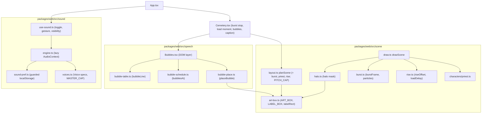

# Design Document: cemetery-undead-2

## Overview

cemetery-undead-2 is Phase 2 of the art pass "Night of the Living Deps". Phase 1 (cemetery-undead) merged to main at b513514 on 25 Nov 2026.

The visual target is unchanged:
- `private/design/mockup-night.html`, the cemetery, with two speech bubbles;
- `private/design/mockup-nightreplay.html`, the axios replay at its burst, with the caption "The wind stops. A grave opens.";
- their screenshots in `private/design/shots/mockup-night-1440.png` and `mockup-nightreplay-1440.png`.

Part A finishes the owner's review of Phase 1 (25 Nov 2026). Part B adds sound, speech bubbles, the replay burst, the burial priest, the rise clip and the load moment.

As in Phase 1, nothing here changes what a grave means. A grave's State comes from the Engine. Its Form depends on the State only. A Ghost means one or more advisories. Triage order sets the keyboard order. Sound, Bubbles, the Burst, the Priest and the Load moment are decoration: each is hidden, silent or still when the viewer asks, and none carries information that the tooltip and the drawer do not. Implements requirements 1 to 16.

### Decisions already made (handoff, 25 Nov 2026)

1. **Paths.** packages/web, the README line, CREDITS.md, the two screenshots, web.md, docs/requirements.md and this folder. No runtime dependency, no audio file, no `.config.kiro`.
2. **Sound.** Web Audio API, generated in code. Off by default. No AudioContext before the viewer turns it on. A remembered "on" still waits for the first gesture. Serious mode silences every sound but the burial bell. Reduced motion does not change sound.
3. **Voices.** A low wind bed, a Possessed sting, a grave-rise thud, a burial bell and a short ghost call on hover of a grave with advisories. One master gain with a hard cap. Every sound short except the wind bed. The owner approves the Sound list.
4. **Bubbles.** One short line from a fixed table by State and reason, true of that reason. At most two on screen, rotated on a seeded schedule, never over a name label, hidden in Serious mode, aria-hidden, still under Reduced motion. The owner approves the Bubble table. The mockup's two lines are approved: "Deprecated, not departed." and "One more minor bump and I am coming out."
5. **Burst.** At the axios 00:21 UTC Stop, and at keyv's Possessed Stop: the lid is flung, dirt and shards fly, the zombie rises, the caption shows, and the sting and thud play when sound is on. It plays again on each arrival. Reduced motion shows the final pose at once. The 16 ms budget holds with 300 graves.
6. **Priest.** Original vector art in the blocky style. Walks, reads, the bell sounds. Stands still under Reduced motion for the burial's duration.
7. **Rise clip and load moment.** One rise animation shared by the Burst and the Load moment. The Load moment raises the graves in triage order, once per page load, in under one second, and is skipped under Reduced motion.
8. **Part A.** As listed in the requirements Introduction, A1 to A8.
9. **Merge.** On the owner's `push`, a local `git merge --no-ff` under the repository identity, so that the merge commit carries the owner's full name.

### The owner's decisions (25 Nov 2026)

- **R-UI-8 approved as written**, added to docs/requirements.md section 5.8 with the change log line 0.7:
  > R-UI-8. THE SYSTEM MAY play sound generated in code and show short speech bubbles over the cemetery. Sound SHALL be off by default and SHALL not start before the user turns it on. Speech bubbles SHALL never cover a grave's name, SHALL be hidden in Serious mode, and SHALL carry no information the grave's tooltip and drawer do not.
- **Bubble table approved with two changes**: "Restless, no-signals" reads "Couldn't read my papers. Ask me again later." and "Restless, stale" reads "Two years without a release. Getting restless." The table below holds the approved lines.
- **Sound list approved as written.**
- **The Halo limit accepted**: the strong pink shows around the rows and above them, not between graves packed tight in a row. The owner judges it on the screenshot.

## Architecture



The Engine and the API do not change. Web still holds no state rule. Bubble lines, like Punchlines, map `state` and `stateReason` to words.

## Components and Interfaces

### A1. Name labels stay readable (requirement 1)

Today a Ghost is drawn 40 cell units above its planned point and twice as large, so it pokes about 28 cell units above its cell and covers the name label of the grave behind it. docs/cemetery.png shows event-stream's ghost over lodash, uuid's over express and request's over moment.

`scene/art-box.ts`, pure:

```ts
/** Everything one grave draws but its glow lies in this box, in cell units (cell 192 by 224). */
export const ART_BOX = { x: -40, y: 0, w: 272, h: 224 } as const;
/** The name label: the plinth rectangle. */
export const LABEL_BOX = GRAVE_GEOMETRY.plinth;
export function artRect(grave: GravePlan): Rect;   // ART_BOX scaled to grave.rect
export function labelRect(grave: GravePlan): Rect; // LABEL_BOX scaled to grave.rect
```

**Why this box is enough.** Rows never overlap, so a box inside its own cell's vertical band cannot reach a label in another row. In a row, a neighbour's cell starts at least one cell width away and its label starts 44 cell units in, so a reach of 40 past the side leaves at least 4 cell units clear. Graves in one row share one scale. Property 1 checks this over the layout model.

**Drawing changes** that bring every mark inside ART_BOX:
- The Ghost's draw shift becomes (−4, −2), from (−4, −40). Without drift the Ghost then spans y 10 to 66 in cell units, over its stone top as in the mockup. The drift of ±6 px is divided by the Tier scale, so the span is about 4 to 72 at the front Tier and 0.6 to 75.4 at the back Tier (6 / 0.64 = 9.4). The planned Ghost box and its drift are unchanged, so the ghost-drift and layout tests stay as they are.
- The open grave's lid moves 5 shape units right: its leftmost vertex goes to 8 + (−16.38 × 2.75) = −37.05 cell units, and its stroke (STONE_LINE_WIDTH 0.5 shape units, about 0.95 cell units at a right-angled corner) to about −38. It was −50.8. The replay overhang of 60 stays as room around the lone replay grave.
- The Possessed zombie, the Dead skeleton, the Restless hand, the Alive hat, the pennant, the Priest and the Burst particles are clamped to the box where the probe of Property 2 finds a mark outside it. Any such move is listed in "Decisions made during implementation".

Property 2 proves the box by drawing, not by trust: a bounds-recording context draws every Form, every Pose, the Ghost at both drift extremes, the pennant, the Priest at sampled phases and the Burst at sampled phases, at the scales 0.64, 0.8, 1 and the replay scale, and checks that every point it touches lies in ART_BOX. A stroked path's bounds grow by half the line width times the miter factor. The burial already clips its stone to the cell (draw.ts), so a sinking stone stays inside.

**Form boxes.** The same probe measures, per shape id, the bounds of everything that Form draws at rest with its Ghost and pennant. The Priest and the Burst are measured separately and only against ART_BOX, because they play on one grave for a moment. Those bounds, taken as the union over the four probe scales (the Ghost drift in cell units grows as the scale shrinks) and rounded out to whole cell units, are `FORM_BOX` in `art-box.ts`, one constant per shape id for every Tier, and Property 2 checks each Form's drawing against its own `FORM_BOX`, each of which lies in ART_BOX. The Halo cuts the Form box, not the whole Art box, so that it can show between the graves of a row.

### A2. The replay header times (requirement 2)

`Header` gets `replay: boolean` from `App`:
- The scan time line reads `Window ends <time>` on a replay. The `<time>` element and its `dateTime` are unchanged.
- The as-of line reads `Showing <time>` on a replay, then Back to now. Off a replay it stays `as of <time>`.
- On the axios replay at its Possessed Stop this reads "Window ends 31 Mar 2026, 03:29 UTC" and "Showing 31 Mar 2026, 00:21 UTC". Both values come from the response, never from text in the code.

### A3. The Halo (requirement 3)

The mockup's Possessed glow is a strong pink halo. The existing glow contrast check composites the Possessed colour at GLOW_ALPHA_BYTE "28" over the ground tokens and needs every state colour, the ghost, the marker, the ring, the focus colour and the border at 3:1 on it. Alphas 0x40, 0x50 and 0x60 fail it (cemetery-undead decision 17). The check guards what sits on a glow. So the strong part goes only where nothing it guards can sit.

**Method.**
1. The existing glow pass stays: radius 200, GLOW_ALPHA_BYTE "28", drawn before the graves.
2. A Halo pass follows it, on an offscreen layer the size of the Scene, cached per plan (the rectangles, the shown Forms, the selected grave, the Lantern grave, the grave, not the phase, of any burial, Vigil or Burst playing, the width and the height):
   - for each Possessed grave that does not hold the Lantern glow, a radial gradient in the state colour from HALO_ALPHA_BYTE "70" at its centre to ALPHA_ZERO_BYTE at radius HALO_RADIUS (1.4 cell widths);
   - then, with `destination-out`, these are cut out, each with a soft edge of HALO_FEATHER (24 px), a solid rectangle and four linear-gradient edge strips that fade the cut from full to none outside it:
     - every grave's Form box and `labelRect`;
     - the whole cell of the selected grave, which holds the selection ring (inset 2);
     - the whole cell of the Lantern grave, which holds the grave button's focus outline and the Lantern glow;
     - the whole Art box of a grave whose burial, Vigil or Burst is playing, which holds the Priest and the particles.
3. The layer is drawn over the ground, before the graves.

The rectangles cut and the gradient stops come from one pure function, `haloMask(plan)`, which both the painter and Property 3 use, so the test checks the drawn Halo, not a model of it.

**One glow.** The Halo counts as part of the Possessed glow. While a Possessed grave holds the Lantern glow, neither its Possessed glow nor its Halo is drawn, so the cemetery-undead rule "a grave has at most one glow" holds. web.md says so (requirement 14.3).

Inside every cut the Halo is zero, so the composite there is the old glow alone and the existing check covers it unedited. Outside the cuts, only ground, fog, grass, stars and the hill sit on the Halo, and none of them is a token the check guards: the ring and the focus outline sit only on the selected and Lantern cells, and the Lantern glow's stack with the Halo happens only where no guarded token is drawn. Property 3 checks that the Halo paints nothing inside any cut.

HALO_ALPHA_BYTE joins the allowed "colour plus alpha byte" set in draw.test.ts (Deliberate test change 6). If the critic finds "70" too weak or too strong, the byte changes without touching any check, because no checked token sits on it.

The layer is redrawn only when its cache key changes (a selection, a hover or focus change, a burial, Vigil or Burst starting or ending), never per frame: the key holds which grave plays, never its phase, so a Burst frame pays no Halo redraw. A Burst with a null start (Reduced motion) does not count as playing: it shows the static open grave, which its Form box already covers. It does not move, so Reduced motion needs nothing more.

### A4. The pit edge colour (requirement 4)

The pit edge is drawn today in the lantern token #ffb547, close to the ring and focus gold #e8a30c. It becomes `costume.flower` #ffd1e8, the pale pink of the Alive flowers.

Reason: the pit sits in the Possessed glow, so a rim lit pink reads as the glow on wet earth, and it ties the pit to the pink State. CIEDE2000 against the ring gold #e8a30c is 42.0, against 6.2 for the lantern token it replaces (computed 25 Nov 2026 with the colour-vision test's formula; the new test pins at least 20). The ring stays the only gold outline near a grave. No new token.

### A5. Wider middle and back rows (requirement 5)

`PITCH_CAP` becomes front 1.07, middle 1.334, back 1.667. The front pitch is floor(192 × 1.07) = 205 px. The middle cell is 154 px and the back 123 px: floor(154 × 1.334) = floor(205.4) = 205 and floor(123 × 1.667) = floor(205.04) = 205. So a middle or back row with no more graves than a full front row lines up with the front columns. A row with more graves than that still fills by `floor(span / inRow)`: at 1440 a full front row has 7 graves at pitch 201 and a full middle row 9 at pitch 156. Pitch stays `max(cell.w, min(floor(cell.w × cap), floor(span / inRow)))`, so rectangles never overlap and every row stays inside the Scene. cemetery-undead Property 1 (`test/tiers.test.ts`) and Property 7 (`test/fit.test.tsx`) run unedited; the independent model in `test/layout.test.ts` changes under Deliberate test change 5.

### A6. Sources on one line (requirement 6)

`ReplayBanner` renders `<p className="replay-sources">Sources: <a>…</a>, <a>…</a>, <a>…</a></p>` in place of the list. Each link keeps its https check, `target="_blank"` and `rel="noopener noreferrer"`. The drawer renders the same component. The existing banner test reads every `a` in the note, so it stays as it is.

### A7. The fresh-clone run (requirement 16.4)

As in cemetery-undead task 9.4, on the final tree. Recorded in "Notes and open items".

### A8. The footer height hook (requirement 16.6)

`usePinnedFooterHeight` queries every `.night-footer` node on each measure, observes each with one ResizeObserver, and re-queries when the response changes (it takes the response as a dependency). The height is the tallest node whose computed position is sticky, else 0.

### B1. Sound (requirement 8)

**Files.**

```ts
// sound/sound-pref.ts
export const SOUND_KEY = "sexton:sound";
export function readSound(storage: Pick<Storage, "getItem"> | null): boolean;  // true only for "on"; a throw gives false
export function writeSound(storage: Pick<Storage, "setItem"> | null, on: boolean): void; // a throw is ignored

// sound/voices.ts
export type VoiceId = "wind" | "sting" | "thud" | "bell" | "ghost";
export const MASTER_CAP = 0.7;
export interface VoiceSpec { readonly peak: number; readonly durationMs: number | null; readonly serious: boolean }
export const VOICES: Readonly<Record<VoiceId, VoiceSpec>>;

// sound/engine.ts
export interface AudioContextLike { /* the subset of AudioContext the engine calls */ }
export interface SoundEngine {
  play(voice: VoiceId, options: { readonly serious: boolean }): void;
  wind(on: boolean, options: { readonly serious: boolean }): void;
  suspend(): void;
  resume(): void;
  dispose(): void;
}
export function createSoundEngine(make: () => AudioContextLike): SoundEngine; // calls make() once, on first play, wind or resume
```

**Gating.** `use-sound.ts` holds `on` (from `readSound` at mount) and `armed` (a gesture seen). It creates the engine only when both are true:
- Pressing the toggle is itself a gesture, so turning Sound on arms it at once.
- A remembered "on" arms at the first `pointerdown` or `keydown` on the page. Until then no engine and no AudioContext exist.
- The factory is `() => new AudioContext()`. If it throws, or `resume()` rejects, the engine marks itself dead and every call is a no-op. The toggle keeps its state.
- Turning Sound off or the page going hidden calls `suspend()`, which ramps the Master gain to 0 within 50 ms and then suspends the context. Visible again with Sound on calls `resume()` and restarts the wind bed.

**Toggle.** `<button type="button" className="sound-toggle" aria-pressed={on}>` with the glyph and the text "Sound off" or "Sound on". The visually hidden note and `aria-describedby` go. The button sits where it is today, between Scan and Serious mode, and becomes a Tab stop.

**Serious mode.** `play` and `wind` take the Serious flag. Every Voice but the bell has `serious: false` and is skipped while Serious mode is on. Turning Serious mode on stops the wind bed.

**Triggers.**

| Voice | When |
|---|---|
| wind | loops while Sound is on, the page is visible and Serious mode is off |
| sting | the Burst starts |
| thud | the Burst starts (with the sting) |
| bell | the Priest starts reading, or a Vigil starts |
| ghost | a grave with a Ghost gains the Lantern glow by hover or focus, at most once every 1,500 ms |

The noise for the wind bed and the thud is one 2-second mono buffer filled once from a mulberry32 generator seeded with 0x5e7701c3. No `Math.random`.

#### Sound list (approved by the owner, 25 Nov 2026)

Every Voice is built per play from these nodes and joins the Master gain (value MASTER_CAP 0.7, never set higher), then a DynamicsCompressor as a limiter (threshold −10 dB, knee 0, ratio 20, attack 3 ms, release 250 ms), then the destination. Peaks are the Voice gain before the Master gain.

| Voice | How it is made | Envelope | Peak (gain, dBFS) | Length |
|---|---|---|---|---|
| Wind bed | the seeded noise buffer, looping, through a band-pass filter at 380 Hz (Q 0.8) whose frequency an LFO at 0.07 Hz moves by ±120 Hz | fade in over 1,500 ms, fade out over 300 ms | 0.05, −26 | loops |
| Possessed sting | two sawtooth oscillators a semitone apart, D3 146.83 Hz and D♯3 155.56 Hz, through a low-pass at 1,400 Hz | attack 8 ms, exponential decay to silence by 1,100 ms | 0.16, −16 | 1,100 ms |
| Grave-rise thud | a sine falling from 95 Hz to 38 Hz over 220 ms, plus 120 ms of the noise through a low-pass at 260 Hz | attack 4 ms, decay by 400 ms | 0.28, −11 | 400 ms |
| Burial bell | five sine partials of 330 Hz at ratios 0.5, 1, 1.19, 1.5 and 2 (hum, strike, minor third, fifth, octave), levels 0.6, 1, 0.5, 0.35 and 0.25, normalised to the peak | attack 3 ms, exponential decay by 2,400 ms | 0.20, −14 | 2,400 ms |
| Ghost call | a triangle gliding from 330 Hz to 262 Hz, with 5 Hz vibrato of ±6 Hz, through a band-pass at 320 Hz (Q 2), an "ooo" | attack 120 ms, hold, release 300 ms | 0.12, −18 | 800 ms |

The loudest single Voice after the Master gain is the thud at about −14 dBFS. The limiter stops a stack of the sting, the thud and the bell from clipping.

### B2. Speech bubbles (requirement 7)

`speech/bubble-table.ts`, pure:

```ts
export function bubbleLine(state: State, reason: string): string | null; // uses reasonFamily from epitaph.ts
```

#### Bubble table (approved by the owner, 25 Nov 2026)

Each line is at most 46 characters, so it fits two lines in a 220 px bubble (the owner's "Getting restless." line is 46). The first two are the mockup's approved lines.

| State | Reason family | Bubble line | Why it is true |
|---|---|---|---|
| Dead | deprecated | Deprecated, not departed. | the installed version is deprecated and still installed (the mockup's line) |
| Restless | minor-advisory | One more minor bump and I am coming out. | a Moderate or Low advisory is open; one more at High would make it Haunted (the mockup's line) |
| Possessed | maintainer-change | Who has the keys now? | a maintainer was added or removed in the last 90 days |
| Possessed | provenance-regression | Papers? I left them in the last version. | an earlier version had provenance and this one does not |
| Possessed | install-script | I brought a script. It runs on install. | this version added an install script, which npm runs at install |
| Dead | stale-with-advisory | Two years down here, and the hole is open. | no release in 24 months and an open advisory |
| Haunted | severe-advisory | Boo. Severity High, or worse. | a High or Critical advisory is open; on a Haunted grave the Ghost speaks |
| Restless | no-signals | Couldn't read my papers. Ask me again later. | every state signal was unavailable, so a later scan may read them |
| Restless | stale | Two years without a release. Getting restless. | no release in 24 months, and no other rule matched |
| Alive | no-rule | Still kicking. The party hat stays on. | no rule matched |

No line names a person or a project. The Bubble uses the Form at the chosen date, so a replay before the attack speaks as Alive.

**Schedule.** `speech/bubble-schedule.ts`, pure:

```ts
export const BUBBLE_SLOT_MS = 6_000;
export const BUBBLE_SHOW_MS = 4_500;
/** At most two eligible grave indices for this instant, or none in the last 1,500 ms of a slot. */
export function bubblesAt(eligible: readonly number[], nowMs: number): readonly number[];
```

- The slot is `floor(nowMs / BUBBLE_SLOT_MS)`, and its hash is FNV-1a 32 of the slot number's decimal text.
- With n eligible graves, take the position p = hash mod n. The first is `eligible[p]`, and when n ≥ 2 the second is `eligible[(p + 1 + (hash >>> 8) mod (n − 1)) mod n]`. The two positions differ, so the two graves are always distinct.
- A grave is eligible when it has a Bubble line and a clear place (below).

**Placement.** `speech/bubble-place.ts`, pure:

```ts
export const BUBBLE_W = 220;
export const BUBBLE_H = 56;
export function placeBubble(plan: ScenePlan, index: number, taken: readonly Rect[]): Rect | null;
```

The candidates, in order:
1. right of the grave's Art box top;
2. left of it;
3. above the Art box, centred.

The first candidate that lies inside the Scene and intersects no `labelRect` and nothing in `taken` wins. When none is clear, the grave gets no Bubble in that slot. The second Bubble is placed with the first in `taken`. At 390 px the "above" candidate meets the label band of the row above, so on a phone mostly top-row graves and row ends get Bubbles; that is the label rule working, not a fault.

**DOM.** `speech/Bubbles.tsx` renders `<div className="bubble-layer" aria-hidden="true">` inside `.scene-container`, over the canvas, holding at most two `<p className="bubble">` at their planned rectangles. `pointer-events: none`. The style is the mockup's: a `text` token background with `ink` text, 13.5 px, weight 600, radius 14, padding 8 by 12. Both are existing tokens, and ink on text is above 15:1.

**Timing.** One `setTimeout` to the next slot start or show boundary updates a `bubbleClock` state. It does not run while Serious mode is on, while the drawer is open or while the page is hidden. A Bubble appears at its slot start and goes at the show boundary, 4,500 ms later. Without Reduced motion each Bubble fades over 200 ms with an opacity transition. Under Reduced motion the class has no transition.

### B3. The replay Burst (requirement 9)

`scene/burst.ts`, pure:

```ts
export const BURST_MS = 1_600;
export interface BurstFrame {
  readonly lid: number;        // 0 closed over the pit, 1 flung to its resting place
  readonly particles: number;  // 0 to 1 along their paths; 1 means gone
  readonly rise: number;       // the zombie's Rise clip progress, 0 under ground, 1 standing
}
export function burstFrame(elapsedMs: number): BurstFrame; // clamped; burstFrame(BURST_MS) is the final pose
export const BURST_PARTICLES: readonly Particle[]; // 8 dirt clods, 6 shards, fixed paths from the scenery seed
```

- **Phases.** The lid flies over 0 to 300 ms with an ease-out. The particles fly over 0 to 900 ms on fixed parabolas. The zombie rises over 250 to 1,350 ms with the Rise clip.
- **Final pose.** `burstFrame(BURST_MS)` equals the static Possessed Form: lid at its resting place, no particles, the zombie standing. So the end of the Burst is the existing drawing, and the screenshot at the final pose is the existing open grave with the caption.
- **Particles.** Dirt in the `dirt` token, shards in the Possessed colour and the `bone` token. Each path starts at the pit and stays in ART_BOX (Property 2).
- **Burst Stop.** `Cemetery` finds it from the views: on a replay (one grave), the first Stop at which `formAt` gives Possessed. When `asOfMs` changes to the Burst Stop from any other value, `Cemetery` records `burstStart = performance.now()` and calls the sound hook's `play("sting")` and `play("thud")`. Leaving the Stop clears it. So each arrival plays it once more.
- **Plan.** `SceneInput.burst?: { index, startMs } | null`. `drawScene` computes `elapsed = nowMs − startMs` from the clock it already has. Under Reduced motion `planScene` stores no start, and the draw uses the final pose.
- **Caption.** `<p className="burst-caption">The wind stops. A grave opens.</p>`, over the scene, centred above the grave's Art box, shown while the Burst Stop is shown and the Burst has started. It is plain text on the surface token, not a live region: the Play live line already announces the Stop.
- **Budget.** The Burst adds at most 14 small fills and one transform per frame to one grave. The e2e timing hook gains an option that paints the 300-grave plan with a Burst on its first grave at 30 phases across BURST_MS, and its median must stay at or below 16 ms.

### B4. The burial Priest (requirement 10)

`scene/characters/priest.ts` draws the Priest in shape-box units: a long cassock in the `surface` token outlined in `border`, a collar and a book in `marker`, a face in `bone`, all blocky rectangles as in the mockup's figures.

- **Path.** The Priest is 24 cell units wide. His left edge walks from x 208 (so his right edge is at 232, the edge of ART_BOX) to x 180, over burial phases 0 to 0.4, with a two-Pose walk. He reads from 0.4 to 1 at x 180 to 204 with a one-Pose read and the book raised, clear of the pennant (x 160 to 176, y 124 to 168), which shows from phase 0.65.
- **Bell.** At phase 0.4, once per burial, `play("bell")` if Sound is on.
- **Plan.** `ScenePlan.priest: { index, phase } | null`, where phase is the burial phase, or null for a Vigil (standing still).
- **Vigil.** Under Reduced motion `useBurial` keeps its present rule (no burial, the pennant at once) and adds `vigil: { name, startMs } | null` that lasts BURIAL_MS. The plan draws the Priest standing at x 180 for that time, with no stone motion. The bell plays at the Vigil's start if Sound is on. A Vigil queued while the drawer is open starts when it closes, as a burial does.

The existing burial tests stay as they are: `burial` stays null under Reduced motion and the pennant shows at once.

### B5. The Rise clip and the Load moment (requirement 11)

`scene/rise.ts`, pure:

```ts
export const RISE_MS = 400;
export const LOAD_SPREAD_MS = 500;
/** 0 under the ground, 1 standing. Ease-out cubic. Clamped. */
export function riseAt(elapsedMs: number, durationMs?: number): number;
/** The start delay of grave i of n in the Load moment: i · min(40, LOAD_SPREAD_MS / (n − 1)). */
export function loadDelay(index: number, n: number): number;
```

The Load moment's last grave starts at most 500 ms after the first and rises for 400 ms, so it ends within 900 ms for any n.

- **Drawing.** During the Load moment each grave is drawn clipped to its cell and moved down by `(1 − riseAt(...)) · rect.h`, so it comes up out of the ground and the fog. The glow and the Halo appear at once when the last grave stands. Ghosts appear when their grave stands. No sound plays: the thud belongs to the Burst only, so Reduced motion, which skips the Load moment, changes no Voice (requirement 8.9).
- **Once per page load.** A module-level flag in `Cemetery.tsx` is set when the first non-empty scan mounts without Reduced motion. Later scans, replays and scrubber moves do not set a start. Under Reduced motion the flag is set and nothing plays. Tests reset it through `resetLoadMomentForTests()`.
- **Plan.** `SceneInput.rise?: { startMs } | null`. The rectangles never move, so the grave buttons, the ring and the tooltip stay in place and work.
- **Burst.** The zombie's rise in the Burst calls `riseAt` with its own window.

### Header and footer layout

The header keeps its order with Sound now a Tab stop: wordmark, summary, evidence links, form, Sound, Serious mode, Legend. The Footer bar is unchanged. At 1440 by 900 the Canvas top limit of 190 holds on the demo, and the replay keeps 120 or less.

## Data Models

```ts
// scene/layout.ts, additions
interface SceneInput { /* existing */ readonly burst?: { readonly index: number; readonly startMs: number } | null; readonly priest?: { readonly index: number; readonly phase: number | null } | null; readonly rise?: { readonly startMs: number } | null }
// GravePlan is unchanged: test/layout.test.ts pins its 11 keys.
interface ScenePlan { /* existing */ readonly burst: { readonly index: number; readonly startMs: number | null } | null; readonly priest: { readonly index: number; readonly phase: number | null } | null; readonly riseStartMs: number | null }
// speech
interface PlacedBubble { readonly index: number; readonly line: string; readonly rect: Rect }
// sound/voices.ts
interface VoiceSpec { readonly peak: number; readonly durationMs: number | null; readonly serious: boolean }
```

The API contract, the Engine types, the evidence pack, the demo files and the replay fixtures do not change.

## Error Handling

- **No Web Audio, or the context fails.** The engine goes quiet and stays quiet. No error is shown. A warn line goes to `console.warn` only under `__SEXTON_E2E__`.
- **localStorage throws or holds garbage.** Sound is off, Serious mode is off, the page works.
- **An unknown state reason.** No Bubble, and no Punchline as before.
- **No clear place for a Bubble.** That grave gets none in that slot.
- **A hidden page.** The bubble timer, the Character clock and the wind bed stop, and restart on `visibilitychange`.
- **A replay without a Possessed Stop.** No Burst and no caption.

## Correctness Properties

*A property is a characteristic or behavior that should hold true across all valid executions of a system: a formal statement about what the system should do. Properties are the bridge between human-readable specifications and machine-verifiable correctness guarantees.*

These criteria turned out testable as properties: 1.1, 1.2, 3.2, 3.3, 3.4, 7.1, 7.2, 7.3, 7.4, 8.2, 8.3, 8.7, 8.8, 9.1, 9.6, 10.1, 11.1, 11.2. They collapse into the eight properties below. No criterion here is a security invariant, so every new property runs 100 times. Existing properties keep their run counts, and the cemetery-undead properties run unedited.

### Property 1: No grave covers another grave's name

*For all* package lists of up to 300 packages, ALL widths, ALL fit heights, either replay flag and ALL Forms at a chosen date: for every pair of distinct graves i and j, `artRect(i)` does not intersect `labelRect(j)`; and every `artRect` lies inside its own cell's vertical band and reaches at most 40 cell units (scaled) past the sides of its cell. Pairs are checked as in cemetery-undead Property 7: every pair up to 60 graves, and above 60 the first 60 against every seventh later grave.

**Validates: Requirements 1.1, 1.2.** Test: `test/art-box.test.ts`.

### Property 2: Every mark of a grave lies in its Art box

*For all* States, Poses (every Pose of every Clip), Ghost drift phases (0 to GHOST_STEPS), scales (0.64, 0.8, 1 and the replay scale), dance windows, pennant flags, burial phases, Priest phases (sampled at 0 to 1 and the Vigil) and Burst elapsed times (0 to BURST_MS): a bounds-recording context that follows every transform and every path, rectangle, arc and ellipse, and grows a stroke's bounds by half its line width times the miter factor, sees no point outside the Form's `FORM_BOX` for the Form at rest with its Ghost and pennant, and no point outside ART_BOX for the Priest and the Burst; every `FORM_BOX` lies inside ART_BOX. The glow and the Halo layers are not part of it.

**Validates: Requirements 1.2, 9.6, 10.1.** Test: `test/art-box.test.ts`.

### Property 3: The Halo paints nothing under a grave or a name

*For all* plans of up to 60 packages with any States, any selected grave, any Lantern grave and any playing burial, Vigil or Burst: `haloMask(plan)`, the function the painter uses, rasterised at one pixel per cell unit, has alpha 0 at every pixel inside any Form box or `labelRect`, inside the selected and Lantern cells, and inside the Art box of a grave with a burial, Vigil or Burst playing, and paints no Halo for the grave that holds the Lantern glow. The existing glow contrast test passes unedited.

**Validates: Requirements 3.2, 3.3, 3.4.** Test: `test/halo.test.ts`.

### Property 4: Bubble lines come only from the table

*For any* State and any reason string, including generated instances of the ten fixed reason templates: `bubbleLine` is null or the table cell of that State and Reason family, null exactly when the family is null, and null for a template under the wrong State. Its signature takes no package name. Every line is at most 46 characters and contains none of the forbidden words of the epitaph test.

**Validates: Requirements 7.1, 7.2.** Test: `test/bubbles.test.tsx`.

### Property 5: At most two Bubbles, chosen by the clock alone

*For any* list of distinct eligible indices and any `nowMs` from 0 to 10^13: `bubblesAt` returns at most two indices, all from the list and distinct; it returns none in the last 1,500 ms of a slot; it returns the same result for every `nowMs` in the same show window; it returns two when the list has two or more and the instant is in the show window.

**Validates: Requirement 7.3.** Test: `test/bubbles.test.tsx`.

### Property 6: A placed Bubble is inside the Scene and clear of every name

*For all* plans of up to 60 packages at any width and any grave index: `placeBubble` gives null or a rectangle of BUBBLE_W by BUBBLE_H inside the Scene that intersects no `labelRect` and nothing in `taken`.

**Validates: Requirement 7.4.** Test: `test/bubbles.test.tsx`.

### Property 7: No sound before it is asked for, and never past the cap

*For any* sequence of events from {toggle, gesture, play(voice), serious on, serious off, hide, show} and any starting stored value: the AudioContext factory is called only after an event sequence in which Sound is on and a gesture or a toggle-on has happened, and at most once; no Voice but the bell starts while Serious mode is on; the Master gain is never set above MASTER_CAP; every non-wind Voice has a length of at most 2,500 ms. For any stored value, `readSound` is true exactly when it is "on", and `writeSound` then `readSound` returns the value written on a working storage.

**Validates: Requirements 8.2, 8.3, 8.7, 8.8.** Test: `test/sound.test.tsx`, with a fake AudioContextLike.

### Property 9: Every Bubble's tail ends inside its speaker's cell

*For all* plans of up to 60 packages at widths 390 to 1920 and any instant: every Bubble that `bubblesFor` shows has its tail's end inside the speaking grave's cell, and the tail's base on the Bubble's edge.

**Validates: the owner's fix of 25 Nov (Bubbles next to their speaker).** Test: `test/bubbles.test.tsx`.

### Property 8: The Burst and the rise are pure, bounded and end in the still pose

*For any* elapsed time (including negative, NaN and very large): every field of `burstFrame` is in [0, 1]; `burstFrame(t)` for t ≥ BURST_MS equals the final pose; `riseAt` is in [0, 1], non-decreasing in t, 0 at t ≤ 0 and 1 at t ≥ its duration. *For all* n from 1 to 300: the last `loadDelay` plus RISE_MS is at most 1,000 ms, and `loadDelay` is non-decreasing in the index (triage order).

**Validates: Requirements 9.1, 11.1, 11.2.** Test: `test/burst-rise.test.tsx`. Requirement 9.5 (the final pose under Reduced motion) is checked by example in the same file and in e2e.

## Testing Strategy

Three parts, as in Phase 1:
- **Examples** for fixed values, DOM structure, timers and the Voice specs.
- **Properties** for the eight statements above, with fast-check 3.23.1, numRuns 100 and the tag `Feature: cemetery-undead-2, Property N: <title>`.
- **Playwright** for layout, label overlap in pixels, AudioContext gating, performance and the screenshots.

All tests are network-free. Web Audio is never touched by a Vitest test: the engine takes a factory, and the tests pass a fake.

| Test file | Content |
|---|---|
| `test/art-box.test.ts` (new) | Properties 1 and 2. The demo's 12 graves at 1440 and 390 by example: no ghost over lodash, express or moment. |
| `test/halo.test.ts` (new) | Property 3. HALO_ALPHA_BYTE is used only for the Halo. |
| `test/bubbles.test.tsx` (new) | Properties 4, 5 and 6. Every table row by example. The layer is aria-hidden with pointer-events none, shows nothing in Serious mode, nothing while the drawer is open, and has no transition under Reduced motion. Fake timers step the slots. |
| `test/sound.test.tsx` (new) | Property 7. The toggle has aria-pressed, reads "Sound off" or "Sound on", persists under `sexton:sound`, and creates nothing at mount even with "on" stored, until a key or pointer press. Each Voice spec by example. Suspend on hide, resume on show. |
| `test/burst-rise.test.tsx` (new) | Property 8. The Burst Stop of axios is 31 Mar 2026, 00:21 UTC and of keyv its Possessed Stop, found from the fixtures. Leaving and returning starts a new Burst. Reduced motion gives no start. The caption shows at the Burst Stop only. The Load moment plays once per page load and never under Reduced motion. |
| `test/priest.test.tsx` (new) | The Priest is drawn only during a burial or a Vigil, walks then reads, and the bell is asked for once. The Vigil lasts BURIAL_MS and waits for the drawer to close. |
| `test/header.test.tsx`, `a11y.test.tsx`, `scrubber.test.tsx` | Deliberate changes 1 to 4, and the replay header labels (new tests). |
| `test/layout.test.ts`, `draw.test.ts` | Deliberate changes 5 and 6. |
| `test/fit.test.tsx`, `replay.test.tsx` | New: the "Sources:" line. Existing tests unchanged. |
| `test/colour-vision.test.ts` | New test, not a change: the pit edge colour against the ring is at least 20 ΔE00. |
| `e2e/smoke.spec.ts`, `e2e/time.spec.ts` | Deliberate change 7. New: no AudioContext before Sound is turned on (the page's `AudioContext` constructor is wrapped by an init script that counts calls), the toggle reaches aria-pressed true, Bubbles never overlap a name label at 1440 by 900 and 390 by 844, Serious mode hides the Bubbles, Reduced motion shows the Burst's final pose with its caption, the Ghosts' drawn pixels clear every name label, and the repaint median during a Burst. |

The 16 ms budget of the 300-grave repaint stays, idle, after a scrubber move and during a Burst.

### Deliberate test changes

Numbering starts at 1 for this spec. Every existing test not listed here must pass unmodified. Titles are from the inventory of 25 Nov 2026.

`test/header.test.tsx`
1. "orders the controls evidence JSON, evidence Markdown, input, Scan, Sound, Serious mode, Legend in the DOM". Old: the Sound button is disabled and described by "Sound arrives in the next release". New: it is enabled, has `aria-pressed="false"`, and has no `aria-describedby`. The DOM order and the names are unchanged.

`test/a11y.test.tsx`
2. "reaches the two evidence links, the Legend control, field, submit and one grave stop by Tab, and wraps out of the page". Old: 11 presses, and the disabled Sound button is not a stop. New: 12 presses, with "Sound off" after "Scan". The grave stop moves from position 6 to 7.
3. "gives every DOM control a focus-visible outline of at least 2px". Addition: `.sound-toggle:focus-visible`.

`test/scrubber.test.tsx`
4. "is reachable by Tab". Old: the press count of cemetery-undead change 19. New: one more press, for the Sound stop.

`test/layout.test.ts`
5. The independent Tier model and its pinned middle and back positions (cemetery-undead change 30). Old: PITCH_CAP middle 1.2 and back 1.4. New: 1.334 and 1.667. Front positions, rectangle sizes, y values and heights are unchanged.

`test/draw.test.ts`
6. "keeps order, call counts, colours and no globalAlpha" and the per-grave call counts of cemetery-undead change 32. Old: no Halo layer, and the alpha set of cemetery-undead change 7. New: one Halo `drawImage` per frame when a Possessed grave without the Lantern glow is on screen, and HALO_ALPHA_BYTE joins the allowed alpha set. Every style is still a token or a token plus a byte, and still no globalAlpha. (The pit edge colour and the Ghost draw shift are not pinned by any existing test; the pit edge gets a new test.)

`e2e/smoke.spec.ts`
7. "demo loads under the CSP, then 300 graves redraw within budget" and "the axios replay at its Possessed stop, for the README". Additions, no assertion removed: before docs/cemetery.png the step sets the page clock to a show window in which two Bubbles are placed and waits for both; before docs/replay-axios.png the step checks the Burst caption and the final pose.

`e2e/smoke.spec.ts`, added by the owner's fixes of 25 Nov 2026
8. "demo loads under the CSP, then 300 graves redraw within budget". Addition, no assertion removed: 300 graves all in the front row, Possessed and Dead in turn, repaint with a median at or below 16 ms over 30 paints.
9. "demo loads under the CSP, then 300 graves redraw within budget", the step before docs/cemetery.png. Old: it hovers left-padder and expects "Here lies left-padder" in the tooltip. New: it hovers event-stream and expects "Here lies event-stream", so left-padder, not hovered, shows its Halo. The epitaph check is unchanged.
10. "the axios replay at its Possessed stop, for the README", the step before docs/replay-axios.png. Old: it hovers the axios grave and expects its epitaph in the tooltip (K2d fix 1, item 8). New: it moves the pointer away and expects no tooltip, so the picture shows the Halo and the Burst caption.

If the build finds another existing test that pins a value this spec changes on purpose, it is added here with the same Old and New form before the test is edited, and the report names it.

### Visual critic protocol (requirement 15)

As cemetery-undead "Visual critic protocol", with these captures: `/` and `/?replay=axios` at 1440 by 900 and 390 by 844, plus the axios replay at the Burst Stop at 600 ms into the Burst (mid-animation) and at its final pose, with Reduced motion off at a fixed page clock. The critic sees only those images, the two mockup PNGs, the design guidance and this checklist:
- no ghost, lid, character or bubble over another grave's name;
- the Possessed halo reads strong and pink, as in the mockup;
- the pit edge is not gold like the selection ring;
- the middle and back rows fill the width;
- the replay header labels its two times;
- the story card's sources are on one line;
- the bubbles look like the mockup's;
- the Burst reads as a grave bursting open, with its caption;
- the Priest reads as a priest;
- no generic template tells.

## Calls made without a user decision

1. **One Art box for every Form.** Reason: one rule (inside its own vertical band, at most 40 cell units past the sides) is enough to keep every name clear, whatever Form the scrubber shows, and it is easy to prove.
2. **The Ghost moves down to its stone, not the rows apart.** Reason: moving the rows apart would change the pinned layout heights of three earlier specs. The planned Ghost box and its drift tests stay.
3. **The Halo by cutting out, not by a new contrast rule.** Reason: the handoff says the existing check passes unchanged, so the strong part goes only where the check has nothing to guard.
4. **Pit edge in `costume.flower`.** Reason in A4.
5. **Pitch caps from the front pitch.** Reason in A5.
6. **"Sound off" and "Sound on" as the toggle's names, as the handoff asks.** Note: assistive technology reads the name and the pressed state, so it hears "Sound on, pressed". The names match the mockup and the handoff.
7. **A limiter after the Master gain.** Reason: the sting, the thud and the bell can start together at the Burst.
8. **The Burst caption is plain text, not a live region.** Reason: the Play live line already announces the Stop, and a second announcement would talk over it.
9. **The Burst uses the Form at the Stop, found from the Segments.** Reason: web holds no state rule, and the Stop must not be a date in the code.
10. **The Vigil is new state beside the burial.** Reason: the existing burial tests pin "no burial under Reduced motion", and the Vigil does not move the stone.
11. **The Load moment draws glows after the last grave stands.** Reason: a glow under an empty plot would mean nothing.
12. **Bubbles hidden while the drawer is open.** Reason: the scene is inert then, and a moving bubble behind the scrim distracts.
13. **No sound in the Load moment.** Reason: it would play only without Reduced motion, which requirement 8.9 forbids, and before any gesture, which requirement 8.2 forbids.

## Decisions made during implementation

1. **Bubble line length 46, not 44.** The owner's approved line "Two years without a release. Getting restless." is 46 characters. The cap follows the approved wording; two lines in a 220 px bubble still hold it.
2. **ART_BOX is 220 high, not 224.** A Tier cell is rounded to whole pixels (154 by 179 at 0.8), so 224 units at the drawing scale (154 / 192) pass the cell's bottom by under a pixel. Nothing is drawn below 219 units.
3. **Marks moved into the Art box, found by the probe.** The Ghost shift is (−4, −2). The lid, its crack, its solid box and its specks move 5 shape units right. The zombie is drawn at 1.15 (was 1.35), centred at x 32 and moved to −7, so its horns stay inside the top of the cell and its feet stand in the pit. The party hat is 9 rows from y 2 with its bobble at y −2 (was 13 rows, bobble at −9).
4. **The Form box is split.** One core box per shape, without the shadow, plus GHOST_BOX {80, 0, 48, 76} when the grave has a Ghost and MARKER_BOX {160, 124, 16, 44} when it has a pennant (`formRects`). The shadow is not cut: no checked token sits on it. Critic round 2 saw dark boxes where whole Forms were cut.
5. **The Halo's numbers.** HALO_ALPHA_BYTE "a0", radius 2.4 grave widths, feather 32 px, centre (96, −40) in cell units, above the zombie's head, so most of it rises into open sky and ground (critic round 1). The layer is painted at half a CSS pixel per pixel, and each cut is painted 2 px wider than the mask so that smoothing leaves no trace inside it.
6. **ScenePlan gains `selected`**, beside `burst`, `priest` and `riseStartMs`, so the Halo cuts the selected cell without reading the ring.
7. **The critic rounds of tasks 2.5 and 3.3 ran together.** Both are canvas changes of Part A, judged on the same captures.
8. **The e2e timing hook gains `labels()` and `paintVariant({ ghosts })`** for the label pixel check of task 2.4.
9. **The noise reuses `mulberry32` from scene/scenery-seed.ts** with the same seed, rather than a second copy.
10. **The sound test is `test/sound.test.tsx`**, not `.ts`: it also renders the page to check the toggle and run axe with Sound on (requirement 12.3).
11. **The Sound toggle's glyph changes with its state** (a speaker with waves when on, crossed out when off). Its name is the text "Sound off" or "Sound on".
12. **The page clock is `Date.now()`.** The Burst and the Load moment take their starts from it, because `drawScene` already draws at `Date.now()`; design B3 said `performance.now()`.
13. **The Burst leaves the plan after BURST_MS**, so the Halo returns over the still open grave; the caption stays while the Burst Stop is shown.
14. **The Load moment flag lives in `scene/load-moment.ts`** (`claimLoadMoment`, `setLoadMomentPlayedForTests`), not in Cemetery.tsx. `test/setup.ts` marks it played before every test, so the existing tests see the scene at rest as before; the new tests clear it.
15. **The e2e timing hook times the whole scene**: `redraw` paints the plan without the Load moment, so a page still rising does not time fewer graves. `redrawBurst` paints a Burst on the first open grave and fails without one. The Burst budget test uses the smoke test's 300 graves with left-padder first.
16. **The Halo layer covers only the box around its sources**: on a tall scene a full-height layer cost about 50 ms a frame.
17. **Burst particles**: 8 dirt clods and 10 triangular shards in the Possessed colour and bone, from the pit rim, bounded to x −15 to 79 shape units (critic round 4).
18. **The Priest** is a 24 by 76 figure drawn 1.45 times: a stepped violet-grey cassock (`grassLight`) outlined in `border`, buttons, a white collar notch on a dark neck band, a face in the `marker` cream with eyes, a skullcap, and a book with a white cross. He walks from x 191 to 183 and reads at 183 (critic rounds 5 to 7). The bell rule is the pure `bellKey`.
19. **Bubble fades use the Web Animations API** from the component: the style sheet may hold no transition, and no animation but the loading spinner's (an existing style test). Under Reduced motion there is no fade.
20. **The "above" Bubble place moves sideways to stay inside the Scene.** At 390 px the centred place ran off the edge, so no Bubble ever showed.
21. **The hovered or focused grave gets no Bubble**, and no Bubble sits in the band where its tooltip opens (critic round 8: a Bubble sat under the replay's tooltip).
22. **The test files of tasks 6 to 8 are `.tsx`**: they render the page or the layer.
23. **"The first scan after a page load" is the first scan with graves.** An empty first scan does not claim the Load moment, so the first scan that has graves rises.
24. **The Burst starts in a layout effect**, so the first paint at the Burst Stop is the Burst's first frame, not its final pose (whole-branch review).

25. **Sprites (the owner's fix of 25 Nov).** A front row of 300 Possessed and Dead graves repainted in 180 to 380 ms. The time went to the zombie's, skeleton's and ghost's many rotated limbs and curved paths at front-row size, not to the glows or the fills (a measured split: scenery 0.8 ms, glows 0.2 ms, graves 280 ms). `scene/sprites.ts` now paints each still body (shadow, stone, Character at one Pose, Costume) once per shape, fill, Clip and Pose, each ghost and each glow once per colour and size, at the paint's device pixels per unit, and draws them as images: the front row repaints in about 2 ms. Sprites are used only on a real canvas context; the painter's tests and the bounds probe record the direct drawing, which both paths share (`drawBody`). A burial, a Burst in play and a rising grave are drawn directly; an e2e paints a rising frame with and without sprites and requires them equal. An e2e paints one frame with sprites and one without and allows under 0.5% of pixels to differ by more than a smoothing step (measured 0.007% and 0.012%).
26. **Bubbles with tails (the owner's fix).** A Bubble is as wide as its speaker's column (160 to 220 px) and as tall as its line needs. Its places, in order: above the speaker's head in its column with the tail down, then beside the stone, right then left, with the tail across. A place clear of every other grave's art wins over one that is not; with none clear, the first allowed place is used. The tail ends inside the speaker's cell (Property 9). It is a square in the bubble's token turned 45 degrees, under the bubble's text.
27. **The README pictures (the owner's fix).** docs/cemetery.png hovers event-stream, so left-padder shows its Halo; docs/replay-axios.png hovers nothing, so the axios grave shows its Halo with the Burst caption (Deliberate test changes 9 and 10).
28. **The Priest keeps his size (the owner's choice, 25 Nov).** He is PRIEST_H = 110 cell units tall: at least half of every stone and 70 px or more in every row at 1440 by 900. A test pins it.

## Notes and open items

- **Fresh-clone run on the final tree (task 9.5, A7).** Run on 25 Nov 2026 on commit a1d62c6: cloned to `build/fresh-clone` and installed with `npx npm@11 ci` (exit 0).
  - `npm test -w @sexton/api` first: 296 tests pass.
  - Root `npm test`: exit 0, 1988 tests (action 12, api 296, cli 60, engine 1059, web 510, infra 51).
  - `packages/web/public/demo` deleted, then bare `npx vitest run` in `packages/web`: the global setup wrote the demo files; exit 0, 510 tests.
  - The clone was then removed.
- **Gates on the final tree (task 9.3).** Root typecheck and lint exit 0 with zero warnings; root `npm test` 1988 tests; `npm run test:e2e -w @sexton/web` 33 passed, none skipped. Repaint medians at 300 graves: 2.90 ms idle, 2.40 ms after a scrubber move, 3.20 ms during a Burst (budget 16 ms).
- **Scope and bundle (task 9.4).** Every changed path since b513514 is in the allowed list; no `package.json` or lock file changed. `npm run build -w @sexton/web` passes its bundle check (16 files clean), and `dist` holds no audio file.
- **For the owner.** The Halo does not show on a hovered or focused Possessed grave, which shows the Lantern glow alone by the one-glow rule; both README pictures hover a grave for its tooltip, so neither shows the Halo. A 300-grave scan whose graves are all in the front row repaints in 180 to 330 ms in headless Chromium, a cost Phase 1 added (the Possessed glow pass and the full-height fills); the budget test's 300 graves sit in the middle row.

- **R-UI-8, the Bubble table and the Sound list** were decided by the owner on 25 Nov 2026 (see "The owner's decisions").
- **The Character e2e and the `bone` token.** The Burst shards and the Priest's face use `bone`. The Character e2e assumes `bone` appears only in Costumes. It holds because the Burst plays only on a replay and the Priest only during a burial, and neither is on screen in that test.
- **Merging.** AGENTS.md says "No merges" for the spec tasks. The merge of decision 9 happens only on the owner's `push`, as the handoff asks.
- **The Character art.** The Phase 1 vector source stays. If the owner downloads the CC0 models later, a bake can replace it behind the same call.
- **Alive against Restless.** Still 1.509:1 against the 1.5 minimum. This spec changes no state colour.
