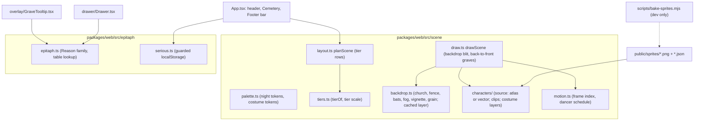

# Design Document: cemetery-undead

## Overview

cemetery-undead is Phase 1 of the art pass "Night of the Living Deps". Art direction C was chosen on 24 Nov 2026 at 03:41. It covers two views:

- the cemetery
- the axios replay moment.

Both at 1440 by 900, as this spec sets them, are the visual target. The 390 by 844 target is the same art reflowed by the rules of "Layout at 390 px".

The spec changes how the cemetery looks and leaves what a grave means alone. A grave's State still comes from the Engine. Its Form, Character and Costume depend only on that State. A Ghost still means one or more advisories. Triage order still sets the keyboard order. Implements requirements 1 to 15.

### Decisions already made (24 Nov 2026)

1. **Paths.** packages/web, plus the README line, CREDITS.md, the two screenshots, web.md and this folder. Dev-only additions to `@sexton/web` devDependencies are allowed for the Bake, so the root `package-lock.json` changes. No runtime dependency is added.
2. **State colours.** Alive #8fe3d0, Restless #e69f00, Haunted #56b4e9, Dead #bfb8ad, Possessed #cc79a7, each adjusted within its hue family only if a check fails. None fails with this palette (see "Palette").
3. **Fonts.** Pirata One, IM Fell English SC, IM Fell English italic and Instrument Sans, self-hosted with their OFL files.
4. **Characters.** CC0 models by Quaternius, baked into sprite Atlases by a dev-only script. The bake has one day. If it fails, the fallback is vector characters in a blocky style.
5. **Ghost.** Original art. Never the Kiro logo.
6. **Depth.** Three Tiers by urgency. Triage order holds within a Tier and in the keyboard order.
7. **Frame rate.** 12 a second. One still Pose under Reduced motion. The 300-grave repaint stays inside 16 ms.
8. **Epitaphs.** A fixed table keyed by State and reason, set on 24 Nov 2026 (section "Epitaph table"). The install-script line was reworded that day.
9. **Serious mode.** Off by default, remembered per browser with a guarded localStorage read.
10. **Sound button.** Shown but disabled in Phase 1.
11. **Canvas top.** At or above y 190 at 1440 by 900.
12. **The screenshot loop.** A Visual critic that never sees the code reviews every visual change at both sizes.

### Open question for the owner (requirement 13, blocks the build)

**Decided 24 Nov 2026: the owner approved the amendment as written.** Task 1.1 applies it.

R-UI-1 says: "Grave form encodes state: upright stone for Alive and Restless, cross for Haunted, cracked tilted stone for Dead, open grave for Possessed." This spec gives Alive and Restless different Forms. The approved art cannot meet R-UI-1 as written.

The proposed amendment, as a change log line "0.5, 24 Nov 2026. R-UI-1: Alive and Restless get distinct forms; characters and costumes act out each state":

> R-UI-1. THE SYSTEM SHALL render each direct dependency as a grave in a cemetery scene. Grave form encodes state: a rounded stone with a party hat and flowers for Alive, a tilted stone with a hand clawing out of the dirt for Restless, a cross for Haunted, a cracked tilted stone with a lounging skeleton for Dead, and an open grave with a dancing devil-costumed zombie for Possessed. Colour follows the same state. Graves sit in three depth tiers by state group, each at a fixed scale. No continuous encodings. A package whose installed version is not yet published on the chosen date shows an unmarked mound (the Not-published form), and a package with a logged pull request shows a pennant beside its grave. Neither changes the grave form of a State.

If the owner declines, these parts revert and the rest of the spec stands:
- Restless keeps the Alive outline (`rounded`, upright) with the hand in front, and no `tilted` outline is added. Requirement 3.3 then reads "an upright stone with a zombie hand clawing out of the dirt in front of it".
- Deliberate test change 1 keeps one shared outline for Alive and Restless.
- Deliberate test change 2 keeps its old title and its one allowed shared shape, renamed from upright to rounded.

## Architecture



The Engine and the API do not change. Web still holds no state rule. It reads `state` and `stateReason` from the response and maps them to pictures and words.

## Components and Interfaces

### Palette (requirement 1)

| Token | Value | Use |
|---|---|---|
| states.Alive | #8fe3d0 | decided value |
| states.Restless | #e69f00 | decided value |
| states.Haunted | #56b4e9 | decided value |
| states.Dead | #bfb8ad | decided value |
| states.Possessed | #cc79a7 | decided value |
| skyTop | #0e0b1a | the decided top of the sky |
| skyMid | #241339 | purple |
| skyHorizon | #3d1d4c | violet glow at the horizon |
| groundTop | #231a33 | deep violet ground |
| bg | #120d1c | page and lowest ground |
| fog | #a796c4 | lilac fog, at 52/255 as before |
| grassDark / grassLight | #2c2140 / #3a2a52 | violet grass |
| pit | #05030a | open grave |
| moon | #f0a040 | orange harvest moon |
| text / muted | #f1ece2 / #bdb3cc | |
| wordmark | #f6a93b | Pirata One wordmark |
| focus / ring | #ffb547 | lantern-gold focus |
| border | #9a8bb3 | was #8a7aa3 in the first pass, 2.59:1 against fog, raised to pass 3:1 |
| ghost | #f4f0fa | ghost body |
| ink | #140f22 | text on a state colour |
| surface / field | #1a1328 / #150f22 | header, tooltip, drawer |
| accentBg / accentText | #f6a93b / #140f22 | Scan button |
| marker | #f6e7c1 | pennant |
| silhouette | #08060f | church, fence, tree, bats |
| lantern | #ffb547 | Lantern glow, at LANTERN_ALPHA_BYTE |
| horizon, star, starFar, ring | unchanged names, values #5a2e6e, #f4f1de, #b7a9d6 and the focus value | as today |
| costume tokens | horns #d23a3a, eyes #ff3b30, cape #7a1f3d, skin #7fae4e, bone #ece5d6, onesie #5b4a8a, hat #f6a93b, flower #ffd1e8, blush #f2a7c3 | drawn layers |

Every value is checked by the existing contrast tests, which iterate every Backdrop stop and both theme keys:
- the state colours reach at least 3.30:1 (Possessed is the lowest), and ink on a state colour at least 6.12:1;
- text reaches 8.58:1 and muted 5.04:1 on the weakest stop;
- Alive against Restless is 1.509:1 against the existing 1.5 minimum;
- border reaches 3.23:1.

**Glow stops.** The Lantern glow and the Possessed glow sit under graves, so their composites are stops too. **A grave has at most one glow**: while a Possessed grave holds the Lantern glow, its pink glow is not drawn, so the two never stack.

`glowStops(theme)` returns ten composites, each glow over each of the five tokens under a grave (groundTop, the fog-over-ground stop, grassDark, grassLight and bg):
- the lantern at LANTERN_ALPHA_BYTE "18";
- the Possessed colour at GLOW_ALPHA_BYTE "28".

`backdropStops` keeps its ten stops unedited, so the existing tests that pin its length and order still hold. A new test runs every check of the cemetery-theme contrast Property (state colours, ghost, marker, ring, focus and border at least 3:1) over `glowStops`. Measured:
- the lowest state colour is Possessed at 3.08:1, on its own glow over the fog stop;
- the lowest of all checked tokens is border at 3.02:1.

Rejected alphas:
- lantern "55" gave Possessed 1.91:1;
- lantern "20" gave Possessed 2.96:1;
- stacking both glows gave Possessed 2.59:1, which is why one glow at a time is a rule.

The other new bytes are VIGNETTE_ALPHA_BYTE "b0", applied only at the scene edges outside every cell, and GRAIN_ALPHA_BYTE "14". All four new bytes join the "colour plus alpha byte" set in draw.test.ts (Deliberate test change 7). The names of the existing decoration CSS variables (`--moon`, `--fog`, ...) stay out of styles.css, as the existing test asks. The canvas reads the tokens from palette.ts directly.

### Colour vision check (requirement 1.7)

`test/colour-vision.test.ts` takes each State colour through these steps:
1. Linearise the sRGB value.
2. Multiply by the Machado, Oliveira and Fernandes (2009) severity 1.0 matrix for protanopia, deuteranopia or tritanopia (the matrices are fixed in the test, from https://www.inf.ufrgs.br/~oliveira/pubs_files/CVD_Simulation/CVD_Simulation.html).
3. Clamp to [0, 1] and convert to CIELAB (D65).
4. Compute CIEDE2000 for every pair.

The minimum is 8. Three reasons:
- A ΔE00 of about 2.3 is one just-noticeable difference (Sharma, Wu and Dalal 2005), so 8 is more than three such steps for small marks on a dark field.
- Shape already encodes State, so colour is the redundant channel.
- The decided set reaches 8.4 at its tightest pair, and three of its colours are from the Okabe-Ito colour-blind-safe palette.

Measured with the decided colours, the minimum ΔE00 is:

| Vision | Minimum ΔE00 | Closest pair |
|---|---|---|
| normal | 24.1 | Alive and Dead |
| protanopia | 8.4 | Alive and Dead |
| deuteranopia | 9.1 | Alive and Dead |
| tritanopia | 10.5 | Alive and Haunted |

The protanopia margin is small, so a later shade change must recheck it.

### Type (requirement 2)

| Family | File | Use | Fallback |
|---|---|---|---|
| Pirata One 400 | `public/fonts/pirata-one-400.woff2` | the wordmark | `fantasy, serif` |
| IM Fell English SC 400 | `public/fonts/im-fell-english-sc-400.woff2` | grave names on the canvas, "Here lies" names | `Georgia, serif` |
| IM Fell English 400 italic | `public/fonts/im-fell-english-400-italic.woff2` | Punchlines, "Here lies" | `Georgia, serif` |
| Instrument Sans 400, 500, 600 | `public/fonts/instrument-sans-400.woff2`, `-500.woff2`, `-600.woff2` | everything else | `system-ui, sans-serif` |

- **Files and licences.** The WOFF2 files are the Latin subsets served by Google Fonts. They are downloaded once by the developer, never at run time. Each family folder gets its `OFL.txt`. The fonts are assets, not npm dependencies.
- **CSS.** `styles.css` declares them with `@font-face { src: url("/fonts/...woff2") format("woff2"); font-display: swap; }`. The rule that `styles.css` holds no `url(` is narrowed to "only `url("/fonts/<name>.woff2")`" (Deliberate test change 18).
- **CSP.** `vite.config.ts` already has `font-src 'self'`, so the CSP does not change. An e2e check asserts that no request leaves the origin.
- **Canvas text.** The canvas draws names in IM Fell English SC. `Cemetery.tsx` waits on `document.fonts.load` for the canvas families and then invalidates the Scene once. Until then the fallback draws.

### Characters (requirements 3, 4, 11)

**Source.** The Zombie Apocalypse Kit by Quaternius, https://quaternius.com/packs/zombieapocalypsekit.html.
- The page states "License CC0". It has 60 models, animated, in FBX, OBJ, Blend and glTF, including 4 enemies (zombies).
- The Cube World Kit, https://poly.pizza/bundle/Cube-World-Kit-DwDr8493Fw, is the candidate for the skeleton. Its page renders client side, so the CC0 licence of the exact model is checked and recorded in task 4.1 before use. If it is not CC0, the skeleton is a zombie-kit rig with the bone token and a drawn ribcage, or comes from the Vector fallback.

**Bake.** `packages/web/scripts/bake-sprites.mjs` runs only by hand (`npm run sprites:bake -w @sexton/web`), never in `test`, `build` or CI.
1. It loads the glTF files from the repository-root `build/models` (gitignored by the root `build/*` rule, downloaded by hand).
2. It opens a Playwright Chromium page with three.js (devDependency) and a fixed three-quarter orthographic camera (azimuth 35°, elevation 20°).
3. It plays each Clip and samples it at 12 Poses a second, into 96 by 96 cells.
4. It writes one Atlas per Clip (`public/sprites/<character>-<clip>.png`) and its frame table (`<character>-<clip>.json`, `{ cell, frames }`).

The Clips:

| Character | Clips | Poses each |
|---|---|---|
| zombie (Possessed) | dance | 12 |
| skeleton (Dead) | lounge, dance | 12 |
| hand (Restless) | twitch | 8 |

- **No models in the repo.** Source models are not committed. The bake reads them from the gitignored folder, and the Atlases are the committed product.
- **Licence check.** The bake writes the pack name and licence into each JSON, and a test checks it says CC0.
- **Fallback.** If the bake does not produce all four Atlases within one working day of task 4, the Vector fallback is used and the call is recorded under "Notes and open items".

**Vector fallback.** `scene/characters/vector.ts` draws each Pose from rectangles and simple paths in a blocky style (possessed, skeleton and hand figures). Its Poses are 12 per Clip by joint angles from a fixed table. It uses the same `CharacterSource` interface.

```ts
export type CharacterId = "zombie" | "skeleton" | "hand";
export type ClipId = "dance" | "lounge" | "twitch";
export interface CharacterSource {
  readonly ready: boolean;
  poseCount(character: CharacterId, clip: ClipId): number;
  /** Draws one Pose into the cell-relative box. Pure apart from the context calls. */
  draw(ctx: CanvasRenderingContext2D, character: CharacterId, clip: ClipId, pose: number, box: { x: number; y: number; w: number; h: number }): void;
}
```

The sprite source loads the Atlases with `new Image()` from the page origin. Until they load, `ready` is false and the graves draw without Characters, then repaint once.

**Costumes.** `scene/characters/costume.ts` draws the costume layers with Path2D and costume tokens, in Character-relative coordinates, so a costume fits every Pose:
- the devil horns and cape on the zombie;
- the onesie on the skeleton;
- the party hat and flowers on the Alive stone.

**Forms.**

| State | Stone | Character, Clip | Costume | Extra |
|---|---|---|---|---|
| Possessed | open grave, lid flung aside (`open` outline, lid rotated −28°) | zombie, dance | devil horns, cape, red eyes | pink glow (the state colour at GLOW_ALPHA_BYTE) |
| Dead | cracked tilted stone (`cracked`) | skeleton, lounge, dance in a dance window | onesie | none |
| Restless | tilted stone (`tilted`, new outline, −6°) | hand, twitch, in front of the stone | none | dirt mound |
| Haunted | cross (`cross`) | none | none | none |
| Alive | rounded stone (`rounded`, new outline) | none | party hat, flowers | none |

`SHAPE_BY_STATE` becomes Alive "rounded", Restless "tilted", Haunted "cross", Dead "cracked", Possessed "open" (Deliberate test changes 1 and 2).

**Ghost.** `GHOST_PATH` becomes a new ghost: a rounded body with a wavy hem, two oval eyes in ink and two blush ovals. It stays one cell-relative path set, the same for every grave, with no Kiro logo or mark.

### Motion (requirement 4)

`scene/motion.ts`, pure:

```ts
export const FRAME_MS = 1000 / 12;
export const STILL_POSE = 0;
export function poseAt(nowMs: number, poseCount: number, reducedMotion: boolean, phaseOffset: number): number;
export function dancers(deadNames: readonly string[]): ReadonlySet<string>;
export function inDanceWindow(name: string, nowMs: number): boolean;
```

- `poseAt` gives `STILL_POSE` under Reduced motion. Otherwise it gives `(floor(nowMs / FRAME_MS) + phaseOffset) mod poseCount`. The phase offset is the seed mod poseCount, so neighbours do not move in lockstep.
- **Seed.** FNV-1a 32 of the package name.
- **Dancers.** The Dead names sorted by seed then name. The first `max(1, floor(n / 5))` dance, with none when n is 0.
- **Dance window.** 2,000 ms in every 12,000 ms, starting at `seed mod 12000`.
- **Clock.** `Cemetery.tsx` owns one clock. It sets one `setTimeout(FRAME_MS)` while some animated Character is on screen, Reduced motion is off and `document.visibilityState` is "visible". It passes `nowMs` into `planScene`. The ghost drift keeps its own 100 ms step, as now. One repaint serves both.

### Tiers (requirement 5)

*Final values: SKY_HEIGHT 120 and TIER_GAP 0 (decision 11), rows centred (decision 6). The 160 and 12 below, and the heights worked from them in Deliberate test change 6, are the first pass; the tests pin y 136 and heights 67,352 and 11,352.*

`scene/tiers.ts`:

```ts
export type TierId = "front" | "middle" | "back";
export const TIER_OF: Record<State, TierId> = { Possessed: "front", Dead: "front", Haunted: "middle", Restless: "middle", Alive: "back" };
export const TIER_SCALE: Record<TierId, number> = { front: 1, middle: 0.8, back: 0.64 };
export const TIER_DRAW_ORDER: readonly TierId[] = ["back", "middle", "front"];
```

`planScene` puts each grave in the Tier of `pkg.state`, the scan-date State, never the Form at the chosen date. Triage order already lists the Possessed and Dead packages first, then Haunted and Restless, then Alive. So each Tier is a contiguous run of the triage list, and the grave index, the DOM order and the keyboard order do not change.

For each non-empty Tier, top to bottom on screen in TIER_DRAW_ORDER:
- the cell is `round(192·s)` wide and `round(224·s)` high;
- it has `max(1, floor((width − 32) / cellW))` columns, and as many rows as its graves need;
- graves fill left to right, then row by row, in triage order;
- the Tier starts 12 px below the previous one.

The first Tier starts at `SKY_HEIGHT + PADDING`. `SKY_HEIGHT` becomes 160 so the moon, church and bats have room. Height is the sum of the Tier heights plus padding.

Per-grave geometry (shape, plinth, ghost, marker, inscription) is the existing cell-relative geometry multiplied by the Tier scale. The ring, the grave button rectangle and the tooltip anchor take the scaled rectangle.

### Backdrop (requirement 6)

*Final values: decisions 5 (no backdrop cache, measured medians 2.3 to 3.05 ms), 7 and 11 (sky 120, the moon at y 62 with r min(52, ...), no Tier gap) in "Decisions made during implementation" replace the numbers below.*

`scene/backdrop.ts` draws the static layers once per (width, height, theme) into an offscreen canvas, and `drawScene` blits it. The layers are:
- the sky gradient and stars;
- the orange moon (`moon.x = width − width/5`, `y = 90`, `r = 56`) with its halo;
- the church silhouette at `width·0.07`, and a tree at `width·0.9`;
- the fence along the horizon;
- the fog band, the ground gradient and the grass;
- the vignette (a radial gradient to the silhouette token at VIGNETTE_ALPHA_BYTE);
- a 128 by 128 grain tile, generated from the scenery seed 0x5e7701c3 and drawn as a pattern at GRAIN_ALPHA_BYTE.

Positions depend on the width only.

**Bats.** Four, positions from the seeded generator, wing Pose from `poseAt` with 4 Poses. They are drawn per frame over the cached layer. Under Reduced motion they hold still.

**Lantern glow.** `planScene` takes `lantern: number | null`, the hovered or focused grave index. On that grave the Lantern glow replaces the Possessed glow. `GraveButtons` already knows both. A radial gradient from the lantern token at LANTERN_ALPHA_BYTE to ALPHA_ZERO_BYTE is drawn under that grave before it, with a radius of 0.6 of the cell width.

**Budget.** The backdrop cache removes the gradient and silhouette work from each repaint. A repaint is then the cached blit, the bats, and per grave the shadow, the stone, at most one Atlas `drawImage` and at most four costume paths. The 300-grave median must stay at or below 16 ms in `smoke.spec.ts`, unchanged.

### Epitaphs (requirement 7)

`src/epitaph/epitaph.ts`, pure:

```ts
export type ReasonFamily = "maintainer-change" | "provenance-regression" | "install-script" | "deprecated" | "stale-with-advisory" | "severe-advisory" | "no-signals" | "stale" | "minor-advisory" | "no-rule";
export function reasonFamily(state: State, reason: string): ReasonFamily | null;
export function punchline(state: State, reason: string): string | null;
export function hereLies(name: string, version: string): string; // "Here lies <name> <version>"
```

`reasonFamily` matches the fixed reason texts of `packages/engine/src/state.ts` lines 61 to 114:
- each prefix is anchored at the start;
- version numbers and month counts are free;
- the State must match the row.

Anything else gives null, and then no Punchline.

#### Epitaph table (set 24 Nov 2026)

| State | Engine reason | Reason family | Punchline | Why it is true |
|---|---|---|---|---|
| Possessed | maintainer change in the last 90 days | maintainer-change | The keys changed hands. Nobody heard the door. | a maintainer was added or removed in 90 days (`maintainerDiff` counts both). The first proposed line, "New owners moved in. Nobody heard them knock.", is true only of an addition, so it is not used. |
| Possessed | provenance regression: X has no provenance, Y had it | provenance-regression | It used to carry papers. This one came without. | the installed version lacks the provenance an earlier one had |
| Possessed | install script added in X | install-script | It came back with a script, and it runs before you do. | this version added an install script, which npm runs at install, before any of your code |
| Dead | installed version is deprecated | deprecated | Deprecated, not departed. | the installed version is deprecated and still installed |
| Dead | no release in 24 months and an open advisory | stale-with-advisory | Two years without a release, and a hole still open. | no release in 24 months and an open advisory |
| Haunted | advisory of severity High or Critical | severe-advisory | Something serious walks these grounds. | a High or Critical advisory is open |
| Restless | all state signals unavailable | no-signals | Nobody could find its records. | every state signal was unavailable |
| Restless | no release in 24 months | stale | Two years of silence. It may just be resting. | no release in 24 months, and no other rule matched |
| Restless | advisory of severity Moderate or Low | minor-advisory | A small advisory keeps it awake. | a Moderate or Low advisory is open |
| Alive | no rule matched | no-rule | Alive and well, as far as the records show. | no rule matched |

No line names a person or project. "Here lies" stays the same in Serious mode, because it is a label, not a joke.

### Serious mode (requirement 8)

`src/epitaph/serious.ts`:

```ts
export const SERIOUS_KEY = "sexton:serious";
export function readSerious(storage: Pick<Storage, "getItem"> | null): boolean; // true only for "on"; any throw gives false
export function writeSerious(storage: Pick<Storage, "setItem"> | null, on: boolean): void; // a throw is ignored
```

`App.tsx` holds the value in state, reads it once at mount through a guarded `window.localStorage` access, and passes it to the tooltip and the drawer. The header button is `<button type="button" className="serious-toggle" aria-pressed={on}>Serious mode</button>`.

### Header and Footer bar (requirement 9)

**Header**, one row at 960 px and wider, in DOM order:
- the wordmark;
- the summary: the repository or replay title, then the scan line with policy, the as-of line and Back to now;
- the evidence links;
- the form (field and Scan);
- `<button type="button" className="sound-toggle" disabled aria-describedby="sound-note">Sound off</button>`, with `<span id="sound-note" class="visually-hidden">Sound arrives in the next release</span>`;
- Serious mode;
- the Legend.

The replay banner sits under the header row.

**Footer bar.** `<footer className="night-footer">` comes after `main` in the DOM, holding:
- the Scrubber, reordered to Play, the "History date" label, the date text and the slider;
- the "Replay an attack" group.

When `timelinesOmitted` is set, the omitted line takes the Scrubber's place in the footer.

The page is a column (header, main, footer) with the footer `position: sticky; bottom: 0`. `useFreeHeight` subtracts the measured footer height, so the ground ends at the footer top. The caption notes of the scrubber sit above the footer row inside the footer.

**Heights at 1440 by 900.** Header about 76 px, so the Canvas top is about 76 with no replay. That is far inside the 190 limit; a replay adds the banner. Footer about 72 px.

**Layout at 390 px.**
- The header wraps: wordmark and summary on one line; the form full width; Sound, Serious mode and Legend on one line.
- The footer wraps to Play, date and slider on one line, and the Replay group on the next.
- The Tier columns follow the width (front cell 192 px, so one or two per row). There is no horizontal scroll at 390 or at 360.

### Legend (requirement 10.3)

It keeps 8 chips (five Forms, Ghost, Not-published, pennant) and the existing text. The Form descriptions change to the new words:
- "Possessed: open grave, a devil zombie dancing out";
- "Dead: cracked stone, a skeleton lounging";
- "Haunted: cross";
- "Restless: tilted stone, a hand clawing out";
- "Alive: rounded stone with a party hat".

The chips draw the new outlines and costumes as small static SVG, using no colour literal.

## Data Models

```ts
// scene/layout.ts, additions to GravePlan
interface GravePlan { /* existing */ readonly tier: TierId; readonly scale: number; readonly character: { readonly id: CharacterId; readonly clip: ClipId; readonly pose: number } | null; readonly costume: CostumeId | null }
// scene/layout.ts, additions to SceneInput
interface SceneInput { /* existing */ readonly nowMs?: number; readonly reducedMotion?: boolean; readonly lantern?: number | null }
// public/sprites/<character>-<clip>.json
interface AtlasTable { readonly cell: number; readonly frames: number; readonly pack: string; readonly licence: "CC0-1.0"; readonly source: string }
```

The API contract, the Engine types, the evidence pack and the demo files do not change.

## Error Handling

- **An Atlas fails to load.** The grave draws its stone and costume without the Character. No error is shown, and a warn line goes to `console.warn` only under `__SEXTON_E2E__`.
- **A font fails to load.** The fallback family draws, and the layout does not depend on font metrics beyond the existing inscription width cap.
- **localStorage throws or holds garbage.** Serious mode is off and the page works.
- **An unknown state reason.** No Punchline. The plain reason shows.
- **A page that is hidden.** The clock stops, and restarts on `visibilitychange`.

## Correctness Properties

*A property is a characteristic or behavior that should hold true across all valid executions of a system: a formal statement about what the system should do. Properties are the bridge between human-readable specifications and machine-verifiable correctness guarantees.*

These criteria turned out testable as properties: 1.4, 1.5, 3.6, 3.7, 4.2, 4.3, 4.4, 5.1, 5.3 to 5.7, 7.3, 7.4, 7.6, 8.3 and 8.4. They collapse into the six properties below.

Fixed checks are examples, not properties: the colour vision pairs, the font files, the licence fields, the layout heights and the screenshots. No criterion here is a security invariant, so every new property runs 100 times. Existing properties keep their run counts.

### Property 1: Tiers keep triage order and never overlap

For any list of 0 to 300 packages in triage order, any width from 0 to 4,000 and any Forms at a chosen date:
- every grave lies in the Tier of its scan-date State, with that Tier's scale;
- the graves of each Tier are contiguous in index and fill rows left to right in index order;
- the back Tier lies above the middle and the middle above the front;
- no two grave rectangles overlap, and every rectangle lies inside the Scene;
- the rectangles with Forms equal those without.

**Validates: Requirements 5.1, 5.2, 5.3, 5.4, 5.5, 5.6, 5.7**

### Property 2: Form, Character and Costume depend on the State only, and a Ghost on advisories only

For any two packages and any instant, equal States give equal shape, fill, Character id, Clip set and Costume. A Ghost is drawn if and only if advisories are available and non-empty (or the Form's ghost flag, at an earlier date).

**Validates: Requirements 3.6, 3.7**

### Property 3: Motion is a pure function of time, seed and Reduced motion

For any `nowMs`, Pose count and name:
- `poseAt` is in range;
- under Reduced motion it is `STILL_POSE` for every `nowMs`;
- otherwise it advances by one every `FRAME_MS`.

For any list of Dead names:
- `dancers` returns `max(1, floor(n / 5))` names, or none when n is 0;
- the result is a subset of the input;
- it is the same for any permutation of the input.

For any dancer, `inDanceWindow` is true for exactly 2,000 ms of every 12,000.

**Validates: Requirements 4.1, 4.2, 4.3, 4.4**

### Property 4: Punchlines come only from the table and are true of the reason

For any State and any reason string, including generated instances of the ten fixed reason templates (with any version strings and month counts):
- `punchline` is either null or the table cell of that State and Reason family;
- it is null exactly when the family is null;
- a template under the wrong State gives null.

`punchline` takes only the State and the reason, so it cannot depend on the package name. A type-level test pins its signature as `(state: State, reason: string) => string | null`.

**Validates: Requirements 7.3, 7.4, 7.6**

### Property 5: Serious mode storage is total

For any stored value (any string, null, or a getter that throws), `readSerious` is true exactly when the value is "on". For any boolean b, `writeSerious` then `readSerious` gives b on a working storage. A storage whose `setItem` throws leaves the app working.

**Validates: Requirements 8.3, 8.4**

### Property 6: Contrast and colour vision over the whole palette

For every State colour against every Backdrop stop and every Glow stop the contrast is at least 3:1, and for ink on every State colour at least 4.5:1. Under each fixed CVD matrix, every State pair is at least 8 ΔE00 apart. This is the existing contrast Properties of cemetery-theme and cemetery-polish, run unedited on the new tokens, plus a new test of the same checks over `glowStops` and the new colour vision example.

**Validates: Requirements 1.4, 1.5, 1.6, 1.7**

### Property 7: The sky fills the fit height and the graves never overlap

*For all* package lists of up to 300 packages, ALL widths, ALL fit heights (including none and unreadable ones) and either replay flag: the sky is between 120 and 420; apart from a replay's lone grave, every rectangle is the plan without a fit height moved down by the sky growth, with its size and x unchanged; when the graves fit, they end PADDING above the fit height; every rectangle lies inside the Scene and below the sky; and no two rectangles overlap (every pair up to 60 graves, and above 60 the first 60 against every seventh later grave; Property 1 checks every pair of the layout the sky only moves).

**Validates: requirements 5.6, 5.8, 9.4.** Test: `test/fit.test.tsx`.

## Testing Strategy

The approach has three parts:
- **Examples** for fixed values, DOM structure, timers, fonts and assets.
- **Properties** for the six statements above.
- **Playwright** for layout, performance and screenshots.

All tests are network-free. Property tests use fast-check 3.23.1 with numRuns 100 and the tag `Feature: cemetery-undead, Property N: <title>`.

| Test file | Content |
|---|---|
| `test/tiers.test.ts` (new) | Property 1. Examples: the demo's 12 packages land as 6 front, 4 middle, 2 back; widths 224, 390 and 1440. |
| `test/characters.test.ts` (new) | Property 2. Each State maps to its Character and Costume. The Atlas JSON files say CC0-1.0 and name the pack. Every Atlas exists, or the Vector fallback is selected. |
| `test/motion.test.ts` (new) | Property 3. Fake timers: the clock steps every 83 ms, stops when hidden, and sets no timer under Reduced motion. |
| `test/epitaph.test.ts` (new) | Property 4. Every table row by example. An example check that the table names no person or project: every Punchline is compared with a fixed list of words it may not contain (the demo and replay package names, "npm", "GitHub", and the maintainer names in the fixtures). The reason templates are fixed strings in the test, with a comment that points to `packages/engine/src/state.ts` lines 61 to 114. Web takes no dependency on the Engine, as structure.md asks. |
| `test/serious.test.ts` (new) | Property 5. The toggle has aria-pressed and persists, and the tooltip and drawer hide the Punchline. |
| `test/colour-vision.test.ts` (new) | The CVD check of requirement 1.7. |
| `test/fonts.test.ts` (new) | Each WOFF2 file and OFL.txt exists. The @font-face rules point only at /fonts/. No `fonts.googleapis` in src, public or index.html. |
| `test/shapes-palette.test.ts` | Deliberate changes 1 and 2. The contrast Properties stay unedited. |
| `test/layout.test.ts`, `draw.test.ts`, `ghost-drift.test.ts`, `marker.test.tsx`, `scene.test.tsx` | Deliberate changes 3 to 15. |
| `test/header.test.tsx`, `a11y.test.tsx`, `scrubber.test.tsx`, `replay.test.tsx`, `app.test.tsx`, `tooltip.test.tsx`, `styles.test.ts` | Deliberate changes 16 to 25. |
| `e2e/time.spec.ts`, `e2e/polish.spec.ts`, `e2e/smoke.spec.ts` | Deliberate change 26. New: the Canvas top is at most 190, the footer stays in view, there is no horizontal scroll at 390 and 360, no font request leaves the origin, and a Character is visible. |

The 16 ms budget of the 300-grave repaint stays, before and after a scrubber move.

### Deliberate test changes

Every existing test not listed here must pass unmodified. Titles are from the inventory of 24 Nov 2026.

`test/shapes-palette.test.ts`
1. "has five distinct shape path strings and the specified state mapping". Old: `SHAPE_BY_STATE` = upright, upright, cross, cracked, open, and only cracked tilts. New: rounded, tilted, cross, cracked, open, with two tilted shapes (tilted and cracked) and still only open having a pit.
2. "different states differ in the (shape, fill) pair, Alive and Restless sharing upright". Old: the one allowed shared shape is upright for Alive and Restless. New: title "different states differ in the (shape, fill) pair", and no shape is shared.

`test/layout.test.ts`
3. Property 8 "holds for any width and 0 to 300 packages". Old: one grid with 192 by 224 cells from y 96. New: replaced by Property 1 of this spec, keeping its title and adding the tag.
4. "puts the first package top-left". Old: `{x:16,y:96,w:192,h:224}`. New: the first package sits at the left of its Tier's first row, at the Tier's scale.
5. "changes columns at width 415 and 416". Old: one grid. New: the same width test for the front Tier (cell 192); the middle (154) and back (123) Tiers get their own thresholds.
6. "lays out 300 graves at width 224 in one column", "matches the 300-grave examples", Property 2 "holds for any width and 0 to 300 packages", Property 3 "keeps the layout formulas and sets groundHeight from minHeight", and the w and h assertion of Property 19. Old: the single-grid formulas and heights (67312, 11312). New: the Tier formulas of "Tiers". The properties keep their invariants. The examples pin fixed numbers, worked by hand in this design before the code exists: 300 front-Tier graves at width 224 are one column of 300 rows; at width 1280 they are 6 columns of 50 rows. The height is `160 + 16 + rows·224 + 16`, so 67,392 and 11,392. Property 16 stays unedited.

`test/draw.test.ts`
7. "keeps order, call counts, colours and no globalAlpha". Old: the alpha byte set 34, 00, 40, 80. New: adds 55, b0, 14 and 66. Every style is still a token or a token plus a byte, and still no globalAlpha.
8. "draws stars and grass in order, then one shadow and one texture per grave". Old: the per-grave call sequence and the starFar, star, moon, grass order on the main canvas. New: the backdrop order is checked on the backdrop layer's context; the main canvas checks the blit, then per grave the shadow, stone, Character draw and costume in back-to-front Tier order.
9. "draws the same Plinth path object for one Grave of each State". Old: exactly 2 `fill(path)` per grave. New: the Plinth path object is still shared, and the count per State follows the Form table.
10. "paints equal decoration for two graves of one State relative to the Cell origin". Old: one cell size. New: compared within one Tier. Unchanged in intent.
11. "keeps each speck inside a solid box of its shape" and "keeps the cracked specks 3 units from the crack". Old: shape ids upright, cross, cracked, open, unmarked. New: adds rounded and tilted, and removes upright.
12. "gives a plan for zero packages Scenery" and Property 5 (moon inside the sky, x ≤ w/3). Old: skyHeight 80 and moon {83, 40, 20} on the left. New: skyHeight 160, and the moon on the right at `width − width/5`, y 90, r 56, inside the sky.
13. Property 2 "draws tufts after the fog" and the 300-grave grass bounds. Old: tuft rows tied to the single grid. New: tied to the Tier rows. The bounds are recomputed by the same rule.

`test/ghost-drift.test.ts`, `test/marker.test.tsx`, `test/scene.test.tsx`, `test/burial.test.ts`
14. ghost-drift "gives every ghost the same bounded offset and moves nothing else", and marker "sets marker exactly from the marks…". Old: unscaled offsets (ghost +84/+12, marker +160/+124). New: the same offsets times the Tier scale.
15. scene "draws a ghost only for graves with advisories". Old: 2 fillText and 1 strokeRect. New: the counts of the new ghost (body, eyes, blush) and the canvas name text. The ghost-if-advisories assertion stays. burial "paints the same calls…" stays unedited.

`test/header.test.tsx`, `test/a11y.test.tsx`, `test/scrubber.test.tsx`, `test/replay.test.tsx`, `test/app.test.tsx`, `test/tooltip.test.tsx`, `test/styles.test.ts`
16. header "orders the controls evidence JSON, evidence Markdown, Legend, input, Scan in the DOM". Old: [JSON, Markdown, Legend, repo, Scan]. New: title "…input, Scan, Sound, Serious mode, Legend…", list [JSON, Markdown, repo, Scan, Sound off, Serious mode, Legend].
17. a11y "reaches the two evidence links, the Legend control, field, submit and one grave stop by Tab, and wraps out of the page". Old: Tabs 0 to 8 are JSON, Markdown, Legend, repo, Scan, axios, keyv, Play, History date, and the 10th is the grave. New: JSON, Markdown, repo, Scan, Serious mode, Legend, then the grave, Play, History date, "axios, Mar 2026", "keyv, Aug 2026". The disabled Sound button is not a Tab stop.
18. a11y "gives every DOM control a focus-visible outline of at least 2px". Addition: `.serious-toggle:focus-visible`.
19. scrubber "is reachable by Tab". Old: 7 presses. New: the slider follows the grave stop and Play, so the count is recomputed from the new order and the comment names it.
20. scrubber "is a native button named Play after the date text and before the slider, inside a polite live section". Old: date text, then Play, then slider. New: title "…named Play before the History date label and the slider…", order Play, label, date, slider, still inside `.scrub` with the live line.
21. replay "renders the Replay group after the Scan button with the two button texts". Old: the group follows Scan. New: the group is inside `footer.night-footer`, after the slider. The texts are unchanged.
22. app "shows the omitted line directly under the header in place of the scrubber, and no slider". Old: previous sibling `header.site-header`. New: title "…in the footer in place of the scrubber…", parent `footer.night-footer`.
23. tooltip "positions the tooltip at offset (8, 4) with width 176". Old: width 176. New: width 240 for the Epitaph line.
24. tooltip "renders all five facts, and scan text only as text". Old: `strong` is the name. New: the name sits in `.epitaph-name` inside the line "Here lies <name> <version>". Still text only.
25. styles "has no url(), @import, colour literal, scheme query or decoration variable", and shapes-palette "keeps the Theme keys identical and the CSS free of scheme queries, url() and decoration tokens". Old: no `url(`. New: `url(` only in `@font-face` with a `/fonts/<file>.woff2` target. Everything else stays.

`e2e/time.spec.ts`
26. "at 1440 by 900 on the demo the canvas top is at most 190, with the form and the replay group on one row and the scrubber on one row". Old: the form and the Replay group share a header row, and the scrubber parts share a row. New: title "…with the header on one row and the footer bar in view…". The canvas top is still at most 190; the header controls share one row; the footer's bottom edge is at the viewport bottom; Play, label, date and slider share a row.

`e2e/smoke.spec.ts`
27. "demo loads under the CSP, then 300 graves redraw within budget". Addition, added during task 8 and reviewed in task 9.5. Before the README screenshot the step blurs the active element and moves the mouse to (1, 899), so the download clicks leave no focus or hover ring in docs/cemetery.png. No assertion changes, and the 16 ms budget check is unchanged.

Fix round (24 Nov 2026), after the owner's review of the screenshots:

`test/tooltip.test.tsx`, `test/replay.test.tsx`, `test/scrubber.test.tsx`
28. "shows the version, state and reason of each Stop in the grave name, tooltip and drawer" (replay) and "shows the Segment version in the button name, tooltip and drawer title, …" (scrubber). Old: the tooltip text contains "<version>, <State>". New: the version shows once, in "Here lies <name> <version>"; the State line is the State alone, checked on `.tooltip-state`, and the text no longer contains "<version>, <State>".

`test/header.test.tsx`
29. "has the title text 'Sexton cemetery', …". Old: the h1 holds an aria-hidden svg mark. New: the h1 holds no svg. The wordmark is the name alone. The title text check is unchanged.

`test/layout.test.ts`
30. The Tier model and "puts the first package at the left of its Tier's first row, at the Tier's scale". Old: the graves of a row sit one cell width apart. New: they spread apart up to 1.07, 1.2 and 1.4 cell widths (front, middle, back) to fill the row, and the row is centred on its used width. The first front grave of three at width 1280 moves from x 352 to x 339, the second is 205 to its right. Rectangle sizes, the y values and the 300-grave heights are unchanged.

`test/replay.test.tsx`
31. "shows the title, the exact text and one link per source on the scene screen and inside the drawer", and Property 21. Old: the banner is inside the header, and Property 21 renders it through `Header`. New: the banner is the `.replay-card` inside main, not in the header; Property 21 renders `ReplayBanner` with that class. The banner text, title, links, `target` and `rel` checks are unchanged.

`test/draw.test.ts`
32. "draws the same Plinth path object for one Grave of each State", Property 4 (cemetery-polish) and its shadow-order check. Old: two path fills per grave (stone and plinth), six scenery path fills, unit arcs n plus 4 per ghost, and the stone's fill is the first path fill after the shadow. New: path fills per grave by shape (four for a stone: the side face twice, the stone and the plinth; five for the open grave, which adds its mound; two for the mound of the Not-published form); eight scenery path fills (the hill twice: its lit edge and the ground); one more unit arc and argument-less fill per open grave (the pit); and the stone's fill is the path fill that its stroke follows. In "paints equal decoration for two graves of one State", a Possessed pair first opens two glow frames, since every glow is now drawn in one pass before the graves; the two glow frames are checked equal, then the grave frames as before. The plinth is still one shared path object, and every colour check is unchanged.

`test/tooltip.test.tsx`
33. "positions the tooltip at offset (8, 4) with width 240", renamed "…, or beside its cell inside the Scene". Old: with the scene width given, the tooltip sits over its cell at offset (8, 4), moved left to stay inside the Scene. New: it sits beside its cell, right of it when it fits, else left of it, else over it as before; the top is still cell.y + 4 and the width 240, and it stays inside the Scene from a visible cell. Without the scene width nothing changes.

`e2e/smoke.spec.ts`
34. "demo loads under the CSP, then 300 graves redraw within budget" and "the axios replay at its Possessed stop, for the README". Additions, no assertion removed: before docs/cemetery.png the step hovers left-padder and waits for its tooltip and Punchline; before docs/replay-axios.png the step checks the replay card (banner text, four links), three Stop cards with the 00:21 one current, a canvas top of at most 120, then hovers the grave and waits for its Punchline (fix round of 24 Nov 2026).

New tests, not changes: `test/fit.test.tsx` (Property 7, the replay cell, the fit height, the Stop cards and the replay card), and in `e2e/smoke.spec.ts` the Character check on the Possessed and a Dead grave.

Change 26 also drops the replay sub-check of the old test (the form and the Replay group on one row, the form at x below 40), because the Replay group moved into the Footer bar.

### Visual critic protocol (requirement 14)

After every visual sub-task, the Orchestrator does three things:
1. It builds e2e (`VITE_SEXTON_API=/api vite build --mode e2e`), serves `dist-e2e` locally, and captures `/` and `/?replay=axios` at 1440 by 900 and 390 by 844, with Reduced motion off at a fixed `page.clock` time.
2. It spawns a fresh subagent with only:
   - those four images;
   - the text of the design guidance;
   - this section's checklist.
3. The critic answers READY, or gives numbered findings. Findings are fixed, the round repeats, and each round's findings go under the sub-task as "Critic round N".

Checklist:
- the palette and moon match the tokens and sky this spec sets
- the wordmark is in Pirata One;
- grave names are in IM Fell English SC;
- each State's Form reads at a glance;
- the front Tier is the most urgent;
- the ghost is the original art, not a logo;
- nothing overlaps at 390;
- the footer bar matches the layout this spec sets
- the Canvas top is near the header;
- no generic template tells (the design guidance's list).

## Calls made without a user decision

1. **No shade adjusted.** All five decided colours pass every check with this backdrop. The glow alphas were chosen so that they do, too.
2. **Border token #9a8bb3.** Reason: 3:1 against the fog stop.
3. **ΔE00 minimum of 8 for colour vision.** Reason: given in "Colour vision check".
4. **Tier scales 1, 0.8 and 0.64.** Reason: the target rows measure about 1, 0.78 and 0.62. These round to a geometric step of 0.8.
5. **Tiers use the scan-date State.** Reason: web.md "Triage order and grave positions always use the scan date". Graves never jump between Tiers while the scrubber moves.
6. **SKY_HEIGHT 160.** Reason: the moon, church and bats this spec draws need it. The Canvas top is the header's bottom, so it does not move the 190 limit.
7. **Backdrop cache.** Reason: the 16 ms budget with gradients, a vignette and grain.
8. **One clock at 12 a second, separate from the ghost drift.** Reason: the ghost drift step of 100 ms is pinned by existing tests and stays.
9. **Dancer rule (1 in 5, 2 s in 12 s).** Reason: the decisions ask for "a deterministic subset … now and then". The numbers keep motion occasional.
10. **Punchline under the reason, not in place of it, when Serious mode is off.** Reason: the reason is the fact. The Punchline is colour.
11. **"Here lies" in both modes.** Reason: it is a label, not a joke.
12. **Sound button disabled with a visually hidden description.** Reason: a disabled native button is not focusable, so the note goes in an `aria-describedby` text that assistive technology reads with the button.
13. **The Footer bar after main in the DOM, so the keyboard order changes.** Reason: visual order equals DOM order (WCAG 2.4.3). The grave now comes before Play and the Replay group, as on screen.
14. **CREDITS.md at the repository root.** Reason: the README line links it, and it covers fonts and models together.
15. **Source models not committed.** Reason: the Atlases are the product, the models are large, and the bake reads them from gitignored `build/models`.
16. **Tooltip width 240, allowed past a scaled cell.** Reason: the Epitaph line needs it, since 176 wrapped the Epitaph punchlines to four lines. The middle (154 px) and back (123 px) cells are narrower than any readable tooltip. web.md's rule "sits inside its own Cell" becomes "anchored at its own Cell and kept inside the Scene", with `pointer-events: none` unchanged, so clicks still reach the graves. Requirement 12.3 names the rule.
17. **Clips dance, lounge and twitch only.** The decided clips are idle, dance, rise, lounge and twitch. No Phase 1 Form uses idle or rise: the still Pose under Reduced motion is pose 0 of the Form's own Clip, and rise belongs to the Phase 2 replay burst. Reason: baking unused Clips costs bake time and bundle size. Phase 2 bakes rise.
18. **One glow per grave.** Reason: stacked glows drop Possessed to 2.59:1 (see "Palette").
19. **Phase 2 items out of scope.** The speech bubbles and the replay stop cards are not built. Reason: the decisions name them Phase 2.

## Decisions made during implementation

1. **The palette after the Visual critic (task 2).**
   - Critic rounds 1 and 2 asked for a broader, more saturated violet sky, a deep violet ground and a deeper gold. The final values replace those in the "Palette" table: skyHorizon #5a2d6e, groundTop #2e2440, fog #6f5296, moon #f2a030 with moonEdge #d9781e, focus, ring and accentBg #e8a30c, and wordmark #f2b02e.
   - To keep 3:1 and 4.5:1 on the brighter stops, border went to #ab9cc6, muted to #cdc4db and starFar to #c2b5df.
   - A costume token `dirt` #3b2a22 was added for the Restless mound.
   - The state colours are unchanged.
   - Measured minimums: Possessed 3.05:1 against fog over the horizon, and every check over the ten Glow stops passes. The numbers in "Palette" above are those of the first pass.
2. **Instrument Sans as one variable WOFF2 (task 3).** Google serves weights 400 to 600 as a single variable file. One file covers the same weights and is smaller. The licences are `OFL-<family>.txt` beside the fonts.
3. **The wordmark mark is hidden, not removed (task 3).** This spec sets the wordmark as the name alone. An existing header test pins the decorative aria-hidden mark in the h1, so the mark stays in the DOM and CSS does not show it.
4. **Vector fallback for the Characters (task 4).**
   - The Zombie Apocalypse Kit is CC0, but it downloads only through a Google Drive folder, and the poly.pizza page of the Cube World Kit sits behind a browser challenge.
   - Neither can be fetched by a script, so the bake cannot run unattended. Under requirement 3.9 the Vector fallback is used.
   - No bake script and no devDependency were added. No package.json or package-lock.json changes.
   - The README line follows requirement 12.2 for the fallback, and CREDITS.md lists the fonts only.
   - If the owner later downloads the models into `build/models`, a Phase 2 bake can replace the vector source behind the same `drawCharacter` call.

5. **No backdrop cache (task 5).** The scenery is drawn every frame instead of cached in an offscreen layer (call 7). Measured with 300 graves at 1280 by 800, the medians are 2.60 ms and 2.30 ms after a scrubber move, against the 16 ms budget. A cache would add a second canvas and a context that the painter tests cannot see. The e2e budget test guards this choice. If a later change pushes the median near the budget, the cache is the first fix.
6. **Tier rows are centred (task 5).** This spec centres every row, so each Tier row is centred in the drawable width (`min(width, MAX_BACKING)`). Graves still fill a row left to right in triage order. The layout tests use an independent model of this rule.
7. **The moon scales down on narrow scenes (task 5).** The moon gained three craters in moonEdge after critic round 3. Its final values are in decision 11: `r = min(52, floor(width / 5) - 4)`, at x `width - width / 5`, y 62, so it stays inside the sky at width 224.
8. **Critic round 3 changes (tasks 4 and 5).**
   - Grave name tags are smaller (104 by 26) and the inscription is 15 px.
   - Ghosts are drawn 1.6 times larger and lower, overlapping their stones. The planned ghost box and its drift are unchanged.
   - The Dead stone is a rounded tilted outline with the same crack, and the skeleton lounges across its base.
   - The Possessed zombie is drawn 1.35 times larger, with a tail.
   - The Restless hand has splayed fingers on a stepped dirt mound.
   - The bats are 1.7 times larger, the fog band is taller, and the sky glow feathers 56 px into the ground.
   - Not done, against rules this spec keeps:
     - varying tilt, pose or mirroring per grave, because a Form depends on the State only (Property 2);
     - rows overlapping each other, because grave rectangles never overlap (Property 1);
     - a dimmer back row, because the state colours are fixed by the contrast rules;
     - enlarging a lone replay grave, because the Tier scales are fixed.
9. **Sticky header (task 5, ahead of task 7).** The front Tier sits low on the page, so pressing a grave there scrolled the URL box out of view, and the cemetery-polish e2e failed. The header is now `position: sticky`, as requirement 9.4 asks of the Footer bar, so the box stays reachable.
10. **Test notes (tasks 4 and 5).**
    - Deliberate change 7 also allows the costume tokens: they are palette tokens.
    - The marker test (change 14) checks the cell-relative rectangles inside each grave frame. The frame's translate and scale are covered by the draw tests.
    - Change 1 renamed the test from five to six shapes, since there are now six outlines.

11. **A shorter sky and no gap between Tiers (task 7).**
    - With the Footer bar at the bottom, the demo's front row sat behind it at 1440 by 900.
    - The sky is now 120 px (was 160) and TIER_GAP is 0 (was 12).
    - The church and tree are drawn at 0.72 so they fit the sky. The bats moved to y 26 to 50.
    - The moon is `r = min(52, floor(width / 5) - 4)` at y 62.
    - The pinned layout numbers follow from this: the first front grave sits at y 136, and 300 front graves give heights of 67,352 (width 224) and 11,352 (width 1280).
    - All 12 demo graves now fit between the header (119.7 px) and the footer (57.3 px).
12. **Header and Footer bar stay in view only at 960 px and wider (task 7).** At 390 px the wrapped header is about 250 px tall and the footer about 110. Keeping both in view there would leave almost no cemetery, so below 960 both scroll with the page. Requirement 9.4 holds at 960 and wider, the widths where the e2e checks it.
13. **Critic round 4 (task 7).**
    - Acted on:
      - the tooltip as a padded card, with "Here lies" small, the name in small caps and the state in its colour;
      - the replay banner as a compact card with its sources on one line;
      - two summary lines in the header;
      - Scan beside the field at 390 px;
      - only the drawer title in the display face.
    - Not done:
      - a 300 px tooltip placed beside the grave, because the width and offset are pinned by requirement 7.1 and change 23;
      - a front-row scale for a replay grave whose scan-date State is Alive, because the Tiers follow the scan date;
      - stripping "https://" from the repository line, because existing header tests pin the text;
      - restyled drawer signal labels and dates, and a round Play icon with a thinner track, because those are outside Phase 1.
14. **Test notes (tasks 6 and 7).**
    - Changes 19, 21 and 24 needed no edit: the tests pass as they are. The tooltip name stays in `strong.tooltip-name` inside the "Here lies" line.
    - The tooltip shows the version twice: in "Here lies <name> <version>" (7.1), and in the existing "<version>, <State>" line, which three existing tests pin.
    - In the drawer, "Here lies" is a line above the h2 title, so the dialog keeps its name "<name> <version>".

15. **The ground runs under the Footer bar (task 7).** Design said the free height leaves room for the footer. The existing e2e test "at 1440 by 900 the canvas reaches the bottom of the viewport" (spec cemetery-time) requires the canvas to reach the viewport bottom, so the ground runs to the bottom and the footer sits over it. The new e2e test checks that every demo grave ends above the footer's top edge.

16. **Critic round 5 (task 8).**
    - Two blocking points, both fixed. Grave names stay at least 12 px on screen whatever the Tier scale: the font is MIN_NAME_PX / scale in the cell frame, never below 15. The open drawer now has a scrim, a `.backdrop::before` in the bg token at opacity 0.55. A pseudo-element is never an event target, so a press on it is still a press on the backdrop, and the Repository URL box rule holds.
    - The final round answered READY at 1440 and 390.
    - The README screenshot step now blurs focus and moves the mouse away first, so no hover or focus ring from the download clicks shows. It changes no assertion (Deliberate test change 27).

17. **Fix round: a larger, deeper scene (24 Nov 2026).** The owner overruled the critic's READY: the scene was too small and too flat, and the replay showed one small grave in an empty field.
    - Rule changes this spec makes: a replay draws its grave full size (requirement 5.8), and the Footer bar stays in view at 960 px and wider only (requirement 9.4). Both are in docs/requirements.md 0.6. Decision 12 is now the requirement, not a departure.
    - Stones are tall: each stone is about 34 by 56 in its 64 box, drawn at 2.75 (was 2), so a front stone is about 94 by 152 px at 1440 by 900. Each stone has a side face (its outline again, offset and shaded with the ink token at the shadow byte). Ghosts are drawn twice as large and float over their stone tops. The planned ghost box and its drift are unchanged.
    - Rows fill the width: the graves of a row spread apart up to 1.07, 1.2 and 1.4 cell widths (front, middle, back). Front graves at 1440 are 205 px apart (the target is 206). Rectangles stay one cell, so none overlap (Property 1).
    - The sky grows: when the graves fit in the fit height (the free height less a Footer bar that stays in view), the sky grows up to 420 px so the graves stand at the bottom (Property 7). The moon grows with it (r up to 0.3 of the sky). Stars and bats spread over the taller sky.
    - The ground: a low hill meets the sky, lit along its top edge by a 3 px band in skyHorizon, shaded from groundTop to bg over the upper half of the ground; the violet horizon glow is in the sky above it. Every colour is an existing token or backdrop stop, so the contrast tests are unchanged.
    - The Possessed grave: a wide dark pit (the pit token) above the plinth, in a mound of earth (the surface token), the lid tilted off to the left in the state colour with a crack, the pit's edge drawn as a thin line in the lantern token, and the Possessed glow centred over the pit at radius 200. Every glow is drawn in one pass on the ground before any grave, so a wide glow never tints a neighbouring stone. Its alpha is unchanged: alphas of 0x40, 0x50 and 0x60 were tried and each fails the existing glow contrast check (2.84, 2.89 and 2.62 against 3), so the glow can only grow in size.
    - The replay: its one grave is drawn at up to 1.8, and its width leaves 60 cell units each side for the lid, so at 390 px the lid stays on screen. Its story is a card over the scene, top left (the chosen Stop's date, the title, the banner text, the summary, the sources and, before the scan date, the scrubber captions). The Stops are three dated cards in the Footer bar (a Stop before the version was published reads "Not published", the Legend's wording); the slider stays for the keyboard, out of sight, and the current card shows its focus. The header keeps its normal height: canvas top 72.6 px on the axios replay at 1440 by 900.
    - The tooltip shows the version once and sits beside its grave (right, else left, else over it). This reverses the two refusals in decisions 8 and 13 (enlarging a lone replay grave, and a tooltip beside the grave), now that the owner asked for them.
    - The wordmark mark is removed from the DOM (was hidden, decision 3).
    - Play is a round button with a play or pause glyph at 960 px and wider; its name stays "Play" or "Pause".
    - Critic requests declined: a stronger Possessed glow (the contrast check above); a shorter replay story (the summary is source data, and the scrubber captions must stay, requirement 9.8), so the card is wider (34rem) and the captions smaller instead; tucking the back row behind the middle row (rectangles never overlap); a one-row header at 390 px (outside this fix); a softer zombie silhouette (the Character art is unchanged apart from its size).
    - Visual critic rounds against the checklist, each by a fresh reviewer seeing only images:
      - Round 1: NOT READY at 1440 and 390. Acted on: a lit hill edge in skyHorizon and a darker ground lower down; a gold edge on the pit; the replay grave's width leaves room for its lid at 390; a wider story card with smaller captions. Declined, with the reasons above: a stronger glow, a shorter story, a one-row 390 header.
      - Round 2: NOT READY at 1440 and 390: the glow was not visible and the plinth hid the pit. Acted on: the pit is wider and above the plinth, the zombie stands in it, and the glow grows to radius 200 in its own pass before the graves.
      - Round 3: READY at 1440 and READY at 390. Its notes (a label for the replay header's two times, the pit edge close to the ring's gold, spreading the middle and back rows wider) are left for the owner.
    - Not changed: the state colours, the contrast tests, the glow alphas, the 240 px tooltip width, the plinth in the state colour.

## Notes and open items

- **R-UI-1.** Accepted on 24 Nov 2026 as written (see "Open question for the owner").
- **Cube World Kit licence.** Checked in task 4.1.
- **The bake.** Task 4 records whether it worked within its day or the Vector fallback was used.
- **Alive against Restless.** 1.509:1 against the existing 1.5 minimum, so a later shade change must recheck it.
- **Screenshots.** Task 8 records the Visual critic rounds and the final heights.
- **Fresh-clone run on the final tree (task 9.4).** Run on 24 Nov 2026 on commit 52915bd: cloned to `build/fresh-clone` and installed with `npx npm@11 ci` (exit 0).
  - `npm test -w @sexton/api` first: exit 0, 296 tests.
  - Root `npm test`: exit 0, 1904 tests (action 12, api 296, cli 60, engine 1059, web 426, infra 51).
  - `packages/web/public/demo` deleted, then bare `npx vitest run` in `packages/web`: the global setup wrote the demo files; exit 0, 426 tests.
  - The clone was then removed.
