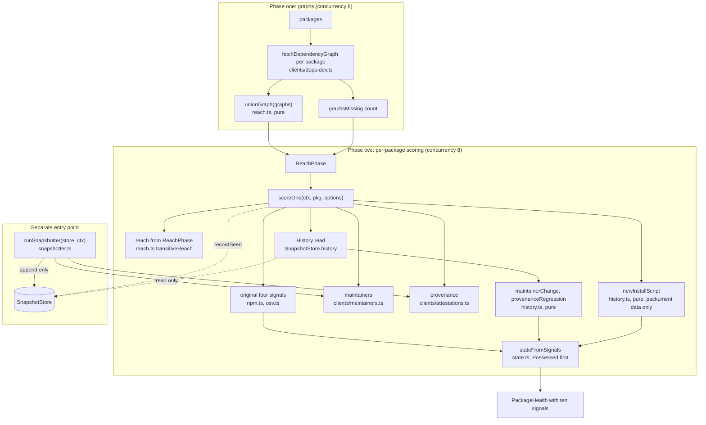

# Design Document: history-signals

## Overview

history-signals extends `@sexton/engine` from four signals per package to ten. Six new signals need a second upstream or a memory: `maintainers`, `provenance`, `transitiveReach`, `maintainerChange`, `provenanceRegression` and `newInstallScript`. The memory is an append-only `SnapshotStore`. A separate snapshotter function fills it. Scoring only reads it.

The state function gains one rule in front of the existing ones: Possessed. It fires from the three Possession signals only. With the six new signals absent or unavailable, every health-scoring result is unchanged (Requirement 10.6).

Implements requirements 1 to 10 of this spec, which cover R-SG-4, R-SG-5, R-SG-6, R-SN-1, R-SN-2, R-SN-3 and the Possessed rule of R-ST-2 in docs/requirements.md.

Out of scope: any database store, any scheduler, UI, CLI, policy, remediation, evidence pack, agent, and any signal beyond the ten.

### Names in the source that differ from the instructions

The names in the instructions all exist except where noted here.

- The cache helper is `cacheKey(source, pkg, version)` in `cache.ts`. `ClientContext` is in `clients/context.ts`, with `cachedJson`, `describeFailure` and `isRecord`.
- `mapWithConcurrency` and `PACKAGE_CONCURRENCY` (8) are exported from `score.ts`. The snapshotter imports them from there.
- The packument source constants are `NPM_PACKUMENT_SOURCE` and `NPM_ABBREVIATED_SOURCE` in `clients/npm.ts`. The cache key for the full packument is `npm-packument|{name}|*`. Maintainers read through exactly that key.
- `available` and `unavailable` in `signal.ts` take a `Date` for fetchedAt, not a string.
- `evaluateState(inputs, now)` and `stateFromSignals(signals, now)` exist in `state.ts`. `PackageSignals` and `SIGNAL_NAMES` live in `types.ts`.

### Research findings that shape the design

- deps.dev GetDependencies is `GET /v3/systems/npm/packages/{name}/versions/{version}:dependencies` ([deps.dev API docs](https://docs.deps.dev/api/v3/)). Path parameters must be percent-encoded, so `@colors/colors` becomes `%40colors%2Fcolors`. The first node is the root of that package's own graph. Nodes carry a `versionKey` with name and version. Edges run from a dependent node to the node it depends on, by node index. Edge field names are fromNode and toNode, node indexes, confirmed against the v3 docs, so the parser can be written without a live check.
- A deps.dev graph describes what a package depends on. A package P's reach therefore comes from other scanned packages' graphs that contain P. This is why reach needs the Union graph and cannot be computed from P's own graph.
- The attestations endpoint is `https://registry.npmjs.org/-/npm/v1/attestations/{name}@{version}` (R-SG-5). A version without attestations answers 404, which this design treats as "no attestation", not as a failure (Requirement 2.4).

## Architecture

Three entry points share one cache and one transport: `scorePackages` (two phases), `runSnapshotter`, and the pure functions both call.



Cache and transport path for every new client, unchanged from health-scoring:

`client` → `CachedFetcher` → `requestWithRetry` → `Transport` (User-Agent stamped in `createFetchTransport`).

Design decisions:

1. The pure rules live in `history.ts`, `reach.ts` and `state.ts`. Clients and the store are the only I/O. This follows the engine steering rule.
2. Scoring never writes Snapshots. Only `runSnapshotter` appends. That keeps History a record of the daily job, not of whoever ran a scan (Requirements 10.8, R-SN-2).
3. The full packument is read once per package by the new code and shared with the original clients through the existing cache key. No second upstream request is made within the TTL (Requirement 1.2).
4. Two clients (`attestations`, `deps-dev`) cache their parsed outcome, not the raw body, using `ctx.cache.get` directly. `cachedJson` caches whatever JSON arrives and throws on any non-2xx, which would leave a 404 uncached (breaking Requirement 2.10) and would cache an unparseable graph body (breaking Requirement 3.8).

## Components and Interfaces

### Version order (single comparator)

Exported from `history.ts` and used by every consumer (history rules, regression, new-install-script, snapshotter). Requirements Glossary "Version order", 7.2, 8.2, 5.2.

```ts
export interface PublishedVersion {
  readonly version: string;
  readonly publishTime: string; // ISO, as in the packument time map
  readonly publishMs: number;   // parsed once, compared numerically
}

/** Publish time ascending. Equal publish time: the greater version string is later. */
export function compareVersionOrder(a: PublishedVersion, b: PublishedVersion): number;

/** Versions present in `versions` with a time-map entry that parses as a date, in Version order. */
export function publishedVersions(fullPackument: unknown): PublishedVersion[];
```

### snapshot.ts (Requirement 4)

```ts
export interface SnapshotVersion {
  readonly version: string;
  readonly publishTime: string;
  readonly hasInstallScript: boolean;
  readonly provenance: boolean | null; // null only when this version's attestation read failed
}
export interface Snapshot {
  readonly name: string;
  readonly captureTime: string; // ISO 8601 UTC, Z designator
  readonly maintainers: readonly string[];
  readonly versions: readonly SnapshotVersion[]; // at most 20, the greatest in Version order
}
export const MAX_SNAPSHOT_VERSIONS = 20;
export const RECENT_WINDOW_MS = 90 * 24 * 60 * 60 * 1000;

export interface SnapshotStore {
  append(snapshot: Snapshot): Promise<void>;
  history(name: string): Promise<readonly Snapshot[]>;
  recordSeen(name: string, at: Date): Promise<void>;
  listSeenWithin(reference: Date, windowMs: number): Promise<readonly string[]>;
}
export class InvalidCaptureTimeError extends Error {}
export class InMemorySnapshotStore implements SnapshotStore { /* ... */ }
```

The contract has no overwrite and no delete (4.2). `InMemorySnapshotStore`:

- `append` validates `captureTime` against `^\d{4}-\d{2}-\d{2}T\d{2}:\d{2}:\d{2}(\.\d+)?Z$` and a finite `Date`. On failure it throws `InvalidCaptureTimeError` before touching any state (4.12). On success it stores `structuredClone(snapshot)` with an increasing append sequence number (4.4, 4.6).
- `history` returns a `structuredClone` of the package's Snapshots sorted by numeric capture time, then append sequence (4.7). An unknown package returns `[]` (4.11). Other packages are untouched by an append (4.8).
- `recordSeen` keeps every seen time per name. `listSeenWithin(reference, windowMs)` returns each name once, ascending lexical, when at least one of its Seen records T satisfies `T <= reference` and `reference - T <= windowMs` (4.9, 4.10). See tension (f).
- `captureTime` strings compare by `Date.getTime()`, never as strings (engine steering).

`provenance: null` is unknown. Every rule that needs presence true or false skips null (4.13, 7.1).

### reach.ts (Requirement 3, pure)

```ts
export type NameEdge = readonly [dependent: string, dependency: string];
export interface ResolvedGraph {
  readonly names: readonly string[]; // distinct package names in this graph
  readonly edges: readonly NameEdge[];
}
export interface UnionGraph {
  readonly nodes: ReadonlySet<string>;
  readonly dependentsOf: ReadonlyMap<string, ReadonlySet<string>>;
}
/** Merges nodes by name and edges by (dependent, dependency) pair. Self edges are dropped. */
export function unionGraph(graphs: readonly ResolvedGraph[]): UnionGraph;
/** Distinct names N != P from which P is reachable along edges, found by reverse breadth-first search. */
export function transitiveReach(union: UnionGraph, name: string): number;
```

Reverse search over `dependentsOf` uses a visited set, so cycles and diamonds count each name once (3.3, 3.4). The repository root is never a node (3.3). A name absent from the Union graph has reach 0 (3.7). The result does not depend on input order because the union is built from sets.

### clients/deps-dev.ts (Requirement 3)

```ts
export const DEPS_DEV_API = "https://api.deps.dev/v3";
export const DEPS_DEV_SOURCE = "deps-dev-dependencies";
export function dependenciesUrl(name: string, version: string): string; // encodeURIComponent on name and version

export type GraphFetch =
  | { readonly ok: true; readonly graph: ResolvedGraph; readonly source: string; readonly fetchedAt: string }
  | { readonly ok: false; readonly reason: string; readonly source: string; readonly fetchedAt: string };

/** Never throws. A transport error, a non-2xx status, retry exhaustion or an unparseable body all give ok:false. */
export function fetchDependencyGraph(ctx: ClientContext, name: string, version: string): Promise<GraphFetch>;
/** Pure. Returns null when the body is not a graph. Maps node indexes to names, drops edges with bad indexes. */
export function parseDependencyGraph(body: unknown): ResolvedGraph | null;
```

- Cache key: `cacheKey("deps-dev-dependencies", name, version)`.
- The fetch callback passed to `ctx.cache.get` does `requestWithRetry`, checks the status, parses, and throws on a malformed body. The cache therefore stores only parsed graphs and never stores a failure (3.8, 7.4 of health-scoring).
- `source` is the URL of that package's own graph request (3.1), also on failure.

### clients/attestations.ts (Requirement 2)

```ts
export const ATTESTATIONS_SOURCE = "npm-attestations";
export const SLSA_PROVENANCE_PREDICATE = "https://slsa.dev/provenance/v1";
export function attestationsUrl(name: string, version: string): string;
/** Pure. null when the body is not an attestations document. present iff some predicateType equals SLSA_PROVENANCE_PREDICATE. */
export function parseAttestations(body: unknown): ProvenanceValue | null;
export function fetchProvenanceSignal(ctx: ClientContext, name: string, version: string): Promise<Signal<ProvenanceValue>>;
```

- URL: `https://registry.npmjs.org/-/npm/v1/attestations/` plus `encodePackageName(name)` plus `@` plus `encodeURIComponent(version)`. Reuses `encodePackageName` from `clients/npm.ts`.
- Cache key: `cacheKey("npm-attestations", name, version)`. The cached value is the parsed outcome: `{ present: false, predicateType: null }` for a 404 and the parsed value for a 200. Two calls inside the TTL give one upstream request and equal values (2.10), including the 404 case.
- Outcomes: 200 and parseable → available (2.2, 2.3). 404 → available, `present: false` (2.4). Any other status after retries → unavailable, reason `HTTP {status}` (2.5). A transport error with no status → unavailable, reason "no status received: {message}" (2.6). 200 with an unparseable body → unavailable, reason "malformed attestations body" (2.7). `source` is the requested URL in every case and `fetchedAt` is the request time (2.8).
- A 404 is intended to count as "no attestation". A registry outage that returns 404 for everything would read as no provenance. The cost is bounded: regression also needs an earlier Snapshot that recorded provenance true.

### clients/maintainers.ts (Requirement 1)

```ts
export type PackumentDocument =
  | { readonly ok: true; readonly doc: unknown; readonly source: string; readonly fetchedAt: string }
  | { readonly ok: false; readonly reason: string; readonly source: string; readonly fetchedAt: string };

/** Reads the full packument through the existing cache key cacheKey(NPM_PACKUMENT_SOURCE, name, "*"). Never throws. */
export function fetchFullPackumentDocument(ctx: ClientContext, name: string): Promise<PackumentDocument>;
/** Pure. Names in first-appearance order, deduplicated, entries without a name dropped. */
export function extractMaintainers(packument: unknown): string[];
/** Pure assembly from a document read. */
export function maintainersSignalFrom(result: PackumentDocument): Signal<readonly string[]>;
export function fetchMaintainersSignal(ctx: ClientContext, name: string): Promise<Signal<readonly string[]>>;
```

The request is identical to `fetchPackumentSignals` (`packumentUrl(name)`, `Accept: application/json`), so the cache key and the in-flight sharing apply and no second upstream request is made in the TTL (1.2). A missing `maintainers` field gives an available empty list (1.4). A failure gives an unavailable signal and the rest of the scan continues (1.5).

### history.ts (Requirements 6, 7, 8, pure)

```ts
export interface MaintainerDiff { readonly added: readonly string[]; readonly removed: readonly string[]; }
export function maintainerDiff(before: readonly string[], after: readonly string[]): MaintainerDiff;

export function isRecent(instant: Date, reference: Date): boolean; // instant <= reference and reference - instant <= 90 days, numeric

export function maintainerChangeValue(
  history: readonly Snapshot[],
  live: { readonly maintainers: readonly string[]; readonly fetchedAt: string } | null,
  reference: Date,
): MaintainerChangeValue;

export interface ProvenanceRegressionInput {
  readonly installedVersion: string;
  readonly provenance: Signal<ProvenanceValue>;
  readonly fullPackument: unknown;
  readonly historyRead: { readonly ok: true; readonly history: readonly Snapshot[] } | { readonly ok: false; readonly reason: string };
}
export type ProvenanceRegressionOutcome =
  | { readonly kind: "unavailable"; readonly reason: string }
  | { readonly kind: "value"; readonly value: ProvenanceRegressionValue };
export function evaluateProvenanceRegression(input: ProvenanceRegressionInput): ProvenanceRegressionOutcome;

export function newInstallScriptEvents(fullPackument: unknown, abbreviatedPackument: unknown, reference: Date): NewInstallScriptEvent[];
```

Behaviour:

- **maintainerChangeValue** (6.1 to 6.8). Sort Snapshots by numeric capture time, stable on input order. An empty History returns `{ status: "history-insufficient", events: [] }` (6.4). Otherwise it derives one `snapshot-pair` event per consecutive pair whose lists differ as sets, with `eventTime` the later capture time and `recent = isRecent(eventTime, reference)`. Then, when `live` is not null, it compares the most recent Snapshot with `live.maintainers`. If they differ as sets it adds one `live` event with `eventTime = live.fetchedAt` and `recent = isRecent(mostRecentSnapshot.captureTime, reference)` (6.2, 6.6). The live comparison applies to a History of exactly one Snapshot. Events are sorted ascending by numeric `eventTime`, ties kept in derivation order (6.5). Equal sets never produce an event regardless of order or repeats (6.3). Appending a Snapshot equal as a set to the last one leaves the pair events and the live event lists the same apart from the live event's `before` and `recent` (6.8). The function takes the Reference time as a parameter and reads no clock (6.7).
- **evaluateProvenanceRegression** (7.1 to 7.8). Precedence is fixed: unavailable, then history-insufficient, then regression or no-regression.
  1. Unavailable: `provenance` unavailable gives reason "provenance unavailable". A failed History read gives the store's reason. If both apply, the "provenance unavailable" reason is used (7.8).
  2. History-insufficient with a reason when any of these holds: History empty; the installed version is absent from the full packument or its publish time does not parse (7.4); no Published version earlier than the installed version has a non-null `provenance` in the most recent Snapshot.
  3. Otherwise: `regression` when the installed version has `provenance.value.present === false` and some earlier Snapshot version has `provenance === true`. The value names the installed version, the latest such earlier version in Version order, and the Snapshot capture time. If the installed version has provenance, or no earlier version has true, the value is `no-regression` (7.2, 7.3, 7.6).
  
  "Earlier" is the Version order: an earlier version is one that sorts before the installed `PublishedVersion` by `compareVersionOrder`. Snapshot versions carry `publishTime`, so they are compared without the packument. Null presence is ignored on both sides (7.1).
- **newInstallScriptEvents** (8.2 to 8.8). Take `publishedVersions(full)` in Version order. For each version V with a predecessor, emit `{ version, publishTime }` when V's publish time is Recent (inclusive at both ends, a later-than-reference time never qualifies), the abbreviated entry for V has `hasInstallScript === true`, and the predecessor's abbreviated entry is absent or does not have `hasInstallScript === true`. The first Published version never emits. The check runs for every Published version, not only the installed one. It reads no store (8.1).

### snapshotter.ts (Requirement 5)

```ts
export interface SnapshotterResult {
  readonly snapshotted: readonly string[];                          // ascending
  readonly failed: readonly { readonly name: string; readonly reason: string }[]; // ascending by name
  readonly error?: string;                                           // only when listing failed
}
export function runSnapshotter(store: SnapshotStore, ctx: ClientContext, names?: readonly string[]): Promise<SnapshotterResult>;
```

Flow:

1. Read `ctx.clock()` once as `now`. `captureTime = toIso(now)`.
2. Build the seen list (5.1). Two paths:
   - `names` given: deduplicate it through a `Set` and use it as the seen list. `store.listSeenWithin` is not called, so the listing-failure error path of 5.9 can only occur when `names` is omitted.
   - `names` omitted: call `store.listSeenWithin(now, RECENT_WINDOW_MS)` and deduplicate the result through a `Set`, so the disjoint and complete invariant holds even for a store that repeats a name. On throw, return `{ snapshotted: [], failed: [], error: "listing seen packages failed: ..." }` with no reads and no appends (5.9).
   
   An empty seen list from either path returns empty lists (5.1).
3. `mapWithConcurrency(names, PACKAGE_CONCURRENCY, snapshotOne)`.
4. `snapshotOne` wraps everything in `try/catch` and never rejects:
   - `fetchFullPackumentDocument` fails → failed, reason "full packument read failed: ..." (5.4).
   - Abbreviated read (through `cachedJson` with the existing `NPM_ABBREVIATED_SOURCE` key and `ABBREVIATED_ACCEPT`) fails → failed, reason "abbreviated packument read failed: ...".
   - `selected` = the last 20 of `publishedVersions(full)`, which are the greatest in Version order (5.2).
   - For each selected version: `hasInstallScript = abbreviated.versions[v]?.hasInstallScript === true`, so an omitted field is recorded as false and never null (5.2, 5.6). `provenance` comes from `fetchProvenanceSignal`: `value.present` when available, `null` when unavailable (5.4, 5.6). Attestations are read for selected versions only. Up to 4 versions in flight per package through `mapWithConcurrency`.
   - Maintainers come from `extractMaintainers(full)`. An empty list is recorded as empty (5.3).
   - `store.append` throws → failed, reason "snapshot append failed: ...". No Snapshot is appended on any failure path (5.4).
5. Results are sorted. The snapshotted and failed name sets are disjoint and their union is the deduplicated seen list (5.7).

Package isolation (5.5) holds because `snapshotOne` shares nothing except the cache, and a failed fetch is never cached. Fan-out is bounded: 8 packages times 4 version reads is at most 32 attestation requests in flight. There is no timer, cron or scheduler in this file (5.8, review constraint).

### state.ts (Requirement 9)

`StateInputs` gains three optional fields. Existing callers that omit them behave exactly as before.

```ts
export interface StateInputs {
  readonly lastPublish?: Date | null;
  readonly deprecated?: boolean;
  readonly advisories?: readonly Advisory[];
  // New. undefined means unavailable.
  readonly maintainerChange?: MaintainerChangeValue;
  readonly provenanceRegression?: ProvenanceRegressionValue;
  readonly newInstallScript?: readonly NewInstallScriptEvent[];
}
```

`evaluateState` order of work:

1. Possessed, first (9.1). Match in this order: any event in `maintainerChange.events` with `recent === true` (9.2); `provenanceRegression.status === "regression"` (9.3); `newInstallScript` with a non-empty list (9.4). `stateReason` names the condition, for example `maintainer change in the last 90 days`, `provenance regression: 1.4.0 has no provenance, 1.3.2 had it`, `install script added in 1.4.0`. A value with `status: "history-insufficient"`, an `undefined` input, or a `no-regression` value never matches (9.5, 9.8).
2. If nothing matched, the existing `all state signals unavailable` shortcut and the existing Dead, Haunted, Restless, Alive rules run unchanged (9.11, 10.6). Possessed sits before the shortcut so that Possessed with all original signals unavailable is Possessed (9.12).

`stateFromSignals(signals, now)` accepts `Pick<PackageSignals, "lastPublish" | "deprecated" | "advisories"> & Partial<Pick<PackageSignals, "maintainerChange" | "provenanceRegression" | "newInstallScript">>` and passes a possession input only when its envelope is available. `healthRank` and `STATE_ORDER` are unchanged (9.9). The function stays pure and takes the Reference time as a parameter (9.7). The `recent` flags are fixed when `maintainerChangeValue` runs, using the same Reference time.

### types.ts (Requirement 10)

```ts
export const ORIGINAL_SIGNAL_NAMES = ["lastPublish", "deprecated", "hasInstallScript", "advisories"] as const;
export const NEW_SIGNAL_NAMES = ["maintainers", "provenance", "transitiveReach", "maintainerChange", "provenanceRegression", "newInstallScript"] as const;
export const SIGNAL_NAMES = [...ORIGINAL_SIGNAL_NAMES, ...NEW_SIGNAL_NAMES] as const; // ten

export interface OriginalSignals { /* the four existing fields */ }
export interface NewSignals {
  readonly maintainers: Signal<readonly string[]>;
  readonly provenance: Signal<ProvenanceValue>;
  readonly transitiveReach: Signal<TransitiveReachValue>;
  readonly maintainerChange: Signal<MaintainerChangeValue>;
  readonly provenanceRegression: Signal<ProvenanceRegressionValue>;
  readonly newInstallScript: Signal<readonly NewInstallScriptEvent[]>;
}
export type PackageSignals = OriginalSignals & NewSignals; // exactly ten
```

`PackageHealth.missingSignals` becomes `readonly SignalName[]` over the ten names.

### score.ts (Requirements 3.2, 10)

```ts
export interface ScoringDependencies { /* existing fields */ readonly snapshotStore?: SnapshotStore; }

export interface ReachPhase {
  readonly union: UnionGraph;
  readonly graphsMissing: number;
  readonly fetches: ReadonlyMap<string, { readonly source: string; readonly fetchedAt: string }>; // key `${name}@${version}`
}
export interface ScoreOneOptions {
  readonly snapshotStore?: SnapshotStore;
  readonly reach?: ReachPhase;
  readonly reference?: Date; // defaults to ctx.clock(), as today
}
export function collectReach(ctx: ClientContext, packages: readonly PackageRef[]): Promise<ReachPhase>;
export function scoreOne(ctx: ClientContext, pkg: PackageRef, options?: ScoreOneOptions): Promise<PackageHealth>; // third parameter is new and optional
export function buildHistorySignals(input: HistorySignalInput): Pick<NewSignals, "maintainerChange" | "provenanceRegression" | "newInstallScript">; // pure
export function buildHealth(pkg: PackageRef, signals: OriginalSignals & Partial<NewSignals>, now: Date): PackageHealth;
```

`scorePackages`:

1. `reference = clock()` once. `generatedAt` is still stamped from the clock at the end, as today, so health-scoring output is unchanged.
2. Phase one: `collectReach` runs `fetchDependencyGraph` for every package with `mapWithConcurrency(…, 8, …)`, waits for all to settle, and builds the Union graph from the `ok` graphs. `graphsMissing` counts the `ok: false` ones (3.2, 3.6).
3. Phase two: `mapWithConcurrency(packages, 8, pkg => scoreOne(ctx, pkg, { snapshotStore, reach, reference }))`. Within a package everything is fetched concurrently (10.5).

`scoreOne` detail:

- In one `Promise.all`: the three original clients, `fetchFullPackumentDocument`, the abbreviated document read (private helper over `cachedJson`, using the existing key, so it is a cache hit after `fetchInstallScriptSignal`), `fetchProvenanceSignal`, one `store.history(name)` read wrapped into `{ ok, history | reason }`, and `store.recordSeen(name, reference)` wrapped so that a throw is swallowed (10.9, 10.12).
- `maintainers = maintainersSignalFrom(fullDoc)`.
- `transitiveReach`: always available. Value `{ reach: transitiveReach(union, name), graphsMissing }`. `source` and `fetchedAt` are those of this package's own graph request from `fetches`, even when that request failed (3.1, 3.6, 3.7). With no `ReachPhase` supplied the signal is unavailable with reason "reach phase not run", which only happens for a direct `scoreOne` call.
- `buildHistorySignals` assembles the three history-derived signals:
  - `maintainerChange`: store read failed → unavailable with reason and no events (6.9). Otherwise `available(maintainerChangeValue(history, live, reference), packumentUrl(name), fetchedAtOf(maintainers))`. `live` is passed only when `maintainers` is available. `fetchedAt` is the maintainers signal's `fetchedAt`, or `reference` when it is unavailable (6.10). Source is the packument URL.
  - `provenanceRegression`: `evaluateProvenanceRegression` result. `unavailable` outcome becomes an unavailable signal. A value becomes an available signal with the provenance signal's `source` and `fetchedAt` (7.5).
  - `newInstallScript`: unavailable with a reason naming which of the full or abbreviated packument is unavailable (8.5). Otherwise `available(newInstallScriptEvents(...), packumentUrl(name), hasInstallScript.fetchedAt)` (8.9).
- `buildHealth` fills any missing new signal with an unavailable "not evaluated" envelope, computes `missingSignals` over all ten names, and calls `stateFromSignals` (10.1, 10.3, 10.6). Scoring never calls `store.append` (10.8).

### index.ts

Adds exports for the new types, `Snapshot`, `SnapshotStore`, `InMemorySnapshotStore`, `InvalidCaptureTimeError`, `RECENT_WINDOW_MS`, `unionGraph`, `transitiveReach`, `maintainerDiff`, `maintainerChangeValue`, `evaluateProvenanceRegression`, `newInstallScriptEvents`, `compareVersionOrder`, `publishedVersions`, `runSnapshotter`, `fetchProvenanceSignal`, `fetchDependencyGraph`, `fetchMaintainersSignal`, `extractMaintainers`, `collectReach`, `buildHistorySignals`, and `ORIGINAL_SIGNAL_NAMES` and `NEW_SIGNAL_NAMES`.

### Cache keys

| Source | Key | Cached value |
|---|---|---|
| Full packument (reused) | `npm-packument\|{name}\|*` | raw packument JSON |
| Abbreviated packument (reused) | `npm-abbreviated\|{name}\|*` | raw abbreviated JSON |
| Attestations | `npm-attestations\|{name}\|{version}` | `ProvenanceValue` |
| deps.dev dependencies | `deps-dev-dependencies\|{name}\|{version}` | `ResolvedGraph` |

### Upstream etiquette (api-etiquette steering)

Both new clients go through the injected `Transport`, so the User-Agent is stamped once in `createFetchTransport`. Both check the cache before fetching and rely on `requestWithRetry` for 429 and 503 backoff (500 ms start, full jitter, at most 3 retries). No tarball is requested. Fan-out is bounded: phase one and phase two run at 8 packages, the snapshotter at 8 packages by 4 versions, and attestations are read only for the 20 selected versions in the snapshotter and for the installed version in scoring. No client logs a response body.

### Requirement trace

| Component | Requirements |
|---|---|
| `clients/maintainers.ts` | 1.1 to 1.7, 5.2, 5.3 |
| `clients/attestations.ts` | 2.1 to 2.10, 5.2, 5.4, 5.6 |
| `clients/deps-dev.ts`, `reach.ts`, `collectReach` | 3.1 to 3.9, 10.5 |
| `snapshot.ts` | 4.1 to 4.13, 10.7 |
| `snapshotter.ts` | 5.1 to 5.9 |
| `history.ts` `maintainerChangeValue` | 6.1 to 6.10 |
| `history.ts` `evaluateProvenanceRegression` | 7.1 to 7.8 |
| `history.ts` `newInstallScriptEvents` | 8.1 to 8.9 |
| `state.ts` | 9.1 to 9.12, 10.6 |
| `types.ts`, `score.ts`, `index.ts` | 10.1 to 10.9, 10.12 |
| Review constraints | 5.8, 10.10, 10.11 |

## Data Models

```ts
// types.ts
export interface ProvenanceValue {
  readonly present: boolean;
  readonly predicateType: string | null; // the SLSA predicateType when present, else null
}

export interface TransitiveReachValue {
  readonly reach: number;        // non-negative integer
  readonly graphsMissing: number;
}

export interface MaintainerChangeEvent {
  readonly kind: "snapshot-pair" | "live";
  readonly before: readonly string[];
  readonly after: readonly string[];
  readonly eventTime: string; // ISO
  readonly recent: boolean;   // per Requirement 6.6
}
export type MaintainerChangeValue =
  | { readonly status: "history-insufficient"; readonly events: readonly [] }
  | { readonly status: "history-sufficient"; readonly events: readonly MaintainerChangeEvent[] };

export type ProvenanceRegressionValue =
  | { readonly status: "regression"; readonly installedVersion: string; readonly earlierVersion: string; readonly snapshotCaptureTime: string }
  | { readonly status: "no-regression"; readonly snapshotCaptureTime: string }
  | { readonly status: "history-insufficient"; readonly reason: string };

export interface NewInstallScriptEvent {
  readonly version: string;
  readonly publishTime: string;
}
```

`newInstallScript` is a signal over `readonly NewInstallScriptEvent[]`. It is true when the list is non-empty and false when empty (8.3), so no separate boolean is stored.

Snapshot, `SnapshotVersion`, `SnapshotStore` and `MaintainerDiff` are defined in the Components section above. `MaintainerDiff` is used by `maintainerChangeValue` to decide whether a pair or the live comparison is an event.

### Ten-signal health entry

```ts
interface PackageHealth {
  name: string; installedVersion: string;
  state: State; stateReason: string;
  signals: {
    lastPublish; deprecated; hasInstallScript; advisories;                 // existing four
    maintainers; provenance; transitiveReach;                              // fetched
    maintainerChange; provenanceRegression; newInstallScript;              // derived
  };
  missingSignals: SignalName[]; // exactly the names whose available is false, over ten names
}
```

### Seed fixture: `test/fixtures/seed-maintainer-change.json`

Two Snapshots 30 days apart for one package, one maintainer replaced. It drives the demo and the `maintainerChange` example tests (docs/requirements.md section 9).

```json
{
  "name": "left-padder",
  "snapshots": [
    {
      "name": "left-padder",
      "captureTime": "2026-10-01T00:00:00.000Z",
      "maintainers": ["alice", "bob"],
      "versions": [
        { "version": "1.2.0", "publishTime": "2026-09-01T10:00:00.000Z", "hasInstallScript": false, "provenance": true },
        { "version": "1.2.1", "publishTime": "2026-09-20T10:00:00.000Z", "hasInstallScript": false, "provenance": true }
      ]
    },
    {
      "name": "left-padder",
      "captureTime": "2026-10-31T00:00:00.000Z",
      "maintainers": ["alice", "mallory"],
      "versions": [
        { "version": "1.2.0", "publishTime": "2026-09-01T10:00:00.000Z", "hasInstallScript": false, "provenance": true },
        { "version": "1.2.1", "publishTime": "2026-09-20T10:00:00.000Z", "hasInstallScript": false, "provenance": true },
        { "version": "1.3.0", "publishTime": "2026-10-25T10:00:00.000Z", "hasInstallScript": true, "provenance": false }
      ]
    }
  ]
}
```

With a Reference time of `2026-11-05T00:00:00.000Z`, the fixture gives one `snapshot-pair` event (eventTime `2026-10-31`, recent true). It also produces a regression for installed 1.3.0 and a `newInstallScript` event for 1.3.0, so the package is Possessed from all three conditions.

## Behaviour decisions

| Decision | Source |
|---|---|
| maintainerChange is History-insufficient only when the History is empty. Any non-empty History also compares with the live list. | 6.2, 6.4 |
| A live event is Recent iff the most recent Snapshot's capture time is Recent. A pair event is Recent iff its event time is Recent. | 6.6 |
| maintainerChange `source` is the packument URL. `fetchedAt` is the maintainers signal's, or the Reference time when it is unavailable. | 6.10 |
| provenanceRegression reads installed presence from the provenance signal, installed publish time from the packument time map, earlier versions from the most recent Snapshot. Null is ignored on both sides. | 7.1 |
| Precedence is unavailable, then History-insufficient, then regression or no-regression. | 7.8 |
| `source` and `fetchedAt` of provenanceRegression come from the provenance signal. | 7.5 |
| A 404 from attestations means present false and available true. | 2.4 |
| newInstallScript covers every Published version, uses packument data only, is true iff events are non-empty. | 8.1 to 8.3 |
| Possessed is the first rule. Unavailable and History-insufficient Possession signals never match. | 9.1, 9.5, 9.8 |
| Possessed with unavailable original signals is Possessed and lists them in missingSignals. | 9.12 |
| A failed graph fetch increments graphsMissing and changes no other signal of any package. transitiveReach stays available. | 3.2, 3.6 |
| Scoring reads History only through the injected store, records Seen records, and never appends. A Seen failure changes nothing in the entry. | 10.7, 10.8, 10.9, 10.12 |

## Requirement tensions and how this design resolves them

These are places where requirements.md reads two ways. I did not edit requirements.md.

(a) **missingSignals and transitiveReach.** 10.3 and 10.4 define missingSignals as the signals whose `available` is false. 3.6 keeps `transitiveReach` available for every package even when its own graph failed. Resolution: transitiveReach is never listed in missingSignals because of a failed graph. `graphsMissing` inside the value is the visibility mechanism, and the UI or CLI must show it next to every reach. The one exception is a direct `scoreOne` call with no reach phase, where the signal is unavailable with reason "reach phase not run".

(b) **Provenance regression wording.** The Glossary says "strictly earlier publish time". 7.2 and 7.6 use the Version order, which also orders equal publish times by version string. Resolution: the Version order is used everywhere through one comparator, `compareVersionOrder`. The two readings differ only for versions published at the same instant.

(c) **Live event time versus recent flag.** The Glossary gives the live event's time as the maintainers signal's fetchedAt. 6.6 judges the live event Recent by the most recent Snapshot's capture time, because the change happened between that Snapshot and now. Resolution: both are kept as stated. Events are ordered by `eventTime`. The `recent` boolean follows 6.6. The Possessed rule reads `recent` only.

(d) **Reach as number or object.** 3.4, 3.5 and 3.9 describe reach as a number. The value is `{ reach, graphsMissing }` (3.3). Resolution: properties 6, 7 and 8 assert on the `reach` field. `graphsMissing` is asserted separately in the example tests.

(e) **newInstallScript fetchedAt when a packument is unavailable.** 8.5 gives the unavailable signal no fetchedAt rule, and 8.9 sets it to the hasInstallScript signal's. Resolution: `buildHistorySignals` uses the hasInstallScript signal's `fetchedAt` whenever that envelope is present, which is always true inside `scoreOne` because envelopes carry a fetchedAt even when unavailable. If a caller supplies no hasInstallScript signal it falls back to the Reference time. Confirmed by the user: newInstallScript fetchedAt is the hasInstallScript signal's fetchedAt, with the Reference time as fallback.

(f) **Seen records in the future.** 4.9 includes a package when a Seen record is Recent. 4.10 excludes a package whose "most recent Seen record is not Recent". These differ for a package with one Recent record and a later record after the Reference time. Resolution: include a package when any Seen record is Recent (4.9). For records all at or before the Reference time the two readings agree. Confirmed by the user: a package is included when any Seen record is Recent.

(g) **Both provenance unavailable and store read failed.** 7.8 does not say which reason wins. Resolution: "provenance unavailable". Either way the signal is unavailable. Confirmed by the user: "provenance unavailable" wins when the provenance signal and the store read both fail.

(h) **Existing test impact.** `PackageHealth.missingSignals` now ranges over ten names. A test that builds a health entry with four signals and deep-equals `missingSignals` sees six extra "not evaluated" names. Health-scoring tests that assert on the four original names must filter to `ORIGINAL_SIGNAL_NAMES`. `fixture-scan.test.ts` will also issue attestation, deps.dev and packument reads that its routed transport must answer or fail. A failed route gives an unavailable signal and does not change original states. `newInstallScript` reads packument data only, so a fixture whose recorded data shows a recently added install script can turn Possessed. Review `expected-states.json` by hand if that happens.

(i) **5.9 and a supplied names list.** The trigger of 5.9 ("IF listing the seen packages from the SnapshotStore fails") is unconditional in requirements.md, but with a supplied names list no listing happens. Resolution: the design applies 5.9 only when `names` is omitted.

### Review constraints (not correctness properties)

5.8 (no scheduler, timer or cron in the snapshotter), 10.10 (every upstream request goes through the injected Transport) and 10.11 (no new runtime dependency) are checked by code review and lint. 10.10 is also covered indirectly because no test touches the network. They have no property.


## Correctness Properties

*A property is a characteristic or behavior that should hold true across all valid executions of a system-essentially, a formal statement about what the system should do. Properties serve as the bridge between human-readable specifications and machine-verifiable correctness guarantees.*

The tests use fast-check 3.23.1 (pinned exact). `numRuns` is 100 by default and 1000 for security invariants. Properties 2 and 4 are security invariants: property 2 because a false Possessed or a missed Possessed is a mislabelled compromise, and property 4 because the Snapshot History is the only evidence of a handover and must not be rewritable. Property 12 also runs 1000 times because it guards the health-scoring contract that every later spec relies on.

Reflection result: 9.1 to 9.5 and 9.8 merge into property 2. 4.4 to 4.8 merge into property 4. The twelve properties below are the full set.

### Property 1: Possessed determinism

For any ten-signal input (each signal available with a generated value or unavailable) and any Reference time, evaluating `evaluateState` twice gives equal results.

**Validates: Requirements 9.7**

Generators: `arbStateInputs` extended with an optional `maintainerChange` (history-insufficient, or sufficient with events whose `recent` is arbitrary), an optional `provenanceRegression` (three statuses), an optional `newInstallScript` list, plus the existing publish date, deprecated and advisories arbitraries, and a Reference time. Assertion: `deepEqual(evaluateState(i, now), evaluateState(i, now))`.

### Property 2: Exactly one state, and Possessed only from the Possession signals

For any ten-signal input and Reference time, `evaluateState` returns one of the five states with a non-empty `stateReason`. The state is Possessed if and only if some Possession signal matches (a maintainerChange event with `recent` true, a `regression` status, or a non-empty newInstallScript list). It is never Possessed when all three are undefined, history-insufficient, no-regression, or an empty or all-not-recent list. When a Possession signal matches, the state is Possessed whatever the original signals are, including all unavailable.

**Validates: Requirements 9.1, 9.2, 9.3, 9.4, 9.5, 9.6, 9.8, 9.12**

Generators: as property 1, with a bias toward inputs that match zero, one and several Possession conditions. Assertion: state in `STATE_ORDER`; `(state === "Possessed") === matchesPossession(i)` where `matchesPossession` is a three-line oracle written in the test. Security invariant, 1000 runs.

### Property 3: Monotonic in age with all ten signals

For any ten-signal input and any two last-publish dates where one is older, with every other input equal, the older date never produces a state with a greater health rank than the newer date.

**Validates: Requirements 9.10**

Generators: ten-signal input plus two dates. Assertion: `healthRank(older) <= healthRank(newer)`. A Possessed result makes both ranks 0, so the property holds trivially there and still bites on the other four states.

### Property 4: Append-only store round trip and immutability

For any sequence of valid Snapshots appended to an `InMemorySnapshotStore` in any order, across any set of package names: reading a package's History returns its Snapshots deeply equal to those appended, ordered by numeric capture time then append order. After each further append, every History read before it is still a deep-equal prefix-preserving subsequence of the new read for that package and is unchanged for every other package. Mutating a returned History, its Snapshots, their maintainers or their versions never changes a later read.

**Validates: Requirements 4.4, 4.5, 4.6, 4.7, 4.8**

Generators: `arbSnapshot` (name from a small alphabet, capture time from a bounded date range rendered as ISO UTC, 0 to 6 maintainers, 0 to 20 versions with boolean or null provenance), a list of 0 to 30 Snapshots, and a mutation function that pushes, deletes and overwrites fields on the returned value. Assertion: compare a model (a plain array of appended clones, stable-sorted by time) with the store after every append; compare a `structuredClone` taken before mutation with a fresh read after. Security invariant, 1000 runs.

### Property 5: Maintainer difference symmetry

For any lists A and B of maintainer names, `maintainerDiff(A, A)` has empty `added` and `removed`; `added(A, B)` equals `removed(B, A)` as sets and `removed(A, B)` equals `added(B, A)`; and `added(A, B)` and `removed(A, B)` are disjoint. Two lists equal as sets, in any order and with any repeats, give an empty diff and therefore no event from `maintainerChangeValue`.

**Validates: Requirements 6.3**

Generators: arrays of 0 to 8 names from a small alphabet (so overlaps are common), including repeats, plus a shuffle of A. Assertion: set equalities above; `maintainerChangeValue([snap(A), snap(shuffle(A) with repeats)], null, now).events` is empty.

### Property 6: Transitive reach bounds and order independence

For any set of resolved graphs and any package name P, `transitiveReach(unionGraph(graphs), P)` is an integer with `0 <= reach <= |nodes| - 1` (or `|nodes|` when P is not a node), counts each name once however many edges, paths or versions reach P, and is unchanged when the input order of the graphs, and of their nodes and edges, is permuted.

**Validates: Requirements 3.4**

Generators: 0 to 6 graphs over a 10-name alphabet with arbitrary edges including cycles, diamonds, duplicates and self edges, and a random permutation. Assertion: bounds on the reach field; `reach(union(gs)) === reach(union(shuffle(gs)))` for every name.

### Property 7: Chain reach is n minus 1

For any simple chain of n distinct names n0 → n1 → … → n(n-1) given as one graph or split across several graphs, the transitive reach of the last name is n minus 1, and the reach of the first name is 0.

**Validates: Requirements 3.9**

Generators: n from 1 to 30, distinct names from a unique-string arbitrary, and a random split of the edge list into several graphs. Assertion: `reach(last) === n - 1` and `reach(first) === 0`.

### Property 8: Merge idempotence

For any set of resolved graphs, building the Union graph from the graphs twice (the list concatenated with itself) gives the same reach for every name as building it once.

**Validates: Requirements 3.5**

Generators: as property 6. Assertion: for every name in the alphabet, `reach(union([...gs, ...gs]), n) === reach(union(gs), n)`, and the node and edge sets are equal.

### Property 9: newInstallScript is false when no version has an install script

For any pair of packuments and Reference time where no abbreviated version entry has `hasInstallScript` true, `newInstallScriptEvents` returns an empty list. For any pair, repeated evaluation returns equal lists, and no event names a version whose publish time is later than the Reference time.

**Validates: Requirements 8.6, 8.7**

Generators: a full packument with 0 to 12 versions and publish times around the Reference time (before, after and exactly at the 90-day boundary, plus unparseable times), and an abbreviated packument whose `hasInstallScript` values are generated false, absent or, for the second assertion, arbitrary. Assertion as stated.

### Property 10: Snapshotter result lists are disjoint and complete

For any seen list and any subset that fails (a failing full packument read, a failing abbreviated read, or a throwing append), `runSnapshotter` returns `snapshotted` and `failed` names that are disjoint and whose union equals the deduplicated seen list. The Snapshots it appends are identical to those appended when the failing packages are absent from the seen list, in any attempt order. This holds on both paths: (a) the store path, where `names` is omitted and the seen list comes from `store.listSeenWithin`; and (b) the names path, where `names` is passed as the third argument, may contain duplicates, and is the seen list after deduplication. On the names path `store.listSeenWithin` is never called and the listing-failure `error` is never produced.

**Validates: Requirements 5.1, 5.5, 5.7**

Generators: 0 to 12 package names, a failure mode per name drawn from {none, full-read, abbreviated-read, append}, a routed transport built from recorded-shape stub packuments, and a shuffled order. A store wrapper records appends and throws for the chosen names.
- Store path: an `InMemorySnapshotStore` with generated Seen records, some inside and some outside the 90-day window relative to the clock's time (including the exact boundary). The expected seen list is the names with at least one Recent Seen record.
- Names path: a generated names array containing duplicates, passed as the third argument, with a store whose `listSeenWithin` throws if called. Assertion: it is never called, and `error` is undefined.

Assertion for both paths: `snapshotted` and `failed` are disjoint, their union equals the deduplicated seen list, and `appends(withFailures)` equals `appends(withoutFailingNames)` as a set of Snapshots. The throwing `listSeenWithin` case on the store path (5.9) is an example test in `test/snapshotter.test.ts`, not part of this property.

### Property 11: Provenance present if and only if a slsa predicateType exists

For any attestations response body that parses as an attestations document, the provenance value has `present === true` if and only if at least one attestation has `predicateType` `https://slsa.dev/provenance/v1`. When present, the value records that predicateType.

**Validates: Requirements 2.2, 2.3, 2.9**

Generators: attestations arrays of 0 to 5 entries whose predicateType is drawn from the SLSA string, the npm publish predicate string, arbitrary strings and missing values, wrapped in `{ attestations: [...] }`. Assertion: `parseAttestations(body).present === entries.some(e => e.predicateType === SLSA)`.

### Property 12: Health-scoring equivalence when the new signals are unavailable

For any inputs to the original three state signals and any Reference time, evaluating the state with the six new signals absent or unavailable (including history-insufficient and no-regression values) gives the same `state` and `stateReason` as the health-scoring `evaluateState` for the same original inputs, and the original names in `missingSignals` equal the original unavailable names.

**Validates: Requirements 10.6, 9.11**

Generators: the existing health-scoring state-input arbitraries plus an "inert new signals" arbitrary: each new signal undefined, history-insufficient, no-regression, empty events, or events with `recent` false. Assertion: compare with a frozen copy of the health-scoring rule table kept in the test (`test/state-possessed.test.ts` holds a verbatim copy of the pre-change `evaluateState`) and with `buildHealth` filtered to `ORIGINAL_SIGNAL_NAMES`. 1000 runs.

## Error Handling

Clients never throw to their callers. The rule from health-scoring holds: an upstream failure becomes an unavailable signal with a one-line reason (`describeFailure`, cut at 200 characters), and the state function still runs.

| Failure | Result |
|---|---|
| Full packument read fails | `maintainers` and the original packument signals unavailable. `newInstallScript` unavailable naming the full packument. `provenanceRegression` stays evaluable only if the History and provenance reads succeed and the installed version is found. Without the packument it is History-insufficient with reason "installed version not in packument". |
| Abbreviated packument read fails | `hasInstallScript` unavailable. `newInstallScript` unavailable naming the abbreviated packument. |
| Attestations 404 | Available, `present: false`. |
| Attestations other status, no status, malformed body | Unavailable with reason `HTTP {status}`, "no status received: ...", or "malformed attestations body". `provenanceRegression` then unavailable with "provenance unavailable". |
| deps.dev fails or is unparseable | The graph is left out of the Union graph and `graphsMissing` goes up by one. `transitiveReach` stays available for every package. |
| `store.history` throws | `maintainerChange` and `provenanceRegression` unavailable with the reason. Other signals unchanged. |
| `store.recordSeen` throws | Swallowed. The entry is identical to the one produced when it succeeds. |
| `store.append` throws in the snapshotter | That package is listed in `failed` with reason "snapshot append failed". No other package is affected. |
| `store.listSeenWithin` throws | `runSnapshotter` returns an `error` and empty lists. It reads and appends nothing. |
| Invalid `captureTime` on append | `InvalidCaptureTimeError`, store unchanged. The snapshotter always builds `captureTime` from `toIso(now)`, so this guards other callers. |
| 429 or 503 | `requestWithRetry` backs off, retries at most three times, then the signal is unavailable with the status as reason. |

Unexpected exceptions inside `snapshotOne` are caught and reported as a failed package. Nothing in `scorePackages` or `runSnapshotter` rejects because of an upstream or store failure.

## Testing Strategy

Vitest. No network in any test: a routed transport answers from a route table and records calls, and recorded fixtures live under `test/fixtures`, as in health-scoring. Add fixtures by extending `scripts/record-fixtures.mjs` to record attestations and deps.dev responses (including one 404 attestation) for the existing ten packages. Add `test/fixtures/seed-maintainer-change.json` (shape in Data Models). Property tests use fast-check 3.23.1 pinned exact, 100 runs by default and 1000 for properties 2, 4 and 12. Each property test carries the tag `Feature: history-signals, Property {n}: {title}`. Each property is one test.

### Why both kinds of test

Pure rules (`history.ts`, `reach.ts`, `state.ts`, `parseAttestations`, the in-memory store) get property tests because their inputs are large and structured. Clients, the snapshotter's call pattern and scoring wiring get example tests with the routed transport, because their behaviour depends on call counts and statuses and does not vary meaningfully with generated input. Several criteria (4.1 to 4.3, 5.8, 6.1, 8.1, 10.10, 10.11) are structural or review constraints and are checked by types, lint or review.

### Test files and where properties live

| File | Contents |
|---|---|
| `test/state-possessed.test.ts` | Properties 1, 2, 3 and 12. Examples: Possessed order against Dead and Haunted, all-unavailable shortcut, Possessed with unavailable originals, `healthRank` unchanged. |
| `test/snapshot.test.ts` | Property 4. Examples: invalid capture time, unknown package, `listSeenWithin` boundary at exactly 90 days, repeated names, future Seen record (tension f). |
| `test/history.test.ts` | Properties 5 and 9. Examples: seed fixture pairs, live event with one Snapshot, recent flags at the boundary, ordering and ties, null presence ignored, each History-insufficient reason, precedence pairs, first version never emits, predecessor ordering for equal publish times. |
| `test/reach.test.ts` | Properties 6, 7 and 8. Examples: transitive versus direct only, a cycle, reach 0 for a package with no dependents, a package absent from the union. |
| `test/snapshotter.test.ts` | Property 10, run on both paths (store path with `names` omitted, names path with `names` supplied and `listSeenWithin` throwing if called). Examples: empty seen list on each path, listing failure on the store path (error result, empty lists, zero reads, 5.9), names path never lists and never returns the listing error, 25 versions give 20 and attestations requested for 20 only, omitted `hasInstallScript` recorded false, failed attestation recorded null while the Snapshot is still appended, capture time from the single clock read. |
| `test/clients/attestations.test.ts` | Property 11. Examples: URL for scoped and unscoped names, 404, 500, 429 exhaustion, thrown transport error, malformed body, one request for two calls in the TTL including a 404. |
| `test/clients/deps-dev.test.ts` | Examples: URL encoding of `@scope/name`, parse of a recorded graph, unparseable body, failed fetch and `ok: false`, no failure cached. |
| `test/clients/maintainers.test.ts` | Examples: dedupe and first-appearance order, nameless entry, missing field, one upstream request when the original packument client has already run, failure to unavailable. |
| `test/score-history.test.ts` | Examples for the two-phase flow: phase one completes before phase two, in-flight counter never exceeds 8 in either phase, failed graph increments `graphsMissing` and leaves other signals identical, ten signals on every entry, `missingSignals` equals exactly the unavailable names over generated availability, single-signal failure isolation, no `append` call (spy store), Seen records recorded, `recordSeen` failure leaves the entry identical, seed fixture end to end gives Possessed, `buildHealth` fills missing new signals. |
| `test/fixture-scan.test.ts` (existing) | Extend the routed transport with attestations and deps.dev routes. Review `expected-states.json` by hand if any state changes (tension h). |

### Test dependencies

No new runtime dependency is added (10.11). `fast-check` and `vitest` are already devDependencies. The snapshotter and scoring tests build `ClientContext` by hand from the routed transport, a fixed clock, a `CachedFetcher` over `MemoryCacheStore`, and a no-sleep retry option.
