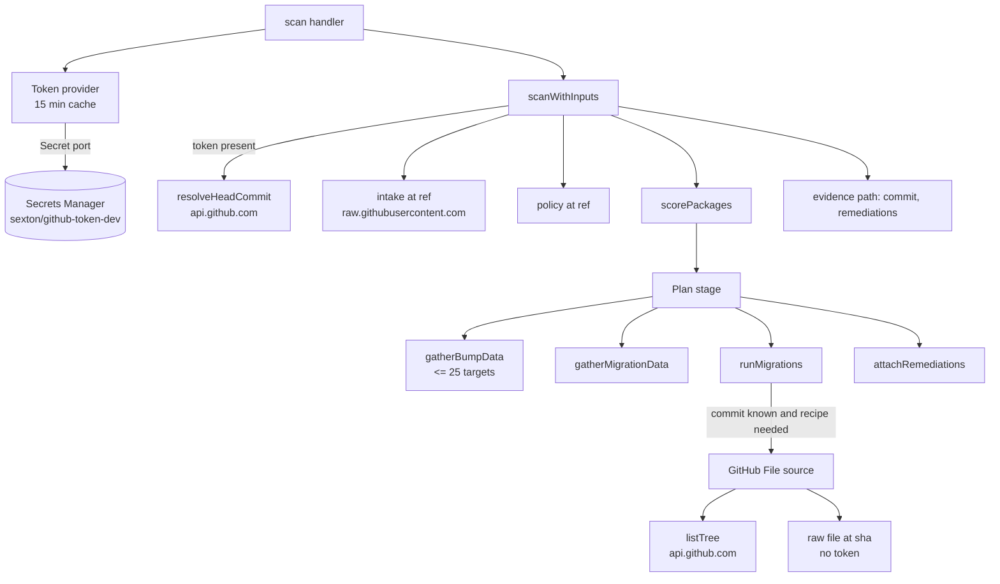

# Design Document: hosted-plans

## Overview

The hosted scan (`GET /api/scan`) has scored packages since spec infra, but it plans nothing and its evidence pack records no commit. This spec adds the read side of hosted remediation: a GitHub token read from the secret HP stored on 21 Nov, two authenticated GitHub API reads (the head commit and the tree of a commit), manifests and the policy file read at that commit, a GitHub File source for recipes, plans on the scan response, and the commit and plans in the hosted evidence pack.

Nothing here writes to GitHub. The token can write to `hsiddhu2/sexton-demo`, so the code holds it to two read shapes on one host, and a property checks that at 1000 runs. Without a token the hosted path never calls api.github.com: Lambda addresses are shared and the anonymous limit is 60 requests an hour. The scan then reads at `HEAD`, records the commit as null and still plans.

The hosted scan never proposes remove. A hosted read cannot see the whole tree cheaply (a full read of a medium repository is thousands of raw requests per scan), untracked and generated files are invisible to it, and a wrong remove costs more than a missing one. The planner gets an empty importSites map, so every hosted candidate for remove is planned as bump or migrate exactly as before spec cli-and-action.

### Research findings that shape the design

- Get a commit, https://docs.github.com/en/rest/commits/commits#get-a-commit: "application/vnd.github.sha: Returns the commit's SHA-1 hash." `ref` "Can be a commit SHA, branch name (heads/BRANCH_NAME), or tag name". Statuses 200, 404, 409, 422, 429, 500, 503. "You must have read access for the repository to use this endpoint." A live unauthenticated request on 21 Nov answered exactly 40 hex characters with no newline; a renamed repository (`strongloop/express`) answered 301 to `/repositories/237159/commits/HEAD`.
- Get a tree, https://docs.github.com/en/rest/git/trees#get-a-tree: `recursive` "Setting this parameter to any value returns the objects or subtrees referenced by the tree". "The limit for the tree array is 100,000 entries with a maximum size of 7 MB when using the recursive parameter." "If truncated is true in the response then the number of items in the tree array exceeded our maximum limit." Entries carry `path`, `mode`, `type`, `sha`, `size`, `url`. The page describes `tree_sha` as "The SHA1 value or ref (branch or tag) name of the tree" and does not say a commit SHA is accepted; a live request with the express head commit SHA on 21 Nov answered 200 with 284 entries and `truncated` false.
- API versions, https://docs.github.com/en/rest/about-the-rest-api/api-versions: supported `2026-03-10` and `2022-11-28`; no header means `2022-11-28`; an unsupported version answers 410. Sexton sends `2026-03-10`, as the CLI's comment client does.
- Fine-grained tokens, https://docs.github.com/en/authentication/keeping-your-account-and-data-secure/managing-your-personal-access-tokens, section "Creating a fine-grained personal access token": "Tokens always include read-only access to all public repositories on GitHub." So HP's token, scoped to `hsiddhu2/sexton-demo` for writing, reads any public repository for this spec.
- Rate limits, https://docs.github.com/en/rest/using-the-rest-api/rate-limits-for-the-rest-api: unauthenticated "60 requests per hour", associated with the originating IP address; a personal access token "5,000 requests per hour". Two requests per scan (one when the tree is cached) fit the WAF-limited scan rate.
- GetSecretValue, https://docs.aws.amazon.com/secretsmanager/latest/apireference/API_GetSecretValue.html: `SecretId` is "The ARN or name of the secret"; with no stage the `AWSCURRENT` version is returned; `SecretString` is 1 to 65536 characters; errors include ResourceNotFoundException ("Secrets Manager can't find the resource that you asked for."), DecryptionFailure, InvalidRequestException, InvalidParameterException, InternalServiceError. "Required permissions: secretsmanager:GetSecretValue. If the secret is encrypted using a customer-managed key instead of the AWS managed key aws/secretsmanager, then you also need kms:Decrypt". The secret has no KmsKeyId, so it uses `aws/secretsmanager` and no KMS statement is needed. "We recommend that you cache your secret values by using client-side caching."
- Service Authorization Reference, https://docs.aws.amazon.com/service-authorization/latest/reference/list_awssecretsmanager.html: GetSecretValue requires resource type Secret, `arn:${Partition}:secretsmanager:${Region}:${Account}:secret:${SecretId}`. The statement names the full ARN from the data stack's `Ref`, no wildcard.
- Redirects. https://developer.mozilla.org/en-US/docs/Web/API/RequestInit#redirect: "Defaults to follow". Node's fetch is undici (https://nodejs.org/api/globals.html#fetch), and https://undici.nodejs.org/#/docs/api/Fetch, "Manual Redirect": "Undici returns the actual response instead of an opaqueredirect filtered one when invoked with a manual redirect." `createFetchTransport` passes no `redirect` today, so it follows redirects. An authenticated request must not: the Transport gains `redirect: "manual"` and a 3xx is a failure with its status.
- Timing, decision 10: the engine pipeline of the built CLI against https://github.com/expressjs/express, three cold processes on 21 Nov: scan 2.74 s, 2.30 s, 2.03 s; plan stage 0.187 s, 0.192 s, 0.184 s; total 2.93 s, 2.49 s, 2.21 s, with 16 bump targets. `sexton scan` of express end to end: 2.59 s, 2.51 s, 2.57 s. The deployed cold scan of express was 8.5 s (spec infra smoke check). The plan stage reuses the packuments intake and scoring cached, so it is cheap; the whole scan stays far below 40 seconds and the Bump target cap stays 25.

## Architecture



Hosted scan order (decision 7):

1. Token from the provider. Null when the variable is unset, the secret is empty or unreadable, or the value is not a Token.
2. With a token and a parsable repository URL: `resolveHeadCommit`. Success: ref and commit are the SHA. Failure: ref `HEAD`, commit null, one warn line `github-api-unavailable` with the status (0 for no status).
3. Intake and the policy fetch at the ref; scoring as today.
4. Plan stage: bumpTargets (first 25), gatherBumpData, gatherMigrationData, runMigrations (GitHub File source only with a commit and a needed recipe), planRemediation with an empty importSites map, attachRemediations. Each step is guarded; a throw costs that step's output and writes one `plans-partial` line.

The token reaches exactly two functions as an argument. ClientContext never holds it, so no other client can send it.

## Components and Interfaces

### http.ts (Requirement 2.10)

`TransportRequest` gains `readonly redirect?: "manual"`. `createFetchTransport` sets `init.redirect = "manual"` when present. Every existing request leaves it unset, so behaviour is unchanged. Fakes may ignore it; tests assert the two API requests set it.

### clients/github-ref.ts (Requirement 1)

`isValidRef(ref: unknown): ref is string` is true for `HEAD` or `/^[0-9a-f]{40}$/`. `isCommitSha(value)` for the SHA alone. `refCacheScope(owner, repo, ref)` returns `owner/repo` for `HEAD` (unchanged keys) and `owner/repo@sha` otherwise.

### clients/github-raw.ts and github-policy.ts (Requirement 1)

`manifestUrl(reference, file, ref = "HEAD")`, `fetchManifest(ctx, reference, file, ref = "HEAD")`, `fetchRepoManifests(ctx, reference, gate, ref)`, `policyUrl(repo, ref = "HEAD")`, `fetchPolicyText(ctx, repo, ref = "HEAD")`. The builders throw on an invalid ref; the fetchers answer their existing invalid-reference failure (`failed`/`invalid-reference` and `failed` respectively).

### intake/intake.ts (Requirement 1.1)

`intakeRepoWithManifests(url, ctx, ref = "HEAD")` reads both manifests at the ref. `intakeRepo` is unchanged.

### clients/github-api.ts (Requirement 2)

```ts
export const GITHUB_API_ORIGIN = "https://api.github.com";
export const GITHUB_API_VERSION = "2026-03-10";
export const TOKEN_PATTERN = /^(ghp_|github_pat_)[A-Za-z0-9_]{20,255}$/;
export const MAX_TREE_ENTRIES = 20000;
export interface GithubAuth { readonly token: string }
export type ApiFailure = { readonly ok: false; readonly reason: "invalid-input" | "http-status" | "network" | "invalid-body"; readonly status: number | null };
export function headCommitUrl(repo): string;          // throws on invalid owner or repo
export function treeUrl(repo, sha): string;            // throws on invalid owner, repo or SHA
export function isToken(value: unknown): value is string;
export function resolveHeadCommit(ctx, repo, auth): Promise<{ ok: true; sha: string } | ApiFailure>;
export function listTree(ctx, repo, sha, auth): Promise<{ ok: true; paths: readonly string[]; capped: boolean } | ApiFailure>;
```

Headers: `Authorization: Bearer <token>`, `Accept` (`application/vnd.github.sha` for the commit, `application/vnd.github+json` for the tree), `X-GitHub-Api-Version: 2026-03-10`; the Transport adds the User-Agent. Requests go through `requestWithRetry` (429 and 503 retried, nothing else). Only status 200 is success. The commit body is read with `text(64)` and accepted only when it is exactly a Commit SHA. The tree body is read with `text(8 MiB)` (GitHub's limit is 7 MB) and parsed with `JSON.parse`; a body that is not an object with a `tree` array is `invalid-body`. Raw entries are counted in order; at the 20001st the walk stops and the listing is capped; `truncated === true` also caps. Kept paths are entries with `type === "blob"` and a string `path`. The listing is cached as `{ paths, capped }` under `cacheKey("github-tree", "owner/repo", sha)`; failures are thrown inside the cache fetch so they are never stored. A token that is not a Token, an invalid owner, repo or SHA answers `invalid-input` without a request.

### clients/github-file-source.ts (Requirement 3)

```ts
export function githubFileUrl(repo, sha, path): string; // valid owner, repo, SHA and Safe path; each segment encodeURIComponent
export class GithubFileSource implements FileSource {
  constructor(ctx: ClientContext, repo: RepoRef, sha: string, auth: GithubAuth, options?: { now?: () => number; budgetMs?: number });
  listFiles(): Promise<readonly string[]>;  // rejects when the listing fails; a capped listing answers its paths and counts() reports capped
  readFile(path: string): Promise<string | undefined>;
  counts(): { readonly performed: boolean; readonly capped: boolean; readonly listed: number };
}
```

`listFiles` runs `listTree` once (memoised). A failed listing rejects, so the Capped source marks the recipe's scan not performed and the PR body says the files were not scanned. A capped listing answers the blob paths of the first 20000 raw entries and `counts()` reports it capped, like the CLI working-tree source (decision 8); the Capped source then caps at 500 listed. `readFile` answers undefined unless the path is in the successful listing and passes `isSafePath`; it reads raw with `Accept: text/plain`, no token, `text(262144)`, and caches `{ kind: "found", text }` or `{ kind: "absent" }` (404 or over the cap) under `cacheKey("github-file", "owner/repo@sha", path)`. Every other outcome answers undefined uncached. A read budget of 15 seconds runs from the first listing; after it `readFile` answers undefined without a request, and the Capped source counts the file skipped. The node-sass recipe reads files one after another, so without the budget up to 200 raw reads could push a scan near the 60 second limit. The recipe runner still wraps the source with `capFileSource` at 500 listed and 200 read.

### packages/api/src/github-token.ts (Requirement 4)

```ts
export interface SecretPort { secretString(secretId: string): Promise<string | undefined> } // rejects on any SDK error
export const TOKEN_CACHE_MS = 15 * 60 * 1000;
export function tokenSecretArn(env): string | null;    // GITHUB_TOKEN_SECRET_ARN, null when absent or empty
export function createTokenProvider(port: SecretPort, secretId: string | null, now?: () => number): () => Promise<string | null>;
```

The provider answers null for no secret id (no port call), for a rejected read, and for any value that is not a Token. It caches every answer for 15 minutes and shares one in-flight read. It logs nothing. `aws-secret-port.ts` implements the port with `GetSecretValueCommand` from `@aws-sdk/client-secrets-manager` (pinned to the client-dynamodb version) and is the only file that imports it.

### packages/api/src/scan.ts (Requirements 5, 6)

`ScanDeps` gains `githubToken?: () => Promise<string | null>` (absent means null). `ScanWithInputs` success gains `commit: string | null`; the body gains `remediations`. `plan-stage.ts` holds the Plan stage:

```ts
export const MAX_BUMP_TARGETS = 25;
export interface PlanSteps { readPackageScripts; bumpTargets; gatherBumpData; gatherMigrationData; runMigrations; planRemediation; attachRemediations } // defaults: the engine functions
export async function planStage(input: { ctx; report; policy; intake; packageJsonText; files?: () => FileSource | undefined; steps?: Partial<PlanSteps> }): Promise<{ remediations: RemediationEntry[]; partial: boolean }>;
```

Each step runs in its own guard: a throw in readPackageScripts leaves no scripts, in bumpTargets or the cap no targets, in gatherBumpData an empty bump map, in gatherMigrationData empty data, in building the File source no source, in runMigrations an empty outcome map, in planRemediation no plans, in attachRemediations no entries. `partial` is true when any guard caught. The steps are injectable so tests can make each one throw; production uses the engine functions. scan.ts also wraps the planStage call, so no throw from it reaches runScan's 500 path. The scan writes `{ msg: "plans-partial" }` once at warn level.

The GitHub File source is built only when the commit is a Commit SHA, a token exists, and some report package is Unhealthy (Haunted, Dead or Possessed) and named in `DEFAULT_RECIPE_REGISTRY`.

### packages/api/src/evidence.ts (Requirement 7)

`commit: scanned.commit`, `remediations: scanned.body.remediations ?? []`, `remediationLog: null`.

### scan-handler.ts and handlers/scan.ts (Requirements 4, 5)

`ScanHandlerDeps` gains `githubToken?`; it is passed into ScanDeps. `handlers/scan.ts` builds one provider per container from `tokenSecretArn(process.env)` and a `SecretsManagerClient({ maxAttempts: 3 })`. `readScanEnvironment` is unchanged: the variable is optional so a missing one gives the no-token path, not a failed start.

### Infra (Requirement 8)

`edge-stack.ts`: `DataRefs` gains `githubTokenSecret` (app.ts already passes the whole data stack). The scan role gains `new iam.PolicyStatement({ actions: ["secretsmanager:GetSecretValue"], resources: [data.githubTokenSecret.ref] })`; the scan function's environment is the shared environment plus `GITHUB_TOKEN_SECRET_ARN: data.githubTokenSecret.ref`; the snapshotter keeps the shared environment. The cross-stack reference adds an export of the ARN to SextonData; the secret resource itself is untouched. `nag-suppressions.ts` gets the new SMG4 reason, repeated verbatim in the infra design.md. The secret's description still says it is empty and no role reads it: changing it is a resource update CloudFormation would apply to the live secret holding HP's token, so it stays out of date on purpose (decision 12). Once SextonEdge imports the new export, SextonData cannot remove it while Edge uses it; the runbook says so.

Superseded: infra Requirement 9.6 and the infra design.md lines saying no role reads the secret now hold for every role except the scan role. The infra tests `iam.test.ts` "grants no role access to the GitHub token secret" and `edge-stack.test.ts` (the exact environment key list) change with this spec.

## Data Models

```ts
// Tree listing, cached under github-tree|owner/repo|sha
{ readonly paths: readonly string[]; readonly capped: boolean }
// Raw file at a SHA, cached under github-file|owner/repo@sha|path
{ readonly kind: "found"; readonly text: string } | { readonly kind: "absent" }
// Hosted scan body
{ report: HealthReport; policy: PolicyResult; remediations: RemediationEntry[] }
```

No new DynamoDB table or item shape: both cache values go through the existing cache store, which skips values over 350 KiB compressed and keys over 1024 bytes.

## Error Handling

| Situation | Result |
|-----------|--------|
| Variable unset or empty | token null, no Secrets Manager call, no api.github.com call |
| Secret empty, missing, wrong shape, read fails | token null for 15 minutes |
| Head commit 3xx, 4xx, 5xx, network, odd body | ref HEAD, commit null, warn `github-api-unavailable` with status |
| Tree fails | recipe gets no listing, PR body says files were not scanned |
| Tree capped | first 20000 raw entries listed, counts() capped; the Capped source caps at 500 |
| File read budget of 15 s spent | later reads answer undefined, counted skipped |
| Raw file 404, too large, not UTF-8, network | that file is not read |
| Any Plan stage step throws | 200 with the plans that exist, warn `plans-partial` |
| More than 25 bump targets | later targets planned "bump data was not gathered" |

## Security

- The token travels only in the Authorization header of the two Allowed API requests to `https://api.github.com`, built from a validated owner, repo and SHA, never following a redirect. It is not in ClientContext, a URL, a cache key or value, a log field, an error or a response body.
- The provider validates the token shape before use, so a value with a newline or other header-breaking character is never sent.
- Raw reads, pinned or not, carry no token.
- The request log keeps host-only lines for api.github.com and never reads headers.
- Only the scan role reads the secret, on its exact ARN.
- The token can also read `hsiddhu2/sexton-demo` if that repository were private; the scan cannot leak it, because raw reads carry no token, so intake of a private repository fails before any tree read.
- The head commit read runs on every scan and evidence request (not cached, decision 4). The token's 5,000 requests an hour are shared with 10c's writes; WAF and the reserved concurrency of 10 bound the scan rate, and the threat model records the shared budget.
- With `redirect: "manual"` a non-200 API body is not read; the Transport has no cancel call, so the socket is freed when the response is collected. The function is short-lived.

## Dependencies

`@aws-sdk/client-secrets-manager` 3.1166.0 in packages/api only, the version `@aws-sdk/client-dynamodb` is pinned to, Apache-2.0. Bundled into the scan function like the DynamoDB client. No other new dependency.

## Testing Strategy

Vitest with fakes for the Transport, the Secret port and the cache store; no network, no AWS. fast-check properties at 100 runs, security properties at 1000. A scan test with a fake token and fake GitHub answers shows a pinned read, a commit and plans; the same test with a null token shows HEAD, commit null, plans and zero api.github.com requests. Infra tests assert the IAM statement shape, the variable and the snapshotter's absence of both.

## Correctness Properties

### Property 52: Authorization only on the two allowed shapes (1000 runs)

For any scan input, token and fake GitHub answers, every Transport request that carries Authorization (any letter case) has host `api.github.com`, method GET, `redirect: "manual"` and a URL that is one of the two Allowed API request shapes; the token appears in no other header, no URL and no request body. Proves 2.1, 2.3, 2.6, 2.8.

### Property 53: The token never leaks (1000 runs)

For any Token and any scan, the Token appears in no log line, no error message, no cache key, no cached value, no URL and no response body. Proves 4.5, 9.2.

### Property 54: Invalid refs are refused (1000 runs)

For any string that is not `HEAD` and not 40 lower-case hex, every URL builder throws (`manifestUrl`, `policyUrl`, `treeUrl`, `githubFileUrl`) and the fetchers make no request; `treeUrl` and `githubFileUrl` also refuse `HEAD`. Proves 1.2, 2.9.

### Property 55: No token, no API call

For any scan input with a null token, no request goes to api.github.com, and the manifests are read at HEAD. Proves 5.1.

### Property 56: File source reads only listed safe paths

For any listing and any requested path, `readFile` makes a request only for a path in the listing that passes `isSafePath`. Proves 3.3.

### Property 57: Failures still give a 200 scan

For any combination of failing head commit, failing tree and failing File-source raw reads, with the manifest and policy reads succeeding, the scan answers 200 with a body the web validator accepts; and for any set of Plan stage steps that throw, planStage resolves with `partial` true and entries only from steps that ran. Proves 5.4, 6.6, 6.7.

### Property 58: Hosted plans never remove

For any hosted scan, no remediation has kind `remove`. Proves 6.2.

### Property 59: The provider answers null for non-tokens

For any secret value that does not match the Token pattern, the provider answers null. Proves 4.3.

## Requirement Traceability

| Requirement | Where | Test |
|-------------|-------|------|
| 1.1 to 1.4 | github-ref.ts, github-raw.ts, github-policy.ts, intake.ts | Property 54, ref examples |
| 2.1 to 2.10 | github-api.ts, http.ts | Properties 52, 54, api examples |
| 3.1 to 3.7 | github-file-source.ts | Property 56, examples |
| 4.1 to 4.5 | github-token.ts, aws-secret-port.ts | Property 59, cache examples; 4.5 by Property 53 |
| 5.1 to 5.5 | scan.ts | Properties 55, 57, scan examples |
| 6.1 to 6.7 | plan-stage.ts, scan.ts | Properties 57, 58, cap example |
| 7.1 to 7.3 | evidence.ts | evidence examples |
| 8.1 to 8.7 | edge-stack.ts, nag-suppressions.ts, .gitignore | iam, edge-stack, nag tests, cdk diff |
| 9.1 to 9.4 | steering, logging-transport test, web test, docs | review |

## Decisions made during implementation

Each is the choice that keeps the smallest surface.

1. **A capped tree is listed, as decision 8 says.** Nothing reads `counts()` yet: runRecipe reports the Capped source's counts. A tree over 20000 raw entries almost always holds more than 500 non-ignored blobs, so the Capped source marks the scan capped; a tree capped mostly by ignored directories could show capped false. Recorded for HP (spec review 1, defect 1).
2. **The provider caches failures too**, for the same 15 minutes, so a broken secret costs one Secrets Manager call per container per quarter hour.
3. **`readScanEnvironment` is unchanged**; the token variable is read on its own and is optional, so a function without it serves the no-token path.
4. **The token pattern lives in the Engine** (`TOKEN_PATTERN`) and the provider uses it, so the shape that may reach a header is defined once.
5. **The commit body must be exactly 40 lower-case hex characters**, no trimming: the live answer has no newline, and anything else is a failure.
6. **`github-api-unavailable` carries `status` 0** when there was no HTTP status (network failure or invalid input).
7. **The Bump target cap stays 25**: the plan stage measured 0.19 s for express's 16 targets.
8. **The File source has a 15 second read budget** (spec review 1, note 4): express has no node-sass, so the measurement did not cover the File-source path; the node-sass recipe reads sequentially, and the budget bounds it. The budget stops new reads; it does not abort a read already running, and the shared fetch Transport has no per-request timeout (true of every upstream client since spec repo-intake). That risk is accepted for 0.1 and recorded for HP.
9. **The tree is read with an 8 MiB text cap** before JSON.parse, like every other upstream read (spec review 1, note 5).
10. **`scripts/self-scan.mjs` accepts a plain directory workspace entry.** Decision 1 asks that `npm run scan:self` passes; on main it stopped with exit 2 at the `infra` entry the root manifest gained in spec infra. Scanning infra found esbuild's install script, so esbuild is on the `sexton.policy.yml` allow list with a comment, as HP decided on 20 Nov.
11. **planStage takes the File source as a thunk** so that building it runs inside a guard (spec review 1, defect 3).
