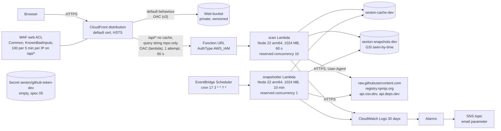
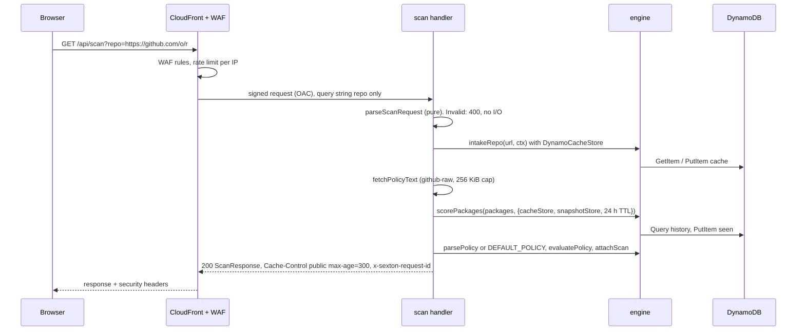

# Design Document: infra

## Overview

infra puts Sexton on AWS. It adds three things:

1. A CDK v2 TypeScript app in `infra/` with two stacks, `SextonData-dev` (DynamoDB tables, a Secrets Manager placeholder) and `SextonEdge-dev` (two Lambda functions, a function URL, one CloudFront distribution, a WAF web ACL, the web bucket, an EventBridge Scheduler schedule, alarms and an SNS topic).
2. The hosted API in `packages/api`: the `GET /api/scan?repo=<url>` handler, the snapshotter handler, the DynamoDB `CacheStore` and `SnapshotStore` that the engine defined as interfaces, a structured logger and a logging Transport wrapper.
3. CI in `.github/workflows/ci.yml`, and three documents: `docs/architecture.md`, `docs/threat-model.md` and `docs/well-architected.md`.

Implements requirements 1 to 12 of this spec, which cover R-SN-1 (scheduled daily job), R-SN-2 (append-only snapshots, in production), R-SN-3 (history in production), R-SG-7 (shared 24-hour cache, in production), R-PO-1 and R-PO-2 (policy file read from the repository root, hosted path), N-1 (security), N-3 (performance), N-5 (observability), N-6 (cost), N-7 (self-scan in CI), N-8 (CI runs Sexton on itself) and N-9 (architecture, threat model and Well-Architected documents). It also covers the hosted side of R-IN-1 to R-IN-4: the handler accepts the URL from a user and returns the intake errors and scan metadata the engine produces.

Out of scope: the web app code (cemetery-ui, Kiro), remediation pull requests (spec 05), the CLI (spec 09), any deploy from CI, custom domains, a second stage, private repositories, and any change to `packages/engine`.

### Decisions recorded on 20 Nov 2026

HP decided the open items of the first draft. The rest of this document follows these decisions.

1. **TLS.** Release 0.1 keeps the default CloudFront certificate with HSTS. The default certificate forces the `TLSv1` security policy, so TLS 1.2 minimum is not met. The limit and the custom-domain path (ACM certificate in us-east-1, `domainNames`, `minimumProtocolVersion: TLS_V1_2_2021`, Route 53 alias) are recorded in docs/threat-model.md. cdk-nag `AwsSolutions-CFR4` is suppressed with that reason.
2. **API base.** Kiro relaxes `parseApiBase` to accept a same-origin path. The web app is built with `VITE_SEXTON_API=/api`. There is one deploy pass.
3. **Missing package.json.** The API returns 422, not 404, for `missing-package-json`. This replaces the 404 in fixed decision 7 of the handoff: the distribution maps 403 and 404 to `index.html` (fixed decision 10), so an API 404 would reach the browser as the HTML page with status 200.
4. **Policy fetch failure.** A `sexton.policy.yml` request that fails with anything other than 404 returns 502 `fetch-failed`, with no fallback to the default policy.
5. **Workspace.** `"infra"` is added to the `workspaces` array of the root `package.json`, that one line only, and recorded as done in build/handoffs/to-kiro.md. The root `tsconfig.json` is not changed, so `infra` type-checks itself in its `pretest` script (`tsc -p infra --noEmit`), which the root `npm test` runs. Adding `{ "path": "infra" }` to the root references stays an optional request to Kiro.
6. **Order.** The API tasks (2 to 7) wait for cemetery-ui to merge into main. The work order is: infra stacks with the IAM-shape and cdk-nag tests, then the three documents, then CI.

Still recorded as design facts, not decisions: PutItem can replace an item, so append-only is IAM plus a conditional put (see "Append-only proof"); and `packages/api/package.json`, `tsconfig.json` and `contract.ts` arrive with cemetery-ui.

Two consequences of order item 6 for the stacks. The handler entry files `packages/api/src/handlers/scan.ts` and `snapshotter.ts` do not exist yet, and `packages/web/dist` does not exist on main. So `bin/sexton.ts` bundles a handler only when its entry file exists and otherwise uses a placeholder inline handler that returns HTTP 503 `{ "code": "not-deployed" }`, and it adds the `BucketDeployment` only when `packages/web/dist/index.html` exists. Each fallback adds a CDK warning annotation that names what is missing. Task 14 refuses to deploy while either warning is present.

### Names in the source that shape the design

- `CacheStore` in `packages/engine/src/cache.ts` is `get(key)` returning `CacheEntry<unknown> | undefined` and `set(key, entry)`. `CacheEntry` is `{ value, storedAt }` with `storedAt` in epoch milliseconds. The store applies no TTL. `CachedFetcher` applies the TTL and **awaits `store.set` inside the same try block as the fetch**, so a `set` that rejects fails the fetch. The DynamoDB store's `set` therefore never rejects (repo-intake design, open item 10).
- `SnapshotStore` in `packages/engine/src/snapshot.ts` is `append(snapshot)`, `history(name)`, `recordSeen(name, at)` and `listSeenWithin(reference, windowMs)`. `append` rejects with `InvalidCaptureTimeError` for a `captureTime` that is not ISO 8601 UTC. `InMemorySnapshotStore` orders history by capture time in milliseconds, then by insertion sequence, and returns deep copies. `listSeenWithin` returns the distinct names with at least one Seen time `t` where `t <= reference` and `reference - t <= windowMs`, sorted by UTF-16 code units.
- `scoreOne` calls `store.history(name)` and `store.recordSeen(name, reference)` for every scored package, and swallows a `recordSeen` failure. A `history` failure marks the history-derived signals unavailable.
- `runSnapshotter(store, ctx, names?)` never rejects. With `names` it skips `listSeenWithin`. It appends one Snapshot per name and returns `{ snapshotted, failed, error? }`.
- `intakeRepo(url, ctx)` never rejects and returns seven error codes: `invalid-url`, `missing-package-json`, `invalid-package-json`, `invalid-lockfile`, `manifest-too-large`, `fetch-failed`, `internal-error`. Every message is a fixed template.
- `parseRepoUrl`, `isValidOwner`, `isValidRepo`, `scorePackages`, `scanMetadata`, `attachScan`, `parsePolicy`, `evaluatePolicy`, `DEFAULT_POLICY`, `CachedFetcher`, `createFetchTransport`, `requestWithRetry`, `UpstreamError` and `cacheKey` are exported from `@sexton/engine`.
- The github-raw client (`manifestUrl`) only builds URLs for `package.json` and `package-lock.json` from a constant table. It cannot fetch `sexton.policy.yml`. The API therefore has its own one-file policy fetcher (see `policy-source.ts`).
- `createFetchTransport` adds the Sexton User-Agent and exposes `text(limitBytes)`. The API wraps it to log one line per upstream request.
- `scripts/self-scan.mjs` exists and is wired as the root `scan:self` script.
- cemetery-ui (Kiro, not on main yet) defines `ScanResponse = { report, policy, remediations? }` in `packages/api/src/contract.ts`. The web app calls `{VITE_SEXTON_API}/scan?repo=<encoded>` with GET, `credentials: "omit"`, `redirect: "error"` and `Accept: application/json` only. It ships a meta CSP with `connect-src 'self' <api origin>`.

### Research findings that shape the design

Every AWS fact used below, with the page it was checked against on 20 Nov 2026.

| Fact | Source |
|---|---|
| CloudFront OAC supports Lambda function URL origins. The function URL must use `AuthType: AWS_IAM`. The OAC uses `OriginAccessControlOriginType: lambda`, `SigningBehavior: always`, `SigningProtocol: sigv4`. | https://docs.aws.amazon.com/AmazonCloudFront/latest/DeveloperGuide/private-content-restricting-access-to-lambda.html |
| CloudFront needs **two** resource-based permissions on the function: `lambda:InvokeFunctionUrl` and `lambda:InvokeFunction`, both for principal `cloudfront.amazonaws.com` with `SourceArn` set to the distribution ARN. | same page, "Grant CloudFront permission to access the Lambda function URL" |
| With OAC on a function URL, `PUT` and `POST` need a client-computed `x-amz-content-sha256`. GET is unaffected. Sexton's API is GET only. | same page |
| Lambda function URL with IAM auth behind CloudFront and OAC is the documented way to restrict a function URL to CloudFront. | https://repost.aws/knowledge-center/lambda-restrict-public-access |
| CloudFront origin response timeout: minimum 1, maximum 120, default 30 seconds. 60 needs no quota increase. | https://docs.aws.amazon.com/sdk-for-kotlin/api/latest/cloudfront/aws.sdk.kotlin.services.cloudfront.model/-custom-origin-config/origin-read-timeout.html and https://docs.aws.amazon.com/AmazonCloudFront/latest/DeveloperGuide/DownloadDistValuesOrigin.html#DownloadDistValuesOriginResponseTimeout |
| For GET and HEAD, when the origin does not respond within the response timeout, CloudFront retries according to Connection attempts (up to 3). Response completion timeout caps the total time and must be at least the response timeout. | https://docs.aws.amazon.com/AmazonCloudFront/latest/DeveloperGuide/DownloadDistValuesOrigin.html |
| API Gateway HTTP API integration timeout is 50 to 30,000 ms (default 30 s). The increase is available only for Regional and private REST APIs. | https://docs.aws.amazon.com/sdk-for-cpp/latest/api/aws-cpp-sdk-apigatewayv2/html/class_aws_1_1_api_gateway_v2_1_1_model_1_1_integration.html and https://repost.aws/knowledge-center/api-gateway-timeout-limit |
| With the default CloudFront certificate the distribution uses the `TLSv1` security policy. A custom certificate is needed to choose `TLSv1.2_2021`. | https://repost.aws/knowledge-center/cloudfront-security-protocols-ciphers |
| WAF rate-based statement: `Limit` minimum 10, maximum 2,000,000,000. `EvaluationWindowSec` is 60, 120, 300 (default) or 600. `AggregateKeyType: IP` with an optional `ScopeDownStatement`. WAF checks the rate about every 10 seconds. 100 per 300 seconds per IP is valid. | https://docs.aws.amazon.com/AWSCloudFormation/latest/TemplateReference/aws-properties-wafv2-webacl-ratebasedstatement.html and https://repost.aws/knowledge-center/waf-rate-based-rule-not-blocking |
| DynamoDB TTL attribute must be a Number in Unix epoch **seconds**. Expired items are deleted "typically within a few days", without consuming write throughput, so readers must check expiry themselves. | https://docs.aws.amazon.com/amazondynamodb/latest/developerguide/TTL.html |
| DynamoDB maximum item size is 400 KB including attribute names. | https://docs.aws.amazon.com/amazondynamodb/latest/developerguide/Constraints.html |
| `dynamodb:LeadingKeys` holds the partition key value. It must be used with `ForAllValues`. For a String key, `StringLike` gives a prefix match. | https://docs.aws.amazon.com/amazondynamodb/latest/developerguide/specifying-conditions.html |
| EventBridge Scheduler cron expressions have six fields (minutes, hours, day-of-month, month, day-of-week, year) and run in UTC unless a time zone is given. 03:17 UTC daily is `cron(17 3 * * ? *)`. | https://docs.aws.amazon.com/scheduler/latest/UserGuide/schedule-types.html |
| Lambda runtime identifier `nodejs22.x`, Amazon Linux 2023, deprecation 30 May 2027. `nodejs24.x` also exists. | https://docs.aws.amazon.com/lambda/latest/dg/lambda-runtimes.html |
| Lambda recommends ES modules for Node.js because they support top-level await during init. | https://docs.aws.amazon.com/lambda/latest/dg/nodejs-handler.html |
| `NodejsFunction` bundling supports `format: OutputFormat.ESM`. A `banner` with `createRequire` covers CommonJS dependencies that call `require`. | https://constructs.dev/packages/aws-cdk-lib/v/2.277.0/api/OutputFormat?lang=typescript&submodule=aws_lambda_nodejs and https://github.com/aws-samples/serverless-patterns/tree/main/lambda-node-esm/typescript/cdk/cdk/node-esm-stack.ts |
| `FunctionUrlOrigin.withOriginAccessControl(url, props)` exists in `aws-cdk-lib/aws-cloudfront-origins` and takes `readTimeout`, `responseCompletionTimeout` and `keepaliveTimeout`. | https://constructs.dev/packages/aws-cdk-lib/v/2.277.0/api/FunctionUrlOrigin?lang=dotnet&submodule=aws_cloudfront_origins |
| CDK versions on npm: aws-cdk-lib 2.278.0 (published 20 Nov 2026) and 2.277.0 (13 Nov), aws-cdk CLI 2.1149.0 (19 Nov) and 2.1148.0 (5 Nov), cdk-nag 3.1.0 (20 Nov) and 3.0.2 (4 Aug, peer `aws-cdk-lib ^2.257.0`), constructs 10.8.1, esbuild 0.28.2 (8 Aug), @aws-sdk/client-dynamodb 3.1166.0 (10 Nov). | `npm view <pkg> time` on 20 Nov 2026; API reference https://constructs.dev/packages/aws-cdk-lib/v/2.277.0 |
| Pricing, us-east-1: DynamoDB on-demand $0.625 per million write units and $0.125 per million read units. WAF $5 per web ACL, $1 per rule or rule group per month, $0.60 per million requests. CloudFront always-free 1 TB out and 10 M requests per month. Lambda free tier 1 M requests and 400,000 GB-seconds per month, then $0.20 per million and $0.0000166667 per GB-second (x86, Arm is lower). Secrets Manager $0.40 per secret per month. CloudWatch Logs ingestion $0.50 per GB. | https://aws.amazon.com/dynamodb/pricing/, https://docs.aws.amazon.com/solutions/latest/deepracer-on-aws/cost.html, https://aws.amazon.com/waf/faqs/, https://aws.amazon.com/cloudfront/faqs/, https://docs.aws.amazon.com/whitepapers/latest/big-data-analytics-options/aws-lambda.html, https://aws.amazon.com/secrets-manager/pricing/, https://aws.amazon.com/cloudwatch/omni/pricing/ |

Not yet confirmed against a documentation page, and checked again at task time: that CloudFront sends `X-Amz-Cf-Id` to the origin (the design falls back to the Lambda request ID when the header is absent).

Learned while building the stacks (20 Nov 2026):

- `FunctionUrlOrigin.withOriginAccessControl` in aws-cdk-lib 2.277.0 adds **both** `lambda:InvokeFunctionUrl` and `lambda:InvokeFunction` for `cloudfront.amazonaws.com`, scoped to the distribution. The stack adds nothing of its own; `edge-stack.test.ts` asserts exactly these two permissions.
- cdk-nag 3 is a CDK policy-validation plugin: `Validations.of(app).addPlugins(new AwsSolutionsChecks(app))`. An unacknowledged finding makes `app.synth()` throw and writes `validation-report.json`. `NagSuppressions` no longer exists.
- `TableV2` with the AWS owned key renders `SSESpecification: { SSEEnabled: false }`, and point-in-time recovery and deletion protection render on the `Replicas` entry.
- aws-cdk-lib types are not written for `exactOptionalPropertyTypes` (`Bucket` is not assignable to `IBucket` under it), so `infra/tsconfig.json` turns that one option off. Everything else in `tsconfig.base.json` applies.
- CDK prints a warning unless the cross-stack reference strength is set. `buildApp` sets `@aws-cdk/core:defaultCrossStackReferences` to `strong` in the app context.
- `npm install -w sexton-infra` installs only that workspace's packages. A full tree comes from `npm ci` with the committed lockfile, which changes no file.

Versions chosen (exact pins, each at least a week old): aws-cdk-lib 2.277.0, aws-cdk 2.1148.0, constructs 10.8.1, cdk-nag 3.0.2, esbuild 0.28.2, @aws-sdk/client-dynamodb 3.1166.0, @types/aws-lambda 8.10.164 (checked at task time). cdk-nag 3.1.0 and aws-cdk-lib 2.278.0 were published on the day of writing and are not used.

## Architecture





Design decisions:

1. **No API Gateway.** A cold 50-dependency scan may take up to 60 seconds (N-3). HTTP APIs cap the integration timeout at 30 seconds, and only REST APIs can raise it. A function URL behind CloudFront has no such cap, and the origin response timeout can be 60 seconds without a quota increase.
2. **The function URL accepts only CloudFront.** `AuthType: AWS_IAM`, an OAC of type `lambda` with `SigningBehavior: always`, and two resource-based permissions (`lambda:InvokeFunctionUrl` and `lambda:InvokeFunction`) for `cloudfront.amazonaws.com`, each with `AWS:SourceArn` equal to the distribution ARN. A direct call to the function URL is unsigned and gets 403 from Lambda.
3. **One connection attempt to the API origin.** CloudFront retries GET on an origin timeout up to `connectionAttempts` times. A retry would start a second full scan and double the cost of a slow request. The API origin sets `connectionAttempts: 1`, `readTimeout: 60 s` and `responseCompletionTimeout: 65 s`.
4. **Only `repo` reaches the function.** The `/api/*` behaviour uses the managed `CachingDisabled` cache policy and a custom origin request policy that forwards the query string `repo` only, no cookies, and no viewer headers. The Host header is never forwarded, which is required for OAC signing to the function URL host. The function reads nothing else from the viewer.
5. **Same origin for the web app.** The web app and the API share the CloudFront domain, so no CORS headers are set and none are needed.
6. **Pure core, I/O at the edges.** Request parsing, response mapping, cache item encoding, snapshot key encoding, the snapshotter time budget and the log line shape are pure functions in `packages/api/src`. The only I/O is the `DynamoPort` adapter, the engine Transport and `console.log`. Handlers wire these together and hold no logic that is not tested through an injected seam.
7. **A narrow DynamoDB port.** The stores talk to a three-method interface (`getItem`, `putItem`, `query`) instead of the SDK client. Tests use an in-memory fake of that port that models the key schema, the GSI, `ConditionExpression: attribute_not_exists(pk)` and the 400 KB item limit. The real adapter is a thin mapping onto `@aws-sdk/client-dynamodb` and is covered by a contract test that runs the same suite against the fake and against a stubbed SDK client (no network).
8. **Cache values are gzipped.** Full packuments of popular packages are often several hundred kilobytes of JSON and compress about ten to one. The cache item stores `gzip(JSON.stringify(value))` as a Binary attribute. The 350 KB limit applies to the compressed bytes. A larger value is not stored and the fetch result is still returned.
9. **Store writes never fail a scan.** `DynamoCacheStore.get` returns `undefined` and `set` resolves on any DynamoDB error, logging one line. `recordSeen` failures are already swallowed by the engine. `history` failures degrade the history signals, as the engine defines.
10. **Append-only is IAM plus a conditional put.** See "Append-only proof".
11. **Snapshotter works in a time budget.** It lists Seen names once, then calls `runSnapshotter(store, ctx, chunk)` on chunks of 25 names while more than 90 seconds of the 10-minute budget remain. Names not reached are counted as deferred and logged, and a deferred count above zero triggers the snapshotter alarm. At launch traffic every Seen name fits in one run.
12. **Two stacks, one direction.** `SextonEdge-dev` reads table names, table ARNs and the GSI ARN from `SextonData-dev` through stack props. Nothing in Data depends on Edge, so Data can be deployed first and Edge can be destroyed and rebuilt without touching stored snapshots.

## Components and Interfaces

Paths are relative to the repository root.

### Layout

```
infra/
  package.json          sexton-infra 0.0.0, private, type module
  tsconfig.json         extends ../tsconfig.base.json, rootDir ., include bin lib test
  cdk.json              app: "npx tsx bin/sexton.ts", context: stage dev
  vitest.config.ts
  bin/sexton.ts         creates the App, both stacks, applies AwsSolutionsChecks
  lib/config.ts         STAGE, REGION, names, limits (pure constants and name builders)
  lib/data-stack.ts     SextonDataStack
  lib/edge-stack.ts     SextonEdgeStack
  lib/web-security-headers.ts   response headers policy values (pure)
  lib/nag-suppressions.ts       NAG_SUPPRESSIONS table: rule id, resource path, reason
  test/data-stack.test.ts
  test/edge-stack.test.ts
  test/iam.test.ts
  test/nag.test.ts
  test/config.test.ts
packages/api/
  src/contract-pending.ts       ScanResponse shape until contract.ts lands on main
  src/dynamo/port.ts            DynamoPort interface and item types
  src/dynamo/aws-port.ts        adapter onto @aws-sdk/client-dynamodb
  src/dynamo/cache-item.ts      pure: encode, decode, size check, TTL arithmetic
  src/dynamo/cache-store.ts     DynamoCacheStore implements CacheStore
  src/dynamo/snapshot-keys.ts   pure: snapshot and seen key encoding and decoding
  src/dynamo/snapshot-store.ts  DynamoSnapshotStore implements SnapshotStore
  src/http/scan-request.ts      pure: Lambda URL event to a validated request or a rejection
  src/http/responses.ts         pure: error table, response builders, headers
  src/log/logger.ts             structured JSON logger with a correlation ID
  src/log/logging-transport.ts  Transport wrapper: one line per upstream request
  src/policy-source.ts          fetch sexton.policy.yml through the Transport and cache
  src/scan.ts                   runScan(request, deps): the composition, deps injected
  src/snapshot-run.ts           runSnapshotJob(deps): listing, chunking, time budget
  src/handlers/scan.ts          Lambda entry, builds real deps once per container
  src/handlers/snapshotter.ts   Lambda entry
  test/...                      mirrors src, plus test/fakes/memory-dynamo.ts
.github/workflows/ci.yml
docs/architecture.md  docs/threat-model.md  docs/well-architected.md
build/reviews/10-infra.md
```

### infra/lib/config.ts (Requirements 1.1, 1.2, 1.3)

```ts
export const REGION = "us-east-1";
export const STAGE = "dev";
export const stackName = (base: "SextonData" | "SextonEdge", stage: string) => `${base}-${stage}`;
export const tableName = (base: "sexton-cache" | "sexton-snapshots", stage: string) => `${base}-${stage}`;
export const SECRET_NAME = (stage: string) => `sexton/github-token-${stage}`;
export const SCAN_TIMEOUT_SECONDS = 60;
export const SCAN_MEMORY_MB = 1024;
export const SCAN_RESERVED_CONCURRENCY = 10;
export const SNAPSHOTTER_TIMEOUT_SECONDS = 600;
export const SNAPSHOTTER_SCHEDULE = "cron(17 3 * * ? *)";
export const ORIGIN_READ_TIMEOUT_SECONDS = 60;
export const ORIGIN_COMPLETION_TIMEOUT_SECONDS = 65;
export const RATE_LIMIT = { limit: 100, windowSeconds: 300 } as const;
export const LOG_RETENTION_DAYS = 30;
```

`bin/sexton.ts` throws at synth time when `CDK_DEFAULT_REGION` or the `env.region` passed in is not `us-east-1`, so no stack can be synthesised for another region (1.2). Both stacks get `env: { region: "us-east-1" }` and `terminationProtection: true` for Data.

### infra/lib/data-stack.ts (Requirements 2, 3.1, 9.6)

```ts
export interface SextonDataOutputs {
  readonly cacheTable: dynamodb.ITableV2;
  readonly snapshotsTable: dynamodb.ITableV2;
  readonly seenIndexName: "seen-by-time";
  readonly githubTokenSecret: secretsmanager.ISecret;
}
export class SextonDataStack extends cdk.Stack implements SextonDataOutputs { /* ... */ }
```

- `sexton-cache-dev`: `TableV2`, partition key `pk` (String), no sort key, billing on-demand, encryption `TableEncryptionV2.dynamoOwnedKey()`, TTL attribute `expiresAt`, removal policy `DESTROY` (a cache is disposable), PITR off (suppressed `AwsSolutions-DDB3` with reason).
- `sexton-snapshots-dev`: partition key `pk` (String), sort key `sk` (String), on-demand, AWS owned key, `pointInTimeRecoverySpecification: { pointInTimeRecoveryEnabled: true }`, removal policy `RETAIN`, deletion protection on, **no TTL attribute**. GSI `seen-by-time`: partition key `gpk` (String), sort key `seenAt` (Number), projection `INCLUDE` of `name` only.
- Secret `sexton/github-token-dev`: created with no generated value (`secretStringValue` unset and `generateSecretString` unset gives an empty secret placeholder), AWS managed key, removal policy `RETAIN`. Its ARN is a `CfnOutput` named `GithubTokenSecretArn`. No role in this spec is granted read on it (9.6).

### infra/lib/edge-stack.ts (Requirements 3 to 8)

```ts
export interface SextonEdgeProps extends cdk.StackProps {
  readonly data: SextonDataOutputs;
  readonly alarmEmail: string;      // from the CfnParameter AlarmEmail, never a literal
  readonly webAssetPath: string;    // packages/web/dist
}
```

Constructs, in build order:

1. **Log groups.** One `logs.LogGroup` per function, retention 30 days, removal `DESTROY`. Passed to the function as `logGroup`, so CDK creates no log-retention custom resource.
2. **Roles.** One role per function, trust `lambda.amazonaws.com`, **no managed policies**. Inline statements only, listed in the IAM table below. Log permissions are `logs:CreateLogStream` and `logs:PutLogEvents` on `{logGroupArn}:log-stream:*`.
3. **Functions.** `NodejsFunction`, `runtime: NODEJS_22_X`, `architecture: ARM_64`, `bundling: { format: ESM, target: "node22", sourceMap: true, minify: true, mainFields: ["module", "main"], banner: "import { createRequire } from 'module'; const require = createRequire(import.meta.url);" }`, environment `NODE_OPTIONS=--enable-source-maps`, `CACHE_TABLE`, `SNAPSHOTS_TABLE`, `SEEN_INDEX`, `STAGE`. The AWS SDK is bundled (pinned), not taken from the runtime. Scan: 1024 MB, 60 s, `reservedConcurrentExecutions: 10`. Snapshotter: 1024 MB, 600 s, `reservedConcurrentExecutions: 1` (two overlapping runs would append duplicate snapshots).
4. **Function URL** on scan: `authType: AWS_IAM`, `invokeMode: BUFFERED`, no CORS.
5. **Web bucket.** `blockPublicAccess: BLOCK_ALL`, `enforceSSL: true`, `versioned: true`, `encryption: S3_MANAGED`, `objectOwnership: BUCKET_OWNER_ENFORCED`, removal `RETAIN`. Server access logs suppressed (`AwsSolutions-S1`) with reason.
6. **Distribution.**
   - Default behaviour: `S3BucketOrigin.withOriginAccessControl(bucket)`, `viewerProtocolPolicy: REDIRECT_TO_HTTPS`, `CACHING_OPTIMIZED`, response headers policy below, `defaultRootObject: "index.html"`, error responses 403 and 404 mapped to `/index.html` with status 200 and TTL 0.
   - `/api/*` behaviour: `FunctionUrlOrigin.withOriginAccessControl(url, { readTimeout: 60 s, responseCompletionTimeout: 65 s, connectionAttempts: 1, originPath: "" })`, `allowedMethods: ALLOW_GET_HEAD`, `CACHING_DISABLED`, origin request policy `ApiOriginRequestPolicy` (query string allow list `repo`, no headers, no cookies), the same response headers policy, `viewerProtocolPolicy: HTTPS_ONLY`.
   - The SPA error mapping (403/404 to `index.html`) is distribution-wide in CloudFront. An API 404 (`missing-package-json`) would be rewritten to the HTML page. The handler therefore returns `missing-package-json` with HTTP status **422**, not 404, so the error mapping never touches API responses (Decisions, item 3).
   - `httpVersion: HTTP2_AND_3`, `priceClass: PRICE_CLASS_100`, `enableIpv6: true`, default certificate, `webAclId` from the web ACL.
   - The CloudFront permission `lambda:InvokeFunction` is added with `fn.addPermission` (principal `cloudfront.amazonaws.com`, `sourceArn` the distribution ARN) when the CDK helper does not add it. A test asserts both permissions exist with that exact `SourceArn`.
7. **Response headers policy** (`web-security-headers.ts`, pure values): `Strict-Transport-Security: max-age=63072000; includeSubDomains`, `X-Content-Type-Options: nosniff`, `X-Frame-Options: DENY`, `Referrer-Policy: no-referrer`, and `Content-Security-Policy: default-src 'self'; img-src 'self' data:; object-src 'none'; base-uri 'none'; frame-ancestors 'none'; form-action 'none'`, all with `override: true`. Browsers enforce both this header CSP and Kiro's meta CSP, so the effective policy is the intersection. Every source Kiro's meta CSP allows (`'self'`, `data:` images, same-origin `connect-src`) is also allowed here, so the header does not break the page.
8. **WAF web ACL**, `scope: CLOUDFRONT`, default action allow, three rules in priority order: `AWSManagedRulesCommonRuleSet` (0), `AWSManagedRulesKnownBadInputsRuleSet` (1), `ApiRateLimit` (2) with `rateBasedStatement: { limit: 100, evaluationWindowSec: 300, aggregateKeyType: "IP", scopeDownStatement: byteMatch on URI path, STARTS_WITH "/api/", text transformation NONE }`, action block with a custom response: HTTP 429 and the JSON body `{"code":"rate-limited","message":"Too many requests. Try again in a few minutes."}`. A 429 is not in the distribution's 403/404 page mapping, so a rate-limited API call reaches the browser as a 429, not as `index.html`. A block by a managed rule group is a 403, which the mapping does rewrite to `index.html` with status 200; the web app then reports an invalid response, which is acceptable for a request WAF judged hostile. CloudWatch metrics and sampled requests on for each rule. The `/api/` prefix match is on the normalised path CloudFront receives, so `/API/scan` does not match the rule, but it also does not match the `/api/*` behaviour (CloudFront path patterns are case-sensitive) and is served by S3 as a 404 mapped to `index.html`.
9. **Bucket deployment.** `BucketDeployment` from `webAssetPath` to the bucket, `distribution` and `distributionPaths: ["/*"]` for invalidation, `prune: true`, `memoryLimit: 512`. Synth fails with a clear message when `packages/web/dist/index.html` does not exist.
10. **Schedule.** `scheduler.Schedule` with `ScheduleExpression.cron({ minute: "17", hour: "3" })` (UTC), target `LambdaInvoke(snapshotter, { retryAttempts: 0 })`. The target role gets `lambda:InvokeFunction` on the snapshotter ARN only.
11. **Alarms and topic** (see Data Models, "Alarms"). The SNS topic has `enforceSSL: true` and one email subscription to the `AlarmEmail` parameter.
12. **Outputs.** `DistributionDomainName`, `DistributionId`, `WebBucketName`, `ScanFunctionName`, `SnapshotterFunctionName`.

### infra/lib/nag-suppressions.ts (Requirement 10.4)

`NAG_SUPPRESSIONS` is a readonly array of `{ id, path, reason }`. `bin/sexton.ts` applies each with `NagSuppressions.addResourceSuppressionsByPath`. A test asserts every entry has a reason of at least 20 characters and that the same text appears in the table under "cdk-nag suppressions" in this design. Nothing else in the code calls `NagSuppressions`.

### packages/api/src/contract-pending.ts (Requirement 4.6)

```ts
import type { HealthReport, PolicyResult } from "@sexton/engine";
/** Mirrors ScanResponse in cemetery-ui's contract.ts until it is on main. Remove when it lands. */
export interface ScanResponse {
  readonly report: HealthReport;
  readonly policy: PolicyResult;
}
```

When `contract.ts` lands on main, the import in `scan.ts` switches to `./contract.js` and this file is deleted. A type-level test asserts the handler's success body is assignable to `ScanResponse`.

### packages/api/src/dynamo/port.ts (Requirement 2)

```ts
export type AttrValue = { S: string } | { N: string } | { B: Uint8Array };
export type Item = Readonly<Record<string, AttrValue>>;

export interface PutOptions { readonly ifNotExists?: boolean }      // attribute_not_exists(pk)
export interface QueryInput {
  readonly table: string;
  readonly index?: string;
  readonly partition: { readonly name: string; readonly value: string };
  readonly sortBetween?: { readonly name: string; readonly low: AttrValue; readonly high: AttrValue };
  readonly projection?: readonly string[];
}
export class ConditionFailedError extends Error {}
export class ItemTooLargeError extends Error {}

export interface DynamoPort {
  getItem(table: string, key: Item): Promise<Item | undefined>;
  putItem(table: string, item: Item, options?: PutOptions): Promise<void>;
  /** Returns every page, ascending by sort key. */
  query(input: QueryInput): Promise<readonly Item[]>;
}
```

`aws-port.ts` maps these to `GetItemCommand` (eventually consistent), `PutItemCommand` (with `ConditionExpression: "attribute_not_exists(pk)"` when `ifNotExists`) and `QueryCommand` (following `LastEvaluatedKey`, `ScanIndexForward: true`). `ConditionalCheckFailedException` becomes `ConditionFailedError`. A `ValidationException` whose message says the item is too large becomes `ItemTooLargeError`. The client is built once per container with `maxAttempts: 3`.

### packages/api/src/dynamo/cache-item.ts (Requirements 2.1 to 2.6, pure)

```ts
export const MAX_CACHE_VALUE_BYTES = 350 * 1024;
export const CACHE_TTL_SECONDS = 24 * 60 * 60;

export function expiresAtSeconds(storedAtMs: number, ttlSeconds: number): number; // Math.floor(storedAtMs / 1000) + ttlSeconds
export function encodeCacheItem(key: string, entry: CacheEntry<unknown>, ttlSeconds: number):
  { readonly ok: true; readonly item: Item } | { readonly ok: false; readonly reason: "too-large" | "not-json" | "invalid-entry" };
export function decodeCacheItem(item: Item): CacheEntry<unknown> | undefined;
```

`encodeCacheItem` runs `JSON.stringify(entry.value)` inside try/catch (`not-json` for a cycle, a BigInt or `undefined`), gzips with `gzipSync` (level 6), and returns `too-large` when the compressed length exceeds `MAX_CACHE_VALUE_BYTES`. The item is `{ pk: { S: key }, v: { B: gz }, storedAt: { N: String(entry.storedAt) }, expiresAt: { N: String(expiresAtSeconds(entry.storedAt, ttlSeconds)) } }`. A key longer than 1024 bytes in UTF-8 (the DynamoDB partition key limit is 2048 bytes; engine keys are well below 1024) is also `too-large`. `decodeCacheItem` returns `undefined` for any item that is missing a field, has a non-numeric `storedAt`, fails to gunzip or fails `JSON.parse`. It never throws.

The store keeps the engine's semantics: the TTL is applied by `CachedFetcher` from `storedAt`. `expiresAt` exists only so DynamoDB removes old items. Because TTL deletion is lazy (up to a few days), `decodeCacheItem` does not look at `expiresAt` at all, and the `CachedFetcher` rule `now - storedAt < ttl` alone decides freshness.

Size check note: gzip is CPU work on the request path. A 3 MB packument takes about 20 ms to compress at level 6 on 1024 MB arm64. This is measured in the performance task and the level lowered if needed.

### packages/api/src/dynamo/cache-store.ts (Requirements 2.1 to 2.7)

```ts
export class DynamoCacheStore implements CacheStore {
  constructor(port: DynamoPort, table: string, log: Logger, ttlSeconds = CACHE_TTL_SECONDS);
  get(key: string): Promise<CacheEntry<unknown> | undefined>;  // never rejects
  set(key: string, entry: CacheEntry<unknown>): Promise<void>;   // never rejects
}
```

`get`: `port.getItem`, then `decodeCacheItem`. Any error gives `undefined` and one log line `{ msg: "cache-get-failed", errorName }`. An item that does not decode also gives `undefined` and one line `{ msg: "cache-decode-failed" }`. A `storedAt` that is not a safe integer is skipped with reason `invalid-entry`. `set`: `encodeCacheItem`; on `too-large` or `not-json` it does nothing and logs `{ msg: "cache-skip", reason, bytes }`. Otherwise `port.putItem` without a condition (a cache entry may be replaced). Any error is logged and swallowed. The key is never logged (keys hold package names, which are public, but the rule "never log a URL query" is kept simple: no key, no value).

### packages/api/src/dynamo/snapshot-keys.ts (Requirements 3.1 to 3.4, pure)

```ts
export const CAPTURE_OFFSET_MS = 62_167_219_200_000;   // ms from 0000-01-01T00:00:00Z to the Unix epoch
export const CAPTURE_DIGITS = 15;

export function snapshotPk(name: string): string;                     // "snap#" + name
export function seenPk(name: string): string;                         // "seen#" + name
export function encodeSnapshotSk(captureMs: number, sequence: string): string;
export function decodeSnapshotSk(sk: string): { readonly captureMs: number; readonly sequence: string } | undefined;
export function encodeSeenSk(seenMs: number, sequence: string): string;
export const SEEN_GSI_PK = "seen";
```

Encoding: `encodeSnapshotSk(ms, seq)` is `String(ms + CAPTURE_OFFSET_MS).padStart(15, "0") + "#" + seq`. Any ISO 8601 UTC string the engine accepts (years 0000 to 9999) gives `ms + offset` between 0 and 315,569,519,999,999, which is at most 15 digits, so the field is fixed width and lexicographic order of `sk` equals numeric order of capture time. Decoding takes the first 15 characters as the number and everything after the 16th character as the sequence, so a sequence that contains `#` still round-trips. The partition key holds the package name after a fixed 5-character prefix, so `(name, captureMs, sequence)` maps injectively to `(pk, sk)`.

Sequence: `${counter}-${random}` where `counter` is a per-store-instance integer padded to 10 digits and `random` is 16 hex characters from `crypto.randomUUID()`. Within one store instance the counter keeps insertion order for equal capture times (the in-memory store's tie-break). Across instances the random part makes a collision negligible, and a collision is caught by the conditional put and retried once with a new sequence.

Seen records: `pk = "seen#" + name`, `sk = encodeSeenSk(seenMs, sequence)` (same fixed-width number), plus `gpk = "seen"`, `seenAt = seenMs` (Number) and `name`. The GSI sort key is the Number `seenAt`, so `listSeenWithin` compares numbers, never date strings (engine steering: "Never compare strings").

### packages/api/src/dynamo/snapshot-store.ts (Requirements 3)

```ts
export class DynamoSnapshotStore implements SnapshotStore {
  constructor(port: DynamoPort, table: string, index: string, log: Logger);
  append(snapshot: Snapshot): Promise<void>;
  history(name: string): Promise<readonly Snapshot[]>;
  recordSeen(name: string, at: Date): Promise<void>;
  listSeenWithin(reference: Date, windowMs: number): Promise<readonly string[]>;
}
```

- `append`: validates `captureTime` with the engine's rule (the same regular expression and `Number.isFinite` check as `InMemorySnapshotStore`; rejects with `InvalidCaptureTimeError`). Writes `{ pk: snapshotPk(name), sk, data: { S: JSON.stringify(snapshot) } }` with `ifNotExists`. On `ConditionFailedError` it retries once with a new sequence. Any other error rejects, which `runSnapshotter` records as a failed name.
- `history`: `query({ partition: pk = snapshotPk(name) })`, decodes each `data` with `JSON.parse`, drops items whose `sk` does not decode or whose `data` is not a Snapshot with the same `name` (logged), and sorts by `(captureMs, sequence)` with a numeric comparison on `captureMs` and a code-unit comparison on `sequence`. The sort is explicit even though DynamoDB returns sort-key order, so the result does not depend on the port.
- `recordSeen`: one put without a condition (Seen records are not snapshots and may repeat).
- `listSeenWithin`: `query({ index: "seen-by-time", partition: gpk = "seen", sortBetween: seenAt in [reference - windowMs, reference], projection: ["name"] })`, then de-duplicates names in a `Set` and sorts by code units. Bounds are inclusive on both ends, matching `t <= ref && ref - t <= windowMs`.

### packages/api/src/http/scan-request.ts (Requirement 4.1 to 4.3, pure)

```ts
export const MAX_REPO_PARAM_LENGTH = 512;
export type ScanRequest = { readonly ok: true; readonly repoUrl: string } | { readonly ok: false; readonly status: 400 | 405 };
export function parseScanRequest(event: LambdaFunctionURLEvent): ScanRequest;
```

Rules, in order: method must be `GET` (else 405); `rawPath` must be exactly `/api/scan` (else 400); the raw query string is parsed with `URLSearchParams`; it must contain exactly one `repo` parameter and no other parameter (else 400); the value must be at most 512 characters (else 400); `parseRepoUrl(value)` from the engine must return `ok` (else 400). On success it returns the Canonical URL from the parsed reference, never the raw value. The function reads no header and no cookie.

### packages/api/src/http/responses.ts (Requirements 4.4 to 4.9, pure)

```ts
export const API_ERROR_CODES = ["invalid-request", "method-not-allowed", "invalid-url", "missing-package-json",
  "invalid-package-json", "invalid-lockfile", "manifest-too-large", "invalid-policy", "fetch-failed", "internal-error"] as const;
export function errorResponse(code: ApiErrorCode, requestId: string): LambdaFunctionURLResult;
export function intakeErrorResponse(error: IntakeError, requestId: string): LambdaFunctionURLResult;
export function policyErrorResponse(errors: readonly ValidationError[], requestId: string): LambdaFunctionURLResult;
export function okResponse(body: ScanResponse, requestId: string): LambdaFunctionURLResult;
```

Every response has `content-type: application/json; charset=utf-8`, `x-sexton-request-id`, `x-content-type-options: nosniff`. Success has `cache-control: public, max-age=300`. Errors have `cache-control: no-store`. Bodies are `JSON.stringify` of an object built from named fields only. The error table is under Error Handling. `intakeErrorResponse` uses the engine's fixed message for the code (the engine guarantees it holds no input), and adds `file` when present. `policyErrorResponse` returns at most 20 errors, each as `{ code, path }` with `path` cut to 200 characters; the policy `message` texts are dropped because some quote YAML keys from the file.

### packages/api/src/log/logger.ts and logging-transport.ts (Requirement 6)

```ts
export interface Logger { info(fields: LogFields): void; warn(fields: LogFields): void; error(fields: LogFields): void; }
export type LogFields = Readonly<Record<string, string | number | boolean>>;
export function createLogger(correlationId: string, sink: (line: string) => void = console.log): Logger;
export function logLine(level: "info" | "warn" | "error", correlationId: string, fields: LogFields, now: Date): string;
export function withRequestLogging(inner: Transport, log: Logger, clock: () => number): Transport;
export function upstreamFields(url: string, status: number, latencyMs: number): LogFields;
```

`logLine` is pure: `JSON.stringify({ level, time: now.toISOString(), correlationId, ...fields })` with keys from `fields` that are not `level`, `time` or `correlationId`. Values are scalars only, so no object or body can be logged by accident. `upstreamFields` takes `new URL(url).host` and `pathname` only, cut to 200 characters; the query and fragment are never read. For a GitHub host no Owner or Repo is logged: raw.githubusercontent.com keeps only the file path after the ref, and github.com and api.github.com log no path (item 14 under "Notes on requirements and open items"). `withRequestLogging` times each call, logs `{ msg: "upstream", host, path, status, latencyMs }` on return or `{ msg: "upstream", host, path, status: 0, latencyMs, error: errorName }` on throw, and rethrows. A log sink that throws is swallowed, so logging never changes the response or the error. It never reads the body.

The correlation ID is the `x-amz-cf-id` request header when it is 1 to 128 characters of `[A-Za-z0-9_=-]`, otherwise the Lambda `awsRequestId`. It is returned as `x-sexton-request-id`. For the snapshotter it is `snap-` plus the Lambda request ID.

### packages/api/src/policy-source.ts (Requirements 4.10 to 4.12)

```ts
export const POLICY_FILE = "sexton.policy.yml";
export const MAX_POLICY_BYTES = 256 * 1024;
export type PolicyText = { readonly kind: "found"; readonly text: string } | { readonly kind: "absent" } | { readonly kind: "failed" };
export function policyUrl(repo: RepoRef): string;
export function fetchPolicyText(ctx: ClientContext, repo: RepoRef): Promise<PolicyText>;
```

`policyUrl` re-checks `isValidOwner` and `isValidRepo` and returns `https://raw.githubusercontent.com/{owner}/{repo}/HEAD/sexton.policy.yml`; it throws for an invalid reference, which `fetchPolicyText` turns into `failed` with no request. The fetch follows the github-raw pattern: `ctx.cache.get(cacheKey("github-raw", owner + "/" + repo, POLICY_FILE), download)`, where `download` returns `{ kind: "found", text }` for 2xx within the byte limit, `{ kind: "absent" }` for 404 (both cached 24 hours), and throws for every other status, an oversize body or invalid UTF-8 (not cached). `requestWithRetry` handles 429 and 503. No `Authorization` or `Cookie` header is sent.

Outcome mapping in `runScan`: `found` goes to `parsePolicy`; an invalid policy returns 422 `invalid-policy` and no partial scan (R-PO-2); `absent` uses `DEFAULT_POLICY` with source `"default"` (R-PO-1); `failed` returns 502 `fetch-failed`, because silently applying the default policy when the repository's own policy could not be read would report a pass the repository did not ask for.

### packages/api/src/scan.ts (Requirements 4, 5)

```ts
export interface ScanDeps {
  readonly transport: Transport;            // already wrapped with request logging
  readonly cacheStore: CacheStore;
  readonly snapshotStore: SnapshotStore;
  readonly clock: () => Date;
  readonly log: Logger;
}
export type ScanOutcome = { readonly ok: true; readonly body: ScanResponse } | { readonly ok: false; readonly response: ErrorSpec };
export function runScan(repoUrl: string, deps: ScanDeps): Promise<ScanOutcome>;
```

Steps: build one `CachedFetcher` over `deps.cacheStore` with a 24-hour TTL and one `ClientContext`; `intakeRepo(repoUrl, ctx)`; on error map with `intakeErrorResponse`. Then `fetchPolicyText` and `scorePackages(intake.packages, { transport, clock, cacheStore, cacheTtlMs: 24 h, snapshotStore })` run in parallel (they share the store, and the cache dedupes keys). Then the policy outcome is mapped, `evaluatePolicy(policy, report, source)`, `attachScan(report, scanMetadata(intake))`, and the body `{ report, policy }`. The whole body is in try/catch returning `internal-error`. `runScan` never rejects.

One log line per scan at the end: `{ msg: "scan", status, packages, capped, unlocked, durationMs, policySource }`. The repository URL is not logged (a URL query rule does not cover it, but an Owner and Repo can be personal names; the count fields are enough for operations).

### packages/api/src/handlers/scan.ts (Requirement 4)

Module scope (top-level, once per container): read and check the three environment variables (a missing one throws at init, so the function fails fast and the alarm fires), build the `DynamoDBClient`, the `AwsDynamoPort`, the base fetch transport. Per request: correlation ID, logger, `parseScanRequest`; on rejection return the error response with no I/O; otherwise `runScan` with the stores built over the shared port and a logger-bound transport. The handler has no branch that is not covered by `scan-request`, `responses` or `runScan` tests, plus one test that calls the exported handler with fakes injected through a `createScanHandler(deps)` factory.

### packages/api/src/snapshot-run.ts and handlers/snapshotter.ts (Requirement 7)

```ts
export const CHUNK_SIZE = 25;
export const SAFETY_MARGIN_MS = 90_000;
export interface SnapshotJobResult { readonly listed: number; readonly snapshotted: number; readonly failed: number; readonly deferred: number; readonly error?: string }
export function planChunks(names: readonly string[], size: number): readonly (readonly string[])[];   // pure
export function runSnapshotJob(deps: { store: SnapshotStore; ctx: ClientContext; remainingMs: () => number; log: Logger; reference: Date }): Promise<SnapshotJobResult>;
```

`runSnapshotJob`: `listSeenWithin(reference, RECENT_WINDOW_MS)`; a failure returns `{ error }` and logs it. Then for each chunk, while `remainingMs() > SAFETY_MARGIN_MS`, `runSnapshotter(store, ctx, chunk)` and add the counts. Names in chunks not started are `deferred`. One log line per chunk and one summary line `{ msg: "snapshot-run", listed, snapshotted, failed, deferred }`. The handler publishes the summary with CloudWatch Embedded Metric Format (`SnapshotterFailed`, `SnapshotterDeferred`, `SnapshotterError` in namespace `Sexton`), so no `cloudwatch:PutMetricData` permission is needed. The EMF line is written to `process.stdout` directly, because Lambda's text log format puts a prefix on `console.log` lines and EMF extraction needs the JSON document on its own. Task 14.3 confirms after the first deploy that the three metrics appear in `Sexton`. The handler returns the summary and never throws, so the Scheduler does not retry.

### .github/workflows/ci.yml (Requirement 11)

Three jobs, `permissions: contents: read`, actions pinned by full commit SHA (actions/checkout v7.0.1 `3d3c42e5aac5ba805825da76410c181273ba90b1`, actions/setup-node v7.1.0 `949feb2413d6458794dcd2491c4babbbce0c15c1`), `persist-credentials: false` on checkout, `concurrency` per ref with cancel-in-progress:

1. `gates`: matrix `macos-latest`, `ubuntu-latest`; `actions/setup-node` Node 22 with npm cache; `npm ci`; `npm run typecheck`; `npm run lint`; `npm test`.
2. `self-scan` (ubuntu, needs gates): `npm ci`; `npm run build -w @sexton/engine`; `npm run scan:self`. This job has network. The script exits non-zero on a policy failure, which fails the build (N-7).
3. `infra` (ubuntu, needs gates): `npm ci`; `npm run build` (every workspace with a build script; the web build joins once cemetery-ui is on main); `npx cdk synth -q` in `infra/` with no AWS credentials; `npm test -w sexton-infra` (assertions, IAM test and cdk-nag test). No job has AWS credentials and no job deploys.

`cdk synth` with no credentials works because the stacks use only `env.region` and no context lookups (`fromLookup` is not used anywhere, a test asserts no `cdk.context.json` lookups are needed).

## Data Models

### Cache item (`sexton-cache-dev`)

| Attribute | Type | Meaning |
|---|---|---|
| `pk` | S | engine cache key, for example `npm-packument|express|*` |
| `v` | B | gzip of `JSON.stringify(value)`, at most 350 KB |
| `storedAt` | N | epoch ms, from `CacheEntry.storedAt` |
| `expiresAt` | N | epoch seconds, `floor(storedAt / 1000) + 86400`, the TTL attribute |

### Snapshot table (`sexton-snapshots-dev`)

| Item | `pk` | `sk` | Other attributes |
|---|---|---|---|
| Snapshot | `snap#{name}` | `{15-digit capture ms + offset}#{sequence}` | `data` (S, JSON of the Snapshot) |
| Seen record | `seen#{name}` | `{15-digit seen ms + offset}#{sequence}` | `gpk` = `seen` (S), `seenAt` (N, epoch ms), `name` (S) |

GSI `seen-by-time`: `gpk` (S) partition, `seenAt` (N) sort, projects `name`. Snapshot items have no `gpk`, so they are not in the index (sparse index).

No item on this table has an `expiresAt` attribute and the table has no TTL setting, so DynamoDB never deletes from it.

### IAM

| Principal | Actions | Resource | Condition |
|---|---|---|---|
| scan role | `dynamodb:GetItem`, `dynamodb:PutItem` | cache table ARN | none |
| scan role | `dynamodb:Query` | snapshots table ARN | `ForAllValues:StringLike dynamodb:LeadingKeys ["snap#*"]` |
| scan role | `dynamodb:PutItem` | snapshots table ARN | `ForAllValues:StringLike dynamodb:LeadingKeys ["seen#*"]` |
| scan role | `logs:CreateLogStream`, `logs:PutLogEvents` | `{scan log group ARN}:log-stream:*` | none |
| snapshotter role | `dynamodb:GetItem`, `dynamodb:PutItem` | cache table ARN | none |
| snapshotter role | `dynamodb:PutItem`, `dynamodb:Query` | snapshots table ARN | none |
| snapshotter role | `dynamodb:Query` | `{snapshots table ARN}/index/seen-by-time` | none |
| snapshotter role | `logs:CreateLogStream`, `logs:PutLogEvents` | `{snapshotter log group ARN}:log-stream:*` | none |
| `cloudfront.amazonaws.com` (resource policy on scan) | `lambda:InvokeFunctionUrl`, `lambda:InvokeFunction` | scan function | `AWS:SourceArn` = distribution ARN |
| `cloudfront.amazonaws.com` (bucket policy) | `s3:GetObject` | `{bucket ARN}/*` | `AWS:SourceArn` = distribution ARN |
| scheduler role (CDK `LambdaInvoke` target) | `lambda:InvokeFunction` | snapshotter function ARN and `{ARN}:*` | none |
| CDK BucketDeployment handler role (CDK-owned) | S3 read on the asset bucket, S3 write on the web bucket, `cloudfront:CreateInvalidation`, `cloudfront:GetInvalidation` | the invalidation actions are granted on `*` by CDK | none |

The cache-table rows give the scan role no `Query`, `Scan`, `UpdateItem`, `DeleteItem` or `BatchWriteItem`. The scan role's GetItem on the cache uses `ConsistentRead: false`. Note that the scan role's `Query` on snapshots is limited to `snap#` partitions: it reads history and never lists Seen records.

**Exceptions to "no wildcard":** (1) `log-stream:*` under one named log group, because stream names are generated by Lambda at runtime. (2) The CDK BucketDeployment invalidation statement on `*`, because CloudFront invalidation actions do not support resource-level scoping in that construct. Both are allowed by an explicit allow list in the IAM test, matched on the exact action set, and every other statement must have neither an action nor a resource equal to `*`.

### Append-only proof (R-SN-2 in production)

What holds, and why:

1. No role, policy or resource policy in either stack grants `dynamodb:UpdateItem`, `dynamodb:DeleteItem`, `dynamodb:BatchWriteItem`, `dynamodb:PartiQLUpdate`, `dynamodb:PartiQLDelete` or `dynamodb:*` on the snapshots table or its index. The IAM test checks this over every `AWS::IAM::Policy` and `AWS::IAM::Role` inline policy in the synthesised templates.
2. The scan role can write only partitions that start with `seen#` (LeadingKeys condition). It cannot write a `snap#` item at all.
3. The snapshotter role can PutItem on `snap#` items. PutItem replaces an existing item with the same key. No IAM condition key can require a `ConditionExpression`, so IAM alone cannot stop a replace. The code therefore writes every snapshot with `attribute_not_exists(pk)`, and the sort key contains 64 random bits, so code that does not first read an existing key cannot address it.
4. The table has no TTL, so DynamoDB never deletes snapshots. PITR keeps 35 days of history, so a replace by a compromised snapshotter role can be found and reverted.
5. Deletion protection is on and the removal policy is `RETAIN`, so a stack delete does not drop the table.

Residual risk, written into docs/threat-model.md: a compromised snapshotter role (code execution in that function) could read a snapshot key with `Query` and replace the item with PutItem. Detecting that needs DynamoDB Streams or CloudTrail data events, which are out of scope for 0.1.

### Alarms

| Alarm | Metric | Threshold |
|---|---|---|
| `ScanErrorRate` | metric math `100 * Errors5xx / Invocations` over 5 minutes, where `Errors5xx` is a log metric filter on `{ $.msg = "scan" && $.status >= 500 }` and `Invocations` is `AWS/Lambda Invocations` | > 5, 1 of 1 periods, missing data not breaching |
| `ScanDurationP95` | `AWS/Lambda Duration` p95, 5 minutes | > 45,000 ms, 1 of 1 |
| `ScanThrottles` | `AWS/Lambda Throttles` sum, 5 minutes | > 0 |
| `SnapshotterProblems` | `Sexton SnapshotterFailed + SnapshotterDeferred + SnapshotterError` sum per day, plus `AWS/Lambda Errors` of the snapshotter | > 0 |
| `DynamoThrottles` | `AWS/DynamoDB ThrottledRequests` summed across both tables and the GSI, 5 minutes | > 0 |

All alarms send to the SNS topic. Five alarms is inside the CloudWatch free tier of 10.

### Cost (N-6)

Prices from the Research table. Lambda is priced at the x86 rate as an upper bound.

**Zero traffic, per month:** WAF $5 web ACL + 3 rules at $1 = $8.00. Secrets Manager 1 secret $0.40. Snapshotter 30 runs of a few seconds: free tier. DynamoDB storage under 25 GB: free tier. PITR on a table under 1 MB: under $0.01. S3 web assets under 5 MB: under $0.01. CloudFront, alarms, SNS email: free tier. **Total about $8.40.**

**1000 scans a day, per month.** Assumptions: 50 direct dependencies per scan, 3000 distinct packages a day across scans, 6 cache keys per package, average stored cache item 6 KB compressed (6 write units, 1 eventually consistent read unit), half of the cache reads served by a warm container's in-flight sharing, 20,000 packages Seen in 90 days, one 2 KB snapshot per package per day.

| Item | Working | USD |
|---|---|---|
| WAF fixed | as above | 8.00 |
| WAF requests | 30,000 API + 60,000 page requests, $0.60 per million | 0.05 |
| DynamoDB cache writes | 3000 × 6 × 6 units × 30 = 3.24 M | 2.03 |
| DynamoDB cache reads | 1000 × 50 × 6 × 0.5 × 1 unit × 30 = 4.5 M | 0.56 |
| DynamoDB Seen writes (table + GSI) | 1000 × 50 × 2 × 30 = 3.0 M | 1.88 |
| DynamoDB history queries | 1000 × 50 × 0.5 unit × 30 = 0.75 M | 0.09 |
| DynamoDB snapshots | 20,000 × 2 units × 30 = 1.2 M | 0.75 |
| Lambda scan | 30,000 × 15 s × 1 GB = 450,000 GB-s, 50,000 over the free tier | 0.83 |
| Lambda snapshotter | 30 × 600 s × 1 GB = 18,000 GB-s | 0.30 |
| CloudWatch Logs | about 300 lines × 200 bytes per scan = 1.8 GB | 0.90 |
| Secrets Manager | 1 secret | 0.40 |
| CloudFront, S3, SNS, alarms | free tier | 0.00 |
| **Total** | | **about 15.80** |

Under 20 USD (N-6). The biggest lever is the WAF fixed cost. The biggest variable cost is DynamoDB writes; if real cache items are larger than assumed, the first fix is to lower the gzip budget or skip caching the full packument for packages over a size.

## Correctness Properties

*A property is a characteristic or behavior that should hold true across all valid executions of a system, a formal statement about what the system should do. Properties are the bridge between human-readable requirements and machine-checked correctness.*

Each property is one fast-check test, tagged `Feature: infra, Property {n}: {title}`. `numRuns` is 100 unless stated. Properties 7, 8, 9 and 10 guard security invariants and run 1000 times. DynamoDB properties run against the in-memory `DynamoPort` fake, never the real service.

Shared generators (`packages/api/test/arbitraries.ts`): `arbCacheKey` (engine-shaped keys and arbitrary strings up to 300 characters), `arbJsonValue` (`fc.jsonValue()` with large strings and nested objects), `arbStoredAt` (`fc.integer({ min: 0, max: 8.64e15 })`), `arbTtlSeconds` (`fc.integer({ min: 1, max: 31_536_000 })`), `arbPackageName` (valid npm names, including scoped and names with `#`-free punctuation), `arbIsoUtc` (ISO strings from year 0000 to 9999 with and without milliseconds), `arbSequence` (strings including `#`), `arbSnapshot`, `arbSeenSet`, `arbEvent` (Lambda URL events with random methods, paths and raw query strings), `arbHostileRepo` (strings with a 12 to 20 character canary).

### Property 1: Cache round trip

*For any* cache key and any JSON value whose compressed size is within the limit, `set(key, { value, storedAt })` then `get(key)` returns an entry deeply equal to `{ value, storedAt }`.

**Validates: Requirements 2.1, 2.2**

Generator sketch: `fc.tuple(arbCacheKey, arbJsonValue, arbStoredAt)`. Values are JSON-normalised first (`JSON.parse(JSON.stringify(v))`, so `-0` and `undefined` keys do not create false failures). The memory port fake is fresh per run.

### Property 2: TTL arithmetic

*For any* `storedAt` in milliseconds and any TTL in seconds, the stored `expiresAt` equals `floor(storedAt / 1000) + ttlSeconds`, is an integer, and is at least `storedAt / 1000`.

**Validates: Requirements 2.3**

Generator sketch: `fc.tuple(arbStoredAt, arbTtlSeconds)`. The assertion reads the raw item from the fake port.

### Property 3: Oversize values are never stored

*For any* value whose compressed form exceeds 350 KB, `set` resolves, writes nothing to the port, and a following `get` returns `undefined` (or the earlier entry, unchanged, when one existed).

**Validates: Requirements 2.4, 2.5**

Generator sketch: incompressible values built from `fc.uint8Array({ minLength: 360 * 1024, maxLength: 600 * 1024 })` encoded as hex strings, with and without a prior small entry under the same key. `numRuns`: 20 (each value is large), stated in the test.

### Property 4: Store failures never reject

*For any* sequence of `get` and `set` calls against a port whose every call fails with a random error kind, every call resolves, `get` returns `undefined`, and the logger receives one line per failure with no key or value in it.

**Validates: Requirements 2.6, 2.7, 6.3**

Generator sketch: `fc.array(fc.oneof(getOp, setOp))` with a failing port that throws `Error`, a non-Error value, or rejects asynchronously.

### Property 5: Snapshot key encoding is injective and round-trips

*For any* two distinct triples `(name, captureMs, sequence)`, the encoded `(pk, sk)` pairs differ. *For any* triple, `decodeSnapshotSk(encodeSnapshotSk(captureMs, sequence))` equals `{ captureMs, sequence }`, and the `sk` order of two encodings with different capture times equals the numeric order of the capture times.

**Validates: Requirements 3.2, 3.3**

Generator sketch: `fc.tuple(arbPackageName, arbIsoUtc.map(toMs), arbSequence)` pairs, with a branch that forces equal names and equal times and differing sequences, and one that forces sequences containing `#`.

### Property 6: History order and equivalence with the in-memory store

*For any* sequence of appends in any order (including equal capture times and several packages), `DynamoSnapshotStore.history(name)` returns the snapshots of `name` deeply equal to what was appended, ordered by numeric capture time and then by append order, and deeply equal to what `InMemorySnapshotStore.history(name)` returns for the same appends.

**Validates: Requirements 3.4, 3.5**

Generator sketch: `fc.array(arbSnapshot, { maxLength: 30 })` over a pool of 3 names and a pool of 5 capture times, applied to both stores. The fake port returns query results in a shuffled order to prove the store sorts by itself.

### Property 7: Append never replaces

*For any* sequence of appends, including appends whose generated sequence is forced to collide with an existing key, the number of `snap#` items after the run equals the number of successful appends, and no stored item is changed after it was first written.

**Validates: Requirements 3.6, 3.7**

Generator sketch: a sequence generator injected into the store that returns repeated values on demand. `numRuns`: 1000.

### Property 8: Seen listing

*For any* set of Seen records over several names and any reference time and window, `listSeenWithin` returns exactly the names with at least one record `t` with `t <= reference` and `reference - t <= window`, each once, in ascending code-unit order, and equals `InMemorySnapshotStore.listSeenWithin` on the same records.

**Validates: Requirements 3.8, 3.9**

Generator sketch: `arbSeenSet` (names from a pool of 6, times within ±200 days of a base), `fc.integer` reference offsets including exact boundaries (`t === reference`, `reference - t === window`, one millisecond outside each). `numRuns`: 1000.

### Property 9: Request validation is exclusive

*For any* Lambda URL event, the scan handler either returns 400 or 405 with the fixed body and makes no Transport request and no DynamoDB call, or calls `intakeRepo` exactly once with a URL equal to `formatRepoUrl` of `parseRepoUrl` of the `repo` parameter. Never both, never neither.

**Validates: Requirements 4.1, 4.2, 4.3**

Generator sketch: `arbEvent` mixing valid GitHub URLs (from the engine's `arbOwner`/`arbRepo` shapes), near misses, repeated `repo` parameters, extra parameters, other methods and paths, and over-long values. A spy wraps `intakeRepo` through the injected deps. `numRuns`: 1000.

### Property 10: Error bodies never echo input

*For any* request that fails (invalid request, any intake error, invalid policy, failed policy fetch, internal error), the response body contains no substring of the `repo` parameter longer than 3 characters, other than substrings that occur in the fixed error text itself.

**Validates: Requirements 4.5, 4.9**

Generator sketch: the canary is placed in the Owner, the Repo and the `/tree/` suffix of a valid URL and in invalid URLs; routed fake transports produce each intake error, an invalid policy whose YAML keys contain the canary, and thrown errors whose message contains the canary. The check slides a 4-character window over the parameter and asserts each window is absent from the body unless it is in the fixed text table. `numRuns`: 1000.

### Property 11: Upstream log lines carry no query and no body

*For any* URL, status and latency, the line `withRequestLogging` writes has exactly the keys `level`, `time`, `correlationId`, `msg`, `host`, `path`, `status` and `latencyMs`, its `host` equals `new URL(url).host`, and it contains neither the URL's query string, its fragment, nor any byte of the response body.

**Validates: Requirements 6.1, 6.2, 6.3**

Generator sketch: `fc.webUrl({ withQueryParameters: true, withFragments: true })`, a canary placed in the query, fragment and body, statuses from `fc.integer({ min: 100, max: 599 })` and a throwing branch.

### Property 12: Snapshot job accounting

*For any* Seen list, chunk size and sequence of remaining-time readings, `runSnapshotJob` returns `snapshotted + failed + deferred = listed`, `deferred` is a multiple of the chunk size except for a final partial chunk, and it never starts a chunk when `remainingMs()` is at most 90 seconds.

**Validates: Requirements 7.3, 7.4**

Generator sketch: names from `arbPackageName` up to 200, a fake `runSnapshotter` that fails a random subset, and a scripted `remainingMs`.

### Property 13: IAM policy shape

*For* the synthesised templates of both stacks, no IAM statement grants `dynamodb:UpdateItem`, `dynamodb:DeleteItem`, `dynamodb:BatchWriteItem`, `dynamodb:PartiQLUpdate`, `dynamodb:PartiQLDelete` or any action ending in `*` on a resource that refers to the snapshots table, and no statement has an action or resource equal to `*` except the allow-listed CDK BucketDeployment invalidation statement.

**Validates: Requirements 8.1, 8.2, 8.3**

This is a check over the one synthesised template, so it is an example test over every statement, not a fast-check property. It walks every `AWS::IAM::Policy`, `AWS::IAM::Role` inline policy, `AWS::Lambda::Permission`, `AWS::S3::BucketPolicy` and `AWS::SNS::TopicPolicy`, resolving `Fn::GetAtt`, `Fn::ImportValue` and `Ref` to logical IDs.

### Property 14: cdk-nag AwsSolutions is clean

*For* both stacks with `AwsSolutionsChecks` applied, the error and warning annotations are empty, and every suppression in effect is one of the entries in `NAG_SUPPRESSIONS`, each with its written reason.

**Validates: Requirements 10.3, 10.4**

An example test, as for Property 13.

## Error Handling

Every response body is fixed text. The only variable parts are the code, an engine file name, an HTTP status number from an upstream, and policy error codes and JSON pointer paths.

| Cause | HTTP | `code` | `message` |
|---|---|---|---|
| Method other than GET | 405 | `method-not-allowed` | `Only GET is supported.` |
| Path other than `/api/scan`, missing, repeated or extra parameter, value over 512 characters | 400 | `invalid-request` | `Send GET /api/scan?repo=<public GitHub URL>.` |
| `repo` fails `parseRepoUrl` | 400 | `invalid-url` | engine text: `The URL is not a public GitHub repository URL of the form https://github.com/{owner}/{repo}.` |
| intake `missing-package-json` | 422 | `missing-package-json` | engine text, `file` |
| intake `invalid-package-json`, `invalid-lockfile` | 422 | same | engine text, `file` |
| intake `manifest-too-large` | 422 | `manifest-too-large` | engine text, `file` |
| intake `fetch-failed` | 502 | `fetch-failed` | engine text, `file` |
| policy file invalid | 422 | `invalid-policy` | `sexton.policy.yml is not valid.` plus `errors: [{ code, path }]` (at most 20) |
| policy file could not be fetched (not 404) | 502 | `fetch-failed` | `sexton.policy.yml could not be fetched.` with `file: "sexton.policy.yml"` |
| intake `internal-error`, any thrown value | 500 | `internal-error` | `The scan failed unexpectedly.` |

Other behaviour:

- **Upstream failures for one package** degrade that package's signals and never fail the scan (engine behaviour, N-4).
- **DynamoDB failures** degrade to "no cache" or "no history" and never fail the scan (2.6, 2.7, 3.10).
- **Lambda timeout** (60 s) gives CloudFront a 502 or 504. The scan alarm on duration and 5xx rate covers it. No partial body can be sent because the function URL is in `BUFFERED` mode.
- **Throttling** at the reserved concurrency of 10 gives the viewer HTTP 429 from Lambda through CloudFront. The `ScanThrottles` alarm fires.
- **WAF block** never reaches the function. The rate rule answers HTTP 429 with a fixed JSON body. A managed-rule block is a 403, which the distribution's error mapping turns into `index.html` with status 200.
- **Snapshotter** never throws. A listing failure, a failed name and a deferred name are each counted and published as metrics.

## Security

| Concern | Measure | Requirements |
|---|---|---|
| Only CloudFront can call the API | IAM-auth function URL, OAC of type lambda, two permissions scoped by `SourceArn`. A test asserts `AuthType: AWS_IAM` and both permissions. | 5.1, 5.2 |
| Abuse of the public endpoint | WAF managed rules, rate limit of 100 per 5 minutes per IP on `/api/`, reserved concurrency 10, 300-dependency cap from intake, 60-second timeout, one origin attempt. | 5.3 to 5.6 |
| Untrusted input | The only viewer input read is the `repo` query parameter, validated by `parseRepoUrl` before any I/O. The policy file is parsed only by the engine's `parsePolicy` (YAML without custom tags, schema-checked). No eval, no shell, no templates. | 4.1 to 4.3, 4.11 |
| No echo | Fixed error text. Property 10 plants a canary. | 4.5 |
| Least privilege | Inline policies only, per function, per table, with LeadingKeys conditions. Property 13. | 8 |
| Append-only snapshots | See "Append-only proof". | 3.6, 3.7, 8.2 |
| Secrets | None in code or config. One empty Secrets Manager secret for spec 05, read by no role in this spec. The alarm email is a stack parameter. | 9 |
| Logging | Scalars only, host and path only, no query, no body, no key, no token. Property 11. | 6 |
| Transport security | HTTPS only at the viewer (redirect for the web, HTTPS only for `/api/*`), HSTS, HTTPS to both origins. TLS policy limited by the default certificate (Decisions, item 1; documented in docs/threat-model.md). | 5.7, 5.8 |
| Browser hardening | Response headers policy with CSP, frame deny, nosniff, no-referrer. No CORS. | 5.9 |
| Data at rest | DynamoDB with AWS owned keys, S3 with S3-managed keys, bucket private with Block Public Access and SSL enforced. | 2.8, 5.10 |
| Supply chain | Exact pins, actions pinned by SHA, no deploy credentials in CI, SDK bundled at a pinned version. | 11 |

## cdk-nag suppressions

cdk-nag 3 replaced `NagSuppressions` with CDK's `Validations.of(construct).acknowledge({ id, reason })`, and each granular finding (IAM4, IAM5) must be acknowledged by its own finding ID. `infra/lib/nag-suppressions.ts` holds one entry per row below, and `applyNagSuppressions` expands `{Name}` placeholders to logical IDs. Each reason below is the exact text in the code; `infra/test/nag.test.ts` checks that. No other acknowledgement exists. This is the full list that fired on the first synth with cdk-nag 3.0.2 (20 Nov 2026); `AwsSolutions-DDB3` and `AwsSolutions-SNS2`, expected in the first draft, did not fire.

| Rule | Findings | Resource | Reason |
|---|---|---|---|
| AwsSolutions-CFR1 | | Distribution | Geo restriction is not wanted: Sexton is a public open-source demo for any country. |
| AwsSolutions-CFR3 | | Distribution | Access logs are off in 0.1 for cost and to avoid storing viewer IP addresses; WAF sampled requests and Lambda logs cover operations. |
| AwsSolutions-CFR4 | | Distribution | The default CloudFront certificate forces the TLSv1 security policy; TLS 1.2 minimum needs a custom domain, recorded in docs/threat-model.md. HSTS is set and modern clients negotiate TLS 1.3. |
| AwsSolutions-S1 | | Web bucket | Server access logs are off in 0.1: the bucket is read only through CloudFront OAC and holds public build output. |
| AwsSolutions-SMG4 | | GitHub token secret | The secret is an empty placeholder for spec 05; rotation is designed with the GitHub App flow in that spec. |
| AwsSolutions-L1 | | Scan and snapshotter functions | tech.md fixes Node.js 22 for the whole repository; nodejs22.x is supported until 30 May 2027. |
| AwsSolutions-IAM5 | `Resource::<ScanLogs.Arn>:log-stream:*` | Scan role | Log stream names are generated by Lambda at runtime; the resource is limited to log-stream:* under one named log group. |
| AwsSolutions-IAM5 | `Resource::<SnapshotterLogs.Arn>:log-stream:*` | Snapshotter role | Log stream names are generated by Lambda at runtime; the resource is limited to log-stream:* under one named log group. |
| AwsSolutions-IAM5 | `Resource::<SnapshotterFunction.Arn>:*` | Scheduler target role | CDK's scheduler target grants invoke on the snapshotter function and its versions (function ARN plus :*); it is one function and no other. |
| AwsSolutions-L1 | | BucketDeployment handler | CDK-owned BucketDeployment custom resource: its runtime is chosen by CDK. |
| AwsSolutions-IAM4 | `Policy::...AWSLambdaBasicExecutionRole` | BucketDeployment role | CDK-owned BucketDeployment custom resource: CDK attaches the AWS managed basic execution policy to its role. |
| AwsSolutions-IAM5 | `Action::s3:GetObject*`, `s3:GetBucket*`, `s3:List*`, `s3:DeleteObject*`, `s3:Abort*`, the CDK asset bucket `/*`, the web bucket `/*`, `Resource::*` | BucketDeployment role | CDK-owned BucketDeployment custom resource: it reads the CDK asset bucket, writes the web bucket, and creates CloudFront invalidations, which CDK grants on *. |

A rule that fires and is not in this table is fixed, not suppressed, unless HP agrees to a new row.

## Dependencies

| Package | Version | Where | Kind | One-line justification |
|---|---|---|---|---|
| aws-cdk-lib | 2.277.0 | infra | runtime of the CDK app | The IaC framework fixed by tech.md. |
| constructs | 10.8.1 | infra | runtime of the CDK app | Required peer of aws-cdk-lib. |
| aws-cdk | 2.1148.0 | infra | dev | The CDK CLI for synth and diff. |
| cdk-nag | 3.0.2 | infra | dev | AwsSolutions checks required by the spec. |
| esbuild | 0.28.2 | infra | dev | Local bundling for NodejsFunction without Docker. |
| tsx | exact, chosen at task time | infra | dev | Runs `bin/sexton.ts` as ESM TypeScript for `cdk.json`. |
| @aws-sdk/client-dynamodb | 3.1166.0 | packages/api | runtime | The only AWS API the functions call. |
| @types/aws-lambda | 8.10.164 | packages/api | dev | Types for function URL events and results. |
| fast-check | 3.23.1 | packages/api | dev | Property tests; the same pin as the root, declared so the API does not rely on hoisting. |

All direct licences are Apache-2.0 or MIT (N-7). Two packages bundled inside aws-cdk-lib carry other permissive licences: `case` is `MIT OR GPL-3.0-or-later` (we take it under MIT) and `minimatch` is `BlueOak-1.0.0`. infra also declares `fast-check` 3.23.1 as a dev dependency, the same pin as the root. No other runtime dependency: gzip, UUIDs and logging use Node built-ins.

## Testing Strategy

Vitest. No network and no real AWS in any test. Property tests use fast-check 3.23.1 with 100 runs by default and 1000 for Properties 7 to 10.

| Test file | Covers |
|---|---|
| `packages/api/test/fakes/memory-dynamo.ts` | the port fake: key schema, sparse GSI, ascending sort-key order, conditional put, 400 KB limit, injectable failures and shuffled result order |
| `packages/api/test/dynamo/port-contract.test.ts` | the same suite run against the fake and against `AwsDynamoPort` over a stubbed SDK client (`send` returns recorded command outputs), proving both map conditions, pagination and errors the same way |
| `packages/api/test/dynamo/cache-item.test.ts` | P2, encode and decode examples, corrupt items |
| `packages/api/test/dynamo/cache-store.test.ts` | P1, P3, P4, integration with `CachedFetcher` (a hit inside 24 h makes no fetch, a hit after 24 h refetches, an expired-but-not-deleted item is refetched) |
| `packages/api/test/dynamo/snapshot-keys.test.ts` | P5 |
| `packages/api/test/dynamo/snapshot-store.test.ts` | P6, P7, P8, `InvalidCaptureTimeError`, retry on collision, history with a corrupt item, and the engine's `fixture-scan` seed run through `scorePackages` with this store |
| `packages/api/test/http/scan-request.test.ts` | P9 (parser half), example rows |
| `packages/api/test/http/responses.test.ts` | one example per error-table row, headers |
| `packages/api/test/log/*.test.ts` | P11, `logLine` shape, correlation ID rules |
| `packages/api/test/policy-source.test.ts` | found, absent, failed, cached 404, size limit, no auth headers, invalid reference makes no request |
| `packages/api/test/scan.test.ts` | P9 (handler half), P10, end to end with the engine fixtures (routed fake transport, memory port), shared cache between intake and scoring, `Cache-Control` |
| `packages/api/test/snapshot-run.test.ts` | P12, listing failure, metrics lines |
| `infra/test/config.test.ts` | names, region guard |
| `infra/test/data-stack.test.ts` | tables, keys, GSI, TTL only on cache, PITR, deletion protection, retain, secret, output |
| `infra/test/edge-stack.test.ts` | runtime, architecture, memory, timeouts, reserved concurrency, ESM bundling, function URL auth type, both CloudFront permissions, OAC types, origin timeouts and attempts, behaviours, policies, error responses, headers policy values, WAF rules and rate limit values, schedule expression, alarms and thresholds, SNS parameter, log retention |
| `infra/test/iam.test.ts` | P13 |
| `infra/test/nag.test.ts` | P14, suppression reasons match this design |

Stack tests pass `{ kind: "placeholder" }` as the handler code, so the test run does not need esbuild output, and use a one-file web fixture (`infra/test/fixtures/web`) so the BucketDeployment and its cdk-nag findings are covered. The `infra` CI job also runs a real `cdk synth`, which bundles any handler whose entry file exists.

Performance (N-3) is not a unit test. After HP types `deploy`, task 13 measures `GET /api/scan?repo=https://github.com/expressjs/express` cold and warm with `curl -w` and records the numbers in build/reviews/10-infra.md.

Commands: `npm test -w @sexton/api`, `npm test -w sexton-infra`, then `npm run typecheck`, `npm run lint` and `npm test` at the root, zero warnings.

## Requirement Traceability

"P" is a property, "T" an example test, "R" a review or deploy check.

| Criterion | Component | Check |
|---|---|---|
| 1.1 to 1.3 | `config.ts`, `bin/sexton.ts` | T config, T stacks |
| 2.1, 2.2 | `cache-store.ts`, `cache-item.ts` | P1 |
| 2.3 | `cache-item.ts` | P2 |
| 2.4, 2.5 | `cache-item.ts`, `cache-store.ts` | P3 |
| 2.6, 2.7 | `cache-store.ts` | P4 |
| 2.8 | `data-stack.ts` | T data-stack |
| 3.1 | `data-stack.ts` | T data-stack |
| 3.2, 3.3 | `snapshot-keys.ts` | P5 |
| 3.4, 3.5 | `snapshot-store.ts` | P6 |
| 3.6, 3.7 | `snapshot-store.ts`, IAM | P7, P13 |
| 3.8, 3.9 | `snapshot-store.ts` | P8 |
| 3.10 | `snapshot-store.ts` | T |
| 4.1 to 4.3 | `scan-request.ts`, `scan.ts` | P9 |
| 4.4 | `responses.ts` | T |
| 4.5 | `responses.ts`, `scan.ts` | P10 |
| 4.6 | `scan.ts`, `contract-pending.ts` | T, type-level T |
| 4.7, 4.8 | `responses.ts` | T |
| 4.9 | `scan.ts` | P10, T |
| 4.10 to 4.12 | `policy-source.ts`, `scan.ts` | T |
| 4.13 | `scan.ts` | T shared cache |
| 5.1 to 5.10 | `edge-stack.ts` | T edge-stack |
| 6.1 to 6.3 | `logger.ts`, `logging-transport.ts` | P11, P4 |
| 6.4, 6.5 | `logger.ts`, handlers | T |
| 6.6 | `edge-stack.ts` | T |
| 7.1, 7.2 | `edge-stack.ts` | T |
| 7.3, 7.4 | `snapshot-run.ts` | P12 |
| 7.5, 7.6 | `snapshot-run.ts`, handler | T |
| 8.1 to 8.3 | `edge-stack.ts`, `data-stack.ts` | P13 |
| 8.4 | `edge-stack.ts` | T |
| 9.1 to 9.4 | `edge-stack.ts` | T |
| 9.5, 9.6 | `data-stack.ts` | T, P13 |
| 10.1, 10.2 | design.md cost table | R |
| 10.3, 10.4 | `nag-suppressions.ts` | P14 |
| 11.1 to 11.5 | `ci.yml` | R, CI run |
| 12.1 to 12.3 | docs | R |

## Notes on requirements and open items

1. **TLS 1.2 minimum versus the default certificate.** Fixed decision 3 asks for both. CloudFront documentation says the default certificate uses the `TLSv1` policy. Decided: default certificate with HSTS for 0.1 (Decisions, item 1). Requirement 5.8 is written as "HTTPS only, HSTS, and the TLS policy the default certificate allows".
2. **Web API base.** Decided: `VITE_SEXTON_API=/api`, one deploy pass (Decisions, item 2).
3. **Workspace wiring.** Decided: one line in the root `workspaces` (Decisions, item 5).
4. **Append-only.** See "Append-only proof". Fixed decision 6 says append-only is enforced by IAM, not code. IAM is necessary but not sufficient against PutItem replace. The design uses both and documents the residual risk.
5. **Seen sort key is a number.** Fixed decision 6 names `sk = {isoTime}` for Seen records and a GSI sort key of `isoTime`. The engine steering forbids comparing date strings, and a window query on ISO strings compares strings. The design keeps the same items and index but uses a fixed-width number in `sk` and a Number `seenAt` as the GSI sort key.
6. **HTTP 422 for missing package.json (decided).** Fixed decision 7 of the handoff maps `missing-package-json` to 404; the decided mapping is 422. CloudFront's custom error responses (fixed decision 10, `index.html` for 403 and 404) apply to the whole distribution, so an API 404 would come back as the HTML page with status 200. The design returns 422 instead. The web app treats any non-2xx as `fetch-failed` with the status (cemetery-ui design), so it is unaffected.
7. **Policy fetch failure (confirmed).** The handoff does not say what happens when `sexton.policy.yml` returns 5xx. The design returns 502 instead of falling back to the default policy, because a fallback could report a pass under a policy the repository did not choose.
8. **Policy via the engine client.** The handoff says "through the github-raw client". That client only fetches the two manifests. The API has its own small fetcher with the same rules. If Kiro prefers, the engine can later export a `fetchRepoFile` and the API switches to it.
9. **Snapshotter scale.** Ten minutes covers a few thousand packages a day. Above that, names are deferred and the alarm fires. A fan-out (Scheduler per shard or Step Functions) is roadmap.
10. **Reserved concurrency and account limits.** Reserving 10 for scan and 1 for the snapshotter needs `UnreservedConcurrentExecutions` of at least 111 in us-east-1, because Lambda keeps 100 units unreserved for functions without reserved concurrency (https://docs.aws.amazon.com/lambda/latest/dg/configuration-concurrency.html). Corrected on 20 Nov 2026: the first draft said 21. New accounts can have a lower limit. The deploy runbook (build/infra/10-deploy.md) checks `aws lambda get-account-settings` first and stops for HP if the value is too low.
11. **Correlation header.** `X-Amz-Cf-Id` on origin requests is to be confirmed at task time against the CloudFront request and response behaviour page. The fallback is the Lambda request ID, so nothing breaks if it is absent.
12. **Kiro's `packages/api` files.** `package.json`, `tsconfig.json`, `vitest.config.ts` and `scripts/` in `packages/api` come from cemetery-ui. This spec adds dependencies and scripts to that `package.json` after it is on main, and does not create its own copy, to avoid a merge conflict on a file Kiro writes first.
13. **Policy error paths and Property 10.** Requirement 4.10 returns each policy error's JSON pointer `path`. For an unknown or duplicated key the engine builds that path from the key's text in `sexton.policy.yml`, so the path can repeat text from the repository's own file. That is file content, not the request's `repo` parameter, so Property 10 (no echo of the `repo` parameter) still holds. The policy `message` texts are dropped. The Property 10 test therefore puts the canary in the `repo` parameter and uses policy keys that cannot form a window of it, instead of the design sketch's "YAML keys contain the canary". Each path is still cut to 200 characters, and at most 20 are returned.
14. **Owner and repo in upstream log lines (decided by HP, 20 Nov 2026).** The scan summary line leaves out the repository, because an Owner or Repo can be a personal name. For the same reason, an upstream request line to a GitHub host (`raw.githubusercontent.com`, `github.com`, `api.github.com`) carries the host and the file name only, for example `{ host: "raw.githubusercontent.com", path: "package.json" }`, never `/{owner}/{repo}/...`. For raw.githubusercontent.com the logged path is what follows `/{owner}/{repo}/{ref}/`. For github.com and api.github.com no path is logged. Hosts are matched on the hostname, ignoring case, a port and a trailing dot. Other hosts keep the full path, cut to 200 characters. No log line carries the repository, and a property test checks this over eleven URL shapes.
