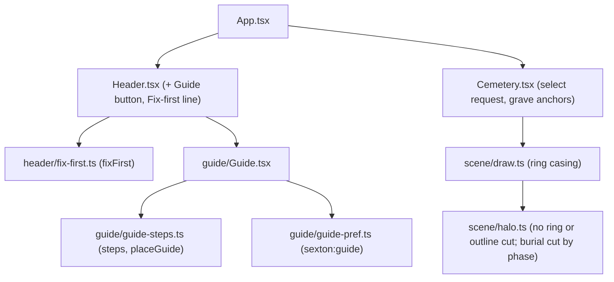

# Design Document: judge-path

## Overview

A judge who has watched the video opens the hosted demo. In five seconds the first screen must say which grave to fix first and why; in two minutes the judge must have hovered a grave, opened its drawer, read its evidence and pull request preview, and replayed an attack. judge-path adds the Fix-first line and a first-visit Guide for that, the same steps in the README, and closes three cemetery notes from 25 Nov 2026. Implements requirements 1 to 8.

Nothing here changes what a grave means, the triage order, a colour, an accessible name of an existing control, or the API.

### Decisions already made (handoff, 25 Nov 2026)

1. **Paths.** packages/web, the README section "Try it in two minutes" only, docs/cemetery.png and docs/replay-axios.png, .kiro/steering/web.md, this folder. No dependency.
2. **Guide.** Four steps on the demo, each pointing at the real control: hover a grave, open its drawer, read the evidence and the pull request preview, press "Replay an attack". Closable, remembered per browser with a guarded read, reachable again from the header, fully keyboard operable, never over a grave's name, no movement under Reduced motion.
3. **Fix first.** In the header or just under it: the top grave in triage order with its state and plain reason, as a button that selects that grave. Shown in Serious mode too.
4. **README.** A section "Try it in two minutes" with the same four steps and absolute links to https://de1giv8lj8sfh.cloudfront.net, including the two `?replay=` links. Lane 2 owns the rest of the README.
5. **Notes.** The replay halo with no dark patch along the ring; a cold Halo repaint inside 16 ms on the 300 front-row scene, added to the speed test; the burial column removed within the budget or recorded with a measurement.

## Architecture



## Components and Interfaces

### A1. The Guide (requirement 1)

```ts
// guide/guide-pref.ts
export const GUIDE_KEY = "sexton:guide";
export function readGuideClosed(storage: Pick<Storage, "getItem"> | null): boolean; // true only for "closed"; a throw gives false
export function writeGuideClosed(storage: Pick<Storage, "setItem"> | null): void;  // a throw is ignored

// guide/guide-steps.ts, pure
export type AnchorId = "fix-first-grave" | "replay-axios";
export interface GuideStep { readonly title: string; readonly body: string; readonly anchor: AnchorId }
export const GUIDE_STEPS: readonly GuideStep[]; // four
export const GUIDE_W = 300;
/** Beside, above or below the anchor, inside the viewport, clear of every name label; else docked at the viewport's bottom. */
export function placeGuide(anchor: Rect, viewport: { width: number; height: number; headerBottom: number | null; footerTop: number | null }, height: number, labels: readonly Rect[]): { left: number; top: number; side: "right" | "left" | "above" | "below" | "dock-bottom" | "dock-top" | "dock-forced" };
```

The four steps, in plain words:

| # | Title | Body | Anchor |
|---|---|---|---|
| 1 | Hover a grave | Each grave is one dependency. Its shape and colour show its state. Hover this one, or Tab to it, to see why. | the Fix-first grave |
| 2 | Open its drawer | Press it, or press Enter on it, to open the drawer. | the Fix-first grave |
| 3 | Read the evidence | The drawer shows every signal with its source and date, and the pull request Sexton would open, with its body. | the Fix-first grave |
| 4 | Replay an attack | Press "axios, Mar 2026" to watch a real compromise unfold, stop by stop. | the "axios, Mar 2026" button |

- **Shown by itself** only on the Demo (`state.isDemo`), only when `readGuideClosed` is false and the page's test flag allows it, without moving focus (1.1 to 1.3).
- **Markup.** `<section className="guide" role="dialog" aria-modal="false" aria-labelledby="guide-title">` rendered in the header right after the Guide button, so its controls follow it in the Tab order (Back, Next or Done, Close). Position `fixed`, at `placeGuide` of its Anchor's client rectangle (the grave button, or the "axios, Mar 2026" button), re-placed on resize and scroll. A small pointer arrow on the side that faces the Anchor. Step counter "Step n of 4".
- **Anchor in view.** Each step scrolls its Anchor into view (`scrollIntoView({ block: "nearest" })`, no smooth scroll under Reduced motion) before it is placed, so at 390 px the Replay button of step 4 is on screen (1.13).
- **Placement.** `placeGuide` gets every grave's `labelRect` in client coordinates (the canvas rectangle plus the plan's label) and tries right, left, above, below the Anchor. With none clear and inside the viewport, the card docks to the first of two bands clear of every Name label: the viewport's bottom band (above the Footer bar when it is pinned), then its top band (below the header when it is pinned). With neither clear it docks to the bottom band, the one case in which it may cover a name; the e2e checks every step at 1440 by 900 and 390 by 844 on the Demo never reaches that case (1.14 to 1.16). Property 1.
- **Controls.** Back, Next or Done, and Close (named "Close guide"), all native buttons.
- **Escape.** Listened for on the Guide's own `section` (`onKeyDown`), never on the document, so Escape on a grave's tooltip does not close the Guide (1.6).
- **Close.** Close, Done and Escape write "closed" (1.7). Focus returns to the Guide button only when focus was inside the Guide (1.11); otherwise it stays where it is.
- **Header button** "Guide", after Legend, rendered when App passes `onGuide` (while a scan is shown, not while loading or after an error): opens at step 1 and focuses the Guide's heading (`tabIndex -1`) (1.9, 1.10). On a scan that is not the Demo it anchors to that scan's Fix-first grave; on a replay steps 1 to 3 anchor to the replay grave.
- **Drawer.** While the drawer is open the Guide is not rendered; its step is kept in App state. Opening the drawer at step 1 or 2 moves the Guide to step 3, whose text describes what the drawer shows; it returns at step 3 when the drawer closes (1.18 to 1.20).
- **Reduced motion.** The card has no transition and no animation. Under motion it fades in over 150 ms with the Web Animations API, called only when `Element.prototype.animate` exists (jsdom has none); the style sheet holds no transition (1.17).
- **Tests.** A module flag in `guide/guide-pref.ts` (`setGuideAllowedForTests`), like the Load moment flag, is set to "not allowed" in `test/setup.ts`, so existing tests see no Guide whatever they do with localStorage; the Guide's own tests allow it. In Playwright the existing tests run with a storage state that holds `sexton:guide` = "closed" (`playwright.config.ts`); the Guide's e2e uses a fresh state.

### A2. The Fix-first line (requirement 2)

```ts
// header/fix-first.ts, pure
export type FixFirst =
  | { readonly kind: "grave"; readonly index: 0; readonly name: string; readonly version: string; readonly state: State; readonly reason: string }
  | { readonly kind: "all-alive" }
  | null; // a replay, or no packages
export function fixFirst(response: ScanResponse): FixFirst; // computed in App and passed to Header as a prop
export function fixFirstText(f: Exclude<FixFirst, null>): string; // "Fix first: left-padder 1.2.1, Possessed, maintainer change in the last 90 days"
```

- `Header` takes `fixFirst` and `onFixFirst` as props (not HeaderModel fields), so a Header rendered without them is unchanged.
- Rendered in the header summary under the policy line: a native button `.fix-first` with that text, or the "Nothing to fix first" sentence. A small state-colour chip before it (decoration, aria-hidden).
- **Select.** App holds `selectRequest: { index, n } | null`; pressing the button bumps `n`. Cemetery, on a new request, sets the selected grave and focuses its button, so the tooltip shows the why.
- Triage index 0 is the first of `triageOrder(response.report.packages)`, the order Cemetery already uses, at the scan date.

### A3. README (requirement 3)

A new section "## Try it in two minutes" after the opening paragraphs and before "## The problem", with the four steps as a numbered list, the Hosted site link, and the two absolute `?replay=` links. `test/readme.test.ts` gains a test for it, and its headings list gains the new heading (Deliberate test change 4).

### B4. Ring casing and the Halo (requirement 4)

- **Ring.** Before the gold ring's `strokeRect`, `drawScene` fills its casing with the `ink` token as four rectangles: 2 px just outside the gold line and 2 px just inside it. The ring is still one `strokeRect` and still the last call, so the painter's call-count tests are unchanged.
- **Focus outline.** `.grave-button:focus-visible` keeps `outline: 3px solid var(--focus)` with `outline-offset: -9px` (it stays for forced-colours mode) and gains a `::after` at `inset: 4px` with `border: 2px solid var(--ink)` and `box-shadow: inset 0 0 0 3px var(--focus), inset 0 0 0 5px var(--ink)`, so the outline's band (6 to 9 px inside the cell) has ink on both sides (from 4 to 6 px and from 9 to 11 px inside the cell). The `::after` has `pointer-events: none`.
- **Halo.** `haloMask` no longer cuts the Ring band and the Outline band. The gold sits on its casing, and only the ink casing, which no contrast check guards, sits on the Halo. The Part, Ghost, pennant, Name label, Burst and burial cuts stay.
- **Inside the ring.** The smudges in docs/replay-axios.png sit inside the ring too, where the soft edges of the zombie's Part cuts (horns, arms, lid) reach it. If the e2e of 4.7 still finds a sample under half the uncut Halo after the ring cut goes, the soft edge is narrowed for every cut: HALO_GROW 14 and HALO_BLUR 4 with the 8 px margin, so the grown copy still passes the solid cut by one and a half blurs. These are the global constants that the painter, `haloAlphaAt` and Property 4's far distance all read, so model and painter stay one; the measurement is recorded.
- **Contrast.** A new test: the ring token against `ink` and the focus token against `ink`, each at least 3:1. The existing tests run unedited.

### B5. A cold Halo repaint inside the budget (requirement 5)

The cold repaint on the 300 front-row scene measured about 20 ms on 25 Nov. Measured first, then fixed in this order until the median is at or below 16 ms:

1. Paint the sources canvas at a sixteenth of a CSS pixel (the sources are smooth radial gradients).
2. Group sources of one radius and colour by row and draw each row from one sprite strip.
If the median is still above 16 ms after these two, requirement 5.3 applies: each step and its median are recorded in "Decisions made during implementation", and the case is left at its measured value.

The e2e hook gains `redrawHaloCold(n)`, which clears the Halo layer and the sources canvas before each paint. The speed case joins `e2e/fixes.spec.ts` and the 300-grave speed test (requirement 5.2).

### B6. The burial cut by phase (requirement 6)

- `buryingRegions(grave, phase)` follows the drawing: the Part boxes moved down by `sink × BURIAL_SINK_PX` and clipped at the plinth top, the mound at its scale, the Priest and the pennant. The Halo's mask key holds the burial phase rounded to 1/24 (once per Pose frame at 12 a second over 1,200 ms), so the layer is repainted as the stone sinks and rises.
- Budget: the 300 front-row scene with a burial on one grave, 30 paints across the burial, median at or below 16 ms (a new e2e case). If it is not met, requirement 6.4 applies and the measurement is recorded.

## Data Models

```ts
// App state additions
interface GuideState { readonly open: boolean; readonly step: 0 | 1 | 2 | 3; readonly opener: "self" | "button" }
interface SelectRequest { readonly index: number; readonly n: number }
```

No change to the API contract, the Engine, the evidence pack, the demo files or the replay fixtures.

## Error Handling

- **localStorage throws or holds garbage.** The Guide behaves as not closed; the page works.
- **An Anchor cannot be placed beside** (no clear place, or no grave). The step scrolls its Anchor into view; if no place beside, above or below is clear, the card takes the dock of 1.15 and 1.16, with no arrow and its text unchanged.
- **No packages.** No Fix-first line; the Guide's grave steps take the dock of 1.15.

## Correctness Properties

### Property 1: The Guide card stays on screen and off every name

*For all* plans of up to 60 packages at widths 360 to 1920, any Anchor rectangle and any card height from 120 to 260: when a place beside, above or below the Anchor lies inside the viewport and clear of every Name label, `placeGuide` returns the first such place in that order; otherwise it returns the first dock band clear of every Name label; and it returns `dock-forced`, which may cover a name, only when no place and no band is clear.

**Validates: Requirements 1.14, 1.15, 1.16.** Test: `test/guide.test.tsx`.

### Property 2: The Guide is remembered only as "closed"

*For any* stored value and any throwing storage: `readGuideClosed` is true exactly for "closed"; after `writeGuideClosed` on a working storage it is true; a throwing storage reads false and never throws.

**Validates: Requirements 1.7, 1.8.** Test: `test/guide.test.tsx`.

### Property 3: Fix first is the first grave in triage order

*For all* scan responses: `fixFirst` is null for a replay or no packages; "all-alive" exactly when every package is Alive; otherwise the first package of `triageOrder` with its scan-date State and reason, and `fixFirstText` holds its name, version, State and reason.

**Validates: Requirements 2.1, 2.4, 2.6, 2.7.** Test: `test/fix-first.test.tsx`.

### Property 4: The Halo is zero wherever a guarded token sits, and is not cut along the ring

*For all* plans of up to 60 packages with any selected grave, any Lantern grave and any playing burial, Vigil or Burst: the Halo is zero inside every Part, Ghost and pennant box, every Name label, the Art box of a bursting grave and the burial regions at the burial's phase; and it is the uncut Halo at every point farther than its soft edge from all of those, ring and outline bands included.

**Validates: Requirements 4.3, 4.4, 6.1.** Test: `test/halo.test.ts` (Deliberate test change 3).

### Property 5: The burial regions hold every mark of a burial at its phase

*For all* Forms, burial phases and the Vigil: every point of every mark drawn by the burial at that phase lies in `buryingRegions(grave, phase)`, and no burial region lies above the sunk stone's top by more than one grid block.

**Validates: Requirements 6.1, 6.2.** Test: `test/priest.test.tsx` (Deliberate test change 5).

## Testing Strategy

Examples for fixed values and DOM; Properties 1 to 5 with fast-check, numRuns 100, tagged `Feature: judge-path, Property N: <title>`; Playwright for the Guide in a real browser, the Fix-first focus, the axe check with the Guide open, the halo along the ring, and the speed cases.

| Test file | Content |
|---|---|
| `test/guide.test.tsx` (new) | Properties 1 and 2. Opens by itself on the Demo only; not on a replay or a hosted scan; four steps in order; Back, Next, Done, Close and Escape on the Guide; Escape on a grave does not close it; focus not moved when it opens by itself; focus to the heading from the Guide button, and back to it on close only from inside; hidden while the drawer is open, moved to step 3 when the drawer opens at step 1 or 2, and back at its step when it closes; no transition under Reduced motion. |
| `test/fix-first.test.tsx` (new) | Property 3. The button text and name; pressing it selects the grave and focuses its button; Serious mode keeps it; replay hides it; the all-Alive sentence. |
| `test/readme.test.ts` | New test: the section, its four steps and the three absolute links. |
| `test/colour-vision.test.ts` | New test: ring and focus against ink at least 3:1. |
| `test/halo.test.ts`, `test/priest.test.tsx` | Properties 4 and 5. |
| `e2e/judge.spec.ts` (new) | The Guide on a first visit at 1440 by 900 and 390 by 844: each step's card beside its Anchor and off every name; Close remembered across a reload; keyboard only from the Guide button to Done; axe with the Guide open; the Fix-first button focuses left-padder and shows its tooltip; the cold Halo repaint and the burial repaint on the 300 front-row scene at or below 16 ms; after the axios Burst ends, at points 8 px inside and outside the replay grave's ring that lie outside every guarded box, the Halo alpha is at least half the uncut Halo (4.7); every Guide step on the Demo at 1440 by 900 and 390 by 844 places its card clear of every name (never `dock-forced`); step 4 at 390 by 844 scrolls the Replay button into view. |

### Deliberate test changes

Every existing test not listed here must pass unmodified.

`test/a11y.test.tsx`
1. "reaches the two evidence links, the Legend control, field, submit and one grave stop by Tab, and wraps out of the page". Old: 12 presses. New: 14, with the Fix-first button before the evidence links and Guide after Legend; the grave stop moves from position 7 to 9.

`test/scrubber.test.tsx`
2. "is reachable by Tab". Old: 8 presses. New: 10 (the Fix-first button and Guide).

`test/halo.test.ts`
3. "Property 3: The Halo paints nothing under a grave or a name". Old: the ring and outline bands are among the zero regions, and the burial regions take no phase. New: the bands are not zero regions, the far check counts them as uncut, and the burial regions are at the burial's phase (Property 4).

`test/readme.test.ts`
4. "keeps the other section headings unchanged" (`ORIGINAL_HEADINGS`). Old: the list starts at "## The problem". New: "## Try it in two minutes" comes first.

`test/priest.test.tsx`
5. "keeps every point of every mark of a burial or a Vigil ... inside the burial regions". Old: `buryingRegions(grave)`. New: `buryingRegions(grave, phase)`.

The header test's control order does not change: `Header` renders the Guide button and the Fix-first line only when App passes them. The painter's ring call counts do not change: the casing is filled, the ring is still one `strokeRect`. If the build finds another test that pins a value this spec changes on purpose, it is added here before the test is edited.

### Visual critic protocol

As cemetery-undead-2, with captures of the Demo at 1440 by 900 and 390 by 844 with the Guide open at each step and closed, the axios replay at its Burst Stop, a burial mid-sink, and both README pictures. Checklist: the Fix-first line reads at a glance; the Guide points at the right control at each step and covers no name; the replay halo has no dark patch along the ring; the burial leaves no dark column; no regression.

## Calls made without a user decision

1. **The Fix-first line sits in the header summary** under the policy line, so the first screen shows it without scrolling at both sizes, and its button is in the Tab order right after Back to now.
2. **The Fix-first line is hidden on a replay.** The story card names the replay's grave, and a replay's scan-date grave is its last Stop, not the attack.
3. **Pressing Fix first focuses the grave** as well as selecting it, so the tooltip with the reason shows at once, for keyboard and pointer users alike.
4. **The Guide is a non-modal dialog** in the header's DOM after the Guide button: it does not trap focus, so a judge can try each control while it is open.
5. **The Guide hides while the drawer is open**, because the drawer traps focus and the scene is inert.
6. **Existing tests run with the Guide closed** (test setup and Playwright storage state), like the Load moment flag of cemetery-undead-2.
7. **The ring and the focus outline get a casing instead of a cut.** It removes the dark patch with no contrast test edited.

## Decisions made during implementation

None yet.

## Notes and open items

- **For the owner at go.** The handoff says to bring the cold Halo repaint inside 16 ms. Requirement 5.3 is a fallback: if the two steps of B5 are not enough, each is recorded with its median and the case is reported above 16 ms. The owner accepts or refuses that fallback at go.

- The hosted site must serve this build before the README links show the Guide. Deploying is outside this spec.
