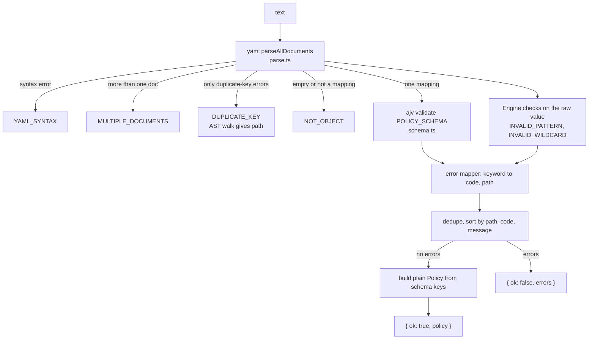
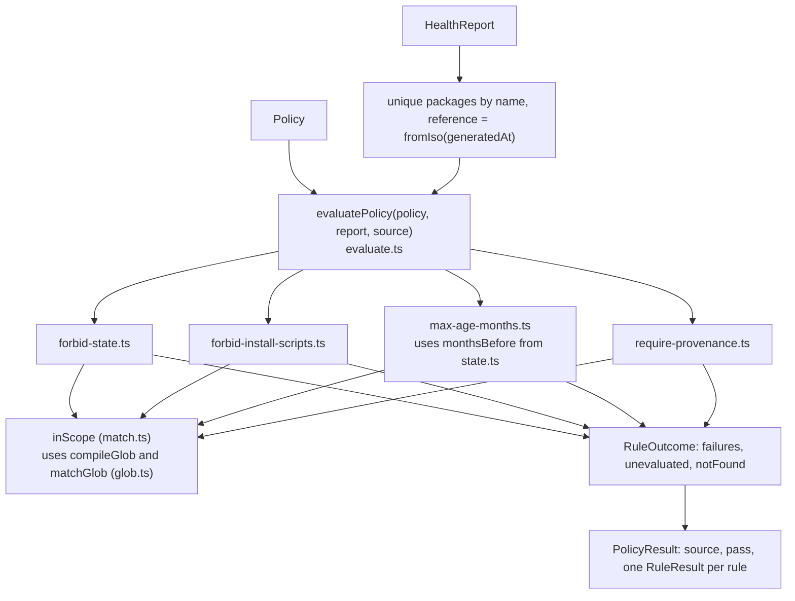

# Design Document: policy

## Overview

policy adds the pure policy core to `@sexton/engine`. It has five parts: a version-1 policy document with a JSON Schema, a parser and validator (`parsePolicy`), a pretty printer (`formatPolicy`), a package matcher (`inScope`) with a hand-written glob matcher, and an evaluator (`evaluatePolicy`) that applies four rule types to a `HealthReport` and returns a `PolicyResult`. It also exports `DEFAULT_POLICY`.

The module reads no file, no clock and no network. The caller reads `sexton.policy.yml`, chooses between the file and the default, and passes `"file"` or `"default"` as `source`. The evaluator takes its Reference time from `report.generatedAt`.

Implements requirements 1 to 9 of this spec, which cover R-PO-2, R-PO-3, R-PO-4 and R-PO-5 of docs/requirements.md, the engine half of R-PO-1 and R-PO-6, and the permissive-licence part of N-7. The evaluator is the N-8 property-tested component.

Out of scope: file reading, GitHub access, exit codes, the CLI `check` command, the evidence pack, a fifth rule type, policy merging, remote schemas.

### Names in the source that differ from the brief

The names in the brief all match the source. These details of the existing code shape the design:

- `HealthReport` and `PackageHealth` are in `src/types.ts`. A `PackageHealth` carries `name`, `installedVersion`, `state`, `stateReason` and `signals`. The signals this module reads are `signals.hasInstallScript` (`Signal<boolean>`), `signals.lastPublish` (`Signal<string | null>`) and `signals.provenance` (`Signal<ProvenanceValue>`).
- `monthsBefore(now, months)` is exported from `src/state.ts`. It mutates a copy with `setUTCMonth`, so it returns an Invalid Date when `months` is large enough to leave the Date range.
- `fromIso(iso)` in `src/signal.ts` is `new Date(iso)`. It never throws. It returns an Invalid Date for unparseable text. This module treats `Number.isFinite(date.getTime())` as "parses as a date".
- `State` and `STATE_ORDER` are in `src/types.ts`. The schema's `states` enum is built from `STATE_ORDER` so the two cannot drift.
- `packages/engine/package.json` has no `dependencies` key yet. The existing script folder is `packages/engine/scripts/` (it holds `record-fixtures.mjs`), so `write-schema.mjs` goes there. A repository-root `scripts/` folder also exists, but it is not where the engine's own scripts live.
- The new shared types go into the existing `src/types.ts` under a policy heading, as history-signals did. This keeps the file list to the files named in the brief.
- `schemas/` does not exist at the repository root yet. `write-schema.mjs` creates it.

### Research findings that shape the design

- `yaml` 2.x parses YAML 1.2 by default (core schema), exposes `parseAllDocuments` (one `Document` per `---` section), and has a `uniqueKeys` option, on by default, that records a `DUPLICATE_KEY` error for repeated mapping keys ([yaml documentation](https://eemeli.org/yaml/)). Each `Document` has `errors` (with a `code`), `contents` (an AST with `isMap`, `isSeq`, `isScalar` guards) and `toJS()`. `toJS` enforces `maxAliasCount`, which defends against alias bombs by throwing.
- Ajv 8 ships a draft 2020-12 class at `ajv/dist/2020.js` ([Ajv JSON Schema drafts](https://ajv.js.org/json-schema.html)). Errors carry `keyword`, `instancePath` (already a JSON Pointer), `params` and `message`. Under `allErrors: true` every violation is reported. Ajv compiles the schema to a function with `new Function`. The code is generated from the schema only, never from the data.
- With `if`/`then`, Ajv adds one extra error with keyword `if` when a `then` branch fails. That error is a summary and is dropped by the error mapper.
- Under NodeNext, a default import of `ajv/dist/2020.js` can be typed as the CommonJS namespace and fail with "not constructable". The task that writes `schema.ts` must check the import form under the repository's tsconfig. If needed, it uses `import Ajv2020Module from "ajv/dist/2020.js"` and takes `.default` through one typed cast in that file. No `require`.

## Architecture





Design decisions:

1. **One schema constant is the single source.** `POLICY_SCHEMA` is a plain JSON-serialisable object in `schema.ts`. The validator is compiled from it. `write-schema.mjs` writes it to `schemas/sexton.policy.schema.json`. A test asserts the committed file equals the constant (1.6). The engine never reads the file.
2. **The schema uses `if`/`then` keyed on `type`, not `oneOf`.** With `oneOf` over four rule shapes, Ajv reports errors from all four branches plus a `oneOf` error, and the mapper would have to guess which branch the author meant. With `if` on `type: const`, only the branch that matches the `type` value runs, so every error belongs to the intended rule type. The `if` condition also needs `required: ["type"]`, so a rule without `type` gets one `MISSING_FIELD` error. A `type` outside the four values selects no branch and gets one `enum` error, which maps to `UNKNOWN_RULE_TYPE`.
3. **Flat property declarations with per-branch tightening.** `additionalProperties: false` only sees properties declared at its own level, so all rule keys are declared once at the rule level (`states: true`, `months: true`, and so on), and each `then` branch redeclares its own parameters with real constraints and sets the other types' parameters to `false`. A foreign parameter (for example `months` on a `forbid_state` rule) yields a "boolean schema is false" error at that key, which maps to `UNKNOWN_FIELD`.
4. **The schema encodes the pattern character set and the `"*"` rule, and the Engine checks stay the source of their errors.** `matchPackagePatterns` items carry a `pattern` for the character set and `require_provenance.packages` carries a `oneOf` for the lone `"*"` (requirement 1.4), so the published file rejects the same texts as `parsePolicy`. Their Ajv errors are awkward (a `oneOf` failure reports every branch), so the mapper drops the `pattern`, `minLength`, `oneOf`, `const` and `not` errors on those paths and `parse.ts` emits `INVALID_PATTERN` and `INVALID_WILDCARD` itself. Each problem therefore yields exactly one error. Duplicate keys stay in `parse.ts` because JSON Schema cannot see them.
5. **Errors are mapped, not passed through.** Ajv messages are never shown. The mapper builds `{ path, message, code }` from keyword, `instancePath` and `params`, so the 13 codes are stable across Ajv upgrades.
6. **Totality.** `parsePolicy` wraps every library call in `try/catch`. `evaluatePolicy` and every rule function are total on any `HealthReport`, which property 1 exercises with generated reports, including an unparseable `generatedAt`.

## Components and Interfaces

All paths are under `packages/engine/` and are relative to `src/` unless stated.

### types.ts additions (Requirements 1, 2, 8, 9)

Shared shapes are added to the existing `src/types.ts`. They are listed under Data Models.

### policy/glob.ts (Requirements 2.18, 2.19, 3.3, 3.11, pure)

```ts
export type GlobToken =
  | { readonly kind: "literal"; readonly ch: string }
  | { readonly kind: "star" }
  | { readonly kind: "doublestar" }
  | { readonly kind: "question" };

/** True iff the pattern is non-empty and every character is in [A-Za-z0-9@/._*?-]. Requirement 2.18, 2.19. */
export function isValidGlob(pattern: string): boolean;

/** Tokenises a pattern per the Glossary glob rules. Total: never throws. */
export function compileGlob(pattern: string): GlobToken[];

/** True iff the whole name matches the token list. Total: never throws. */
export function matchGlob(tokens: readonly GlobToken[], name: string): boolean;
```

Tokenisation of `compileGlob`, left to right over the pattern:

- A run of two or more `*` is one `doublestar` token. Any run of 2 or more stars means `**`, so `***` and `****` equal `**`.
- A single `*` is `star`.
- `?` is `question`.
- Every other character is a `literal` token holding that character. There is nothing to escape, because no regular expression is built. A pattern with characters outside the valid set (for example `(`) still tokenises, and its characters match as plain text.

Semantics of the tokens, as in the Glossary: `literal` matches that one character, `question` matches any one character except `/`, `star` matches zero or more characters except `/`, `doublestar` matches zero or more characters of any kind. The match is anchored at both ends of the name.

`matchGlob` is a state-set walk with no backtracking and no `RegExp` anywhere (3.11). With n tokens, a position is an integer from 0 to n. The state is a set of positions, kept as a boolean array of length n + 1, so the set has at most n + 1 members.

1. The epsilon closure of a set adds `p + 1` for every member `p < n` whose token is `star` or `doublestar` (a wildcard may match nothing). Steps only move forward, so one left-to-right pass over the positions computes the closure.
2. The start set is the closure of `{0}`.
3. For each character `c` of the name, build the next set from every member `p < n`: a `literal` token advances to `p + 1` when its `ch` equals `c`; a `question` token advances to `p + 1` when `c` is not `/`; a `star` token stays at `p` when `c` is not `/`; a `doublestar` token stays at `p` for any `c`. The next set is then closed under epsilon steps. If the set is empty, the walk stops early with `false`.
4. The name matches iff position n is in the final set.

Each character costs one pass over at most n + 1 positions, so the time is O(name length x (tokens + 1)) and the memory is O(tokens + 1). A pattern full of wildcards cannot make the cost grow faster than that bound, which is the 3.11 requirement. Iteration is over UTF-16 code units, so `question` matches one code unit; package names are ASCII in practice.

### policy/match.ts (Requirement 3, pure)

```ts
export type MatcherFields = Pick<Rule, "matchPackageNames" | "matchPackagePatterns" | "excludePackageNames">;
export function inScope(rule: MatcherFields, packageName: string): boolean;
```

Logic: `excluded = excludePackageNames?.includes(name)`; if excluded return false. `hasInclude = names.length > 0 || patterns.length > 0` (absent counts as empty). If not `hasInclude` return true. Otherwise return `names.includes(name) || patterns.some(p => matchGlob(tokensFor(p), name))`. Comparison is `===` on strings, with no normalisation (3.2).

`tokensFor` memoises `compileGlob` in a module-level `Map<string, GlobToken[]>` that maps a pattern string to its token list, capped at 1000 entries (cleared when the cap is reached). `matchGlob` keeps no state between calls and never mutates the token list, so the memo is invisible to callers. `inScope` reads no signals (3.10) and takes only the matcher fields and a name, so it can be called by any rule function and by tests with a bare matcher object.

### policy/rules/forbid-state.ts (Requirement 4)

```ts
export function evaluateForbidState(rule: ForbidStateRule, report: HealthReport, reference: Date | null): RuleOutcome;
```

For each package in report order: skip if not `inScope`; fail if `rule.states.includes(pkg.state)`. The failure has `signal: "state"`, `value: pkg.state`, `source: null`, `fetchedAt: report.generatedAt`, and a reason `state is ${state}: ${stateReason}` (4.5, 9.6). `unevaluated` is always `[]` (4.4). `reference` is unused. The signature is shared by the four rule functions so `evaluate.ts` dispatches uniformly.

### policy/rules/forbid-install-scripts.ts (Requirement 5)

```ts
export function evaluateForbidInstallScripts(rule: ForbidInstallScriptsRule, report: HealthReport, reference: Date | null): RuleOutcome;
```

For each in-scope package: if `(rule.allow ?? []).includes(name)` skip (5.6). Read `signals.hasInstallScript`. Unavailable: one `Unevaluated` with `signal: "hasInstallScript"` and the signal's `reason` (5.5). Available with `true`: one failure with `value: true`, the signal's `source` and `fetchedAt` (5.3, 5.7). Available with `false`: nothing (5.4). Removing an entry from `allow` can only move a package from "skipped" to "judged", which gives monotonicity (5.8).

### policy/rules/max-age-months.ts (Requirement 6)

```ts
export function evaluateMaxAgeMonths(rule: MaxAgeMonthsRule, report: HealthReport, reference: Date | null): RuleOutcome;
```

`reference` is `null` when `report.generatedAt` does not parse (`evaluate.ts` computes it once).

1. If `reference === null`: every in-scope package gets `Unevaluated { signal: "lastPublish", reason: "reference time invalid" }` and nothing else (6.7).
2. `boundary = monthsBefore(reference, rule.months)` using the helper from `src/state.ts` (6.2). If `boundary` is an Invalid Date (an extreme `months` value), no package can be older, so there are no failures. This keeps `toISOString` from being called on an Invalid Date.
3. For each in-scope package, read `signals.lastPublish`. Unavailable: `Unevaluated` with the signal's reason (6.5). Available with `null`, or a value for which `fromIso(value)` is not finite: `Unevaluated` with reason `no usable publish date exists` (6.6). Otherwise `failure` iff `published.getTime() < boundary.getTime()` (strict, 6.2). A date later than the Reference time is later than the boundary too (because `months >= 1`), so it never fails (6.4) with no extra branch.
4. The failure has `signal: "lastPublish"`, `value` the ISO string from the signal, its `source` and `fetchedAt`, `boundary: boundary.toISOString()`, and a reason `last published ${value}, earlier than ${boundary} (${months} months before ${generatedAt})` (6.8).

The result depends on time only through `reference` (6.10).

### policy/rules/require-provenance.ts (Requirement 7)

```ts
export function evaluateRequireProvenance(rule: RequireProvenanceRule, report: HealthReport, reference: Date | null): RuleOutcome;
```

`wildcard = rule.packages.length === 1 && rule.packages[0] === "*"`. A package is selected iff `inScope(rule, name) && (wildcard || rule.packages.includes(name))` (7.2). For each selected package: unavailable `provenance` gives `Unevaluated { signal: "provenance", reason }` (7.5). Available with `present: false` gives a failure with `value` a copy of the `ProvenanceValue`, plus the signal's `source` and `fetchedAt` (7.3, 7.6). `present: true` gives nothing (7.4).

`notFound`: the entries of `rule.packages` other than `"*"` whose name equals no `name` in `report.packages`, in order of first appearance, without repeats (7.7, 7.8). It depends only on report presence, not on Scope. A named package that is in the report but excluded by a Matcher is not "not found". The wildcard rule selects a superset of every other selection, so its failing set contains theirs (7.10).

### policy/default.ts (Requirement 8.1)

```ts
export const DEFAULT_POLICY: Policy = {
  version: 1,
  rules: [{ type: "forbid_state", states: ["Possessed", "Dead"] }],
};
```

### policy/evaluate.ts (Requirements 8.2 to 8.4, 9)

```ts
export function evaluatePolicy(policy: Policy, report: HealthReport, source: PolicySource): PolicyResult;
```

1. `reference = fromIso(report.generatedAt)`, replaced by `null` when `getTime()` is not finite.
2. `packages` = `report.packages` with a repeated `name` dropped (first occurrence wins). A scoring run never produces duplicates, so this is a guard that makes "each package at most once" (9.9) hold for any hand-built report. The rule functions receive `{ generatedAt, packages }`.
3. For each rule in order, `switch (rule.type)` calls the matching rule function and builds `RuleResult { index, type, ...(rule.name !== undefined ? { name: rule.name } : {}), pass: failures.length === 0, failures, unevaluated, notFound }` (9.4, 9.5, 9.8).
4. `pass = ruleResults.every(r => r.pass)`, which is `true` for an empty rules list (9.13). `source` is copied unchanged (8.2).

Rules are evaluated independently from the same inputs, so removing a rule changes no other result except `index` (9.15). Rule functions build new arrays and new objects and never write to `policy` or `report` (9.3). Copied values (`ProvenanceValue`) are shallow copies so a caller who mutates a result cannot reach into the report. The function has no `try/catch`: the rule functions are total on any `HealthReport`, and a defensive catch would turn an engine bug into either a silent pass or a spurious failure.

### policy/schema.ts (Requirements 1.1 to 1.7)

```ts
export const POLICY_SCHEMA: JsonSchema; // plain JSON-serialisable object (no undefined, functions or RegExp)
export const validatePolicySchema: ValidateFunction; // compiled once at module load
```

Ajv options: `new Ajv2020({ strict: true, allErrors: true, allowUnionTypes: false, coerceTypes: false, useDefaults: false, removeAdditional: false })`. No `loadSchema`, no `$ref` outside `#/$defs`, so there are no remote refs. The schema is a constant; policy text never reaches `compile`, so no code is generated from policy data. The validator is built at import time. A schema bug fails loudly when the module loads, and `schema.test.ts` imports it. The `pattern` value is plain JSON-Schema regular-expression text, evaluated by Ajv over a policy string; it has no nested quantifier, so it is linear in the pattern length. Glob matching itself uses no regular expression.

Sketch (final text is in the file; `STATE_ENUM` is `STATE_ORDER`):

```jsonc
{
  "$schema": "https://json-schema.org/draft/2020-12/schema",
  "title": "Sexton policy",
  "type": "object",
  "additionalProperties": false,
  "required": ["version", "rules"],
  "properties": {
    "version": { "const": 1 },
    "rules": { "type": "array", "items": { "$ref": "#/$defs/rule" } }
  },
  "$defs": {
    "nameList": { "type": "array", "items": { "type": "string", "minLength": 1 } },
    "patternList": { "type": "array", "items": { "type": "string", "minLength": 1, "pattern": "^[A-Za-z0-9@/._*?-]+$" } },
    "rule": {
      "type": "object",
      "additionalProperties": false,
      "required": ["type"],
      "properties": {
        "type": { "enum": ["forbid_state", "forbid_install_scripts", "max_age_months", "require_provenance"] },
        "name": { "type": "string", "minLength": 1, "maxLength": 80 },
        "matchPackageNames": { "$ref": "#/$defs/nameList" },
        "matchPackagePatterns": { "$ref": "#/$defs/patternList" },
        "excludePackageNames": { "$ref": "#/$defs/nameList" },
        "states": true, "allow": true, "months": true, "packages": true
      },
      "allOf": [
        { "if": { "required": ["type"], "properties": { "type": { "const": "forbid_state" } } },
          "then": { "required": ["states"],
            "properties": { "states": { "type": "array", "minItems": 1, "items": { "enum": STATE_ENUM } },
                            "allow": false, "months": false, "packages": false } } },
        { "if": { ... "forbid_install_scripts" },
          "then": { "properties": { "allow": { "$ref": "#/$defs/nameList" }, "states": false, "months": false, "packages": false } } },
        { "if": { ... "max_age_months" },
          "then": { "required": ["months"],
            "properties": { "months": { "type": "integer", "minimum": 1 }, "states": false, "allow": false, "packages": false } } },
        { "if": { ... "require_provenance" },
          "then": { "required": ["packages"],
            "properties": { "packages": { "oneOf": [
                              { "const": ["*"] },
                              { "type": "array", "minItems": 1,
                                "items": { "type": "string", "minLength": 1, "not": { "const": "*" } } } ] },
                            "states": false, "allow": false, "months": false } } }
      ]
    }
  }
}
```

The `packages` schema uses `oneOf` with two branches that cannot both match: the first accepts exactly `["*"]`, the second accepts any non-empty list of non-empty strings none of which is `"*"`. So `["*"]` and any list of names are valid, and any list that mixes `"*"` with other entries (or repeats it) matches neither branch. In Ajv, a failing `oneOf` reports the failing keywords of each branch plus a `oneOf` summary, which would give several errors for one problem. The mapper therefore drops every `const`, `not` and `oneOf` error whose path is `/rules/{i}/packages` or below, and keeps `type` and `minItems` and the per-entry `type` and `minLength` errors. The outcomes: `["*", "a"]` and `["*", "*"]` give no mapped schema error and `parse.ts` adds one `INVALID_WILDCARD`; `[]` gives one `EMPTY_LIST` (from `minItems` in the second branch); a non-list gives one `WRONG_TYPE`; `[""]` and `[1]` give one `WRONG_TYPE` per entry. For patterns, the `pattern` and `minLength` errors under `matchPackagePatterns` are dropped and `parse.ts` adds one `INVALID_PATTERN` per entry that is a string and fails `isValidGlob` (this includes the empty string); a non-string entry gives one `WRONG_TYPE` from `type`.

Notes: `version` is `{ "const": 1 }` only, so one `const` error covers every wrong value and the mapper chooses the code from the value. `type` is `{ "enum": [...] }` only, so every non-member (including a number) is `UNKNOWN_RULE_TYPE`. Each `then` branch inherits `type: object` from the rule schema, so Ajv strict mode (strictTypes) accepts `properties` there and a non-object rule produces one `type` error from the parent. `name` length counts Unicode code points (Ajv's `minLength` and `maxLength` count code points).

### policy/parse.ts (Requirement 2)

```ts
export function parsePolicy(text: string): ParseResult;
```

Stages, each in `try/catch` that converts a thrown value into a `YAML_SYNTAX` error at path `$` (so `parsePolicy` never throws, 2.2):

1. **Parse.** `parseAllDocuments(text, { uniqueKeys: true })`, converted with `Array.from` (an empty stream is empty). Documents with a parse error are inspected.
   - Any error whose `code` is not `DUPLICATE_KEY` in any document: one error `YAML_SYNTAX`, path `$`, message from the first error. No schema validation (2.6).
   - More than one document: one error `MULTIPLE_DOCUMENTS`, path `$` (2.7).
   - Only `DUPLICATE_KEY` errors: walk the document AST (`isMap`, `isPair`, `isScalar`, `isSeq`), tracking the JSON Pointer of each mapping, and report one `DUPLICATE_KEY` error per mapping that holds a repeated scalar key, with that mapping's path (the empty string for the root). Neither value is used and schema validation does not run (2.8). A mapping with a repeated non-scalar key reports the mapping's path as well.
2. **Value.** `value = doc.toJS({ maxAliasCount: 100 })` for the single document. No document, a `null` value (empty text, comments only) or a value that is not a plain mapping (a scalar, a list): one error `NOT_OBJECT`, path `""` (2.9).
3. **Schema.** `validatePolicySchema(value)`. Each Ajv error is mapped by the table below.
4. **Engine checks** on the raw value, run in addition to the schema so that one parse reports every problem. The schema also encodes both rules (1.4), but these checks are the only source of `INVALID_PATTERN` and `INVALID_WILDCARD`, because the mapper drops the schema errors for those paths. Each is guarded by `Array.isArray` and `typeof` checks:
   - For every `rules[i].matchPackagePatterns[j]` that is a string and fails `isValidGlob`: `INVALID_PATTERN` at that entry's path (2.18, 2.19).
   - For every `rules[i]` with `type === "require_provenance"` and `packages` an array that includes `"*"` and has length greater than 1: `INVALID_WILDCARD` at `/rules/i/packages` (2.17).
5. **Finish.** Dedupe errors by the triple (path, code, message) and sort by path, then code, then message, each in ascending UTF-16 code-unit order using `<` (2.4). If any remain, return `{ ok: false, errors }`. Otherwise build the policy.

**Building the Policy (2.20, 2.24).** `buildPolicy(value)` constructs fresh plain objects by copying the schema keys explicitly per rule type, and copies arrays with `slice`. Optional keys are added only when present, so absent stays absent and `undefined` never appears. No key outside the schema can survive, and the result serialises to JSON without loss. Patterns stay plain strings, already validated, and the matcher tokenises them on use.

**Ajv error mapper.** Error → `{ path, code }`. The path is `instancePath`, except for `required` (`instancePath + "/" + escape(params.missingProperty)`) and `additionalProperties` (`instancePath + "/" + escape(params.additionalProperty)`). `escape` replaces `~` with `~0` and `/` with `~1`.

| Ajv keyword and location | Code |
|---|---|
| `required` | `MISSING_FIELD` |
| `additionalProperties`, or `false schema` | `UNKNOWN_FIELD` |
| `const` at `/version`, value an integer | `VERSION_UNSUPPORTED` |
| `const` at `/version`, value not an integer | `WRONG_TYPE` |
| `enum` at `/rules/{i}/type` | `UNKNOWN_RULE_TYPE` |
| `enum` elsewhere (an entry of `states`) | `WRONG_TYPE` |
| `minItems` | `EMPTY_LIST` |
| `type` at a `months` path, value a number (fractional, NaN, infinite) | `INVALID_MONTHS` |
| `minimum` at a `months` path | `INVALID_MONTHS` |
| `pattern` or `minLength` under `matchPackagePatterns` | dropped (the Engine check emits `INVALID_PATTERN`) |
| `oneOf`, `const` or `not` at `/rules/{i}/packages` or below | dropped (the Engine check emits `INVALID_WILDCARD`) |
| `type`, `minLength`, `maxLength` anywhere else | `WRONG_TYPE` |
| keyword `if` (the then-failed summary) | dropped |

Messages are written by the mapper from the code and path (for example `rules[2].months must be a positive integer`), never copied from Ajv. Any Ajv error not in the table maps to `WRONG_TYPE` at its path, so no unmapped keyword can escape the 13 codes.

### policy/format.ts (Requirement 2.21 to 2.23)

```ts
export function formatPolicy(policy: Policy): string;
```

Builds an ordered plain object (keys inserted in a fixed order): `version`, `rules`. Within a rule: `name` (if present), `type`, then the type's parameters in schema order (`states`; `allow`; `months`; `packages`), then `matchPackageNames`, `matchPackagePatterns`, `excludePackageNames` (each only if present). It calls `stringify(obj, { lineWidth: 0, indent: 2, sortMapEntries: false })` from `yaml`. `lineWidth: 0` disables folding. The `yaml` stringifier quotes scalars that would otherwise read back as another type or as YAML syntax (`"*"`, `"@scope/pkg"`, `"123"`, `"yes"`), which is what the round trip needs. Output depends only on the input value, so two calls return the same text (2.23).

### scripts/write-schema.mjs (Requirement 1.6)

Location: `packages/engine/scripts/write-schema.mjs`, next to `record-fixtures.mjs`. It imports `POLICY_SCHEMA` from `../dist/policy/schema.js` (so the engine is built first), and writes `JSON.stringify(POLICY_SCHEMA, null, 2) + "\n"` to `schemas/sexton.policy.schema.json` at the repository root, creating the folder. It is wired as `"schema:write": "node scripts/write-schema.mjs"` in `packages/engine/package.json`. The script is a build tool, not engine runtime code, so the "no filesystem writes" rule for the engine does not apply to it. The committed JSON is the artefact other tools read.

### index.ts additions

```ts
export { parsePolicy } from "./policy/parse.js";
export { formatPolicy } from "./policy/format.js";
export { evaluatePolicy } from "./policy/evaluate.js";
export { DEFAULT_POLICY } from "./policy/default.js";
export { inScope } from "./policy/match.js";
export { POLICY_SCHEMA } from "./policy/schema.js";
export type { Policy, Rule, RuleType, ForbidStateRule, ForbidInstallScriptsRule, MaxAgeMonthsRule, RequireProvenanceRule,
  ParseResult, ValidationError, ErrorCode, PolicySource, PolicyResult, RuleResult, Failure, Unevaluated } from "./types.js";
```

### package.json (Requirements 1.8, 1.9)

`packages/engine/package.json` gains `"dependencies": { "ajv": "8.20.0", "yaml": "2.9.1" }`, exact versions, and `"schema:write"`. The lockfile gains `ajv`, `yaml` and ajv's four runtime dependencies.

| Package | Version | Licence | One-line PR justification |
|---|---|---|---|
| yaml | 2.9.1 | ISC | Parses and prints the YAML 1.2 policy file with duplicate-key detection and a stable printer; no dependencies of its own. |
| ajv | 8.20.0 | MIT | Validates the policy against the published draft 2020-12 JSON Schema so the schema file and the validator cannot drift. |
| fast-deep-equal | pinned by lockfile | MIT | Transitive runtime dependency of ajv. |
| fast-uri | pinned by lockfile | BSD-3-Clause | Transitive runtime dependency of ajv. |
| json-schema-traverse | pinned by lockfile | MIT | Transitive runtime dependency of ajv. |
| require-from-string | pinned by lockfile | MIT | Transitive runtime dependency of ajv. |

Checked on npm: none of the six declares an `install`, `preinstall` or `postinstall` script. Both direct dependencies are permissive (N-7). The lockfile is the record of the transitive versions; the `npm install` task reads them back and confirms the set equals these four.

### Requirement trace

| Component | Requirements |
|---|---|
| `policy/schema.ts`, `write-schema.mjs` | 1.1 to 1.7 |
| `package.json` | 1.8, 1.9 |
| `policy/parse.ts` | 2.1 to 2.20, 2.24, 2.25 |
| `policy/format.ts` | 2.21 to 2.23 |
| `policy/glob.ts` | 2.18, 2.19, 3.3, 3.11 |
| `policy/match.ts` | 3.1 to 3.10 |
| `policy/rules/forbid-state.ts` | 4.1 to 4.7 |
| `policy/rules/forbid-install-scripts.ts` | 5.1 to 5.8 |
| `policy/rules/max-age-months.ts` | 6.1 to 6.10 |
| `policy/rules/require-provenance.ts` | 7.1 to 7.10 |
| `policy/default.ts` | 8.1, 8.5, 8.6 |
| `policy/evaluate.ts` | 8.2 to 8.4, 9.1 to 9.16 |

## Data Models

Added to `src/types.ts`:

```ts
export const RULE_TYPES = ["forbid_state", "forbid_install_scripts", "max_age_months", "require_provenance"] as const;
export type RuleType = (typeof RULE_TYPES)[number];

export interface Matchers {
  readonly matchPackageNames?: readonly string[];
  readonly matchPackagePatterns?: readonly string[]; // plain strings, validated at parse time
  readonly excludePackageNames?: readonly string[];
}
interface RuleBase extends Matchers { readonly name?: string } // 1 to 80 characters

export interface ForbidStateRule extends RuleBase { readonly type: "forbid_state"; readonly states: readonly State[] }
export interface ForbidInstallScriptsRule extends RuleBase { readonly type: "forbid_install_scripts"; readonly allow?: readonly string[] }
export interface MaxAgeMonthsRule extends RuleBase { readonly type: "max_age_months"; readonly months: number }
export interface RequireProvenanceRule extends RuleBase { readonly type: "require_provenance"; readonly packages: readonly string[] }
export type Rule = ForbidStateRule | ForbidInstallScriptsRule | MaxAgeMonthsRule | RequireProvenanceRule;

export interface Policy { readonly version: 1; readonly rules: readonly Rule[] } // only schema keys

export const ERROR_CODES = [
  "YAML_SYNTAX", "MULTIPLE_DOCUMENTS", "DUPLICATE_KEY", "NOT_OBJECT", "MISSING_FIELD", "VERSION_UNSUPPORTED",
  "UNKNOWN_RULE_TYPE", "UNKNOWN_FIELD", "WRONG_TYPE", "EMPTY_LIST", "INVALID_MONTHS", "INVALID_WILDCARD", "INVALID_PATTERN",
] as const;
export type ErrorCode = (typeof ERROR_CODES)[number];

export interface ValidationError {
  readonly path: string; // JSON Pointer, "" for the document, "$" for the text as a whole
  readonly message: string;
  readonly code: ErrorCode;
}
export type ParseResult =
  | { readonly ok: true; readonly policy: Policy }
  | { readonly ok: false; readonly errors: readonly [ValidationError, ...ValidationError[]] };

export type PolicySource = "default" | "file";

export interface Failure {
  readonly name: string;
  readonly installedVersion: string;
  /** "state" for forbid_state, else the signal name. */
  readonly signal: "state" | "hasInstallScript" | "lastPublish" | "provenance";
  readonly value: string | boolean | ProvenanceValue; // state name, true, ISO string, or provenance value
  readonly source: string | null;                    // null for the state rule
  readonly fetchedAt: string;                        // generatedAt for the state rule
  readonly reason: string;                           // names the signal and the value
  /** max_age_months only. ISO instant of the age boundary. Requirement 6.8. */
  readonly boundary?: string;
}
export interface Unevaluated {
  readonly name: string;
  readonly installedVersion: string;
  readonly signal: "hasInstallScript" | "lastPublish" | "provenance";
  readonly reason: string;
}
export interface RuleResult {
  readonly index: number;
  readonly type: RuleType;
  readonly name?: string; // key absent when the rule has no name
  readonly pass: boolean;
  readonly failures: readonly Failure[];
  readonly unevaluated: readonly Unevaluated[];
  readonly notFound: readonly string[]; // empty except for require_provenance
}
export interface PolicyResult {
  readonly source: PolicySource;
  readonly pass: boolean;
  readonly rules: readonly RuleResult[];
}

/** Internal. The shared return type of the four rule functions. */
export interface RuleOutcome {
  readonly failures: readonly Failure[];
  readonly unevaluated: readonly Unevaluated[];
  readonly notFound: readonly string[];
}
```

## Requirement tensions and how this design resolves them

requirements.md is not edited. These are the places where it reads two ways or cannot be met literally.

(a) **2.6 and 2.8, duplicate keys.** Resolved in requirements: 2.6 now excludes duplicate keys.

(b) **Two ambiguities raised in analysis, not applied to requirements.md.**
- 4.3: "WHEN a package's state is not an entry of states THEN no Failure." The design reads the guarantee as holding for every package in the report. Scope only removes packages from consideration, so an out-of-scope package never fails whatever its state, and an in-scope package fails exactly when its state is listed. Property 5 asserts the intersection form.
- 7.5: Unevaluated for `require_provenance` is exactly the packages that are selected (in Scope and named by `packages` or covered by `"*"`) and whose `provenance` signal is unavailable. An in-Scope package that `packages` does not select is neither failed nor unevaluated, even when its signal is unavailable.

(c) **Other tensions found while designing.**

1. **Empty pattern, 2.18 against 1.2 and 2.14.** 1.2 and 2.14 say a matcher entry that is not a non-empty string is `WRONG_TYPE`. 2.18 says an empty pattern is `INVALID_PATTERN`. The specific rule wins: `minLength: 1` stays in the schema for every matcher list (1.2), the mapper drops the `minLength` and `pattern` errors under `matchPackagePatterns`, and the Engine check reports an empty pattern as `INVALID_PATTERN` because the empty string fails `isValidGlob`. An empty name in `matchPackageNames`, `excludePackageNames`, `allow` or `packages` stays `WRONG_TYPE`.
2. **Linear matching, 3.11.** Resolved: the matcher is a state-set walk, see glob.ts.
3. **Runs of stars.** The Glossary defines `*` and `**` but not `***`. Any run of two or more stars is one `**`.
4. **Wildcard with itself, 2.17 and 7.1.** `["*", "*"]` has two entries and 7.1 says the wildcard is "the single entry". The design rejects it: `INVALID_WILDCARD` fires when `"*"` is present and the list has more than one entry.
5. **Boundary evidence, 6.8 against 9.6.** 6.8 needs the boundary instant in the evidence, and 9.6 fixes the `Failure` fields. The design adds one optional `boundary` field to `Failure`, present only for `max_age_months`, and also states the boundary in the `reason` text.
6. **Order of checks in `max_age_months`, 6.5 and 6.7.** When `generatedAt` is unparseable and a package's signal is also unavailable, both rules apply. 6.7 says every in-scope package gets "reference time invalid", so the Reference check runs first.
7. **Extreme `months`.** `months` is any positive integer, but `monthsBefore` returns an Invalid Date for values that leave the Date range. The design treats an Invalid Date boundary as "no package is older". It never calls `toISOString` on it.
8. **Name length unit, 1.2 and 2.25.** "Characters" is counted in Unicode code points (Ajv's `minLength` and `maxLength`), not UTF-16 units.
9. **Report with a repeated package name, 9.9.** A scoring run yields one entry per name, but `HealthReport` does not forbid repeats. The evaluator keeps the first entry for a repeated name so each package appears at most once.
10. **not-found, 7.7.** "Absent from the report" is judged on report presence only. A package that is in the report but outside the rule's Scope is found.
11. **Duplicate or non-scalar keys beyond the root.** DUPLICATE_KEY reports the path of the mapping that holds the repeat, including mappings nested in lists (for example `/rules/0`).
12. **Schema and engine check split.** Resolved: the schema encodes both rules (1.4).

## Correctness Properties

*A property is a characteristic or behavior that should hold true across all valid executions of a system-essentially, a formal statement about what the system should do. Properties serve as the bridge between human-readable specifications and machine-verifiable correctness guarantees.*

The tests use fast-check 3.23.1 (pinned exact). `numRuns` is 100 by default and 1000 for the security invariants: properties 2, 9, 15 and 17. Each property is one test, tagged `Feature: policy, Property {n}: {title}`. The shared generators live in `test/policy/arbitraries.ts`.

Reflection result: 4.2, 4.3 and 4.6 merge into property 5. 9.2 merges into property 1. 2.1 to 2.4 merge into property 15. 9.8 and 9.13 merge into property 10. The seventeen properties below are the full set. All other criteria are covered by example tests (see Testing Strategy).

Shared generators: `arbName` (short names from a small alphabet including `@scope/x` forms so collisions happen), `arbPackage` (a `PackageHealth` with a generated `state`, and each of `hasInstallScript`, `lastPublish`, `provenance` either available with a generated value or unavailable with a reason; unique names within a report), `arbReport` (0 to 12 packages, `generatedAt` a valid ISO instant or, occasionally, an unparseable string), `arbRule` (any of the four types with generated parameters and matchers), `arbPolicy` (0 to 6 rules), `arbValidPolicy` (as `arbPolicy` with valid patterns, months from 1 to 1200, a lone `"*"` or a list of names, and rule names of 1 to 80 code points).

### Property 1: Evaluator determinism and non-mutation

For any valid policy, any report (including an empty one, entries with unavailable signals and an unparseable `generatedAt`) and any source, `evaluatePolicy` returns without throwing, two calls return deeply equal results, and neither call changes the policy or the report.

**Validates: Requirements 9.2, 9.3**

Generators: `arbValidPolicy`, `arbReport`, `source` from `"default" | "file"`. Assertion: deep-freeze `policy` and `report` (a write to a frozen object throws in strict ES modules), call twice, `deepEqual` the results, and `deepEqual` the inputs with `structuredClone` copies taken before the call.

### Property 2: Exclude wins

For any rule and any package name that is an entry of the rule's `excludePackageNames`, `inScope(rule, name)` is false, whatever `matchPackageNames` and `matchPackagePatterns` hold.

**Validates: Requirements 3.4**

Generators: matcher fields from `arbName` lists and valid patterns (including `**` and `*`, which match the name), with the name forced into the exclude list at a random position. Assertion: `inScope(...) === false`. Security invariant, 1000 runs.

### Property 3: No matchers means all packages

For any rule whose `matchPackageNames` and `matchPackagePatterns` are empty or absent, and any package name that is not in `excludePackageNames`, `inScope(rule, name)` is true.

**Validates: Requirements 3.6**

Generators: a rule with each of the two lists independently absent or `[]`, an exclude list, and a name drawn so that it is not in the exclude list. Assertion: `inScope(...) === true`.

### Property 4: Order independence of matchers

For any rule and package name, `inScope` returns the same result after the entries of `matchPackageNames`, `matchPackagePatterns` and `excludePackageNames` are reordered or repeated.

**Validates: Requirements 3.7**

Generators: a rule from `arbRule`, a name, and a permutation plus duplication function applied to each list. Assertion: `inScope(rule, name) === inScope(permuted, name)`.

### Property 5: forbid_state exactness

For any report, any rule's matchers and any `states` list, the packages `evaluateForbidState` fails are exactly the packages that are in Scope and whose `state` is listed, in report order, and the rule returns no unevaluated entries.

**Validates: Requirements 4.2, 4.3, 4.6**

Generators: `arbReport`, a `forbid_state` rule with a non-empty `states` list and matchers. Assertion: the failure names equal `report.packages.filter(p => inScope(rule, p.name) && rule.states.includes(p.state)).map(p => p.name)`, and `unevaluated` is `[]`.

### Property 6: Monotonic in states

For any report, matchers and two `states` lists where one contains the other, the failing package set for the larger list contains the failing package set for the smaller list.

**Validates: Requirements 4.7**

Generators: a report, matchers, a `states` list `S` and a superset `T` built by adding generated states. Assertion: `failNames(S)` is a subset of `failNames(T)`.

### Property 7: Monotonic in allow

For any report, matchers and two `allow` lists where one contains the other, the failing package set for the larger `allow` list is contained in the failing package set for the smaller one. Removing an entry from `allow` never removes a failure, and adding an entry never adds one.

**Validates: Requirements 5.8**

Generators: a report with generated `hasInstallScript` signals, matchers, `allow` list `A` and superset `B`. Assertion: `failNames(B)` is a subset of `failNames(A)`.

### Property 8: Monotonic in months

For any report and matchers, and any two positive integers `a` less than `b`, the failing package set of a `max_age_months` rule with `b` is contained in the failing package set with `a`.

**Validates: Requirements 6.9**

Generators: a report with `lastPublish` instants around `generatedAt` (before, after, equal, null, unparseable) and integers `a < b` from 1 to 1200. Assertion: `failNames(b)` is a subset of `failNames(a)`.

### Property 9: Unevaluated never fails

For any valid policy and report, no package that appears in a rule's `unevaluated` list appears in the same rule's `failures`, and a rule whose `failures` are empty has `pass` true however many entries `unevaluated` holds.

**Validates: Requirements 9.12**

Generators: `arbValidPolicy` and a report in which most signals are unavailable. Assertion: for every rule result, `unevaluated.length` may be any value and `pass === (failures.length === 0)`; additionally, replacing every signal of the report with an unavailable one yields `pass` true for `forbid_install_scripts`, `max_age_months` and `require_provenance` rules. Security invariant, 1000 runs.

### Property 10: Pass is exactly the absence of failures, overall and per rule

For any valid policy and report, each rule result's `pass` is true if and only if its `failures` list is empty, and the overall `pass` is true if and only if every rule result's `pass` is true. A policy with no rules gives `pass` true and an empty `rules` list.

**Validates: Requirements 9.8, 9.13**

Generators: `arbValidPolicy` (including the empty policy) and `arbReport`. Assertion as stated.

### Property 11: Disjointness of failures and unevaluated

For any valid policy and report, in each rule result no package appears in both `failures` and `unevaluated`, and each package appears at most once in each of the two lists.

**Validates: Requirements 9.9**

Generators: `arbValidPolicy` and `arbReport` whose package names may repeat (the evaluator keeps the first entry). Assertion: the name sets are disjoint and no list holds a repeated name.

### Property 12: Scope containment

For any valid policy and report, every package named in a rule result's `failures` or `unevaluated` is in the Scope of that rule, and both lists follow the order of `report.packages`.

**Validates: Requirements 9.10, 9.11**

Generators: `arbValidPolicy` and `arbReport`. Assertion: each listed name satisfies `inScope(rule, name)`, and the list is a subsequence of the report's name order.

### Property 13: Rule isolation

For any valid policy and report, removing one rule from the policy leaves every other rule result deeply equal to its earlier value except for `index`, and the overall `pass` of the smaller policy equals the conjunction of the remaining rule passes.

**Validates: Requirements 9.15**

Generators: `arbValidPolicy` with at least one rule, a report, and a random index to remove. Assertion: compare each remaining result to the original at its original position after replacing `index`.

### Property 14: Schema round trip and format determinism

For any valid policy `p`, `parsePolicy(formatPolicy(p))` returns `{ ok: true }` with a policy deeply equal to `p`. Two calls to `formatPolicy(p)` return the same text, and parse then format then parse gives a policy deeply equal to the first parse. A parsed policy holds only the schema's keys.

**Validates: Requirements 2.22, 2.23, 2.24**

Generators: `arbValidPolicy` with rule names and package names drawn from full Unicode strings and from tricky scalars (`"*"`, `"123"`, `"yes"`, `"@a/b"`, strings with leading spaces, colons, `#`, quotes and newlines). Assertion: the three equalities, plus a check that every key of the parsed value (policy and each rule) is in the schema's key set for its type.

### Property 15: parsePolicy never throws, and ok matches the errors

For any string, including the empty string, binary-looking text, deeply nested flow collections and alias-heavy YAML, `parsePolicy` returns a result without throwing. The result has `ok` true if and only if it carries a `policy` and no `errors`, and `ok` false if and only if `errors` is non-empty. Every error has a code from the 13 stable codes. The errors are sorted by path, code and message, and two calls return deeply equal results.

**Validates: Requirements 2.2, 2.3, 2.4, 2.5**

Generators: `fc.string()` and `fc.fullUnicodeString()`, structured fragments (`fc.oneof` of YAML-ish pieces: `---`, `&a`, `*a`, `[`, `{`, `: `, `- `, tabs, `version: 1`, `rules:`), and corruptions of a formatted valid policy (truncate, insert a character, swap two lines). Assertion as stated. Security invariant, 1000 runs.

### Property 16: The default policy fails exactly when a package is Possessed or Dead

For any report, `evaluatePolicy(DEFAULT_POLICY, report, "default")` has `pass` true if and only if no package in the report is in the state Possessed or Dead. In particular, any report whose packages are all Alive, Restless or Haunted passes.

**Validates: Requirements 8.5**

Generators: `arbReport`, plus a variant whose states are drawn only from Alive, Restless and Haunted. Assertion: `result.pass === !report.packages.some(p => p.state === "Possessed" || p.state === "Dead")`, and `result.source === "default"`.

### Property 17: Glob matcher agrees with a reference

For any glob made from tokens over a small alphabet including `/`, `@`, `*`, `**` and `?`, and any name over the same characters, `matchGlob(compileGlob(g), name)` equals a naive recursive reference matcher written in the test that implements the Glossary rules directly; and for any name made only of characters from `[A-Za-z0-9@/._-]` (no glob characters), `compileGlob(name)` matches exactly that name and no other generated name.

**Validates: Requirements 3.3, 3.11**

Generators: `arbGlob` builds a pattern string from a list of pieces drawn from `a`, `b`, `@`, `/`, `.`, `*`, `**`, `***` and `?`, so runs of stars occur; `arbGlobName` draws names from the same alphabet without wildcards, with length 0 to 8 so that matches and misses are both common; `arbLiteralName` draws from `[A-Za-z0-9@/._-]`, with a second independent name, a one-character mutation and a prefix or suffix. The reference matcher is a few lines of recursion over the pattern string and the name (`*` tries every split that avoids `/`, `**` tries every split, `?` consumes one non-`/` character, a run of 2 or more stars is one `**`), and it shares no code with `glob.ts`. Assertion: the two matchers agree on every generated pair, and `matchGlob(compileGlob(a), b) === (a === b)` for every generated literal pair. Security invariant, 1000 runs.

## Error Handling

`parsePolicy` and `evaluatePolicy` never throw for their stated input types.

| Condition | Result |
|---|---|
| Any library call throws (`yaml`, `toJS`, Ajv, a stack overflow on deep nesting, an alias bomb) | `{ ok: false }` with one `YAML_SYNTAX` error at `$` and a one-line message from the thrown value |
| YAML syntax error | One `YAML_SYNTAX` error at `$`, no schema validation |
| Several documents | One `MULTIPLE_DOCUMENTS` error at `$` |
| Duplicate mapping key | One `DUPLICATE_KEY` error per mapping that holds a repeat, path of that mapping, no schema validation |
| Empty text, comments only, scalar or list at the root | One `NOT_OBJECT` error at the empty path |
| Schema violation | One mapped error per violation, with a JSON Pointer path; engine checks add `INVALID_PATTERN` and `INVALID_WILDCARD` in the same pass |
| Unmapped Ajv keyword | `WRONG_TYPE` at the error's path |
| `report.generatedAt` unparseable | `max_age_months` rules mark every in-scope package unevaluated with "reference time invalid". The other three rule types do not use the Reference time |
| Extreme `months` giving an Invalid Date boundary | No failures for that rule |
| Unavailable signal | Unevaluated entry with the signal's reason. Never a failure |
| `lastPublish` null or unparseable | Unevaluated with reason "no usable publish date exists" |
| Package named in `require_provenance.packages` but absent from the report | Listed in `notFound`. No failure, no unevaluated entry |
| Hand-built pattern with characters outside the valid set passed to `inScope` | Tokenised as literals and matched as plain text. No throw |

A rule that cannot judge a package records it and moves on. The policy never fails because a signal is missing. A caller that wants "fail on unevaluated" can read `unevaluated`.

## Testing Strategy

Vitest. No network. No filesystem access in engine tests, with one exception: `schema.test.ts` reads `schemas/sexton.policy.schema.json` from the test (resolved from `import.meta.url`), never from the engine. Property tests use fast-check 3.23.1 with 100 runs by default and 1000 for properties 2, 9, 15 and 17. Each property is one test with the tag `Feature: policy, Property {n}: {title}`. Time never comes from the wall clock: reports carry their own `generatedAt`.

### Why both kinds of test

The matcher, the four rule functions, the evaluator, the parser and the printer are pure functions over large structured inputs, so they get property tests. The schema document, the error-code table and each rule's evidence fields are fixed shapes, so they get example tests. Several criteria are structural or review constraints and have no test: 1.8, 1.9, 3.10, 9.1 and 9.16.

### Test files

| File | Properties | Examples |
|---|---|---|
| `test/policy/arbitraries.ts` | Shared generators | none |
| `test/policy/schema.test.ts` | none | Committed file deeply equals `POLICY_SCHEMA` (1.6); `additionalProperties: false` on the document and each rule schema (1.4); `name` has `minLength 1` and `maxLength 80`; `matchPackagePatterns` items carry the `pattern` and `require_provenance.packages` carries the `oneOf` (1.4); `DEFAULT_POLICY` validates (1.7); module imports and compiles; `POLICY_SCHEMA` survives `JSON.parse(JSON.stringify(...))` unchanged |
| `test/policy/parse.test.ts` | 15 | One example per error code (table below); path of a nested duplicate key; a text with both a syntax error and a duplicate key gives `YAML_SYNTAX`; two errors in one text are both reported and sorted; `months` boundaries 0, -1, 1.5, `.nan`, `.inf`; name length 0, 1, 80, 81 code points; pattern character set (space, `(`, `\`); empty pattern gives `INVALID_PATTERN`; `["*", "*"]` gives `INVALID_WILDCARD`; patterns kept as plain strings; unknown key `__proto__` is `UNKNOWN_FIELD` |
| `test/policy/glob.test.ts` | 17 | `*` does not cross `/`; `**` crosses `/`; `?` matches one non-`/` character; `***` equals `**`; a pattern of 30 `*` and `?` tokens against a 200-character name finishes in the state-set bound (the test checks the result, not the time); a pattern with characters outside the valid set such as `a(b)` matches the name `a(b)` as plain text; `@scope/*` matches `@scope/a` and not `@scope/a/b`; `isValidGlob` accepts and rejects by character class and the empty string |
| `test/policy/match.test.ts` | 2, 3, 4 | Exact case-sensitive comparison (3.2); monotonic in exclusions and in matches (3.5, 3.8); determinism (3.9); name or pattern alone is enough (3.1) |
| `test/policy/rules/forbid-state.test.ts` | 5, 6 | Evidence fields (4.5); no unevaluated entries (4.4) |
| `test/policy/rules/forbid-install-scripts.test.ts` | 7 | `true`, `false`, unavailable and allowed cases (5.3 to 5.7); absent `allow` equals `[]` |
| `test/policy/rules/max-age-months.test.ts` | 8 | Boundary exactly at `monthsBefore` is not older and one millisecond earlier is (6.2); future date; null and unparseable `lastPublish`; unparseable `generatedAt` with and without an unavailable signal (tension 6); evidence with `boundary` (6.8); extreme `months`; same result for equal reports (6.10) |
| `test/policy/rules/require-provenance.test.ts` | none | Selection by name and by `"*"` (7.2); failure, success and unavailable cases (7.3 to 7.6); `notFound` order, dedupe and found-but-excluded (7.7 to 7.9); wildcard failing set contains the named set (7.10) |
| `test/policy/evaluate.test.ts` | 1, 9, 10, 11, 12, 13 | Result shape and `name` key present only when set (9.4 to 9.7); source copied (8.2 to 8.4); removing out-of-scope packages changes nothing but `notFound` (9.14); empty policy |
| `test/policy/default.test.ts` | 16 | `DEFAULT_POLICY` contents (8.1); default and parse-of-format results are equal apart from `source` (8.6) |
| `test/policy/format.test.ts` | 14 | Fixed key order in the output text; empty `rules` prints `rules: []`; `"*"` and `"@a/b"` are quoted |
| `test/index.test.ts` (existing) | none | The new names are exported |

### One example per error code

Each input is YAML and each expectation is the code and the path.

| Code | Input | Path |
|---|---|---|
| `YAML_SYNTAX` (invalid YAML by definition) | `version: [1` | `$` |
| `MULTIPLE_DOCUMENTS` | `{version: 1, rules: []}` then `---` then `{version: 1, rules: []}` | `$` |
| `DUPLICATE_KEY` | `version: 1`, `version: 1`, `rules: []` on three lines | `` (empty) |
| `NOT_OBJECT` | `- a` then `- b` | `` |
| `MISSING_FIELD` | `version: 1` | `/rules` |
| `VERSION_UNSUPPORTED` | `{version: 2, rules: []}` | `/version` |
| `UNKNOWN_RULE_TYPE` | `{version: 1, rules: [{type: forbid_licence}]}` | `/rules/0/type` |
| `UNKNOWN_FIELD` | `{version: 1, rules: [], extra: true}` | `/extra` |
| `WRONG_TYPE` | `{version: 1, rules: oops}` | `/rules` |
| `EMPTY_LIST` | `{version: 1, rules: [{type: forbid_state, states: []}]}` | `/rules/0/states` |
| `INVALID_MONTHS` | `{version: 1, rules: [{type: max_age_months, months: 0}]}` | `/rules/0/months` |
| `INVALID_WILDCARD` | `{version: 1, rules: [{type: require_provenance, packages: ["*", left-pad]}]}` | `/rules/0/packages` |
| `INVALID_PATTERN` | `{version: 1, rules: [{type: forbid_state, states: [Dead], matchPackagePatterns: ["a(b)"]}]}` | `/rules/0/matchPackagePatterns/0` |

### Test dependencies

No new test dependency. `fast-check` and `vitest` are already devDependencies at the root. The rule and evaluator tests build `HealthReport` values by hand from the `arbitraries.ts` generators and read no fixtures. The existing `test/helpers.ts` is reused only if it already builds a `PackageHealth`; otherwise `arbPackage` builds one directly.
