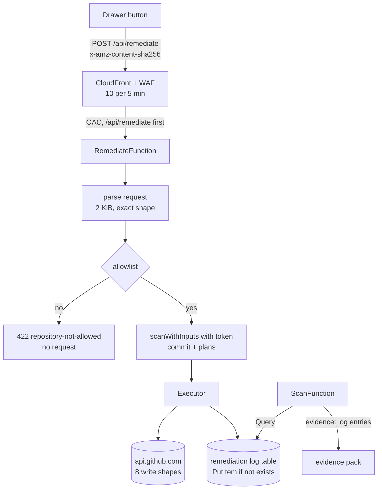

# Design Document: remediate

## Overview

Spec hosted-plans put remediation plans on the hosted scan. This spec opens them. A visitor who scans `hsiddhu2/sexton-demo` sees "Open pull request" under a proposed plan; pressing it sends `POST /api/remediate` with the repository and the package name only. A new function runs the hosted scan again with the token, takes the plan from its own scan, and opens one pull request on a `sexton/` branch through eight fixed GitHub requests. It posts one comment listing the review sites, appends one entry to a remediation log table, and answers with the pull request URL. The hosted evidence pack then shows the log.

Every other repository is refused before any request. The token HP stored can write only to sexton-demo, and the code enforces the allowlist as well. Nothing in this spec deletes, merges, force-pushes or touches a default branch.

### Research findings that shape the design

GitHub REST pages read on 21 Nov 2026. The fine-grained permission boxes did not appear in the fetched pages; the permissions come from the handoff's verified facts (Create an issue comment accepts Issues write or Pull requests write, https://docs.github.com/en/rest/issues/comments; the stored token has Contents read and write, Pull requests read and write, Metadata read, only on sexton-demo).

| Shape | Page | Success | Notes |
|---|---|---|---|
| GET /repos/{o}/{r} | https://docs.github.com/en/rest/repos/repos#get-a-repository | 200 | `default_branch` required string; 301, 403, 404 |
| GET /repos/{o}/{r}/git/matching-refs/{ref} | https://docs.github.com/en/rest/git/refs#list-matching-references | 200 | "If the :ref doesn't exist in the repository, but existing refs start with :ref, they will be returned as an array." Prefix match; case not stated, so the Executor compares lower-cased itself |
| GET /repos/{o}/{r}/pulls | https://docs.github.com/en/rest/pulls/pulls#list-pull-requests | 200 | `head` "in the format of user:ref-name"; `state` open, closed, all; `per_page` max 100 |
| GET /repos/{o}/{r}/contents/{path} | https://docs.github.com/en/rest/repos/contents#get-repository-content | 200 | `ref`; `content`, `encoding`, `sha`; all features at 1 MB or smaller |
| POST /repos/{o}/{r}/git/refs | https://docs.github.com/en/rest/git/refs#create-a-reference | 201 | `ref` must be fully qualified, `sha`; 409, 422 "Validation failed" |
| PUT /repos/{o}/{r}/contents/{path} | https://docs.github.com/en/rest/repos/contents#create-or-update-file-contents | 200 or 201 | `message`, `content` Base64, `sha` "The blob SHA of the file being replaced", `branch`; 404, 409, 422 |
| POST /repos/{o}/{r}/pulls | https://docs.github.com/en/rest/pulls/pulls#create-a-pull-request | 201 | `title`, `head`, `base`, `body`, `draft`; 403, 422 |
| POST /repos/{o}/{r}/issues/{n}/comments | https://docs.github.com/en/rest/issues/comments#create-an-issue-comment | 201 | `body`; 403, 404, 410, 422 |

- Permissions per shape: the fetched pages showed no fine-grained permission box. Expected from the token's scopes: GET repository, Metadata read; matching-refs and contents GET, Contents read; pulls GET, Pull requests read; create ref and contents PUT, Contents write; create pull, Pull requests write; issue comment on a pull request, Pull requests write (handoff fact). Deploy smoke check 2 exercises every shape against the real token.
- Review comments, https://docs.github.com/en/rest/pulls/comments: "Pull request review comments are comments made on a portion of the unified diff during a pull request review." The migration changes package.json only, so a stylesheet line is not in the diff and cannot take one. Decision 3 amends R-RM-7 accordingly.
- CloudFront OAC with a Lambda function URL, https://docs.aws.amazon.com/AmazonCloudFront/latest/DeveloperGuide/private-content-restricting-access-to-lambda.html: "If you use PUT or POST methods with your Lambda function URL, your users must compute the SHA256 of the body and include the payload hash value of the request body in the x-amz-content-sha256 header when sending the request to CloudFront. Lambda doesn't support unsigned payloads."
- Origin request policies, https://docs.aws.amazon.com/AmazonCloudFront/latest/DeveloperGuide/controlling-origin-requests.html: viewer headers are "not included in the origin request by default". No page states whether a policy may list an `x-amz-` header; the denylist at https://docs.aws.amazon.com/AmazonCloudFront/latest/DeveloperGuide/add-origin-custom-headers.html covers origin custom headers only. Decision 2.
- WAF rate-based rules, https://docs.aws.amazon.com/waf/latest/developerguide/waf-rule-statement-type-rate-based-high-level-settings.html: "The lowest limit setting allowed is 10." Windows 60, 120, 300 (default) and 600 seconds. A scope-down statement limits counting to matching requests. The new rule uses 10 per 300 s, the minimum.

## Architecture



Execution for one request (handoff decision 5): allowlist, scan with token, entry lookup, branch check, read package.json at the commit, apply edits, create branch at the commit, put package.json, open the pull request, review-site comment, log entry. A failure after the branch exists answers failed with the step and leaves the branch.

## Components and Interfaces

### Engine: remediation/apply-edits.ts (Requirement 1)

```ts
export type ApplyFailure = "invalid-json" | "not-an-object" | "section-not-object" | "name-absent";
export function applyPackageJsonEdits(text: string, edits: readonly PackageJsonEdit[]): { ok: true; text: string } | { ok: false; reason: ApplyFailure };
```

Parses with JSON.parse into an insertion-ordered object (own properties only; `__proto__` keys are copied with `Object.defineProperty`, so nothing reaches a prototype). Indentation from the first line that starts with whitespace: a tab, else 4 when it starts with four spaces, else 2. Serialises with `JSON.stringify(value, null, indent)` and appends `\n` when the input ended with one. Dependency sections in order: dependencies, devDependencies, optionalDependencies, peerDependencies. "Sorted" means the keys are in code-unit order; a section of zero or one key counts as sorted.

### API: remediate/allowlist.ts

`parseAllowlist(raw: string | undefined): ReadonlySet<string>` (lower-cased, trimmed, `owner/repo` shape only) and `isAllowed(set, repo)`.

### API: remediate/github-requests.ts (Requirement 2)

```ts
export type WriteRequest =
  | { kind: "get-repo" } | { kind: "list-sexton-refs" } | { kind: "list-pulls"; branch: string }
  | { kind: "get-package-json"; sha: string } | { kind: "create-ref"; branch: string; sha: string }
  | { kind: "put-package-json"; branch: string; message: string; contentBase64: string; blobSha: string }
  | { kind: "create-pull"; branch: string; base: string; title: string; body: string }
  | { kind: "create-comment"; number: number; body: string };
export function buildWriteRequest(repo: RepoRef, allow: ReadonlySet<string>, token: string, request: WriteRequest): { url: string; request: TransportRequest };
```

Throws on any invalid part (repository not allowed, token not a Token, SHA not 40 hex, branch not a valid Sexton branch, number not a positive safe integer, base not a valid branch name or a Sexton branch). Bodies are JSON with fixed keys. Every request has `redirect: "manual"`. The engine's `TransportRequest.method` widens from `GET | POST` to `GET | POST | PUT` for the contents PUT (Requirement 1.7); DELETE and PATCH stay out of the type. Reads go through `requestWithRetry` (429 and 503); writes are sent once, so an ambiguous 503 never creates a second branch or pull request.

### API: remediate/executor.ts (Requirements 3, 4)

```ts
export interface ExecutorDeps { ctx: ClientContext; token: string; allow: ReadonlySet<string>; log: RemediationLogWriter; clock: () => Date; remainingMs?: () => number; }
export async function execute(repo: RepoRef, commit: string, entry: RemediationEntry, deps): Promise<RemediateOutcome>;
```

Steps and their names: `repository`, `branch-check`, `read-package-json`, `apply-edits`, `create-branch`, `put-package-json`, `open-pull-request`, `review-sites`, `log`. An `applyPackageJsonEdits` failure answers failed at `apply-edits`. Before create-branch the Executor checks `remainingMs()` (the Lambda context's remaining time) and refuses below 20 s. A 422 from create-branch reruns the branch check: an open pull request answers existing; a collision without one answers refused "another request is opening this pull request, try again in a minute" (the other request holds the branch); no collision answers failed. The matching-refs prefix is case-sensitive, so the collision check sees `sexton/` refs in any letter case after the prefix; the `head` query value is URL-encoded and uses the matched ref's real name. Each response is checked for status and the exact fields used (`default_branch`, ref names, PR `number`, `html_url`, `state`, content `encoding` base64 and `sha`). A review-site failure leaves the pull request open and answers opened with `reviewSites.posted` 0.

### API: remediate/review-sites.ts (Requirement 4)

`reviewSiteComment(repo, sha, comments, treePaths): { body: string; posted: number; dropped: number } | null`. Tree paths come from the engine's `listTree` (a Read shape) at the commit. The body is a fixed heading, then one line per kept comment: a link whose text is `escapeField("path:line")` (a code span, so a path cannot break the Markdown or mention anyone) and whose URL has percent-encoded segments, then the engine-built comment body unchanged apart from `neutralise` and line breaks turned into spaces (the body is already fixed text plus an escaped excerpt). `posted` counts kept comments, listed or summarised in "and N more review sites were found".

### API: remediate/log-store.ts (Requirement 5)

`DynamoRemediationLog` over the existing DynamoPort: `append(entry)` writes `{repository, sk, branch, prUrl, package, kind, timestamp}` after `isValidLogEntry`, with `attribute_not_exists(repository)`; `list(repository)` queries the partition and keeps entries that pass `isValidLogEntry`. `PutOptions` gains `conditionKey` (default `pk`), so the condition names the table's own partition key.

### API: remediate/request.ts, response.ts, remediate-handler.ts, handlers/remediate.ts (Requirement 6)

The parser checks method, path, content-type (`application/json`, optional `; charset=utf-8`), base64 decoding, size, a key scanner that rejects a repeated key, exact keys, canonical URL and package name. Responses carry `content-type: application/json; charset=utf-8`, `cache-control: no-store`, `x-content-type-options: nosniff`, the request ID, and no `access-control-*` header. One log line `remediate` per request: status, outcome, step, logged, posted, dropped, durationMs. No repository, branch, URL or body.

### Scan and evidence (Requirement 7)

`ScanDeps` gains `allowlist?: ReadonlySet<string>` and `remediationLog?: { list(repository): Promise<readonly RemediationLogEntry[]> }`. The scan body gains `actions: { remediate }`. `evidence.ts` reads the log; a throw gives null and one warn line.

### Infra (Requirement 8)

Data: `RemediationLogTable` (TableV2). Edge: `RemediateRole`, `RemediateLogs`, `RemediateFunction`, its URL, a `RemediateOriginRequestPolicy`, a behavior `/api/remediate` added before `/api/*`, `RemediateRateLimit` in the web ACL, `REMEDIATE_ALLOWLIST` and `REMEDIATION_LOG_TABLE` on scan and remediate, `remediateCode` in the app. config.ts gains `REMEDIATE_ALLOWLIST`, `REMEDIATE_RATE_LIMIT`, `REMEDIATE_*` sizes and the table name.

### Web (Requirement 9)

`load/remediate-client.ts`: `requestRemediation(fetchFn, apiBase, repo, pkg)` builds the body, hashes it with `crypto.subtle.digest("SHA-256")`, POSTs, validates the response and the PR prefix. `Cemetery` passes an optional `onRemediate` to the Drawer only when the scan is hosted and `actions.remediate` is true. The Drawer shows the button, an in-flight state and a live region with the outcome.

## Data Models

```ts
// Log item, table sexton-remediation-log-dev
{ repository: S, sk: S /* timestamp#branch */, branch: S, prUrl: S, package: S, kind: S, timestamp: S }
// Request
{ repo: string; package: string }
// Response
{ status: "opened" | "existing" | "refused" | "failed"; prUrl?: string; reason?: string; step?: string; logged?: boolean; reviewSites?: { posted: number; dropped: number } }
// Scan response addition
actions?: { remediate: boolean }
```

## Error Handling

| Situation | Answer |
|---|---|
| Method other than POST | 405 |
| Bad content-type, body over 2 KiB, not JSON, extra, missing or repeated key, non-canonical URL, invalid name | 400 `invalid-request` |
| Repository not on the allowlist | 422 `repository-not-allowed`, no scan, no GitHub request |
| No token | 200 refused "GitHub token unavailable" |
| Scan fails or commit null | 200 refused "head commit unknown" or "the scan failed" |
| Plan not proposed or no intent | 200 refused "no pull request is proposed for this package" |
| Branch collision with an open pull request | 200 existing with its URL |
| Branch collision without one | 200 refused with the delete text |
| Edits change nothing | 200 refused "the change is already in package.json" |
| Edits cannot be applied | 200 failed at `apply-edits` |
| Less than 20 s left before create-branch | 200 refused "the scan took too long, try again" |
| create-branch 422 and a collision without an open pull request | 200 refused "another request is opening this pull request, try again in a minute" |
| create-branch 422 and no collision | 200 failed at `create-branch` |
| A GitHub step answers anything unexpected | 200 failed with the step |
| Log write fails after the pull request opened | 200 opened, logged false |
| Unexpected throw | 500 internal-error |
| Missing or wrong payload hash | Lambda answers 403, which the distribution turns into `index.html` with 200; the web client treats any body that is not the response shape as failed |

## Security

- Only an Allowed repository reaches the scan or GitHub. The check runs before anything else and again in the request builder.
- The client sends a URL and a name. The branch, title, body, edits and files come from the server's scan.
- The token travels only in the Authorization header of the eight Write shapes and the two Read shapes, to api.github.com, with no redirect followed.
- Bounded pull requests: one branch per package; while it exists, a new request answers existing or refused. At most 10 requests per 5 minutes per IP reach the function, and its reserved concurrency is 2.
- CSRF: the endpoint needs `content-type: application/json` and sends no CORS headers, so a cross-site form cannot send it and a cross-site script cannot read it. A cross-site `fetch` with that content type is a preflighted request that fails without CORS.
- Nothing deletes: no DELETE request exists in the builder; a failure leaves the branch.
- GitHub response bodies never reach a response or a log; only fields the Executor checks are used, and the pull request URL only after the prefix check.

## Dependencies

No new dependency.

## Testing Strategy

Vitest with fakes for the Transport, the Secret port, DynamoDB and GitHub. A fake GitHub keeps branches, files and pull requests in memory and answers the Write shapes. An end-to-end handler test opens a pull request, answers existing on the second call, and refuses a non-allowlisted repository with zero requests. Infra tests with assertions and cdk-nag. Web tests with Testing Library and axe; one Playwright test with a mocked endpoint.

## Correctness Properties

### Property 60: Only Write shapes on the allowed repository (1000 runs)

For any repository, package, token and fake GitHub answers, every request to api.github.com that the Executor's transport sends (the scan in the same run also calls registries, which carry no token) has host api.github.com, method and path of one Write or Read shape, the allowed owner and repository, and `redirect: "manual"`. Proves 2.1, 2.2.

### Property 61: Outside the allowlist, no request (1000 runs)

For any repository not on the allowlist and any body, the handler sends no request of any kind. Proves 3.1, 6.2.

### Property 62: The client body cannot steer the change (1000 runs)

For any extra text the client could control (the package name and URL within the accepted shape, and rejected extra fields), every branch, title, body, file content and comment sent equals what the server's own plan produces. Proves 3.3.

### Property 63: The token never leaks (1000 runs)

For any token and run, the token appears in no response, log line, log entry, error, URL or request body. Proves 2.4.

### Property 64: No DELETE, no default branch ref (1000 runs)

For any run, no request uses DELETE, no request path names `refs/heads/{default}`, and every create-ref and put targets a Sexton branch that differs from the default branch ignoring case. Proves 2.3.

### Property 65: A Branch collision never creates a branch

For any set of existing refs under `sexton/` that contains the intent branch in any letter case after the prefix, no create-ref request is sent. Proves 3.4.

### Property 66: applyPackageJsonEdits

For any package.json object and edits whose names exist where needed, the output parses, equals the expected object, keeps the other keys and their order, a second apply of set-range is unchanged and a second remove answers name-absent. Proves 1.3 to 1.6; examples prove the closed failure set of 1.2.

### Property 67: Every prUrl has the PR prefix

For any GitHub answer, a `prUrl` in a response starts with the PR prefix followed by digits. Proves 6.4.

### Property 68: Review-site validation

For any review comments and tree, every link in the posted comment is to a Safe path in the tree at the commit, every line is a positive integer or absent, at most 50 are listed, and posted plus dropped equals the input count. Proves 4.2 to 4.4.

## Requirement Traceability

| Requirement | Where | Test |
|---|---|---|
| 1 | apply-edits.ts | Property 66, examples |
| 2 | github-requests.ts | Properties 60, 63, 64 |
| 3 | executor.ts, remediate-handler.ts | Properties 61, 62, 65, end-to-end |
| 4 | review-sites.ts | Property 68 |
| 5 | log-store.ts, data-stack.ts | log examples, infra tests |
| 6 | request.ts, response.ts | Property 67, parser examples |
| 7 | scan.ts, evidence.ts | evidence and scan examples |
| 8 | infra/lib | iam, edge-stack, data-stack, nag tests, cdk diff |
| 9 | web | validator, drawer, axe, e2e |
| 10 | private/demo-repo, steering, docs | review |

## Decisions made during implementation

1. **The allowlist refusal answers 422, not 403.** The distribution maps origin 403 and 404 to `index.html` with 200 (spec infra), so a 403 would reach the browser as HTML. The same reason gave the missing-package.json 422 and the WAF 429. The smoke check expects 422.
2. **The handler does not require the `x-amz-content-sha256` header.** Lambda rejects a POST through OAC without a payload hash before the handler runs ("Lambda doesn't support unsigned payloads"), and no page says whether the header reaches the function event. The behaviour still forwards it in its origin request policy, as the handoff says, and the handler logs `bodyHash: true|false` so the first deploy shows it. If CloudFormation refuses an `x-amz-` header in the policy, the deploy rolls back; the runbook says to remove it from the policy and deploy again.
3. **R-RM-7 on the hosted path.** GitHub takes review comments only on lines of the pull request diff (https://docs.github.com/en/rest/pulls/comments), and the migration changes only package.json, so review sites are posted as one issue comment with links to the lines at the commit.
4. **`PutOptions.conditionKey`** names the partition key for the not-exists condition; the default stays `pk`, so the cache and snapshot stores are unchanged.
5. **The tree for review-site validation** is read with the engine's `listTree` (a Read shape from spec hosted-plans), cached under the commit.
6. **No log entry for existing.** Only a newly opened pull request is appended, so the log holds one entry per pull request.
7. **Reserved concurrency now totals 13** (scan 10, snapshotter 1, remediate 2): the first deploy of this spec needs unreserved concurrency of at least 102 before it (100 kept plus 2 new); the account showed 979.
8. **`isValidLogEntry` is a public engine export.** The API log store checks every entry with it before the write (handoff decision 7); the engine index test drops it from the "kept internal" list.
9. **The repository URL is lower-cased** after the allowlist check, so the scan, GitHub requests and log partition use one form; the evidence read uses the lower-cased URL too (spec review 1, note 3).
10. **A 20 second time check before create-branch** (spec review 1, note 7): a timeout after the branch exists would leave a branch that refuses every later request until deleted by hand.
11. **Steering file patterns.** pr-safety.md and api-etiquette.md gain `packages/api/src/remediate/**/*.ts` in their fileMatchPattern, so the rules load for the Executor (spec review 1, note 6).
12. **The remediate function reads the secret too**, superseding hosted-plans 8.2 and 8.3 for this function only; the snapshotter still never reads it (Requirement 8.5).
13. **The scan origin moves from Origin2 to Origin3.** CloudFront evaluates behaviors in order, so `/api/remediate` must come before `/api/*`; CDK numbers origins in behavior order, so the remediate function URL takes the Origin2 id and the scan function URL gets Origin3 with new Lambda permissions. cdk diff shows the two Origin2 permissions replaced. CloudFormation creates the replacements before it deletes the old ones, and every permission is scoped to the same distribution ARN, so the scan stays reachable during the update. The runbook's first smoke checks after the deploy cover it.
14. **One GitHub host string in the web app.** Requirement 2.18 of cemetery-ui keeps registry and GitHub hosts out of the web source, because the web app calls only its own API. The pull request link needs its prefix checked in the browser (Requirement 9.3), so `load/remediate-client.ts` holds exactly one constant with it; the imports test allows that line only. No request goes to it.
15. **Code review notes accepted as limits.** JSON.parse puts integer-like keys first, so a package named like `"2"` would move in its section, and CRLF line endings come back as LF; neither occurs in the demo repository. `list-pulls` reads 10 results with `state=all`, so more than 10 closed pull requests on one head could hide an open one and answer refused. A comment over 65536 characters cannot be built and is counted as not posted; engine-built bodies are far shorter. The e2e build sets `VITE_SEXTON_API` with POSIX shell syntax.
