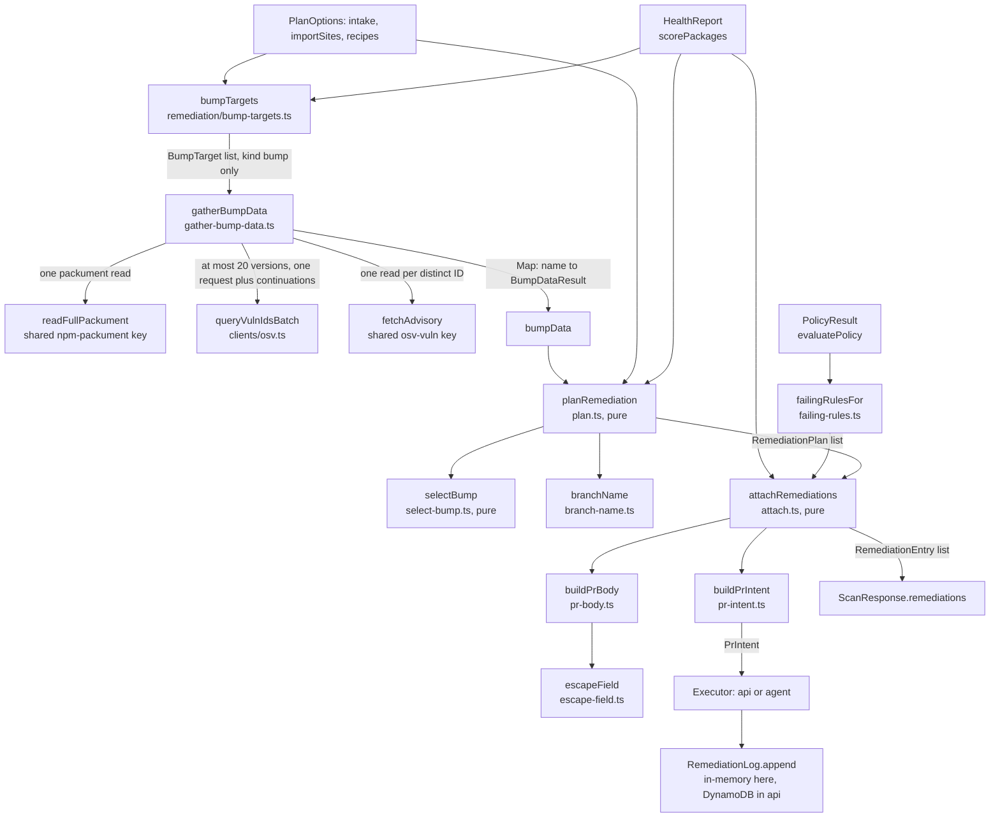
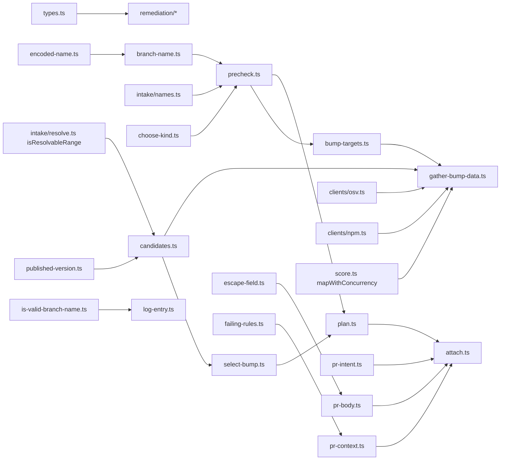

# Design Document: remediation

## Overview

remediation adds the planning half of R-RM-1 to R-RM-8 to `@sexton/engine`. For a scored report it returns one `RemediationPlan` for each package in state Haunted, Dead or Possessed. For a plan that can be carried out it also returns a PR intent: a branch name, a title, a Markdown body and one structured edit to `package.json`. An Executor (the api or the agent, through GitHub MCP) turns the intent into a branch, a commit and a pull request. The Engine never does that part.

The module has eleven parts, all under `packages/engine/src/remediation/`, one exported concept per file:

1. a bump selector (`selectBump`) over a candidate orderer (`orderCandidates`), both pure;
2. a bump data fetch (`gatherBumpData`) that reads the full packument and OSV through the existing Transport and Cache;
3. a pure kind chooser and pre-check (`chooseKind`, `precheck`, `bumpTargets`);
4. a pure branch-name encoder (`encodeName`, `branchName`, `isValidBranchName`);
5. the planner (`planRemediation`);
6. a PR intent builder (`buildPrIntent`);
7. a PR body builder (`buildPrBody`) over one escaping function (`escapeField`);
8. an empty Recipe registry (`EMPTY_RECIPE_REGISTRY`);
9. an append-only Remediation log (`RemediationLog`, `createInMemoryRemediationLog`);
10. `attachRemediations`, which builds the API `remediations` list;
11. one batched OSV function, `queryVulnIdsBatch`, in `clients/osv.ts`.

It also moves `RemediationEntry` into the Engine types, replaces the placeholder shape, and updates the web validator, the web list file and the tests that build entries.

Implements requirements 1 to 8 of this spec, which cover R-RM-1, R-RM-2, R-RM-3, R-RM-5, R-RM-6 and R-RM-8 on the engine side, R-SG-3, R-SG-7, R-SG-8 and R-SG-9 for the new reads, and N-2 in part. R-RM-4 and R-RM-7 (recipes) are a later spec. The planner is the N-8 property-tested "bump selector".

Out of scope: the node-sass to sass recipe and any other recipe, migration sections of the PR body, branch creation, commits, pull requests, merging, default-branch resolution, GitHub MCP calls, counting import sites, reading repository source, editing `package-lock.json`, a persistent log (DynamoDB belongs to the api), a user-facing control that opens a pull request, changes to the drawer, the CLI, the API handler or the agent. The Engine writes no file. The demo scan generator gains a `remediations` list (HP decision 13 and the owner's task 4, requirement 7.13).

### Names in the source that shape the design

The names in the requirements match the source. These details of the existing code shape the design:

- `IntakePackage` extends `PackageRef` with `declaredRange`, `origin` (`"dependencies" | "devDependencies"`) and `resolution`. `parsePackageJson` lists a name in `devDependencies` only when it is absent from `dependencies`, so a package in both has `origin: "dependencies"` (see Notes, item 3).
- `HealthReport`, `PackageHealth` (with `state`, `stateReason`, `signals`), `SIGNAL_NAMES` (ten names, original four then new six), `Advisory` and `Severity` (`Critical | High | Moderate | Low | Unknown`) are in `src/types.ts`. `PolicyResult`, `RuleResult` and `Failure` are there too. A `Failure` carries `name` and `reason`, so "Failing rule" is derivable from the policy result alone.
- `readFullPackument(ctx, name)` in `clients/npm.ts` reads the full packument under `cacheKey("npm-packument", name, "*")` and throws on failure. `extractDeprecated(packument, version)` reads `packument.versions[version]` with bracket access. This design reads packument fields with `Object.hasOwn` in its own helper and leaves `extractDeprecated` unchanged.
- `queryVulnIds` in `clients/osv.ts` sends a one-element `queries` array per version and caches under `cacheKey("osv-querybatch", name, version)`. Its stored value is the raw single-query response. The new batch function cannot reuse that key (see Decision 4). `fetchAdvisory(ctx, id)` reads `/v1/vulns/{id}` under `cacheKey("osv-vuln", id, "*")`. `OSV_MAX_PAGES` is 10.
- `cachedJson` throws on non-2xx. `CachedFetcher.get(key, fetch)` stores what `fetch` returns, stores nothing when it throws, and shares in-flight fetches. It has no public `set`, so a key can only be written by a fetch function passed to `get`.
- `requestWithRetry(transport, url, request, retry)` retries 429 and 503 at most three times and throws `UpstreamError` when retries run out. `UpstreamError.status` is the only upstream-derived value the planner may put in a reason.
- `describeFailure(error)` returns `error.message` for a generic `Error`. That message can contain upstream text, so this module does not use it for reasons (see Decision 7).
- `isValidPackageName`, `isResolvableRange` (valid semver range of at most 256 characters), `ENGINE_VERSION` and `mapWithConcurrency` (exported from `score.ts`, signature `(items, limit, fn)`) are reused unchanged.
- `packages/api/src/contract.ts` exports a runtime constant `REMEDIATION_KINDS`, which `api/test/contract.test.ts` imports, and a placeholder `RemediationEntry { packageName, kind, title, prBody }`. The file uses `import type` for everything else from `@sexton/engine`.
- `packages/web/src/load/lists.ts` holds literal copies of the contract lists and ties four of them to the contract with `Assert<Same<...>>`. `REMEDIATION_KINDS` is a literal copy with no tie. `validate-scan-response.ts` `checkRemediations` checks `packageName`, `title`, `prBody` and `kind` only.
- The tsconfig has `exactOptionalPropertyTypes` and `noUncheckedIndexedAccess`. Optional fields are therefore added by conditional spread, and `undefined` never appears in a result.
- Shared types go into the existing `src/types.ts` under a remediation heading, as the policy and repo-intake specs did.

### Research findings that shape the design

- **GitHub body limit.** A pull request body is limited to 65536 characters. The requirement sets 60000 as the ceiling. GitHub counts UTF-16 code units, so an astral character counts as two (see Notes, contradiction C6).
- **Git ref rules.** `git check-ref-format` ([git documentation](https://git-scm.com/docs/git-check-ref-format)) forbids, in a ref name: any component beginning with `.` or ending with `.lock`; `..`; an ASCII control character, DEL, space, `~`, `^`, `:`; `?`, `*`, `[`; a leading or trailing `/` or two consecutive `/`; a trailing `.`; the sequence `@{`; the single character `@`; and a backslash. `@` elsewhere in a name is valid, so `sexton/bump-@scope__name` is a valid ref. `{` alone is allowed by git, but requirement 4.5 forbids it, which is stricter and safe.
- **OSV `querybatch`.** The request body is `{ "queries": [ { "package": { "name", "ecosystem" }, "version", "page_token"? } ] }`. The response is `{ "results": [ ... ] }` with one result per query, in query order. A result is `{}` when there is no match, otherwise `{ "vulns": [ { "id", "modified" } ], "next_page_token"? }`. A continuation sends the same query with `page_token`. Severity is not in the response, so `/v1/vulns/{id}` is read ([OSV API](https://google.github.io/osv.dev/post-v1-querybatch/)). The recorded fixtures in `test/fixtures/packages/*/osv-querybatch.json` confirm the shape.
- **Markdown inline code.** In CommonMark and GitHub Flavored Markdown, text inside a code span is literal: no emphasis, link, image, HTML, entity or mention is parsed. A code span ends at the next backtick run of the same length, so removing backticks from the content makes the span unbreakable. Inside a GFM table cell, a pipe must be written `\|` even in a code span, or the cell splits. A code span holding only one space renders as a space; an empty pair of backticks does not render as a span.
- **semver 7.8.6.** `valid(v) === v` is "equal to its own normalised form". `prerelease(v)` returns `null` for a release. `satisfies(v, range)` returns false for a prerelease unless the range names one, and throws for an invalid range, so every call is guarded. `minVersion("^1.2.3")` is `1.2.3`, used by the test for requirement 4.14.
- **No new library is needed.** Candidate ordering, range tests, branch encoding and escaping are small pure functions over `semver` (already a runtime dependency) and the language.

## Architecture





Design decisions:

1. **Plan, describe, never act.** Everything in `remediation/` except `gatherBumpData` is a pure function. `gatherBumpData` is the only module that touches a Transport, and only for packages that will be bumped. Nothing creates a branch, writes a file or calls GitHub. The intent names `baseRef: "@default"` and a branch of its own, so the Executor can never be told to push to an existing branch.
2. **One pre-check shared by planner and fetcher.** `precheck` decides, from the report entry, the options and the intake list, whether a package can be planned and what its kind is. `planRemediation` uses it to set `unavailable` statuses. `bumpTargets` uses the same function to decide which packages get any upstream request. A package that the planner would mark `unavailable` before bump data is therefore never fetched (requirements 1.10, 2.17, 8.2).
3. **Candidate order is one function.** `orderCandidates` is used by the selector and by the fetcher, so the versions OSV is asked about are exactly the versions the selector evaluates (2.4, 2.17). The selector never evaluates a version the fetcher did not read.
4. **The batch OSV result is cached as a unit.** `queryVulnIdsBatch` wraps its whole paged exchange in one `ctx.cache.get`, under the key `osv-querybatch-multi|{name}|{versions joined by ","}`. A hit costs no request (2.21, R-SG-7). The existing per-version `osv-querybatch` key is not reused, because its stored value is a raw single-query response and one batch cannot be split into those without a cache `set` that `CachedFetcher` does not offer. Details come from the existing `osv-vuln` key, so an advisory read during scoring costs nothing more (2.20). See Components for the key's limits.
5. **One escaping function, one choke point.** Every string that comes from a repository or an upstream passes through `escapeField` before it enters a body, and `escapeField` always returns an inline code span. No heading, list or table cell is built from input text. A Declared range never reaches the body at all (5.9).
6. **Branch names are an injective encoding, not a sanitiser.** `encodeName` escapes `/`, `_`, `~` and certain dots with `_`-prefixed two-character tokens. Because a raw `_` never appears in the output, decoding is unambiguous, so distinct names give distinct branches (4.4, 4.7).
7. **Reasons are fixed text.** A plan `reason` is chosen from a closed set of templates whose only variable parts are integers and HTTP statuses. A thrown error message is never copied. This is what gives the "no echo" property for reasons, summaries and log rejections.
8. **Failure degrades one plan.** `gatherBumpData` catches everything per package and returns `{ ok: false, reason }` for that package. The planner turns it into `unavailable`. Other packages are unaffected (N-4, 2.22).
9. **The log is a two-method interface.** `append` and `list`, nothing else, so no implementation can offer update or delete through this contract (6.2). Entries are copied in and frozen out.
10. **`RemediationEntry` moves to the Engine; the contract re-exports it.** The Engine depends on nothing internal, and `attachRemediations` must return the type. The api and the web read the shape from `contract.ts`, as they already do for `PolicyResult`.

## Components and Interfaces

All paths are under `packages/engine/` and relative to `src/` unless stated.

### types.ts additions (Requirements 1, 2, 4, 6, 7)

Listed under Data Models.

### remediation/published-version.ts (Requirements 2.2, 2.3, 8.4, pure)

```ts
export const MAX_VERSION_LENGTH = 64;
/** True iff v is a string, valid semver, equal to its own normalised form, and at most 64 characters. */
export function isPublishedVersion(v: unknown): v is string;
```

`typeof v === "string" && v.length <= 64 && semver.valid(v) === v`, inside `try/catch` returning false. This is the only test a version must pass before it enters an Edit, a title, a cache key or a request (8.4).

### remediation/candidates.ts (Requirements 2.2 to 2.4, 2.12, pure)

```ts
export const MAX_CANDIDATES = 20;
export interface Candidate { readonly version: string; readonly inRange: boolean }
/** Candidates in Candidate order, cut to the first 20. Total: never throws. */
export function orderCandidates(installedVersion: string, declaredRange: string | undefined, published: readonly string[]): readonly Candidate[];
```

1. If `semver.valid(installedVersion) !== installedVersion`, return `[]`.
2. `rangeUsable = declaredRange !== undefined && isResolvableRange(declaredRange)`. When false, every candidate has `inRange: false` (2.12). Otherwise `inRange = safeSatisfies(v, declaredRange)`, where `safeSatisfies` wraps `semver.satisfies` in `try/catch` and returns false on a throw. `prereleaseRange = rangeUsable && hasPrereleaseComparator(declaredRange)`, where `hasPrereleaseComparator` walks `new semver.Range(range).set` inside `try/catch` and is true when any comparator's `semver.prerelease.length > 0` (HP decision 1).
3. Keep `v` of `published` where `isPublishedVersion(v)`, `semver.gt(v, installedVersion)`, and either `semver.prerelease(v) === null` or (`prereleaseRange` and `inRange(v)`). Drop repeats (a `Set`). A prerelease installed version is allowed; `2.0.0` is greater than `2.0.0-beta.1`. `semver.satisfies` with default options already admits a prerelease only on the same `[major, minor, patch]` tuple as a prerelease comparator, so the prerelease candidates are exactly the ones npm would install for that range.
4. Sort the in-range group, then the out-of-range group, each by `semver.compare` ascending with ties broken by UTF-16 code-unit order of the string (the glossary's Candidate order).
5. Concatenate in-range then out-of-range and return the first 20.

Input order cannot affect the result: the set removes repeats, and the sort has a total order (2.14).

### remediation/select-bump.ts (Requirement 2.1 to 2.16, pure)

```ts
export interface SelectBumpInput {
  readonly installedVersion: string;
  readonly declaredRange?: string;
  readonly published: readonly string[];
  readonly deprecated: ReadonlySet<string>;
  readonly advisories: ReadonlyMap<string, readonly Advisory[]>;
}
export type SelectBumpResult =
  | { readonly outcome: "chosen"; readonly version: string; readonly majorUpgrade: boolean; readonly style: RangeStyle; readonly evaluated: number }
  | { readonly outcome: "none"; readonly evaluated: number };
export function selectBump(input: SelectBumpInput): SelectBumpResult;
```

`candidates = orderCandidates(...)`. The result also carries `style`, the Range style of the Declared range (see `range-style.ts`), so the planner never reads the range again. A candidate passes iff `!deprecated.has(v)`, `advisories.get(v)` is defined (2.8) and every advisory severity is `"Low"` (so Critical, High, Moderate and Unknown fail, 2.6 and 2.7). The first passing candidate in order is chosen, with `majorUpgrade = !candidate.inRange` (2.11). `evaluated` is the number of candidates examined: the position of the chosen one, or `candidates.length` for `none`. The function reads no clock, makes no request, and its whole body is in `try/catch` returning `{ outcome: "none", evaluated: 0 }` if a hostile `ReadonlySet` or `ReadonlyMap` throws (2.16).

### remediation/range-style.ts (Requirements 4.13, 4.14, 5.5, 8.5, pure, HP decision 4)

```ts
export type RangeStyle = "exact" | "tilde" | "caret";
/** The operator form of a Declared range. Total: an absent, unusable or compound range is "caret". */
export function rangeStyle(declaredRange: string | undefined): RangeStyle;
/** The new range for a chosen Published version in a style. */
export function styledRange(style: RangeStyle, version: string): string;
```

`rangeStyle` returns `"caret"` unless the range is usable (`isResolvableRange`). It then trims the range to `t` and tests `t` in this order. `exact`: `t` with a leading `=` and spaces removed is accepted by `semver.valid` and holds no space or `|` (`1.2.3`, `=1.2.3`, `v1.2.3`). `tilde`: `t` matches `^~>?\s*[^\s|<>=~^]+$` (`~1.2.3`, `~1.2`, `~>1.2.3`). `caret` is the default, so `^1.2.3` and every other form (`>=1.2.0`, `1.x`, `*`, `""`, a hyphen range, `||`, two comparators) is `"caret"`. `styledRange` returns `version`, `~version` or `^version`. For any Published version `v` and any style, `semver.validRange(styledRange(style, v))` is not null and `semver.minVersion(...)` is `v` (4.14). The range text itself is used only for these tests and is never copied (8.5).

### remediation/read-published.ts (Requirements 2.17, 8.6, 8.7, pure)

```ts
export interface PublishedVersions { readonly versions: readonly string[]; readonly deprecated: ReadonlySet<string> }
/** Reads versions and deprecations from a packument by own-property access. Returns null when there is no versions object. */
export function readPublished(packument: unknown): PublishedVersions | null;
```

Returns `null` unless the packument is a plain object that has an own `versions` property holding a plain object. For each own key `k` of `versions` that passes `isPublishedVersion`, it records `k`, and records `k` as deprecated when `Object.hasOwn(versions, k)`, the entry is a plain object that has an own `deprecated`, and that value is a non-empty string (the same meaning as `extractDeprecated`). Keys such as `constructor` or `__proto__` fail `isPublishedVersion` and are ignored. It copies no packument object into its result.

### clients/osv.ts addition (Requirements 2.18 to 2.22, 8.6)

The existing exports `queryVulnIds`, `fetchAdvisory`, `fetchAdvisoriesSignal`, `OSV_API`, `OSV_QUERY_SOURCE`, `OSV_VULN_SOURCE`, `OSV_MAX_PAGES` are unchanged. One function and one constant are added:

```ts
export const OSV_BATCH_SOURCE = "osv-querybatch-multi";
/**
 * Advisory IDs for several versions of one package, in at most OSV_MAX_PAGES querybatch requests in total.
 * One entry per input version, in input order. Throws on any failure so the cache stores nothing.
 */
export function queryVulnIdsBatch(ctx: ClientContext, name: string, versions: readonly string[]): Promise<ReadonlyMap<string, readonly string[]>>;
```

Behaviour:

1. `versions` empty: return an empty map without a request. Otherwise every version must satisfy `isPublishedVersion` and the list must have no repeats, else throw (a programming error, never reached from `gatherBumpData`).
2. **Cache.** `key = cacheKey(OSV_BATCH_SOURCE, name, versions.join(","))`. At most 20 versions of at most 64 characters give a key under 1400 characters. The whole exchange below runs inside `ctx.cache.get(key, fetch)`. The stored value is a JSON array of `[version, ids]` pairs, not an object, so a version string can never act as a property name. On a hit the pairs are validated (array of two-element arrays, a string and an array of strings) and a malformed stored value throws. The key has one known limit: a new release changes the candidate list and so the key, and the old entry expires by TTL (see Notes, item 17).
3. **Initial request.** One `POST ${OSV_API}/querybatch` with body `JSON.stringify({ queries: versions.map(version => ({ package: { name, ecosystem: "npm" }, version })) })`, headers `Accept` and `Content-Type: application/json`, through `requestWithRetry(ctx.transport, url, request, ctx.retry ?? {})`. A non-2xx status throws `UpstreamError`.
4. **Reading a response.** The body must be a plain object whose `results` is an array with exactly as many entries as the request had queries, else throw `"querybatch response is malformed"`. Result `i` belongs to query `i`. A result that is not a plain object is treated as no match only when it is `{}`-like (an object); any other type throws. Each entry of `vulns` must be a plain object with a string `id` that is a plausible advisory ID (1 to 128 characters of `[A-Za-z0-9._:-]`); an implausible ID throws. A plausible rule is used because a dropped ID would hide an advisory, which would make the selector more permissive. `next_page_token` counts only when a non-empty string.
5. **Continuations.** While any result carries a token and fewer than `OSV_MAX_PAGES` requests have been sent, send one more request whose `queries` holds only the queries that had a token, each carrying `page_token`. Results map back to versions by position. IDs are appended in arrival order and de-duplicated per version. When a token remains after the tenth request, throw `"querybatch pagination did not finish"` (2.22). When no result carries a token the function has sent exactly one request (2.19).
6. The function logs nothing and sends no `Authorization` or `Cookie` header (8.9).

### remediation/gather-bump-data.ts (Requirements 2.17 to 2.24)

```ts
export const BUMP_CONCURRENCY = 8;
export interface BumpTarget { readonly name: string; readonly installedVersion: string; readonly declaredRange?: string }
export interface BumpData {
  readonly ok: true;
  readonly published: readonly string[];
  readonly deprecated: ReadonlySet<string>;
  readonly advisories: ReadonlyMap<string, readonly Advisory[]>;
}
export interface BumpFailure { readonly ok: false; readonly reason: string }
export type BumpDataResult = BumpData | BumpFailure;
/** Never rejects. One entry per target name. */
export function gatherBumpData(ctx: ClientContext, targets: readonly BumpTarget[]): Promise<ReadonlyMap<string, BumpDataResult>>;
```

`targets` come from `bumpTargets`, which already applied the pre-check, so the function makes no kind decision. It still re-checks `isValidPackageName(name)` and `semver.valid(installed) === installed` and returns a failure without a request when either fails (8.2, 8.4). A repeated name keeps the first target.

Per target, run through `mapWithConcurrency(targets, BUMP_CONCURRENCY, ...)`, each inside a `try/catch` that converts any throw into a `BumpFailure`:

1. `packument = await readFullPackument(ctx, name)`. One request, shared with scoring through the `npm-packument` key (2.17, 2.21).
2. `published = readPublished(packument)`. `null` gives failure `"packument has no versions"`.
3. `candidates = orderCandidates(installed, declaredRange, published.versions)`. No candidates: return `ok: true` with an empty advisory map and no OSV request.
4. `idsByVersion = await queryVulnIdsBatch(ctx, name, candidates.map(c => c.version))`. One request unless pagination continues.
5. `distinct` = the distinct IDs across all candidates. Read each with `fetchAdvisory(ctx, id)` through `mapWithConcurrency(distinct, BUMP_CONCURRENCY, ...)`, so an ID shared by several versions is fetched once (2.20). Build `advisories: Map<version, Advisory[]>` with an entry for every candidate (an empty array for a candidate with no IDs).
6. Return `{ ok: true, published: published.versions, deprecated: published.deprecated, advisories }`.

Failure reasons come from a closed set. `reasonFor(error, stage)` returns `"{stage} failed (HTTP {status})"` for an `UpstreamError`, and otherwise `"{stage} failed"` or `"{stage} response is malformed"`, where `stage` is one of `"packument request"`, `"OSV querybatch"`, `"OSV advisory detail"`. The error message is not used (Decision 7). The retry, User-Agent and cache behaviour all come from `ctx`, so the module adds no header and no retry logic (2.23).

### remediation/choose-kind.ts (Requirements 1.4 to 1.8, 3.2, pure)

```ts
export function chooseKind(name: string, options: Pick<PlanOptions, "importSites" | "recipes">): RemediationKind;
```

`recipes.has(name)` gives `"migrate"`. Otherwise `importSites?.get(name) === 0` gives `"remove"`. Otherwise `"bump"`. A value that is `NaN`, negative, fractional, a string or missing is never `=== 0`, so it falls through to `"bump"` (1.7). `importSites` is a `ReadonlyMap`, so a package named `constructor` is an ordinary key (8.6). `recipes` defaults to `EMPTY_RECIPE_REGISTRY` (1.5).

### remediation/precheck.ts (Requirements 1.9, 1.10, 8.2, pure)

```ts
export type PrecheckResult =
  | { readonly ok: true; readonly kind: RemediationKind; readonly intake: IntakePackage | undefined; readonly branch: string | null }
  | { readonly ok: false; readonly kind: RemediationKind; readonly reason: string };
export function precheck(pkg: PackageHealth, options: PlanOptions, intakeByName: ReadonlyMap<string, IntakePackage>): PrecheckResult;
```

The checks run in this order and the first failure wins. The order is the design's answer to requirement 1.10 and 8.2 together:

1. `isValidPackageName(pkg.name)` fails: `reason = "package name is not a valid npm package name"`.
2. Kind is `migrate`: ok (no Edit, so no intake entry and no branch are needed, 1.6).
3. No intake entry for the name: `reason = "no intake entry for this package, so the section of package.json is unknown"`.
4. `branchName(kind, name) === null`: `reason = "branch name too long"` (see Notes, C1).
5. Otherwise ok, with the intake entry and the branch.

`kind` is returned in every case, so a plan for an invalid name still carries the kind the options imply.

### remediation/bump-targets.ts (Requirements 2.17, 3.6, pure)

```ts
export function bumpTargets(report: HealthReport, options: PlanOptions): readonly BumpTarget[];
```

For each package of the report in an Unhealthy state whose `precheck` is ok with kind `bump`, and whose installed version satisfies `semver.valid(v) === v`, emit `{ name, installedVersion, declaredRange }` (the range from the intake entry; the key is absent when the entry has none). Packages in state Restless or Alive, packages of kind `remove` or `migrate`, packages with an invalid name, no intake entry or an over-long branch name give no target, so they cost no request (2.17, 3.6).

### remediation/encoded-name.ts (Requirements 4.4, 4.7, pure)

```ts
/** Escapes: "/" to "__", "_" to "_u", "~" to "_t", and "." to "_d" when it touches another ".", is last, or is the dot of a final ".lock". */
export function encodeName(name: string): string;
/** The inverse. Returns null for text that encodeName cannot have produced. */
export function decodeName(encoded: string): string | null;
```

`encodeName` walks the name once. For a `.` at index `i`, it is escaped when `name[i-1] === "."`, `name[i+1] === "."`, `i === name.length - 1`, or `name.endsWith(".lock") && i === name.length - 5`. Every other character is kept. The output never holds a raw `_`: every `_` starts a two-character token (`__`, `_u`, `_t`, `_d`). `decodeName` reads tokens left to right, so decoding is unambiguous, and it returns `null` when it meets a lone `_` or an unknown token. That gives requirement 4.7's round trip and injectivity. The escaped dots make `..`, a trailing `.` and a final `.lock` impossible, and `~` and `/` never appear.

### remediation/is-valid-branch-name.ts (Requirement 4.5, pure)

```ts
/** git check-ref-format --branch rules, as a pure predicate. */
export function isValidBranchName(ref: string): boolean;
```

False when the string is empty, equals `@`, begins or ends with `/`, ends with `.`, contains `//`, `..`, `@{`, or any of space, `~`, `^`, `:`, `?`, `*`, `[`, `\`, `{`, a control character (U+0000 to U+001F, U+007F). It splits on `/` and is false when any component is empty, begins with `.` or ends with `.lock`. It is the predicate property 8 and the log validation use. Requirement 4.5 adds `{` to git's own list, so the predicate is stricter than git and any string it accepts is accepted by git.

### remediation/branch-name.ts (Requirements 4.2, 4.3, 4.6, 4.8, 4.9, 8.3, pure)

```ts
export const BRANCH_PREFIX = "sexton/";
export const MAX_BRANCH_LENGTH = 200;
export function branchName(kind: RemediationKind, name: string): string | null;
```

Returns `null` when `kind` is not in `REMEDIATION_KINDS`, when `isValidPackageName(name)` is false, or when the result is longer than 200 characters. Otherwise `` `sexton/${kind}-${encodeName(name)}` ``. Example: `branchName("bump", "@scope/name")` is `sexton/bump-@scope__name`. A name of 214 characters made only of `_` encodes to 428 and returns `null`. The kind sits before the first `-` after `sexton/` and no kind contains `-`, so the kind is recovered by splitting there (4.8).

### remediation/recipes.ts (Requirements 1.5, 1.6)

```ts
export type RecipeRegistry = ReadonlyMap<string, Recipe>;
export const EMPTY_RECIPE_REGISTRY: RecipeRegistry; // new Map(), no entries
```

`Recipe` is `{ readonly id: string }` for now. The recipe spec extends it with the edits and the review-site rules; the planner reads only `has(name)`.

### remediation/plan.ts (Requirements 1, 3.1 to 3.6)

```ts
export interface PlanOptions {
  readonly intake?: readonly IntakePackage[];
  readonly importSites?: ReadonlyMap<string, number>;
  readonly recipes?: RecipeRegistry;
  readonly bumpData?: ReadonlyMap<string, BumpDataResult>;
}
export function planRemediation(report: HealthReport, options?: PlanOptions): readonly RemediationPlan[];
```

1. Build `intakeByName`, a `Map` from name to `IntakePackage`; a repeated name keeps the first.
2. For each package of `report.packages` in order, skip it unless `state` is Possessed, Dead or Haunted (1.2). A repeated package name in the report is skipped after the first, so plan names are distinct (1.3).
3. `precheck`. On failure return the plan `{ ..., kind, status: "unavailable", reason }` with no Edit.
4. Kind `migrate`: `status: "proposed"`, no Edit, no chosen version (1.6).
5. Kind `remove`: `status: "proposed"` and `edit = { path: "package.json", op: "remove-dependency", section: intake.origin, name }` (3.1, 3.3).
6. Kind `bump`: if `semver.valid(installedVersion) !== installedVersion`, `unavailable` with `"installed version is not a valid semver version"`. Else look up `options.bumpData?.get(name)`: missing gives `unavailable` with `"bump data was not gathered"`; a `BumpFailure` gives `unavailable` with `"bump data unavailable: " + failure.reason`. Else call `selectBump` with the intake entry's `declaredRange`. `chosen` gives `proposed` with `chosenVersion`, `majorUpgrade` and `edit = { path: "package.json", op: "set-range", section: intake.origin, name, range: styledRange(result.style, chosenVersion) }` (4.13, HP decision 4). `none` gives `no-safe-version` with `reason = "no safe version found among " + evaluated + " evaluated candidate versions"` and no Edit (2.13, HP decision 3).
7. Each plan carries `packageName`, `installedVersion`, `state` and `stateReason` from its own report entry. A plan reads only its own report entry, intake entry, Import sites value, Recipe and Bump data, so the other packages cannot change it (1.11). The function has no `try/catch` around its own logic because every callee is total; a defensive catch would hide an engine bug. It does not mutate `report` or `options` (1.13) and reads no clock (1.12).

### remediation/failing-rules.ts (Requirements 5.13, 7.6, pure)

```ts
export function failingRulesFor(policy: PolicyResult, packageName: string): readonly FailingRule[];
```

For each `RuleResult` in order with `pass === false` that has a `Failure` whose `name === packageName`, emit `{ index, type, name?, reason }` where `reason` is that failure's `reason`. It reads the policy result alone (7.6) and returns `[]` for a package no rule names.

### remediation/escape-field.ts (Requirements 5.6, 5.17, pure)

```ts
export const ESCAPE_MAX_CODE_POINTS = 200;
export function escapeField(value: string): string;
```

Steps, in this order (escape first, then truncate, as 5.6 states):

1. If `value` is not a string, treat it as `""`. Replace each lone surrogate with U+FFFD.
2. Replace every character matching `[\p{Cc}\u2028\u2029\u202A-\u202E\u2066-\u2069]` with one space.
3. Replace every backtick with an apostrophe.
4. Split into units by code point. A `|` becomes one unit `\|` that costs two code points. Every other code point is one unit of cost one.
5. Take units while the running cost stays at or below `ESCAPE_MAX_CODE_POINTS` (200). If any unit was left out, append `…` to the kept text. A `\|` unit is never split, so no half escape is left.
6. If the kept text is empty, use a single space.
7. Return the text between two backticks.

The result is at most 200 + 1 + 2 = 203 code points. It holds no newline, exactly two backticks (the delimiters), and every `|` in it follows a `\`. Two calls return the same string. The function is the only way any text from outside the engine enters a PR body.

### remediation/clean-line.ts (Requirement 7.4, pure)

```ts
export function cleanLine(value: string, maxCodePoints: number): string;
```

Steps 1, 2 and 5 of `escapeField` without the backtick, pipe or span rules: replace control and bidi characters with a space, cut to `maxCodePoints` code points with a final `…` when cut. It builds `RemediationEntry.summary` and the no-change `title`, which are plain one-line text shown by the web as text, never Markdown. It is applied to names that failed `isValidPackageName`, which is the only way an uncontrolled string can reach those two fields.

### remediation/pr-context.ts (Requirements 5.1, 7.7, pure)

```ts
export function buildPrContext(report: HealthReport, policy: PolicyResult, packageName: string): PrContext | null;
```

Returns `{ entry, failingRules, generatedAt: report.generatedAt, engineVersion: ENGINE_VERSION }`, where `entry` is the report package with that name (the first one), or `null` when the report has no such package.

### remediation/pr-intent.ts (Requirement 4)

```ts
export const BASE_REF_DEFAULT = "@default";
export function buildPrIntent(plan: RemediationPlan, context: PrContext): PrIntent | null;
```

Returns `null` unless `plan.status === "proposed"`, `plan.kind` is `bump` or `remove`, and `plan.edit` exists. Otherwise `branch = branchName(plan.kind, plan.packageName)` (`null` again gives `null`), `title` as below cut to 200 characters, `body = buildPrBody(plan, context)`, `files = [plan.edit]` and `baseRef = BASE_REF_DEFAULT`. Titles: `Sexton: bump {name} to {chosenVersion}` and `Sexton: remove unused {name}`. Both are built only from a Valid package name and a Published version, because the plan's status was reached through `precheck` and `selectBump`. The intent holds no file text and no `content` field (4.12).

### remediation/pr-body.ts (Requirement 5)

```ts
export const MAX_BODY_CHARS = 60000;
export const LIST_LIMIT = 20;
export const REDUCED_LIST_LIMIT = 5;
export function buildPrBody(plan: RemediationPlan, context: PrContext): string;
```

The body has these parts, in this order (5.2). `F(x)` means `escapeField(x)`; every other piece is fixed text.

```
# Sexton remediation

**Package:** F(name) F(installedVersion)
**State:** F(state) F(stateReason)
> **Warning:** ...fixed Possessed text...                      <- only when state is Possessed

## Signals

| Signal | Value | Source | Fetched at |
|---|---|---|---|
| F(signalName) | rendered value | F(source) | F(fetchedAt) |   <- ten rows, SIGNAL_NAMES order

## Proposed change

...fixed lines and F(...) for the kind, versions and range, or "No change proposed" and F(reason)...

## Failing policy rules

1. rule F(index) F(type) F(name) F(reason)     <- up to LIST_LIMIT, then "and N more"; fixed "No policy rule fails for this package." when none

## Lockfile                                      <- only for a proposed bump or remove

`package-lock.json` is not changed ... run `npm install` on this branch before `npm ci` works.

---
Generated by Sexton F(engineVersion) from a scan at F(generatedAt).
```

Rules of rendering:

- **Signal cells (5.3, 5.7).** For an unavailable signal the cell is the fixed word `unavailable` and `F(reason)`. For an available signal the cell is a one-line rendering: a scalar value is one `F(...)`; a list signal (`advisories`, `maintainers`, `maintainerChange`, `newInstallScript`) renders up to the list limit items, each item one or two `F(...)` calls joined by a fixed space, items joined by `; `, and the fixed text `and N more` for the rest. An advisory item is `F(id)` then the severity word then `F(summary)`. A `maintainerChange` event is one item: `F("{kind} {eventTime}: {before joined by ", "} -> {after joined by ", "}")`, so the item is one capped field however long the lists are. The rendering of the other signals follows their value shapes (`transitiveReach` as `reach` and `graphsMissing`, `provenance` as `present` and `predicateType`, `provenanceRegression` by `status`).
- **Declared range (5.9, 5.10).** The body reads no `declaredRange` and no string from the repository other than package names and versions. The plan holds none, and `PrContext` carries none. The "Major upgrade" line is fixed text: `Major upgrade: the chosen version is outside the declared range`.
- **No HTML, links, images (5.8).** The only `http` text is a `source` inside a code span.
- **Possessed (5.12).** The warning line is present iff `plan.state === "Possessed"`.
- **Failing rules (5.13).** Items come from `context.failingRules` in order, `1.` to `20.` with the rule's own `index`, type, optional name and reason. More than 20 give `and N more`. When none, the fixed sentence.
- **Lockfile note (5.14).** Present when `status === "proposed"` and `kind` is `bump` or `remove` (HP decision 6). Fixed text, so it contains no input.
- **Proposed change (5.5).** A bump renders `Bump F(name) from F(installed) to F(chosen).`, the fixed line `Range style preserved.`, and the fixed Major upgrade line when `majorUpgrade` is true. Neither the old range nor the new range is printed (HP decision 4). A remove renders `Remove F(name), listed in F(section).` and the fixed line `The edit removes it from dependencies and devDependencies in package.json.` (HP decision 7; wording of spec remediation-remove-scope). A migrate renders the fixed line that a migration is proposed and its changes come from the recipe.
- **Size (5.15).** Render with `LIST_LIMIT`. If the string is longer than `MAX_BODY_CHARS` UTF-16 units, render again with `REDUCED_LIST_LIMIT` (5). The reduced render is bounded below the limit by arithmetic (see Data Models, "Body size") and a property asserts it.
- **Determinism (5.16).** The only times in the body are `context.generatedAt` and the signals' `fetchedAt` values. The function reads no clock, no environment and no random source.

### remediation/log-entry.ts and remediation/remediation-log.ts (Requirement 6)

```ts
export function isValidLogEntry(entry: unknown): entry is RemediationLogEntry;
export type AppendResult = { readonly ok: true } | { readonly ok: false; readonly reason: string };
export interface RemediationLog {
  append(entry: RemediationLogEntry): Promise<AppendResult>;
  list(): Promise<readonly RemediationLogEntry[]>;
}
export const LOG_REJECTED_REASON = "log entry rejected: it does not satisfy the entry rules";
```

`isValidLogEntry` accepts a plain object with exactly these string-typed fields and no others of significance: `repository` such that `parseRepoUrl(repository)` is ok and its `url` equals `repository` (Canonical URL); `branch` that starts with `sexton/` and satisfies `isValidBranchName` and is at most 200 characters; `prUrl` that starts with `https://`, is at most 2048 characters and holds no whitespace or control character; `package` that satisfies `isValidPackageName`; `kind` in `REMEDIATION_KINDS`; `timestamp` that matches `^\d{4}-\d{2}-\d{2}T\d{2}:\d{2}:\d{2}(\.\d{1,9})?(Z|[+-]\d{2}:\d{2})$` and for which `Date.parse` is finite. It never throws.

### remediation/in-memory-log.ts (Requirement 6.3 to 6.8)

```ts
export function createInMemoryRemediationLog(): RemediationLog;
```

Keeps a private array. `append` runs `isValidLogEntry`; when false it returns `{ ok: false, reason: LOG_REJECTED_REASON }` and changes nothing (6.4, 6.8). When true it pushes a frozen copy built from the six named fields and resolves `{ ok: true }`. `list` returns `Object.freeze(entries.slice())`, a new frozen array of the same frozen entries, so a caller cannot change the log through the list or through an entry (6.7). There is no method to update, replace, delete or clear (6.2).

### remediation/attach.ts (Requirement 7.2 to 7.9)

```ts
export function attachRemediations(report: HealthReport, policyResult: PolicyResult, plans: readonly RemediationPlan[]): RemediationEntry[];
```

For each plan in order: skip it when `plan.packageName` was already emitted (first wins; see Notes, C9). `context = buildPrContext(report, policyResult, plan.packageName)`; `null` skips the plan (7.7). `intent = buildPrIntent(plan, context)`. The entry is built from named fields only:

```ts
{ packageName, kind, status,
  title: intent?.title ?? `Sexton: no change proposed for ${cleanLine(packageName, 200)}`,
  summary: summarise(plan),            // one line, at most 200 characters, via cleanLine
  prBody: buildPrBody(plan, context),
  ...(plan.chosenVersion !== undefined ? { chosenVersion } : {}),
  ...(plan.majorUpgrade !== undefined ? { majorUpgrade } : {}),
  ...(intent !== null ? { intent } : {}) }
```

`summarise` uses fixed templates over the kind, status, name, versions and the plan reason, for example `Bump {name} from {installed} to {chosen}`, `Remove unused {name} from {section}`, `No change proposed for {name}: {reason}`. It is cut to 200 code points by `cleanLine`. The function does not touch `report`, `policyResult` or `plans`, builds new objects only, and leaves `scorePackages` and `evaluatePolicy` unchanged (7.9).

### packages/api/src/contract.ts changes (Requirement 7.1)

```ts
export type { RemediationEntry, RemediationKind, RemediationStatus, PrIntent, PackageJsonEdit } from "@sexton/engine";
export { REMEDIATION_KINDS, REMEDIATION_STATUSES } from "@sexton/engine";
export type RemediationStatusList = typeof REMEDIATION_STATUSES;
```

The placeholder interface and the local `REMEDIATION_KINDS` constant are deleted. The value re-export keeps `api/test/contract.test.ts` working, since it imports `REMEDIATION_KINDS` from `contract.js`. `ScanResponse.remediations` stays `readonly RemediationEntry[] | undefined`. `contract.ts` now imports `@sexton/engine` at runtime for those two constants. The web imports only types from `@sexton/api`, so the bundle is unchanged.

### Web changes (Requirements 7.10 to 7.12)

`packages/web/src/load/lists.ts` adds `export const REMEDIATION_STATUSES = ["proposed", "no-safe-version", "unavailable"] as const;` and one more member of `ListsMatchContract`: `Assert<Same<typeof REMEDIATION_STATUSES, RemediationStatusList>>`. `REMEDIATION_KINDS` is left as it is (no tie added, to keep the change minimal).

`validate-scan-response.ts` `checkRemediations` keeps its duplicate check and adds, per entry, using the existing `Walk` helpers:

```ts
w.str(entry, p, "summary");
w.oneOf(entry, p, "status", REMEDIATION_STATUSES);
if (has(entry, "chosenVersion")) w.str(entry, p, "chosenVersion");
if (has(entry, "majorUpgrade")) w.bool(entry, p, "majorUpgrade");
if (has(entry, "intent")) {
  const intent = w.obj(entry, p, "intent");
  if (intent !== undefined) {
    const ip = `${p}/intent`;
    w.str(intent, ip, "branch"); w.str(intent, ip, "title"); w.str(intent, ip, "body"); w.str(intent, ip, "baseRef");
    w.arr(intent, ip, "files");
  }
}
```

An old-shape entry has no `status` and no `summary`, so each gives `MISSING_FIELD` at `/remediations/{j}/status` and `/remediations/{j}/summary` (7.10). The elements of `intent.files` are not checked: the drawer never reads them, and checking them would duplicate the Edit type in the web. The drawer keeps showing `kind`, `title` and `prBody` as text and needs no change. The files that do change in the web are: `lists.ts`, `validate-scan-response.ts`, `test/arbitraries.ts` (`arbRemediations`), `test/drawer.test.tsx` (an inline entry at line 27), `test/lists.test.ts` (one more list) and `test/validate-scan-response.test.ts` (new cases). `PATH_RE` in that test already allows any `[A-Za-z]+` segment, so the new paths need no change there. See Notes, C10.

### index.ts additions

```ts
// remediation
export { planRemediation } from "./remediation/plan.js";
export { selectBump } from "./remediation/select-bump.js";
export { orderCandidates, MAX_CANDIDATES } from "./remediation/candidates.js";
export { isPublishedVersion, MAX_VERSION_LENGTH } from "./remediation/published-version.js";
export { gatherBumpData, BUMP_CONCURRENCY } from "./remediation/gather-bump-data.js";
export { bumpTargets } from "./remediation/bump-targets.js";
export { branchName, BRANCH_PREFIX, MAX_BRANCH_LENGTH } from "./remediation/branch-name.js";
export { encodeName, decodeName } from "./remediation/encoded-name.js";
export { isValidBranchName } from "./remediation/is-valid-branch-name.js";
export { buildPrIntent, BASE_REF_DEFAULT } from "./remediation/pr-intent.js";
export { buildPrBody, MAX_BODY_CHARS } from "./remediation/pr-body.js";
export { escapeField } from "./remediation/escape-field.js";
export { EMPTY_RECIPE_REGISTRY } from "./remediation/recipes.js";
export { createInMemoryRemediationLog } from "./remediation/in-memory-log.js";
export { attachRemediations } from "./remediation/attach.js";
export { failingRulesFor } from "./remediation/failing-rules.js";
export { queryVulnIdsBatch, OSV_BATCH_SOURCE } from "./clients/osv.js";
export { REMEDIATION_KINDS, REMEDIATION_STATUSES } from "./types.js";
export type { /* every type under "Data Models" */ } from "./types.js";
```

`test/index.test.ts` gains the new names. `cleanLine`, `precheck`, `chooseKind`, `readPublished`, `buildPrContext`, `isValidLogEntry` stay internal.

### package.json

No change to `packages/engine/package.json`. No runtime dependency is added (see Dependencies).

### Requirement trace by component

| Component | Requirements |
|---|---|
| `remediation/plan.ts`, `precheck.ts`, `choose-kind.ts` | 1.1 to 1.13, 3.1 to 3.6, 8.2 |
| `remediation/candidates.ts`, `select-bump.ts`, `published-version.ts` | 2.1 to 2.16, 8.4 |
| `remediation/gather-bump-data.ts`, `bump-targets.ts`, `read-published.ts`, `clients/osv.ts` | 2.17 to 2.24, 3.6, 8.5 to 8.7, 8.9 |
| `remediation/encoded-name.ts`, `branch-name.ts`, `is-valid-branch-name.ts` | 4.2 to 4.9, 8.3 |
| `remediation/pr-intent.ts` | 4.1, 4.10 to 4.16 |
| `remediation/pr-body.ts`, `escape-field.ts`, `failing-rules.ts`, `pr-context.ts` | 5.1 to 5.17, 8.8 |
| `remediation/log-entry.ts`, `remediation-log.ts`, `in-memory-log.ts` | 6.1 to 6.8 |
| `remediation/attach.ts`, `clean-line.ts`, `contract.ts` | 7.1 to 7.9 |
| web `lists.ts`, `validate-scan-response.ts` | 7.10 to 7.12 |
| `packages/api/scripts/generate-demo-scan.mjs`, `packages/api/scripts/lib/remediation-routes.mjs` | 7.13 |

## Data Models

Added to `src/types.ts` under a remediation heading:

```ts
export const REMEDIATION_KINDS = ["bump", "remove", "migrate"] as const;
export type RemediationKind = (typeof REMEDIATION_KINDS)[number];
export const REMEDIATION_STATUSES = ["proposed", "no-safe-version", "unavailable"] as const;
export type RemediationStatus = (typeof REMEDIATION_STATUSES)[number];
export type UnhealthyState = "Possessed" | "Dead" | "Haunted";

/** A structured change to package.json. Requirement 4.12, 4.13. */
export type PackageJsonEdit =
  | { readonly path: "package.json"; readonly op: "set-range"; readonly section: DependencyOrigin; readonly name: string; readonly range: string }
  | { readonly path: "package.json"; readonly op: "remove-dependency"; readonly section: DependencyOrigin; readonly name: string };

export interface RemediationPlan {
  readonly packageName: string;
  readonly installedVersion: string;
  readonly state: UnhealthyState;
  readonly stateReason: string;
  readonly kind: RemediationKind;
  readonly status: RemediationStatus;
  readonly chosenVersion?: string;
  readonly majorUpgrade?: boolean;
  /** Fixed text from a closed set of templates. Present for no-safe-version and unavailable. */
  readonly reason?: string;
  readonly edit?: PackageJsonEdit;
}

export interface PrIntent {
  readonly branch: string;
  readonly title: string;
  readonly body: string;
  /** Exactly one Edit. No file text. */
  readonly files: readonly [PackageJsonEdit];
  /** BASE_REF_DEFAULT. Never a branch name. */
  readonly baseRef: "@default";
}

export interface RemediationEntry {
  readonly packageName: string;
  readonly kind: RemediationKind;
  readonly status: RemediationStatus;
  readonly title: string;
  /** One line, at most 200 characters, plain text. */
  readonly summary: string;
  readonly prBody: string;
  readonly chosenVersion?: string;
  readonly majorUpgrade?: boolean;
  readonly intent?: PrIntent;
}

export interface Recipe { readonly id: string }

export interface FailingRule {
  readonly index: number;
  readonly type: RuleType;
  readonly name?: string;
  readonly reason: string;
}

export interface PrContext {
  readonly entry: PackageHealth;
  readonly failingRules: readonly FailingRule[];
  readonly generatedAt: string;
  readonly engineVersion: string;
}

export interface RemediationLogEntry {
  readonly repository: string; // Canonical URL
  readonly branch: string;     // begins with sexton/
  readonly prUrl: string;      // begins with https://
  readonly package: string;    // Valid package name
  readonly kind: RemediationKind;
  readonly timestamp: string;  // ISO 8601 instant
}
```

`PlanOptions`, `SelectBumpInput`, `SelectBumpResult`, `Candidate`, `BumpTarget`, `BumpData`, `BumpFailure`, `BumpDataResult`, `RecipeRegistry`, `RemediationLog` and `AppendResult` live in the files that define them (shown under Components) and are re-exported from `index.ts`.

Example `RemediationEntry` for a proposed bump (fields in this order):

```json
{
  "packageName": "request",
  "kind": "bump",
  "status": "proposed",
  "title": "Sexton: bump request to 2.88.2",
  "summary": "Bump request from 2.81.0 to 2.88.2",
  "prBody": "# Sexton remediation\n\n**Package:** `request` `2.81.0`\n...",
  "chosenVersion": "2.88.2",
  "majorUpgrade": false,
  "intent": {
    "branch": "sexton/bump-request",
    "title": "Sexton: bump request to 2.88.2",
    "body": "# Sexton remediation\n...",
    "files": [{ "path": "package.json", "op": "set-range", "section": "dependencies", "name": "request", "range": "^2.88.2" }],
    "baseRef": "@default"
  }
}
```

### Body size (Requirement 5.15)

Every escaped field is at most 203 code points, which is at most 406 UTF-16 units. At the list limit of 20, the number of fields in a worst-case body is about 190 (advisories 40, three other list signals 20 each, 20 rows of source and fetchedAt, up to 20 failing rules at about 2 fields each, about 30 others), so the worst case is about 76,000 units and can exceed 60,000 when every field is full-length astral text. At the reduced limit of 5 the count is about 82 fields, so about 33,300 units, plus under 3,000 units of fixed text. `buildPrBody` therefore renders once at 20 and, only when that is longer than `MAX_BODY_CHARS`, once at 5. The reduced render is below 60,000 by this arithmetic and property 12 asserts it with full-length astral input.

### Fixtures

All upstream data in tests is a recorded or hand-written fixture. Nothing touches the network. New files go under `packages/engine/test/fixtures/remediation/`:

| Path | Content | Origin |
|---|---|---|
| `packages/{request,uuid,lodash,event-stream,node-sass,left-pad,colors}/packument.json` | Full packuments trimmed to `name`, `time` and every version key with only its `deprecated` marker | Recorded on 21 Nov 2026 by `node scripts/record-fixtures.mjs --remediation` |
| `packages/{name}/osv-by-version.json` | `{ name, installedVersion, ids }`: the OSV advisory IDs of every release above the installed version, a superset of the 20 candidates for any range | Recorded by the same run through `querybatch` with pagination |
| `packages/{name}/vulns/*.json` | Detail records of every ID in `osv-by-version.json`, trimmed like the existing `vulns` fixtures | Recorded by the same run |
| `expected-plans.json`, `expected-plans.md` | The expected plan of each recorded package, and the reasoning that checks it by hand against the recorded data | Hand-written |
| `packuments/ladder.json` | One package with 30 releases `1.0.0` to `1.29.0`, a few prereleases and two deprecated entries, so the 20-candidate cut and in-range and out-of-range groups are both visible | Synthetic, marked `"synthetic": true` at the top |
| `packuments/hostile.json` | `versions` with keys `constructor`, `__proto__`, `toString`, `1.0.0+build`, `v1.0.0`, a 70-character key and an entry that is not an object; a `deprecated` that is a number | Synthetic |
| `packuments/no-versions.json`, `versions-array.json` | A packument with no `versions` and one whose `versions` is an array | Synthetic |
| `osv/querybatch-ladder-page1.json`, `page2.json` | A batch response for 20 versions with `next_page_token` on two entries, and the continuation response | Synthetic, shaped from the recorded `osv-querybatch.json` |
| `osv/querybatch-empty.json`, `querybatch-malformed.json`, `querybatch-endless.json` | `{ "results": [{}, ...] }`; a wrong-length results array; a response that returns a token on every page | Synthetic |
| `osv/vulns/*.json` | Detail records for a High, a Moderate, a Low and a severity-less advisory | Copied from the recorded `packages/request/vulns/` where possible, rest synthetic |
| `reports/mixed.json`, `policy-result.json` | A `HealthReport` with one package per state and signal availability mix, and the `PolicyResult` for it | Built from the existing `fixtures/packages.json` and the default policy |
| `intake.json` | `IntakePackage` list for the report, with both origins | Synthetic |
| `golden/*.md` | Expected PR bodies: `bump-in-range`, `bump-major`, `remove`, `possessed-no-safe-version`, `unavailable-invalid-name`, `hostile-canary` | Hand-written, reviewed in the PR |

A helper `test/remediation/routes.ts` extends the existing routed transport with an OSV script: it answers `POST /v1/querybatch` from a model of versions, advisory IDs and page tokens, answers `GET /v1/vulns/{id}` from the model, answers the packument GET, and records every call with its URL, method and body. `test/remediation/arbitraries.ts` holds the generators. Existing helpers and tests are not edited.

## Correctness Properties

*A property is a characteristic or behavior that should hold true across all valid executions of a system-essentially, a formal statement about what the system should do. Properties serve as the bridge between human-readable specifications and machine-verifiable correctness guarantees.*

The tests use fast-check 3.23.1 (pinned exact). `numRuns` is 100 unless stated, and 1000 for the security invariants: properties 7, 8, 11, 19 and 20. Each property is one test, tagged `Feature: remediation, Property {n}: {title}`. Shared generators live in `test/remediation/arbitraries.ts`; the web property uses `packages/web/test/arbitraries.ts`.

Reflection result: 1.2 and 1.3 merge into property 1. 2.6 to 2.8 are the passing definition used by property 2. 2.2 and 2.3 merge into property 4. 2.14 splits: the reorder half is property 5, the "add an irrelevant version" half is property 14 with 2.15. 5.4, 5.9 and 5.10 share one generator and merge into property 7. 4.5, 4.7, 4.8 and 8.3 merge into property 8. 1.7, 1.8, 3.2 and 3.5 merge into property 9. 6.4 to 6.8 merge into property 10. The twenty properties below are the full set. Every other criterion is covered by an example test or is a review constraint (see Testing Strategy).

Shared generators: `arbName` (valid names from a small alphabet that forces collisions, including `@s/x` scoped forms, `_`, `__`, `.`, `..`, trailing `.`, `.lock`, `~`, upper case), `arbVersion` (`M.m.p` with an optional prerelease), `arbRange` (semver ranges, `""`, `*`, and unusable specifiers such as `latest`, a git URL, `file:../x`, an alias, 300 characters), `arbAdvisory` (any of five severities, ID and summary arbitrary strings), `arbSelectInput` (installed version, optional range, 0 to 60 published versions around the installed one including lower, equal, prerelease, build-metadata and non-version strings, a deprecated subset, and an advisories map in which some candidates have no entry), `arbHealth` (a `PackageHealth` with a generated state and ten signals each available or unavailable, reusing the policy arbitraries), `arbReport` (0 to 12 packages with unique names), `arbIntake` (an `IntakePackage` per name with a generated origin and range), `arbOptions` (intake, importSites map, recipes, bumpData), `arbPolicyResult`, and `arbHostileString` (a planted marker mixed with Markdown, HTML, pipes, backticks, newlines, bidi controls, astral characters and lone surrogates).

### Property 1: One plan per unhealthy package

For any report and any options, `planRemediation` returns exactly one plan for each package whose state is Haunted, Dead or Possessed and none for a package whose state is Restless or Alive. The plans are in report order, their `packageName` values are distinct and are names of report packages, and the number of plans equals the number of unhealthy packages.

**Validates: Requirements 1.2, 1.3**

Generators: `arbReport` with states drawn from all five, installed versions including `"unresolved"` and invalid strings, `arbOptions`. Assertion: `names(plans)` deep-equals `report.packages.filter(isUnhealthy).map(p => p.name)`. Include a report in which two entries share a name: the later one gives no second plan.

### Property 2: The lowest passing candidate

For any selector input, `selectBump` returns the first passing candidate in Candidate order, where in-range candidates by ascending version come first and out-of-range candidates by ascending version follow, cut to 20. When an in-range candidate passes among the evaluated ones, the chosen version is the lowest passing in-range candidate. The chosen version is a candidate, is not deprecated, has an advisories entry and no advisory above Low. When none passes, `outcome` is `none` and `evaluated` equals the number of candidates examined.

**Validates: Requirements 2.6, 2.7, 2.8, 2.9, 2.10, 2.13**

Generators: `arbSelectInput`. The model is a brute-force function in the test that shares no code with `candidates.ts`: it filters the published list by `semver.valid`, prerelease and `gt`, partitions by `satisfies`, sorts each part with its own triple comparison, cuts to 20 and scans for the first passing entry. Assertion: the two results are deeply equal. Extra assertions cover candidates with a missing advisories entry (fails), severity Unknown (fails) and severity Low (passes). "Lowest" here means lowest in Candidate order; see Notes, C2.

### Property 3: The major label is set if and only if the version is outside the range

For any selector input and any chosen result, `majorUpgrade` is true if and only if the chosen version does not satisfy the Declared range. When the Declared range is absent, longer than 256 characters, or not a valid semver range, `majorUpgrade` is true for every chosen result.

**Validates: Requirements 2.11, 2.12**

Generators: `arbSelectInput` with `arbRange` and the optional range absent about one run in five. Assertion: `result.majorUpgrade === !(usable && semver.satisfies(result.version, range))`, with `usable = range !== undefined && range.length <= 256 && semver.validRange(range) !== null`.

### Property 4: Prereleases are excluded

For any selector input whose range has no prerelease comparator, a chosen version has no prerelease part; for any input, a chosen version is a Published version (valid semver, equal to its normalised form, at most 64 characters), is greater than the installed version, and, when it has a prerelease part, satisfies a range that has a prerelease comparator. For a range without a prerelease comparator, adding any string that is a prerelease, carries build metadata, has a leading `v`, is longer than 64 characters or is not a version to `published` leaves the result unchanged. `orderCandidates` returns at most 20 entries, and none of them has a prerelease part unless the range has a prerelease comparator and the entry is in range.

**Validates: Requirements 2.2, 2.3, 2.5, 8.4**

Generators: `arbSelectInput` plus a list of junk versions from `fc.oneof(arbPrerelease, arbBuildMeta, arbVPrefixed, fc.string(), fc.constant("x".repeat(65)))`. Assertion: the three claims, and `orderCandidates(...).length <= 20`.

### Property 5: Selector determinism and order independence

For any selector input, including strings that are not versions, ranges that are not ranges and arbitrary Unicode, `selectBump` returns without throwing and two calls return deeply equal results. Reordering `published`, or repeating entries of it, returns the same result.

**Validates: Requirements 2.1, 2.14, 2.16**

Generators: `arbSelectInput` with `fc.fullUnicodeString()` mixed into `published`, `declaredRange` and `installedVersion`; a shuffle and a duplicate-some function for the list. Assertion: `deepEqual(selectBump(a), selectBump(a))` and `deepEqual(selectBump(a), selectBump(shuffled))`.

### Property 6: Candidate and OSV call bounds

For any package and any scripted upstream (with up to 60 published versions, random advisory IDs shared across versions, random pagination of 0 to 12 pages, and pre-warmed cache entries), a run of `gatherBumpData` through a recording transport sends at most one packument request, queries OSV for at most 20 versions, sends at most 10 `querybatch` requests including continuations (exactly 1 when no response carries a token), sends at most one `/v1/vulns/{id}` request per distinct ID, and sends no request for a key already in the cache. A package whose kind is not `bump`, whose state is Restless or Alive, whose name is not valid, or that has no intake entry or an over-long branch name receives no request at all. A second run with the same context sends none.

**Validates: Requirements 2.5, 2.17, 2.18, 2.19, 2.20, 2.21, 3.6, 8.2**

Generators: a model of versions, advisory IDs per version and token plan fed to the `routes.ts` OSV script; a context with a `MemoryCacheStore` that is optionally pre-filled with the packument and some `osv-vuln` keys; `arbReport` and `arbOptions` for the "no request" arm, run through `bumpTargets` then `gatherBumpData`. Assertions on the recorded calls: count of `GET` packument URLs, count of `POST` `/v1/querybatch` (at most 10), the `versions` array of the first POST body is a prefix of `orderCandidates` and has at most 20 entries, count of `GET /v1/vulns/` per ID at most 1 and not for pre-cached IDs. When the script returns a token on all pages, the result is `{ ok: false }` and exactly 10 `querybatch` requests were sent. Retry behaviour is covered by the existing `http` tests, so the scripted transport answers 200.

### Property 7: PR body signal coverage and no echo

For any plan and report entry, the PR body contains, for each of the ten signal names in `SIGNAL_NAMES` order, one table row that holds `escapeField(source)` and `escapeField(fetchedAt)` of that signal. For any string planted in the package name, state reason, signal sources, signal reasons, advisory IDs and summaries, maintainer names, rule names, rule failure reasons, plan reason and the installed version, the planted string never appears in the body outside a code span. The body never contains a Declared range planted in the intake entry. Outside code spans the body has no `<`, no `](`, no `![`, no `&`-entity and no raw URL. Every line that begins with `#`, `>`, `-`, `*`, `|` or a digit followed by `.` is one of the fixed template lines. No code span holds a newline.

**Validates: Requirements 5.3, 5.4, 5.6, 5.7, 5.8, 5.9, 5.10, 5.11, 8.8**

Generators: `arbHealth` with every free-text field replaced by `arbHostileString` that carries a unique marker (`@@zx@@`) and a variant with a leading `# `, `> `, `- `, `1. ` or `| `; an `IntakePackage` whose `declaredRange` is a different marker; plans of every kind and status. Assertions: signal rows by regex on the ten names; strip code spans with a small scanner (a span is a backtick, text without backtick, a backtick) and assert the markers are gone from the remainder; assert the range marker is absent from the whole body; assert no line, with its code spans removed, begins with a block marker other than the template's own line shapes. `numRuns` 1000.

### Property 8: Branch name validity and injectivity

For any Valid package name and any kind, `branchName` returns either `null` or a string that is a valid git ref name under the rules of requirement 4.5, starts with `sexton/`, is at most 200 characters, and ends with the encoded name. For any two distinct Valid package names that both yield a branch name and one kind, the branch names are distinct. For any one name and two different kinds, the branch names are distinct and the kind is recovered by splitting at the first `-` after `sexton/`. For any Valid package name, `decodeName(encodeName(name))` equals the name. For any string that is not a Valid package name, `branchName` returns `null`.

**Validates: Requirements 4.2, 4.3, 4.4, 4.5, 4.6, 4.7, 4.8, 4.9, 8.3**

Generators: `arbDenseName` builds names from tokens `a`, `_`, `__`, `.`, `..`, `~`, `.lock`, `@s/`, `-` and `/` and keeps those that pass `isValidPackageName`, so collisions such as `@a__b/c` against `@a/b__c` are generated often. A second generator makes names of 100 to 214 characters of `_` to cross the 200-character boundary. A third generator draws strings that fail the name rule (`__proto__`, empty, spaces, 215 characters, lone surrogates). Assertion: `isValidBranchName` holds and a test-local checker agrees with it, the injectivity and kind-recovery relations, the round trip, and the `null` result for invalid names. The checker is also exercised on a table of known git-valid and git-invalid refs. `numRuns` 1000.

### Property 9: Remove needs import sites

For any report and options, a plan has kind `remove` if and only if its package is unhealthy, has no recipe, and has an Import sites value that is exactly 0. A plan has kind `migrate` if and only if the package has a recipe, whatever its Import sites. Every other plan has kind `bump`. An absent value, a negative number, a fractional number, `NaN` and `Infinity` never give `remove`. A `remove` plan whose name is valid and that has an intake entry is `proposed` with an Edit whose `section` equals the entry's `origin`, whose `op` is `remove-dependency`, and that has no `range` key. Replacing the value 0 by any other value changes the kind to `bump` and leaves `packageName`, `installedVersion`, `state` and `stateReason` unchanged. Planning a `remove` or `migrate` package sends no request.

**Validates: Requirements 1.4, 1.5, 1.6, 1.7, 1.8, 3.1, 3.2, 3.3, 3.4, 3.5, 3.6**

Generators: `arbReport`, `arbIntake` for all names, an `importSites` map with values from `fc.oneof(fc.constant(0), fc.nat(), fc.integer({ max: -1 }), fc.double(), fc.constant(NaN), fc.constant(Infinity))` and some names absent, and a recipes map holding a random subset of names. Assertion: the iff relations and the paired comparison.

### Property 10: The log is append-only

For any sequence of entries, valid and invalid, appended in order to a new log, `list()` returns exactly the valid entries in the order appended. After any `append`, the list equals the earlier list followed by the new entry when it is valid, and equals the earlier list when it is not. An invalid value, including a non-object, a missing field, a wrong type, a branch without the `sexton/` prefix, a `prUrl` without `https://`, an invalid package name, a kind outside the set and a timestamp that does not parse, resolves `{ ok: false, reason }`, where `reason` is the fixed text and contains no part of the value. The returned list is frozen, a write to it or to an entry leaves the log unchanged, and changing the object passed to `append` after the call leaves the log unchanged. The log object has exactly the methods `append` and `list`.

**Validates: Requirements 6.1, 6.2, 6.3, 6.4, 6.5, 6.6, 6.7, 6.8**

Generators: `arbLogEntry` (repository from `arbOwner` and `arbRepo` in canonical form, branch from `branchName`, `prUrl` `https://github.com/o/r/pull/{n}`, package from `arbName`, kind, timestamp from `fc.date().map(d => d.toISOString())`), `arbBadLogEntry` (a valid entry with one fault, `fc.anything()`, and a planted marker in the faulty field). Assertion: a model array compared after every step, `Object.isFrozen`, a strict-mode write inside `expect(() => ...).toThrow()`, `Object.keys(log).sort()` equals `["append","list"]`, and `reason === LOG_REJECTED_REASON`.

### Property 11: escapeField invariants

For any string, including control characters, line and paragraph separators, bidirectional controls, backticks, pipes, lone surrogates and astral characters, `escapeField` returns a string of at most 203 code points that begins and ends with a backtick and has no other backtick, contains no newline, carriage return, U+2028, U+2029, U+202A to U+202E or U+2066 to U+2069, and in which every `|` is preceded by a `\`. Two calls return the same string. A string of at most 200 code points that holds none of those characters returns the input between two backticks. A longer string returns a cut that ends with `…` before the closing backtick, and the cut never ends in a lone `\` that was added for a pipe.

**Validates: Requirements 5.6, 5.7, 5.17, 8.8**

Generators: `fc.fullUnicodeString({ maxLength: 600 })`, strings built from a pool of the special characters, and strings of exactly 199, 200 and 201 code points made of `|`, of astral characters and of ASCII. Assertion: the invariants and the boundary cases. `numRuns` 1000.

### Property 12: Body bound and determinism

For any plan and report entry, including entries with full-length astral text in every field, 20 advisories, 20 maintainers, 20 events and 40 failing rules, `buildPrBody` returns a string of at most 60,000 UTF-16 units. Two calls return the same string. The function does not read the clock: replacing the global `Date` with one that throws leaves the result unchanged. The only time-like text in the body is `generatedAt` and the `fetchedAt` values.

**Validates: Requirements 5.1, 5.15, 5.16**

Generators: `arbHealth` with list sizes drawn up to 40 and each string from a generator that makes 200-code-point astral strings, 40 policy failing rules, plans of each kind and status. Assertion: `body.length <= 60000`, equality of two calls, no throw with `Date` stubbed. The plan statuses `no-safe-version` and `unavailable` are included, because 5.1 requires a body for them.

### Property 13: Possessed warning and failing rules

For any plan, the body contains the fixed Possessed warning line if and only if the plan's state is Possessed. For any policy result and any package with at most 20 failing rules, the rules listed in the body are exactly the failing rules whose failures name the package, in rule order, each with its index and type; a package that no rule names gets the fixed "no rule fails" sentence. More than 20 give the first 20 and a fixed `and N more` line with the correct N.

**Validates: Requirements 5.12, 5.13, 7.6**

Generators: `arbPolicyResult` for a name set that includes the target, rules with failures that name the target in some and other packages in others. Assertion: `failingRulesFor` equals the model filter, and the body's numbered lines parse back to the same indices.

### Property 14: Selector metamorphic and monotonic relations

For any selector input: adding an advisory of severity Low to any candidate leaves the result unchanged; adding a version that is not greater than the installed version, or a prerelease, leaves the result unchanged; and marking the chosen candidate deprecated or giving it an advisory of severity Moderate or above makes the new result either `none` or a candidate that comes later in Candidate order than the old chosen one. Marking a candidate that comes after the chosen one in Candidate order leaves the result unchanged. Among the evaluated candidates, every in-range candidate precedes every out-of-range candidate.

**Validates: Requirements 2.4, 2.14, 2.15**

Generators: `arbSelectInput` and a random pick among the candidates. Assertion: position in the `orderCandidates` list of the new result is greater than that of the old one (not a semver comparison; see Notes, C2).

### Property 15: Edit shape

For any bump plan with status `proposed`, the Edit has `path` `package.json`, `op` `set-range`, `section` equal to the intake `origin`, `name` equal to the package name, and `range` equal to `styledRange(rangeStyle(declaredRange), chosenVersion)`, so an exact range stays exact, a tilde range stays tilde and every other form is caret, and `semver.validRange(range)` is not `null` and `semver.minVersion(range)` equals the chosen version. For any remove plan the Edit has no `range` key. In every intent, `files` has exactly one element, equal to the plan's Edit, which has no `content` key and is not `package-lock.json`.

**Validates: Requirements 3.1, 3.3, 4.12, 4.13, 4.14**

Generators: `arbSelectInput` reduced to plans through `planRemediation` with a matching `bumpData` and `arbIntake`; remove plans from property 9's generator. Assertion: the field equalities and the `semver` checks.

### Property 16: PR intent invariants

For any report, options and plans, `buildPrIntent` returns an intent if and only if the plan's status is `proposed` and its kind is `bump` or `remove`. Every intent has `baseRef` equal to `@default`, a branch that starts with `sexton/`, is valid under `isValidBranchName` and differs from `baseRef`, and a title of at most 200 characters equal to the template for its kind. The branch names of all intents for one report are pairwise distinct, one per plan. Two calls with equal inputs return deeply equal intents, and the function does not throw for any plan.

**Validates: Requirements 4.1, 4.9, 4.10, 4.11, 4.15, 4.16**

Generators: `arbReport`, `arbOptions`, plans from `planRemediation`, plus hand-built plans with hostile names and statuses. Assertion: as stated.

### Property 17: Planner locality, determinism and non-mutation

For any report and options, two calls to `planRemediation` return deeply equal plans and neither call throws, including for a package with all ten signals unavailable, an installed version of `"unresolved"`, a name that fails the name rule, and an options value in which every map is empty. Neither call changes the report or the options (checked by deep freezing and by a `structuredClone` taken before the call). Adding, removing or reordering other packages of the report, or other entries of `intake`, `importSites`, `recipes` and `bumpData`, leaves the plan of a given package deeply equal. A package whose name fails the name rule gets status `unavailable`, no Edit and no intent.

**Validates: Requirements 1.9, 1.10, 1.11, 1.12, 1.13, 8.2**

Generators: `arbReport`, `arbOptions`, a shuffle of the report, and an extra-package generator. Assertion: as stated, plus `scorePackages`-independent equality of the report before and after.

### Property 18: attachRemediations round trip and consistency

For any report, policy result and plans, `attachRemediations` returns entries whose `packageName` values are distinct, whose `kind` and `status` equal those of their plan, whose `prBody` equals `buildPrBody` for the plan, whose `title` equals the intent title when an intent exists and `Sexton: no change proposed for {name}` otherwise, and whose `chosenVersion`, `majorUpgrade` and `intent` keys are present if and only if the plan has them (intent: if and only if `buildPrIntent` returns one). Plans that name a package absent from the report are skipped, and a plan that repeats an earlier plan's name is skipped. Every `summary` is one line of at most 200 characters. The result survives `JSON.parse(JSON.stringify(entries))` unchanged and contains no `undefined` value at any depth. The arguments are unchanged.

**Validates: Requirements 7.2, 7.3, 7.4, 7.5, 7.6, 7.7, 7.8, 7.9**

Generators: `arbReport`, `arbPolicyResult`, plans from `planRemediation` mixed with hand-built plans (absent names, repeated names, invalid names). Assertion: as stated, with a recursive walk for `undefined`.

### Property 19: Bump data failure isolation and untrusted upstream data

For any scripted upstream in which each package independently answers correctly or with a fault (HTTP 404, 500, a 503 that outlasts the retries, a body that is not JSON, a packument with no `versions`, with `versions` as an array, a string, `null` or a number, with the keys `constructor`, `__proto__` and `toString`, with a non-string `deprecated`, a `querybatch` response of the wrong length or with wrong types, an advisory ID that is implausible, a token on every page, a failing `/v1/vulns/{id}`), `gatherBumpData` resolves and never rejects, returns an entry for every target, returns `{ ok: false }` for a faulty package with a reason from the closed set that contains no planted text, never returns `ok: true` with partial advisories, and returns for each healthy package the same value as when that package runs alone. `Object.prototype` is unchanged afterwards. A plan built from a failed entry is `unavailable` and a plan built from a missing entry is `unavailable`; neither selects a version.

**Validates: Requirements 2.22, 8.4, 8.6, 8.7, 8.10**

Generators: a per-package `arbFault` (`fc.constantFrom(none, ...faults)`) applied by the `routes.ts` script, planted markers in every upstream string, two to four targets so isolation is visible. Assertion: as stated; the closed set is a regex over the reason templates of `gather-bump-data.ts`. `numRuns` 1000.

### Property 20: Web validator round trip and single faults

For any valid scan response whose `remediations` entries have the new shape, `validateScanResponse` returns `{ ok: true }` with a value deeply equal to the input. For any single fault in one remediation entry (a removed required field, a wrong type, a `kind` or `status` outside its set, an `intent` that is not an object, an `intent` field that is not a string, `files` that is not an array, a repeated `packageName`), it returns `{ ok: false }` with an error whose path is the faulty location, and no error holds any string from the input. An entry in the old shape (`packageName`, `kind`, `title`, `prBody` only) is rejected with `MISSING_FIELD` at `status` and at `summary`. A response with no `remediations` field is accepted.

**Validates: Requirements 7.10, 7.11**

Generators: `arbRemediations` updated to produce `status`, `summary`, optional `chosenVersion` and `majorUpgrade`, optional `intent` with a `files` array; a fault generator that applies one mutation to one entry and plants a marker string in the mutated value. Assertion: as stated, with `JSON.stringify(errors)` checked for the marker. `numRuns` 1000.

## Error Handling

`planRemediation`, `selectBump`, `orderCandidates`, `buildPrIntent`, `buildPrBody`, `escapeField`, `attachRemediations`, `branchName`, `encodeName` and `isValidLogEntry` never throw for their stated input types. `gatherBumpData` and `queryVulnIdsBatch`'s caller never reject.

| Condition | Result |
|---|---|
| Package name fails `isValidPackageName` | Plan `unavailable`, reason `package name is not a valid npm package name`, no Edit, no intent, no request |
| Kind needs an Edit and no intake entry exists | Plan `unavailable`, reason `no intake entry for this package, so the section of package.json is unknown` |
| Branch name would exceed 200 characters | Plan `unavailable`, reason `branch name too long`, no request |
| Installed version is not valid semver or not in normalised form (kind bump) | Plan `unavailable`, reason `installed version is not a valid semver version` |
| Bump data missing for a bump package | Plan `unavailable`, reason `bump data was not gathered` |
| Bump data is a failure | Plan `unavailable`, reason `bump data unavailable: {fixed failure text}` |
| No evaluated candidate passes, or no candidate exists | Plan kind `bump`, status `no-safe-version`, reason `no safe version found among {n} evaluated candidate versions`, no Edit, no intent |
| Packument request fails (any status, network error, retries exhausted) | `BumpFailure` `packument request failed (HTTP {status})` or `packument request failed` |
| Packument has no `versions` object | `BumpFailure` `packument has no versions` |
| `querybatch` request fails | `BumpFailure` `OSV querybatch failed (HTTP {status})` or `OSV querybatch failed` |
| `querybatch` response malformed (wrong length, wrong types, implausible ID) | `BumpFailure` `OSV querybatch response is malformed` |
| Token remains after the tenth request | `BumpFailure` `OSV querybatch pagination did not finish` |
| An advisory detail fetch fails | `BumpFailure` `OSV advisory detail failed (HTTP {status})` or `OSV advisory detail failed`. No version is selected from partial data |
| Cached batch value is not the stored shape | Treated as a `querybatch` failure for that package |
| Recipe registry has an entry (kind migrate) | Plan `proposed`, no Edit, no intent, no request |
| Plan names a package absent from the report | `attachRemediations` skips it |
| Plan repeats an earlier plan's package name | `attachRemediations` skips it |
| PR body longer than 60,000 after the first render | Re-render with a list limit of 5 |
| `append` receives an invalid value | `{ ok: false, reason: LOG_REJECTED_REASON }`, log unchanged |
| A callee throws inside `selectBump` (hostile Set or Map) | `{ outcome: "none", evaluated: 0 }` |

A plan that cannot be carried out is still a plan. The report keeps its place in the list with a status and a reason, so the drawer can say why nothing is proposed.

## Security

Everything read from a repository, from the packument or from OSV is untrusted input (requirement 8, `security-rules.md`). The module maps to the steering and the requirement as follows.

| Concern | Design measure | Requirements |
|---|---|---|
| Parsing and evaluation | No `eval`, no `Function`, no dynamic `import` or `require`, no shell, no template engine, no `RegExp` built from input. Regular expressions in the module are literals over fixed character classes. A lint rule (`no-eval`, `no-new-func`) covers `src/remediation/**`. | 8.1 |
| Name validation | `isValidPackageName` runs in `precheck` before a name reaches a branch, a URL, a cache key, an Edit or a body, and again in `gatherBumpData`, `branchName` and `isValidLogEntry`. | 8.2, 8.3 |
| Version validation | `isPublishedVersion` guards every version that enters an Edit, a title, a cache key or a request. The installed version enters a request only when `semver.valid(v) === v`. | 8.4 |
| Declared ranges | A Declared range goes only to `isResolvableRange` and `semver.satisfies`, inside `try/catch`. It is not in a URL, key, branch, Edit, title or body. `PrContext` and `RemediationPlan` hold no range. | 8.5, 5.9 |
| Own-property reads | `readPublished` uses `Object.hasOwn` and plain-object checks. Keys that are not Published versions (`constructor`, `__proto__`, `toString`) are ignored. `importSites`, `recipes`, `bumpData` and `intake` lookups use `Map`. Property 19 snapshots `Object.prototype`. | 8.6 |
| Malformed upstream | A malformed or oversized shape is a `BumpFailure` for that package. An implausible advisory ID is a failure, not a skip, because skipping would hide an advisory. | 8.7, 2.22 |
| No echo | Plan reasons, failure reasons, log rejection reasons and summaries come from closed templates with integers and HTTP statuses. Thrown error messages are never used. `escapeField` is the only path for outside text into a body. | 5.6, 5.9, 5.10, 6.4, 8.8 |
| Markdown injection | `escapeField` always returns an inline code span, replaces control, line-separator and bidirectional characters, removes backticks, escapes pipes and caps length. Headings, lists, tables and links are never built from input. The only `http` text is a `source` inside a span. | 5.6 to 5.8, 5.11, 5.17 |
| PR safety | The intent names `baseRef: "@default"`, one branch of its own under `sexton/`, one Edit, no file text. The Engine cannot name the default branch or an existing branch. One intent per package, so one remediation per PR. | 4.10 to 4.12, `pr-safety.md` |
| Credentials | No `Authorization`, `Cookie` or token on any request. The Transport adds only the User-Agent. | 8.9 |
| Logging | The module logs nothing, and retains no packument, advisory body or response text. | 8.9 |
| Data minimisation | Plans, intents, bodies, entries and log entries hold package names, versions, severities, advisory IDs and capped text. No source text is read or stored. | 8.10, N-2 |
| Request volume | Per package: one packument, at most 10 `querybatch`, one detail per distinct ID, all through the Cache. Concurrency 8 for packages and 8 for details. A package that cannot be bumped makes no request. | 2.17 to 2.21 |
| Log integrity | The interface has no update or delete. Entries are copied in, frozen out. Entry fields are validated. | 6.1 to 6.8 |

Residual risks, none introduced by this spec: `readFullPackument` has no body size limit and the Transport follows redirects (both noted in repo-intake). A package with very many distinct advisory IDs across its 20 candidates costs one detail request per ID (see Notes, item 11). The Executor, not the Engine, must create the branch from the repository's default branch, apply the Edit to the file it reads, refuse to push to the default branch and record the pull request in the log before returning.

## Dependencies

| Package | Version | Licence | Kind | Note |
|---|---|---|---|---|
| semver | 7.8.6, exact pin | ISC | runtime, `@sexton/engine` | Already present since repo-intake. Used for `valid`, `validRange`, `satisfies`, `gt`, `compare`, `prerelease`. |
| ajv | 8.20.0, exact pin | MIT | runtime, `@sexton/engine` | Existing (policy spec). Unaffected. |
| yaml | 2.9.1, exact pin | ISC | runtime, `@sexton/engine` | Existing (policy spec). Unaffected. |
| @types/semver | 7.8.0, exact pin | MIT | dev, root | Existing. Unaffected. |
| fast-check | 3.23.1, exact pin | MIT | dev, root | Property tests. |
| vitest | 4.1.12, exact pin | MIT | dev, root | Test runner. |
| typescript | 5.7.2, exact pin | Apache-2.0 | dev, root | Compiler. |

**No new runtime dependency is added.** Candidate ordering, branch encoding, escaping, the log and the attachment use only `semver` and language features (`Map`, `Set`, `Object.hasOwn`, `Intl`-free string handling, `Array.from` for code points). No new dev dependency is added either, so there is no PR-body justification line for this spec. `packages/engine/package.json` and the lockfile are unchanged. `contract.ts` gains a runtime import of `@sexton/engine`, which `@sexton/api` already depends on.

## Testing Strategy

Vitest. No network in any test. Upstream responses are recorded or hand-written fixtures under `packages/engine/test/fixtures/remediation/` (see Data Models), served by `test/remediation/routes.ts`. Tests mirror source paths under `test/`, and each file holds the unit tests and the property tests of its source file. Property tests use fast-check 3.23.1 (pinned exact) with 100 runs by default and 1000 for properties 7, 8, 11, 19 and 20. Each property is one test with the tag `Feature: remediation, Property {n}: {title}`.

Property-based testing applies because the selector, the encoders, the escaper, the planner, the attachment and the validator are pure functions over large structured input. It does not replace example tests for the I/O paths of `gatherBumpData` and `queryVulnIdsBatch`, which have a small input space; those get fixtures plus property 6 and 19 over a scripted transport.

| Test file | Covers |
|---|---|
| `test/remediation/published-version.test.ts` | table of accepted and rejected versions (build metadata, `v`, 65 characters, prerelease, non-string) |
| `test/remediation/candidates.test.ts` | P4 (second arm), ordering examples on `ladder.json`, cut at 20, `""` and `*` ranges, unusable ranges |
| `test/remediation/select-bump.test.ts` | P2, P3, P4, P5, P14, examples from `request.json` and `colors.json`, severity table (Low passes, Unknown fails), missing advisories entry |
| `test/remediation/read-published.test.ts` | hostile packuments, own-property reads |
| `test/clients/osv-batch.test.ts` | one request when no token, continuation with only token queries, tenth-request boundary, wrong-length results, implausible IDs, cache hit sends nothing, key shape, `__proto__` safe pairs |
| `test/remediation/gather-bump-data.test.ts` | P6, P19, concurrency of 8 (observed in the recording transport), shared `npm-packument` and `osv-vuln` keys (a prior scoring run costs no extra request), fixtures |
| `test/remediation/choose-kind.test.ts` | P9 (kind arm), precedence of migrate over remove |
| `test/remediation/encoded-name.test.ts`, `branch-name.test.ts`, `is-valid-branch-name.test.ts` | P8, table of git-valid and git-invalid refs, `@scope/name`, `@a__b/c` against `@a/b__c`, the 200 boundary, `.lock`, trailing and doubled dots |
| `test/remediation/plan.test.ts` | P1, P9, P15 (plan arm), P17, precedence of `precheck` checks, every status and reason |
| `test/remediation/pr-intent.test.ts` | P15, P16, titles at 200 characters |
| `test/remediation/escape-field.test.ts` | P11, example table (backtick, pipe, newline, bidi, empty, 200 and 201 code points) |
| `test/remediation/pr-body.test.ts` | P7, P12, P13, golden files, fixed text lines, no `declaredRange` |
| `test/remediation/log.test.ts` | P10, example per rejected field |
| `test/remediation/attach.test.ts` | P18, skipped and duplicate plans, title rule |
| `test/index.test.ts` (existing) | the new names are exported |
| `packages/api/test/contract.test.ts`, `contract.test-d.ts` | `REMEDIATION_KINDS` and `REMEDIATION_STATUSES` values, `RemediationEntry` type shape, `ScanResponse["remediations"]` type |
| `packages/web/test/validate-scan-response.test.ts` | P20 and one example per entry fault |
| `packages/web/test/lists.test.ts` | `REMEDIATION_STATUSES` order, compile-time tie |
| `packages/web/test/drawer.test.tsx` | the inline entry updated to the new shape, drawer still shows kind, title, `prBody` as text |

### Example and unit tests for criteria that are not properties

**Selector examples (2.2, 2.9, 2.12, 2.13)**
- `request` installed `2.81.0`, range `^2.81.0`: the lowest passing in-range version is chosen and `majorUpgrade` is false.
- A range that excludes every passing version: the lowest passing out-of-range version is chosen and `majorUpgrade` is true.
- Installed version equal to the newest release: no candidate, `none`, `evaluated` 0, status `no-safe-version`.
- Declared range `latest`: every candidate is out of range, `majorUpgrade` true.

**Bump data examples (2.17 to 2.21)**
- `ladder.json` with `querybatch-ladder-page1.json` and `page2.json`: two `querybatch` requests, the second carrying only the two queries with tokens, 20 versions queried, one detail fetch per distinct ID.
- `querybatch-endless.json`: ten requests, then `{ ok: false }` with `OSV querybatch pagination did not finish`.
- A scoring run first, then `gatherBumpData` on the same context: zero extra packument requests and zero extra detail requests for IDs already read.

**Plan and intent examples (1.6, 1.9, 1.10, 3.1, 4.3, 4.13)**
- A recipe injected for `node-sass`: kind `migrate`, status `proposed`, no Edit, no intent, no request.
- Unhealthy package with no intake entry: `unavailable` with the fixed reason.
- A 214-character name made of underscores: `branch name too long`.
- `@scope/name` bump: branch `sexton/bump-@scope__name`, range `^1.2.3`, section from the intake `origin`.

**Body examples (5.2, 5.5, 5.14, golden)**
- One golden file per case listed in Fixtures. The tests compare the whole text.
- A bump body and a remove body end with the lockfile note and the footer. A `no-safe-version` body says `No change proposed`, holds the reason and has no lockfile note.

**Contract examples (7.1, 7.12, 7.13)**
- The demo scan has a `remediations` list with one entry per Dead, Haunted or Possessed package, it passes the web validator, and the entry for `uuid` (Dead) has a title and a PR body (`generate-demo-scan.test.ts`, updated).
- The drawer renders a hostile `prBody` and `title` as text (existing test, entry updated).

Review constraints with no test: 1.14, 2.23, 2.24, 3.7, 4.17, 6.9, 7.13, 8.1, 8.9.

## Requirement Traceability

"P" is a property, "T" is an example or unit test, "R" is a review constraint.

| Criterion | Component | Property or test |
|---|---|---|
| 1.1 | `plan.ts` | T plan.test |
| 1.2 | `plan.ts` | P1 |
| 1.3 | `plan.ts` | P1 |
| 1.4 | `choose-kind.ts` | P9, T |
| 1.5 | `recipes.ts` | P9, T (registry size 0) |
| 1.6 | `plan.ts`, `choose-kind.ts` | P9, T recipe example |
| 1.7 | `choose-kind.ts` | P9 |
| 1.8 | `choose-kind.ts` | P9 |
| 1.9 | `plan.ts` | P17, T status table |
| 1.10 | `precheck.ts`, `plan.ts` | P17, T reasons (see C1) |
| 1.11 | `plan.ts` | P17 |
| 1.12 | `plan.ts` | P17 |
| 1.13 | `plan.ts` | P17 |
| 1.14 | (none) | R |
| 2.1 | `select-bump.ts` | P5, T |
| 2.2 | `candidates.ts` | P4, T |
| 2.3 | `candidates.ts`, `published-version.ts` | P4 |
| 2.4 | `candidates.ts` | P14, T |
| 2.5 | `candidates.ts` | P4, P6 |
| 2.6 | `select-bump.ts` | P2 |
| 2.7 | `select-bump.ts` | P2, T severity table |
| 2.8 | `select-bump.ts` | P2, T |
| 2.9 | `select-bump.ts` | P2, T (see C2) |
| 2.10 | `select-bump.ts` | P2 |
| 2.11 | `select-bump.ts` | P3 |
| 2.12 | `candidates.ts` | P3, T |
| 2.13 | `select-bump.ts`, `plan.ts` | P2, T |
| 2.14 | `candidates.ts` | P5, P14 |
| 2.15 | `select-bump.ts` | P14 (see C2) |
| 2.16 | `select-bump.ts` | P5 |
| 2.17 | `gather-bump-data.ts`, `bump-targets.ts` | P6, T |
| 2.18 | `clients/osv.ts` | P6, T |
| 2.19 | `clients/osv.ts` | P6, T |
| 2.20 | `gather-bump-data.ts` | P6, T |
| 2.21 | `gather-bump-data.ts`, `clients/osv.ts` | P6 |
| 2.22 | `gather-bump-data.ts` | P19, T |
| 2.23 | `clients/osv.ts`, `gather-bump-data.ts` | R, T (headers recorded in P6) |
| 2.24 | (tests) | R |
| 3.1 | `plan.ts` | P9, P15 |
| 3.2 | `choose-kind.ts` | P9 |
| 3.3 | `plan.ts` | P9, P15 |
| 3.4 | `plan.ts` | P9 |
| 3.5 | `plan.ts` | P9 |
| 3.6 | `bump-targets.ts` | P6, P9 |
| 3.7 | (none) | R |
| 4.1 | `pr-intent.ts` | P16 |
| 4.2 | `branch-name.ts` | P8 |
| 4.3 | `branch-name.ts` | P8, T |
| 4.4 | `encoded-name.ts` | P8, T |
| 4.5 | `is-valid-branch-name.ts` | P8, T |
| 4.6 | `branch-name.ts`, `precheck.ts` | P8, T (see C1) |
| 4.7 | `encoded-name.ts` | P8 |
| 4.8 | `branch-name.ts` | P8 |
| 4.9 | `branch-name.ts` | P8, P16 |
| 4.10 | `pr-intent.ts` | P16 |
| 4.11 | `pr-intent.ts` | P16 |
| 4.12 | `pr-intent.ts` | P15 |
| 4.13 | `plan.ts` | P15 (see C4) |
| 4.14 | `plan.ts` | P15 |
| 4.15 | `pr-intent.ts` | P16 |
| 4.16 | `pr-intent.ts` | P16 |
| 4.17 | (Executor) | R |
| 5.1 | `pr-body.ts` | P12, golden |
| 5.2 | `pr-body.ts` | golden, T |
| 5.3 | `pr-body.ts` | P7, golden |
| 5.4 | `pr-body.ts` | P7 |
| 5.5 | `pr-body.ts` | golden, T |
| 5.6 | `escape-field.ts` | P11, P7 (see C5) |
| 5.7 | `pr-body.ts` | P7, P11, T (21st item) |
| 5.8 | `pr-body.ts` | P7 |
| 5.9 | `pr-body.ts` | P7 |
| 5.10 | `pr-body.ts` | P7 |
| 5.11 | `pr-body.ts` | P7 |
| 5.12 | `pr-body.ts` | P13 |
| 5.13 | `failing-rules.ts`, `pr-body.ts` | P13 (see C6) |
| 5.14 | `pr-body.ts` | golden, T (see C8) |
| 5.15 | `pr-body.ts` | P12 (see C6) |
| 5.16 | `pr-body.ts` | P12 |
| 5.17 | `escape-field.ts` | P11 (see C5) |
| 6.1 | `log-entry.ts` | P10, T per field |
| 6.2 | `remediation-log.ts` | P10 |
| 6.3 | `in-memory-log.ts` | P10 |
| 6.4 | `in-memory-log.ts` | P10 |
| 6.5 | `in-memory-log.ts` | P10 |
| 6.6 | `in-memory-log.ts` | P10 |
| 6.7 | `in-memory-log.ts` | P10 |
| 6.8 | `in-memory-log.ts` | P10 |
| 6.9 | (Executor) | R |
| 7.1 | `types.ts`, `contract.ts` | T contract.test-d |
| 7.2 | `attach.ts` | P18 |
| 7.3 | `attach.ts` | P18 (see C9) |
| 7.4 | `attach.ts` | P18 |
| 7.5 | `attach.ts` | P18 |
| 7.6 | `failing-rules.ts` | P13, P18 |
| 7.7 | `attach.ts`, `pr-context.ts` | P18 |
| 7.8 | `attach.ts` | P18 |
| 7.9 | `attach.ts` | P18, T (`scorePackages` unchanged) |
| 7.10 | web `validate-scan-response.ts` | P20, T |
| 7.11 | web `validate-scan-response.ts` | P20 |
| 7.12 | web `lists.ts`, drawer | T, R (see C10) |
| 7.13 | demo scan generator | T `generate-demo-scan.test.ts` |
| 8.1 | (all) | R, lint rule |
| 8.2 | `precheck.ts`, `gather-bump-data.ts` | P6, P17 |
| 8.3 | `branch-name.ts` | P8 |
| 8.4 | `published-version.ts` | P4, P19 |
| 8.5 | `candidates.ts` | P7 (no range in body), T |
| 8.6 | `read-published.ts` | P19 |
| 8.7 | `gather-bump-data.ts`, `clients/osv.ts` | P19 |
| 8.8 | `escape-field.ts`, `pr-body.ts` | P7, P11 |
| 8.9 | (Transport) | R, T (headers in P6) |
| 8.10 | all | P19, T serialised plan holds no source |

## Notes on requirements and open items

This section records the design interpretations Kiro wrote and, under "HP decisions", how each open point was settled on 21 Nov 2026. requirements.md was edited to match those decisions. Items 1 to 5 are the answers given to the five requirements review findings. C1 to C10 are places where requirements.md contradicts itself or cannot be met literally. Items 6 and up are open questions.

### Requirements review findings, recorded as design interpretations

1. **No intake entry with a remove decision.** A package whose kind is `remove` and that has no `IntakePackage` is `unavailable` with the fixed reason, no Edit and no intent. The same holds for `bump` (1.10 says "a Kind that needs an Edit"). `migrate` needs no Edit and is not affected.
2. **`@` in branch names.** Kept. `sexton/bump-@scope__name` is a valid git ref, and keeping the `@` separates scoped from unscoped names (4.3). Property 8 checks it against `isValidBranchName`.
3. **A package in both `dependencies` and `devDependencies`.** *Superseded by HP decision 7: the remove Edit applies to every section that lists the name, and the PR body says so.* `parsePackageJson` gives such a package `origin: "dependencies"`. The `remove` Edit targets only that origin, so after the Edit the name may still be in `devDependencies`. This is a known gap and is out of scope. The Executor sees one `remove-dependency` Edit with one section. The PR body does not mention it.
4. **Lockfile out of step after a bump.** *Superseded by HP decision 6: the note appears for a proposed bump and a proposed remove.* The PR body carries the fixed note of 5.14 that `package-lock.json` is unchanged and `npm install` must be run. The Edit never touches the lockfile (4.13). The note says nothing about regeneration by the Executor, because that would make the body false when the Executor does not regenerate it. If the Executor regenerates the lockfile, a flag on `PrContext` is needed, which changes 5.14. Left for you to decide.
5. **Migrate with an injected registry.** The plan is `proposed`, with no Edit and no intent (1.6, 4.1). The body says only that a migration is proposed and that its changes come from the recipe (fixed text). Requirement 5.5 defines the proposed-change text for bump and remove only.

### Contradictions and gaps found in requirements.md

C1. **1.10 against 4.6: who sets "branch name too long".** 1.10 says the plan is `unavailable` when the branch exceeds the limit. 4.6 says `branchName` gives no name and "the plan SHALL then have" that status. `branchName` returns a value and cannot set a plan field, and `buildPrIntent` only sees plans that are already `proposed`. Resolution: `planRemediation` sets the status, through `precheck`, which calls `branchName` before any request. `buildPrIntent` returns `null` as a second guard. The check applies to kinds `bump` and `remove`; `migrate` has no branch in this spec, so a `migrate` plan is never marked too long (a later recipe spec must decide).

C2. **2.9, 2.10 and 2.15, and "the lowest passing candidate".** *Resolved by HP decision 2.* 2.9 and 2.10 agree on the result: the first passing candidate in Candidate order. But the glossary's Candidate order puts every in-range candidate before every out-of-range one, so the chosen version is not always the lowest by semver. Example: installed `1.0.0`, range `^1.2.0`, candidates `1.1.0` (out) and `1.5.0` (in): `1.5.0` is chosen though `1.1.0` is lower. R-RM-2 says "the lowest version that satisfies the range", which agrees. Requirement 2.15 then says that adding a failure to the chosen candidate SHALL NOT return "a version that is lower than the chosen version". In the example, marking `1.5.0` as failing makes `1.1.0` the next result, and `1.1.0` is lower, so 2.15 is violated as written. Resolution: this design reads "lowest" and "lower" in Candidate order, and property 14 asserts the later-in-Candidate-order form. Please confirm, or change 2.15 to say "later in Candidate order".

C3. **2.4 and the limit of 20.** *Resolved by HP decision 3.* When the first 20 in-range candidates all fail, no out-of-range candidate is ever evaluated, so a passing out-of-range version that exists gives `no-safe-version`. R-RM-2 would propose it. 2.4 states this on purpose ("evaluated only when fewer than 20 in-range candidates exist"), so the design follows 2.4 and records the difference from R-RM-2 here.

C4. **4.13 against 4.14.** *Superseded by HP decision 4: range style is preserved and the body prints neither range.* No logical contradiction. 4.14 follows from 4.13: for any Published version `v`, `semver.minVersion("^" + v)` is `v`. They are kept as one property. Two consequences for you to confirm. First, 4.13 fixes the operator `^` whatever the declared operator was, so a declared `~1.2.0` or an exact `1.2.3` becomes `^1.2.5`, which widens the range. Second, `^0.x` ranges stay inside one minor, which narrows a declared `>=0.2.0`. The PR body shows the new range but not the old one (5.9 forbids echoing it), so the reviewer cannot see the widening. A fixed sentence "the range operator is set to ^" in the body would help and needs a change to 5.5.

C5. **5.6 against 5.17: length and the order of escaping.** *Resolved by HP decision 5; 5.6 and 5.17 edited.* 5.6 truncates to 200 code points and then escapes pipes. A pipe becomes two characters, so 200 pipes give 400 characters plus the delimiters, above the 205 of 5.17. Also 5.17 counts "characters" while 5.6 counts code points, and an astral character is two UTF-16 units. Resolution: escape first, then truncate, counting `\|` as two code points and never splitting it, and read "characters" in 5.17 as code points. The maximum is then 203 code points. If 5.17 is meant in UTF-16 units the bound is 406 and 5.17 must be raised.

C6. **5.13 and 5.15: failing rules are not capped.** *Resolved by HP decision 5; 5.13 and 5.15 edited.* 5.13 says the body lists "each" failing rule. 5.15 says the body is at most 60,000 characters "by the per-list limit of 20 items and the 200-code-point field limit". A policy file can hold any number of rules, and the rule list has no limit of 20 in 5.7 (which names advisories and maintainers). Also, 20-item lists of full-length astral text can exceed 60,000 UTF-16 units (Data Models, "Body size"). Resolution: the rule list is capped at 20 with `and N more` (so 5.13 holds exactly for 20 or fewer rules), and the body is re-rendered with a list limit of 5 when the first render is too long. Please confirm.

C7. **5.3 against 5.7: "one-line rendering" and "list items".** 5.3 puts one row in the table per signal with a one-line value. 5.7 renders advisories and maintainers as list items, up to 20 per signal. Resolution: items are joined on one line with `; ` inside the table cell. A Markdown list inside a cell is not possible.

C8. **5.14 and `remove`.** *Superseded by HP decision 6.* Only a bump gets the lockfile note. A removal also leaves `package-lock.json` out of step (the lockfile still lists the removed package), so `npm ci` can fail on a remove branch too. This design follows 5.14 as written and adds no note for remove, and the note is shown only for a bump that is `proposed`, because no pull request exists for the other statuses. Consider extending 5.14 to `remove`.

C9. **7.2 against 7.3 when plans repeat a name.** 7.2 says one entry per plan. 7.3 says the entries' package names are distinct "for any plans". Plans from `planRemediation` are distinct, but hand-built plans need not be. Resolution: `attachRemediations` keeps the first plan for a name and skips later ones, like the policy evaluator does for repeated report packages. The web validator rejects a repeated name as `DUPLICATE`, so this keeps the two consistent.

C10. **7.12 and 7.13 against the files that must change.** 7.12 says the web change is limited to the validator, `lists.ts` and "the test generators that build entries". Entries are also built inline in `web/test/drawer.test.tsx` (line 27), and `api/test/contract.test.ts` imports `REMEDIATION_KINDS` from `contract.ts`, so `contract.ts` must keep exporting that value, and `contract.test-d.ts` and `web/test/lists.test.ts` and `validate-scan-response.test.ts` need updates. (Superseded by HP decision 13: the demo scan generator now adds a `remediations` list, see 7.13.) But 7.10 rejects the old placeholder shape, so any saved scan JSON that holds old-shape entries stops loading. No such file exists in the repository today (searched `web` and `api`), only test literals. The list of changed files in the design is the full set.

C11. **1.6 against 8.2 for an invalid name with a recipe.** 1.6 says a package with a recipe gets `migrate` and `proposed` whatever its import sites. 8.2 says a name that fails the check is `unavailable`. Resolution: the name check comes first, so an invalid name is `unavailable` with kind `migrate`.

C12. **3.5 is ill-formed as written.** It says the plan is "the same" when the Import sites value is replaced and the kind falls back to `bump`, "except for the fields that depend on the Kind". The design reads it as: `packageName`, `installedVersion`, `state` and `stateReason` are unchanged (property 9).

### Open items

6. **Severity Unknown fails.** *Resolved by HP decision 8: Unknown fails.* 2.7 counts `Unknown` as failing. Advisories with no CVSS data are common, so a package whose newer versions carry only unrated advisories gets `no-safe-version`. Say if `Unknown` should pass like `Low`.
7. **Declared range `""`.** `isResolvableRange("")` is true (npm treats it as `*`), so every candidate is in range and no major label is shown. This matches repo-intake.
8. **Control characters outside the listed ranges.** 5.6 lists U+202A to U+202E and U+2066 to U+2069. U+200E, U+200F and U+061C (left-to-right mark, right-to-left mark, Arabic letter mark) are also bidirectional controls and are not replaced. Inside a code span they are inert for Markdown but can reorder text for a reader. Suggest adding them to 5.6.
9. **Recipe type.** `Recipe` is `{ id: string }` for now. The recipe spec defines the edits and the review-site rules. `EMPTY_RECIPE_REGISTRY` is typed `ReadonlyMap`, but a cast can still write to the shared object; a test asserts its size stays 0.
10. **Log validation is stricter than 6.1.** `isValidLogEntry` also requires the branch to be a valid git ref, at most 200 characters, and the `prUrl` to be at most 2048 characters without whitespace. The Engine's own branch names always pass. Say if you want exactly 6.1.
11. **Distinct advisory IDs are not capped.** 2.21 bounds detail requests by the number of distinct IDs, which can be large for a package with many advisories across 20 versions. A cap (for example 200 IDs, then `BumpFailure`) would bound the cost but changes 2.20 and 2.21.
12. **`importSites` value `-0`.** `-0 === 0` is true, so `-0` selects `remove`. A caller that counts sites never produces `-0`, so this is left alone.
13. **Entry `title` and `summary` for an invalid name.** The no-change title and the summary contain the package name. For a name that failed the name check they pass through `cleanLine` (control characters removed, 200 code points), not `escapeField`, because both fields are plain text for the web. 4.15 requires titles from valid names only; the no-change title of 7.4 is not an intent title, so it is outside 4.15.
14. **Packument size and redirects.** `readFullPackument` has no size limit and the Transport follows redirects. Both are inherited from repo-intake and are unchanged.
15. **Per-package concurrency.** Packages run with concurrency 8 and each package fetches details with concurrency 8, so up to 64 detail requests can be in flight. The Transport is the only throttle. If the registry or OSV objects, lower the inner limit.
16. **`attachRemediations` and unchanged plans.** For a plan whose status is `proposed` and kind `migrate`, the entry has no `intent` and the title is `Sexton: no change proposed for {name}`, which reads oddly beside status `proposed`. The summary says a migration is proposed. Confirm the title wording for this case.
17. **The batch cache key changes with the candidate list.** A new release changes the first 20 candidates, so the next run misses the cache and the old entry expires by TTL. The per-version `osv-querybatch` key is not populated by the batch query, so a package scored with `fetchAdvisoriesSignal` and then planned makes one extra `querybatch` request. The `osv-vuln` details are shared, so that is the only extra request.
18. **`importSites` type.** The requirements say "a map from package name to a non-negative integer". The design uses `ReadonlyMap<string, number>` so a package named `constructor` is an ordinary key (8.6), and the planner still checks the value at run time. A plain object from JSON would have to be converted by the caller.

## HP decisions, 21 Nov 2026

These settle the contradictions and open items above. requirements.md and the sections above were edited to match.

1. Never propose a downgrade. Candidates are versions above the installed version only; prereleases are excluded unless the declared range has a prerelease comparator, and then only in-range prereleases are candidates (Glossary, 2.2, 2.3, `candidates.ts`).
2. "Lowest" means lowest in Candidate order: in-range candidates by ascending semver, then out-of-range by ascending semver. Resolves C2; 2.15 now says "later in Candidate order".
3. One budget of 20 candidates per package across both groups, in-range first. When every evaluated candidate fails, the plan is kind `bump`, status `no-safe-version`, reason `no safe version found among {n} evaluated candidate versions`, no intent. Resolves C3.
4. Range style preserved: exact stays exact, tilde stays tilde, caret stays caret, every other form becomes caret (`range-style.ts`). The PR body prints the fixed line "Range style preserved." and never the range. Resolves C4.
5. Escape first, then truncate. The failing-rules list is capped at 20 with "and N more". Resolves C5 and C6; 5.6, 5.13, 5.15 and 5.17 edited.
6. The lockfile note appears for a proposed bump and a proposed remove. Resolves C8 and item 4.
7. A remove Edit applies to every section of package.json that lists the name, dependencies and devDependencies both. The Edit keeps its `section` field, which records where intake found the name. Resolves item 3.
8. Severity rule as written: a candidate passes only when not deprecated, it has advisory data, and every advisory is Low. Unknown fails; a candidate with no advisories entry fails. Settles item 6.
9. OSV bound as written: one querybatch per package carrying all evaluated candidates, pagination counted, 10 requests in total, detail fetches once per distinct ID through the shared cache. Pagination that does not finish makes the package's advisories unavailable and the plan says so.
10. Missing or unusable declared range: every candidate is out of range and every pick is labelled Major upgrade.
11. Branch encoding as written: injective, `@` kept, `/`, `_`, `~` and dangerous dots escaped, names whose branch exceeds 200 characters get no intent.
12. The PR intent carries a structured Edit `{ path: "package.json", op, section, name, range? }`, never file text. The executor of spec 10b applies it.
13. `RemediationEntry` lives in `packages/engine/src/types.ts` and `packages/api/src/contract.ts` re-exports it, with the shape above. The web validator accepts the new shape and rejects the old one. The drawer code is unchanged. The demo scan generator gains remediations (the owner's task 4), which replaces the old 7.13.
14. This section's former "Analyze findings" heading is relabelled "Requirements review findings". `.kiro/specs/cemetery-ui/.config.kiro` gets a fresh UUID so it no longer shares one with repo-intake.

Items 13 (cleanLine for invalid names), 16 (migrate title), 10 (stricter log validation), 11 (no cap on distinct IDs), 12 (`-0`), 15 (inner concurrency 8) and 17 (batch cache key) stay as the design describes.

## Decisions made during implementation

Recorded as the session protocol requires: each is the choice that keeps the smallest surface.

1. **Remediation fixtures use the installed versions of `test/fixtures/packages.json`**, the same versions the demo scan scores, so one recording serves the engine tests and the demo. Besides the four packages named in the decisions (request, uuid, lodash, event-stream), the recorder also records node-sass, left-pad and colors, so every Dead package of the demo has bump data. The recorder queries OSV for every release above the installed version, a superset of the 20 candidates of any range, and the test transport answers any batch from that per-version table.
2. **Expected plans follow the recorded data, not the first expectation, where they differ.** request 2.88.2: every one of its 126 versions is deprecated and none is above 2.88.2, so the plan is `no-safe-version` with 0 candidates (the first expectation was "the lowest safe major"). event-stream 3.3.6: 4.0.0 and 4.0.1 are not deprecated and have no advisory, so the plan bumps to 4.0.0, a Major upgrade (the first expectation was that no version is safe). uuid 9.0.1: the first non-deprecated release candidate, 11.0.0, has a Moderate advisory, so the plan bumps to 11.1.1, the first candidate that is neither deprecated nor above Low, a Major upgrade because it is outside ^9.0.1. lodash 4.17.21: 4.17.23 has a High and a Moderate advisory, 4.18.0 is deprecated, so the plan bumps to 4.18.1 in range. The reasoning is in `test/fixtures/remediation/expected-plans.md` (added with the fixtures commit).
3. **Demo intake ranges.** The demo has no package.json, so the generator builds each IntakePackage with `declaredRange` `^{installedVersion}` and `origin` `dependencies`, the common npm default. The demo `importSites` map is empty, so no plan is a remove.
4. **Demo transport.** `packages/api/scripts/lib/remediation-routes.mjs` answers the full packument GET and any `querybatch` POST for a recorded package from the per-version table, and the detail GETs from the recorded `vulns`. It runs on its own cache, separate from scoring, because the scoring fixtures hold packuments trimmed to one version.

5. **Example tests instead of golden files.** The PR body tests assert the fixed lines, their order, the escaped interpolations and the absent range directly, instead of comparing six hand-written golden Markdown files. The same facts are checked with less to keep in step.
6. **Two more fixed reasons in `gatherBumpData`.** Its own re-checks return the planner's fixed texts (`package name is not a valid npm package name`, `installed version is not a valid semver version`), and an unexpected throw inside one package becomes `bump data could not be read`. All are fixed text; no error message is copied.
7. **Small helper files.** `unhealthy.ts` (the Haunted, Dead or Possessed test) and `plan-options.ts` (the `PlanOptions` type, shared by the planner and `bump-targets.ts` without an import cycle) are added under `remediation/`. `clients/osv.ts` exports `OsvShapeError` and `OsvPaginationError` so `gatherBumpData` can choose the fixed reason by error class.
8. **The planner and the bump-target list skip a repeated report name after its first entry, whatever the first entry's state**, so both see exactly the same packages.

## Correction, 21 Nov 2026 (spec migration-node-sass, decision 13)

Two open items of this spec are closed by the migration-node-sass spec, and the body rules are widened for its migrate plans. Requirements 2.20, 2.21, 2.22, 5.2, 5.6, 5.9 and 5.14 above were edited to match; tasks.md is not changed.

1. `escapeField` and `cleanLine` also replace the direction marks U+200E (left-to-right mark), U+200F (right-to-left mark) and U+061C (Arabic letter mark) with a space. Property 11 checks them.
2. Distinct advisory IDs per package are capped at 200. Beyond that `gatherBumpData` fetches no detail and returns the failure `too many advisories`. The fetch body moved to `remediation/version-data.ts`, shared with `gatherMigrationData`; for 200 IDs or fewer the behaviour is unchanged. This closes open item 11 ("no cap on distinct IDs").
3. A proposed migrate plan's body adds "Files changed" and "Review before merging" before the lockfile note, carries the lockfile note, and renders Review site paths, line numbers, script names and excerpts from the repository, each only through `escapeField` (5.2, 5.9, 5.14 amended).

## Correction, 21 Nov 2026 (spec cli-and-action, decision 16)

A remove plan's body carries one more fixed line after the remove-scope line: "No reference to this package was found in the files read. A package loaded by name at run time is not detected. Check before merging." (`REMOVE_CHECK_LINE` in `pr-body.ts`). The CLI is the first caller that supplies `importSites`, from a reference count over the working tree, and the line states what that count cannot see. Requirement 5 of this spec is read with this line added; its tasks.md is unchanged.

