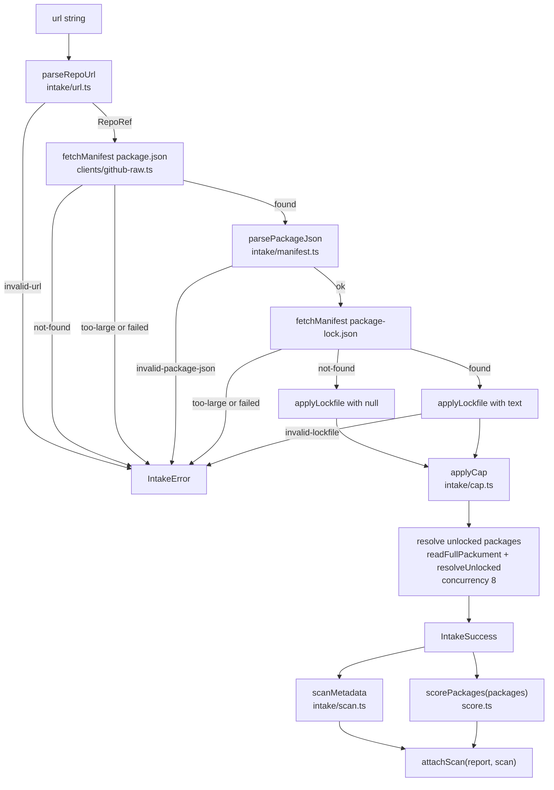
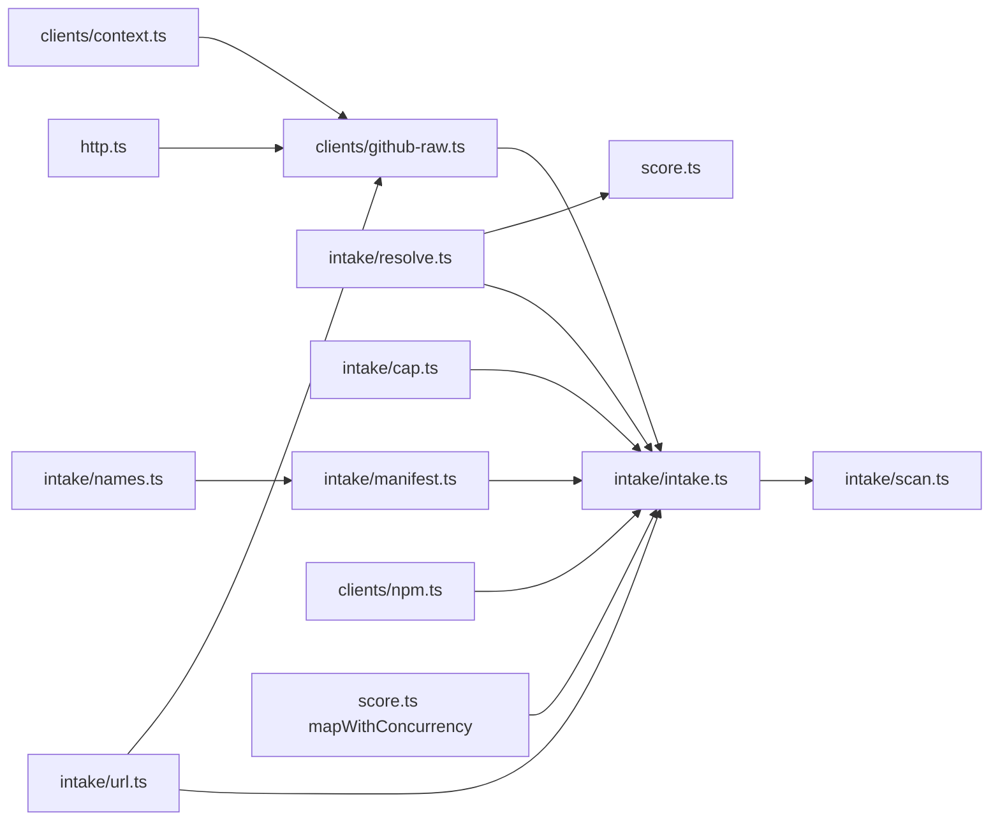

# Design Document: repo-intake

## Overview

repo-intake adds the step that turns a public GitHub repository URL into the list of direct dependencies with installed versions that `scorePackages` consumes. It lives in `@sexton/engine` and has seven parts: a pure URL parser (`parseRepoUrl`, `formatRepoUrl`), a pure package-name validator (`isValidPackageName`), a client that fetches `package.json` and `package-lock.json` from `raw.githubusercontent.com` through the existing Transport and Cache, a pure manifest parser (`parseManifests`), a pure range resolver (`resolveUnlocked`), the 300-dependency Cap (`applyCap`), and the composing function `intakeRepo`, which returns a result and never rejects. It also adds an optional `scan` field to `HealthReport`, with `scanMetadata` and `attachScan`.

Three existing files change: `http.ts` (a text reader with a byte limit on `TransportResponse`), `score.ts` (the `"unresolved"` sentinel), and `types.ts` (new shared types and `HealthReport.scan`). `evaluatePolicy`, the Cache, `ClientContext`, `readFullPackument` and every existing client are untouched.

Implements requirements 1 to 9 of this spec, which cover R-IN-1, R-IN-2, R-IN-3 and R-IN-4 of docs/requirements.md on the engine side, and N-2 in part. What stays with callers: reading a URL from a user, printing the "unlocked" label (R-IN-2), rendering the missing-file error (R-IN-3), and telling the user the Cap was hit (R-IN-4). Callers read the fields defined here.

Out of scope: filesystem reads, private repositories, the GitHub API, tokens, workspaces, monorepo packages below the root, branch or commit selection, pnpm and yarn lockfiles, transitive scoring, the CLI, the API handler, the UI, the evidence pack. The Engine writes no file.

### Names in the source that shape the design

- `Transport`, `TransportResponse`, `requestWithRetry`, `UpstreamError` and `createFetchTransport` are in `src/http.ts`. `TransportResponse` has `status` and `json()` only. `requestWithRetry` retries 429 and 503 and throws `UpstreamError` when retries run out. Any other status is returned to the caller.
- `CachedFetcher.get(key, fetch)` returns a stored value inside the TTL, shares in-flight fetches, and stores whatever `fetch` returns. It stores nothing when `fetch` throws. It also awaits `store.set` inside the same try block, so a store that rejects makes the fetch fail (see Open items).
- `cachedJson` in `src/clients/context.ts` throws on any non-2xx status, so it cannot cache a 404. The github-raw client therefore calls `ctx.cache.get` directly, as the attestations and deps.dev clients do.
- `describeFailure`, `isRecord` and `ClientContext` are in `src/clients/context.ts`. `ClientContext` is `{ transport, cache, clock, retry? }`.
- `readFullPackument(ctx, name)` in `src/clients/npm.ts` reads the full packument under `cacheKey("npm-packument", name, "*")` and throws on failure. `packumentUrl(name)` calls `encodeURIComponent`, which throws a `URIError` on a lone surrogate. Intake only emits Valid package names, but `scorePackages` accepts any `PackageRef`, so the sentinel branch uses a guarded helper (see `score.ts`).
- `scorePackages` builds its own `ClientContext` from `ScoringDependencies`. Sharing `cacheStore` between an intake context and `scorePackages` is how requirement 5.11 holds (see "Sharing the cache").
- `mapWithConcurrency` and `PACKAGE_CONCURRENCY` (8) are exported from `src/score.ts`. `collectReach` is exported too and is not changed.
- `buildHealth(pkg, signals, now)` assembles a `PackageHealth`, computes `missingSignals` and the state. With ten unavailable signals the state is `Restless` ("all state signals unavailable").
- `PackageRef` is `{ name, installedVersion }`. Intake entries extend it, so each entry can be passed to `scorePackages` unchanged.
- Shared types go into the existing `src/types.ts` under an intake heading, as the policy and history-signals specs did.

### Research findings that shape the design

- semver 7.8.6 exports `valid`, `validRange`, `satisfies` and `compare`. `validRange(range)` returns `null` for a non-range such as `latest`, a git URL, `file:`, `workspace:` or `npm:` specifiers. `satisfies(version, range)` excludes prereleases unless the range has a comparator with the same `major.minor.patch` tuple and a prerelease tag, which is the default behaviour requirement 5.3 asks for. `valid(v)` returns the cleaned version without build metadata, so `valid(v) === v` is "equal to its own semver-normalised form" (requirements 4.7 and 8.8). A version with build metadata (`1.0.0+x`) or a leading `v` fails that test. npm registry versions are clean, so this costs nothing for real packages.
- semver is CommonJS. Under NodeNext the import form must be checked against the repository tsconfig, as the policy design says for Ajv. The task that writes `resolve.ts` tries `import semver from "semver"` first and falls back to named imports. No `require`.
- `TextDecoder("utf-8", { fatal: true })` throws a `TypeError` on invalid UTF-8 and strips a leading byte-order mark by default (`ignoreBOM: false`). Both behaviours are wanted (see the decoder decision below).
- `Response.body` is a `ReadableStream<Uint8Array>`, or `null` for a body-less response. `reader.cancel()` stops the download. Node 22 has `Response`, `ReadableStream` and `TextDecoder` as globals, so tests need no network and no extra package.
- `JSON.parse` creates an own data property for the key `__proto__`. It does not set the prototype. The danger is in code that then assigns or spreads such an object, or reads `obj[key]` without an own-property check. Requirements 8.5 and 8.6 target that.

## Architecture





Design decisions:

1. **Pure core, I/O at one edge.** `url.ts`, `names.ts`, `manifest.ts`, `resolve.ts`, `cap.ts` and `scan.ts` read no clock, no file and no network. The only upstream access is `github-raw.ts` (the two Manifests) and `readFullPackument` (Unlocked candidates). Both go through the Transport and the Cache.
2. **Failures throw inside the cached fetch, values return.** `CachedFetcher` stores whatever the fetch function returns and nothing when it throws. The github-raw fetch function returns a value for found and not-found, and throws for every failure and for a too-large body. One outcome conversion then happens outside the cache call. This gives requirements 2.9, 2.10 and 2.12 with no change to the Cache.
3. **Lockfile gating by two calls, not one.** Requirement 2.13 (and 7.9) say the lockfile is fetched only after `package.json` was fetched and parsed. `intakeRepo` calls `fetchManifest` for `package.json`, runs the `package.json` phase of the parser, and only then calls `fetchManifest` for the lockfile. `fetchRepoManifests` (requirement 2.1) is a convenience wrapper over the same pieces and returns a `"not-attempted"` lockfile outcome when the gate fails. See Open items, item 1.
4. **`text()` is optional on `TransportResponse`.** Existing test fake transports and existing clients compile and behave as before. The github-raw client treats a missing `text` as a failed outcome.
5. **Parse in two phases.** `parsePackageJson` validates and lists the direct dependencies. `applyLockfile` reads the lockfile facts. `parseManifests` is their composition and is the function the properties exercise. `intakeRepo` uses the two halves so the lockfile fetch can sit between them and `package.json` is parsed once.
6. **The sentinel is a value, not a flag.** An Unresolved package carries `installedVersion: "unresolved"`. `scorePackages` partitions on that string. No new field on `PackageRef`.
7. **Intake errors carry no input.** Every `message` is built from a fixed template, a file name and an HTTP status. Parser messages, URLs and Manifest text never reach a message.

## Components and Interfaces

All paths are under `packages/engine/` and are relative to `src/` unless stated.

### types.ts additions (Requirements 1, 3, 4, 7, 9)

Shared shapes are added to the existing `src/types.ts`, listed under Data Models. `HealthReport` gains `readonly scan?: ScanMetadata`.

### intake/url.ts (Requirement 1, pure)

```ts
export function parseRepoUrl(input: string): ParseRepoUrlResult;
export function formatRepoUrl(reference: Pick<RepoRef, "owner" | "repo">): string;
export function isValidOwner(owner: string): boolean;
export function isValidRepo(repo: string): boolean;
```

`isValidOwner` and `isValidRepo` are exported so the github-raw client can re-check a reference it did not build (see Security). They are small helpers of the one concept "repository reference grammar".

`parseRepoUrl` is a hand-written scanner with no regular expression over the whole input, so its cost is linear in the input length.

1. Reject the input if it does not start with the exact prefix `https://github.com/` (case-sensitive, no trimming, decoding or normalising, 1.3).
2. Reject the input if any code point is whitespace or a control character: the test is `/[\s\p{Cc}]/u` over the whole input (1.5). A `\p{Cc}` test alone misses U+00A0 and U+2028, so both classes are listed.
3. Let `rest` be the text after the prefix. Reject `rest` if it contains `?`, `#` or a backslash. These also cover a query, a fragment and the forms the grammar names as rejected.
4. Find the first `/` in `rest`. No slash means fewer than two path segments: reject. The text before it is `owner`. The text after it is `afterOwner`.
5. In `afterOwner`, find the next `/`. The text before it (or all of `afterOwner` when there is none) is `repoSegment`. The remainder is `tail`.
6. `tail` must be exactly one of: `""`, `"/"`, or a string that starts with `"/tree/"` and has at least one more character (`/tree/{rest}`, 1.2). Anything else is rejected. This rejects `/issues`, `/blob/main/x`, `//x`, `/tree` and `/tree/`.
7. `repo` is `repoSegment` with one trailing `.git` removed. Check `isValidOwner(owner)` and `isValidRepo(repo)`. `repo` that still ends in `.git` after one removal fails `isValidRepo`.
8. On success return `{ ok: true, repo: { owner, repo, url: formatRepoUrl(...) } }`. On any rejection return the single constant result `{ ok: false, code: "invalid-url", message: INVALID_URL_MESSAGE }`, where the message is fixed text that holds no input (7.11).

Validity of the pieces (Glossary):

- `isValidOwner(s)`: non-empty, every code unit in `[A-Za-z0-9_.-]`, does not start with `.`, does not contain `..`.
- `isValidRepo(s)`: the same, and does not end in `.git`.

Credentials (`user@github.com`), ports (`github.com:443`) and other hosts (`www.github.com`, `github.com.example.invalid`) all fail step 1 because the prefix is matched literally. The form `https://github.com/{owner}/{repo}` is the only thing after the host, so there is no path in which `@` or `:` can be parsed as authority.

`formatRepoUrl` returns `` `https://github.com/${owner}/${repo}` ``. It does not validate, so callers pass a Repository reference from `parseRepoUrl`.

### intake/names.ts (Requirement 8.2, 8.3, pure)

```ts
export const MAX_PACKAGE_NAME_LENGTH = 214;
export function isValidPackageName(name: string): boolean;
```

Hand-written character checks, no dependency on validate-npm-package-name, no regular expression with repetition over unbounded input. The steps:

1. Reject if `name.length > 214` or `name.length === 0`.
2. If `name` starts with `@`: the text must contain exactly one `/`; the scope is the text between `@` and `/`, the name part is the text after `/`. A `@` without a `/`, or a second `/`, is rejected.
3. Otherwise the whole string is the name part, and it contains no `/` (the character check below rejects it).
4. The scope part, when present, and the name part must each be non-empty and must not start with `.` or `_`.
5. Scope characters: `a-z`, `0-9`, `-`, `.`, `_`, `~`. Name-part characters: `a-z`, `A-Z`, `0-9`, `-`, `.`, `_`, `~`. Uppercase is allowed in the name part only, matching npm's `validForOldPackages` rule (8.2). The check is over UTF-16 code units, so any non-ASCII character is rejected.

Examples: `left-pad`, `@babel/core`, `JSONStream`, `constructor` and `prototype` are valid. `__proto__`, `_x`, `.x`, `@Scope/x`, `@x`, `@/x`, `a/b`, `a b`, the empty string and a 215-character name are invalid. The result depends on `name` alone, so the function is total and deterministic.

### intake/manifest.ts (Requirements 3, 4, 8, pure)

```ts
export function parsePackageJson(text: string): PackageJsonParse;
export function applyLockfile(parsed: PackageJsonOk, lockfileText: string | null): ManifestsParse;
export function parseManifests(packageJsonText: string, lockfileText: string | null): ManifestsParse;
```

Neither phase throws. Each wraps `JSON.parse` in `try/catch` and maps any thrown value (a `SyntaxError`, or a `RangeError` for pathological nesting) to its fixed error. `JSON.parse` is called with no reviver. No other parser, no `eval`, no `Function`, no dynamic `import` (8.1).

**Own-property reads.** The module has one private helper pair:

```ts
function own(map: Record<string, unknown>, key: string): unknown {
  return Object.hasOwn(map, key) ? map[key] : undefined;
}
function ownRecord(map: Record<string, unknown>, key: string): Record<string, unknown> | undefined;
```

`ownRecord` returns the value only when `own` found it and it is a plain non-array object. No parsed object is spread, assigned into another object or merged (8.6). Internal collections that are keyed by an untrusted name use `Map<string, ...>` or `Object.create(null)` records, never an object literal, so no dynamic key is ever written onto an object that has `Object.prototype` in its chain.

**`parsePackageJson(text)`** (3.1 to 3.9):

1. `JSON.parse(text)`. A throw, or a value that is `null`, an array or a non-object, gives `{ ok: false, code: "invalid-package-json", file: "package.json", message }` (3.3).
2. For `dependencies` and `devDependencies`: `own(root, key)`. Absent (or no own property) gives an empty map (3.5). Present but not a plain object, or holding any non-string value, gives `invalid-package-json` (3.4). The checks run over `Object.keys(map)` and `own(map, key)`.
3. Build the direct list. Names from `dependencies` that pass `isValidPackageName`, sorted by name in ascending UTF-16 code-unit order (`a < b ? -1 : a > b ? 1 : 0`, not `localeCompare`), each with origin `dependencies`. Then names from `devDependencies` that pass `isValidPackageName` and are not already in the first group, sorted the same way, with origin `devDependencies` (3.6, 3.7, 3.8). A name in both maps keeps the `dependencies` range.
4. `skipped.invalidName` is the number of distinct keys across both maps that fail `isValidPackageName` (8.4). A key in both maps is counted once. Invalid names are dropped here, so they never reach a URL, a cache key or a result (8.3).
5. `skipped.peer` and `skipped.optional` are the numbers of distinct keys of `peerDependencies` and `optionalDependencies` that are Valid package names and are not in the direct list (3.9). A value that is not a plain object counts as zero names and causes no error. Values inside those maps are never read.
6. `totalDirect` is the length of the direct list before the Cap. Every other top-level key is ignored and never copied (3.15, 8.10).

**`applyLockfile(parsed, lockfileText)`** (4.1 to 4.10):

1. `lockfileText === null`: `lockfileVersion: null`, `unlocked: true`, every dependency has `lockedVersion: null`, and `unlockedPackages` lists every direct name (4.1, 4.8).
2. Otherwise `JSON.parse`. A throw, a non-object, or a `lockfileVersion` that is not exactly the number 1, 2 or 3 gives `{ ok: false, code: "invalid-lockfile", file: "package-lock.json", message }` and does not fall back to Unlocked resolution (4.3). `lockfileVersion: "2"` (a string) and `2.5` are rejected.
3. For a Direct dependency `name`: version 1 reads `ownRecord(ownRecord(root, "dependencies"), name)` then `own(entry, "version")`. Versions 2 and 3 read `ownRecord(ownRecord(root, "packages"), "node_modules/" + name)` then `own(entry, "version")` (4.4, 4.5). Version 2 files also hold a `dependencies` section. It is ignored for version 2.
4. The version is usable only when it is a string and `semver.valid(v) === v` (4.7). Otherwise that one dependency has `lockedVersion: null` and the others are unaffected. A usable version is used even when it does not satisfy the Declared range (4.9).
5. `unlocked` is `false` whenever a lockfile exists. `unlockedPackages` lists the direct names with `lockedVersion === null`, in list order (4.8).
6. Entries for names that are not Direct dependencies are never looked up, so they cannot change the result (4.10).

`parseManifests(pkg, lock)` calls `parsePackageJson`, returns its error if any (so an invalid `package.json` wins over an invalid lockfile, 4.11), and otherwise returns `applyLockfile`.

### intake/resolve.ts (Requirement 5, pure)

```ts
export const UNRESOLVED_VERSION = "unresolved";
export const MAX_RANGE_LENGTH = 256;
export function isResolvableRange(range: string): boolean;
export function resolveUnlocked(range: string, versions: readonly string[]): string;
```

`isResolvableRange(range)` is `range.length <= 256 && semver.validRange(range) !== null`, wrapped in `try/catch` that returns `false`. `resolveUnlocked`:

1. If `!isResolvableRange(range)`, return `UNRESOLVED_VERSION` (5.4). This covers dist-tags, git URLs, `file:`, `link:`, `http(s):`, `workspace:`, `npm:` aliases and ranges over 256 characters. The empty string is a valid range meaning `*`, as in npm.
2. Candidates are the entries `v` with `typeof v === "string"` and `semver.valid(v) === v` (5.2). Duplicates are harmless.
3. Keep candidates with `semver.satisfies(v, range)` (default options, so prereleases are excluded unless the range names one, 5.3).
4. Return the candidate with the greatest `semver.compare`. A tie in precedence cannot occur between two distinct normalised strings, but the comparator still breaks one by ascending code-unit order of the string, so the result does not depend on input order (5.2, 5.8). If no candidate remains, return `UNRESOLVED_VERSION` (5.5).
5. The whole body is inside `try/catch` returning `UNRESOLVED_VERSION`, so the function never throws (5.6).

`UNRESOLVED_VERSION` cannot collide with a real version: it is not a semver string (5.16).

### intake/cap.ts (Requirement 6, pure)

```ts
export const MAX_DIRECT_DEPENDENCIES = 300;
export interface CapResult<T> { readonly packages: readonly T[]; readonly capped: boolean; readonly totalDirect: number }
export function applyCap<T>(list: readonly T[], max: number = MAX_DIRECT_DEPENDENCIES): CapResult<T>;
```

`applyCap` returns `list.slice(0, max)`, `capped: list.length > max`, `totalDirect: list.length`. It is generic so properties can test it on numbers. `intakeRepo` applies it to the direct list after skipped names are removed and duplicates are merged (both done by `parsePackageJson`) and before any packument request (6.6).

### clients/github-raw.ts (Requirement 2)

```ts
export const GITHUB_RAW_SOURCE = "github-raw";
export const GITHUB_RAW_HOST = "https://raw.githubusercontent.com";
export const MAX_MANIFEST_BYTES = 5 * 1024 * 1024;

export type ManifestFile = "package.json" | "package-lock.json";

export type ManifestOutcome =
  | { readonly kind: "found"; readonly text: string }
  | { readonly kind: "not-found" }
  | { readonly kind: "too-large" }
  | { readonly kind: "failed"; readonly failure: ManifestFailure; readonly status: number | null };

export type ManifestFailure = "http-status" | "network" | "unsupported-transport" | "invalid-encoding" | "invalid-reference";

export type LockfileOutcome = ManifestOutcome | { readonly kind: "not-attempted" };

export function manifestUrl(reference: Pick<RepoRef, "owner" | "repo">, file: ManifestFile): string;
export function fetchManifest(ctx: ClientContext, reference: RepoRef, file: ManifestFile): Promise<ManifestOutcome>;
export function fetchRepoManifests(
  ctx: ClientContext,
  reference: RepoRef,
  gate?: (packageJsonText: string) => boolean,
): Promise<{ readonly packageJson: ManifestOutcome; readonly lockfile: LockfileOutcome }>;
```

**`manifestUrl`.** Looks `file` up in a constant table (`{ "package.json": "package.json", "package-lock.json": "package-lock.json" }`), checks `isValidOwner` and `isValidRepo`, and returns `` `${GITHUB_RAW_HOST}/${owner}/${repo}/HEAD/${fileName}` ``. It throws when the reference or the file is not valid, so no URL is ever built from an unchecked string (8.9).

**`fetchManifest`.** One file. It never throws.

```ts
const REQUEST: TransportRequest = { method: "GET", headers: { Accept: "text/plain" } };
type CachedManifest = { readonly kind: "found"; readonly text: string } | { readonly kind: "not-found" };
const NOT_FOUND: CachedManifest = { kind: "not-found" };

async function download(ctx: ClientContext, url: string): Promise<CachedManifest> {
  const response = await requestWithRetry(ctx.transport, url, REQUEST, ctx.retry ?? {}); // 429 and 503 end as UpstreamError
  if (response.status === 404) return NOT_FOUND;                       // a value: cached
  if (!Number.isInteger(response.status) || response.status < 200 || response.status >= 300) {
    throw new UpstreamError(url, response.status);                      // a throw: not cached
  }
  if (response.text === undefined) throw new ManifestReadError("unsupported-transport");
  const body = await response.text(MAX_MANIFEST_BYTES);
  if (!body.ok) {
    throw body.reason === "too-large" ? new ManifestTooLargeError() : new ManifestReadError("invalid-encoding"); // not cached
  }
  return { kind: "found", text: body.text };                             // a value: cached
}

export async function fetchManifest(ctx, reference, file): Promise<ManifestOutcome> {
  let url: string;
  try {
    url = manifestUrl(reference, file);
  } catch {
    return { kind: "failed", failure: "invalid-reference", status: null }; // no request, no cache entry
  }
  try {
    const key = cacheKey(GITHUB_RAW_SOURCE, `${reference.owner}/${reference.repo}`, file);
    return await ctx.cache.get<CachedManifest>(key, () => download(ctx, url));
  } catch (error) {
    return outcomeFromError(error); // too-large, or failed with status or null
  }
}
```

`ManifestTooLargeError` and `ManifestReadError` are private classes of the file. `outcomeFromError` maps `ManifestTooLargeError` to `{ kind: "too-large" }`, `UpstreamError` to `{ kind: "failed", failure: "http-status", status: error.status }`, `ManifestReadError` to `{ kind: "failed", failure, status: null }`, and anything else (a transport that throws, a cache store that rejects) to `{ kind: "failed", failure: "network", status: null }`. The failed outcome stores a failure kind from a closed set, never the error message, so no upstream text can reach an Intake error (7.11).

Why this satisfies the caching rules (2.5, 2.9, 2.10, 2.12):

| Outcome | What `download` does | What `CachedFetcher` does |
|---|---|---|
| found (2xx, body within limit) | returns `{ kind: "found", text }` | stores it, TTL 24 hours |
| not found (404) | returns `{ kind: "not-found" }` | stores it, TTL 24 hours |
| 429 or 503 after three retries | `requestWithRetry` throws `UpstreamError` | stores nothing |
| other status, network error, transport that throws | throws | stores nothing |
| body over 5 MiB | throws `ManifestTooLargeError` | stores nothing |
| invalid UTF-8, no `text` method | throws `ManifestReadError` | stores nothing |

A cached found or not-found value is the very object returned on the next call, so two calls inside the TTL return deeply equal outcomes (2.6). Concurrent callers for one key share the in-flight fetch. `CachedFetcher` also shares an in-flight rejection, which `fetchManifest` converts to the same failed outcome for each caller. A failure is not remembered once it has settled, so the next call tries again.

The request carries no `Authorization`, no `Cookie` and no `Origin` header. `createFetchTransport` adds the User-Agent (2.4).

**`fetchRepoManifests`.** Matches requirement 2.1 and honours 2.13:

1. `packageJson = await fetchManifest(ctx, reference, "package.json")`.
2. If `packageJson.kind !== "found"`, or `gate(packageJson.text)` is false, return `{ packageJson, lockfile: { kind: "not-attempted" } }`. No lockfile request is made.
3. Otherwise `lockfile = await fetchManifest(ctx, reference, "package-lock.json")` and return both.

`gate` defaults to `(text) => parsePackageJson(text).ok`. The client file imports one pure function from `intake/manifest.ts` for the default. `intakeRepo` does not call `fetchRepoManifests`. It makes the same two calls itself so it can map each error in order (7.9), and a test asserts that `fetchRepoManifests` and `intakeRepo` request the same URLs in the same order.

### http.ts changes (Requirement 2.11, 2.14)

```ts
export type TextBody =
  | { readonly ok: true; readonly text: string }
  | { readonly ok: false; readonly reason: "too-large" | "invalid-encoding" };

export interface TransportResponse {
  readonly status: number;
  json(): Promise<unknown>;
  /** Reads the body as UTF-8 text, stopping once more than limitBytes bytes arrive. Optional so existing fakes still compile. */
  readonly text?: (limitBytes: number) => Promise<TextBody>;
}
```

**Optional, not required.** `text` is an optional property. Every existing fake `Transport` in `test/` returns `{ status, json }` and keeps compiling and running. No existing client calls `text`. The github-raw client checks `response.text === undefined` and returns a failed outcome (`unsupported-transport`). I chose this over a required method because it leaves every existing client and test untouched. The cost is one runtime check in one client. New tests use fakes that provide `text`.

**`createFetchTransport` implementation.** `json()` is unchanged. `text` is added to the returned object:

1. Read `response.headers.get("content-length")`. If it matches `/^\d+$/`, parses to a safe integer and is greater than `limitBytes`, call `response.body?.cancel()` (errors ignored) and return `{ ok: false, reason: "too-large" }` without reading a byte. This is an early reject (2.11). The header is a hint only. A missing or wrong header does not matter, because step 3 counts bytes.
2. If `response.body === null`, return `{ ok: true, text: "" }`.
3. Get a reader. Loop `await reader.read()`. Add `value.byteLength` to a running total before keeping the chunk. When the total exceeds `limitBytes`, call `reader.cancel()` (errors ignored) and return `{ ok: false, reason: "too-large" }`. The limit is inclusive: a body of exactly `limitBytes` bytes is accepted, `limitBytes + 1` is rejected. The count is of decoded transfer bytes, so a compressed response that expands is counted after expansion.
4. Concatenate the kept chunks into one `Uint8Array` and decode once with `new TextDecoder("utf-8", { fatal: true })`. A `TypeError` from the decoder returns `{ ok: false, reason: "invalid-encoding" }`.
5. Return `{ ok: true, text }`.

At most `limitBytes` bytes plus one chunk are held in memory. A read error from the stream rejects `text()`, which `fetchManifest` converts to a failed outcome.

**Decoder choice: fatal.** A Manifest with invalid UTF-8 is not valid JSON text under the JSON grammar for npm. A non-fatal decoder would replace bad bytes with U+FFFD, and `JSON.parse` could then succeed on a changed document, for example a Declared range or a lockfile version string with a replacement character in it. Failing loudly is the safer default for a security tool, and a failure is not cached. The decoder also strips a leading byte-order mark, so a BOM-prefixed `package.json` parses (raw GitHub serves files as stored, and some Windows-edited files carry a BOM). The `TextBody` reason union therefore has two members, `"too-large"` and `"invalid-encoding"`. Both map to Intake errors through `fetchManifest` (`too-large` gives `manifest-too-large`, `invalid-encoding` gives `fetch-failed`).

### score.ts changes (Requirements 5.14 to 5.16)

```ts
const ALL_UNAVAILABLE_REASON = "unresolvable range";

export async function scorePackages(packages: readonly PackageRef[], deps: ScoringDependencies = {}): Promise<HealthReport> {
  // ctx, clock, reference exactly as today
  const unresolvedCount = packages.filter(isUnresolved).length;
  const resolvable = packages.filter((p) => !isUnresolved(p));
  const phase = await collectReach(ctx, resolvable);
  const reach: ReachPhase = { ...phase, graphsMissing: phase.graphsMissing + unresolvedCount };
  const options: ScoreOneOptions = { reach, reference, ...(snapshotStore) };
  const results = await mapWithConcurrency(packages, PACKAGE_CONCURRENCY, (pkg) =>
    isUnresolved(pkg) ? Promise.resolve(unresolvedHealth(pkg, reference)) : scoreOne(ctx, pkg, options),
  );
  return { generatedAt: clock().toISOString(), packages: results };
}

function isUnresolved(pkg: PackageRef): boolean { return pkg.installedVersion === UNRESOLVED_VERSION; }
```

`unresolvedHealth(pkg, reference)` builds one `unavailable(ALL_UNAVAILABLE_REASON, sourceFor(pkg.name), reference)` per name in `SIGNAL_NAMES` and passes the ten signals to `buildHealth(pkg, signals, reference)`. `buildHealth` then lists all ten names in `missingSignals` and assigns a state (`Restless`, "all state signals unavailable"). It makes no request (5.14). `sourceFor(name)` is `packumentUrl(name)` inside `try/catch`, falling back to `NPM_REGISTRY` for a name that `encodeURIComponent` rejects, so the branch is total for any package name (5.14 says "for any package name").

Effects:

- An Unresolved package is excluded from `collectReach`, so it issues no deps.dev request and adds no edge to the Union graph (5.15).
- `graphsMissing` is raised by the number of Unresolved packages, so every other package's `transitiveReach` value says that many graphs are missing (5.15). The Unresolved package has no `transitiveReach` value of its own (it is unavailable).
- Order is preserved because `mapWithConcurrency` keeps input order. An Unresolved package is not recorded as Seen in the snapshot store, because no scoring work ran for it (Open items, item 7).
- For input with no sentinel, `unresolvedCount` is 0, `resolvable` equals `packages`, `reach` equals the old `ReachPhase` value in content, and each package goes through `scoreOne` as today. The report is equal to today's (5.16). The existing `score` tests run unchanged and serve as the regression check.
- `ScoreOneOptions`, `scoreOne`, `buildHealth` and `collectReach` keep their signatures.

### intake/intake.ts (Requirement 7)

```ts
export function intakeRepo(url: string, ctx: ClientContext): Promise<IntakeResult>;
```

The body is one `async` function wrapped in `try/catch`. A top-level `catch` returns `{ ok: false, code: "internal-error", message: INTERNAL_ERROR_MESSAGE }` with no `file` (7.2, 7.6). The returned promise therefore never rejects. In order, stopping at the first error (7.9):

1. `parseRepoUrl(url)`. A rejection is returned as is (`invalid-url`).
2. `fetchManifest(ctx, repo, "package.json")`. `not-found` gives `missing-package-json`. `too-large` gives `manifest-too-large`. `failed` gives `fetch-failed`. Each carries `file: "package.json"`.
3. `parsePackageJson(text)`. An error is returned (`invalid-package-json`). A lockfile request has not been made.
4. `fetchManifest(ctx, repo, "package-lock.json")`. `not-found` means no lockfile (`lockText = null`, scan is unlocked). `too-large` gives `manifest-too-large`, any `failed` gives `fetch-failed`, both with `file: "package-lock.json"` (7.7). The scan is never silently unlocked on a transient failure.
5. `applyLockfile(parsed, lockText)`. An error is returned (`invalid-lockfile`).
6. `applyCap(parsed.dependencies)`.
7. Resolve every kept dependency with `lockedVersion === null` via `mapWithConcurrency(..., PACKAGE_CONCURRENCY, resolveOne)`, where:
   - `resolveOne` returns `UNRESOLVED_VERSION` at once, with no request, when `!isResolvableRange(range)`. A git URL or dist-tag never causes a packument request.
   - Otherwise it calls `readFullPackument(ctx, name)` (shared `npm-packument` key). It takes `Object.keys` of the packument's own `versions` object as candidates and returns `resolveUnlocked(range, candidates)`. A failed request, a packument that is not an object, or one with no `versions` object gives `UNRESOLVED_VERSION`, the same value as an unresolvable range (5.12). The function does not throw.
   - Results are written by index, so completion order does not matter (5.13).
8. Build each `IntakePackage`: `resolution` is `locked` when `lockedVersion !== null`, `unresolved` when the resolved version is the sentinel, otherwise `unlocked`. `installedVersion` is the locked or resolved version. Every installed version used later in a URL equals its own normalised form (8.8): locked versions pass `semver.valid(v) === v` in `applyLockfile`, and resolved versions are candidates that pass the same test.
9. Return `{ ok: true, repo, packages, unlocked: lockText === null, unlockedPackages, lockfileVersion, capped, totalDirect, skipped, unresolved }`. `unlockedPackages` and `unresolved` are derived from the final `packages` list, in list order, so they are subsets of the kept names after the Cap (7.15, 7.16). `unlocked` is true if and only if `lockfileVersion` is `null`.

Error messages (fixed text only, 7.11, 7.12) are built by the module that produces the code: `url.ts` for `invalid-url`, `manifest.ts` for `invalid-package-json` and `invalid-lockfile`, `intake.ts` for the other codes. Their texts are in Error Handling.

A successful intake holds only names, Declared ranges, versions and counts (8.10). Extra Manifest fields such as `scripts`, `repository` and `bin` are never read into a retained value.

**Sharing the cache (5.11).** A caller that wants intake and scoring to share the packument cache builds one `CacheStore`, wraps it in a `CachedFetcher` for the intake `ClientContext`, and passes the same store as `cacheStore` in `ScoringDependencies`. Both use the key `cacheKey("npm-packument", name, "*")`, so scoring finds the packument stored by intake inside the 24-hour TTL. The intake context and the scoring context must also use the same clock-compatible TTL (default).

### intake/scan.ts (Requirement 9, pure)

```ts
export function scanMetadata(intake: IntakeSuccess): ScanMetadata;
export function attachScan(report: HealthReport, scan: ScanMetadata): HealthReport;
```

`scanMetadata` builds a new object with fresh copies of the arrays and of `repo` and `skipped`: `{ repo, unlocked, unlockedPackages, lockfileVersion, capped, totalDirect, skipped, unresolved }`. It carries exactly the nine named values of the successful intake result, and no `packages` list. `attachScan` returns `{ ...report, scan }` as a new object and mutates neither argument. `generatedAt` and `packages` are the same references as in the input, so they are deeply equal (9.4). `evaluatePolicy` and `scorePackages` do not read `scan` (9.5, 9.6).

### index.ts additions

```ts
// repo-intake
export { parseRepoUrl, formatRepoUrl, isValidOwner, isValidRepo } from "./intake/url.js";
export { isValidPackageName, MAX_PACKAGE_NAME_LENGTH } from "./intake/names.js";
export { parsePackageJson, applyLockfile, parseManifests } from "./intake/manifest.js";
export { resolveUnlocked, isResolvableRange, UNRESOLVED_VERSION, MAX_RANGE_LENGTH } from "./intake/resolve.js";
export { applyCap, MAX_DIRECT_DEPENDENCIES } from "./intake/cap.js";
export { intakeRepo } from "./intake/intake.js";
export { scanMetadata, attachScan } from "./intake/scan.js";
export {
  fetchManifest, fetchRepoManifests, manifestUrl, GITHUB_RAW_SOURCE, GITHUB_RAW_HOST, MAX_MANIFEST_BYTES,
} from "./clients/github-raw.js";
export type { ManifestFile, ManifestOutcome, LockfileOutcome, ManifestFailure } from "./clients/github-raw.js";
export type { CapResult } from "./intake/cap.js";
export type {
  RepoRef, ParseRepoUrlResult, DependencyOrigin, Resolution, IntakePackage, SkippedCounts, LockfileVersion,
  ParsedDependency, PackageJsonOk, PackageJsonParse, ManifestsOk, ManifestsParse, ManifestParseError,
  IntakeErrorCode, IntakeError, IntakeSuccess, IntakeResult, ScanMetadata,
} from "./types.js";
export { INTAKE_ERROR_CODES } from "./types.js";
export type { TextBody } from "./http.js";
```

The existing `export type { Transport, TransportRequest, TransportResponse, ... } from "./http.js"` line stays. `TextBody` is added.

### package.json (Requirement 5.17)

See the Dependencies section.

## Data Models

Added to `src/types.ts`:

```ts
// Types for the repo-intake spec (.kiro/specs/repo-intake).

export interface RepoRef {
  readonly owner: string;
  readonly repo: string;
  /** Canonical URL: https://github.com/{owner}/{repo}. */
  readonly url: string;
}

export type ParseRepoUrlResult =
  | { readonly ok: true; readonly repo: RepoRef }
  | { readonly ok: false; readonly code: "invalid-url"; readonly message: string };

export type DependencyOrigin = "dependencies" | "devDependencies";
export type Resolution = "locked" | "unlocked" | "unresolved";
export type LockfileVersion = 1 | 2 | 3;

/** One kept direct dependency. Assignable to PackageRef, so it can be passed to scorePackages. */
export interface IntakePackage extends PackageRef {
  readonly declaredRange: string;
  readonly origin: DependencyOrigin;
  readonly resolution: Resolution;
}

export interface SkippedCounts {
  readonly peer: number;
  readonly optional: number;
  readonly invalidName: number;
}

/** A direct dependency after package.json and the lockfile are read, before the Cap and Unlocked resolution. */
export interface ParsedDependency {
  readonly name: string;
  readonly declaredRange: string;
  readonly origin: DependencyOrigin;
  /** The version recorded in the lockfile, or null when it must be resolved. */
  readonly lockedVersion: string | null;
}

export interface PackageJsonOk {
  readonly ok: true;
  readonly dependencies: readonly ParsedDependency[]; // lockedVersion null in this phase
  readonly totalDirect: number;
  readonly skipped: SkippedCounts;
}

export interface ManifestParseError {
  readonly ok: false;
  readonly code: "invalid-package-json" | "invalid-lockfile";
  readonly message: string;
  readonly file: "package.json" | "package-lock.json";
}

export type PackageJsonParse = PackageJsonOk | ManifestParseError;

export interface ManifestsOk {
  readonly ok: true;
  readonly dependencies: readonly ParsedDependency[];
  readonly totalDirect: number;
  readonly skipped: SkippedCounts;
  readonly lockfileVersion: LockfileVersion | null;
  readonly unlocked: boolean;
  readonly unlockedPackages: readonly string[];
}
export type ManifestsParse = ManifestsOk | ManifestParseError;

export const INTAKE_ERROR_CODES = [
  "invalid-url", "missing-package-json", "invalid-package-json", "invalid-lockfile",
  "manifest-too-large", "fetch-failed", "internal-error",
] as const;
export type IntakeErrorCode = (typeof INTAKE_ERROR_CODES)[number];

export interface IntakeError {
  readonly ok: false;
  readonly code: IntakeErrorCode;
  readonly message: string;
  /** Present for every code except invalid-url and internal-error. */
  readonly file?: "package.json" | "package-lock.json";
}

export interface IntakeSuccess {
  readonly ok: true;
  readonly repo: RepoRef;
  readonly packages: readonly IntakePackage[];
  readonly unlocked: boolean;
  readonly unlockedPackages: readonly string[];
  readonly lockfileVersion: LockfileVersion | null;
  readonly capped: boolean;
  readonly totalDirect: number;
  readonly skipped: SkippedCounts;
  readonly unresolved: readonly string[];
}
export type IntakeResult = IntakeSuccess | IntakeError;

export interface ScanMetadata {
  readonly repo: RepoRef;
  readonly unlocked: boolean;
  readonly unlockedPackages: readonly string[];
  readonly lockfileVersion: LockfileVersion | null;
  readonly capped: boolean;
  readonly totalDirect: number;
  readonly skipped: SkippedCounts;
  readonly unresolved: readonly string[];
}

export interface HealthReport {
  readonly generatedAt: string;
  readonly packages: readonly PackageHealth[];
  readonly scan?: ScanMetadata;
}
```

`ScanMetadata` has no optional member and no `undefined` value, so `JSON.stringify` then `JSON.parse` returns a deeply equal value (9.7). `ManifestsOk` is exported from `types.ts` and is in the `index.ts` type list.

The Cap value stays in one place: `MAX_DIRECT_DEPENDENCIES` is 300 in `cap.ts`, and `scan.ts` does not repeat it. `capped` is carried as a field, and P16 asserts `capped === (totalDirect > MAX_DIRECT_DEPENDENCIES)`.

### Fixtures

Under `packages/engine/test/fixtures/intake/`:

| File | Content |
|---|---|
| `package-basic.json` | recorded `package.json` of a small public repository chosen at task time, with `dependencies` and `devDependencies` |
| `package-lock-v1.json`, `package-lock-v2.json`, `package-lock-v3.json` | one lockfile of each version for the same dependency set |
| `package-mixed.json` | a name in both maps, a peer name, an optional name, uppercase and invalid names |
| `package-hostile.json` | synthetic: keys `__proto__`, `constructor`, `prototype`, URL-like names, `repository`, `scripts`, `bin` fields, git and `file:` ranges |
| `package-lock-hostile.json` | synthetic: `resolved` and `tarball` URLs pointing at `https://evil.invalid/`, an own `__proto__` key, entries under `node_modules/constructor` |
| `package-lock-partial.json` | a v3 lockfile with entries for some dependencies only |
| `packument-versions.json` | a small recorded packument with a `versions` map and prerelease versions |
| `bom-package.json.bin` | a package.json with a leading BOM (a binary fixture, loaded as bytes) |

The recorded fixtures come from an extension of `scripts/record-fixtures.mjs`. The hostile fixtures are synthetic because no real repository holds them. The test file that loads them says so in a comment, since JSON has no comments. The 300 and 301 dependency lists are generated in the test, not stored.

## Correctness Properties

*A property is a characteristic or behavior that should hold true across all valid executions of a system-essentially, a formal statement about what the system should do. Properties serve as the bridge between human-readable specifications and machine-verifiable correctness guarantees.*

Redundancy check: the 21 properties below keep distinct targets. P4, P5 and P6 share a package.json generator but assert different things (order, accounting, input invariance). P10, P11 and P12 share a range generator and assert different relations. None is implied by another.

Each property is one fast-check test, tagged with the feature name, the property number and the title. `numRuns` is 100 unless stated. Properties 1 (rejection side), 15, 17 and 18 run 1000 times because they guard the security invariants of requirement 8.

Shared generators (added to `test/arbitraries.ts`):

- `arbOwner`: `fc.stringMatching(/^[A-Za-z0-9_-][A-Za-z0-9_.-]{0,20}$/)` filtered to contain no `..`.
- `arbRepo`: the same, filtered to not end in `.git`.
- `arbValidName`: scoped or unscoped, built from the character classes of requirement 8.2 with a non-`.`/`_` first character.
- `arbInvalidName`: `fc.constantFrom("__proto__", "_x", ".x", "@Scope/x", "@x", "@/x", "a/b", "a b", "", "x".repeat(215), "naïve")`.
- `arbRange`: `fc.oneof` of semver ranges (`^1.2.3`, `~0.4.0`, `1.x`, `>=1 <3`, `*`, `1 || 2`), unresolvable specifiers (`latest`, `git+https://example.invalid/x.git`, `file:../x`, `workspace:*`, `npm:other@1`, `http://example.invalid/x.tgz`, `"1".repeat(300)`) and arbitrary strings.
- `arbVersion`: `fc.tuple(fc.nat(20), fc.nat(20), fc.nat(20))` with an optional prerelease tag, formatted `M.m.p` or `M.m.p-tag.n`.
- `arbPackageJson`: records of `dependencies` and `devDependencies` maps from `arbValidName`/`arbInvalidName` with overlap, plus optional `peerDependencies`, `optionalDependencies`, and extra top-level keys; returned as a model object and as text.
- `arbLockfile(model, version)`: builds a lockfile of version 1, 2 or 3 for a model.
- `arbScanMetadata`: `RepoRef` from `arbOwner` and `arbRepo`, `lockfileVersion` in `{1, 2, 3, null}`, arrays of valid names, non-negative integer counts.
- `arbIntakeTransport`: a transport generator described under Property 14.

### Property 1: The URL parser never throws and is deterministic

*For any* string, `parseRepoUrl` returns a result without throwing, returns deeply equal results on two calls, and, when the result is `ok`, the input starts with `https://github.com/` and contains no whitespace, control character, `?`, `#` or backslash. When the result is not `ok`, it is the single `invalid-url` result with the fixed message.

**Validates: Requirements 1.6, 1.7**

Generator sketch: `fc.oneof(fc.string(), fc.string({ unit: "binary", maxLength: 5000 }), nearMiss)`, where `nearMiss` takes a valid canonical URL (from `arbOwner`, `arbRepo`, one of the six suffix forms) and inserts one character from `["?", "#", "\\", " ", "\n", "\u00a0", "\u2028", "\u0000", "@", ":", "%"]` at a random index, or replaces the scheme or host with a case or host variant (`HTTPS://`, `www.github.com`, `github.com.example.invalid`). `numRuns`: 1000.

### Property 2: URL round trip and equivalence of accepted forms

*For any* valid Owner and valid Repo, parsing `formatRepoUrl({ owner, repo })` returns `ok` with the same Owner and Repo, with `url` equal to the Canonical URL. Parsing the Canonical URL, the URL with `.git`, with a trailing slash, with `.git/`, with `/tree/{rest}` and with `.git/tree/{rest}` returns deeply equal results. Parsing `formatRepoUrl` of any parsed reference returns the same result as the first parse. The case of Owner and Repo is exactly as given.

**Validates: Requirements 1.9, 1.10, 1.11, 1.12**

Generator sketch: `fc.tuple(arbOwner, arbRepo, restArb)` with `restArb = fc.stringMatching(/^[A-Za-z0-9._\/-]{1,30}$/)`. Build the six forms and compare each parse to the first. Also generate mixed-case Owner and Repo and assert `result.repo.owner === owner`. `numRuns`: 100.

### Property 3: parseManifests never throws

*For any* pair of texts (the second a string or `null`), `parseManifests` returns a result without throwing, returns deeply equal results on two calls, returns only the codes `invalid-package-json` or `invalid-lockfile` on failure with the matching `file`, and reports the `package.json` error when both texts are invalid.

**Validates: Requirements 3.10, 3.11, 4.12**

Generator sketch: `fc.tuple(textArb, fc.option(textArb))` where `textArb = fc.oneof(fc.string(), fc.string({ unit: "binary" }), fc.jsonValue().map(JSON.stringify), deepNesting, validishManifest)`, `deepNesting = fc.nat({ max: 50000 }).map((n) => "[".repeat(n))`, and `validishManifest` is `arbPackageJson` text or a lockfile text from `arbLockfile`. `numRuns`: 100.

### Property 4: Direct list ordering and distinctness

*For any* valid package.json, the listed names are distinct. Every entry with origin `dependencies` comes before every entry with origin `devDependencies`. Each group is in ascending UTF-16 code-unit order. A name present in both maps appears once, with origin `dependencies` and the range from `dependencies`. Each entry carries its name, Declared range and origin.

**Validates: Requirements 3.6, 3.7, 3.8, 3.12**

Generator sketch: `arbPackageJson` with only valid names, `fc.uniqueArray` for each map, an overlap set drawn from both, values from `arbRange`. The assertion is checked against a model: the expected list is computed from the model object by an independent sort and merge in the test. `numRuns`: 100.

### Property 5: totalDirect accounting

*For any* valid package.json, `totalDirect + skipped.invalidName` equals the number of distinct keys of `dependencies` and `devDependencies` taken together. Every `skipped` count is a non-negative integer. `skipped.peer` and `skipped.optional` equal the number of distinct valid names in `peerDependencies` and `optionalDependencies` that are not Direct dependencies. No dropped name appears in the list.

**Validates: Requirements 3.9, 3.13, 8.4**

Generator sketch: `arbPackageJson` with names drawn from `arbValidName` and `arbInvalidName` (including `__proto__`), overlap between the two maps, and peer and optional maps that overlap with direct names, with non-object peer values in some runs. The expected counts are computed from the model with a `Set`. `numRuns`: 100.

### Property 6: Key order and extra keys do not change the result

*For any* valid package.json, reordering the keys of any dependency map in the text, or adding top-level keys other than `dependencies`, `devDependencies`, `peerDependencies` and `optionalDependencies`, produces an equal `parseManifests` result.

**Validates: Requirements 3.14, 3.15**

Generator sketch: `arbPackageJson` model, a permutation of each map's entries (`fc.shuffledSubarray` with the full array), and extra keys from `fc.dictionary(fc.constantFrom("scripts", "repository", "bin", "name", "version", "__proto__", "x-custom"), fc.jsonValue())`. Serialise with `JSON.stringify` over arrays of entries rebuilt as objects in the chosen order. `numRuns`: 100.

### Property 7: The lockfile ignores non-direct entries

*For any* valid package.json and any lockfile, adding to the lockfile an entry for a name that is not a Direct dependency (a peer or optional name, a transitive name, or a nested path `node_modules/a/node_modules/b`) leaves the `parseManifests` result unchanged, for lockfile versions 1, 2 and 3.

**Validates: Requirements 4.10, 4.13**

Generator sketch: `arbPackageJson`, `arbLockfile(model, v)` for `v` in `fc.constantFrom(1, 2, 3)`, and an extra name from `arbValidName` filtered to not be direct. The extra entry gets a version from `arbVersion` and is inserted into `packages` (versions 2 and 3, as `node_modules/{name}`) or `dependencies` (version 1). `numRuns`: 100.

### Property 8: A fully locked lockfile gives no unlocked packages

*For any* valid package.json and any lockfile whose every Direct dependency has a usable entry, the result has `unlocked` false, an empty `unlockedPackages`, `lockfileVersion` equal to the lockfile's version, and for each Direct dependency a `lockedVersion` equal to the version recorded in the lockfile, even when that version does not satisfy the Declared range.

**Validates: Requirements 4.4, 4.5, 4.8, 4.9, 4.14**

Generator sketch: `arbPackageJson`, a version per direct name from `arbVersion` (independent of the range), `arbLockfile(model, v)` with `v` in `{1, 2, 3}` and every direct name present. `numRuns`: 100.

### Property 9: resolveUnlocked never throws

*For any* range string and any list of strings, `resolveUnlocked` returns a string without throwing. The string is either `"unresolved"` or an entry of the list. Two calls return equal results.

**Validates: Requirements 5.6**

Generator sketch: `fc.tuple(arbRange, fc.array(fc.oneof(arbVersion, fc.string(), fc.constantFrom("v1.0.0", "1.0.0+build", "=1.0.0", "latest", ""))))`. `numRuns`: 100.

### Property 10: The chosen version satisfies the range and is maximal

*For any* range and list where the result is not `"unresolved"`, the result is an entry of the list, equals its own `semver.valid` form, satisfies the range, and is not less than any other entry that is a normalised version satisfying the range. When the result is `"unresolved"` and the range is valid, no normalised entry satisfies it.

**Validates: Requirements 5.2, 5.3, 5.5, 5.7**

Generator sketch: `fc.tuple(validRangeArb, fc.array(arbVersion, { maxLength: 30 }))` where `validRangeArb` is built from `arbVersion` parts (`^`, `~`, `>=`, `x`-ranges, `||`) and includes ranges with a prerelease comparator. The oracle uses `semver.satisfies` and `semver.compare` directly. `numRuns`: 100.

### Property 11: Order independence

*For any* range and list, permuting the list, repeating any entry, or adding an entry that does not satisfy the range (including a string that is not a version) returns the same result.

**Validates: Requirements 5.8**

Generator sketch: `fc.tuple(validRangeArb, fc.array(arbVersion), fc.nat())` with a permutation from `fc.shuffledSubarray`, repeated entries from `fc.subarray`, and a non-satisfying entry chosen as `"0.0.0-nomatch"`, `"not-a-version"` or a version found by filtering `arbVersion` with `!semver.satisfies`. `numRuns`: 100.

### Property 12: Monotonic

*For any* range and list, adding a non-prerelease version that satisfies the range and is greater than the current result (or any such version when the result is `"unresolved"`) makes the result equal to the added version or to a greater satisfying version.

**Validates: Requirements 5.9**

Generator sketch: construct, do not filter. Draw `M`, build the range `^M.0.0`, draw a list of versions `M.a.b` with small `a` and `b`, compute the result `r`, and add `M.(maxA + 1).0` with `maxA` taken over the list and `r`. This version satisfies `^M.0.0` and is greater than every entry. Assert `semver.compare(result', added) >= 0`. A second branch uses a list with no satisfying entry. `numRuns`: 100.

### Property 13: Cap invariant and boundary

*For any* list, `applyCap` returns `packages.length` equal to `min(totalDirect, 300)`, `capped` true if and only if `totalDirect` is greater than 300, `totalDirect` equal to the input length, and `packages` equal to the first `packages.length` entries of the input. A list of exactly 300 entries is not capped. A list of exactly 301 entries is capped.

**Validates: Requirements 6.4, 6.5, 6.8**

Generator sketch: `fc.oneof(fc.integer({ min: 0, max: 700 }), fc.constantFrom(299, 300, 301)).chain((n) => fc.array(fc.integer(), { minLength: n, maxLength: n }))`. `numRuns`: 100.

### Property 14: intakeRepo never rejects for any transport behaviour

*For any* URL string and any Transport behaviour, `intakeRepo` resolves with an Intake result. A failure result has a `code` from the closed set of seven, a non-empty `message`, and no `packages`, `scan`, `unlocked` or other success field.

**Validates: Requirements 7.2**

Generator sketch: `fc.tuple(urlArb, fc.record({ pkg: behaviour, lock: behaviour, registry: behaviour }))` where `urlArb` mixes valid canonical URLs with `fc.string()`, and `behaviour` is `fc.oneof` of: respond 200 with text from `fc.oneof(arbPackageJson text, fc.string(), "")`; 404; 500; 429 forever (with an immediate `sleep` and `maxRetries` 1 in `ctx.retry`); a transport that throws synchronously; one that rejects with an `Error` or a non-Error value; a response whose `text()` rejects; a response whose `text()` returns `too-large` or `invalid-encoding`; a response without `text`; a response with `status: NaN`. The recording transport answers by URL host, so each of the three upstreams gets its own behaviour. The cache is a fresh `MemoryCacheStore` per run. `numRuns`: 100.

### Property 15: Messages never echo input

*For any* input that makes `intakeRepo` return an error, the `message` does not contain any part of the input URL, of the Manifest text, or of an error message thrown by the Transport, and is equal to one of the fixed templates with only the file name and an HTTP status substituted.

**Validates: Requirements 7.11**

Generator sketch: a canary token `fc.stringMatching(/^[A-Za-z0-9]{12,20}$/)` is placed in the Owner and Repo of a valid URL, in an invalid URL, in the names, ranges and bodies of both Manifests (including invalid JSON that contains it), and in the message of an `Error` thrown by the Transport and in a `UpstreamError`-like object. The assertion is `!message.includes(canary)` and `message` matches one of the seven template patterns. `numRuns`: 1000.

### Property 16: Unresolved and unlockedPackages invariants

*For any* successful result, `unresolved` equals the names of the entries whose `resolution` is `unresolved` in list order. It is a subset of `unlockedPackages` and of the names in `packages`. `unlocked` is true if and only if `lockfileVersion` is `null`. `unlockedPackages` equals the names of the entries whose `resolution` is not `locked`. An entry is `unresolved` if and only if its `installedVersion` is `"unresolved"`. Every entry has `name`, `installedVersion`, `declaredRange`, `origin` and `resolution`. `scanMetadata` of the result has `capped` true if and only if `totalDirect` is greater than 300, and every name in `unresolved` is in `unlockedPackages`.

**Validates: Requirements 7.15, 7.16**

Generator sketch: a routed transport (test helper) built from a generated model: `arbPackageJson` (valid names only), an optional lockfile from `arbLockfile` with some entries removed, and a registry route per name that answers a packument with a versions map from `fc.array(arbVersion)`, a 404, or a 500. The run calls `intakeRepo` and, when `ok`, checks the assertions and applies `scanMetadata`. Dependency counts range up to 320 so the Cap sometimes applies. `numRuns`: 100.

### Property 17: Prototype keys are inert

*For any* package.json and lockfile that hold the keys `__proto__`, `constructor`, `prototype`, `toString`, `hasOwnProperty` or `valueOf` in any dependency map, in `packages` or in `dependencies` of the lockfile, `Object.prototype` is unchanged afterwards. The key `__proto__` is counted in `skipped.invalidName`. A name such as `constructor` that is in the manifest gets its own Declared range as a string, and when it has no own lockfile entry it is Unlocked (never given a value inherited from `Object.prototype`).

**Validates: Requirements 8.5**

Generator sketch: texts are built by string templates so that `__proto__` is a real own key after `JSON.parse` (`JSON.stringify` of an object literal would drop it). Names come from `fc.constantFrom("__proto__", "constructor", "prototype", "toString", "hasOwnProperty", "valueOf", "left-pad")` in `dependencies`, `devDependencies`, `peerDependencies`, `optionalDependencies`, in `packages["node_modules/{name}"]` and in `dependencies[name]`, plus top-level `"__proto__": {"polluted": "yes"}`. Before each run, snapshot `Object.getOwnPropertyNames(Object.prototype)`. After, assert equal, `({}).polluted === undefined`, and `typeof` the Declared range is `"string"` for each listed entry. `numRuns`: 1000.

### Property 18: Every outbound URL has the fixed prefix

*For any* package.json and lockfile (including `resolved`, `tarball`, `repository` and `url` fields, URL-like names and ranges, invalid names), every URL requested through the Transport during `intakeRepo` begins with `https://raw.githubusercontent.com/` or `https://registry.npmjs.org/`. The raw URLs are exactly the two Manifest URLs of the validated Owner and Repo. Each registry URL is `packumentUrl(name)` for a Valid package name that is an Unlocked, resolvable direct dependency. No request carries an `Authorization` or `Cookie` header. `fetchManifest` called with an unvalidated reference (an Owner or Repo holding `/`, `..`, `?`, `#`, whitespace) makes no request and returns a failed outcome.

**Validates: Requirements 8.9**

Generator sketch: `arbPackageJson` extended with hostile extras (`repository: { url: "https://evil.invalid/" }`, `scripts`, `bin`, `dist.tarball`), names from valid and invalid pools including `"https://evil.invalid/x"`, ranges from `arbRange`, lockfile entries with `resolved` and `tarball` set to `https://evil.invalid/x.tgz` and versions that are valid, invalid and range-like. A recording transport answers the two raw URLs from the generated text and any registry URL with a small packument. A second arm calls `fetchManifest` directly with `fc.record({ owner: fc.string(), repo: fc.string(), url: fc.string() })`. `numRuns`: 1000.

### Property 19: attachScan preserves the report

*For any* report and any Scan metadata, `attachScan` returns a report whose `generatedAt` and `packages` are deeply equal to those of the input report and whose `scan` equals the given metadata. Neither argument is mutated.

**Validates: Requirements 9.4**

Generator sketch: `arbReport` and `arbScanMetadata`. Take `structuredClone` of both inputs before the call and assert both inputs equal their clones afterwards (inputs may also be passed through a deep-freeze helper so a mutation throws). `numRuns`: 100.

### Property 20: evaluatePolicy ignores scan

*For any* valid policy, report and Scan metadata, `evaluatePolicy(policy, attachScan(report, scan), source)` is deeply equal to `evaluatePolicy(policy, report, source)`.

**Validates: Requirements 9.6**

Generator sketch: `arbValidPolicy`, `arbReport`, `arbScanMetadata`, `fc.constantFrom("file", "default")`. `numRuns`: 100.

### Property 21: Scan metadata JSON round trip

*For any* Scan metadata, `JSON.parse(JSON.stringify(scan))` is deeply equal to `scan`.

**Validates: Requirements 9.7**

Generator sketch: `arbScanMetadata`. Compare with `toStrictEqual` so a stray `undefined` field would fail. A second arm applies `scanMetadata` to a generated `IntakeSuccess` and round-trips the result. `numRuns`: 100.

## Error Handling

`intakeRepo` returns a value for every outcome and never rejects. An upstream failure for one Unlocked package degrades that package to Unresolved and nothing else (N-4). A failure of either Manifest, an invalid Manifest or an unexpected exception returns an Intake error and no partial scan (R-IN-3, 7.10).

Every message is fixed text. The only variable parts are the file name (`package.json` or `package-lock.json`) and an HTTP status number. No part of the URL, a Manifest, a name, a range or a thrown error message appears (7.11).

| Cause | Code | `file` | Message |
|---|---|---|---|
| URL outside the grammar of requirement 1.2 | `invalid-url` | absent | `The repository URL is not a public https://github.com/{owner}/{repo} URL.` |
| HTTP 404 for `package.json` | `missing-package-json` | `package.json` | `package.json was not found. The repository may not exist or may be private.` |
| `package.json` over 5 MiB | `manifest-too-large` | `package.json` | `package.json is larger than 5 MiB.` |
| `package.json` request failed, after retries, with status S | `fetch-failed` | `package.json` | `package.json could not be fetched (HTTP S).` |
| `package.json` request failed with no status (network, invalid encoding, transport without `text`) | `fetch-failed` | `package.json` | `package.json could not be fetched.` |
| `package.json` is not JSON, not an object, or a dependency map is invalid | `invalid-package-json` | `package.json` | `package.json is not a valid manifest.` |
| `package-lock.json` over 5 MiB | `manifest-too-large` | `package-lock.json` | `package-lock.json is larger than 5 MiB.` |
| `package-lock.json` failed with status S other than 404 | `fetch-failed` | `package-lock.json` | `package-lock.json could not be fetched (HTTP S).` |
| `package-lock.json` failed with no status | `fetch-failed` | `package-lock.json` | `package-lock.json could not be fetched.` |
| `package-lock.json` is not JSON, not an object, or `lockfileVersion` is not 1, 2 or 3 | `invalid-lockfile` | `package-lock.json` | `package-lock.json is not a valid lockfile.` |
| Any exception not mapped above | `internal-error` | absent | `Intake failed unexpectedly.` |

The `{owner}/{repo}` in the first message is literal template text, not the input.

Other behaviour:

- **Evaluation order (7.9).** URL, `package.json` fetch, `package.json` parse, lockfile fetch, lockfile parse, Cap, Unlocked resolution. The first error wins, so an invalid `package.json` is reported even when the lockfile would also fail (4.11), and the lockfile is not requested at all in that case (2.13).
- **Lockfile 404.** A 404 for the lockfile is not an error. It means no lockfile, and the scan is unlocked.
- **Any other lockfile failure.** A 429 or 503 that survives three retries, a 5xx, a network error or an oversize body returns `fetch-failed` or `manifest-too-large` with file `package-lock.json`. The scan is not silently weakened to an unlocked one (7.7).
- **Unlocked package failures.** A failed packument request, a packument that is not an object, one without a `versions` object, or a range that is not resolvable gives `resolution: "unresolved"` and `installedVersion: "unresolved"`. The intake still succeeds (5.12).
- **Not cached.** Failed outcomes and too-large outcomes are never cached. Found and not-found outcomes are cached for 24 hours.
- **Retry.** 429 and 503 use `requestWithRetry`: full-jitter backoff from 500 ms, at most three retries (R-SG-9).
- **Invalid names.** A dependency name that fails the name rule is dropped and counted in `skipped.invalidName`. It is not an error.
- **Scoring.** `scorePackages` is unchanged in how it treats upstream failures. An Unresolved package gets ten unavailable signals with the reason `unresolvable range`, and still gets a state.

## Security

Everything read from a scanned repository, and the URL a caller passes, is untrusted input. Requirement 8 and the steering file `security-rules.md` ("everything read from a scanned repository is untrusted input; no eval, no shell interpolation, no template rendering of it; 300-dependency cap; public repositories only") map to the design as follows.

| Concern | Design measure | Requirements |
|---|---|---|
| Parsing | `JSON.parse` without a reviver is the only parser of Manifest text. No `eval`, no `Function`, no YAML parser, no dynamic `import`, no shell, no template rendering of Manifest content. A lint rule (`no-eval`, `no-new-func`) covers the files under `src/intake` and `src/clients/github-raw.ts`. | 8.1, 3.2, 4.2 |
| Own-property reads | Every read of a parsed map uses `Object.hasOwn(map, key) ? map[key] : undefined` through the private `own` and `ownRecord` helpers. Inherited properties never supply a value. | 4.6, 8.5, 8.6 |
| No merge or spread | A parsed manifest object is never spread, assigned or merged into another object. Internal collections keyed by untrusted names are `Map` or `Object.create(null)`. The output objects are built from named fields only. | 8.5, 8.6 |
| Prototype pollution | `__proto__` fails the name rule and is counted in `skipped.invalidName`. `constructor` and `prototype` are Valid names and are read by own-property access. Property 17 snapshots `Object.prototype` before and after. | 8.5 |
| Name validation before use | `isValidPackageName` runs inside `parsePackageJson`, before a name enters the list, a URL, a cache key or a result. An invalid name is dropped and never requested. | 8.2, 8.3, 8.4 |
| Declared ranges | A Declared range is passed only to `semver.validRange`/`satisfies` and copied to the output as a string. It is not put in a URL or a cache key. Ranges longer than 256 characters are rejected before semver sees them. | 8.7 |
| Installed versions | A version enters a URL or cache key only after `semver.valid(v) === v`. Locked versions are checked in `applyLockfile`. Resolved versions are candidates that pass the same test. | 8.8 |
| Fixed URL prefix | URLs are built only in `manifestUrl` (validated Owner and Repo, a fixed file from a constant table, host `raw.githubusercontent.com`) and in `packumentUrl` (a Valid name, host `registry.npmjs.org`). `fetchManifest` re-validates the reference itself, so a hand-built `RepoRef` cannot inject `/`, `..`, `?` or `#`. No `repository`, `resolved`, `tarball` or `url` value is read. | 8.9, 2.2, 2.3 |
| URL grammar | The parser matches the literal prefix `https://github.com/` case-sensitively, with no trimming or decoding. Credentials, ports, other hosts, queries, fragments and whitespace cannot be parsed as part of the authority. | 1.2 to 1.5 |
| No credentials | No token, `Authorization` or `Cookie` header is sent. A private repository answers 404, which gives `missing-package-json`. Only the User-Agent is added, by the Transport. | 2.4, N-2 |
| Body limit | `text(5 * 1024 * 1024)` counts bytes while streaming, cancels the stream once the limit is exceeded, and also rejects early on `Content-Length`. Parsing happens only on a body that fit. | 2.11, 2.12 |
| Data minimisation | The result and report hold only package names, Declared ranges, versions and counts. `scripts`, `repository`, `bin` and every other field are never read into a retained value. Property 6 and an example assert it on the serialised result. | 8.10, N-2 |
| No echo | Error messages are fixed templates with a file name and a status only. Property 15 plants a canary in every untrusted input. | 7.11 |
| No logging of bodies | The module logs nothing. Observability of outbound requests stays with the Transport layer, which logs target, status and latency (api-etiquette). | 8.11 |
| Output handling | Names, ranges and versions in results are data. Callers escape them when they render. | 8.12 |
| Request volume | The Cap of 300 is applied before any packument request, and unresolvable ranges make no request. At most 2 raw requests and 300 packument requests per intake, with concurrency 8. | 6.6, 6.7 |

Residual risks, none of them introduced by this spec: `fetch` follows redirects, and `readFullPackument` has no size limit (see Open items).

## Dependencies

| Package | Version | Licence | Kind | One-line justification for the PR body |
|---|---|---|---|---|
| semver | 7.8.6, exact pin | ISC | runtime dependency of `@sexton/engine` | Range satisfaction and version ordering are npm's own semantics and are error-prone to write by hand. |
| @types/semver | exact pin, chosen at task time | MIT | devDependency of `@sexton/engine` only | Type declarations for semver; no runtime effect. |

semver 7.x has no runtime dependencies of its own, to be confirmed in the lockfile at task time. Both versions are written without `^` or `~`. The lockfile gains semver and @types/semver. No other runtime dependency is added: URL parsing, name validation, manifest parsing and byte-limited reading use only language and platform features (`TextDecoder`, `ReadableStream`, `Object.hasOwn`, `JSON.parse`).

## Testing Strategy

Vitest. No network in any test. Upstream responses are recorded fixtures under `packages/engine/test/fixtures/intake/` (see Data Models), served by a test helper `test/intake/routes.ts`: a routed transport that answers by URL, records every request (URL, method, headers), and returns responses that implement both `json()` and `text()`. A separate helper wraps a string or byte array in a `ReadableStream` for the `text()` tests. It is a new file, so existing helpers and tests are untouched. Tests mirror source paths under `test/` and each file holds the unit tests and the property tests of its source file.

Property tests use fast-check 3.23.1 (pinned exact) with 100 runs by default and 1000 for properties 1 (rejection side), 15, 17 and 18. Each property is one test and carries the tag `Feature: repo-intake, Property {n}: {title}`. Properties 1 to 21 are defined above and are not repeated here. Property-based testing applies because the parser, resolver, cap and metadata functions are pure and the input space is large. It does not replace example tests for the I/O paths, which have a small input space.

| Test file | Covers |
|---|---|
| `test/intake/url.test.ts` | P1, P2, examples below |
| `test/intake/names.test.ts` | name rule table |
| `test/intake/manifest.test.ts` | P3 to P8, P17, lockfile fixtures |
| `test/intake/resolve.test.ts` | P9 to P12, specifier table |
| `test/intake/cap.test.ts` | P13 |
| `test/clients/github-raw.test.ts` | cache and status examples, P18 (second arm) |
| `test/http-text.test.ts` | `createFetchTransport` text reader |
| `test/intake/intake.test.ts` | P14 to P18, error mapping, order, caps |
| `test/intake/scan.test.ts` | P19, P21 |
| `test/policy/scan-ignored.test.ts` | P20 |
| `test/score-unresolved.test.ts` | sentinel scoring |

### Example and unit tests for criteria that are not properties

**URL (1.1 to 1.5)**

- Accepted: the six forms for `https://github.com/octocat/hello-world`, `/tree/main`, `/tree/feature/x/y`, `.git/tree/main`. `repo.url` is the Canonical URL.
- Rejected (1.5), one test row each: `http://github.com/o/r`, `HTTPS://github.com/o/r`, `https://GitHub.com/o/r`, `https://www.github.com/o/r`, `https://gist.github.com/o/r`, `https://gitlab.com/o/r`, `https://github.com.example.invalid/o/r`, `https://user@github.com/o/r`, `https://user:pw@github.com/o/r`, `https://github.com:443/o/r`, `https://github.com/o/r?x=1`, `https://github.com/o/r#readme`, `https://github.com/o//r`, `https://github.com/o`, `https://github.com/`, `https://github.com/o/r/issues`, `https://github.com/o/r/blob/main/x`, `https://github.com/orgs/o`, `https://github.com/o/r.git.git`, `https://github.com/o/.git`, `https://github.com/o/r/tree/`, `https://github.com/o/r/tree`, `https://github.com/o/r/tree/a b`, a URL with a tab or newline, `" https://github.com/o/r"` (leading space, 1.3), `https://github.com/o/r%2Ftree`, the empty string, a 10,000-character input. Each returns `{ ok: false, code: "invalid-url" }`.
- `formatRepoUrl({ owner: "O", repo: "R" })` returns `https://github.com/O/R`.

**Names (8.2)**: a table of valid (`left-pad`, `@babel/core`, `JSONStream`, `constructor`, `prototype`, `a`, `~x`, 214 characters) and invalid names (`__proto__`, `_x`, `.x`, `@Scope/x`, `@x`, `@/x`, `@x/`, `a/b`, `a b`, empty, 215 characters, `naïve`).

**Manifest fetch (2.1 to 2.13)** with the routed transport and a `MemoryCacheStore` with a controllable clock:

- 2.2 to 2.4: the two raw URLs requested are exactly the two Manifest URLs, no `Authorization`, no `Cookie`, headers are `Accept` only (the User-Agent is added by `createFetchTransport` and checked in `http-text.test.ts`).
- 2.5, 2.6: two `fetchManifest` calls for one key issue one request and return equal outcomes. The cache holds the key `github-raw|o/r|package.json`. After the clock moves past 24 hours, a third call issues a new request.
- 2.7: a route that answers 429 twice and then 200 gives found after two sleeps, with an injected `sleep`. A route that answers 429 forever gives `failed` with `status: 429` after exactly four requests.
- 2.8, 2.9: 200 gives found. 404 gives not-found, and a second call issues no request.
- 2.10: 500, a thrown transport and a response without `text` give `failed`, and a later 200 for the same key is fetched and returned (nothing was cached).
- 2.11, 2.12: a 5 MiB + 1 byte body gives too-large, a second call issues a new request (not cached), and `JSON.parse` is never reached (spy).
- 2.13: with the routed transport counting requests, the lockfile URL is requested zero times when `package.json` is 404, too large, failed or invalid JSON, and once when it is valid. `fetchRepoManifests` returns `lockfile: { kind: "not-attempted" }` in the first four cases. The set of URLs requested by `fetchRepoManifests` equals the set requested by `intakeRepo` for the same inputs.
- 2.1: `fetchRepoManifests` returns both outcomes for a valid repository.

**`text()` limit in `createFetchTransport` (2.11, 2.14)** with a fake `fetch` returning a `Response` built on a `ReadableStream` (no network):

- A body of exactly 5 MiB across several chunks returns `ok`. A body of 5 MiB + 1 returns `too-large`, and the stream's `cancel` callback ran. Bytes read after the limit are not requested (the `pull` counter stops).
- A `Content-Length` header above the limit returns `too-large` without a single `read` (the stream's `pull` was never called) and cancels the body.
- A wrong `Content-Length` (too small) does not defeat the byte counter.
- A multi-byte character split across two chunks decodes correctly. Invalid UTF-8 gives `invalid-encoding`. A leading BOM is stripped. A null body gives an empty string.
- `json()` still parses a JSON body. A fake transport returned as `{ status, json }` still satisfies `TransportResponse` (a compile-time check in the test file).
- The User-Agent header is on every request issued through `createFetchTransport` (existing test, unchanged).

**Lockfile fixtures (4.1 to 4.9, 4.11)**: `package-lock-v1.json`, `-v2.json` and `-v3.json` for one dependency set give equal installed versions. Version 2 reads `packages`, not `dependencies`. Rows for `lockfileVersion` absent, `0`, `4`, `"2"`, `2.5`, `null`, a JSON array and invalid JSON each give `invalid-lockfile`. Rows for a missing entry, an entry with no `version`, a numeric `version`, `v1.0.0`, `^1.0.0` and `1.0.0+build` each make that one dependency Unlocked and the others Locked. `lockfileText: null` gives `unlocked` true. A lockfile with a partial set gives `unlocked` false and a non-empty `unlockedPackages`. A locked version that does not satisfy the Declared range is kept.

**package.json examples (3.1 to 3.9, 8.10)**: no dependency maps gives an empty list and no error. `dependencies: []`, `dependencies: { a: 1 }` and a top-level array give `invalid-package-json`. A package.json that holds `scripts`, `repository` and `bin` gives a result whose `JSON.stringify` contains none of those values. A BOM-prefixed fixture (decoded by `text()`) parses.

**Semver edge specifiers (5.1 to 5.5)**: rows for `latest`, `next`, `git+https://example.invalid/x.git`, `github:o/r`, `o/r`, `file:../x`, `link:../x`, `http://example.invalid/x.tgz`, `https://example.invalid/x.tgz`, `workspace:*`, `npm:other@1`, a 257-character range, each resolving to `"unresolved"`. `""` and `*` pick the greatest release. A range `^1.0.0` with versions `1.2.0`, `1.3.0-beta.1` picks `1.2.0`. A range `>=1.3.0-beta.0` with `1.3.0-beta.1` picks the prerelease. An empty `versions` array gives `"unresolved"`.

**Unlocked resolution and Cap in `intakeRepo` (5.10 to 5.13, 6.6, 6.7)**: an Unlocked dependency causes one request to `packumentUrl(name)`, and no tarball URL. A failing packument (500, non-object, no `versions`) gives `resolution: "unresolved"` without failing the intake and without touching the other packages. Dependencies with unresolvable ranges cause no registry request. A package list of 305 Unlocked dependencies requests packuments for 300 names and none for the last five, and `devDependencies` are the ones dropped. A routed transport that completes requests in reverse order returns the same installed versions as one that completes in order, and never has more than 8 packument requests in flight. A shared `MemoryCacheStore` between the intake context and `scorePackages({ cacheStore })` gives zero packument requests during scoring for the names intake already read (5.11).

**Scoring sentinel (5.14 to 5.16, 9.9)** with a recording transport: a list with one real and one Unresolved package (a normal name, a scoped name and a name holding a lone surrogate) issues no request for the Unresolved package, gives it ten unavailable signals with reason `unresolvable range` and source `packumentUrl(name)` (or the registry root for the lone-surrogate name), lists ten names in `missingSignals`, assigns a state, and raises `graphsMissing` of the real package by one. The order of `packages` is preserved when the Unresolved package is first, middle and last. For a list with no sentinel, the report equals a golden report recorded before the change (the existing health-scoring and history-signals score tests run unchanged).

**Error mapping and order (7.3 to 7.9, 7.12 to 7.14)**: one test per row of the Error Handling table, asserting `code`, `file`, the exact message and the absence of `packages` and `scan`. A request log asserts the order URL, `package.json` fetch, parse, lockfile fetch. Two calls with the same fixtures, cache and clock return deeply equal results. An empty-dependency package.json returns `ok`, `packages: []`, `capped: false`, `totalDirect: 0`.

**Scan metadata and types (9.1 to 9.3, 9.5, 9.8 to 9.10)**: `scanMetadata` returns the eight fields of the success result, copies arrays, and returns deeply equal results on two calls. A report built by `scorePackages` has no `scan` key. `attachScan` leaves its inputs unchanged (also P19). A type-level test (`expectTypeOf`) asserts that `IntakePackage` is assignable to `PackageRef` and that `HealthReport.scan` is optional.

**Review constraints (2.14, 2.15, 5.17, 8.1, 8.11, 8.12, 9.11)**: checked in code review. The no-eval rule is enforced by ESLint, the exact-pin rule by the existing dependency check, and the no-network rule by the shared test setup that makes `fetch` throw.

**Commands**: `npm test -w @sexton/engine`, then `npm run typecheck`, `npm run lint` and `npm test` at the root. Lint must report zero warnings.

## Requirement Traceability

Component names refer to the sections above. "P" is a property, "T" is an example or unit test, "R" is a review constraint.

| Criterion | Component | Property or test |
|---|---|---|
| 1.1 | `intake/url.ts` parseRepoUrl | T url accepted forms, P1 |
| 1.2 | `intake/url.ts` | T accepted forms, P1 |
| 1.3 | `intake/url.ts` | T rejected rows (case, leading space, `%2F`) |
| 1.4 | `intake/url.ts` | P2, T |
| 1.5 | `intake/url.ts` | T rejected rows, P1 (near-miss arm) |
| 1.6 | `intake/url.ts` | P1 |
| 1.7 | `intake/url.ts` | P1 |
| 1.8 | `intake/url.ts` formatRepoUrl | P2, T |
| 1.9 | `intake/url.ts` | P2 |
| 1.10 | `intake/url.ts` | P2 |
| 1.11 | `intake/url.ts` | P2 |
| 1.12 | `intake/url.ts` | P2 |
| 2.1 | `clients/github-raw.ts` fetchRepoManifests | T |
| 2.2 | `manifestUrl` | T, P18 |
| 2.3 | `manifestUrl`, `fetchManifest` | P18 |
| 2.4 | `fetchManifest` request, Transport | T, P18 |
| 2.5 | `fetchManifest` cache key | T cache key and TTL |
| 2.6 | `fetchManifest` | T one request, equal outcomes |
| 2.7 | `requestWithRetry` through `download` | T retry rows |
| 2.8 | `download` | T |
| 2.9 | `download` returns not-found | T |
| 2.10 | `download` throws | T not cached |
| 2.11 | `http.ts` text(), `download` | T text() limit, T no JSON.parse spy |
| 2.12 | `ManifestTooLargeError` | T |
| 2.13 | `intakeRepo`, `fetchRepoManifests` | T request counts, Open item 1 |
| 2.14 | `http.ts` optional `text` | R, compile-time T |
| 2.15 | all tests | R |
| 3.1 | `intake/manifest.ts` | T, P3 |
| 3.2 | `parsePackageJson` | R, P3 |
| 3.3 | `parsePackageJson` | T rows, P3 |
| 3.4 | `parsePackageJson` | T rows |
| 3.5 | `parsePackageJson` | T |
| 3.6 | `parsePackageJson` | P4 |
| 3.7 | `parsePackageJson` | P4 |
| 3.8 | `parsePackageJson` | P4 |
| 3.9 | `parsePackageJson` | P5, T |
| 3.10 | `parseManifests` | P3 |
| 3.11 | `parseManifests` | P3 |
| 3.12 | `parsePackageJson` | P4 |
| 3.13 | `parsePackageJson` | P5 |
| 3.14 | `parsePackageJson` | P6 |
| 3.15 | `parsePackageJson` | P6 |
| 4.1 | `applyLockfile` | T |
| 4.2 | `applyLockfile` | R |
| 4.3 | `applyLockfile` | T rows |
| 4.4 | `applyLockfile` v1 | T fixture, P8 |
| 4.5 | `applyLockfile` v2 and v3 | T fixtures, P8 |
| 4.6 | `own`, `ownRecord` | P17 |
| 4.7 | `applyLockfile` | T rows |
| 4.8 | `applyLockfile` | P8, T |
| 4.9 | `applyLockfile` | P8, T |
| 4.10 | `applyLockfile` | P7 |
| 4.11 | `parseManifests`, `intakeRepo` order | P3, T |
| 4.12 | `parseManifests` | P3 |
| 4.13 | `applyLockfile` | P7 |
| 4.14 | `applyLockfile` | P8 |
| 5.1 | `intake/resolve.ts` | T, P9 |
| 5.2 | `resolveUnlocked` | P10 |
| 5.3 | `resolveUnlocked` | P10, T |
| 5.4 | `isResolvableRange` | T specifier rows |
| 5.5 | `resolveUnlocked` | P10, T |
| 5.6 | `resolveUnlocked` | P9 |
| 5.7 | `resolveUnlocked` | P10 |
| 5.8 | `resolveUnlocked` | P11 |
| 5.9 | `resolveUnlocked` | P12 |
| 5.10 | `intakeRepo` resolveOne, `readFullPackument` | T request log |
| 5.11 | shared cache store | T integration |
| 5.12 | `intakeRepo` resolveOne | T |
| 5.13 | `mapWithConcurrency` in `intakeRepo` | T completion order |
| 5.14 | `score.ts` unresolvedHealth | T |
| 5.15 | `score.ts` partition, graphsMissing | T |
| 5.16 | `score.ts` | T golden and existing tests |
| 5.17 | `package.json` | R |
| 6.1 | `intake/cap.ts` | T |
| 6.2 | `applyCap` | P13 |
| 6.3 | `applyCap` | P13 |
| 6.4 | `applyCap` | P13 |
| 6.5 | `applyCap` | P13 |
| 6.6 | `intakeRepo` step order | T |
| 6.7 | `intakeRepo` | T 305 dependencies |
| 6.8 | `applyCap` | P13 |
| 7.1 | `intake/intake.ts` | T end to end |
| 7.2 | `intakeRepo` try/catch | P14 |
| 7.3 | `intakeRepo` | T, P16 |
| 7.4 | `intakeRepo` | P16 |
| 7.5 | `INTAKE_ERROR_CODES` | P14 (code set assertion), T |
| 7.6 | `intakeRepo` error mapping | T per table row |
| 7.7 | `intakeRepo` | T |
| 7.8 | `intakeRepo` | T per table row |
| 7.9 | `intakeRepo` | T request log |
| 7.10 | `intakeRepo` | P14 (shape), T |
| 7.11 | message templates | P15 |
| 7.12 | `intakeRepo` | T |
| 7.13 | `intakeRepo` | T |
| 7.14 | `intakeRepo` | T |
| 7.15 | `intakeRepo` | P16 |
| 7.16 | `intakeRepo` | P16 |
| 8.1 | all intake files | R, ESLint rule |
| 8.2 | `intake/names.ts` | T name table |
| 8.3 | `parsePackageJson` | P18 |
| 8.4 | `parsePackageJson` | P5, P18 |
| 8.5 | `own`, `Map` collections | P17 |
| 8.6 | `own`, `ownRecord` | P17 |
| 8.7 | `intakeRepo`, `resolve.ts` | P18 |
| 8.8 | `applyLockfile`, `resolveUnlocked` | P18, T |
| 8.9 | `manifestUrl`, `packumentUrl` | P18 |
| 8.10 | result construction | T serialised result, P6 |
| 8.11 | all intake files | R |
| 8.12 | callers | R |
| 9.1 | `types.ts` | T type-level |
| 9.2 | `scanMetadata` | T |
| 9.3 | `intake/scan.ts` | P19, T |
| 9.4 | `attachScan` | P19 |
| 9.5 | `score.ts`, `evaluate.ts` | T existing tests |
| 9.6 | `evaluatePolicy` | P20 |
| 9.7 | `ScanMetadata` | P21 |
| 9.8 | `scanMetadata` | P16 |
| 9.9 | `score.ts` | T scoring sentinel |
| 9.10 | `scanMetadata` | T |
| 9.11 | callers | R |

## Notes on requirements and open items

requirements.md is final and unedited. These are design interpretations and questions for the user to confirm.

1. **2.1 versus 2.13 (the Analyze finding).** Requirement 2.1 says `fetchRepoManifests` returns outcomes for both files. Requirement 2.13 (and 7.9) say the lockfile is fetched only after `package.json` was fetched and parsed without error. Following the answer already given (the lockfile fetch is skipped entirely, with no upstream request, when `package.json` is not successfully fetched and parsed), this design exports `fetchManifest(ctx, reference, file)` for one file. `intakeRepo` calls it for `package.json`, runs `parsePackageJson`, and only then calls it for the lockfile. `fetchRepoManifests` still returns an outcome for each file, with a third outcome kind `"not-attempted"` in the lockfile slot when `package.json` is not found, too large, failed, or fails the gate (by default `parsePackageJson(text).ok`). So 2.1 holds (two outcomes) and 2.13 holds (no lockfile request). The added kind is a design interpretation of "an outcome that is found, not found, too large, or failed".
2. **7.1 says `intakeRepo` composes `fetchRepoManifests`.** Because `intakeRepo` must map `package.json` errors before it fetches the lockfile (7.9), it makes the same two `fetchManifest` calls itself instead of calling `fetchRepoManifests`. A test asserts the two request the same URLs in the same order. Confirm that this reading of "composes" is acceptable.
3. **1.2 versus 1.5 on empty segments.** 1.2 says the `/tree/{rest}` suffix has one or more characters with no `?`, `#`, backslash, whitespace or control character, so `rest` may hold `/`. 1.5 rejects "an empty path segment". The design follows 1.2 as the "if and only if" rule: `https://github.com/o/r/tree/a//b` is accepted and the suffix is ignored, while `https://github.com/o//r` and `https://github.com/o/r//` are rejected.
4. **`text()` result union.** The brief's union is `{ ok: true, text } | { ok: false, reason: "too-large" }`. The fatal decoder needs a second reason, `"invalid-encoding"`, which maps to `fetch-failed`. A body with invalid UTF-8 is thus reported as a failed fetch, not as an invalid `package.json`. Say if you want a different code.
5. **No length limit on Owner and Repo.** The grammar and Glossary set no maximum. A very long valid Owner or Repo produces a very long raw URL. GitHub's own limits are 39 and 100 characters. Adding a limit changes requirement 1, so it is not in this design. Suggested follow-up: a maximum of 100 characters for each.
6. **No packument request for an unresolvable range.** Requirement 5.10 says an Unlocked package's packument is read. For a range that `semver.validRange` rejects (`latest`, a git URL), the design makes no request, since the result is `"unresolved"` whatever the packument holds. Scoring makes no request for it either. This reduces upstream traffic and is consistent with 5.4 and 5.12.
7. **Unresolved packages are not recorded as Seen.** `scoreOne` records the Seen time in the snapshot store. The sentinel branch skips `scoreOne`, so no Seen record is made for an Unresolved package. The snapshotter then does not track a package that has no installed version. Say if requirement R-SN-1 ("every package seen in any scan") should include them.
8. **Empty range `""`.** `semver.validRange("")` is `*`, as in npm, so a Declared range of `""` resolves to the greatest release. This is a choice. The alternative is to treat it as unresolvable.
9. **Versions with build metadata.** A Lockfile or packument version such as `1.0.0+build` fails `semver.valid(v) === v` and is treated as Unlocked or not a candidate (4.7, 5.2). npm publishes versions without build metadata in practice.
10. **Cache item size.** A found Manifest may be up to 5 MiB, and `CachedFetcher` awaits `store.set` inside its try block. The DynamoDB cache store in `packages/api` has a 400 KB item limit, so its `set` must either compress, spill to S3, or swallow the error, or a large Manifest would fail the fetch instead of merely not being cached. This is for the api spec, but it is an assumption that spec must meet.
11. **`readFullPackument` has no size limit.** Unlocked resolution reads packuments of attacker-named packages from the npm registry. Some real packuments are several MiB. The existing client is unchanged by this spec. Consider a body limit there in a later spec.
12. **Redirects.** `createFetchTransport` uses `fetch` with its default redirect handling. A redirect from `raw.githubusercontent.com` is chosen by GitHub, not by Manifest content, so requirement 8.9 holds for requests Sexton builds. Making the transport refuse redirects needs a field on `TransportRequest` and is not done here.
13. **`@types/semver` version.** Written as "exact pin, chosen at task time", because it is not looked up here. The task confirms the version compiles against semver 7.8.6 and records it in the lockfile.
14. **Intake context.** `intakeRepo` takes a `ClientContext` and not `ScoringDependencies`. A helper that builds one context for both intake and scoring is left to the CLI and API specs.
15. **Two message tables are spread over three files.** `url.ts`, `manifest.ts` and `intake.ts` each own the fixed messages of the codes they produce. No extra file was added to the list in the brief.
