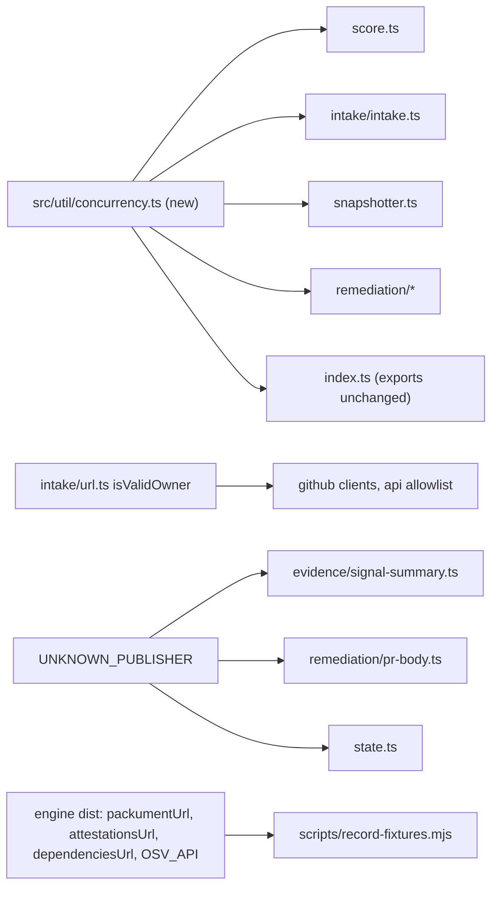

# Design Document: submission-readiness

## Overview

The repository goes public on 2 December 2026, and three judges will read it. This spec makes what they read accurate and tidy. Most of the work is text: two claims corrected, the README brought in line with main, a one-page guide for judges, a sweep of every tracked file. Four small code changes close review notes that have waited since spec 02: the concurrency helper moves to a util file, the owner check agrees with the URL parser, a missing publisher reads "unknown" everywhere, and the fixture recorder uses the engine's URL builders. One CI job is added so the browser tests run on every push.

Every factual line is checked before it is written. The check (a command and its output, a file and line on main, or a link and the date it was read) is recorded in this file under "Checks".

### What is there today (checked on main a01fcce, 25 November 2026)

**Claim A**, that no API exposes maintainer or provenance history:

| Path:line | Text today |
|---|---|
| README.md:20 | "It keeps a dated snapshot of each package's maintainers, install scripts and attestations, because no registry API keeps that history." |
| docs/requirements.md:17 | "And no API exposes maintainer or provenance history, so whoever snapshots it owns the only dataset that can detect a handover." |
| docs/threat-model.md:9 | "Snapshot history. It is the only dataset that can show a maintainer handover, …" |

**Claim B**, that no open-source tool combines Sexton's parts:

| Path:line | Text today |
|---|---|
| README.md:15 | "No open-source tool reads those signals, keeps their history, enforces a policy on them and fixes the result." |
| docs/requirements.md:15 | "No open-source tool reads those signals, keeps their history, enforces a policy on them, and fixes the result." |
| docs/requirements.md:17 | "No open-source tool combines local signals, a repo-committed policy, code-level migration PRs with evidence, and an evidence pack." |
| README.md "How Sexton is different" | four tool lines, Socket's among them, none checked against the tool's own documentation |

Not changed, with the reason: build/reviews/10-infra.md:96 says the competitor lines "stay within requirements section 2". It is a dated record of what a review checked on 20 November 2026, not a claim. .kiro/steering/product.md holds neither claim (searched), and steering is outside this spec's paths in any case. packages/web/index.html holds only the title "Sexton cemetery". Task 1 repeats the search over every tracked file and adds anything new to the list.

**Stale status labels in README.md** (each checked on main):

| Text | Fact on main |
|---|---|
| "Hosted demo: the link arrives with the first deploy." | The hosted site has served the app since deploy 1 on 21 November 2026 (build/reviews/10-infra.md:336). |
| "A CI job that runs it on every push is in progress." | .github/workflows/ci.yml has the `self-scan` job. |
| Roadmap 0.1: remediation pull requests "planned", Cemetery UI "in progress", evidence pack "The CLI command arrives with the CLI" | `sexton evidence`, the remediation planner, the node-sass recipe, POST /api/remediate and the cemetery are on main. |
| "Sexton's migration recipes are planned to change the code…", "Sexton is planned to open one pull request per fix" | The node-sass recipe and the remediate endpoint are on main. |
| Remediation and evidence bullets: "arrives on the hosted site at its next deploy", "gains the evidence endpoint … at its next deploy" | Opening a pull request went live in deploy 3 on 22 November 2026 (build/reviews/10c-remediate.md:34, remediate/design.md:220). The evidence endpoint went live in deploy 2 on 21 November 2026; no tracked file records that deploy, so task 2.1 checks the hosted endpoint itself (a GET of /api/evidence on the hosted site) before the label is changed. |
| ROADMAP.md 0.1: "Five signals", docs/requirements.md:36 "Five signals: …" | Seven product signals since new-signals. |
| Replay links `[?replay=axios](?replay=axios)` | Relative to the README page on GitHub, so they lead nowhere there. packages/web/test/readme.test.ts:59-60 pins them, and :12 and :102 pin the list of `##` headings, so that test changes with the README. |

**Cleanup items:**

| Item | Today |
|---|---|
| impl.md ask rules | Two `effect: ask` shell rules are committed (lines 13 to 18). |
| self-scan.out | Not tracked, and not ignored: `git check-ignore self-scan.out` prints nothing. build/reviews/03-policy.md says it is gitignored. |
| Spec 02 Glossary | "Provenance regression" says "a strictly earlier publish time". Requirement 7 and `evaluateProvenanceRegression` use the Version order: publish time, then the version string on a tie. |
| mapWithConcurrency | In src/score.ts, imported from there by intake, snapshotter and two remediation files; api and cli import it through `@sexton/engine`. |
| Recorder URLs | record-fixtures.mjs copies `attestationsUrl` and `dependenciesUrl`, and writes the packument and OSV URLs inline. |
| Haunted | sexton.policy.yml forbids Possessed and Dead only. |
| Task Dependency Graph | 9 of 22 tasks.md files have one (cemetery-polish, cemetery-theme, cemetery-time, cemetery-time-fixes, cemetery-ui, history-signals, infra, policy, repo-intake), each a JSON list of waves. |
| isValidOwner | Accepts `orgs`. `parseRepoUrl` rejects it after calling `isValidOwner`. |
| 05-remediation.md:3 | Names a private rules file by its path (also a sweep finding). |
| Missing publisher | State reason "unknown"; evidence summary and pull request row "no name". |

**Sweep, first pass:** no TODO, FIXME or XXX; no secret, only test patterns and the guards that look for them; 31 lines that name a private path, in 19 finished spec and review files besides the guards (the final count, 36 mentions in 20 files, is under "Checks"), among them build/reviews/05-remediation.md:3, which names the private rules file (closed by Requirement 5.9); no vendor or tool name outside the guards, apart from Kiro, which belongs.

## Architecture

No new component. The code changes stay inside the engine and its recorder:



## Components and Interfaces

### Claim A text

docs/requirements.md:17, last sentence, becomes (to be checked against a recorded packument in task 1, then written):

> The npm packument lists, for each version, its maintainers, the account that published it (`_npmUser`) and its provenance attestations (`dist.attestations`). Sexton reads all three on every scan. The packument shows the maintainer list only as it stands today and as it stood at each publish, so a change between two releases leaves no trace. Sexton keeps its own dated snapshots to see those changes.

README.md:20 and docs/threat-model.md:9 take the same facts in fewer words. The threat-model asset stays the most valuable one; only "the only dataset" goes.

### Claim B text

docs/requirements.md:15 and README.md:15 drop "No open-source tool …". Each says instead that the signals were visible in public registry data, and that Sexton reads them, keeps their history, enforces a policy on them and opens the fix.

docs/requirements.md:17 and the README comparison section name the partial overlaps. One line each, checked on the linked page in task 1:

- **Socket**, https://github.com/SocketDev/socket-cli and https://docs.socket.dev: what its CLI checks and where the analysis runs.
- **npq**, https://github.com/lirantal/npq: checks a package before you install it.
- **Renovate**, https://docs.renovatebot.com: keeps versions current; replacement pull requests.

Then one line on what Sexton adds: dated snapshots of maintainers and provenance, a policy committed to the repository, pull requests that carry their evidence, and an evidence pack with a digest. The words "no tool" and "only" are not used about other tools. The Dependabot and OSV-Scanner lines stay if their check holds.

### README (Owned README)

- packages/web/test/readme.test.ts: its heading list gains "Limits" and "Pre-existing code", and its replay-link assertions take the absolute hosted links. Lane 1 also edits that list for "Try it in two minutes"; the merge of main keeps both.
- Problem, What Sexton does, state table, signals: corrected as above; the state table is checked against `evaluateState` rule order in packages/engine/src/state.ts.
- Status labels: each stale label from the table above, corrected, and listed under "Checks".
- The hosted site: README describes main. One sentence says the hosted site is deployed by hand and can lag main, with the date of its last deploy. The owner updates that date after deploy 4.
- New section "Limits", short sentences:
  - Sexton sees what the npm registry, OSV, deps.dev and GitHub publish. It does not run or read the package code, so a compromise that leaves no trace in that data is not seen.
  - It scores direct dependencies only; transitive packages count toward reach but get no state.
  - Public GitHub repositories and npm only.
  - The demo and the two replays are recorded data, not a live scan; the replays are reconstructed from public reports.
  - The demo fixtures hold no per-version maintainer lists. The registry's lists for semver 7.8.5 and 7.8.6 differ by one name, and recording them would make the scrubber show semver Possessed while the scan says Alive. The fixtures leave both sides out until that rule is settled.
  - The new-dependency rule has no measurement on a real repository yet: the Express scan of 25 November 2026 had no package that added a dependency.
- New section "Pre-existing code":
  - The first commit is 8bfc8cb on 7 November 2026, after the hackathon start on 30 October 2026 (check: `git log --reverse`).
  - Every line of Sexton's code was written for it after that date.
  - Files not written for Sexton, with source and licence: the CycloneDX 1.5, JSF 0.82 and SPDX JSON schemas under packages/engine/test/fixtures/cyclonedx (CycloneDX, Apache-2.0), the four font families (SIL OFL 1.1, see CREDITS.md), and the recorded registry responses under packages/engine/test/fixtures (public data from the npm registry, OSV, deps.dev and GitHub, trimmed).
  - Open-source packages are used as dependencies, exact versions in package-lock.json, each under its own licence (N-7, docs/adr/0001).
- Documentation list gains docs/JUDGES.md.
- "Try it in two minutes" (lane 1) and "Built with Kiro" (lane 3) are not touched. Whichever is on main when main is merged in stays as merged.

### docs/JUDGES.md

One page, in this order:

1. Open: the hosted site; `?replay=axios` and `?replay=keyv` as absolute links.
2. Click: a grave (tooltip), Enter or click (drawer: state, reason, signals with source and time, pull request preview), "Replay an attack", Play and the slider, Legend, Sound.
3. The five states in rule order, one line each, the same words as the README table.
4. Run it locally: Node.js 22, `npm ci`, `npm test`, `npx tsc -b packages/cli`, then `node packages/cli/dist/bin.js scan https://github.com/expressjs/express`, `check`, `evidence`.
5. The GitHub Action on a pull request: runs `sexton check` on the checkout, writes the job summary, posts one comment, never runs code from the repository; this repository runs it in .github/workflows/sexton.yml.
6. Where things are: .kiro/specs (one folder per spec), .kiro/steering, .kiro/hooks, .kiro/agents, docs/requirements.md, build/reviews.

Every control name is checked against packages/web/src and the e2e tests; every command is run on the branch before it is written.

### Code changes

- **src/util/concurrency.ts (new):** `mapWithConcurrency` and `PACKAGE_CONCURRENCY`, moved unchanged. score.ts, intake, snapshotter and the two remediation files import from it. index.ts exports both from it, so the public exports are the same names. The two tests in test/score.test.ts move to test/util/concurrency.test.ts.
- **intake/url.ts:** `isValidOwner(owner)` is `isValidSegment(owner) && owner !== "orgs"`. `parseRepoUrl` drops its own `orgs` line and keeps the comment on `isValidOwner`. Callers: the four GitHub clients and the api allowlist and request checks now refuse an `orgs` owner with their usual invalid-reference result.
- **Missing publisher word:** `UNKNOWN_PUBLISHER` ("unknown", already in state.ts) is used by evidence/signal-summary.ts and remediation/pr-body.ts in place of "no name". Fields and their order do not change.
- **scripts/record-fixtures.mjs:** imports `packumentUrl`, `ABBREVIATED_ACCEPT` and `OSV_API` from `../dist/index.js` (`packumentUrl` does the name encoding), and `attestationsUrl` and `dependenciesUrl` from `../dist/clients/attestations.js` and `../dist/clients/deps-dev.js`, which index.ts does not export; the public surface does not grow. It deletes its copies. The `fixtures:record` scripts in packages/engine/package.json build the engine first (`tsc -b` through the existing `build` script). The recorded files do not change, so no re-recording is needed.

### Repository changes

- .gitignore gains `self-scan.out` under "build artefacts".
- history-signals Glossary: "… while at least one Published version earlier in the Version order has provenance presence true in the most recent Snapshot."
- sexton.policy.yml: `states: [Possessed, Dead, Haunted]` with a comment on why. test/policy/self-policy.test.ts asserts the three states. `npm run scan:self` is run (network) and its result recorded.
- build/reviews/05-remediation.md:3: "Verdict rules from the project review rules: …".
- Task Dependency Graph: the owner's decision at go, applied to all 22 tasks.md files the same way.

### CI job

```yaml
  e2e:
    # The browser tests in packages/web/e2e on Chromium (spec submission-readiness, Requirement 7).
    needs: gates
    runs-on: ubuntu-latest
    timeout-minutes: 20
    steps:
      - uses: actions/checkout@<same SHA as the other jobs> # v7.0.1
        with:
          persist-credentials: false
      - uses: actions/setup-node@<same SHA> # v7.1.0
        with:
          node-version: 22
          cache: npm
      - run: npm ci
      - id: playwright
        run: echo "version=$(npx playwright --version | awk '{print $2}')" >> "$GITHUB_OUTPUT"
      - id: browsers
        uses: actions/cache@<full SHA> # <tag>, looked up at task time
        with:
          path: ~/.cache/ms-playwright
          key: playwright-${{ runner.os }}-${{ steps.playwright.outputs.version }}
      - if: steps.browsers.outputs.cache-hit != 'true'
        run: npx playwright install --with-deps chromium
      - if: steps.browsers.outputs.cache-hit == 'true'
        run: npx playwright install-deps chromium
      - run: npm run test:e2e -w @sexton/web
```

`pretest:e2e` runs `demo:generate`, whose `predemo:generate` builds the engine with `tsc -b`, so no extra build step is planned; task 7 confirms that by running the job's commands in a clean clone. The suite writes the docs pictures during its run, which is harmless in CI: nothing is committed.

After this job, .kiro/steering/structure.md ("ci.yml runs the gates, the self-scan and the infra synth") is out of date. Steering is lane 3's, so it is listed for lane 3.

## Data Models

No data model changes. The evidence summary and the pull request body show "unknown" where they showed "no name". No recorded fixture has a missing publisher name (checked in task 4), so the golden evidence pack and the demo digest do not change. If one does change, the golden files are regenerated and the new digests recorded.

## Error Handling

- A claim that cannot be checked against code or a source is not written. The sentence is cut instead, and the cut recorded.
- A link that does not resolve is fixed or removed. A link that resolves only for a signed-in GitHub user (the repository while it is private) is checked again by the owner after 2 December 2026, and listed for the owner.
- If `npm run scan:self` fails with Haunted forbidden, the advisory is recorded, the dependency is moved to a fixed version if one exists without a new dependency, or Haunted is left out and the reason written here.
- If the `e2e` job fails on Ubuntu for a reason inside packages/web/e2e or packages/web/src, the finding is listed for lane 1; this spec does not edit those paths.

## Decisions

1. **One pass over claims, not a rewrite.** Each sentence that holds a claim is replaced; the surrounding text stays.
2. **The comparison names three partial overlaps** (Socket, npq, Renovate), and keeps Dependabot and OSV-Scanner when their lines check out.
3. **The README describes main.** The hosted site lags main between deploys; one dated sentence says so.
4. **"Pre-existing code" lists files and packages**, not who or what wrote the code.
5. **docs/requirements.md takes 0.9** for the section 2 rewrite, renumbered if another lane merges first.
6. **Missing publisher word is "unknown"**, the word the state reason already uses (owner decision of 25 November 2026 in new-signals). This reverses new-signals Decision 21, which chose "no name" so a missing name could not be read as a publisher called "unknown". That risk is small: in the summary and the pull request row a real name sits in a code span and the word does not. A status-unknown summary will read `unknown: unknown (token) to …`, which is accepted.
7. **isValidOwner rejects `orgs`** rather than `parseRepoUrl` accepting it: GitHub reserves the name, so no account has it.
8. **The recorder imports from the built engine.** It is run by hand with network, after a build.
9. **Haunted is forbidden** in Sexton's own policy, and the rule name changes to match: a High or Critical advisory in a dependency of Sexton should fail its own CI. The self-scan of 17 November 2026 rated vitest 2.1.8 Haunted with two Critical advisories, and the policy let it pass (build/reviews/03-policy.md:18 and :26). If `npm run scan:self` fails with Haunted and no fixed version exists without a new dependency, Haunted is left out and the reason recorded here (Requirement 5.6).
10. **Task Dependency Graph: owner decision at go**, applied to the 22 tasks.md files on main a01fcce and this one; specs merged in later from other lanes are theirs. Recommended: remove the section from the nine files. Every task in them is done, the order and the requirement IDs are in the task list itself, and writing a graph by hand for the other thirteen would describe an analysis that was never run. The other choice is to keep the nine and add one to each of the thirteen, derived from the task order.
11. **Private-path mentions in finished spec text are reworded** (the review-record part is replaced by owner decision 4) to plain words. The guards in .gitignore, the security hook and the eslint ignore list stay. Dated review records in build/reviews are left as written, apart from 05-remediation.md:3, which the instructions name. Any other finding there is listed for lane 3, which owns build/reviews.
12. **No engine version bump.** No signal, field or rule changes; the only output change is one word in two text rows, and only for a record with no publisher name.

## Correctness Properties

### Property 1: Owner check agrees with the URL parser

For any owner string that holds no `/` and any repository string that `isValidRepo` accepts, `isValidOwner(owner)` is true if and only if `parseRepoUrl("https://github.com/" + owner + "/" + repo).ok` is true.

**Validates: Requirement 5.8.** 1000 runs, as an input-validation invariant. The generator mixes `orgs`, valid segments, and strings with `?`, `#`, `..`, `\\`, spaces and control characters. An owner with a `/` is a separate example: `parseRepoUrl("https://github.com/a/b/tree/x")` is ok with owner `a`, so the result never has `repo.owner` equal to the owner string given.

### Property 2: The concurrency helper is unchanged by the move

For any list and any limit from 1 to 16, `mapWithConcurrency` returns the results in input order and never has more than `limit` calls in flight.

**Validates: Requirement 5.4.** 100 runs.

### Property 3: One word for a missing publisher

For any publisherChange value in which a publish record has a null publisher, the evidence summary and the pull request body row contain "unknown" for that record and never "no name", and the state reason, when the rule fires, does too.

**Validates: Requirement 5.10.** 100 runs.

## Testing Strategy

- The three properties above with fast-check, in test/intake/url.test.ts, test/util/concurrency.test.ts and test/evidence/new-signal-summary.test.ts with a pr-body case.
- Example tests: the existing `orgs` URL cases stay; `isValidOwner("orgs")` is false; the self-policy test names Possessed, Dead and Haunted; a recorder test reads scripts/record-fixtures.mjs and checks it imports the four builders and holds no `registry.npmjs.org`, `api.deps.dev` or `api.osv.dev` literal.
- Changed assertions: new-signal-summary.test.ts:36 "no name" becomes "unknown". A new pr-body case covers the publisher row with a null name; no existing pr-body test asserts "no name".
- Property 3's state-reason part is reached through the test arbitraries only, since `publisherChangeValue` never returns "changed" with a null name.
- Docs are checked by commands, not tests: each check is recorded under "Checks" below.
- CI: the `e2e` job's commands run in a clean clone on the Mac before commit; the job itself is proved by the first CI run on push.
- Gates before every commit, a fresh clone with `npx npm@11 ci` before the work is handed over.

## Owner decisions at go (25 November 2026)

1. Task Dependency Graph: the sections in the 22 tasks.md files on main a01fcce stay exactly as they are; none is removed and none added. Nine files have one, thirteen do not, and that difference stays. This replaces Decision 10. The cleanup item is closed with that reason.
2. The README section is named "Pre-existing code".
3. "unknown" everywhere for a missing publisher is approved (Decision 6).
4. All 31 private-path mentions are reworded in this spec, review records under build/reviews included, without changing what any record says happened. This replaces the review-record part of Decision 11.
5. Lane 3's README section is being renamed "Kiro project files". It is not touched under either name.

## Review notes, spec

Spec review on 25 November 2026, before the spec commit: not ready, six defects, all fixed in the spec. (1) Property 1 was false for an owner holding `/` (`a/b/tree` with repo `x` parses as ok): narrowed to owners without `/`, with that case as an example. (2) The recorder plan imported `attestationsUrl` and `dependenciesUrl` from index.js, which does not export them: now from their client files. (3) packages/web/test/readme.test.ts pins the README headings and replay links, and packages/engine/package.json holds the record scripts: both added to the paths. (4) Deploy dates corrected: deploy 1 on 21 November, remediate live in deploy 3 on 22 November, the deploy 2 evidence fact checked on the hosted site. (5) The vitest Haunted finding was 17 November 2026 and passed the policy: Decision 9 corrected. (6) The earlier wording in 05-remediation.md listed as a sweep finding. Notes acted on: Decision 6 states the reversal of new-signals Decision 21; the pr-body case is new; "Built with Kiro" excluded; 5.7 scoped to the files on a01fcce; review records left as written except 05; structure.md listed for lane 3; docs/requirements.md:36 added; the policy rule name changes; 5.6 made conditional; the api and cli import path; no extra build step in the e2e job. Notes left: some criteria hold more than one behaviour, kept for brevity; 4.1's 60 lines is a guide, the test is one printed page.

## Checks

All on 25 November 2026, on spec/submission-readiness from main a01fcce.

**Claims, after** (before: the tables in the Overview):

| Path | After |
|---|---|
| docs/requirements.md:15 | "Sexton reads those signals for every direct dependency of a repository, keeps their history, enforces a policy on them, and opens the fix." |
| docs/requirements.md:17 | Names Socket's CLI, npq and Renovate with links and one line each, keeps OSV-Scanner, says what Sexton adds. A new paragraph names the packument fields and what Sexton reads. |
| docs/threat-model.md:9 | "The packument shows maintainers only as they are today and at each publish, so Sexton's dated snapshots are what show a handover between releases." |
| README.md:17 (problem) | Same as docs/requirements.md:15. |
| README.md:22 (History) | Names the packument fields and the gap between releases. |
| README.md "How Sexton is different" | Five tools with links: Dependabot, Renovate, OSV-Scanner, Socket's CLI, npq. |

A full search of tracked files (`git grep` for "no API", "no registry", "only dataset", "no open-source tool", "combines", "phones home") found no other place. build/reviews/10-infra.md:96 is left as written: it records what a review checked on 20 November 2026.

**Packument facts:** `curl https://registry.npmjs.org/semver`. Version 7.8.0 has its own `maintainers` (saquibkhan, npm-cli-ops, reggi, owlstronaut), different from the top-level list (saquibkhan, npm-cli-ops, reggi, martinrrm). It has `_npmUser` {name "GitHub Actions", trustedPublisher {id "github"}} and `dist.attestations` {url, provenance.predicateType "https://slsa.dev/provenance/v1"}. What Sexton reads was checked in the code: the top-level maintainers (`clients/maintainers.ts` extractMaintainers), `_npmUser` (`publisher.ts`), per-version maintainers for the timeline (`timeline/facts.ts:40`), and provenance from the attestations endpoint (`clients/attestations.ts:23`), not from `dist.attestations`. The first draft said "Sexton reads all three", and that sentence was corrected before commit.

**Tools, read 25 November 2026:**
- Socket: https://github.com/SocketDev/socket-cli README. "scan dependencies, audit packages, apply security patches, and gate installs"; "Use `socket login --api-token` or `SOCKET_CLI_API_TOKEN` for scans and write commands"; network table lists `api.socket.dev` for "Socket API calls".
- npq: https://github.com/lirantal/npq README. "audit npm packages before you install them"; Marshalls: author ("Validates the resolved version's publisher (`_npmUser`), flags a new maintainer"), scripts, provenance ("error on provenance regression"), age, typosquatting and others. This is the closest overlap, and the README says so.
- Renovate: https://github.com/renovatebot/renovate readme ("automated dependency update tool … can create pull requests to update your versions") and https://docs.renovatebot.com/configuration-options/ (`replacementName`).
- OSV-Scanner: https://google.github.io/osv-scanner/experimental/guided-remediation/ ("The subcommand will modify your manifest and lockfile"). No pull request is mentioned.
- Dependabot: https://docs.github.com/en/code-security/dependabot (200), and the three changelog links already pinned by readme.test.ts.

**Status labels changed** (README.md unless named):

| Label | Check |
|---|---|
| Hosted site sentence, last deployed 22 November 2026 | build/reviews/10c-remediate.md, "Review 3: deploy 3 fix … 22 Nov 2026"; no later deploy recorded |
| Remediation: hosted plans and opening a pull request on the hosted site | 10b deployed 21 November, 10c deployed 22 November (same record) |
| Evidence: the hosted site serves the endpoint and links | `GET https://de1giv8lj8sfh.cloudfront.net/api/evidence?repo=https://github.com/hsiddhu2/sexton-demo&format=json` returned 200 `application/json` with `evidenceVersion` 1 |
| Quick start: hosted demo link | `GET /` returned 200 with title "Sexton cemetery" |
| Sexton scans itself: CI job | `self-scan` job in .github/workflows/ci.yml |
| Replay links absolute; "The hosted site shows them from its next deploy" | The hosted JavaScript has no "Replay an attack"; cemetery-time merged 23 November 2026, after deploy 3 |
| Roadmap: snapshotter "on the hosted site as a daily schedule at 03:17 UTC since 21 November 2026" | infra/lib/config.ts `cron(17 3 * * ? *)`; build/reviews/10-infra.md deploy 1 check 7 (snapshotter invoke) |
| Roadmap: remediation, evidence pack, cemetery UI on `main` | packages/engine/src/remediation, packages/cli evidence command, packages/web |
| ROADMAP.md and docs/requirements.md:36: seven signals | new-signals, change log 0.8 |
| State table Restless row: all three state signals unavailable | packages/engine/src/state.ts:108 |
| docs/threat-model.md:5 "first deployed to us-east-1 on 21 November 2026", three handlers | build/reviews/10-infra.md:336; packages/api/src/handlers/{scan,remediate,snapshotter}.ts |

**State table and signals:** the README rows match `evaluateState` in state.ts in rule order Possessed (lines 72 to 99), Dead (123, 126), Haunted (131), Restless (109, 136, 139), Alive (143). The signal bullet names twelve signals measuring seven product signals; types.ts has twelve SIGNAL_NAMES.

**First commit:** `git log --reverse --format='%h %ad %an %s' --date=iso | head -1` gave `8bfc8cb 2026-11-07 02:48:27 -0500 Harpreet Singh Siddhu chore: initial repository structure, license and hooks`.

**Judge guide:** every control name checked in packages/web/src: "Replay an attack" and the two replay labels (replay/replay-ids.ts), Play (time/Scrubber.tsx), "History date" (aria-label), Legend (header/Legend.tsx), "Serious mode" and "Sound off"/"Sound on" (header/Header.tsx), "Open pull request" (drawer/Drawer.tsx, shown only with actions.remediate), Escape closes the drawer (Drawer.tsx:96), the tooltip facts (cemetery-polish Glossary). The three CLI commands were run against expressjs/express from a scratch folder: scan exit 0, check exit 1 (supertest 6.3.4 Dead, default policy), evidence exit 0 with a digest.

**Cleanup:**
- impl.md: two `effect: ask` shell rules at lines 13 to 18, file not edited.
- `git check-ignore -v self-scan.out` gives `.gitignore:32:self-scan.out`; `git ls-files` lists no such file.
- `npm run scan:self` with Haunted forbidden: 32 packages, all Alive, the three rules PASS, exit 0.
- Task Dependency Graph: `git diff main -- '.kiro/specs/*/tasks.md'` touches no graph line (the only match is one unchanged context line), and nine files still have the section. The tasks.md diffs are this spec's own file and the private-path rewording (owner decisions 1 and 4).

**Sweep:**

| Kind | Found | Done |
|---|---|---|
| Tool or vendor name | Only in the two git hook files then tracked, which reject attribution trailers; "Kiro" throughout, which belongs | Hooks kept at the time. On 25 November 2026, after this spec merged, the git hooks moved to the machine's shared hooks folder and left the repository (chore: keep git hooks local), as the updated project rules require |
| Private path | 36 mentions in 20 files: 19 spec files, build/reviews/05-remediation.md:3 and build/reviews/10c-remediate.md:36 | All reworded (owner decision 4); each line still says what happened. Guards kept: .gitignore, eslint.config.js, .kiro/hooks/security.json, packages/web/test/lint-config.test.ts. A recorded lodash lockfile holds the npm package named `private`, which is data |
| Machine path | none (a macOS home folder path, the owner's account name) | — |
| Secret | none; token patterns only in guards and tests | — |
| TODO, FIXME, XXX | none | — |
| Links | 115 absolute links in tracked Markdown, each requested; relative links outside spec folders all resolve | Every real link answers 200 once a trailing colon from prose is dropped. https://github.com/hsiddhu2/sexton answers 404 while the repository is private, to be checked after 2 December 2026. https://poly.pizza/bundle/Cube-World-Kit-DwDr8493Fw answers 403 to a script, as cemetery-undead design.md:622 already records. Placeholders and test addresses (a/b, evil.invalid) are not links |

**CI job:** actions/cache latest release v6.1.0 (26 June 2026), tag commit 55cc8345863c7cc4c66a329aec7e433d2d1c52a9 (`gh api repos/actions/cache/git/ref/tags/v6.1.0`). `npx playwright --version` prints "Version 1.65.1", so the key is `playwright-Linux-1.65.1`. The workflow parses with jobs gates, self-scan, infra, e2e and `permissions: contents: read`. The suite on the Mac: 40 passed and 2 failed with `ERR_CONNECTION_REFUSED` when the preview server on port 4173 went away during a load average above 25; undead2.spec.ts alone then passed 10 of 10. The two docs pictures the suite rewrites were restored with `git checkout`.

**Licence:** LICENSE equals https://www.apache.org/licenses/LICENSE-2.0.txt apart from that file's one leading blank line. NOTICE names Sexton and "Copyright 2026 Harpreet Singh Siddhu". The root, the five workspaces and infra all say `"license": "Apache-2.0"`. The four font files match the four rows of CREDITS.md. The three vendored schemas are now in CREDITS.md; the CycloneDX specification repository has a LICENSE and no NOTICE (raw NOTICE 404). 105 files under .kiro are tracked and `git check-ignore .kiro` matches nothing.

## Review notes, build

Whole-branch review on 25 November 2026, before the build commit: not ready, three defects, all fixed. The code changes were found correct (engine 86 files, 1,119 tests; no path outside the lane changed; no graph line changed; fixtures unchanged). (1) README Replay paragraph said the replay buttons are in the header; they are in the footer (App.tsx renders ReplayButtons in footer.night-footer): fixed. (2) docs/JUDGES.md told judges to press "Replay an attack", which is a group label, not a button: now "In the 'Replay an attack' group in the footer, press …". (3) This spec's own files named private paths: reworded like the others; the generic mention of the guard folder in Requirement 6.1 and Decision 11 stays. Notes acted on: docs/requirements.md now says Sexton reads the publisher of the installed and the earlier version, not of each version; the recorder design line no longer lists `encodePackageName`; the first-pass and final private-path counts are labelled; Decision 11 points to owner decision 4. Notes left: Property 3's summary check is trivially met for status "unknown" but meaningful for "changed" and "same"; "subagent" in older review and spec text names no tool and is listed for lane 3; "opens the fix" in the problem statement is a product statement, and the Remediation bullet says opening a pull request is limited to the demo repository.

## Decisions made during implementation

1. **npq is named as the closest overlap.** Its README lists checks for the publisher, a new maintainer, install scripts and provenance regression. The comparison says so plainly and states what Sexton adds around those signals.
2. **"Limits" sits after Roadmap**, not after Replay. packages/web/test/readme.test.ts pins Replay directly before Roadmap after the Dependabot section; the heading list in that test gains "Limits" and "Pre-existing code" in their places.
3. **The hosted site's lag is said once, with a date**, in the README status line and the judge guide. The replay links are absolute and say the hosted site shows them from its next deploy. Both lines need an update after deploy 4.
4. **Restless row adds the all-unavailable case**, because `evaluateState` returns Restless when last publish, deprecation and advisories are all unavailable and no Possessed rule matched.
5. **docs/threat-model.md:5 corrected** ("Nothing is deployed yet" was out of date), found while editing line 9.
6. **The recorder ran once by mistake** during an import check: `node -e "import('./scripts/record-fixtures.mjs')"` executes the script. It rewrote ten package fixtures with live data before it stopped. All ten were restored from HEAD with `git checkout` and `git status` shows no fixture change. The run did show the new imports load and produce working URLs.
7. **The self-scan sentence in the README** adds the Haunted rule and the 25 November 2026 result.
8. **`fc.pre` in Property 3** skips a "same" value with a named installed publisher, because a "same" summary shows only the installed record.
