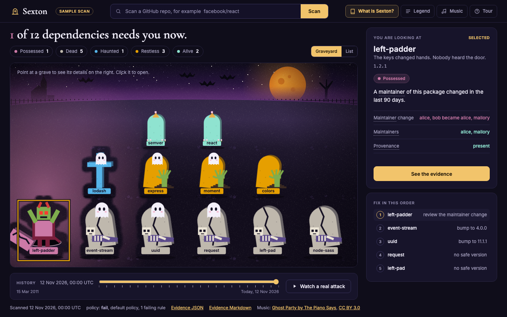
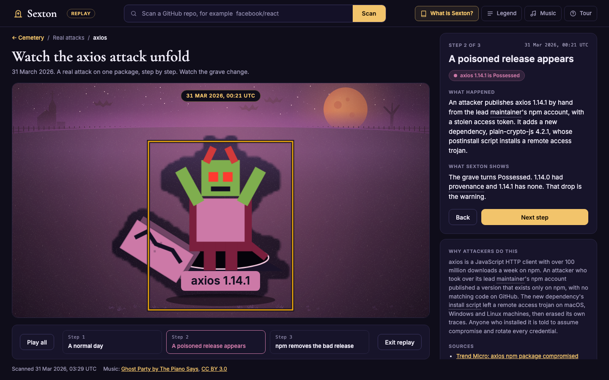

# Sexton

Sexton finds the dependencies that will hurt you, proves it, and opens the pull request that fixes it.



Characters are original vector art. The ghost is original art.

The site plays no generated sound. Music is off until you press the Music button; it then plays one recorded track, Ghost Party, in a loop, and the characters dance to its beat. Under reduced motion they hold still. The track's credit:

Ghost Party by The Piano Says | https://soundcloud.com/thepianosays

Royalty Free Music by https://www.free-stock-music.com

Creative Commons / Attribution 3.0 Unported License (CC BY 3.0)

https://creativecommons.org/licenses/by/3.0/deed.en_US

Status: pre-release. Release 0.1 is due on 4 December 2026. Each feature below says whether it is on `main` today, in progress, or planned.

The hosted site, https://de1giv8lj8sfh.cloudfront.net, is deployed by hand, so it can lag `main`. It was last deployed on 26 November 2026.

## Try it in two minutes

Open the hosted demo at [https://de1giv8lj8sfh.cloudfront.net](https://de1giv8lj8sfh.cloudfront.net). On your first visit a bar under the header offers a two-minute guide. "What is Sexton?" in the header opens it at any time, and Tour points out the three main parts of the page.

1. Hover a grave. Each grave is one dependency. Its shape and colour show its state. The cemetery puts the graves to fix first in front: Possessed, then Dead, Haunted and Restless, then by advisory severity and reach. The details panel shows the grave you point at, and "Fix in this order" lists the packages to fix first.
2. Open its drawer. Click the grave, or press Enter on it. "List" shows the same packages as a table you can search and sort.
3. Read the evidence and the fix. The drawer's Evidence tab shows every signal with its source and date. The fix tab shows the change Sexton proposes, when there is one, with the text of its pull request. History shows how the package's state changed over time.
4. Replay an attack. Press "Watch a real attack" under the cemetery and pick axios, or open [the axios replay](https://de1giv8lj8sfh.cloudfront.net/?replay=axios) directly. [The keyv replay](https://de1giv8lj8sfh.cloudfront.net/?replay=keyv) shows a second attack. Press "Next step" to follow it.

## The problem

Supply-chain attacks arrive through packages that looked fine in the lockfile. Think of event-stream in 2018, ua-parser-js in 2021, colors in 2022 and xz in 2024. In each case the warning signs were visible in public registry data before the damage. Sexton reads those signals for every direct dependency of a repository, keeps their history, enforces a policy on them and opens the fix.

## What Sexton does

- **Signals.** It scores up to 300 direct dependencies per scan on twelve signals. These twelve measure the seven product signals in the roadmap, from last publish date and known advisories to maintainer change, provenance, transitive reach, a change of publisher and a newly added dependency. Every signal carries its source URL and fetch time. On `main` today.
- **History.** It keeps a dated snapshot of each package's maintainers, install scripts and attestations. The npm packument lists each version's maintainers, publisher (`_npmUser`) and attestations, but it shows the maintainer list only as it is today and as it was at each publish, so a change between two releases leaves no trace there. A maintainer change or lost provenance is computed from the history, not from one read. The snapshot engine is on `main`, and the hosted site runs it every day.
- **Policy.** You commit a `sexton.policy.yml` with four rule types and package matchers. Sexton evaluates it and fails CI when a rule breaks. The policy engine, `sexton check` and the GitHub Action are on `main`.
- **Remediation pull requests.** For each dangerous package it proposes one fix: a version bump, a removal, or a migration such as node-sass to sass. The pull request carries its evidence. The plans are on `main` in the engine and the CLI. Hosted scans carry the plans too, without removals, and name the commit they read. Opening the pull request is on `main` and on the hosted site, for the demo repository `hsiddhu2/sexton-demo` only. Every other repository shows the plan and the pull request body, with no button. The hosted site needs no sign-in and never asks for a GitHub password. Sexton proposes a bump only to a version that passes its checks; otherwise it proposes no change.
- **Evidence pack.** It writes a CycloneDX 1.5 SBOM, every signal with its source, the policy results and the remediation plans and log as one JSON file, and a Markdown report rendered from it. A SHA-256 digest over the canonical JSON body lets a reviewer check it against a digest they got separately. The digest is not a signature. On `main` today: the engine, `GET /api/evidence?repo=<url>&format=json|md`, and the demo download links in the site footer. Each hosted download runs its own scan. The hosted site serves the evidence endpoint and the footer links.

## The five states

Each package gets exactly one state. The rules run in this order, and the first match wins.

| State | When |
|---|---|
| Possessed | A maintainer changed in the last 90 days, provenance regressed, a new install script appeared, a new dependency has an install script or was published within 7 days, or the publisher changed from a trusted publisher to a token |
| Dead | The installed version is deprecated, or the last publish was more than 24 months ago and it has an advisory |
| Haunted | It has a High or Critical advisory |
| Restless | The last publish was more than 24 months ago, or it has a Low or Moderate advisory. Also when last publish, deprecation and advisories are all unavailable and no Possessed rule matched |
| Alive | None of the above |

## Quick start

The CLI is on `main`. It is not published to npm yet, so run it from a clone (see "CLI" below).

```sh
sexton scan https://github.com/<owner>/<repo>   # score every direct dependency and write scan.json
sexton check                                    # evaluate sexton.policy.yml, exit non-zero on failure
sexton evidence                                 # write the evidence pack
```

Hosted demo: https://de1giv8lj8sfh.cloudfront.net

What runs today, from a clone of this repository, with Node.js 22:

```sh
npm ci                              # install the exact versions in the lockfile
npm test                            # run every package's tests, no network
npm run build -w @sexton/engine     # build the engine
npm run scan:self                   # score Sexton's own dependencies live and check its policy
```

The last command calls the npm registry, OSV and deps.dev, so it needs network. It exits non-zero when the policy fails.

## Install (coming with release 0.1)

Nothing is on npm yet. With release 0.1, two packages will be published to npm from GitHub Actions, each with npm provenance that links it to the commit and workflow that built it:

- `sexton`, the command line, with the `sexton` command;
- `sexton-mcp`, the MCP server, with the `sexton-mcp` command. It will also be listed in the official MCP Registry as `io.github.hsiddhu2/sexton`.

Each is one file with no dependencies, and runs on Node.js 20.19 or later. The install commands will go here once they work.

Until then, run the CLI from a clone (see "CLI" below), and use the MCP server through the Kiro Power (see "Ask Sexton from Kiro"). Building from a clone needs Node.js 22. The release plan is `.kiro/specs/release`.

## CLI

Not published to npm yet, run it from a clone with Node.js 22:

```sh
npm ci && npx tsc -b packages/cli
node packages/cli/dist/bin.js scan <repo-or-path> [--repo <url>] [--out <file>]
node packages/cli/dist/bin.js check [repo-or-path] [--repo <url>] [--summary <file>]
node packages/cli/dist/bin.js evidence [repo-or-path] [--repo <url>] [--out-dir <dir>]
node packages/cli/dist/bin.js evidence --verify <file>
```

- A target that is a GitHub repository URL is read from GitHub. Any other target is a local directory, default the current one. A local directory needs its repository name: `--repo`, or an `origin` remote on github.com.
- `scan` prints a table and writes `scan.json`. `check` prints every rule and exits non-zero when one fails. `evidence` writes `sexton-evidence.json` and `sexton-evidence.md` and prints the digest. `--verify` checks a pack.
- Exit codes: 0 success, 1 the policy failed or the pack did not verify, 2 anything else (a usage error, a missing or invalid file, an invalid policy).
- For a local directory Sexton also counts references to each dependency in the working tree, and proposes removing a package from `dependencies` only when it found none and read every file. A package loaded by a computed name at run time is not detected, and the pull request body says so.

## GitHub Action

`packages/action` is a composite action. It builds the CLI from its own checkout, runs `sexton check` on your checkout, writes the job summary and posts one summary comment on the pull request. It never installs or runs code from your repository.

```yaml
on:
  pull_request:          # never pull_request_target
permissions:
  contents: read
  pull-requests: write
jobs:
  sexton:
    runs-on: ubuntu-latest
    steps:
      - uses: actions/checkout@<commit SHA>   # pin to a full commit SHA
        with:
          persist-credentials: false
      - uses: hsiddhu2/sexton/packages/action@<PLACEHOLDER: commit SHA of a Sexton release>
```

Inputs: `path` (default `.`), `comment` (default `true`), `token` (default the workflow token). On a pull request from a fork the token is read-only, so the comment is skipped with a warning and the check still decides the job. The comment is updated only when `github-actions[bot]` wrote it; with a personal token each run adds a new comment.

## Ask Sexton from Kiro
`powers/sexton` is a Kiro Power. It gives Kiro four read-only tools that answer from the same scan the CLI runs: `scan_project` (every direct dependency with its state and reason), `explain_package` (one package with every signal, its source URL and fetch time), `fix_order` (what to fix first, with the proposed plan) and `check_policy` (what `sexton check` reports, as data).

Install it in under two minutes, with no clone and no build:
1. In Kiro, open the Powers panel, choose Add Custom Power, then Import power from a repository URL, and paste `https://github.com/hsiddhu2/sexton/tree/main/powers/sexton`. The folder is also installable with Import power from a folder.
2. Open a project that has a `package.json` and ask in chat: "Which of my npm dependencies should I fix first, and why?" Kiro approves each tool call with you and passes the workspace root as `projectDir`.

The server runs on the Node that Kiro starts it with (Node 20 or later), reads `package.json`, `package-lock.json`, `sexton.policy.yml` and source files to count imports, and asks `registry.npmjs.org`, `api.osv.dev` and `api.deps.dev`. It writes nothing, installs nothing, runs no code from the project and returns no file contents. Every string in an answer came from a registry or the project, so each answer starts with a line that says to treat it as data.

Residual risk. Kiro does not tell a Power's server which folder is the workspace, so every tool takes a `projectDir`. The server accepts any real directory that holds a `package.json`, not only the workspace. If a model, or text that steers it, passes another directory and you approve the call, Sexton scans that directory and sends its dependency names and versions to the three public services above, and the model learns what that project depends on. The Power sets no auto-approve, so Kiro shows the `projectDir` before a call runs. Trust the tools for all calls only if you accept this.

A recorded session, with the tool calls Kiro made and its answer, is in [`build/reviews/sexton-power-proof.md`](build/reviews/sexton-power-proof.md). The spec is `.kiro/specs/sexton-power`.
## Sexton scans itself

Sexton runs its own policy against its own dependencies with `npm run scan:self`. The `self-scan` job in `.github/workflows/ci.yml` runs it on every push and pull request. The first time we ran it, it failed.

It rated eslint 9.17.0 Dead, as that version is deprecated on npm. It rated vitest 2.1.8 Haunted, with two Critical advisories (GHSA-9crc-q9x8-hgqq and GHSA-5xrq-8626-4rwp) and one Moderate (GHSA-82fw-gwwq-j7x9). We moved to eslint 10.15.0, @eslint/js 10.0.1, typescript-eslint 8.72.2 and vitest 4.1.12. On the second scan all seven packages were Alive and all three rules passed. The scan on 20 November 2026 showed all eight root packages Alive and all three rules passing. Since 25 November 2026 the policy also forbids Haunted. That day the scan covered 32 packages across the root and every workspace, all Alive, with all three rules passing.

## How Sexton is different

Other tools cover parts of what Sexton does. Each line below was checked on the tool's own README or documentation on 25 November 2026.

- **[Dependabot](https://docs.github.com/en/code-security/dependabot)** opens pull requests when a dependency has a known advisory or a newer version. Sexton also flags packages before any advisory exists, from maintainer change, lost provenance, new install scripts, a change of publisher and a new dependency.
- **[Renovate](https://docs.renovatebot.com)** opens pull requests that keep versions current, and its replacement rules swap one package name for another. Sexton's node-sass to sass recipe also changes the code that uses the package.
- **[OSV-Scanner](https://google.github.io/osv-scanner/)** finds known vulnerabilities, and its fix command edits the manifest and lockfile locally. Sexton opens one pull request per fix, carrying its evidence.
- **[Socket's CLI](https://github.com/SocketDev/socket-cli)** scans dependencies and gates installs, and its scans go through the Socket API with an account token. Sexton scores against public sources only, and its engine needs no Sexton service.
- **[npq](https://github.com/lirantal/npq)** audits one package before you install it. Its checks include the publisher (`_npmUser`), a new maintainer, install scripts and provenance regression, so its signals overlap Sexton's most. Sexton scores every direct dependency of a repository, keeps dated snapshots, enforces a committed policy in CI, opens the fix and writes an evidence pack.

## Sexton and Dependabot

Sexton and Dependabot do different jobs. They run side by side, not as rivals.

[Dependabot](https://docs.github.com/en/code-security/dependabot/ecosystems-supported-by-dependabot/supported-ecosystems-and-repositories) gives you alerts, security updates and version updates. It has alerted on [malware in npm packages since 17 March 2026](https://github.blog/changelog/2026-03-17-dependabot-now-detects-malware-in-npm-dependencies/). Since 28 July 2026 it also [alerts on malicious packages in more ecosystems](https://github.blog/changelog/2026-07-28-dependabot-alerts-on-malicious-packages-across-more-ecosystems), using OpenSSF data.

So Dependabot tells you that a package is known to be bad. Sexton tells you which packages are likely to go bad, and why. It shows the signal, where it came from and when it was read. It then proposes the pull request that fixes the package.

Keep Dependabot on and run Sexton beside it.

## Replay

The cemetery has a history scrubber under it. It shows each package as it stood on an earlier date. Two replays tell real incidents step by step. Open the hosted page with [?replay=axios](https://de1giv8lj8sfh.cloudfront.net/?replay=axios) or [?replay=keyv](https://de1giv8lj8sfh.cloudfront.net/?replay=keyv). You can also press "Watch a real attack" under the cemetery and pick axios or keyv.

A replay opens at Step 1, before the attack, so the grave starts Alive. Each step says what happened and what Sexton shows. Press "Next step" to move on, or "Play all" to move one step every five seconds.



A replay is reconstructed from public reports. It is not a live scan.

## Roadmap

Releases are sequenced, not promised by date. Release 0.1 lists each item's state today.

### 0.1

- npm, direct dependencies, public GitHub repositories. Repository intake is on `main`.
- Seven signals: abandonment, advisories, install scripts, maintainer change, provenance regression, publisher change, new dependency. On `main`.
- Daily snapshotter for maintainers and attestations. On `main`, and on the hosted site as a daily schedule at 03:17 UTC since 21 November 2026.
- Policy file with four rule types and packageRules matchers. On `main`.
- Remediation pull requests: bump, remove, and one migration (node-sass to sass). On `main`
- Evidence pack: CycloneDX JSON SBOM, policy results, remediation log, hash. On `main`, in the engine, the API and the CLI
- Cemetery UI, with the history scrubber and two replays. On `main`
- CLI with scan, check and evidence. On `main`, not published to npm yet
- GitHub Action. On `main`
- Scheduled re-scan agent that judges changes against the policy, planned

### 0.2

- Transitive package scoring
- Typosquat distance and license drift signals
- Private repositories through a GitHub App
- Two more migration recipes
- Workspace scanning in the CLI
- CLI published to npm

### 0.3

- PyPI
- SPDX export
- Download trend and bus factor signals
- Policy inheritance and organisation defaults

### 1.0

- Maven, Go, Cargo
- Team accounts and audit retention
- Signed evidence packs
- Evidence pack export for SOC 2, DORA and CRA reporting

## Kiro project files

Specs, each with its requirements (or bugfix), design and tasks, in `.kiro/specs/`:

- `health-scoring`: the pure scoring core, signals and the state function.
- `history-signals`: maintainers, provenance, transitive reach and the snapshot history.
- `policy`: `sexton.policy.yml`, its schema and the four rule types.
- `repo-intake`: a GitHub repository URL to direct dependencies with installed versions.
- `remediation`: one plan per unhealthy package, PR intents, PR bodies and the log contract.
- `migration-node-sass`: the node-sass to sass recipe.
- `evidence-pack`: the evidence pack, its CycloneDX SBOM and its digest.
- `cli-and-action`: the `sexton` CLI and the GitHub Action.
- `infra`: the CDK app, the hosted scan API and the snapshotter on AWS.
- `hosted-plans`: remediation plans on `GET /api/scan`.
- `remediate`: `POST /api/remediate`, which opens the pull request.
- `sexton-power`: the read-only MCP server `packages/mcp` and the Kiro Power `powers/sexton`.
- `engine-version`: bugfix, the engine version when bundled into Lambda.
- `state-age-rule`: bugfix, age alone gives Restless and Dead needs an advisory or deprecation.
- `new-signals`: the publisherChange and newDependency signals and their two Possessed rules.
- `cemetery-ui`, `cemetery-theme`, `cemetery-polish`, `cemetery-time`, `cemetery-time-fixes`, `cemetery-undead`: the web cemetery, its history scrubber and replays, and the night art.
- `cemetery-undead-2`: sound, speech bubbles, the replay burst and the burial priest.
- `cemetery-undead-fixes`: bugfix, defects in the web app and CI found after cemetery-undead-2.
- `clean-site`: the site rebuilt around the cemetery: the header, Home with its panel and list, the drawer's tabs, the replay story, the guide, the tour, failure cards and a music slot. It removed sound, speech bubbles and the tooltip.

Steering in `.kiro/steering/`:

- `product.md`, `tech.md`, `structure.md`: always included; what Sexton is, how it is built, where things go.
- `engine.md`, `web.md`, `api-etiquette.md`, `pr-safety.md`, `security-rules.md`: included when matching files are open; engine, cemetery, upstream, pull request and security rules.
- `ears-authoring.md`: included on demand when writing acceptance criteria.

Hooks in `.kiro/hooks/`:

- `quality.json`: typecheck before a spec task, engine tests on save, property tests after a task.
- `security.json`: blocks agent writes to secrets, private files and the MCP config (`scripts/deny-secret-writes.mjs`).
- `supply-chain.json`: before an npm install, runs `sexton check` on the repository and blocks the install when the policy fails (`scripts/install-gate.mjs`).

Agents in `.kiro/agents/`:

- `impl.md`: the implementer for spec tasks; it runs tests, typecheck, lint and read-only commands without asking, and asks before anything else.
- `security-reviewer.md`: read-only reviewer against the spec and the security steering.
- `gravedigger.md`: read-only reviewer that checks a remediation plan can never make a repository worse.

## Limits

- Sexton sees what the npm registry, OSV, deps.dev and GitHub publish. It does not run or read the code inside a package. A compromise that leaves no trace in that data is not seen.
- It scores direct dependencies only. Transitive packages count toward reach but get no state of their own.
- It reads npm packages only. It reads a GitHub repository only when it is public. Sexton reads a repository's package.json and package-lock.json at its root. The CLI can also scan a local directory.
- The demo scan and the two replays are recorded data, not a live scan. The replays are reconstructed from public reports.
- The demo leaves out per-version maintainer lists. The registry's lists for semver 7.8.5 and 7.8.6 differ by one name. Recording them would make the history scrubber show semver Possessed while the scan says Alive. Until that rule is settled, the recorded data leaves both sides out.
- The new-dependency rule has no measurement on a real repository yet. In the Express scan of 25 November 2026 no package had added a dependency.
- On the hosted site, a request that the firewall blocks, or an address that is not found, shows the general failure card, not its own card.

## Documentation

- `docs/requirements.md`: the product requirements
- `docs/architecture.md`: how Sexton runs on AWS
- `docs/threat-model.md`: what can go wrong and what stops it
- `docs/well-architected.md`: the deployment against the six pillars
- `docs/adr/`: architecture decision records
- `docs/JUDGES.md`: a one-page guide for judges

## Pre-existing code

The first commit, 8bfc8cb, was made on 7 November 2026, after the hackathon started on 30 October 2026. Sexton's code was written for it from that date on.

These files were not written for Sexton:

- The CycloneDX 1.5, JSF 0.82 and SPDX JSON schemas in `packages/engine/test/fixtures/cyclonedx`, from the [CycloneDX specification](https://github.com/CycloneDX/specification), Apache-2.0. Tests validate the SBOM against them.
- The two font families in `packages/web/public/fonts`, Inter and Cormorant Garamond, SIL Open Font License 1.1. See CREDITS.md.
- The recorded registry responses under `packages/engine/test/fixtures`: public data from the npm registry, OSV, deps.dev and GitHub, trimmed to the fields the engine reads.

Open-source packages are used as dependencies at the exact versions in `package-lock.json`, each under its own licence. Runtime dependencies are permissively licensed (docs/requirements.md N-7, docs/adr/0001).

## Licence

Apache-2.0. See LICENSE and NOTICE.
