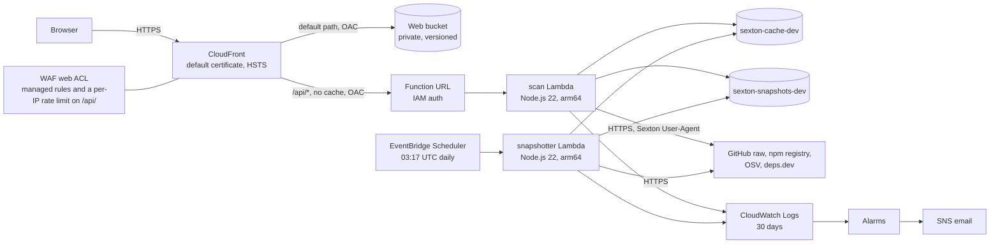

# Sexton architecture on AWS

Sexton runs as a small serverless app in one region, us-east-1. One CloudFront distribution serves the cemetery web app and the scan API from the same domain. Two Lambda functions do the work. Two DynamoDB tables hold the response cache and the snapshot history.

This page covers release 0.1. The stacks are built and tested. The handler code for the two functions comes next, and until it lands each function answers 503. It follows the infra spec in `.kiro/specs/infra/design.md`, which also lists the AWS documentation page behind every fact used here.

## The picture

There are two CloudFormation stacks. `SextonData-dev` holds the two tables and an empty Secrets Manager secret for a later spec. `SextonEdge-dev` holds everything else. Edge reads table names from Data, and Data reads nothing from Edge. So we can rebuild the edge without touching stored history.

## The request path

Here is what will happen when you paste a repository URL into the cemetery. Steps 1 to 4 are built. Steps 5 to 7 are planned and arrive with the handler code.

1. The browser sends `GET /api/scan?repo=<url>` to the CloudFront domain. The web app and the API share that domain, so there is no CORS.
2. WAF checks the request. The AWS managed rule groups block known bad input. A rate rule blocks one IP after 100 requests to `/api/` in 5 minutes, with HTTP 429.
3. CloudFront forwards only the `repo` query parameter. It sends no cookies and no viewer headers. It signs the request with origin access control (OAC).
4. The function URL uses IAM auth. It accepts the signed request from this distribution and rejects anything else with 403.
5. The scan function checks the method, the path and the `repo` value before it does anything else. A bad request gets 400 and costs no upstream call.
6. The engine reads `package.json` and `package-lock.json`, scores each direct dependency and evaluates the policy. Every upstream response goes through the DynamoDB cache for 24 hours.
7. The function returns a `ScanResponse` with `Cache-Control: public, max-age=300` and an `x-sexton-request-id` header.

Why no API Gateway? A cold scan of 50 dependencies may take up to 60 seconds. An HTTP API stops waiting at 30 seconds. CloudFront can wait 60 seconds for a function URL with no quota increase. We also set CloudFront to try the API origin only once. A retry on a slow scan would start a second full scan.

The daily path is shorter. The schedule is built, and the handler steps are planned. EventBridge Scheduler invokes the snapshotter at 03:17 UTC. It lists every package seen in the last 90 days and appends one snapshot per package. It works in chunks of 25 names and stops 90 seconds before its 10-minute timeout. Any names it did not reach are counted, and that count raises an alarm.

## The data model

The cache table has one item per upstream response.

| Attribute | Type | What it holds |
|---|---|---|
| `pk` | String | the engine cache key, such as `npm-packument\|express\|*` |
| `v` | Binary | the response as gzip of JSON, at most 350 KB |
| `storedAt` | Number | when it was stored, in epoch milliseconds |
| `expiresAt` | Number | `storedAt` in seconds plus one day, used by DynamoDB TTL |

The engine decides freshness from `storedAt`. DynamoDB TTL only cleans up old items, and it can take a few days to do that.

The snapshots table holds two kinds of item.

| Item | `pk` | `sk` | Other attributes |
|---|---|---|---|
| Snapshot | `snap#{package}` | capture time as a 15-digit number, `#`, a random sequence | `data`, the snapshot as JSON |
| Seen record | `seen#{package}` | seen time as a 15-digit number, `#`, a random sequence | `gpk = seen`, `seenAt` as a Number, `name` |

The index `seen-by-time` uses `gpk` and `seenAt`. Only Seen records carry `gpk`, so the snapshotter lists names from a small index with one query. Times are numbers, so no code compares date strings. The table has no TTL, point-in-time recovery is on, and deletion protection is on.

## Who can do what

Each function has its own role with inline statements only. No managed policy is attached to either role.

| Principal | Actions | Resource | Condition |
|---|---|---|---|
| scan role | `GetItem`, `PutItem` | cache table | none |
| scan role | `Query` | snapshots table | partition key starts with `snap#` |
| scan role | `PutItem` | snapshots table | partition key starts with `seen#` |
| scan role | `CreateLogStream`, `PutLogEvents` | its own log group | none |
| snapshotter role | `GetItem`, `PutItem` | cache table | none |
| snapshotter role | `PutItem`, `Query` | snapshots table | none |
| snapshotter role | `Query` | the `seen-by-time` index | none |
| snapshotter role | `CreateLogStream`, `PutLogEvents` | its own log group | none |
| scheduler role | `lambda:InvokeFunction` | the snapshotter function | none |
| CloudFront | `lambda:InvokeFunctionUrl`, `lambda:InvokeFunction` | the scan function | this distribution only |
| CloudFront | `s3:GetObject` | the web bucket | this distribution only |
| CDK deploy handler, owned by CDK | read the CDK asset bucket, write the web bucket, `cloudfront:CreateInvalidation` | the two buckets, and `*` for invalidation | none |

The CDK deploy handler copies the web build into the bucket. CDK grants its invalidation on `*`, and that is the one wildcard we allow. No role can update, delete or batch-write anything in the snapshots table. The scan role cannot write a snapshot at all. `infra/test/iam.test.ts` checks this on every synthesised template. The threat model explains why IAM alone is not the whole proof.

## What it costs

These are estimates from public prices, not a bill. Nothing has been deployed yet.

At zero traffic the demo costs about 8.40 USD a month. Almost all of that is WAF: 5 USD for the web ACL and 1 USD for each of its three rules. The Secrets Manager placeholder adds 0.40 USD.

At 1000 scans a day it comes to about 15.80 USD a month. That assumes 50 dependencies per scan, 3000 different packages a day and cache items of about 6 KB after gzip.

| Item | USD a month |
|---|---|
| WAF fixed | 8.00 |
| WAF requests | 0.05 |
| DynamoDB cache writes | 2.03 |
| DynamoDB cache reads | 0.56 |
| DynamoDB Seen writes, table and index | 1.88 |
| DynamoDB history queries | 0.09 |
| DynamoDB snapshots | 0.75 |
| Lambda scan | 0.83 |
| Lambda snapshotter | 0.30 |
| CloudWatch Logs | 0.90 |
| Secrets Manager | 0.40 |
| CloudFront, S3, SNS, alarms | 0.00, inside the free tier |
| Total | about 15.80 |

The target in the product requirements is under 20 USD a month. The design file shows the working for each line.
