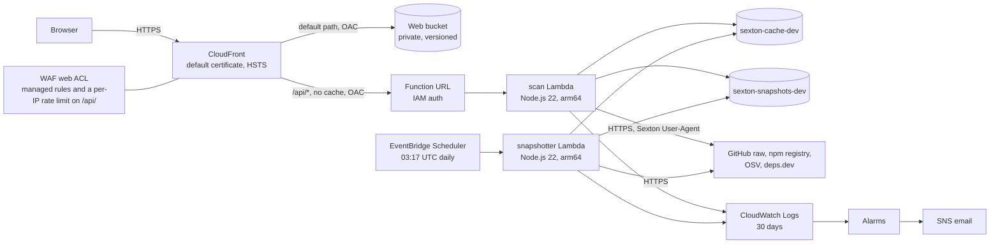

# Sexton architecture on AWS

Sexton runs as a small serverless app in one region, us-east-1. One CloudFront distribution serves the cemetery web app and the scan API from the same domain. Two Lambda functions do the work. Two DynamoDB tables hold the response cache and the snapshot history.

This page covers release 0.1. The stacks are built and tested. The handler code for the two functions comes next, and until it lands each function answers 503. It follows the infra spec in `.kiro/specs/infra/design.md`, which also lists the AWS documentation page behind every fact used here.

## The picture

There are two CloudFormation stacks. `SextonData-dev` holds the two tables and an empty Secrets Manager secret for a later spec. `SextonEdge-dev` holds everything else. Edge reads table names from Data, and Data reads nothing from Edge. So we can rebuild the edge without touching stored history.

## The request path

Here is what happens when you paste a repository URL into the cemetery. Every step is built. None is deployed yet.

1. The browser sends `GET /api/scan?repo=<url>` to the CloudFront domain. The web app and the API share that domain, so there is no CORS.
2. WAF checks the request. The AWS managed rule groups block known bad input. A rate rule blocks one IP after 100 requests to `/api/` in 5 minutes, with HTTP 429.
3. CloudFront forwards only the `repo` and `format` query parameters. It sends no cookies and no viewer headers. It signs the request with origin access control (OAC).
4. The function URL uses IAM auth. It accepts the signed request from this distribution and rejects anything else with 403.
5. The scan function checks the method, the path and the `repo` value before it does anything else. A bad request gets 400 and costs no upstream call.
6. The function reads the GitHub token from Secrets Manager, at most once every 15 minutes per container. With a token it asks api.github.com for the head commit of the default branch. Without a token, or when that read fails, it reads at `HEAD` and records no commit.
7. The engine reads `package.json`, `package-lock.json` and `sexton.policy.yml` at that commit, scores each direct dependency and evaluates the policy. Every upstream response goes through the DynamoDB cache for 24 hours.
8. The engine plans one remediation per Haunted, Dead or Possessed package: a bump for at most the first 25 bump targets, or a migration. A migration recipe that needs repository files gets a GitHub file source: the tree of the commit from api.github.com, then each file from raw.githubusercontent.com at the commit, without the token, for at most 15 seconds of reads. The hosted scan never proposes remove, because it cannot see the whole tree cheaply and a wrong removal costs more than a missing one. A failure in planning never fails the scan.
9. The function returns a `ScanResponse` with `remediations` and `Cache-Control: public, max-age=300` and an `x-sexton-request-id` header.

Why no API Gateway? A cold scan of 50 dependencies may take up to 60 seconds. An HTTP API stops waiting at 30 seconds. CloudFront can wait 60 seconds for a function URL with no quota increase. We also set CloudFront to try the API origin only once. A retry on a slow scan would start a second full scan.

The daily path is shorter, and it is built too. EventBridge Scheduler invokes the snapshotter at 03:17 UTC. It lists every package seen in the last 90 days and appends one snapshot per package. It works in chunks of 25 names and stops 90 seconds before its 10-minute timeout. Any names it did not reach are counted, and that count raises an alarm.

## The evidence pack

`GET /api/evidence?repo=<url>&format=json|md` runs on the same scan function, with the same role, WAF rule, cache and limits. There is no new function, table or permission. It runs the scan, then builds the pack in the engine:

1. Intake also returns the `package.json` and `package-lock.json` texts it read. The API hashes them, and the policy file text when there is one, with SHA-256.
2. The engine builds the body: scan metadata, a CycloneDX 1.5 SBOM of the direct dependencies, every package with its ten signals and their sources, the policy result, and the remediation plans and log. The pack records the commit the scan read at, or says it was not recorded when the scan read `HEAD`, and carries the scan's plans. The remediation log arrives with the remediate endpoint.
3. The engine takes the RFC 8785 canonical form of the body and puts its SHA-256 in `integrity.digest`.
4. The function returns the JSON file, or the Markdown report rendered from it, as a download. The digest also goes in the `x-sexton-evidence-digest` header. A body over 5 MiB gets 422 `evidence-too-large`.

Every download runs its own scan, so the pack can differ from the scan on screen, and each download counts against the rate rule. The demo writes `evidence.json` and `evidence.md` next to `scan.json` at build time, and the header links to them.

The `format` parameter reaches the function only after the next deploy of the edge stack. Until then CloudFront drops it, and the Markdown link returns JSON.

## Opening a pull request

`POST /api/remediate` runs on its own function, `RemediateFunction`, with its own role, log group and function URL behind origin access control. CloudFront routes `/api/remediate` before `/api/*`, with caching off, and its origin request policy forwards only `content-type`. A POST through origin access control needs the SHA-256 of the body in the `x-amz-content-sha256` header on the request to CloudFront, which signs with it; the web app computes it. CloudFront does not allow that header in an origin request policy.

1. The body is `{"repo": <canonical URL>, "package": <name>}` and nothing else, at most 2 KiB. Anything else gets 400.
2. Only a repository on the allowlist goes further. The allowlist is a constant in `infra/lib/config.ts`, today exactly `hsiddhu2/sexton-demo`. Every other repository gets 422 before any scan or GitHub request. (403 would be rewritten to the web page by the distribution's error mapping.)
3. The function reads the token and runs the hosted scan again, with the head commit. It takes the plan for the package from its own scan. The client never sends a branch, a title, a body or an edit.
4. The executor talks to api.github.com through eight fixed requests: read the repository, list `sexton/` branches, list pull requests for one branch, read package.json at the commit, create the branch at the commit, put package.json on it, open the pull request against the default branch, and comment on it. It never deletes and never touches the default branch.
5. If a branch for the package already exists, it answers with the open pull request, or refuses until someone deletes the branch. So each package gets at most one open pull request.
6. A migration's review sites are not in the pull request's diff, so they go in one comment with links to each line at the scanned commit.
7. Each new pull request is appended to the `sexton-remediation-log-dev` table: repository, branch, pull request URL, package, kind and time. The hosted evidence pack reads that table, so its log is available.

WAF allows 10 requests to `/api/remediate` per IP every 5 minutes, and the function's reserved concurrency is 2. The drawer shows "Open pull request" only for a hosted scan whose response says `actions.remediate` is true.

## The CLI and the Action

The CLI (`packages/cli`) runs the same engine as the API on the user's machine. It never calls the Sexton API.

1. A GitHub URL target is read through raw.githubusercontent.com exactly as the hosted scan does. Any other target is a local directory: the CLI reads `package.json`, `package-lock.json` and `sexton.policy.yml` from its root, with the hosted size limits, and names the repository from `--repo` or the `origin` remote.
2. Scoring, policy, bump data, the node-sass migration and planning run as in the demo generator, with an in-memory cache and no snapshot history.
3. For a local directory the CLI lists the working tree (`git ls-files`, or a directory walk), reads at most 5000 files and counts references to each dependency. A dependency with no reference is proposed for removal only when the listing ran in full.
4. `scan` writes `scan.json`, `check` exits 1 on a policy failure, `evidence` writes the pack with the local `HEAD` as the commit.

The Action (`packages/action`) is a composite action. It builds the engine and the CLI from its own checkout with `npm ci --ignore-scripts`, runs `sexton check` on the caller's workspace, appends the summary to the job summary and posts or updates one comment through three GitHub REST calls: list, create and update issue comments. This repository runs it on its own pull requests (`.github/workflows/sexton.yml`).

## The data model

The cache table has one item per upstream response.

| Attribute | Type | What it holds |
|---|---|---|
| `pk` | String | the engine cache key, such as `npm-packument\|express\|*` |
| `v` | Binary | the response as gzip of JSON, at most 350 KB |
| `storedAt` | Number | when it was stored, in epoch milliseconds |
| `expiresAt` | Number | `storedAt` in seconds plus one day, used by DynamoDB TTL |

The engine decides freshness from `storedAt`. DynamoDB TTL only cleans up old items, and it can take a few days to do that.

The snapshots table holds two kinds of item.

| Item | `pk` | `sk` | Other attributes |
|---|---|---|---|
| Snapshot | `snap#{package}` | capture time as a 15-digit number, `#`, a random sequence | `data`, the snapshot as JSON |
| Seen record | `seen#{package}` | seen time as a 15-digit number, `#`, a random sequence | `gpk = seen`, `seenAt` as a Number, `name` |

The index `seen-by-time` uses `gpk` and `seenAt`. Only Seen records carry `gpk`, so the snapshotter lists names from a small index with one query. Times are numbers, so no code compares date strings. The table has no TTL, point-in-time recovery is on, and deletion protection is on.

## Who can do what

Each function has its own role with inline statements only. No managed policy is attached to either role.

| Principal | Actions | Resource | Condition |
|---|---|---|---|
| scan role | `GetItem`, `PutItem` | cache table | none |
| scan role | `Query` | snapshots table | partition key starts with `snap#` |
| scan role | `PutItem` | snapshots table | partition key starts with `seen#` |
| scan role | `CreateLogStream`, `PutLogEvents` | its own log group | none |
| scan role | `secretsmanager:GetSecretValue` | the GitHub token secret, by its exact ARN | none |
| scan role | `Query` | remediation log table | none |
| remediate role | `GetItem`, `PutItem` | cache table | none |
| remediate role | `Query` | snapshots table | partition key starts with `snap#` |
| remediate role | `PutItem` | snapshots table | partition key starts with `seen#` |
| remediate role | `PutItem` | remediation log table | none |
| remediate role | `secretsmanager:GetSecretValue` | the GitHub token secret, by its exact ARN | none |
| remediate role | `CreateLogStream`, `PutLogEvents` | its own log group | none |
| snapshotter role | `GetItem`, `PutItem` | cache table | none |
| snapshotter role | `PutItem`, `Query` | snapshots table | none |
| snapshotter role | `Query` | the `seen-by-time` index | none |
| snapshotter role | `CreateLogStream`, `PutLogEvents` | its own log group | none |
| scheduler role | `lambda:InvokeFunction` | the snapshotter function | none |
| CloudFront | `lambda:InvokeFunctionUrl`, `lambda:InvokeFunction` | the scan function | this distribution only |
| CloudFront | `s3:GetObject` | the web bucket | this distribution only |
| CDK deploy handler, owned by CDK | read the CDK asset bucket, write the web bucket, `cloudfront:CreateInvalidation` | the two buckets, and `*` for invalidation | none |

The CDK deploy handler copies the web build into the bucket. CDK grants its invalidation on `*`, and that is the one wildcard we allow. No role can update, delete or batch-write anything in the snapshots table. The scan role cannot write a snapshot at all. `infra/test/iam.test.ts` checks this on every synthesised template. The threat model explains why IAM alone is not the whole proof.

## What it costs

These are estimates from public prices, not a bill. Nothing has been deployed yet.

At zero traffic the demo costs about 8.40 USD a month. Almost all of that is WAF: 5 USD for the web ACL and 1 USD for each of its three rules. The Secrets Manager placeholder adds 0.40 USD.

At 1000 scans a day it comes to about 15.80 USD a month. That assumes 50 dependencies per scan, 3000 different packages a day and cache items of about 6 KB after gzip.

| Item | USD a month |
|---|---|
| WAF fixed | 8.00 |
| WAF requests | 0.05 |
| DynamoDB cache writes | 2.03 |
| DynamoDB cache reads | 0.56 |
| DynamoDB Seen writes, table and index | 1.88 |
| DynamoDB history queries | 0.09 |
| DynamoDB snapshots | 0.75 |
| Lambda scan | 0.83 |
| Lambda snapshotter | 0.30 |
| CloudWatch Logs | 0.90 |
| Secrets Manager | 0.40 |
| CloudFront, S3, SNS, alarms | 0.00, inside the free tier |
| Total | about 15.80 |

The target in the product requirements is under 20 USD a month. The design file shows the working for each line.
